My first resin print was a simple name plate: raised letters on a flat block. I designed it in Tinkercad, sliced it in CHITUBOX, and printed it on an ELEGOO Mars 3 Pro.

:::brain-power Before you read on
A resin printer does not squeeze out plastic like a glue gun. It shines ultraviolet light up through a screen, through the bottom of a tank of liquid resin, and hardens a whole layer at once. If that is how it works, why might the part come out of the printer upside down, hanging from the build plate?
:::

## Tinkercad

I created a 3D .STL file using Tinkercad.

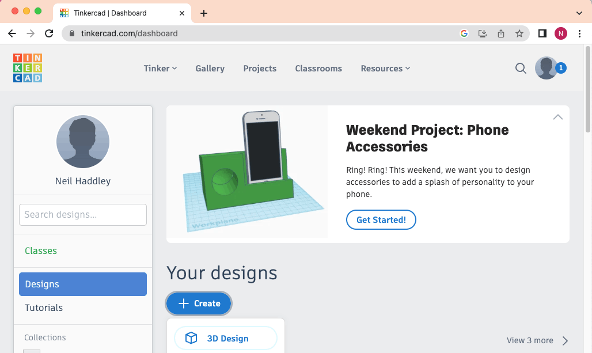
*I created a 3D design in Tinkercad*

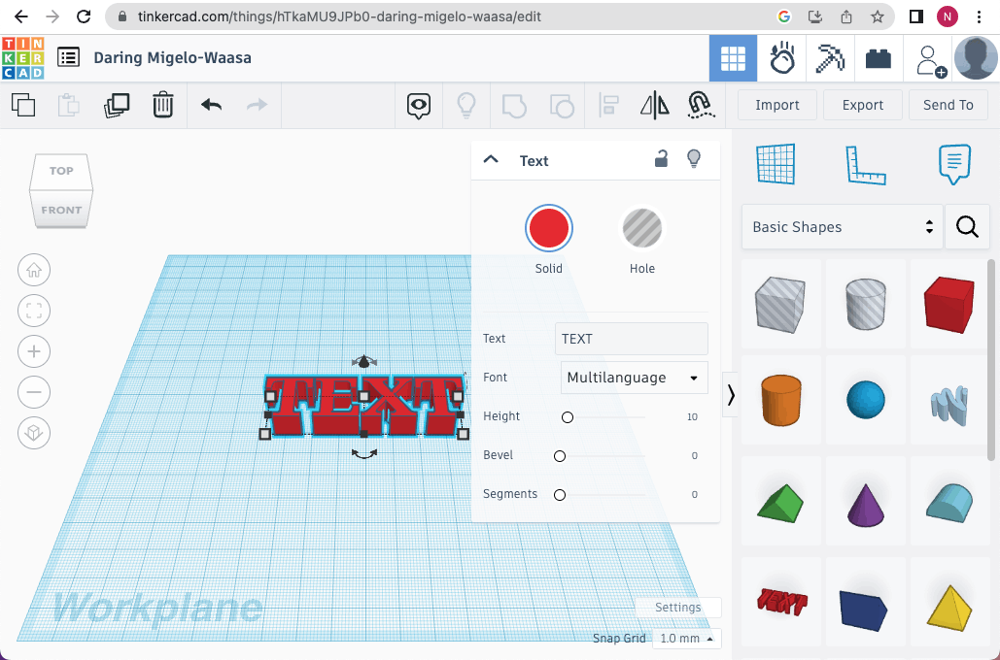
*I added text*

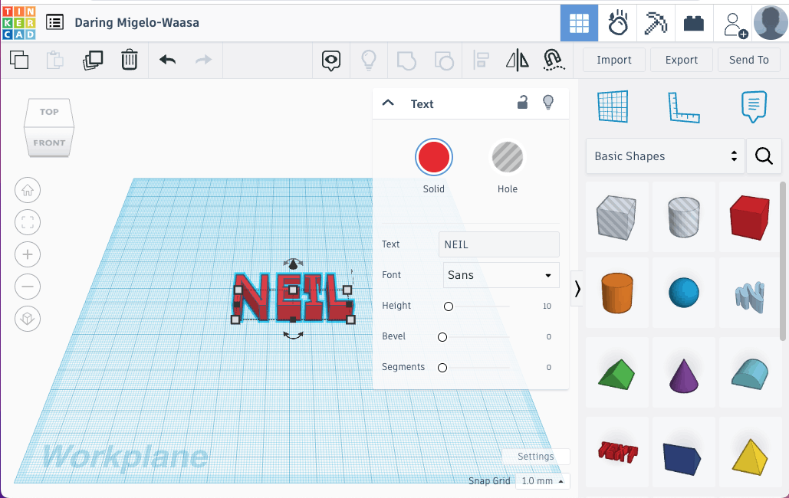
*I updated the font. Notice that the Height was set to 10.*

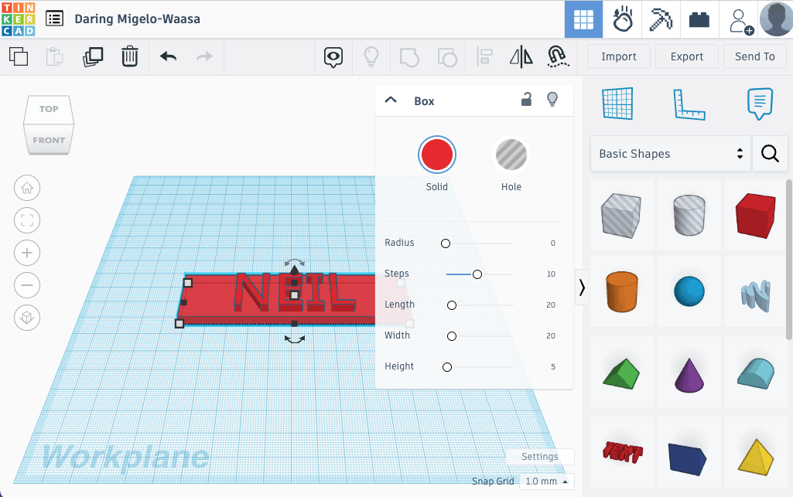
*I added a block with a height of 5.*

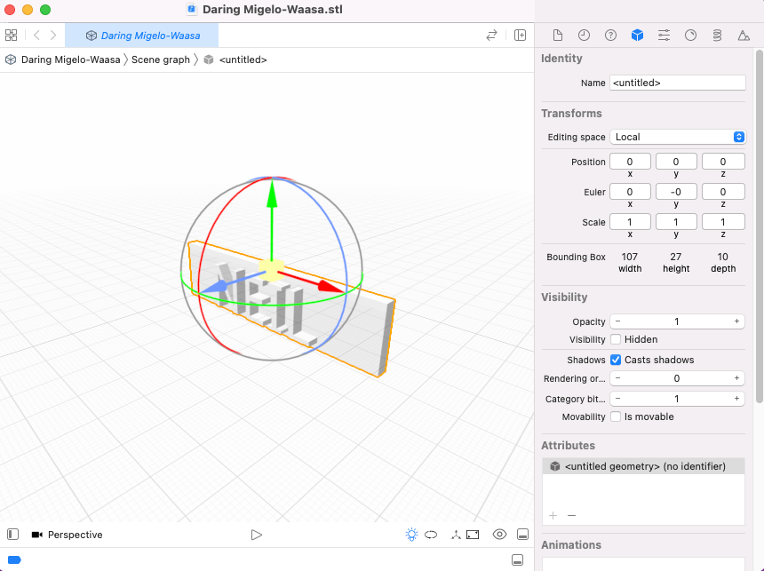
*I exported the design as .STL file*

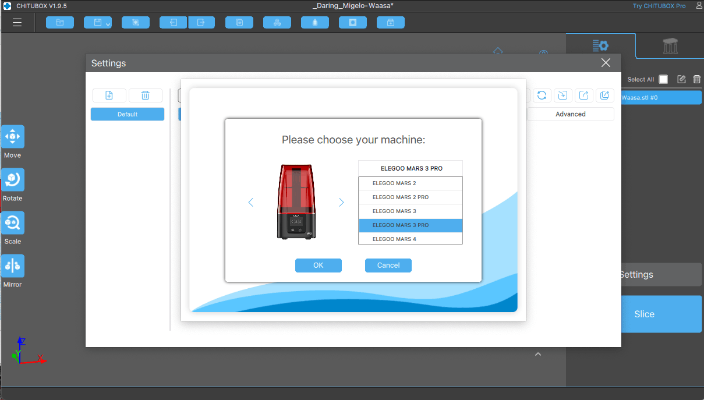
*I downloaded CHITUBOX and added support for the "ELEGOO MARS 3 PRO"*

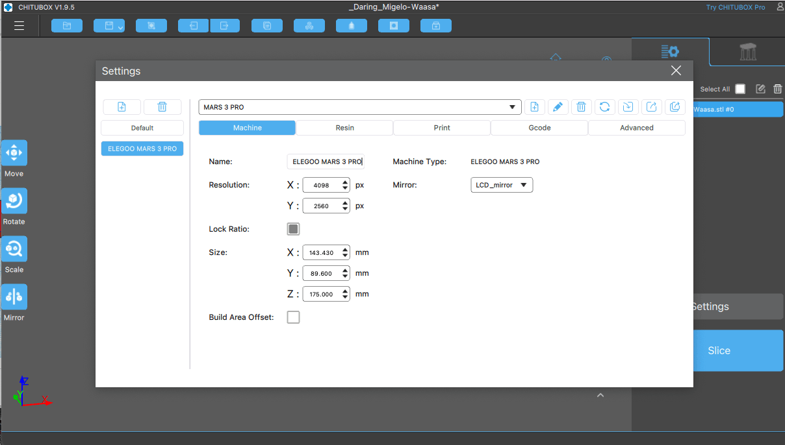
*I reviewed the settings for the Mars 3 Pro*

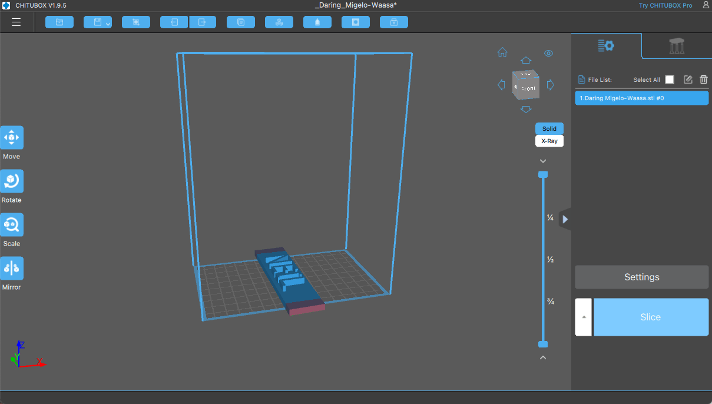
*I imported the .STL file*

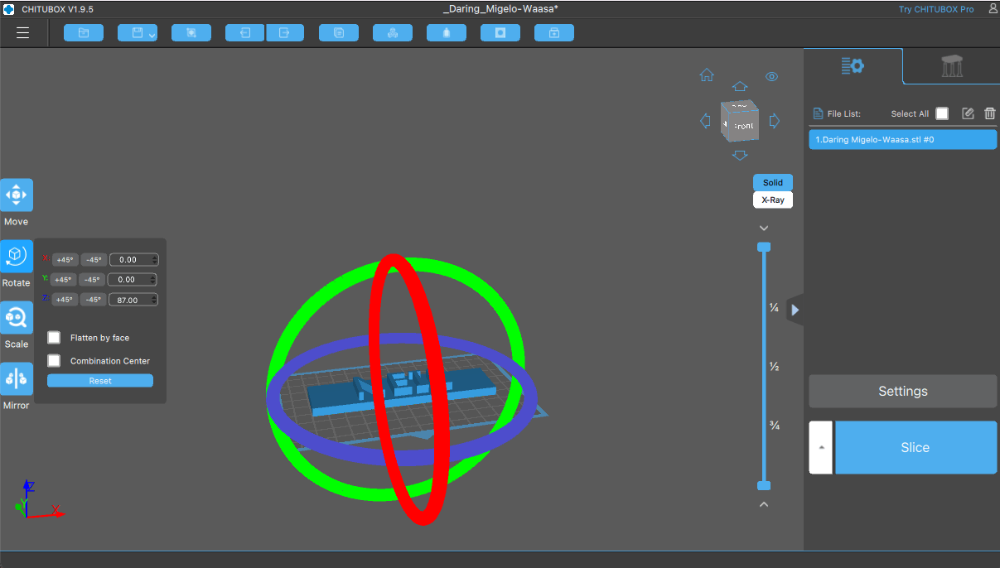
*I rotated the design.*

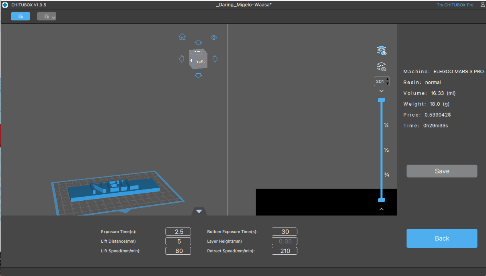
*I clicked "Slice"*

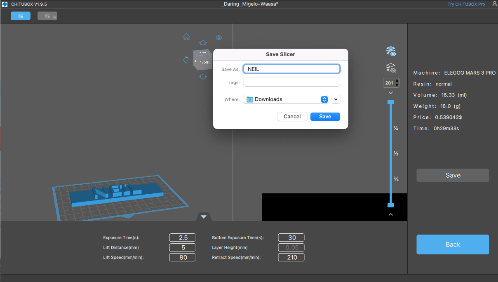
*I saved the result as a .CTB file*

:::no-dumb-questions
**Q: What is a .CTB file?**

A: It is the sliced file the printer reads. CHITUBOX turns the 3D model into a stack of thin layers, each an image of what the screen should light up, and saves them for the Mars 3 Pro to print one by one.

**Q: Why does the part hang upside down from the build plate?**

A: The light comes from below. Each new layer hardens against the bottom of the tank, and the build plate lifts the part a little after every layer, so the part grows downward from the plate.
:::

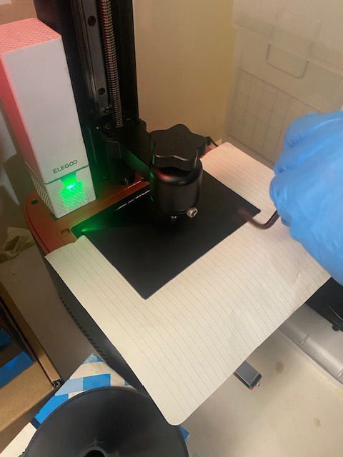
*I checked that the build plate was level.*

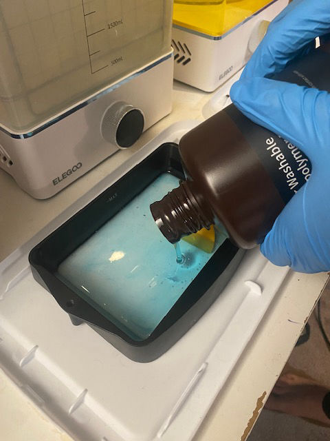
*I added resin to the tank*

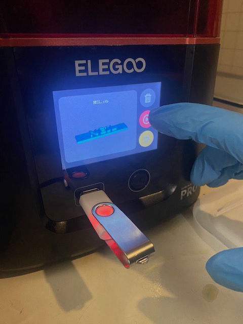
*I started the print*

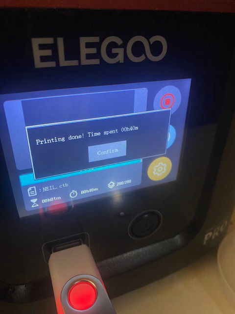
*The print completed in 40 minutes*

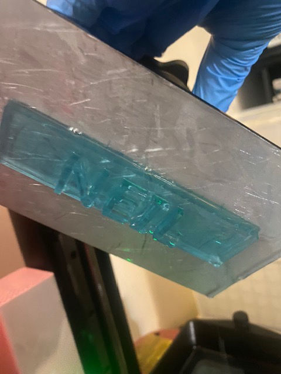
*I removed the build plate from the printer*

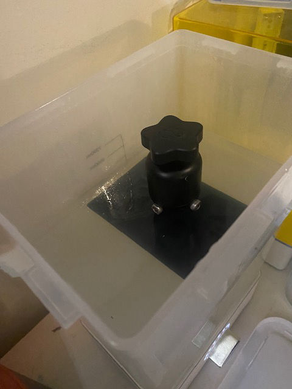
*I washed the part (still attached to the build plate)*

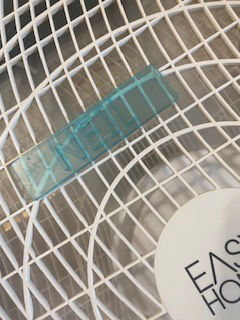
*I dried the part (still sticky)*

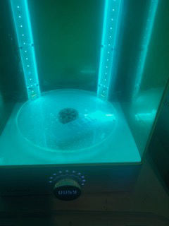
*I cured the part (with UV light)*

:::watch-it Liquid resin needs care
The part was still sticky after washing and drying, and uncured resin can irritate skin. Wear gloves when you handle the resin, the build plate and the part, work somewhere well ventilated, and do not treat the part as finished until it has been cured under UV light.
:::

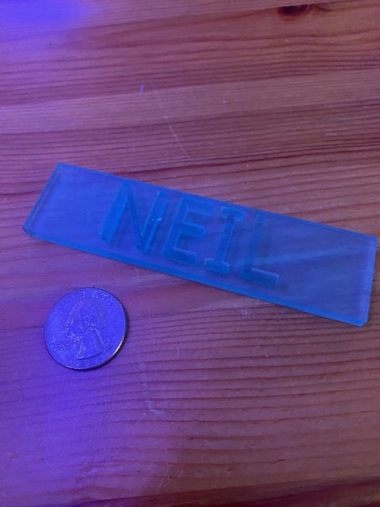
*The final result*

:::bullet-points In short
- I designed a name plate in Tinkercad, as raised text on a block, and exported it as an .STL file.
- CHITUBOX sliced it into layers for the ELEGOO Mars 3 Pro and saved a .CTB file.
- The resin printer hardened each layer with UV light, and the part grew downward from the build plate.
- The print took 40 minutes.
- Afterwards the part needed washing, drying and curing under UV light before it was finished.
:::
