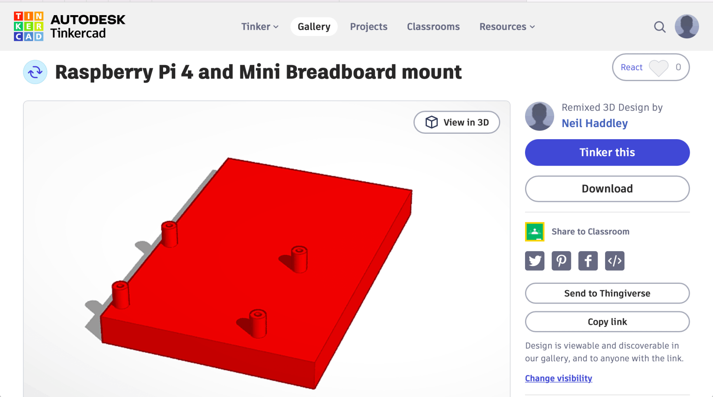
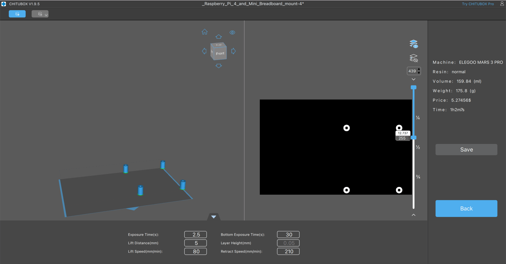
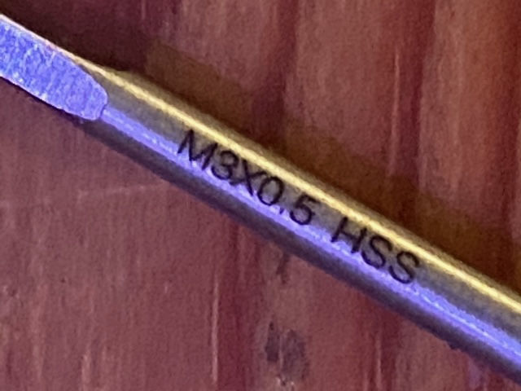
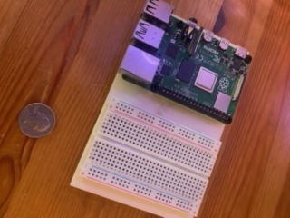

In [Part 1](/posts/3dprinting1/) I printed a name plate. This time I printed something useful: a plate that holds a Raspberry Pi 4 and a mini breadboard together, so that the wires between them stay put.

## Tinkercad

I updated an existing Tinkercad design to create a part to securely hold a Raspberry Pi 4 and small breadboard.

**Original design**
[https://www.tinkercad.com/things/8k21OQvUnlh](https://www.tinkercad.com/things/8k21OQvUnlh)

**Updated design**
[https://www.tinkercad.com/things/fQPX9bFkoC3-raspberry-pi-4-and-mini-breadboard-mount](https://www.tinkercad.com/things/fQPX9bFkoC3-raspberry-pi-4-and-mini-breadboard-mount)

*I updated the design in Tinkercad*

*I sliced the part*

:::pencil How tall is the part?
The slicer split the mount into 439 layers, with a layer height of 0.05 mm. How tall is the printed part?

:::answer
439 × 0.05 mm is about 22 mm. Most of that height is the four posts that the Raspberry Pi sits on; the plate itself is much thinner.
:::
:::

:::watch-it A flat plate uses a lot of resin
The slicer estimated 159.84 ml of resin for this part, and just over an hour to print it. A solid plate the size of a Raspberry Pi and a breadboard is a lot of material for a resin printer, so it is worth checking the estimate before you press Print.
:::

*I used an M3 tap drill*

:::no-dumb-questions
**Q: Why use a tap drill on a printed part?**

A: A tap cuts a screw thread into a hole. Tapping the printed holes gave the M3 screws a thread to bite into, instead of relying on the plastic alone.
:::

*I assembled the finished part*

:::bullet-points In short
- I adapted an existing Tinkercad design to hold a Raspberry Pi 4 and a mini breadboard on one plate.
- The slicer split it into 439 layers of 0.05 mm, and estimated 159.84 ml of resin and just over an hour.
- I tapped the holes with an M3 tap so that the screws had a thread to hold.
- The finished mount keeps the Raspberry Pi and the breadboard together.
:::
