The bike already had a front light, so I added a rear light while I had the bike in pieces and the soldering iron out. This is a side project, and it is not directly related to the [ATtiny85 speed limiter](/posts/attiny2/) that I was building at the same time.

The light is the one in [this eBay listing](https://www.ebay.com.au/itm/178190458528). This is what it looked like originally.

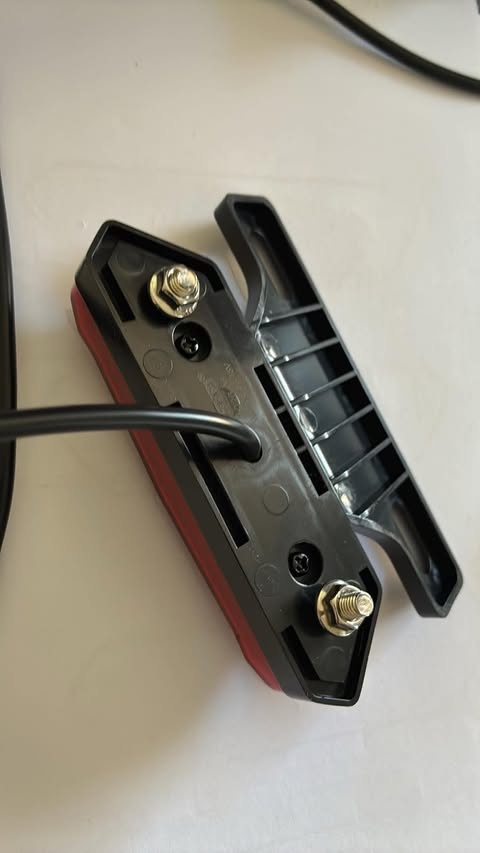
*The original rear light from the back: the black back half with its two studs and two screws, the cable leaving through the middle, and the separate bracket lying beside it*

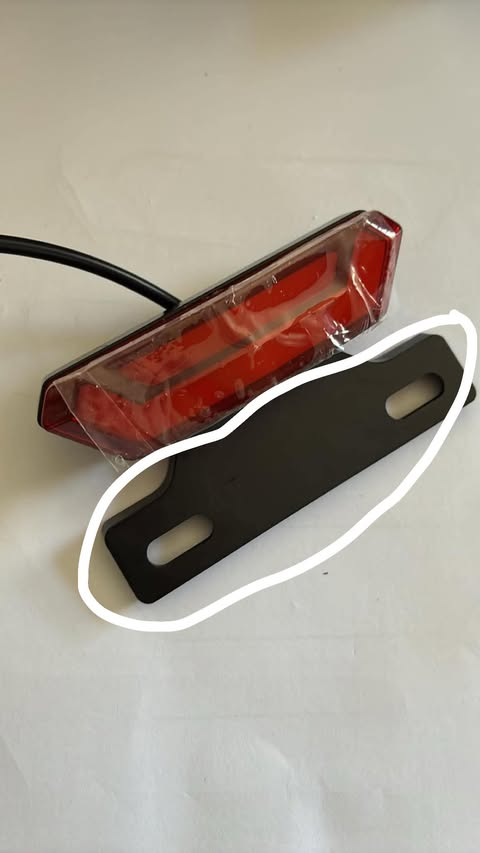
*The original rear light from the front, with the clear film still on the lens. The flat black bracket with two slots, circled in white, is the part of the original design that I discarded*

This is the bike carrier that the light has to fit.

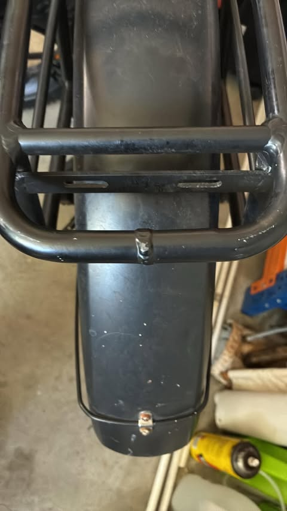
*The bike carrier, with the bar that has two slots for mounting the rear light, no hole in the middle, and not a lot of room between where the light will be mounted and the rear mudguard*

The carrier already has a bar with two slots, and those slots will mount the rear light. The bar has no hole in the middle. There is also not a lot of room between where the light will be mounted and the rear mudguard.

## Two problems, two designs

The original design gave me two problems. I solved them with two 3D printed versions of the back half of the purchased rear light.

| Problem | Design | What I made |
|---|---|---|
| There was not enough space, and the light could not fit because of my bike's mudguard. | Design 1 | A printed copy of the black back half, measured from the original and corrected until it fitted both the original light and the part that mates with it. It addresses the space problem by leaving out the flat black bracket, which is a good part of the original light. Removing the bracket removed vertical height. The slots in the carrier do the bracket's job. |
| The cable leaves through the middle of the back, and my bike carrier has no hole there for it to pass through. I could have drilled a new hole in the carrier. | Design 2 | A deeper copy, in which the cable turns inside the part and leaves through the edge, held by a clamp. |

Design 2 is the one that I fitted to the bike.

## How I worked

I worked with Claude Code in VS Code. Claude Code wrote every version of both models as OpenSCAD code, a text language for describing 3D shapes, and it exported and rendered every version of the two STL files. I never opened or edited that code myself. I opened each STL in Bambu Studio to look at it, and I printed from there. The models and the STLs are in the [bikespeed repository](https://github.com/Haddley/bikespeed/tree/main/rearlight). Design 1 is `fuse_block.scad` and Design 2 is `fuse_block_side_exit.scad`. Claude Code chose the name `fuse_block` for the files. I have no idea why, and the part is simply the back half of the purchased rear light.


*Every change went round this loop*

## The part

The part is an open tray, 105 mm long, 28 mm wide, and 8 mm deep. Its outer wall is the rim. Inside the rim is a gutter, then a low inner wall. Two large bosses carry the studs, each with a hex pocket for the bolt head. Two smaller pillars carry the screws. A hole in the middle takes the cable, and four deep slots sit in the gutters. The outside face is flat.


*The tray side: the rim, the gutter, the inner wall, the two stud bosses with hex pockets, the two screw pillars, the cable hole, and the slots*

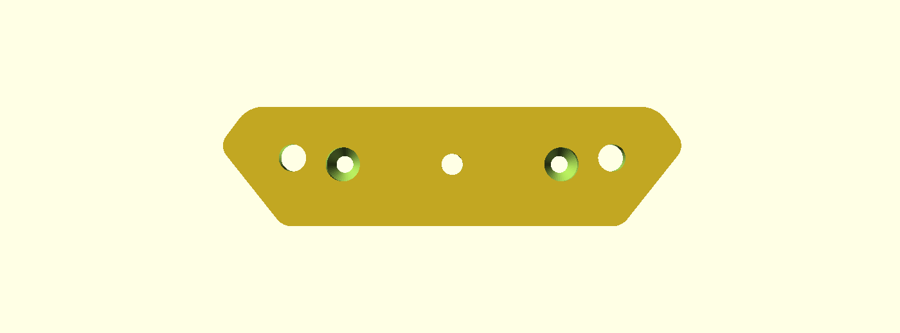
*The flat outside face, with the countersunk screw holes and the stud and cable holes*

## Design 1 — The copy that fits the gap

Design 1 does not include the original bracket, the flat black plate circled in the photo at the top of this post. Leaving it out removed vertical height, and that is what solves the space problem.

Claude Code wrote a first parametric model and I printed it, and neither was quite right. This section is the long run of small corrections that got the copy to fit the original and the part that mates with it.

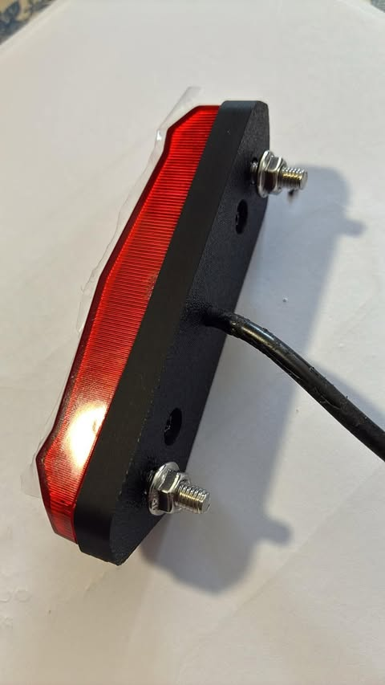
*The first printed copy on the back of the rear light, with the two studs and the cable, at a halfway stage: the cable still leaves through the hole in the middle of the back*

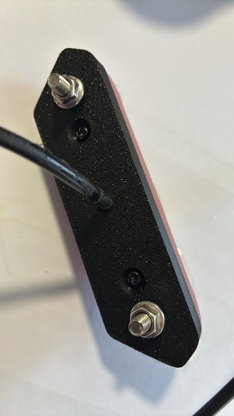
*The other side of the first printed copy, with the two countersunk screws and the studs*

### Beat 1 — Small fixes after the first print

The first print was close, but a few features were wrong. I described each one to Claude Code in plain words.

```PROMPT
rearlight fuse_block issues... bold head recess is too big please make smaller
```

Claude Code found the hex pocket around each stud hole and reduced it from 9 mm to 8 mm across the flats.

```PROMPT
screw hole on the "ouside" need to be wider (countersunk) can be a little more narrow in the "inside"
```

Claude Code added a 90° countersink on the outside face and narrowed the shaft from 4.5 mm to 4.0 mm.

```PROMPT
the deep slots in the gutters above and below the screw holes all need to be shifted towards the center of the piece by 2mm (ish). move left deep slots right 2mm and move right deepslots left by 2mm
```

Claude Code moved the four slots 2 mm toward the centre. It made the shift a parameter, `clip_shift`, so I could change it later.

:::watch-it The STL on disk is not the model
After the countersink change, I opened the STL in Bambu Studio and wrote that I could not see any countersink on the outside. Claude Code had edited the model code, but the program that turns that code into an STL was not installed on this Mac, so it could not export a new STL. The STL still held the old shape.

My laptop opens and views STL files natively, so I never needed that program to look at the part. It was needed only for the step before that, turning the model code into a new STL, and that step had not happened.

Homebrew had disabled the normal version of that program, so Claude Code installed a snapshot build instead. From then on it re-exported the STL after every change and rendered the part, which let Claude Code check its own work before I opened the STL and printed.
:::

I later made the countersink deeper. Claude Code made it 4 mm deep and 12 mm wide, and I wanted it deeper but not wider. The final version keeps the 8 mm opening. A 2 mm cone narrows to the 4 mm shaft, and a straight 8 mm bore sits above it, so a screw head sits 2 mm below the outside face.

### Beat 2 — Tracing the original

To compare the print with the original, I traced around both parts on a sheet of paper. I used the two screw holes as a common reference point and marked them as dots. I drew the new part in red ink and the original in black ink, using a red ink pen and a black ink pen.

```PROMPT
the original and our copy fuse_block parts are a little different. I have traced around the two using the screw holes as a common point of reference. what do you suggest?
```

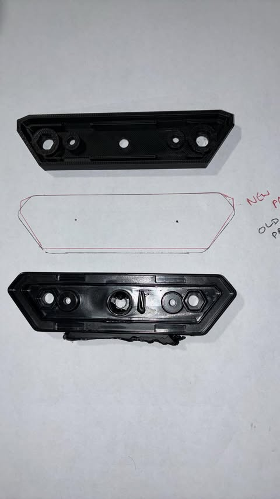
*The first printed copy at the top, the trace in the middle, and the original at the bottom*

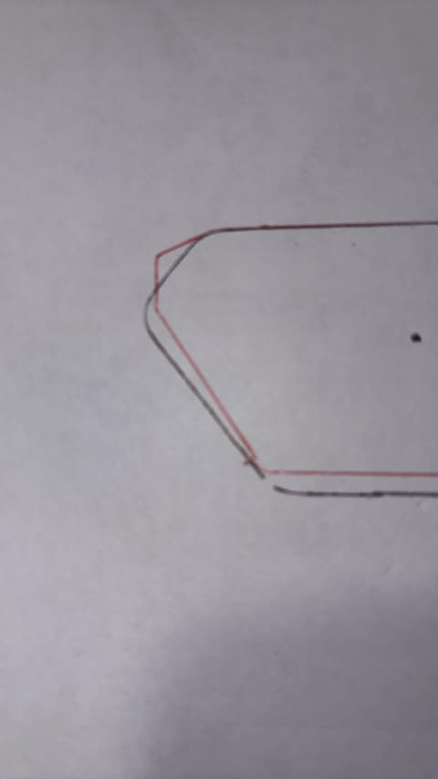
*A closeup of the left end: the black ink line of the original and the red ink line of the copy*

Claude Code read the photo and told me that our outline looked larger. I could see that it was wrong, because I had measured the two parts by hand.

```PROMPT
our outline is not as large vertically as we look at it. from the external most measurement our part is 2mm smaller vertically. Can you see that?
```

The original was 2 mm taller, not shorter. Claude Code changed the height from 26 mm to 28 mm and assumed that the extra 2 mm split evenly above and below the screw holes. That was also wrong. The extra height was all on one side of the holes, so the hole line moved off the centre.

:::brain-power Can a photo be a ruler?
A photo of a trace has no scale on it, and it is taken at a slight angle. Is there any way to turn it into millimetres without putting a ruler in the picture? Think about what the photo does contain before you read on.
:::

### Beat 3 — Letting the photo be the measuring tape

I had one thing in the picture that I already knew exactly: the red line is the outline of our own model. Claude Code used it to work out the scale and the position of the photo, and then read the black ink line of the original in millimetres.

:::under-the-hood How the measurement works
1. Claude Code picked out the red pixels and the black ink pixels in the photo.
2. It fitted the red pixels to the known outline of the model, with a scale, a small rotation, and a shift. The fit came out at 9.8 pixels per millimetre, with a typical error of 0.13 mm.
3. The dot I had drawn for the left screw hole landed within 0.2 mm of where the model puts that screw. That told me the calibration was good.
4. It converted the black ink pixels to millimetres with the same transform.
5. It fitted a new outline to the black ink line and exported it as the end shape of the model.

As a check, it ran the same fit on the red line, where the right answer was known. It recovered the model within a few tenths of a millimetre.
:::

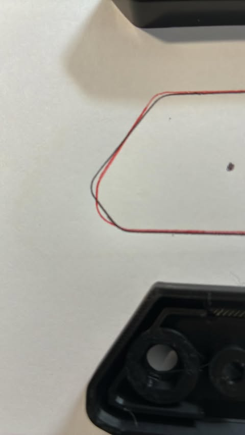
*A later closeup: the black ink line of the original and the red ink line of our part*

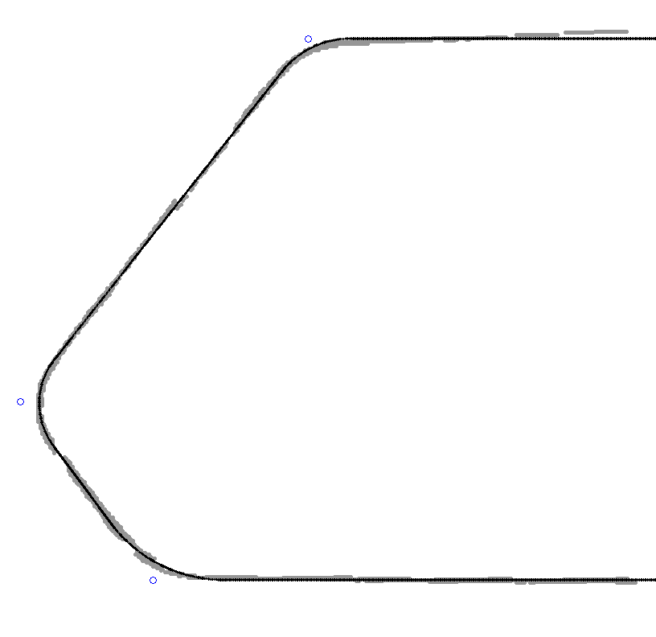
*The black ink trace in millimetres (grey dots) and the fitted outline (black line)*

The fit said four things about the original:

- The nose sticks out about 1.9 mm further than my model had it.
- The end is one long diagonal into a single rounded nose, with one longer steep chamfer to the bottom edge. My model had a short vertical flat between two corners.
- The corners have different radii: 4.5 mm where the long diagonal meets the narrow edge, 3.7 mm at the nose, and 7.3 mm at the chamfer.
- The screw and stud line sits 14.5 mm from the narrow edge, not 15 mm.

With the new end shape, the exported outline matched the black ink trace to 0.12 mm on average. The worst point was 0.36 mm out.

:::watch-it A comment can swallow the rest of the line
Twice, Claude Code added a `//` comment in the middle of a parameter line. In the model code, a comment runs to the end of the line, so the variables after it were never defined. The first time, the screw holes and slots disappeared. The second time, the render showed a broken tray. I caught both in the renders before printing. The fix is to put each comment on its own line.
:::

The first version of the rounded corners also had a bug. It built each corner as a hull of circles, which only works when every radius fits its edge. The two nose corners were too close together, so the arcs overlapped. Claude Code replaced it with exact tangent arcs and merged the nose into a single corner:

```
function arc_pts(P, Q, R, r, n = 24) =
  let (u1 = unit(P - Q), u2 = unit(R - Q), half = acos(u1 * u2) / 2,
       c  = Q + unit(u1 + u2) * (r / sin(half)),
       t1 = Q + u1 * (r / tan(half)), t2 = Q + u2 * (r / tan(half)),
       a1 = atan2(t1[1] - c[1], t1[0] - c[0]), a2 = atan2(t2[1] - c[1], t2[0] - c[0]),
       da = ((a2 - a1 + 540) % 360) - 180)
  [for (k = [0:n]) c + r * [cos(a1 + da * k / n), sin(a1 + da * k / n)]];
```

I printed the result and laid it over the trace. The outline was spot on.

### Beat 4 — Fitting the part that mates with it

The outside was right, but the other original part did not quite fit into the tray. I fixed three things, one at a time.

**The wall.** The outer wall of my tray was a little thicker than the original, so the inside was too small by about half a millimetre.

```PROMPT
while we are making this change please notice that the external most wall of the "tray" seems to be a little thicker than in the original part? so the internal hight is not quite as big.
```

I did not want to enlarge the outside, because it now matched the original. Claude Code thinned the wall in two steps, from 2.0 mm to 1.75 mm and then to 1.2 mm. The 1.2 mm is three perimeters of a 0.4 mm nozzle, so it should still print solidly at 8 mm tall. It widened the gutter by the same amount, so the inner wall and everything inside it stayed in the same place.

**The height of the inner wall and the pillars.** The tray is 6 mm deep from the rim to the inside of the floor.

```PROMPT
The "inner wall" and "srew hole pillar" seem to be too tall. The other part seems to want to slip 4mm (or so) into our new part. Is there enough space?
```

There was enough room, but the inner wall and the screw pillars stood 4 mm tall, so their tops were only 2 mm below the rim. The other part would stop after about 2 mm. Claude Code added two parameters, `wall_top` and `screw_top`, and set both to 4 mm, so there is now a clear 4 mm of depth above them.

**The stud bosses.** The large stud bosses were pushing through the inner wall.

```PROMPT
move the stud bosses down a little and then (again) towards the center of the part. at the moment it looks liks the stud boss is breaking through the inner wall slightly
```

Claude Code measured the geometry first. The boss reached 3.59 mm from the outer edge, but the inner wall's outer face is at 4.0 mm, so it poked 0.4 mm into the gutter. Moving the stud down moves it away from the diagonal, where the problem was. The studs now sit 1.5 mm further down and 0.25 mm further toward the centre. The boss now reaches 4.72 mm from the edge, and it still has a 0.35 mm gap to the screw pillar.

### Design 1 in numbers

| What | First print | Design 1 |
|---|---|---|
| Width | 26 mm | 28 mm |
| Hex pocket | 9 mm across flats | 8 mm across flats |
| Screw shaft | 4.5 mm | 4.0 mm |
| Countersink | none | 8 mm opening, 4 mm deep |
| Slots | at the screws | 2 mm toward the centre |
| Outer wall | 2.0 mm | 1.2 mm |
| Inner wall and screw pillars | tops 2 mm below the rim | tops 4 mm below the rim |
| Nose | short chamfer and flat | one rounded nose, 1.9 mm further out |
| Stud bosses | on the hole line | 1.5 mm down, 0.25 mm further in |


*Design 1 from an angle: the low inner wall and screw pillars, the taller stud bosses, and the thinner outer wall*

## Design 2 — The cable leaves through the side

Design 1 solved the mudguard problem, but it keeps the cable hole through the middle of the back face, as the original light does. There is no hole in the middle of my bike carrier for the cable to pass through. I could have drilled one, but I decided that a different approach was at least as good: a second design in which the cable turns inside the part and leaves through the edge.

### Beat 5 — A separate file, so the perfect part stays perfect

I began the prompt with a line in capitals, because Design 1 was already perfect and I did not want anything to happen to it.

```PROMPT
PLEASE DO NOT MESS WITH fuse_block.stl IT IS PERFECT

Please create a new model. a variation on fuse_block that does not have a hole in the middle that allows the cable to enter. Instead I would like a version that allows the cable to turn and then exit at the bottom of the part. I imagine that the "tray" will need to be a lot deeper to make space for the new hole but the other part needs to match up exactly as it does now so I image that the inner and outer walls will need to be higher and the screw pillars will need to be longer. What are your thoughts?
```

Claude Code agreed with my guess. A cable cannot turn through 90 degrees in a tray that is only 6 mm deep, so the floor has to move down. Everything the other part touches is measured from the open face, so those features stay exactly where they are, and only the floor moves.

Claude Code made Design 2 a separate file, a copy of Design 1 with a few extra parameters. It recorded checksums of my three original files before it started and checked them after every change. It also built in a test: with `extra_depth = 0` and `cable_exit = false`, the new file exports an STL that is identical, byte for byte, to `fuse_block.stl`. Claude Code ran that comparison after every edit, so I knew that Design 2 could not drift away from the part that I had already printed.

### Beat 6 — The screws and the bolts

The first version of the deeper tray put the screw heads at the new outside face, 12 mm further out than before. The original screws would not have reached the other part, and I did not want to buy longer ones.

```PROMPT
I don't want to use longer screws make the screw pillars deeper?
```

The screw head has to sit at the same depth below the open face as before, or the original screws will not reach the other part. Claude Code kept the head seat where it was and turned the rest of the screw hole into a straight 8 mm well running out to the outside face. A well that wide in a 9 mm column leaves almost no wall, so below the original column the screw column widens to 12 mm.

:::watch-it Tell Claude Code which way each fastener points
I asked for the screw columns to be longer and deeper, and Claude Code told me that they already were. I answered with the direction that each fastener points:

```PROMPT
you don't seem to appreciate the direction that the bolt and the screw is pointing. The screw is going to be used to secure this new part to the other part so the screw hole pillars need to be longer and deeper now. The bolt holding columns hold this part to the bike carrier so that pillar can remain the same height or it can grow I guess but it needs to be attached to the base of the tray
```

That told Claude Code what each column is for. The screw columns hold the part to the light, so they must run all the way from the new floor up to the same place as before. The bolt columns hold the part to the carrier, so they must be attached to the floor of the tray. In the version before that, I had shortened them and they hung from the inner wall, which would have needed supports and was weak.
:::

The bolts are a different matter. Moving the outside face 12 mm further out means that the bolts need to be 12 mm longer than the originals. There is another way: a setting called `stud_deep_pocket` makes the hex pockets 12 mm deeper, so that the original bolts reach. I did not use it. With the deep pockets the plastic supports each bolt over only about 3 mm, and with the longer bolts it supports them over about 15 mm. I expect the long bolts to cope better with side loads, so I bought new, longer bolts.

### Beat 7 — Filling the gutter

```PROMPT
also I think we can fill up a lot of the gap between the outside and inside walls. as long as we have a deep enough space left to accomodate the other part
```

Claude Code filled the gutter between the outer wall and the inner wall from the new floor up to 6 mm below the open face. That is the depth of the original floor, so the other part sees exactly the same gutter. The slots still cut 1 mm into the fill, as they cut into the old floor. The fill makes the walls much stiffer. It adds about 8 cm³ of plastic, roughly 10 g.

### Beat 8 — The cable exit and the clamp

The cable starts at the old hole position on the open face, drops into the tray, turns through a bend, and leaves through the edge wall.


*A side-on section of Design 2 along the cable path*

```PROMPT
add a cable clamp?
```

There was no room inside the tray for a clamp that is screwed down. Claude Code put a slit tube on the outside of the wall instead. A zip tie in a groove near the free end closes the slit and squeezes the bore onto the cable. The bore is 5.0 mm, the same as the cable, the slit is 1 mm wide, and the groove is 3.2 mm wide and 1.2 mm deep, for a 2.5 mm zip tie.

:::watch-it Top and bottom depend on how you hold the part
```PROMPT
you have the cable coming out of the "top". please move exit to "bottom"
```

Claude Code had put the exit on the edge that I call the top. We were looking at the part from opposite sides. The fix was one setting, `exit_dir`, which swaps the exit to the other edge. After that I described edges by what I could see in the render.
:::

```PROMPT
please move the cable exit away from the base of the tray. Will that require a support?
```

The exit height is also the bend radius of the cable, so moving the exit 2 mm further from the base shortened the bend from a 12 mm radius to a 10 mm radius. Claude Code stopped there, because a higher exit would have left a skin of plastic thinner than 1 mm above the bore.

```PROMPT
opporunity to round off the clamp?
```

```PROMPT
I am proposing not having underside flat
```

Claude Code had kept the underside of the clamp flat, filled down to the outside face, so that it would print without supports. I preferred a round tube, clear of the base, with a rounded free end and a flared mouth that is kind to the cable jacket. A round tube sticking out of a wall needs supports, and I had to turn them on in Bambu Studio for the print.

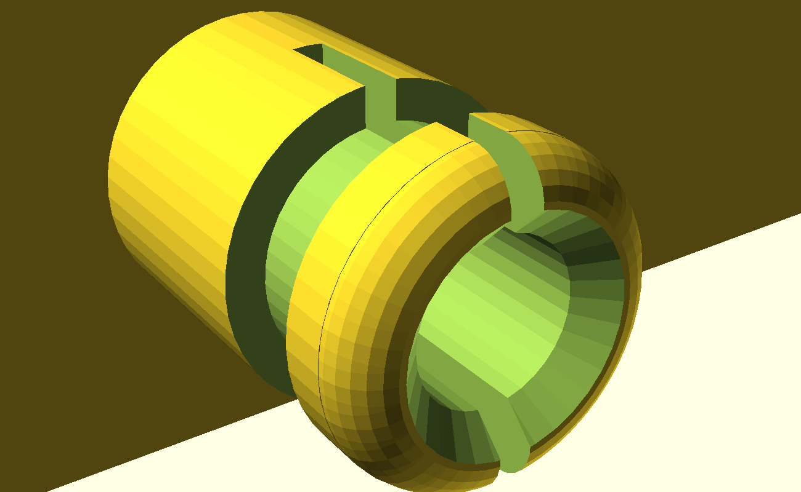
*The clamp: a round tube with a 1 mm slit, a groove for the zip tie, a rounded end and a flared mouth*

### Design 2 in numbers

| Part | Design 1 | Design 2 |
|---|---|---|
| Depth from the open face to the outside face | 8 mm | 20 mm (`extra_depth = 12`) |
| Outer wall and inner wall | tops at the open face and 4 mm below it | the same tops, running 12 mm further down |
| Screw columns | top 4 mm below the open face, 4 mm of plastic | the same top, 16 mm long, 12 mm across below 6 mm |
| Bolt columns | top 2 mm below the open face, standing on the floor | the same top, running down to the new floor |
| Gutter between the walls | open down to 6 mm | solid below 6 mm |
| Cable | straight hole through the floor | 10 mm radius bend, leaving through the edge wall 10 mm below the open face |
| Clamp | none | round clamp, 14 mm long, 10 mm across, 5.0 mm bore |

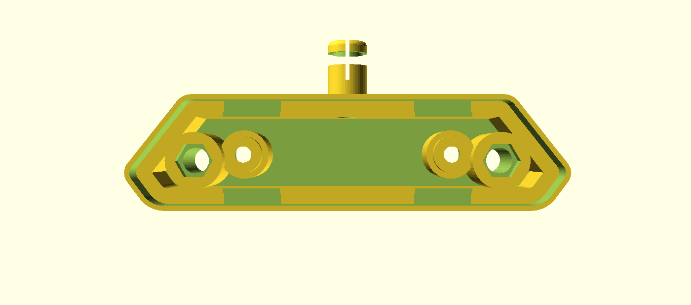
*Design 2 from the tray side, with the clamp sticking out of the edge where the cable leaves*

## Printing both designs

I viewed and printed both designs in Bambu Studio. The screenshot shows them on one plate: Design 1 at the top and Design 2 below it, with the clamp sticking out at the back. Each part sits with its flat outside face on the plate and the tray facing up.

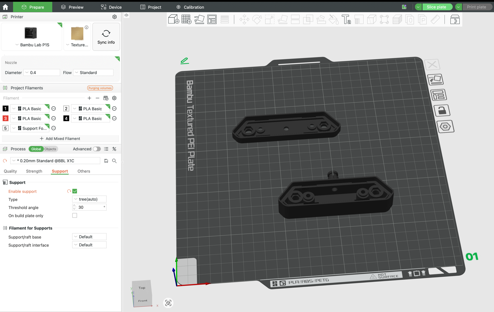
*Bambu Studio with both designs on the plate, printed on a Bambu Lab P1S with a 0.4 mm nozzle, PLA Basic, and the textured PEI plate*

The settings were the 0.20 mm Standard process profile, with supports switched on. The support type was tree (auto), with a threshold angle of 30°. "On build plate only" was switched off. The outside face prints against the textured PEI plate, and that is where the grainy finish in the photos comes from.

## Download the STL files

You can download either design. Both files are already in printing orientation, with the flat outside face on the plate and the tray facing up.

| Design | File | Notes |
|---|---|---|
| Design 1: the copy that fits the gap | [fuse_block.stl](/assets/files/3dprinting3/fuse_block.stl) | The cable leaves through a hole in the middle of the back. |
| Design 2: the cable leaves through the side | [fuse_block_side_exit.stl](/assets/files/3dprinting3/fuse_block_side_exit.stl) | The part is 20 mm deep, so it needs bolts 12 mm longer than the originals. It needs supports under the round clamp. |

I measured both designs from the light in the eBay listing above, and I built them to fit my own bike. Check the dimensions against your own light before you print. The source for both designs is in the [bikespeed repository](https://github.com/Haddley/bikespeed/tree/main/rearlight) as `.scad` files, which OpenSCAD opens, so you can change any dimension. The files are free to use and change.

## On the bike

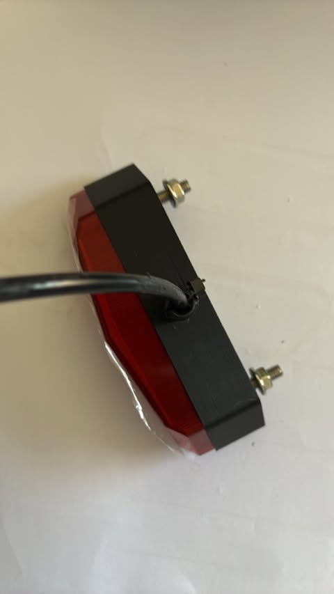
*Design 2 on the light, with the cable leaving through the clamp and held with a zip tie*

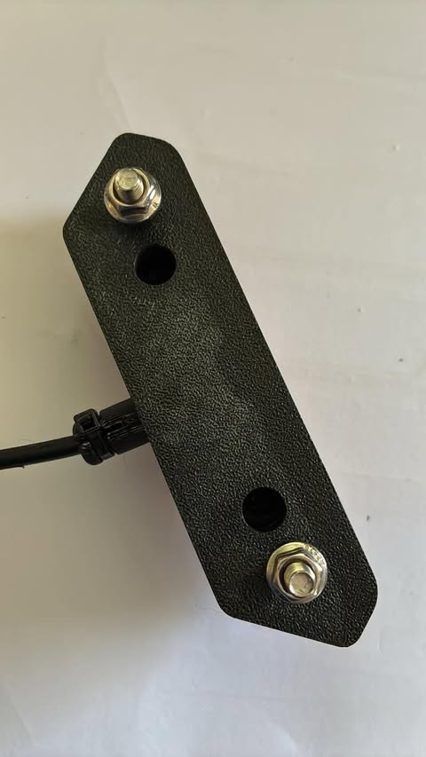
*The outside face: the two bolts with their nuts and washers, the two screw wells, and the clamp at the edge*

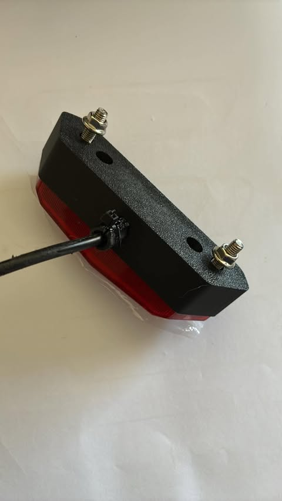
*The same part from the side, with the cable leaving through the edge*

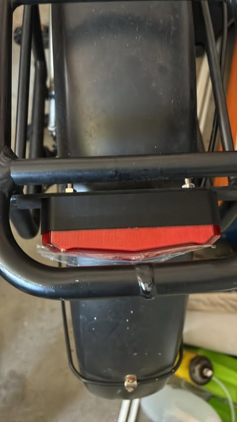
*The light fitted to the bike in the gap between the carrier and the mudguard*

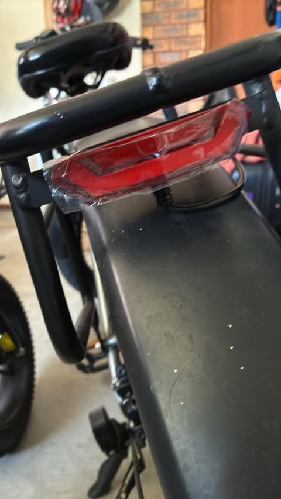
*The light from behind and to the side, with the clear film still on the lens*

It works really well.

The rear light cable will run along parts of the bike carrier, and then I will extend it and run it through the frame to connect to the front light cable of the bike controller.

:::bullet-points What I learned
- Put every dimension in a named parameter. Every correction in this post was one number.
- Ask for a render and an export after every change. I only noticed the stale STL because I could not see the countersink, and two of my bad exports came from a comment in the wrong place that I only found by looking at the render.
- A photo can be a measuring tape if the picture contains something you already know exactly, such as your own outline and two screw holes.
- Test the fit with the part it has to mate with, not only with the original.
- When a part is already perfect, build the next design as a separate file with a switch that reproduces the original exactly, and compare the two files byte for byte after every edit.
- Tell Claude Code what each fastener does and which way it points. The geometry follows from that, and my own wording was not enough on its own.
- Top and bottom depend on how you hold the part. Check the render from the view that you are using.
- A round underside on a feature that sticks out needs supports. A flat underside avoids them, so choose according to what the feature needs.
:::
