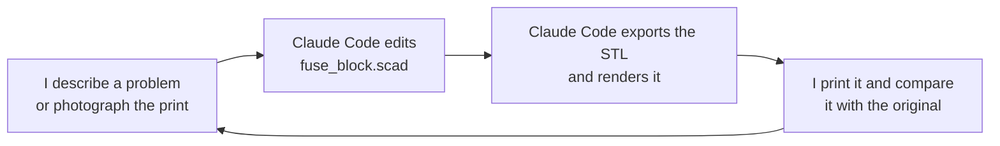
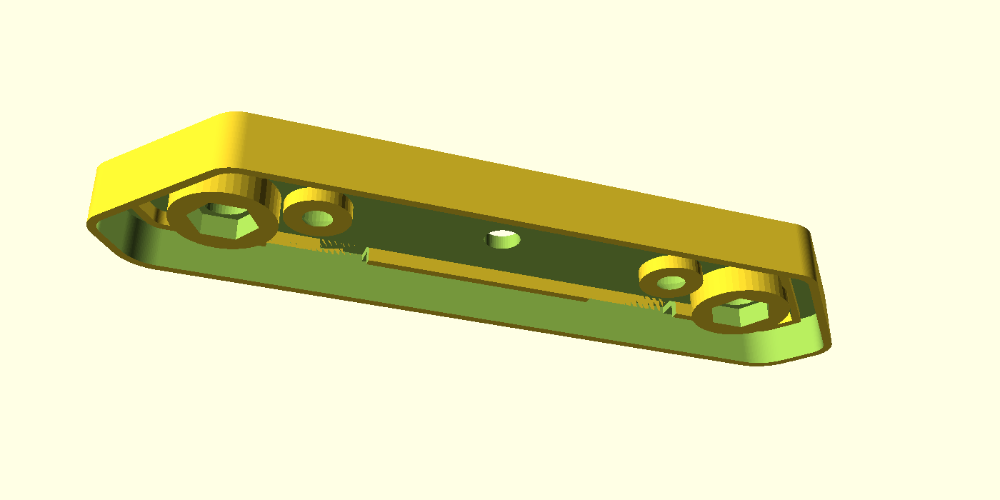

The bike already had a front light, so I added a rear light while I had the bike in pieces and the soldering iron out. This is a side project, and it is not directly related to the [ATtiny85 speed limiter](/posts/attiny2/) that I was building at the same time.

The light needed a 3D printed copy of one half of the black block that sits on its back. The block is 105 mm long, 28 mm wide, and 8 mm deep. It carries two studs, two screws, and the cable. I had a first parametric model in OpenSCAD and a first print, and neither was quite right. This post is about the long run of small corrections that got the copy to fit the original and the part that mates with it.


*The finished printed block half on the back of the rear light, with the two studs and the cable*


*The other side of the finished part, with the two countersunk screws and the studs*

I worked with Claude Code in VS Code. Claude Code edited the model, exported the STL, and rendered it so I could check each change before I printed it. The model and the STL are in the [bikespeed repository](https://github.com/Haddley/bikespeed/tree/main/rearlight).



*Every change went round this loop*

## The part

The part is an open tray. Its outer wall is the rim. Inside the rim is a gutter, then a low inner wall. Two large bosses carry the studs, each with a hex pocket for the nut. Two smaller pillars carry the screws. A hole in the middle takes the cable, and four deep slots sit in the gutters. The outside face is flat.


*The tray side in OpenSCAD: the rim, the gutter, the inner wall, the two stud bosses with hex pockets, the two screw pillars, the cable hole, and the slots*


*The flat outside face, with the countersunk screw holes and the stud and cable holes*

## Beat 1 — Small fixes after the first print

The first print was close, but a few features were wrong. I described each one to Claude Code in plain words.

```PROMPT
rearlight fuse_block issues... bold head recess is too big please make smaller
```

Claude Code found the hex pocket around each stud hole and reduced it from 9 mm to 8 mm across the flats.

```PROMPT
screw hole on the "ouside" need to be wider (countersunk) can be a little more narrow in the "inside"
```

Claude Code added a 90° countersink on the outside face and narrowed the shaft from 4.5 mm to 4.0 mm.

```PROMPT
the deep slots in the gutters above and below the screw holes all need to be shifted towards the center of the piece by 2mm (ish). move left deep slots right 2mm and move right deepslots left by 2mm
```

Claude Code moved the four slots 2 mm toward the centre. It made the shift a parameter, `clip_shift`, so I could change it later.

:::watch-it The STL on disk is not the model
After the countersink change, I looked at the part and wrote that I could not see any countersink on the outside. Claude Code had edited the `.scad` file, but OpenSCAD was not installed on this Mac, so it could not export a new STL. The STL still held the old shape.

Homebrew had disabled the normal OpenSCAD cask, so Claude Code installed the snapshot build instead. From then on it re-exported the STL after every change and rendered the part, so I could check the result before I printed.
:::

I later made the countersink deeper. My first reading of that request was wrong: Claude Code made it 4 mm deep and 12 mm wide, and I wanted it deeper but not wider. The final version keeps the 8 mm opening. A 2 mm cone narrows to the 4 mm shaft, and a straight 8 mm bore sits above it, so a screw head sits 2 mm below the outside face.

## Beat 2 — Tracing the original

To compare the print with the original, I traced around both parts on a sheet of paper. I used the two screw holes as a common reference point and marked them as dots. I drew the new part in red and the original in pencil.

```PROMPT
the original and our copy fuse_block parts are a little different. I have traced around the two using the screw holes as a common point of reference. what do you suggest?
```


*The first printed copy at the top, the trace in the middle, and the original at the bottom*


*A closeup of the left end: the pencil line of the original and the red line of the copy*

Claude Code read the photo and told me that our outline looked larger. I could see that it was wrong, because I had measured the two parts by hand.

```PROMPT
our outline is not as large vertically as we look at it. from the external most measurement our part is 2mm smaller vertically. Can you see that?
```

The original was 2 mm taller, not shorter. Claude Code changed the height from 26 mm to 28 mm and assumed that the extra 2 mm split evenly above and below the screw holes. That was also wrong. The extra height was all on one side of the holes, so the hole line moved off the centre.

:::brain-power Can a photo be a ruler?
A photo of a trace has no scale on it, and it is taken at a slight angle. Is there any way to turn it into millimetres without putting a ruler in the picture? Think about what the photo does contain before you read on.
:::

## Beat 3 — Letting the photo be the measuring tape

I had one thing in the picture that I already knew exactly: the red line is the outline of our own model. Claude Code used it to work out the scale and the position of the photo, and then read the pencil line of the original in millimetres.

:::under-the-hood How the measurement works
1. Claude Code picked out the red pixels and the dark pencil pixels in the photo.
2. It fitted the red pixels to the known outline of the model, with a scale, a small rotation, and a shift. The fit came out at 9.8 pixels per millimetre, with a typical error of 0.13 mm.
3. The dot I had drawn for the left screw hole landed within 0.2 mm of where the model puts that screw. That told me the calibration was good.
4. It converted the pencil pixels to millimetres with the same transform.
5. It fitted a new outline to the pencil line and exported it as the end shape of the model.

As a check, it ran the same fit on the red line, where the right answer was known. It recovered the model within a few tenths of a millimetre.
:::


*A later closeup: the pencil line of the original and the red line of our part*


*The pencil trace in millimetres (grey dots) and the fitted outline (black line)*

The fit said four things about the original:

- The nose sticks out about 1.9 mm further than my model had it.
- The end is one long diagonal into a single rounded nose, with one longer steep chamfer to the bottom edge. My model had a short vertical flat between two corners.
- The corners have different radii: 4.5 mm where the long diagonal meets the narrow edge, 3.7 mm at the nose, and 7.3 mm at the chamfer.
- The screw and stud line sits 14.5 mm from the narrow edge, not 15 mm.

With the new end shape, the exported outline matched the pencil trace to 0.12 mm on average. The worst point was 0.36 mm out.

:::watch-it A comment can swallow the rest of the line
Three times, Claude Code added a `//` comment in the middle of a parameter line. In OpenSCAD, a comment runs to the end of the line, so the variables after it were never defined. The first time, the screw holes and slots disappeared. The second time, the render showed a broken tray. I caught both in the renders before printing. The fix is to put each comment on its own line.
:::

The first version of the rounded corners also had a bug. It built each corner as a hull of circles, which only works when every radius fits its edge. The two nose corners were too close together, so the arcs overlapped. Claude Code replaced it with exact tangent arcs and merged the nose into a single corner:

```
function arc_pts(P, Q, R, r, n = 24) =
  let (u1 = unit(P - Q), u2 = unit(R - Q), half = acos(u1 * u2) / 2,
       c  = Q + unit(u1 + u2) * (r / sin(half)),
       t1 = Q + u1 * (r / tan(half)), t2 = Q + u2 * (r / tan(half)),
       a1 = atan2(t1[1] - c[1], t1[0] - c[0]), a2 = atan2(t2[1] - c[1], t2[0] - c[0]),
       da = ((a2 - a1 + 540) % 360) - 180)
  [for (k = [0:n]) c + r * [cos(a1 + da * k / n), sin(a1 + da * k / n)]];
```

I printed the result and laid it over the trace. The outline was spot on.

## Beat 4 — Fitting the part that mates with it

The outside was right, but the other original part did not quite fit into the tray. I fixed three things, one at a time.

**The wall.** The outer wall of my tray was a little thicker than the original, so the inside was too small by about half a millimetre.

```PROMPT
while we are making this change please notice that the external most wall of the "tray" seems to be a little thicker than in the original part? so the internal hight is not quite as big.
```

I did not want to enlarge the outside, because it now matched the original. Claude Code thinned the wall in two steps, from 2.0 mm to 1.75 mm and then to 1.2 mm. The 1.2 mm is three perimeters of a 0.4 mm nozzle, so it should still print solidly at 8 mm tall. It widened the gutter by the same amount, so the inner wall and everything inside it stayed in the same place.

**The height of the inner wall and the pillars.** The tray is 6 mm deep from the rim to the inside of the floor.

```PROMPT
The "inner wall" and "srew hole pillar" seem to be too tall. The other part seems to want to slip 4mm (or so) into our new part. Is there enough space?
```

There was enough room, but the inner wall and the screw pillars stood 4 mm tall, so their tops were only 2 mm below the rim. The other part would stop after about 2 mm. Claude Code added two parameters, `wall_top` and `screw_top`, and set both to 4 mm, so there is now a clear 4 mm of depth above them.

**The stud bosses.** The large stud bosses were pushing through the inner wall.

```PROMPT
move the stud bosses down a little and then (again) towards the center of the part. at the moment it looks liks the stud boss is breaking through the inner wall slightly
```

Claude Code measured the geometry first. The boss reached 3.59 mm from the outer edge, but the inner wall's outer face is at 4.0 mm, so it poked 0.4 mm into the gutter. Moving the stud down moves it away from the diagonal, where the problem was. The studs now sit 1.5 mm further down and 0.25 mm further toward the centre. The boss now reaches 4.72 mm from the edge, and it still has a 0.35 mm gap to the screw pillar.

## The finished model

| What | First model | Final model |
|---|---|---|
| Width | 26 mm | 28 mm |
| Hex pocket | 9 mm across flats | 8 mm across flats |
| Screw shaft | 4.5 mm | 4.0 mm |
| Countersink | none | 8 mm opening, 4 mm deep |
| Slots | at the screws | 2 mm toward the centre |
| Outer wall | 2.0 mm | 1.2 mm |
| Inner wall and screw pillars | tops 2 mm below the rim | tops 4 mm below the rim |
| Nose | short chamfer and flat | one rounded nose, 1.9 mm further out |
| Stud bosses | on the hole line | 1.5 mm down, 0.25 mm further in |


*The final model from an angle: the low inner wall and screw pillars, the taller stud bosses, and the thinner outer wall*

:::bullet-points What I learned
- Put every dimension in a named parameter. Every correction in this post was one number.
- Ask for a render and an export after every change. I only noticed the stale STL because I could not see the countersink.
- A photo can be a measuring tape if the picture contains something you already know exactly, such as your own outline and two screw holes.
- Check the render for each change. Two of my bad exports came from a comment in the wrong place, and I only found them by looking.
- Test the fit with the part it has to mate with, not only with the original.
:::
