In this post I use a Power Apps canvas app and the Patch function to add an item to Business Central. The app starts from the Business Central Configuration app and a Copilot-generated Item Setup app.

:::brain-power Before you read on
A new item needs checking before it becomes a real item in the company's books. Where would you keep a draft item while someone reviews it, and what should happen to the draft once the real item exists?
:::

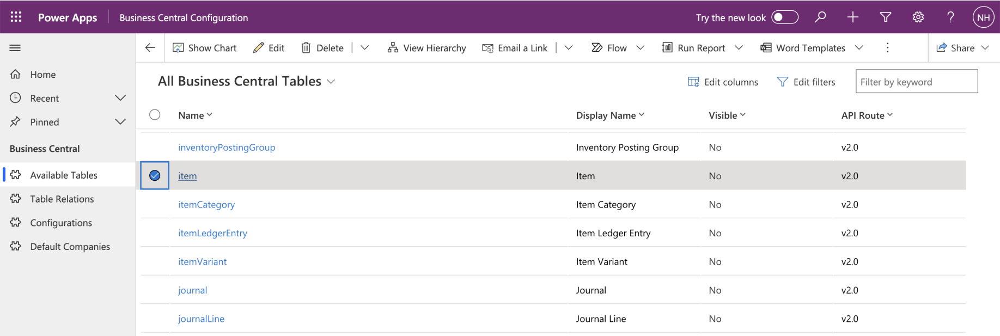
*I opened the Business Central Configuration app*

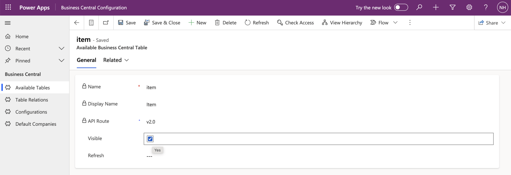
*I made the Business Central Item table visible*

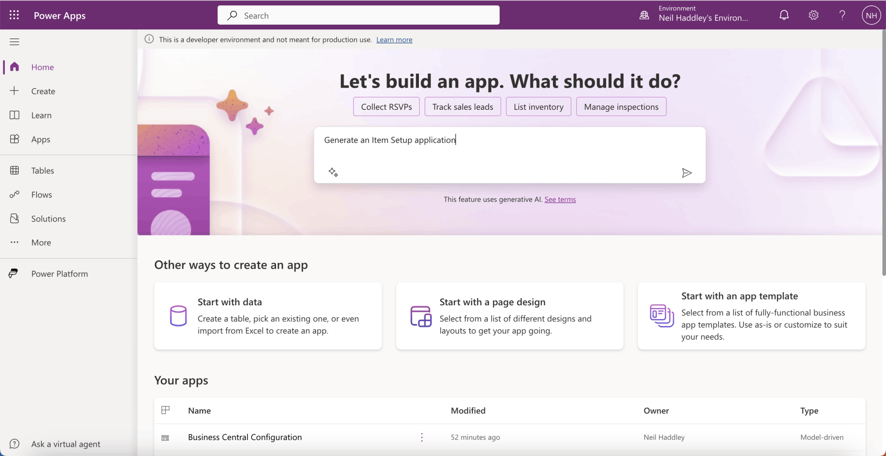
*I generated an Item Setup app with Copilot*

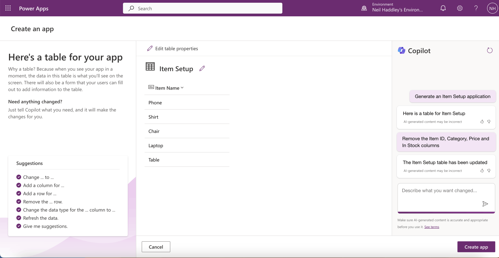
*I asked Copilot to remove the columns I did not need*

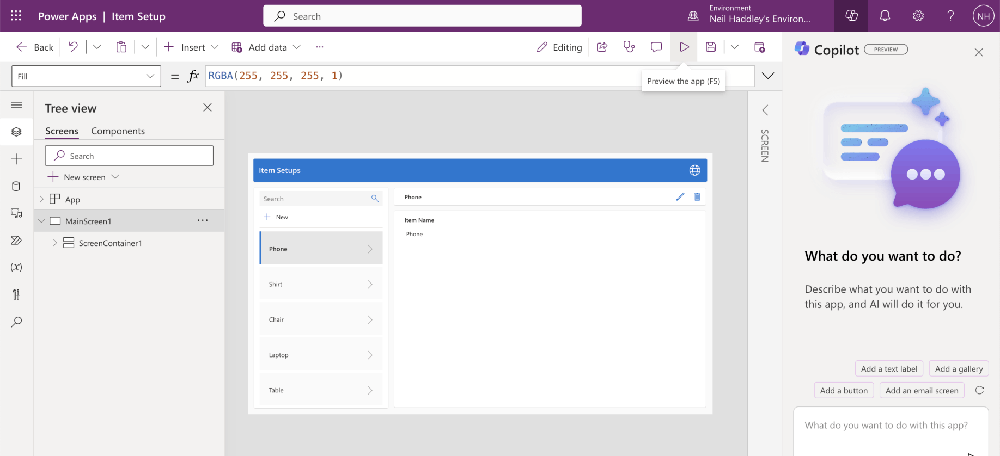
*I clicked the "Preview the app" button*

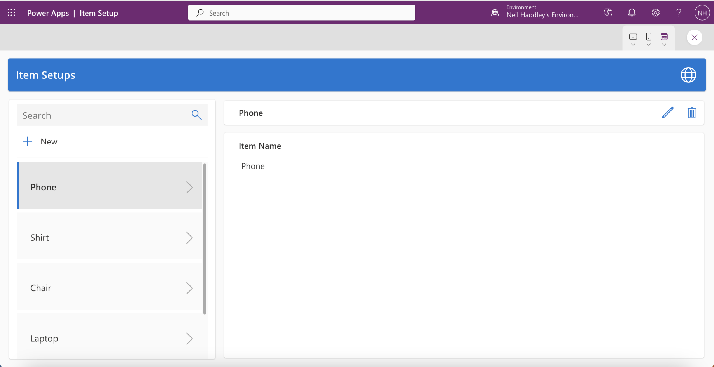
*I reviewed the app*

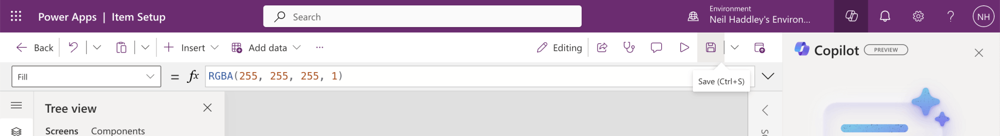
*I saved the app*

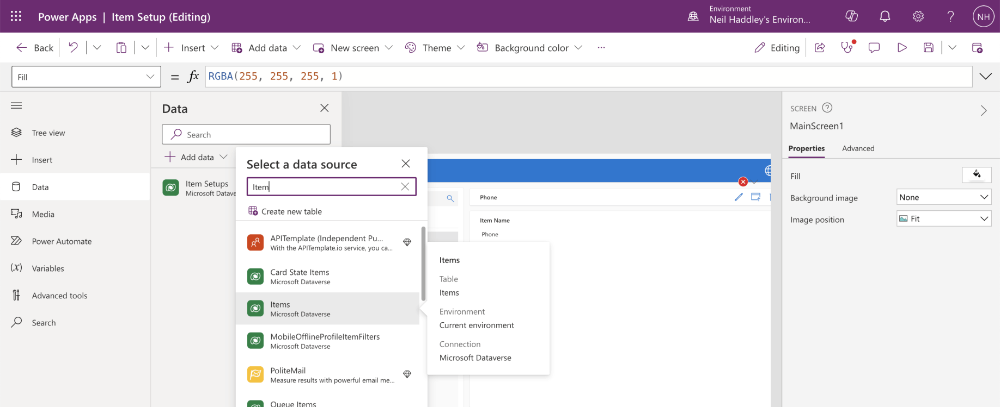
*I switched to the Data tab and clicked the + Add data button*

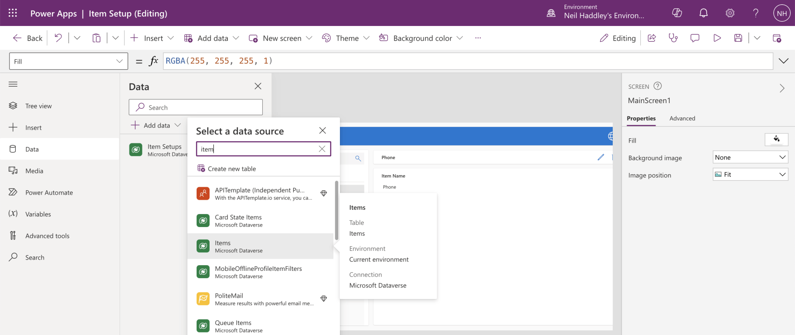
*I selected the Business Central Virtual Table*

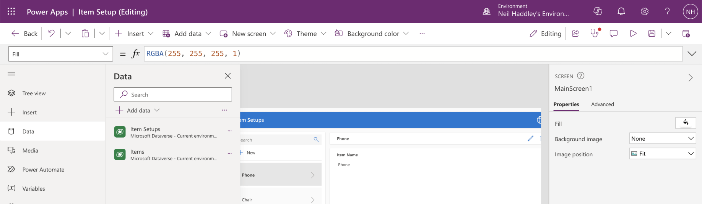
*The Items table was added*

:::no-dumb-questions
**Q: What does Patch do?**

A: Patch is a Power Fx function that creates a record in a data source, or changes one that already exists. Here the Publish button uses it to create an item in the Business Central Items table.

**Q: Why use a Business Central Virtual Table?**

A: A virtual table lets a Power Apps app read and write Business Central data through Dataverse, without keeping a second copy of the data. That is why I could add the Items table to the app as a data source.
:::

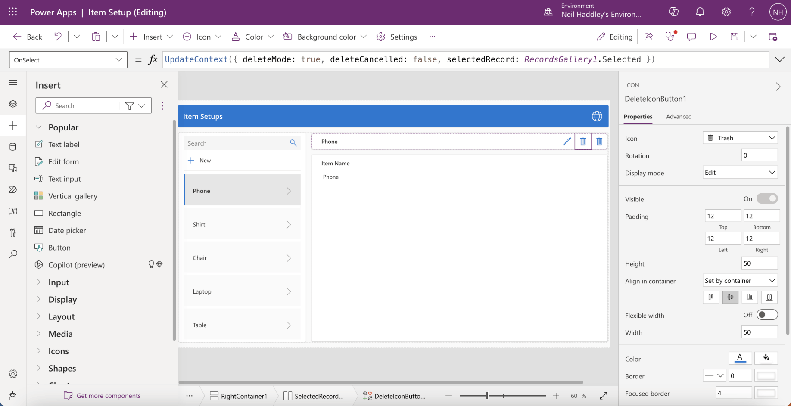
*I duplicated the delete button*

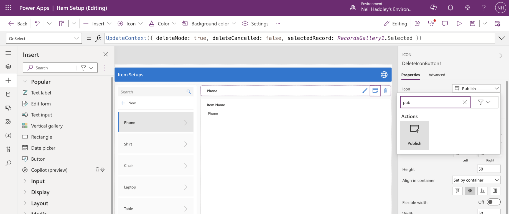
*I configured the new button to display the Publish icon*

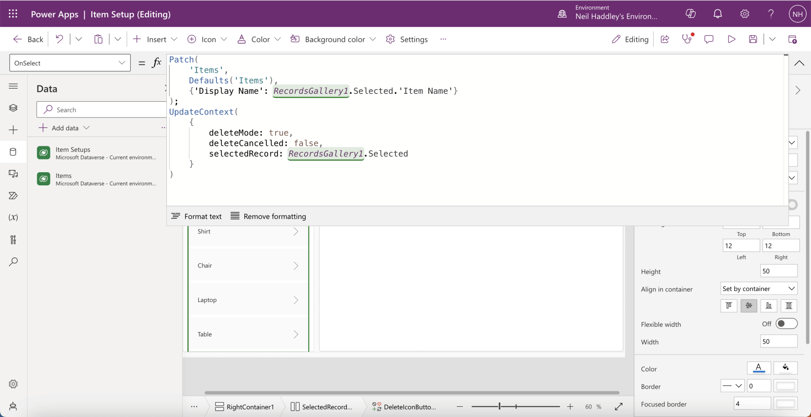
*I updated the button's OnSelect property*

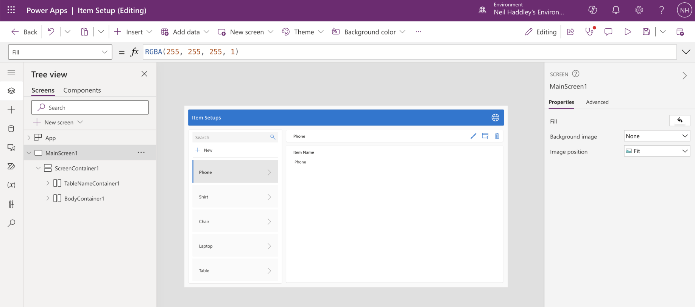
*I previewed the app*

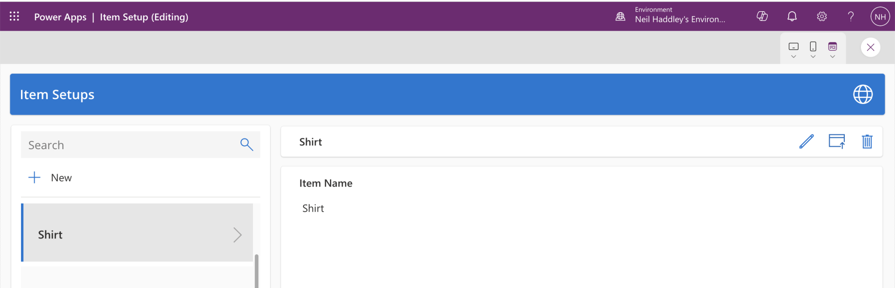
*I selected an item and clicked the Publish button*

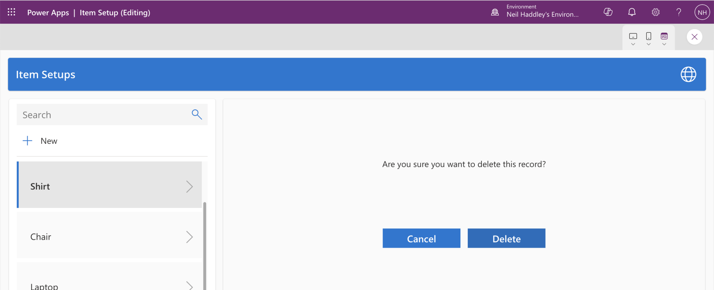
*The item was added to Business Central and I was prompted to confirm a delete*

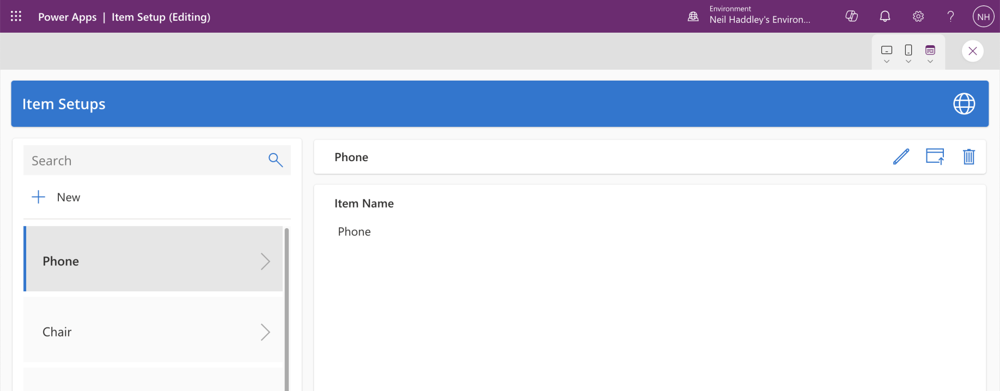
*The Item Setup record has been deleted*

:::watch-it The Publish button was a copy of the delete button
I made the Publish button by duplicating the delete button, and then I changed its icon and its OnSelect property. That is why the app still asked me to confirm a delete after the item was added. The Item Setup record was removed, because the real item now exists in Business Central, but a confirmation that says delete is confusing. In a finished app I would change the wording.
:::

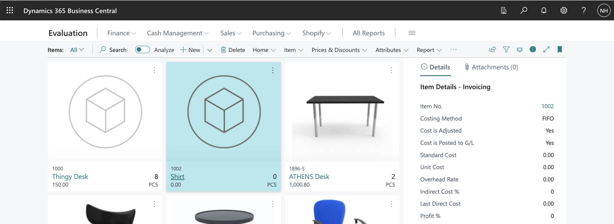
*The Business Central item has been added*

:::test-drive Try it yourself
1. Preview the app, select an item in the Item Setup list, and click Publish.
2. Confirm the delete, and check that the Item Setup record has gone.
3. Open the Items list in Business Central and look for the new item.
:::

:::bullet-points Recap
- A Copilot-generated Item Setup app gave me a place to prepare a new item.
- Patch creates a record in a data source, and here it created the Business Central item.
- The Business Central Virtual Table made the Items table available to the app without a second copy.
- A button that I copied from the delete button still asked for a delete confirmation.
:::
