## Summary

:::brain-power Before you read on
A purchase order has a header, which says who it is for, and lines, which say what is being ordered. Which would you create first in an app, and why?
:::

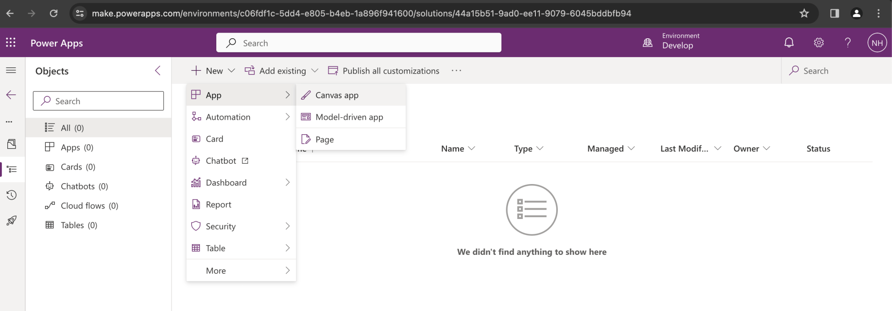
*I created a Canvas app*

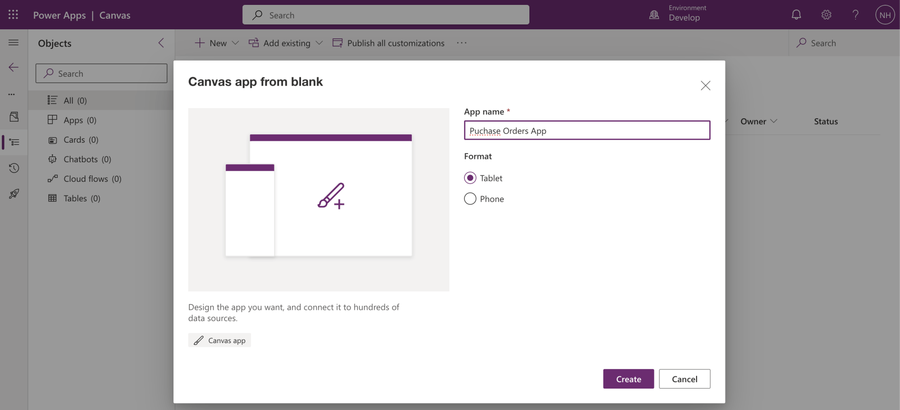
*I named the Canvas app "Purchase Orders App"*

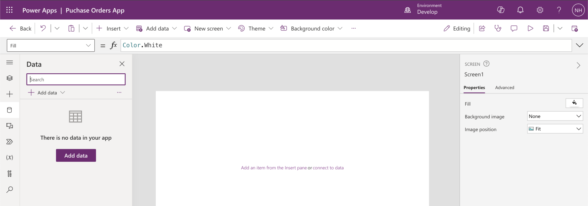
*I clicked the Data tab*

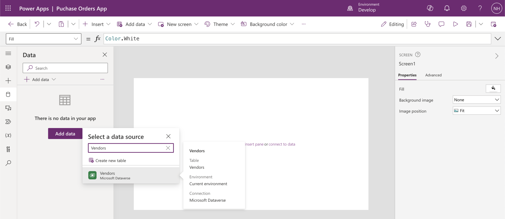
*I added the Business Central "Vendors" Table*

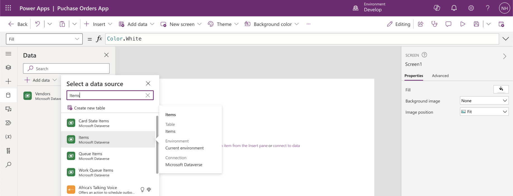
*I added the Business Central "Items" Table*

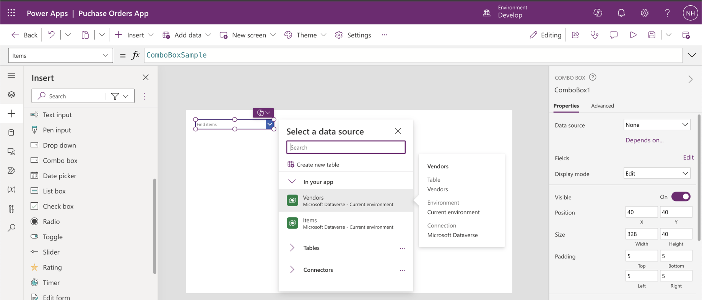
*I added ComboBox1 allowing the user to select a Vendor*

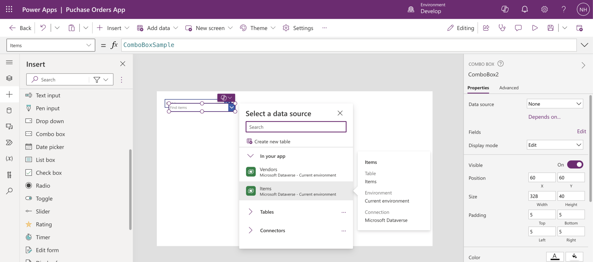
*I added ComboBox2 allowing the user to select an Item*

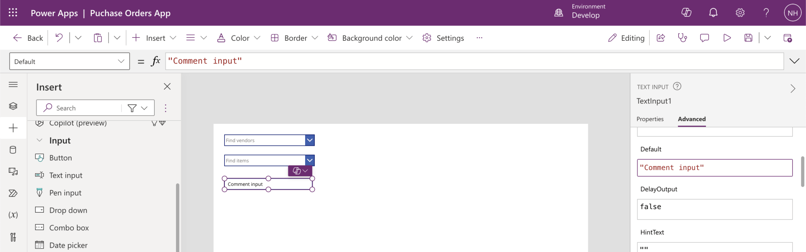
*I added TextInput1 allowing the user to enter a comment*

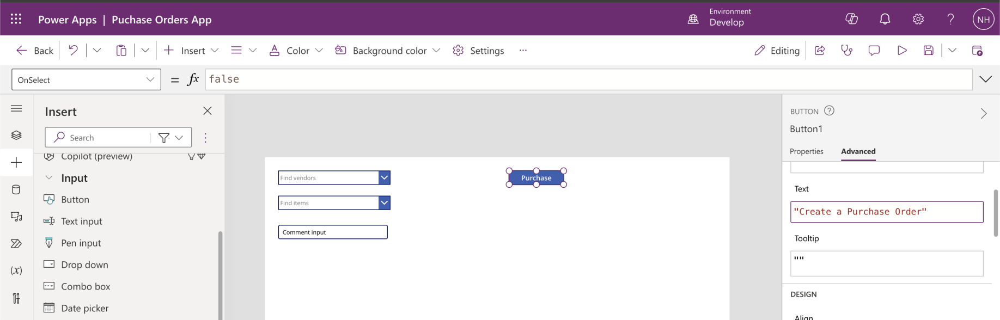
*I added a "Create a Purchase Order" Button*

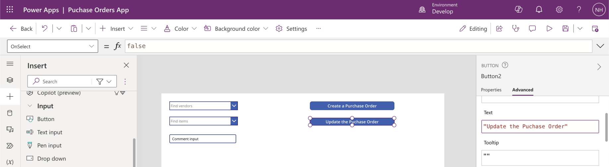
*I added an "Update the Purchase Order" Button*

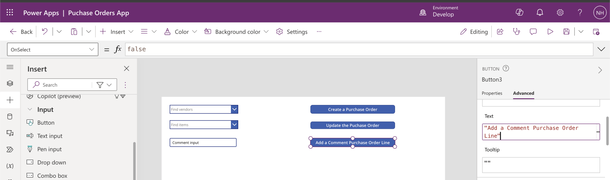
*I added an "Add a Comment Purchase Order Line" Button*

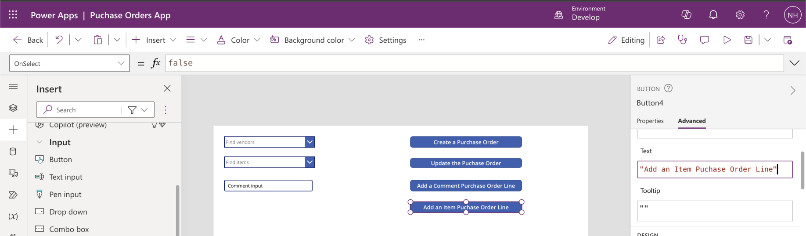
*I added an "Add an Item Purchase Order Line" Button*

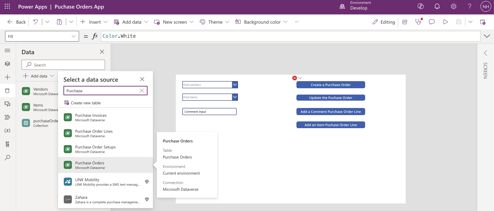
*I added the Business Central "Purchase Orders" Table*

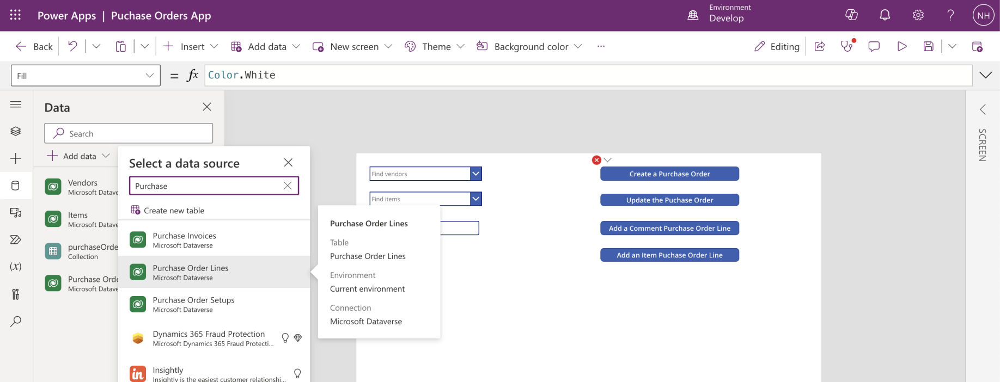
*I added the Business Central "Purchase Order Lines" Table*

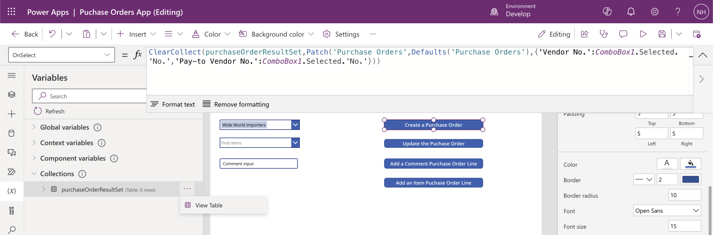
*I added OnSelect code to the Create a Purchase Order button*

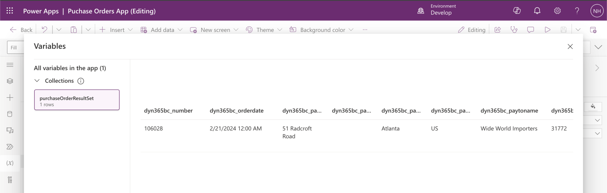
*I reviewed the purchaseOrderResultSet collection returned (the single row)*

:::no-dumb-questions
**Q: What are Purchase Order Lines?**

A: The rows of a purchase order. In this post I add two kinds: a comment line, which carries the text that I typed, and an item line for the ATHENS Mobile Pedestal.

**Q: Why did I look at the purchaseOrderResultSet collection?**

A: The Create button stores the result in a collection, and the collection held the single new row. I could see the purchase order that Business Central created before I used it in the next steps.
:::

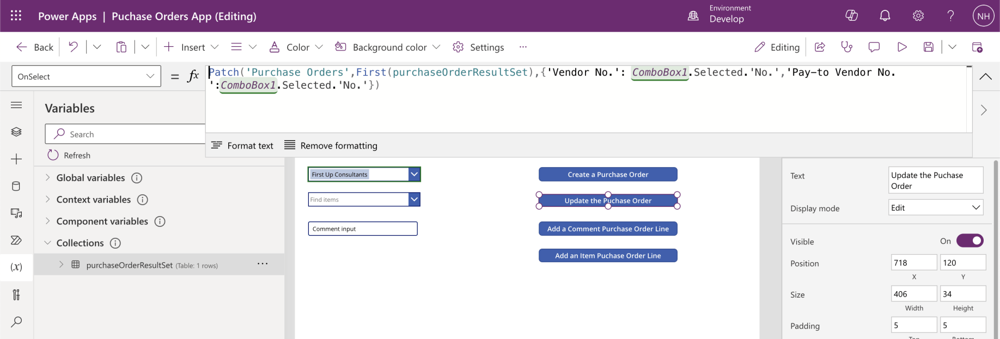
*I added the OnSelect code to the "Update the Purchase Order" button*

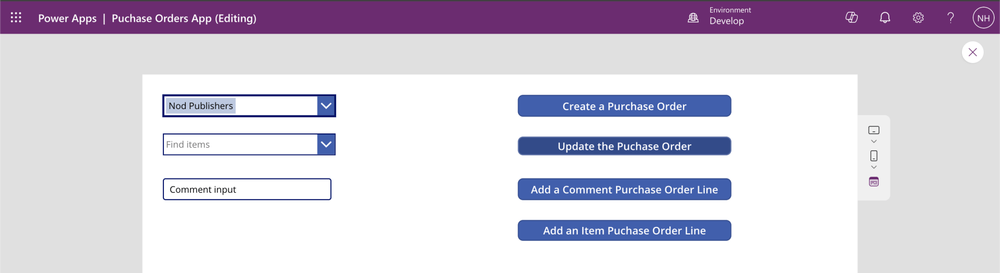
*I selected "First Up Consultants" and clicked the "Update the Purchase Order" button*

:::pencil Which button first?
The app has four buttons: Create a Purchase Order, Update the Purchase Order, Add a Comment Purchase Order Line and Add an Item Purchase Order Line. Which one must I click first, and what would go wrong if I clicked Add an Item Purchase Order Line first?

:::answer
Create a Purchase Order comes first, because the lines belong to a purchase order that has to exist. Without it, the line buttons have no order to add the line to. The order in the post is create, update with the vendor, add the comment line, and then add the item line.
:::
:::

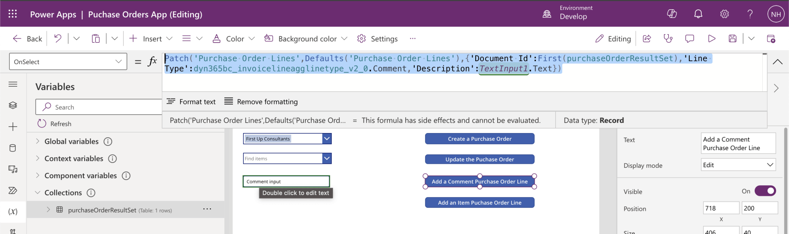
*I added the OnSelect code to the "Add a Comment Purchase Order Line" button*

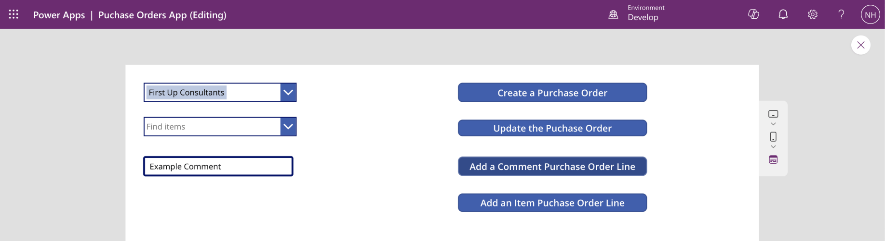
*I entered "Example Comment" into the text input and clicked the "Add a Comment Purchase Order line" button*

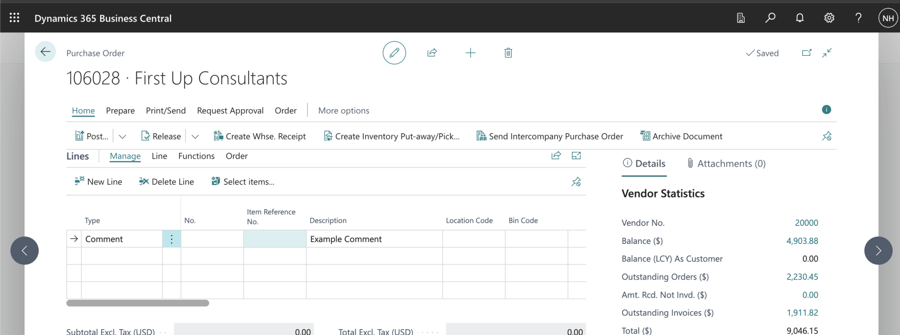
*I reviewed the Purchase Order and the Comment Purchase Order Line*

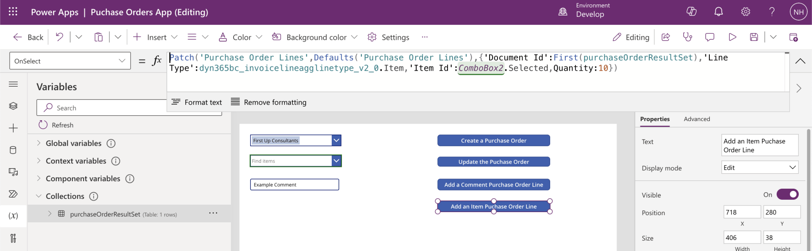
*I added the OnSelect code to the "Add an Item Purchase Order Line" button*

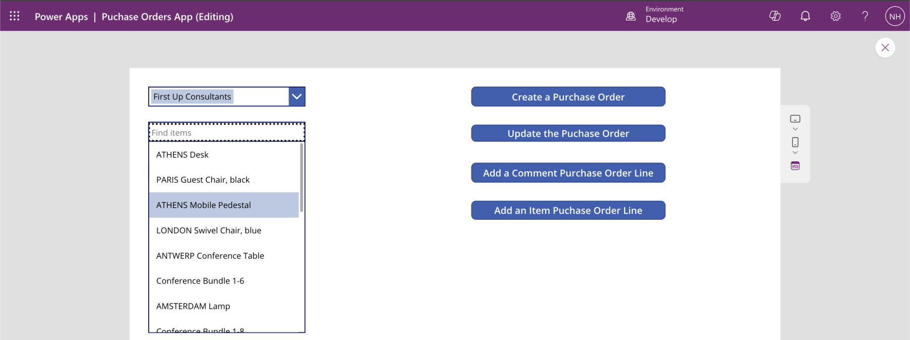
*I selected the "ATHENS Mobile Pedestal" item*

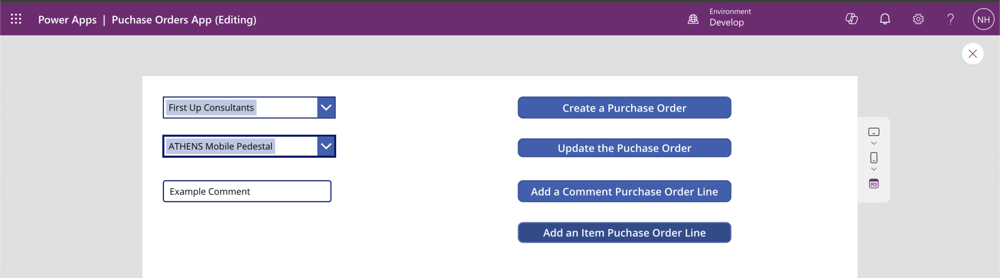
*I clicked the "Add an Item Purchase Order Line" Button*

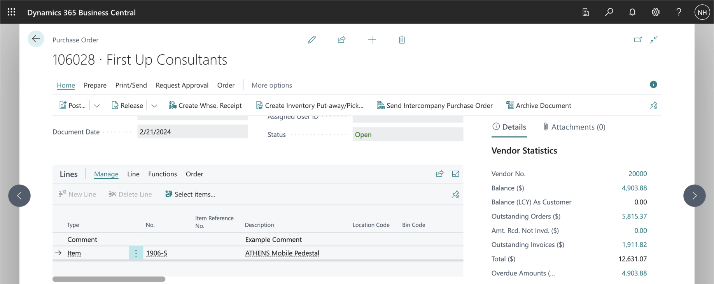
*I reviewed the newly created "ATHENS Mobile Pedestal" Purchase Order Line*

:::test-drive Try it yourself
1. Click Create a Purchase Order, and then choose a vendor and click Update the Purchase Order.
2. Type a comment and add the comment line.
3. Choose an item and add the item line.
4. Open the purchase order in Business Central and compare it with the app.
:::

:::bullet-points Recap
- A purchase order needs its header before it can have lines.
- Patch created the purchase order, and the same pattern added a comment line and an item line.
- A collection held the new purchase order, so the later buttons could use it.
- I checked the result in Business Central after each step.
:::
