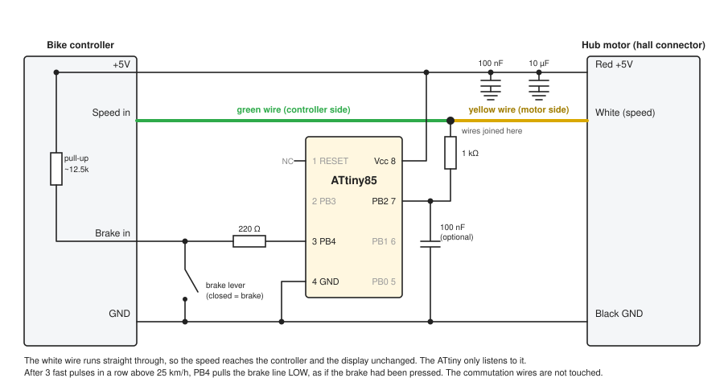
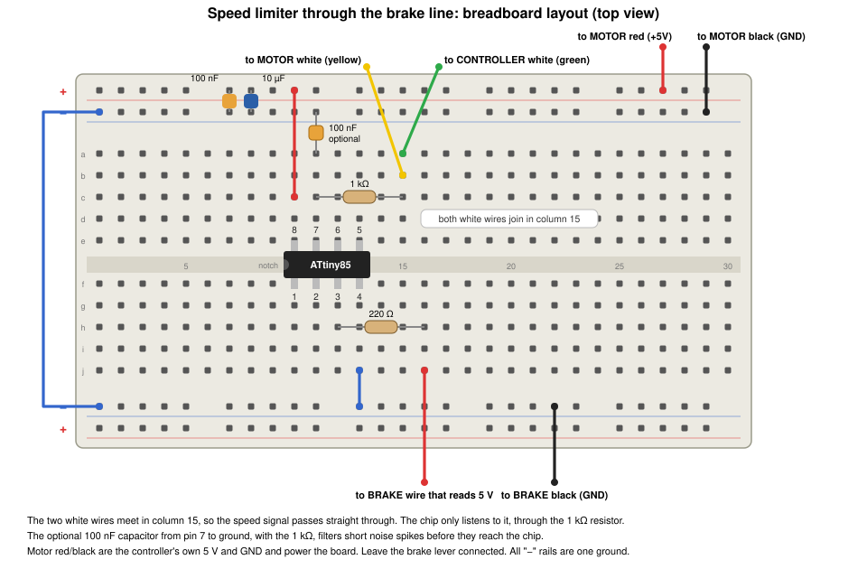
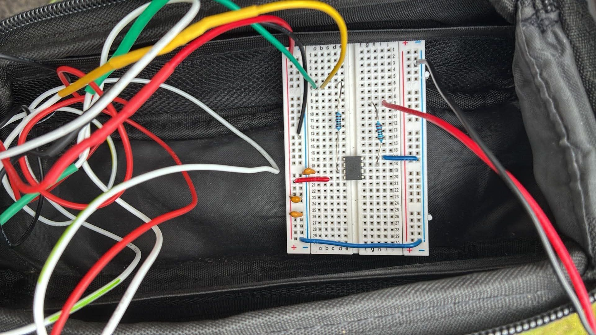

[Part 2](/posts/attiny2/) ended with the bike's display showing double the real speed above 25 km/h. I hoped that would make the motor stop assisting at 25 km/h, but it did not.

The chip now listens to the speed wire and pulls the brake line LOW above 25 km/h, which cuts the motor.

## The brake lever is a switch

An e-bike controller cuts the motor when the brake lever is pulled. That line is a signal I can reach. I measured it with a meter.

```PROMPT
I am working on the Brake-cutoff line approach. I have accessed the brake sensor line red and black wire. 5v and 0.4 mA when I connect meter across the sensor wires
```

Two numbers tell the whole story:

- **About 5 V** with nothing connected. The controller holds the line at 5 V.
- **About 0.4 mA** with the meter connected as a short circuit across the wires. That is the current the line can supply.

5 V divided by 0.4 mA is about 12.5 kΩ, so the controller pulls the line up to 5 V through roughly 12.5 kΩ, and the brake lever connects it to ground. The input is active LOW: 5 V means no brake, and 0 V means brake.

That suits a small chip. The ATtiny85 can join the lever in parallel, and it only ever needs to do one of two things with a spare pin, PB4:

- **Pull the line LOW** by making PB4 an output set to LOW. The controller sees the brake and cuts the motor.
- **Let go** by making PB4 an input with no pull-up, which leaves the pin disconnected. The controller's own pull-up raises the line back to 5 V.

PB4 never drives the line HIGH, so it cannot fight the real lever. If the ATtiny fails or loses power, the pin lets go and the real brake lever still works. The 0.4 mA is small enough that no transistor is needed, just a 220 Ω resistor in series.

The two white wires, the motor's and the controller's, are joined, so the speed reaches the controller and the display exactly as it did before. The chip only listens to that wire, through a 1 kΩ resistor on pin 7 (PB2), and it pulls the brake line LOW through a 220 Ω resistor on pin 3 (PB4). A 100 nF capacitor from pin 7 to ground is optional. With the 1 kΩ resistor, it filters short noise spikes before they reach the chip.


*The circuit with the optional 100 nF capacitor on the speed input*


*The breadboard with the optional 100 nF capacitor between the pin 7 column and the ground rail, turned to match the way the board sits in the bag*


*The final breadboard in the frame bag, with the capacitors, the two resistors and the leads to the bike's wires*

The program is 678 bytes, and this is the full listing, comments included, the same as `hubspeed.ino` in the repository. The interrupt handler runs on both edges of the wire: the falling edge records when a pulse started, and the rising edge decides whether it was a real wheel pulse. It still calls only `micros`.

```c
// ============================================================
//  ATtiny85 — e-bike speed limiter, through the brake sensor line
//
//  VERSION 1.0 — RELEASED, WORKING VERSION
//  This is the released, working version of the hubspeed code. It
//  limits the bike to 25 km/h (release below 24 km/h), 678 bytes
//  built with hubspeed/build_and_flash.sh. Flash it with
//  ./build_and_flash.sh flash. Do not build it as a plain .ino
//  (see build_and_flash.sh for why).
//
//  The motor's white speed wire and the controller's white wire
//  are joined together, so the speed signal reaches the controller
//  and the display exactly as it did before. The ATtiny only LISTENS
//  to that wire on PB2, and when the bike is faster than the limit it
//  pulls the brake sensor line LOW on PB4, as if the brake had been
//  pressed. The controller then cuts power to the motor.
//
//  Behaviour:
//    3 wheel pulses in a row faster than 25 km/h -> brake line pulled LOW
//                                                   (motor cut)
//    a wheel pulse slower than 24 km/h           -> brake line released
//                                                   (motor runs)
//    no wheel pulses for 1 s                     -> brake line released
//
//  The 1 km/h gap between 25 and 24 stops it chattering at the limit.
//
//  Noise: at high motor power the speed wire picks up spikes. A real
//  wheel pulse is LOW for several milliseconds, so anything LOW for
//  less than 1.5 ms is ignored, and the brake is only applied after 3
//  fast pulses in a row, so one stray pulse cannot trigger it.
//
//  If the ATtiny fails or loses power, the brake line is released and
//  the speed wire is still joined: the bike behaves as it did before.
//
// ============================================================
//  WIRING
// ============================================================
//
//  Speed wire (the white wire in the hub motor's hall connector):
//    Join the motor-side half and the controller-side half together.
//    Tap the joined wire to PB2 (pin 7) through a 1 kΩ resistor.
//    Optional: a 100 nF capacitor from PB2 to GND. With the 1 kΩ it
//    filters short noise spikes before they reach the chip.
//    The controller's own pull-up holds the wire HIGH; each magnet
//    passing the hall sensor pulls it LOW (about 6 pulses per wheel
//    turn, idle HIGH, about 18 % LOW).
//
//  Brake sensor line (measured: about 5 V open circuit, 0.4 mA short
//  circuit, so the controller pulls it up through about 12.5 kΩ and
//  the brake lever pulls it to ground):
//    brake wire that reads 5 V ──[220 Ω]── PB4 (pin 3)
//    brake wire that reads 0 V ─────────── GND (pin 4)
//    Leave the brake lever connected: the lever and the ATtiny are
//    two switches on the same line, so either one applies the brake.
//    Cutoff: PB4 = output LOW. Released: PB4 = input, high-Z. The pin
//    never drives HIGH, so it cannot fight the lever.
//
//  Power (the hub connector's thin RED and BLACK wires are the
//  controller's own +5 V and GND):
//    Pin 8 (Vcc) ── RED  (+5 V)
//    Pin 4 (GND) ── BLACK
//    100 nF ceramic and 10 µF capacitors across pin 8 / pin 4, right
//    at the chip. Motor PWM puts ripple on the 5 V rail.
//
//  Do NOT touch the green, yellow and blue commutation hall wires.
//
//  Parts: ATtiny85 (internal 1 MHz, factory fuses), 1 kΩ, 220 Ω,
//  100 nF ceramic and 10 µF capacitors for the supply, and the
//  optional 100 nF ceramic on PB2.
//
// ============================================================
//  BENCH CHECK (wheel off the ground)
// ============================================================
//    Spin the wheel past the limit: the brake line reads about 0 V and
//    the motor cuts. Slow below the release speed: it reads about 5 V and the
//    motor runs again.
//
// ============================================================
//  PIN MAP
// ============================================================
//    Pin 1  PB5 / RESET   unused
//    Pin 2  PB3           unused
//    Pin 3  PB4           OUTPUT  -> brake sensor line (via 220 Ω)
//    Pin 4  GND
//    Pin 5  PB0           unused
//    Pin 6  PB1           unused
//    Pin 7  PB2           INPUT   <- speed wire (via 1 kΩ)
//    Pin 8  Vcc
//
// ============================================================

#include <avr/interrupt.h>

#define HALL_IN_PIN  2       // PB2, physical pin 7
#define BRAKE_PIN    4       // PB4, physical pin 3

// Output register bit stays 0, so switching the pin to an output pulls
// the brake line LOW, and switching it to an input lets it go.
#define BRAKE_ON()   (DDRB |=  (1 << BRAKE_PIN))
#define BRAKE_OFF()  (DDRB &= ~(1 << BRAKE_PIN))

// Time between wheel pulses at a given speed
// (29 inch wheel, 2.314 m round, 6 magnets, so 6 pulses per turn):
//   25 km/h -> a pulse every 55 538 µs
//   24 km/h -> a pulse every 57 852 µs
const uint32_t CUT_PERIOD_US     = 55538UL;   // shorter than this: faster than 25 km/h
const uint32_t RELEASE_PERIOD_US = 57852UL;   // longer than this: slower than 24 km/h
const uint32_t MIN_PERIOD_US     = 10000UL;   // closer together than this is noise, not a wheel
const uint32_t STOPPED_US        = 1000000UL; // no pulse for this long: the wheel has stopped
const uint32_t MIN_LOW_US        = 1500UL;    // a real pulse is LOW for longer than this
const uint8_t  FAST_PULSES       = 3;         // fast pulses in a row before the brake is applied

volatile uint32_t lastFallUs = 0;   // start of the last accepted wheel pulse
uint32_t fallUs    = 0;             // start of the pulse being measured (interrupt only)
uint8_t  fastCount = 0;             // fast pulses in a row (interrupt only)

// ------------------------------------------------------------
//  Pin-change interrupt on the speed wire
//    falling edge: a magnet may be passing the hall sensor
//    rising edge:  the pulse has ended, so decide whether it was real
// ------------------------------------------------------------
ISR(PCINT0_vect)
{
  uint32_t now = micros();

  if ((PINB & (1 << HALL_IN_PIN)) == 0) {      // line went LOW
    fallUs = now;
    return;
  }

  // The line went HIGH: the pulse has ended
  if (now - fallUs < MIN_LOW_US) return;       // LOW for too short a time: noise

  uint32_t period = fallUs - lastFallUs;
  if (period < MIN_PERIOD_US) return;          // too soon after the last pulse: noise
  lastFallUs = fallUs;

  if (period > STOPPED_US) {                   // first pulse after the wheel was stopped
    fastCount = 0;
    return;
  }

  if (period < CUT_PERIOD_US) {
    if (++fastCount >= FAST_PULSES) BRAKE_ON();
  } else {
    fastCount = 0;
    if (period > RELEASE_PERIOD_US) BRAKE_OFF();
  }
}

void setup()
{
  // The controller holds the wire HIGH; the internal pull-up only keeps
  // the pin quiet if the tap wire ever comes loose.
  pinMode(HALL_IN_PIN, INPUT_PULLUP);

  PORTB &= ~(1 << BRAKE_PIN);      // latch LOW; only DDRB changes
  BRAKE_OFF();

  PCMSK |= (1 << HALL_IN_PIN);     // pin-change interrupt on PB2 only
  GIMSK |= (1 << PCIE);
  sei();
}

void loop()
{
  // No wheel pulses for a second: the bike has stopped, let go of the brake line
  noInterrupts();
  uint32_t last = lastFallUs;
  interrupts();
  if ((uint32_t)(micros() - last) > STOPPED_US) BRAKE_OFF();
}
```

The interrupt handler does all of the work. The falling edge on the speed wire marks the start of a possible wheel pulse, and the rising edge ends it. The handler throws the pulse away if it was LOW for under 1.5 ms or came less than 10 ms after the last one, then compares the gap since the last real pulse with the two limits, and pulls or releases the brake line. The loop only checks that the wheel is still turning. The pin uses the chip's internal pull-up, which only matters if the tap wire ever comes loose, because the controller holds the real wire HIGH. The sketch, the circuit and the [design notes](https://github.com/Haddley/bikespeed/blob/main/design.md) are in the [bikespeed repository](https://github.com/Haddley/bikespeed/tree/main/hubspeed).

## What stands out

- **A display is not a controller.** Part 2 doubled the signal that the display reads, and the display obeyed. The controller never looked at that wire. I should have checked which wire the motor logic uses before I designed around the wrong one.
- **Two measurements told me what the brake line is.** 5 V open circuit and 0.4 mA short circuit meant a pull-up of about 12.5 kΩ and a line that is active LOW. That was enough to design a safe way to join it, in parallel with the lever.
- **Take parts out once they stop earning their place.** The doubling circuit and its code only existed to fool the display. Without them there is nothing in the speed path that can fail.

:::bullet-points Recap
- The doubled white wire changed the display, and the motor kept running, because the controller takes its speed from the commutation hall wires.
- The brake sensor line reads 5 V open circuit and 0.4 mA short circuit, which makes it an active LOW input with a pull-up of about 12.5 kΩ.
- The ATtiny pulls it LOW through PB4 and a 220 Ω resistor above 25 km/h, and lets go below 24 km/h, in parallel with the real brake lever.
- The final design joins the two halves of the white wire, so the speed passes straight through. The chip only listens to it and pulls the brake line.
- The road tests with the 25 km/h limit, at power levels 3 and 1, both showed the motor switching off as the speed reached 25 km/h.
:::

## References

- [Part 2 — The speed limiter, simulated in Tinkercad](/posts/attiny2/)
- [Part 1 — Programming a bare ATtiny85](/posts/attiny1/)
- [The bikespeed repository: code, circuit and design notes](https://github.com/Haddley/bikespeed)
