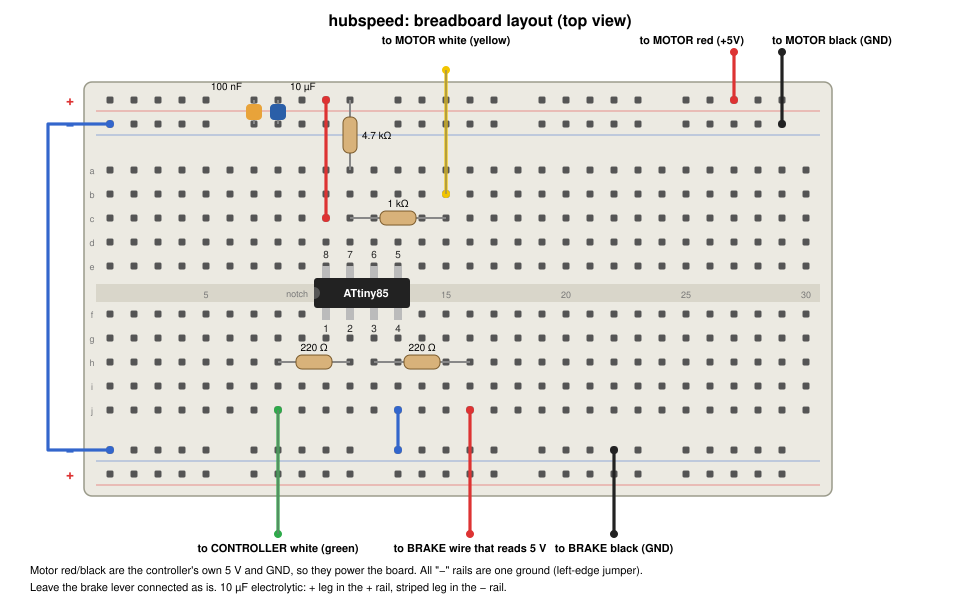
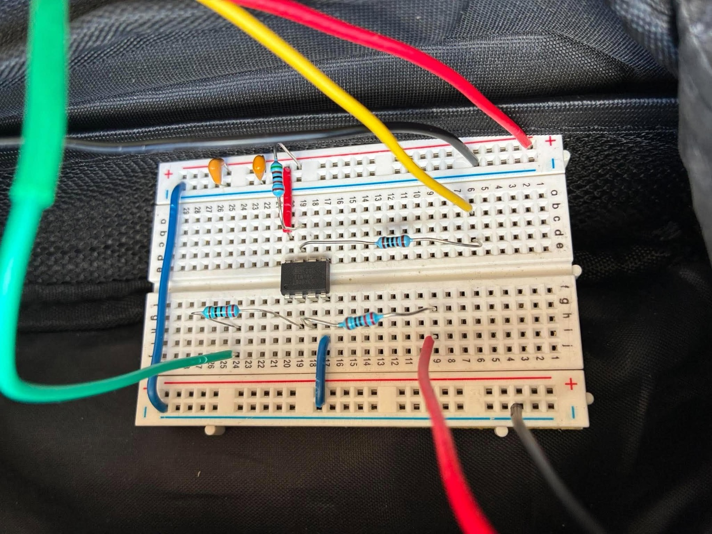
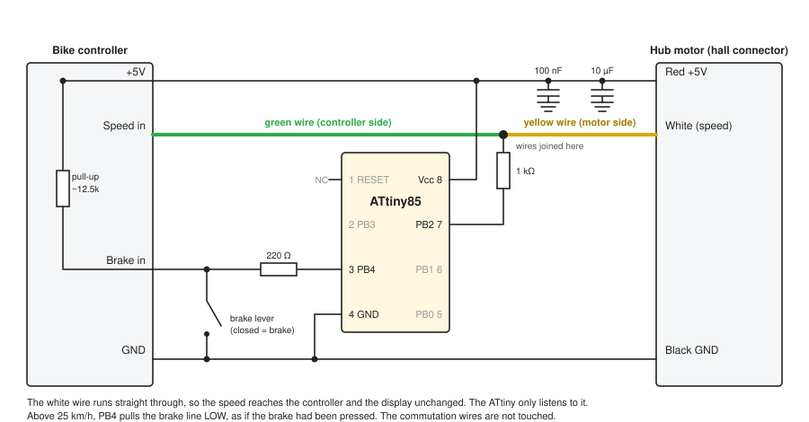
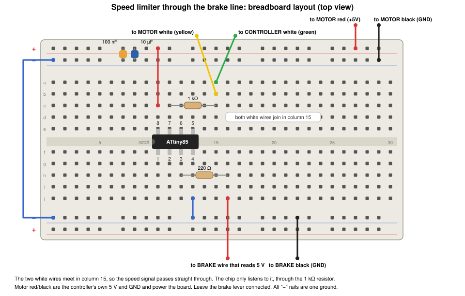

[Part 2](/posts/attiny2/) ended with the bike's display showing double the real speed above 25 km/h. That was the easy half of the job. I wanted the motor to stop assisting at 25 km/h, and the doubled display did not do that. In this part I take the chip back to the bike, work out why the motor kept running, find a second wire that does stop it, hit a build bug, and then strip the design right back.

## The motor kept running

In the field test, the display did what the bench test promised: it climbed with the wheel, and when the real speed went from 24 km/h to 26 km/h it jumped to 52 km/h. The motor carried on supplying power the whole time.

```PROMPT
Speed displayed on bike display increased from 24km/h to 52km.h as real speed increased from 24km/h to 26km/h. So success. Unforunately the bike's controller continued to provide power to the hub motor
```

Part 2 assumed that a controller with a speed limit above 25 km/h would cut assistance when it saw the doubled speed. This controller does not. Claude Code explained why. The white wire only carries the speed to the display. The controller works out its own speed from the three commutation hall wires, the green, yellow and blue ones that switch the motor phases, and it does not use the white wire to decide whether to cut power. Doubling the white wire changed what I could see on the display and nothing else.

:::brain-power Another way to stop the motor
I could not touch the commutation wires. Interfering with them can make the motor stutter or damage the controller. Is there another wire on the bike that tells the controller to cut the motor? Think about what happens when you squeeze a brake lever before you read on.
:::

## The brake lever is a switch

An e-bike controller cuts the motor when the brake lever is pulled. That line is a signal I can reach, and it is much safer than the commutation wires. I measured it with a meter.

```PROMPT
I am working on the Brake-cutoff line approach. I have accessed the brake sensor line red and black wire. 5v and 0.4 mA when I connect meter across the sensor wires
```

Two numbers tell the whole story:

- **About 5 V** with nothing connected. The controller holds the line at 5 V.
- **About 0.4 mA** with the meter connected as a short circuit across the wires. That is the current the line can supply.

5 V divided by 0.4 mA is about 12.5 kΩ, so the controller pulls the line up to 5 V through roughly 12.5 kΩ, and the brake lever connects it to ground. The input is active LOW: 5 V means no brake, and 0 V means brake.

That suits a small chip. The ATtiny85 can join the lever in parallel, and it only ever needs to do one of two things with a spare pin, PB4:

- **Pull the line LOW** by making PB4 an output set to LOW. The controller sees the brake and cuts the motor.
- **Let go** by making PB4 an input with no pull-up, which leaves the pin disconnected. The controller's own pull-up raises the line back to 5 V.

PB4 never drives the line HIGH, so it cannot fight the real lever. If the ATtiny fails or loses power, the pin lets go and the real brake lever still works. The 0.4 mA is small enough that no transistor is needed, just a 220 Ω resistor in series.

## The first circuit: the chip in the speed path

My first brake design kept the chip where Part 2 had put it, between the motor's white speed wire and the controller's. It still mirrored the speed below 25 km/h and doubled it above, and it added the brake line. This is the layout, with the lead for the motor's white wire in yellow and the lead for the controller's white wire in green, the same colours as the wires on the bike.


*The first circuit, seen from above: the yellow lead comes from the motor's white wire and goes through a resistor to the chip, the green lead goes to the controller's white wire from the chip's output, the red and black leads at the top bring power from the hub connector, and the red and black leads at the bottom connect to the brake line*


*The first circuit on the breadboard in the field test, with the yellow lead coming in at the top and the green lead leaving at the bottom left*

The program was the Part 2 sketch with two additions. The chip already measured the real speed from the white wire. Now it also pulled the brake line LOW when that speed was above 25 km/h, and let go below 24 km/h, with the same 1 km/h of hysteresis.

```c
#define BRAKE_PIN    4       // PB4, physical pin 3 (active LOW, open-drain style)
#define BRAKE_CUT_ON()  (DDRB |=  (1 << BRAKE_PIN))  // output, PORTB bit 0 -> pulls LOW
#define BRAKE_CUT_OFF() (DDRB &= ~(1 << BRAKE_PIN))  // input, line floats to controller's 5 V

      // Brake-cutoff decision with hysteresis
      if (!cutting && speed_kmh > SPEED_CUTOFF_KMH) {
        cutting = true;
      } else if (cutting && speed_kmh < SPEED_CUTOFF_KMH - SPEED_HYST_KMH) {
        cutting = false;
      }
      if (cutting) BRAKE_CUT_ON(); else BRAKE_CUT_OFF();
```

The pin is only ever switched between output and input. The output register bit for PB4 stays at 0, so making PB4 an output pulls the line LOW, and making it an input lets it go.

## It did not seem to work at all

I flashed the new program and tried it. It did not seem to work at all.

```PROMPT
That did not seem to work at all. Please upload a simple program that "pulls break" for 10 seconds then allows motor to run for 10 seconds etc. always send speed 10km/h to controller/display
```

A bench test with no speed logic would show whether the brake wiring was the problem. Claude Code wrote a short program for it. It pulls PB4 LOW for 10 seconds, lets go for 10 seconds, and repeats. It sends a fixed 10 km/h signal on PB3 instead of anything real. For 10 km/h on a 29 inch wheel with 6 pulses per turn, that is a pulse every 138.9 ms, LOW for 25 ms of each.

The first version did not compile. Then I asked for the next test, which passes the real speed through and only cycles the brake:

```PROMPT
update code to always pass real speed but to turn off motor (via brake on) for 10 seconds and then to turn the motor on (via brake off) for next 10 seconds and repeat
```

This version also failed to compile, and the error message led to the real cause.

:::watch-it A program can compile and still be wrong
The Arduino build generates function declarations for an `.ino` file with a tool called ctags. On this Mac the declarations came out with the return type missing, as `setup();` and `loop();`, and the tool placed them in the wrong spot.

In the new test sketch, they landed at the top level of the file, and the compiler refused them. In my speed limiter, they landed inside the pin-change interrupt handler. There, `setup();` and `loop();` are valid statements, so the program compiled without any error. It then called `setup()` and `loop()` from inside the interrupt handler on every wheel pulse. `setup()` lets go of the brake line each time, so the brake never stayed on. That is why the first brake program "did not seem to work at all".
:::

:::under-the-hood How Claude Code confirmed it
Claude Code printed the code that the build generates, which showed the declarations. It then disassembled the compiled program that had been flashed to the chip and listed every function the interrupt handler calls:

```
interrupt handler calls: micros, setup, loop
```

The correct list is only `micros`. The broken program was 2446 bytes, and the corrected one is 2366 bytes.
:::

The fix was to keep the code out of the `.ino` file. Arduino does not generate declarations for a plain `.cpp` file, so the code is built as one, and nothing else about it changes. A small script, `build_and_flash.sh`, does that and then checks the compiled handler. If the handler calls `setup()` or `loop()`, the script refuses to program the chip.

With the bug found, I gave Claude Code the Part 2 code and asked for the speed limiter with the brake cut-out.

```PROMPT
THIS WAS THE CODE FROM LAST BLOG POST PLEASE UPDATE TO INCLUDE THE MOTOR CUT OUT (VIA BRAKE SENSOR)

STILL WANT TO SEE DOUBLE SPEED >25km/h BUT ALSO MOTOR CUT OFF VIA BREAK SENSOR
```

The program was already in the repository, with the brake cut-out added to the Part 2 code. What it needed was the corrected build. Claude Code built it with the script, which confirmed that the interrupt handler calls only `micros`, and programmed the chip. The programmer read the flash back and verified all 2366 bytes, and the fuses were still at their factory settings, so the chip runs at 1 MHz.

## Simplify: join the wires

Once the brake line was doing the work of stopping the motor, the speed path through the chip made no sense. The doubled display was a trick that did nothing useful, and every part of the circuit and the code that existed to mirror and double the signal was a part that could fail. I asked for the simplest design that still works.

```PROMPT
please simplify the hardware and the software so that the yellow and green (signal wire) connect together passing the correct speed from the motor to the controller but still using the brake sensor to cut power to the motor (as if the brake had been pressed) when speed >25km/h refactor hardware and software to be as simple as possible. please update breadboard.svg
```

The two halves of the white wire go back together, so the controller and the display get the real speed straight from the motor, exactly as they did before I touched the bike. The chip only listens to that wire and pulls the brake line when the bike is too fast.


*The simplified circuit: the white wire runs straight through, the chip listens to it through a 1 kΩ resistor, and PB4 pulls the brake line LOW through a 220 Ω resistor*

This is what went away:

- **The 4.7 kΩ pull-up.** The controller's own pull-up is back in the circuit now that the wire is whole.
- **The 220 Ω output resistor and the whole PB3 output.** Nothing comes out of the chip on the speed wire any more.
- **The mirroring, the doubling and all the speed arithmetic.** The program went from 2366 bytes to 580 bytes, about a quarter of the size.

Five parts are left: the ATtiny85, one 1 kΩ resistor, one 220 Ω resistor, and the two capacitors that decouple the supply.


*The simplified layout, seen from above: the yellow lead from the motor's white wire and the green lead to the controller's white wire go into the same column, so the column is the join, and a 1 kΩ resistor takes the signal to the chip's input*

| Chip pin | Name | Connects to | Through |
|---|---|---|---|
| 2 | PB3 | nothing | |
| 3 | PB4 | the brake wire that reads 5 V | 220 Ω |
| 4 | GND | the hub connector's black wire and the brake wire that reads 0 V | nothing |
| 7 | PB2 | the joined white speed wire, input only | 1 kΩ |
| 8 | Vcc | the hub connector's red wire, +5 V | 100 nF and 10 µF capacitors to GND |

The brake lever itself stays connected. The chip and the lever are two switches on the same line, so either one can apply the brake. If the chip fails, the speed wire is still joined and the brake line floats free, so the bike behaves as it did before.

The program is now short enough to read in one go. Instead of working out the speed in km/h, it compares the time between wheel pulses with two fixed limits. A 29 inch wheel is 2.314 m round, and the wheel has 6 magnets, so 25 km/h is a pulse every 55 538 µs and 24 km/h is a pulse every 57 852 µs. A shorter gap means a faster bike.

```c
#include <avr/interrupt.h>

#define HALL_IN_PIN  2       // PB2, physical pin 7
#define BRAKE_PIN    4       // PB4, physical pin 3

// Output register bit stays 0, so switching the pin to an output pulls
// the brake line LOW, and switching it to an input lets it go.
#define BRAKE_ON()   (DDRB |=  (1 << BRAKE_PIN))
#define BRAKE_OFF()  (DDRB &= ~(1 << BRAKE_PIN))

// Time between wheel pulses at a given speed
// (29 inch wheel, 2.314 m round, 6 magnets, so 6 pulses per turn):
//   25 km/h -> a pulse every 55 538 µs
//   24 km/h -> a pulse every 57 852 µs
const uint32_t CUT_PERIOD_US     = 55538UL;   // shorter than this: faster than 25 km/h
const uint32_t RELEASE_PERIOD_US = 57852UL;   // longer than this: slower than 24 km/h
const uint32_t MIN_PERIOD_US     = 10000UL;   // shorter than this is a glitch, not a wheel
const uint32_t STOPPED_US        = 1000000UL; // no pulse for this long: the wheel has stopped

volatile uint32_t lastFallUs = 0;   // time of the last falling edge

// ------------------------------------------------------------
//  Pin-change interrupt on the speed wire
//    each falling edge is one magnet passing the hall sensor
// ------------------------------------------------------------
ISR(PCINT0_vect)
{
  if (PINB & (1 << HALL_IN_PIN)) return;       // rising edge: ignore

  uint32_t now    = micros();
  uint32_t period = now - lastFallUs;
  lastFallUs = now;

  // Ignore glitches, and the first pulse after the wheel was stopped
  if (period < MIN_PERIOD_US || period > STOPPED_US) return;

  if (period < CUT_PERIOD_US)          BRAKE_ON();
  else if (period > RELEASE_PERIOD_US) BRAKE_OFF();
}

void setup()
{
  // The controller holds the wire HIGH; the internal pull-up only keeps
  // the pin quiet if the tap wire ever comes loose.
  pinMode(HALL_IN_PIN, INPUT_PULLUP);

  PORTB &= ~(1 << BRAKE_PIN);      // latch LOW; only DDRB changes
  BRAKE_OFF();

  PCMSK |= (1 << HALL_IN_PIN);     // pin-change interrupt on PB2 only
  GIMSK |= (1 << PCIE);
  sei();
}

void loop()
{
  // No wheel pulses for a second: the bike has stopped, let go of the brake line
  noInterrupts();
  uint32_t last = lastFallUs;
  interrupts();
  if ((uint32_t)(micros() - last) > STOPPED_US) BRAKE_OFF();
}
```

The interrupt handler does all of the work. Each falling edge on the speed wire is one magnet passing the hall sensor. The handler times the gap since the last edge, ignores a gap that is too short to be a wheel or too long to be a pulse, and then pulls or releases the brake line. The loop only checks that the wheel is still turning. The pin uses the chip's internal pull-up, which only matters if the tap wire ever comes loose, because the controller holds the real wire HIGH. After the corrected build, Claude Code confirmed that the handler calls only `micros`, and programmed the chip. The programmer verified all 580 bytes, and the fuses were still at their factory settings. The sketch, the circuit and the [design notes](https://github.com/Haddley/bikespeed/blob/main/design.md) are in the [bikespeed repository](https://github.com/Haddley/bikespeed/tree/main/hubspeed).

## Power level 3: the brake comes on too early

The simplified version worked at power level 1, where the bike accelerates slowest. At power level 3, where it accelerates fastest, the brake came on at a speed well below 25 km/h and then released. The effect was uncomfortable. I asked Claude Code what was happening.

The chip counts a falling edge on the speed wire as a wheel pulse, and a pulse that arrives too soon after the last one means a fast wheel. At high motor power the wire probably picks up electrical noise, so a stray spike looks like an extra pulse, the gap looks short, and the chip decides the bike is fast. The next real pulse then lets the brake go again. Claude Code has not measured the noise. It is the most likely cause, and a meter cannot see it, so the proof needs an oscilloscope on pin 7.

The photo of my wiring also showed a mistake, and I fixed it. The lower lead of the 220 Ω resistor was in the row for PB3 instead of PB4, and an extra resistor was in the circuit. Removing the extra resistor helped a little, but the problem at power level 3 stayed.

So the program now ignores noise in three ways:

- **A real pulse is LOW for several milliseconds.** The chip now times the whole pulse, and anything LOW for under 1.5 ms is ignored.
- **Pulses closer than 10 ms are ignored.**
- **One fast pulse is no longer enough.** The brake only comes on after 3 fast pulses in a row, and any pulse that is not fast starts the count again.

Claude Code simulated the old and new logic against a simulated wheel signal with noise added. The old logic made between 14 and 229 false brake applications a minute. The new logic made none for narrow spikes and for spikes inside a real pulse, and between 1 and 6 for wide 3 ms spikes. A simulation is not a bike, so the real answer is the next ride.

A 100 nF capacitor from pin 7 to ground is an optional extra. With the 1 kΩ resistor it filters short spikes before they reach the chip, and it costs one part.


*The circuit with the optional 100 nF capacitor on the speed input*


*The breadboard with the optional 100 nF capacitor between the pin 7 column and the ground rail*

The new program is 678 bytes. The interrupt handler now runs on both edges of the wire, and it still calls only `micros`.

## Where it stands

The 580-byte program is the one on the chip. The 678-byte program with the noise filter is built and checked, but I have not yet programmed it, because the programmer was not plugged in when Claude Code tried. The test with it comes next. This is the check to run first, with the wheel off the ground:

1. Spin the wheel. The display should show the true speed, because the speed wire is joined straight through.
2. Spin the wheel past 25 km/h. The motor should cut out, and a meter on the brake line should read about 0 V.
3. When the wheel slows below 24 km/h, the line should return to about 5 V and the motor should run again.
4. The 5 V pin on the chip should stay steady while the motor runs.

After that I will ride the bike at power levels 1 and 3, and I will add the result here when I have it.

## What stands out

- **A display is not a controller.** Part 2 doubled the signal that the display reads, and the display obeyed. The controller never looked at that wire. I should have checked which wire the motor logic uses before I designed around the wrong one.
- **Two measurements told me what the brake line is.** 5 V open circuit and 0.4 mA short circuit meant a pull-up of about 12.5 kΩ and a line that is active LOW. That was enough to design a safe way to join it, in parallel with the lever.
- **Compiling is not the same as working.** The broken program compiled, uploaded and verified without a single warning. Only reading what the compiler had produced showed the stray calls.
- **Take parts out once they stop earning their place.** The doubling circuit and its code only existed to fool the display. Without them the design needs five parts, and there is nothing in the speed path that can fail.

:::bullet-points Recap
- The doubled white wire changed the display, and the motor kept running, because the controller takes its speed from the commutation hall wires.
- The brake sensor line reads 5 V open circuit and 0.4 mA short circuit, which makes it an active LOW input with a pull-up of about 12.5 kΩ.
- The ATtiny pulls it LOW through PB4 and a 220 Ω resistor above 25 km/h, and lets go below 24 km/h, in parallel with the real brake lever.
- A build tool put `setup();` and `loop();` inside the interrupt handler, which released the brake on every pulse. Building the code as a `.cpp` file fixed it, and a script now checks for it.
- The final design joins the two halves of the white wire, so the speed passes straight through. The chip only listens to it and pulls the brake line.
- At power level 3 the brake came on too early, probably because noise on the speed wire looked like wheel pulses. The new program ignores short pulses and needs 3 fast pulses in a row.
:::

## References

- [Part 2 — The speed limiter, simulated in Tinkercad](/posts/attiny2/)
- [Part 1 — Programming a bare ATtiny85](/posts/attiny1/)
- [The bikespeed repository: code, circuit and design notes](https://github.com/Haddley/bikespeed)
