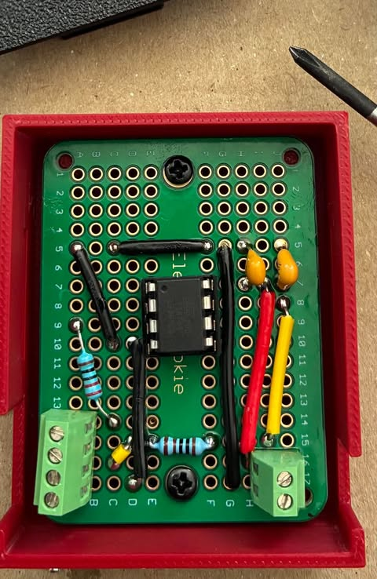
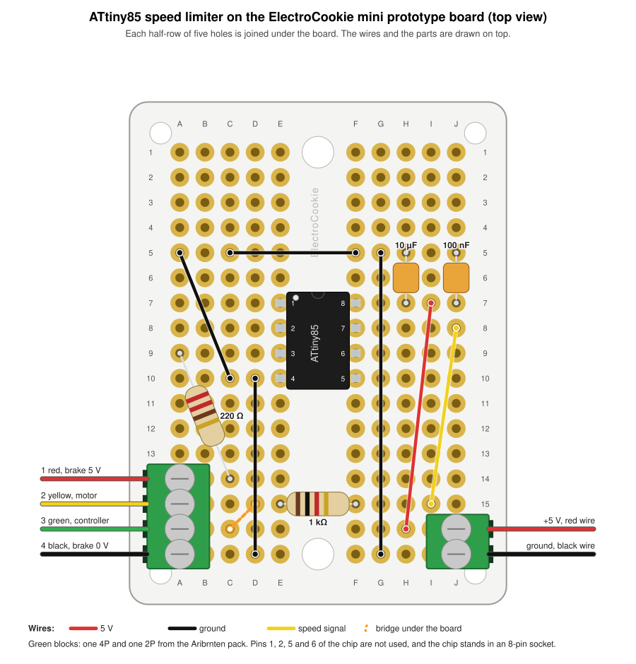
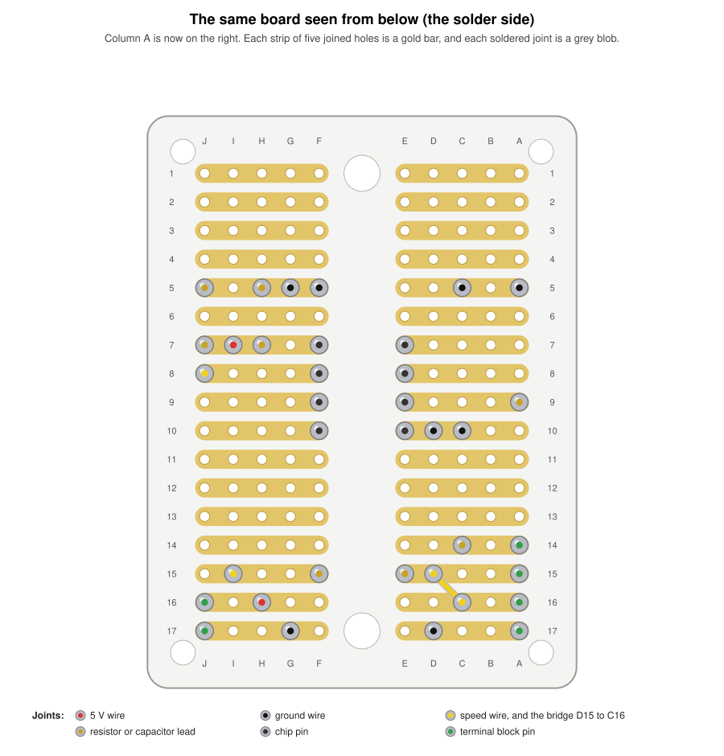
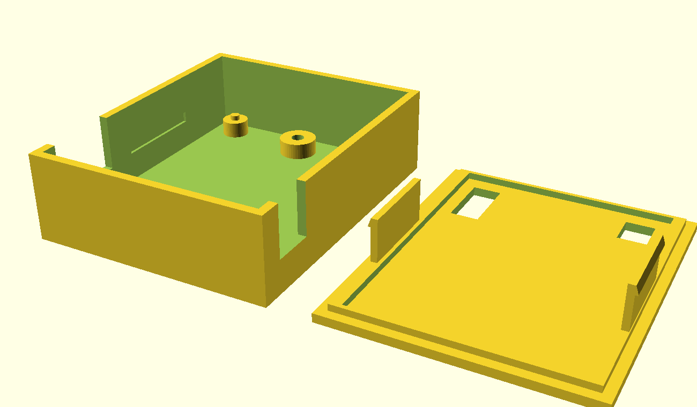
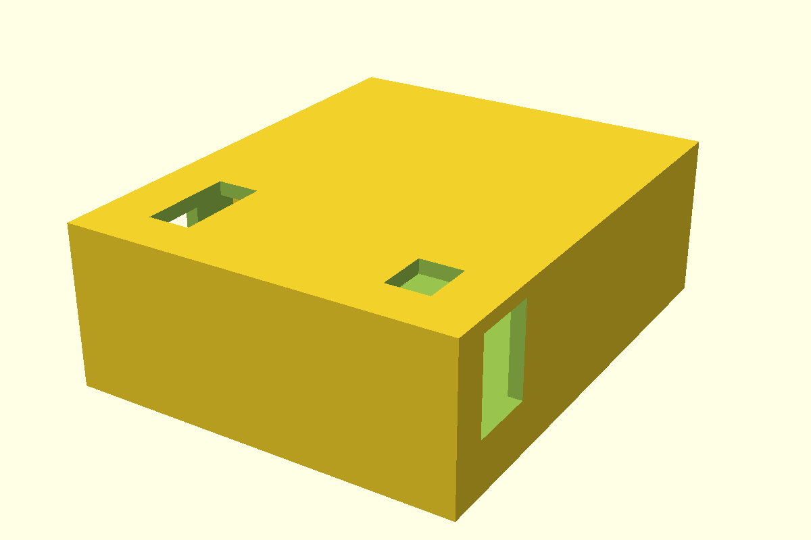
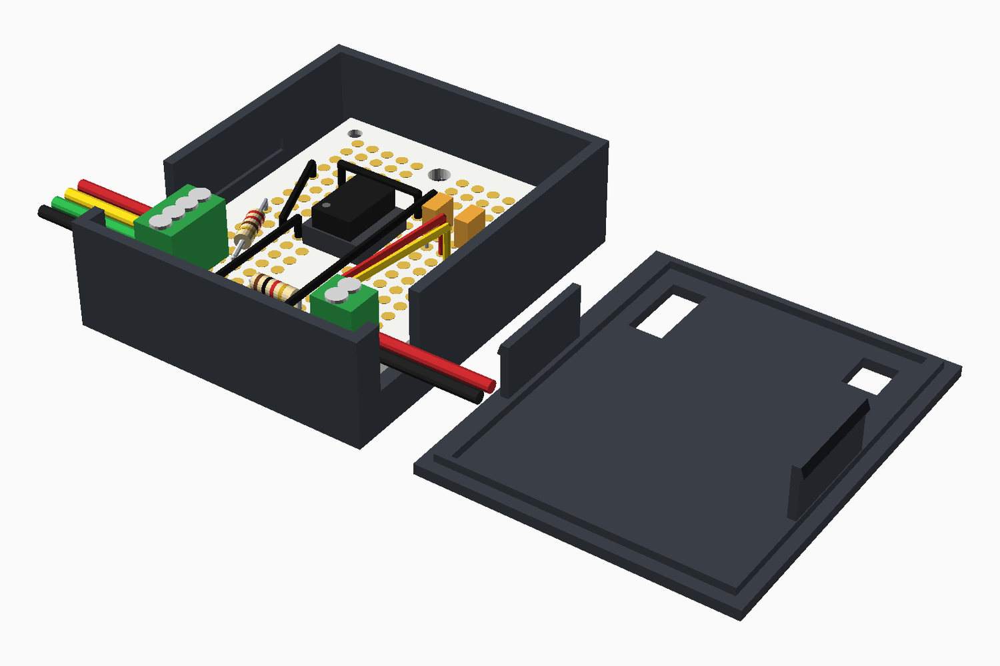

Here is the finished board, in its red case with the lid off. I have tested it on the bike. The motor cuts out at 25 km/h, as it did in Part 3, and it works great.

*I soldered the parts to the board and fitted it in the case: the chip in the middle, the 4-pole terminal block at the bottom left, the 2-pole block at the bottom right, and the red and yellow wires standing on the right-hand side*

In [Part 3](/posts/attiny3/) the ATtiny85 cuts the motor above 25 km/h by pulling the brake line LOW, and the circuit lives on a solderless breadboard in the frame bag. A breadboard was the right tool for trying ideas. I would rather have a soldered board for the bike, so in this post I make the move, and I print a case that squeezes into the bike frame.

I moved the circuit to an **ElectroCookie Mini PCB Prototype Board**, a solderable board with gold-plated holes, and I used **Aribrnten 2.54 mm PCB mount terminal blocks** for the bike's wires. They come in a pack of 50, in 2, 3 and 4 poles, and the listing rates them at 150 V and 6 A.

:::brain-power Before you read on
On a breadboard, I push a wire into any hole and the board makes the connection. On a plain soldered board, what do I have to do myself for every connection, and which connections will many parts share?
:::

## What has to move

The final circuit from Part 3 has only five parts:

- **The ATtiny85**, which I plug into an 8-pin socket. I used a socket adapter from a 66-piece kit of soldering-type DIP IC sockets with a 2.54 mm grid, in sizes from 6 to 28 pins. The socket makes the chip easy to remove and replace, and it means that I never heat the chip itself when I solder to the board
- **A 1 kΩ resistor** between the speed wire and pin 7 (PB2)
- **A 220 Ω resistor** between the brake wire and pin 3 (PB4)
- **A 100 nF capacitor and a 10 µF capacitor**, marked 104 and 106, that decouple the supply between pin 8 (Vcc) and ground
- **Optionally, a second 100 nF capacitor** between pin 7 and ground, which filters short spikes on the speed wire. The breadboard circuit in Part 3 worked without it, so I leave it off the board in this build.

Six wires from the bike connect to it: the hub connector's red wire (+5 V) and black wire (ground), the two halves of the white speed wire, and the two brake wires, one that reads 5 V and one that reads 0 V.

## The board

The board is a quarter-size breadboard that is meant for soldering. It is double-sided and gold plated to prevent oxidation, and the product drawing gives these sizes:

| | Size |
|---|---|
| Board | 1.5 × 2 inches (38.1 × 50.8 mm) |
| Holes | 17 rows, in two blocks of five columns (A to E and F to J), with a channel between them |
| Hole size | 1.2 mm through holes, on a 0.1 inch (2.54 mm) pitch |
| M2 mounting holes (Ø2.2 mm) | Four, in the corners, 31.8 mm apart across and 44.5 mm apart along the board |
| M3 mounting holes (Ø3.2 mm) | Two, in the channel between the columns, 40.6 mm apart |

The view of the underside shows that the five holes of each half-row are joined by a strip, as they are on a breadboard. I checked the strips by eye before I soldered, and they were all good.

The gap between column E and column F is the same as the gap on a breadboard, so an ATtiny85 can straddle the channel: pins 1 to 4 go in column E, and pins 8 to 5 go in column F. Every pin then has four free holes on its own strip, as it would on a breadboard.

### No separate + and − rails

A breadboard usually has a pair of power rails along its edges. I connect 5 V and ground to them once, and then I can take either one from any hole beside them. This board does not have separate + and − rails, so I have to make the 5 V and ground connections myself, with solder and short wires.

Ground matters most here, because several things share it. Pin 4 sits on a strip with four other holes, and four more things need ground.

:::pencil Count the ground connections
List everything in the circuit that has to connect to ground, apart from pin 4 itself. Pin 4 is in column E, so its strip has four free holes, A to D. Do all of the connections fit on that one strip?

:::answer
By count they do fit, because four things need ground and the strip has four free holes. In practice they do not. The terminal block poles are fixed in column A and column J, so the 0 V brake pole and the black wire of the 2P block are on strips of their own, and the capacitors stand in the right half of the board. Short wires therefore carry ground from one strip to the next. The 5 V strip is easier, because pin 8 has four free holes and only three things need 5 V: the power wire and one side of each of the two supply capacitors.
:::
:::

## Terminal blocks for the bike's wires

Each terminal block has pins on a 2.54 mm (0.1 inch) pitch, the same spacing as the holes on the board, and the pack is a mixture of green blocks with 2, 3 and 4 poles. I used one 2-pole block and one 4-pole block to attach the bike's wires to the board:

| Block | Pole | Connects to |
|---|---|---|
| 2P, power | 1 | +5 V, from the hub connector's red wire |
| 2P, power | 2 | Ground, from the hub connector's black wire |
| 4P, speed and brake | 1 | Red brake wire, which reads 5 V |
| 4P, speed and brake | 2 | Yellow speed wire, motor side |
| 4P, speed and brake | 3 | Green speed wire, controller side |
| 4P, speed and brake | 4 | Black brake wire, which reads 0 V, to ground |

As in Part 3, I mark the motor half of the white speed wire yellow and the controller half green, and I leave the two brake wires red and black.

On the board, the same connections give these nets:

| Net | What is on it |
|---|---|
| 5 V | Power pole 1, chip pin 8, and one side of each supply capacitor |
| Ground | Power pole 2, speed and brake pole 4, chip pin 4, and the other side of each capacitor |
| Speed | The yellow and green poles (2 and 3) joined together, and the 1 kΩ resistor to chip pin 7 |
| Brake | The red brake pole (1), and the 220 Ω resistor to chip pin 3 |

:::watch-it The poles of a block must not share a strip
Because the five holes of each half-row are joined, a terminal block that lies along a row would join all of its poles together. Each pole has to stand in its own row. So the blocks stand along the long edges of the board, with one pole in each row: the 4P block in column A, in rows 14 to 17, and the 2P block in column J, in rows 16 and 17. The wires then enter the blocks from the sides of the board and not from the end.
:::

:::under-the-hood Why the yellow and green poles are joined
In Part 3 I simplified the design so that the two halves of the white wire join again, and the chip only listens to the speed. On the board, that join is a short wire or a solder bridge between the strips of the yellow and green poles of the 4P block. The controller and the display get the speed straight from the motor, as they did before I touched the bike, and the 1 kΩ resistor takes a copy of the signal to the chip's input.
:::

:::no-dumb-questions
**Q: Why use terminal blocks and not solder the bike's wires to the board?**

A: With a terminal block I can fasten and release each wire with a screwdriver, so I can take the board off the bike without cutting or resoldering anything. It also keeps a pull on a wire from tearing at a solder joint.

**Q: Why 2.54 mm?**

A: It is the same pitch as the 0.1 inch grid of the board's holes and of the ATtiny85's pins, so the pieces line up without any bending.
:::

:::under-the-hood What the product drawing says about the blocks
The seller's drawing gives the sizes that the board and the case depend on. The listing also says 150 V and 6 A.

| | Size |
|---|---|
| Length of a block with P poles | P × 2.54 + 0.4 mm, so 10.56 mm for 4P and 5.48 mm for 2P |
| Height above the board | 8.80 mm |
| Depth | 6.30 mm in all: the pins are 3.0 mm from the back face and 3.3 mm from the wire entry face |
| Pins | 0.8 × 0.5 mm, 3.5 mm long below the body, with a 1.3 mm hole recommended |

My board's holes are 1.2 mm, and the diagonal of a 0.8 × 0.5 mm pin is about 0.94 mm, so the pins should go in. With a 1.6 mm board, about 1.9 mm of each pin comes out of the underside, and the 3 mm of space under the board in the case is enough for it and its solder. The screws are on top, and the wire goes in from the side, which is why the lid has slots and the long walls have notches.
:::

:::watch-it Check the wire range
The drawing does not say which sizes of wire a terminal block takes. Each block grips its wire with a screw, and the blocks worked well with the 24 AWG stranded silicone wire that joins them to the bike's cable. The listing rates the blocks at 6 A and 150 V, and this circuit draws far less than 6 A, so the wire is not the limit. The connections stayed firm.
:::

## The component layout

Here is the circuit laid out on the board. The white board, its gold holes, and the letters and numbers match the ElectroCookie board, and the green blocks are the Aribrnten terminal blocks.

*The component layout on the ElectroCookie mini prototype board, seen from above, with the 4P terminal block in column A and the 2P block in column J*

Here is the same board seen from below, where I solder. Column A is now on the right, and the gold bars are the strips that join each half-row of five holes. The only wire on this side is the yellow bridge between D15 and C16. I put it there, and not at the poles, so that each pad has room around it.

*The same layout seen from below, with each soldered joint marked and the bridge under the board*

I spread the parts out on purpose, so that I can solder each joint without touching the next one. The chip sits in rows 7 to 10, the brake resistor runs down the left side, and the two supply capacitors stand at the top right with a ground rail of their own in row 5. Rows 1 to 4 are empty, and no wire goes near either M3 hole. No two wires cross, and no wire passes over another joint. Almost every pair of joints on different strips is at least 3.6 mm apart, which is one hole diagonally. The one exception is the lower lead of the 100 nF capacitor at J7 and the end of the speed wire at J8, which sit in neighbouring holes, 2.54 mm apart, so I soldered those two with care. Joints on the same strip can sit side by side, because they are the same connection. I used the solid 22 AWG wires from my TUOFENG kit for the short links, in red for 5 V, black for ground and yellow for the speed signal. The number 22 is the American Wire Gauge size, and it means a copper conductor about 0.64 mm across, with a cross-section of about 0.33 mm². The PVC insulation takes the whole wire to 1.55 mm, so the bare conductor fits the board's 1.2 mm holes, and the insulation does not. The kit is TUOFENG hook-up wire, 22 gauge solid-core tinned copper with PVC insulation, in six colours with 9 m (30 ft) of each. Solid core suits the board, because the board is held still in the case and vibration will not be an issue. All of my capacitors are ceramic, so they have no polarity and can go in either way round. I left the optional 100 nF filter on the speed wire off the board, because the breadboard circuit in Part 3 worked without it.

Every part sits in the holes in this table, and each hole belongs to a strip, so the strips make the connections that a breadboard would make:

| Part | Holes |
|---|---|
| 8-pin socket, with the ATtiny85 plugged in | pins 1 to 4 in E7 to E10, and pins 8 to 5 in F7 to F10 |
| 4P terminal block | A14 red (brake wire that reads 5 V), A15 yellow (to the motor), A16 green (to the controller), A17 black (brake wire that reads 0 V) |
| 2P terminal block | J16 +5 V (red wire), J17 ground (black wire) |
| 220 Ω resistor | A9 to C14 |
| 1 kΩ resistor | E15 to F15 |
| 10 µF ceramic capacitor, marked 106 | H7 to H5 |
| 100 nF ceramic capacitor, marked 104, for the supply | J7 to J5 |
| Ground wires | A5 to C10, D10 to D17, C5 to F5, and G17 to G5 |
| 5 V wire | H16 to I7 |
| Speed wire | I15 to J8 |
| Solder bridge under the board | D15 to C16, which joins the strips of the yellow and green poles |

The markings on the two capacitors are three-digit codes. The first two digits are the value in picofarads, and the third is the number of zeros that follow. So 104 is 10 followed by four zeros, which is 100,000 pF or 100 nF, and 106 is 10 followed by six zeros, which is 10,000,000 pF or 10 µF.

:::pencil Trace the brake path
The brake wire that reads 5 V is the red wire in the terminal block at A14. Follow it through the strips, the resistor and the chip until you reach the pin that pulls the brake line LOW. Which holes does it pass through?

:::answer
A14 is in the strip for row 14, which also holds C14, one lead of the 220 Ω resistor. The resistor runs up to A9, which is in the strip for row 9. That strip also holds E9, which is pin 3 of the chip, PB4. So the path is A14, then the strip, then C14, the resistor, A9, the strip, and then E9.
:::
:::

:::under-the-hood Why the chip is in rows 7 to 10
The terminal block poles take rows 14 to 17 in column A. If the chip's left-hand pins were in any of those rows, they would share a strip with a pole and join the bike's wire to the chip by accident. Putting the chip in rows 7 to 10 keeps the chip's strips and the poles' strips apart. Each of the six nets also has its own strips, and the chip's unused pins, 1, 2, 5 and 6, sit on strips that nothing else uses.
:::

:::watch-it I checked the layout on paper first
I wrote the layout as a list of holes, and a short script joins the holes in each strip and each wire, and checks the result. It confirms that the six nets are each joined together, that no two of them touch, that no hole is used twice, and that nothing is under a terminal block. A search then chose the holes, so that joints on different strips stay as far apart as the strips allow. It cannot check lead lengths on a real board. The 220 Ω resistor spans 13.7 mm, the 1 kΩ resistor spans 7.62 mm, and the capacitors span 5.08 mm, so a part with shorter leads needs a different pair of holes.
:::

## Soldering order, because I am not good at soldering

I am not good at soldering, so I have chosen the order and the habits that give me the most room for mistakes. The ElectroCookie pack has six boards, so I could have practised on a spare one first. I did not need to, because the first board worked.

:::pencil My soldering order
Which part do I solder first, and which last? Think about what sits in the way of what, then open the answer.

:::answer
1. The wires and the bridge, which are the lowest.
2. The two resistors, which lie close to the board.
3. The socket, then the two capacitors.
4. The terminal blocks, which are the tallest, last of all, so that they never block the iron.

Then I check every strip before I plug in the chip.
:::
:::

For each joint, I followed the same steps:

1. Tin the tip of the iron, at about 330 to 350 °C.
2. Touch the pad and the lead together for about two seconds.
3. Feed in a little solder for about two seconds, so that it flows into the hole.
4. Take away the solder first, and then the iron, and keep still for three seconds.
5. Look for a small, shiny cone. A dull, lumpy joint gets reheated.
6. Snip the lead flush once the joint has cooled.

I followed this order, and starting with the small components first was genius.

:::watch-it The one tight pair
Every layout that I tried leaves one pair of joints on different strips in neighbouring holes, 2.54 mm apart: the lower lead of the 100 nF capacitor at J7, and the end of the speed wire at J8. I soldered J8 first, kept the tip on the pad and away from J7, and then checked that the two strips were not joined.
:::

:::bullet-points Habits that help me
- Tack one lead of each part first, check that it sits flat, and then solder the other lead.
- For a terminal block, solder one pin, check that the block is flat and square to the board edge, and then do the rest.
- Use 0.6 to 0.8 mm rosin-core solder, and add a little flux if a joint will not flow.
- Check each strip, and the neighbouring strips for shorts, before the board goes near the bike.
:::

## A 3D printed case

The board also needs a case, and the finished, printed box goes into the bike frame. The case has to do four things:

- hold the board and its two terminal blocks;
- have holes so that I can reach the terminal screws and feed the wires in;
- come in two pieces that snap together once the wires are secured;
- be small enough for the gap in the frame.

I model it in OpenSCAD with named parameters, in the same way as the parts in my [3D printing post](/posts/3dprinting3/), so that I can change the size to suit the space. Here is the first version:

*The first version of the case, drawn in OpenSCAD: the base on the left and the lid on the right, upside down as it would print*

*The same case closed, with the lid in place*

Here is a preview of the finished item, with the lid beside the base. This picture is drawn from the same list of holes as the layout diagram above, so the parts are where the table puts them.

*A preview of the finished item with the lid beside the base: the board in the base, the chip in the middle, the terminal blocks at the left and right edges, and the bike's wires leaving through the notches in the long walls*

:::test-drive Turn the finished item around
Drag the model below to turn it, and scroll or pinch to zoom. Look at the case from the side, to see how the wires leave through the notches, and from above, to see that no two wires on the board cross. In the model, the lid lies beside the base.
:::

:::demo model /assets/files/attiny4/lid-off.glb
:::

I also saved the same model as [lid-off.glb](/assets/files/attiny4/lid-off.glb) and [scene.gltf](/assets/files/attiny4/scene.gltf), which open in most 3D viewers.

The design has these parts:

- **Feet:** the board rests on feet in the base, so that the solder tails have room underneath. The two feet under the M3 holes are solid, with a hole that I can tap.
- **Wire notches:** a notch in each long wall, level with each block, is open at the top. I can tighten the wires first, and then the lid closes the notch over them.
- **Screwdriver slots:** the lid has a slot above each block, along its poles.
- **Snap tabs:** two flexible tabs on the lid click into pockets in the long walls of the base.

:::no-dumb-questions
**Q: What are the tapped M3 posts for?**

A: I have an M3 tap, which I used on a printed part in my [3D printing post about a Raspberry Pi mount](/posts/3dprinting2/). An M3 screw through the board's M3 hole goes into a tapped hole in the foot below it, so the board is held down firmly and does not rattle on the bike. The corner M2 holes only carry the board on small pins.

**Q: Why are the wire notches open at the top?**

A: So that the wires can be tightened before the case is closed. The lid then covers the top of each notch, and leaves an opening just big enough for the wires.

**Q: Why does the case need two sets of measurements?**

A: The board and what stands on it set the smallest inside size, and the frame sets the largest outside size. The case has to fit between them.
:::

:::pencil Which two measurements decide the box?
Before I can finish the case, I need two sets of measurements. What are they, and where does each one come from?

:::answer
The inside size comes from the board and what stands on it: the 50.8 × 38.1 mm board, the height of the terminal blocks and the chip, and the room that the wires need. The outside size comes from the gap in the bike frame. If the first set is bigger than the second, the layout has to change and not the box.
:::
:::

With the sizes in the file today, the closed case is 44.9 × 55 × 17.6 mm. The height comes from the 8.8 mm terminal blocks, plus the space under the board and the lid. I have assumed that the 10 µF capacitor is no taller than the blocks, or that it lies flat, and that the board is 1.6 mm thick, which its drawing does not give.

:::watch-it Do the snap tabs hold, and does it fit the frame?
A snap tab is a thin blade that bends, and a blade that is printed standing up can crack across its layers when it bends. I printed the files as they are, and both tabs held. They keep the lid shut without gripping too hard, and I can still take the lid off with a little gentle pressure. A bike frame is also wet and bumpy, so the case should keep water off the board, hold the board firmly, and give the wires slack and some strain relief.
:::

## Download the case files

These are the files that I printed, on a Bambu Lab P1S printer with Bambu PLA in black and red, and the first version worked. The case fits my bike frame easily, and the lid closes over the real board. Your frame is not the same as mine, so measure the gap in your frame, and the thickness of your board, before you print. The terminal block and board sizes come from the product drawings. The STL files are in printing orientation, with the base standing in its tray and the lid on its back.

| Part | File | Notes |
|---|---|---|
| Base | [case_base.stl](/assets/files/attiny4/case_base.stl) | Feet for the board, tapped M3 posts, wire notches, and pockets for the snap tabs. |
| Lid | [case_lid.stl](/assets/files/attiny4/case_lid.stl) | Screwdriver slots over the terminal blocks, and two snap tabs. Print it flat on its plate. |
| Source | [case.scad](/assets/files/attiny4/case.scad) | The OpenSCAD model. Change the values marked CHECK, such as the board thickness, and export again. |

The size of the case follows from those values, so a change to a block or board size changes the outside size.

## The assembled board

The photo at the top of this post shows the assembled board. It follows the layout above, with one small change. I mounted the yellow bridge wire on top of the board, where the layout has it underneath, because I found that easier. The terminal blocks stand along the two long edges, the chip sits in the middle rows, and the black wires carry ground between the strips. The two resistors lie close to the board, and the two capacitors stand at the top.

The case fits the frame easily. It goes in the space at the top of the frame, above the battery.

To connect it to the bike, I opened up the cable between the controller and the hub motor. I tapped a red wire into the 5 V wire and a black wire into the ground wire, and I cut the white speed wire in half and joined a white wire to each cut end. The other ends of these four wires go into the terminal blocks on the board. They are 24 AWG stranded silicone wire from a hook-up wire kit with six colours, 30 ft spools, and a 300 V rating. A 24 AWG conductor is about 0.51 mm across, a little thinner than the 22 gauge solid core on the board. The stranded wire is flexible, so it suits the run from the bike's cable to the board, and the solid core stays on the board.

I also bought two cables on eBay to make the connections:

- a waterproof 6 mm M6 e-bike splitter cable with one female connector and two male connectors, which the listing sells in 2, 3 and 5 pin versions. I plugged it into the join in the bike's brake cable;
- a 1 m waterproof brake cable with a 6 mm M6 2-pin female Julet connector at one end and bare wires at the other. It plugs into the splitter. Its two bare wires, one red and one black, go into the red and black poles of the 4-pole terminal block, exactly as planned.

The bike's brake cable comes apart at a connector, so I did not have to cut it. The splitter keeps the brake lever and the controller connected, and the extra connector carries the brake signal to the board.

I programmed the ATtiny85 before I plugged it into the socket on the board.

:::bullet-points Recap
- The Part 3 circuit has five parts and six wires to the bike, so it fits on a small board.
- The ElectroCookie board is a quarter-size breadboard with 5-hole strips and no separate + and − rails, so power and ground are wired by hand.
- Ground has five connections and only four free holes on pin 4's strip, so a short wire carries it to a second strip.
- Each terminal block pole needs its own row, so the blocks stand along the long edges of the board.
- The chip sits in rows 7 to 10, so its strips never share a row with a terminal block pole, and a script checks the layout for shorts.
- The parts are spread out, no two wires cross, and only one pair of joints on different strips is closer than 3.6 mm.
- A two-piece printed case has screwdriver slots, wire notches open at the top, snap tabs, and tapped M3 posts that hold the board down.
- The 8.8 mm blocks give a case of 44.9 × 55 × 17.6 mm, and it fits easily in my frame, in the space above the battery.
- I printed the case from these files. The snap tabs hold, and I can still take the lid off with a little gentle pressure.
- The layout needed only one small change: I mounted the yellow bridge wire on top of the board and not underneath, because that was easier. I opened the cable between the controller and the hub motor, tapped into the red 5 V and black ground wires, and cut the white speed wire in half with both cut ends on the board. The motor cuts out at 25 km/h, and it works great on the bike.
:::

## References

- [Part 3: the speed limiter through the brake line](/posts/attiny3/)
- [Part 2: the speed limiter, simulated in Tinkercad](/posts/attiny2/)
- [3D Printing, Part 3: two printed versions of the back half of a rear light](/posts/3dprinting3/)
- [3D Printing, Part 2: a mount for a Raspberry Pi and a breadboard](/posts/3dprinting2/)
- [The bikespeed repository: code, circuit and design notes](https://github.com/Haddley/bikespeed)
