# A skill in Azure: the prompt agent

I wrote the `page-line-summary` skill for [Claude Code (Part 14)](/posts/claudecode14/) and ran it again in [Claude Cowork (Part 1)](/posts/claudecowork1/). In this post I run the same skill in Azure. I store it in Microsoft Foundry, give it to a prompt agent, and ask the agent to summarize deposition excerpts.

My earlier post, [Creating an Agent in Azure AI Foundry](/posts/azurefoundryagent/), used Azure AI Search to give an agent my documents. This post is about something different: giving an agent a skill.

:::brain-power Before you read on
My skill tells the model to "use the Read tool" to read the transcript and the "Write tool" to save the summary. Azure has no Read tool and no Write tool. What does a skill still give me, and what do I have to supply myself?
:::

## The plan

There are two kinds of agent in Foundry that matter here.

| | Prompt agent | Hosted agent |
|---|---|---|
| What it is | Instructions, a model and tools that I configure | My own Python code that Foundry runs |
| Code to maintain | None | Yes |
| Where I start | This post | Part 2 |

I start with the prompt agent because it is the least to build. I upload the skill, create the agent, and send it the deposition text. [Part 2](/posts/azurefoundryagent3/) builds a hosted agent that can read a PDF itself.

## Setting up Foundry

I used a Foundry project that I had already created. The `haddley-foundry-name` resource is in the `haddley-foundry-rg` resource group in East US, and its default project is `proj-default`.

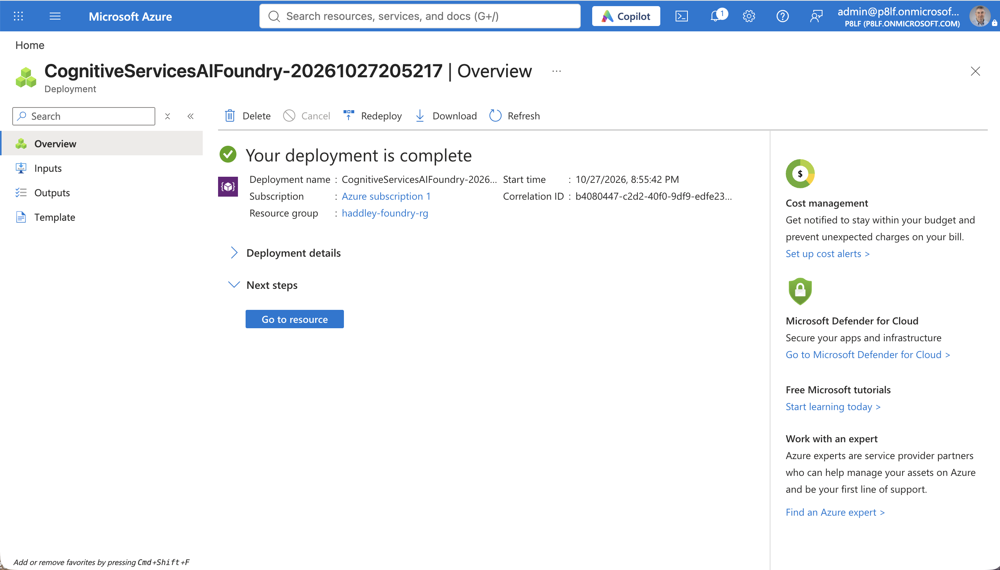
*The Azure portal reported that my Foundry deployment was complete*

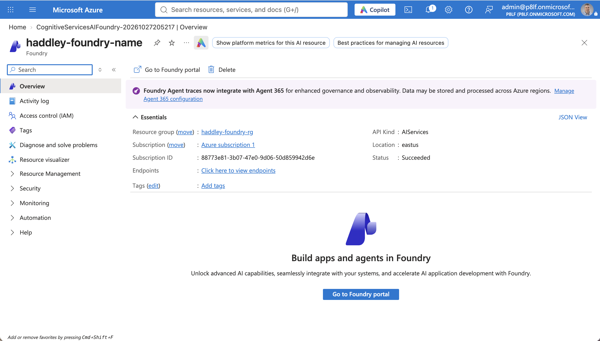
*The haddley-foundry-name resource overview showed the East US location*

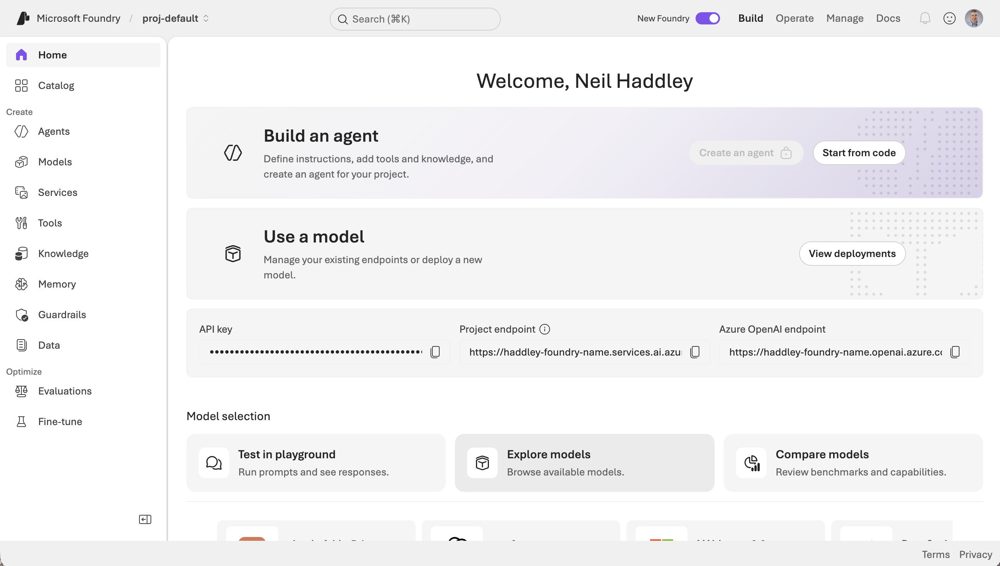
*The Foundry portal home page for proj-default showed the project endpoint*

### Deploying the model

The project had no model deployed. I wanted `gpt-5.4-mini`, so I checked my quota first.

```bash
az cognitiveservices usage list -l eastus --subscription <subscription-id> -o table
```

:::watch-it Quota can be zero
On my subscription the `GlobalStandard` quota for `gpt-5.4-mini` was 0, but `DataZoneStandard` had 200. The Microsoft quickstart suggests a capacity of 10. A deposition summary sends tens of thousands of tokens in one request, so I used a capacity of 100.
:::

```bash
az cognitiveservices account deployment create \
  -g haddley-foundry-rg -n haddley-foundry-name \
  --deployment-name gpt-5.4-mini --model-name gpt-5.4-mini \
  --model-version 2026-03-17 --model-format OpenAI \
  --sku-name DataZoneStandard --sku-capacity 100
```

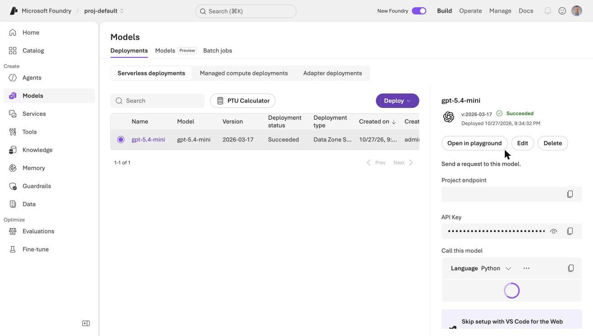
*The Models page showed gpt-5.4-mini with the Succeeded status and the Data Zone Standard deployment type*

### Getting permission to create agents

The Foundry portal showed a **Create an agent** button that was greyed out and had a lock on it.

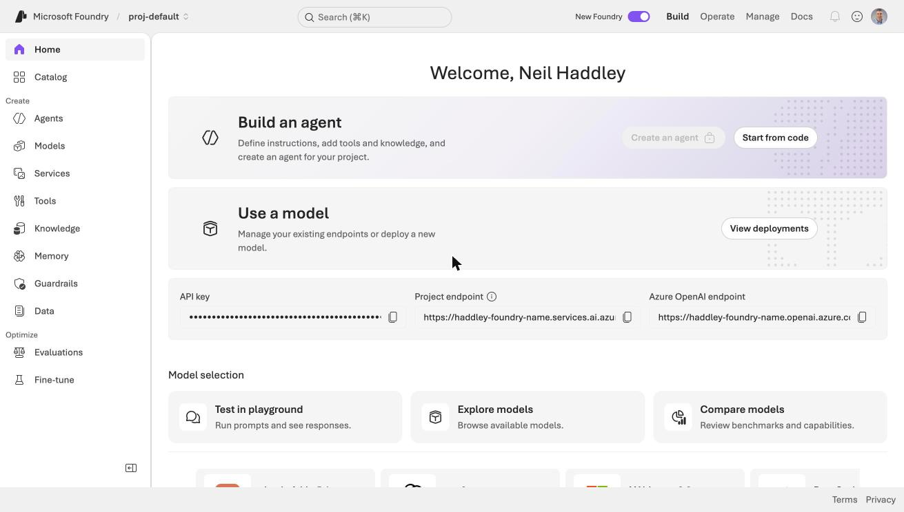
*The Create an agent button on the Foundry home page was locked*


*I zoomed in on the locked button*

I am the Owner of the subscription, but that was not enough. Creating skills and agents calls a Foundry data action, `Microsoft.CognitiveServices/accounts/AIServices/agents/write`, which the **Foundry User** role carries and the Owner role does not. The first upload of my skill failed with exactly that message.

:::watch-it Owner is not enough
I assigned the Foundry User role to myself on the Foundry resource only, not on the whole subscription. The role took about ten minutes to take effect, so my first few uploads still failed.
:::

```bash
az role assignment create \
  --assignee <my-object-id> \
  --role "Foundry User" \
  --scope /subscriptions/<subscription-id>/resourceGroups/haddley-foundry-rg/providers/Microsoft.CognitiveServices/accounts/haddley-foundry-name
```

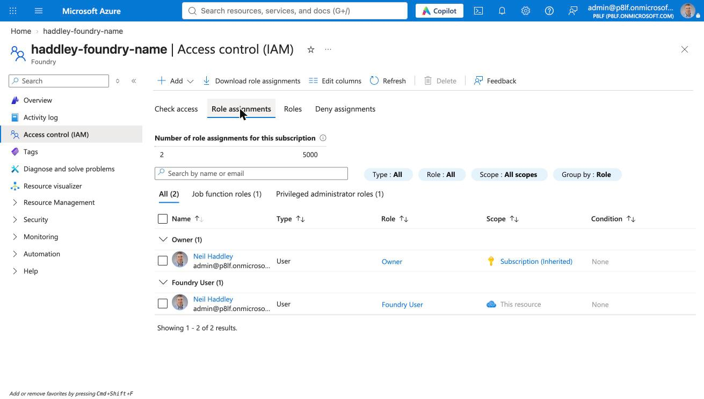
*The Role assignments tab on the Foundry resource listed Owner (inherited from the subscription) and Foundry User (on this resource)*

## The sample deposition

My earlier posts ran the skill on a court document that I could not publish excerpts from. For this post I used a teaching exercise, "Civil Rights Settlement" by Jim Hilbert, from [Mitchell Hamline Open Access](https://open.mitchellhamline.edu/dri_teachingmaterials/3). It is a fictional case, *Neruda v. Heritage Homes, et al.*, and its plaintiff's lawyers packet includes two deposition excerpts: Roger Arness (pages 17 to 24) and Salvador Neruda (pages 65 to 74). Each page has numbered lines 1 to 21, which is the structure the skill needs.

:::watch-it Check the licence before you quote
The materials are free for instructors to copy and adapt, as long as the copyright notice and attribution stay. There is no Creative Commons licence. I do not host the PDF on this site, and I quote only a line or two.
:::

The PDF lays each transcript page out in two columns, and the page label ("Page 17") prints after the page's lines. I wrote a small extractor that reads the PDF with `pypdf` and tags every line with the label that follows it.

```python
LINE = re.compile(r"^\s*(\d{1,2})\.\s*(.*)$")
PAGE = re.compile(r"^\s*Page\s+(\d+)\s*$")

def extract(path, first=1, last=None):
    reader = PdfReader(path)
    out, pending = [], []
    for pdf_page in reader.pages[first - 1 : last]:
        for raw in pdf_page.extract_text().splitlines():
            page = PAGE.match(raw.rstrip())
            if page:                      # the label arrives AFTER its lines
                out.extend(f"{page.group(1)}:{n} {t}" for n, t in pending)
                pending = []
                continue
            line = LINE.match(raw.rstrip())
            if line:
                pending.append((line.group(1), line.group(2).strip()))
    return "\n".join(out)
```

PDF pages 13 to 17 became 388 lines in the form `17:4 Q. When did you start working at Heritage`. Every line got a page label.

## Uploading the skill

Foundry stores skills centrally in a versioned Skills API (a preview feature). I used the Python SDK, `azure-ai-projects` 2.9.0 on Python 3.14.

```python
created = project.beta.skills.create_from_files(
    "page-line-summary",
    content=CreateSkillVersionFromFilesBody(files=[("SKILL.md", skill.read_bytes())]),
)
project.beta.skills.update("page-line-summary", default_version=created.version)
```

I did not change my skill. The `SKILL.md` that I wrote for Claude Code uploaded as it was. Two rules from the Microsoft documentation matter: the `name` and `description` in the front matter must be unquoted, and the skill name may use only lowercase letters, numbers and hyphens.

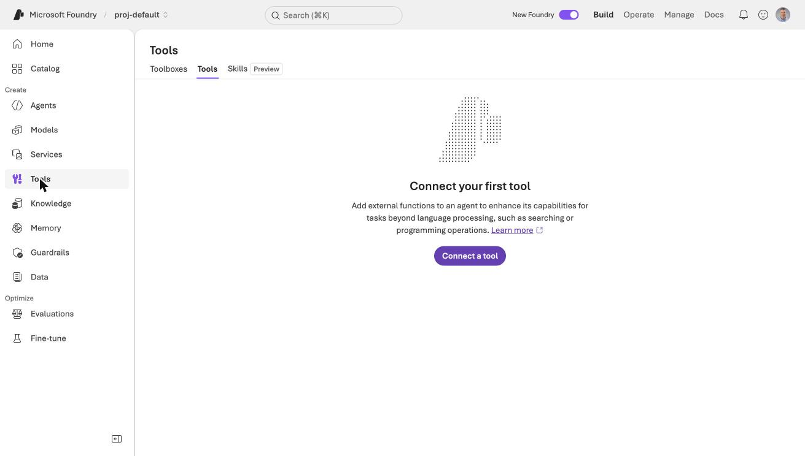
*The Tools page in the Foundry portal had Toolboxes, Tools and Skills tabs*

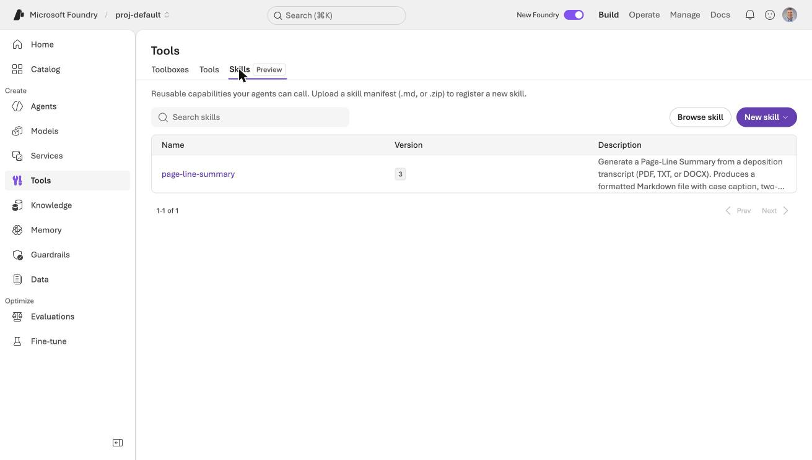
*The Skills tab, marked Preview, listed page-line-summary*

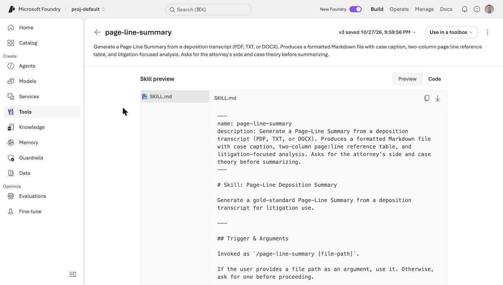
*The skill detail page showed my SKILL.md exactly as I wrote it*

## Creating the prompt agent

A prompt agent is a model, instructions and tools. I used the skill as the instructions, and I added a short preamble for the tools that a prompt agent does not have.

```python
PREAMBLE = """You are running as a Foundry prompt agent, not in Claude Code or Cowork.
You have no file tools: you cannot Read, Write or run Bash. Wherever the skill below
says to use those tools, use the text in the conversation instead and return the
finished Markdown document in your reply, not as a file.

The transcript arrives as lines of the form `PAGE:LINE text`, for example
`17:4 Q. When did you start working at Heritage`. Use those tags for every
Page:Line reference. Do not invent pages or lines.

Skill follows.

"""

skill = ...  # downloaded from the Skills API
agent = project.agents.create_version(
    agent_name="page-line-summary-prompt",
    definition=PromptAgentDefinition(model="gpt-5.4-mini", instructions=PREAMBLE + skill),
)
```

The agent code downloads the skill from Foundry each time it runs. That keeps the skill in one place. Changing the skill changes every agent that downloads it, with no edit to the agent code.

:::watch-it The documentation and the SDK disagree
The Microsoft documentation calls the download method `skills.download_content`. In `azure-ai-projects` 2.9.0 the method is `skills.download`, and the documented name raised an `AttributeError`.
:::

:::no-dumb-questions
**Q: Can the prompt agent use the skill directly, without copying it into the instructions?**

A: The documented route is to attach a skill to a toolbox. That route targets hosted agents and MCP clients such as Claude Code and GitHub Copilot, and it also needs permissions for the agent's identity. For a prompt agent I found no documented way to attach a skill, so I put its text in the instructions. In [Part 2](/posts/azurefoundryagent3/) the hosted agent downloads the skill from Foundry itself at startup, so it needs no toolbox.
:::

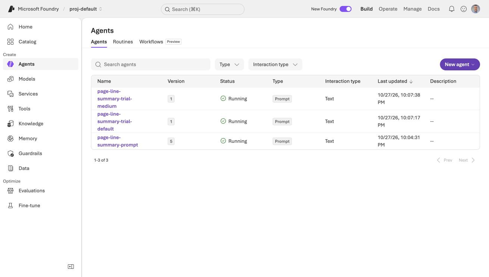
*The Agents page listed page-line-summary-prompt as a running Prompt agent*

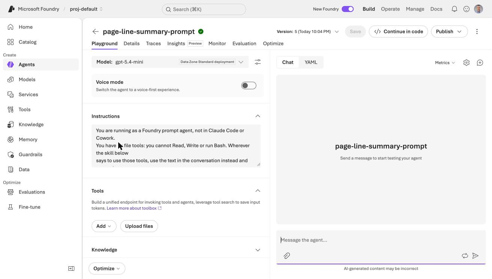
*The agent's instructions began with my preamble, followed by the skill*

## Running it

Foundry's playground is the quickest way to try an agent. I pasted my prompt, which gave the two deposition names, my side (Plaintiff), my case theory, and the 388 tagged lines.

```PROMPT
Summarize these two deposition excerpts (Roger Arness, pp. 17-24, and Salvador Neruda, pp. 65-74) from Neruda v. Heritage Homes, et al.
Which side do you represent? Plaintiff.
Case theory: Heritage Homes steered roofing jobs away from Salvador Neruda because customers did not want foreigners.

17:1 Q. Thorstein Veblen Community College in
...
```

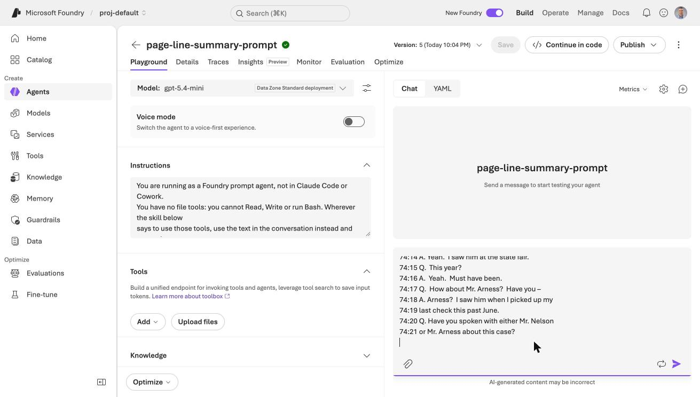
*I pasted the prompt and the tagged transcript lines into the playground chat*

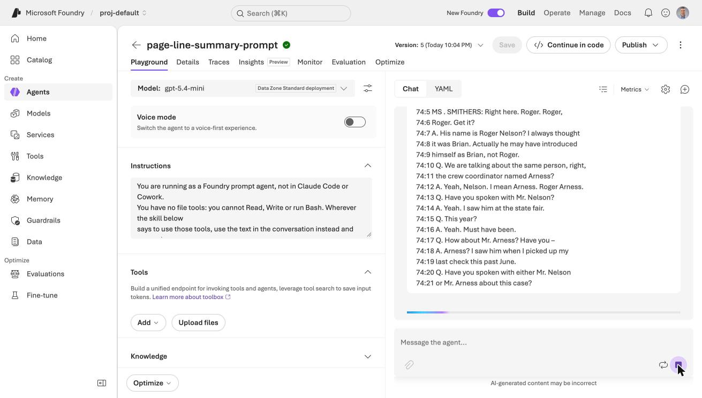
*The agent started to respond*

The answer arrived in 29 seconds and used 13,971 tokens. This agent version had the model's reasoning effort set to medium, which I explain below.

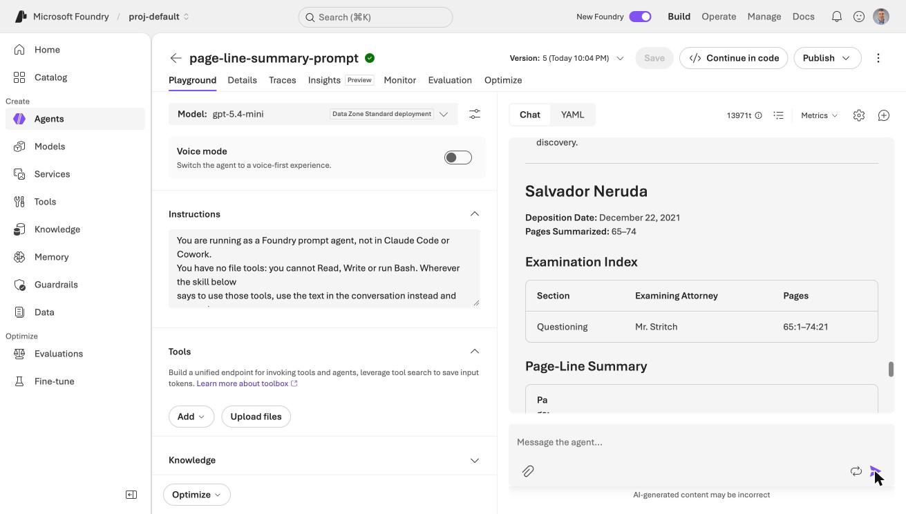
*The summary gave each deposition its own section, with an examination index naming Mr. Stritch*

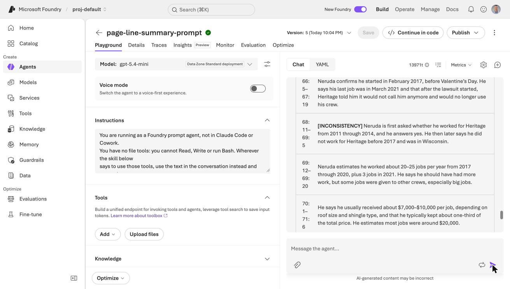
*The table flagged one row as an INCONSISTENCY: Neruda agreed to counsel's statement that he worked for Heritage from 2011 through 2014, then said he started in 2017*

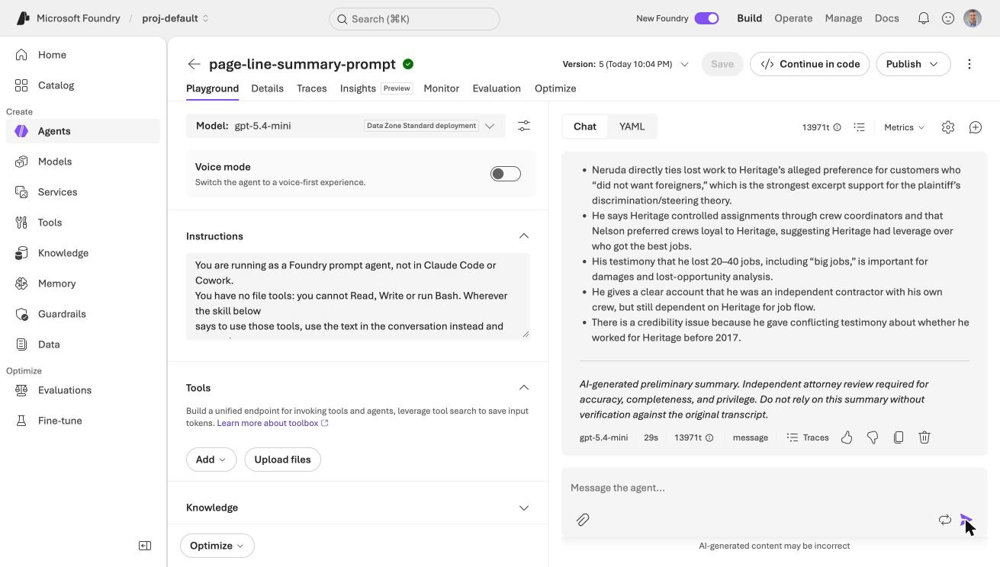
*The summary ended with the key takeaways and the attorney-review disclaimer*

The structure came from my skill: the caption fields, the examination index, the page:line table, the takeaways and the disclaimer. That part of the skill moved to Azure without any change.

## What I found when I checked the summary

I checked the first run against the transcript. The page:line references and the quotations that I spot-checked were right. Two things were wrong.

- **No contradictions flagged.** The excerpts hold several. Counsel says Neruda worked for Heritage "from 2011 through 2014", while Neruda says he started in 2017. Neruda calls Roger Arness "Brian" and then "Roger Nelson". Arness says he does not recall how many crews Heritage used, then says "10-15", then "more than a dozen".
- **Attorneys not named.** The examining attorneys showed as "Not stated", even though the speaker labels (Mr. Dempsey and Mr. Stritch) are in the text.

I wrote the skill for Claude, and the small model here needed more help, so I changed it, and I used Foundry's skill versions to keep each attempt.

| Version | What I changed | Result |
|---|---|---|
| 1 | Nothing. This is my skill. | Clean table. No contradictions flagged. Attorneys "Not stated". |
| 2 | Added a "consistency pass" instruction | The model mentioned the name mix-up in the prose, but added no tags and no paired references. |
| 3 | Added a required **Inconsistencies and Corrections** table to the output template, and told the model to take attorney names from the speaker labels | Attorney names found. The table caught the crew count and the "Brian" mix-up. |

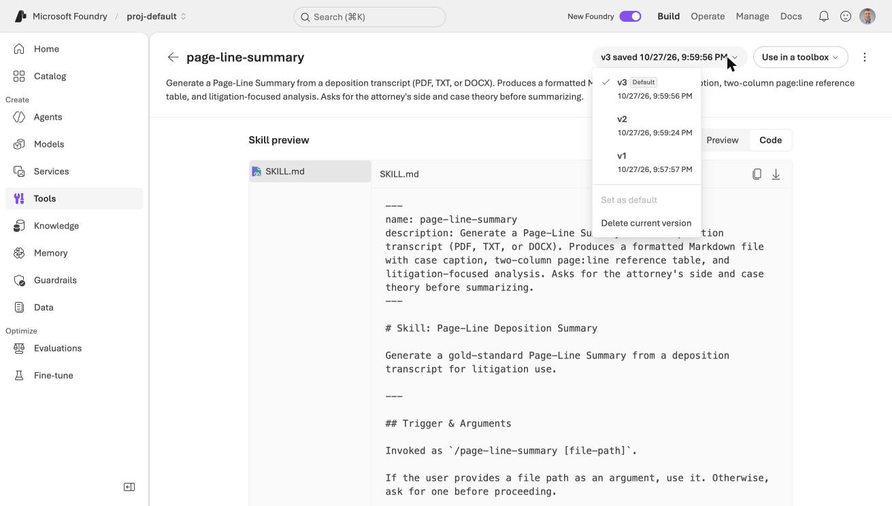
*The skill's version menu listed v1, v2 and v3, with v3 as the default*

Each upload creates a new immutable version, and the `default_version` setting decides which one an agent gets. I did not have to touch the agent to try version 2 or version 3.

:::pencil Why did a template work when a rule did not?
Version 2 added a rule to the instructions. Version 3 added a section to the output template. Why might a small model follow the second change more reliably than the first?

:::answer
The model fills in the template that I give it, so a missing section is a visible gap. A rule in the instructions competes with everything else in a 10,000-character prompt, and the model can quietly skip it. This is my explanation, not something I tested.
:::
:::

## How reliable is it?

Version 3 still missed things, and one run is not enough to judge. I ran the agent three times at its default setting and three times with the model's reasoning effort set to `medium`. A script scored each run against the three contradictions that I know are in the excerpts, counting one only when it appeared in an Inconsistencies section.

| | default | medium |
|---|---|---|
| Crew count ("10-15" then "more than a dozen") | 3 of 3 | 0 of 3 |
| Arness called "Brian" or "Nelson" | 3 of 3 | 3 of 3 |
| "2011 through 2014" versus 2017 | 2 of 3 | 1 of 3 |
| **Contradictions caught, out of 9** | **8** | **4** |
| Mr. Stritch labelled defense (correct) | 1 of 3 | 2 of 3 |
| Mr. Stritch labelled plaintiff (wrong) | 0 of 3 | 0 of 3 |
| Tokens per run | about 9,500 | 14,400 to 17,900 |

More reasoning did not mean more accuracy. Medium effort cost more tokens and caught half as many contradictions, though it was better at working out which side Mr. Stritch represents. I do not know why it missed the crew count. Three runs per setting is a small sample, and my earlier single runs gave different answers, so the sensible conclusion is that the results vary from run to run.

:::under-the-hood How the scoring worked, and the bug I fixed
The scorer looks for patterns in the text. For example, it counts the crew-count contradiction only if "dozen" or "10-15" appears inside a section titled Inconsistencies and Corrections.

My first version missed one run, because the model had split the section per deponent ("Inconsistencies and Corrections — Roger Arness"). I found this by reading the runs that the scorer called misses. I fixed the pattern and rescored the saved outputs, without any new model calls. The numbers above are the corrected ones.
:::

The larger models were not an option. My subscription had no quota for `gpt-5.4`, `gpt-5.5` or the `gpt-5.6` models, and asking for quota is a manual portal request.

## What a prompt agent cannot do

- **It cannot read a PDF.** I extracted the text myself and pasted it into the message. In Claude Code, the skill's Read tool did that.
- **It cannot save a file.** The summary comes back as text in the reply.
- **Tracing needs Application Insights.** The Traces tab asked me to connect an Application Insights resource, so I could not inspect the agent's calls.

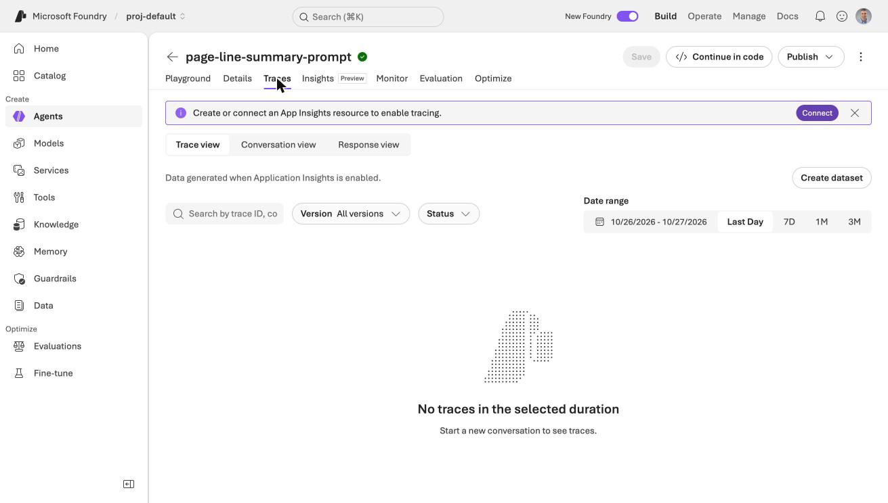
*The Traces tab asked me to connect Application Insights before it would show anything*

:::fireside-chat The skill and the agent
**Skill:** I tell the model how to write a good page-line summary. I cannot open a file.

**Agent:** I give the model a place to run, and I decide which tools it has. Here I have none, so I read nothing and I save nothing.

**Skill:** So you need someone to put the text in front of me.

**Agent:** Yes. In Part 2 I become a hosted agent with my own Python code, and that code reads the PDF.
:::

:::bullet-points Recap
- A skill is instructions. It does not carry tools, so a prompt agent with no tools needs the transcript text handed to it.
- Foundry stores skills with immutable versions, and `default_version` chooses which one an agent gets.
- I needed the Foundry User role, not just Owner, and it took about ten minutes to work.
- A required section in the output template worked better than a rule in the instructions.
- Across three runs per setting, default effort caught 8 of 9 contradictions and medium effort caught 4 of 9. The results vary, so a lawyer must check every summary against the transcript.
:::

## References

- [Use skills with Microsoft Foundry agents (preview)](https://learn.microsoft.com/en-us/azure/foundry/agents/how-to/tools/skills)
- [Quickstart: Create a prompt agent](https://learn.microsoft.com/en-us/azure/foundry/agents/quickstarts/prompt-agent)
- [What is Microsoft Foundry Agent Service?](https://learn.microsoft.com/en-us/azure/foundry/agents/overview)
- [Hosted agents in Foundry Agent Service](https://learn.microsoft.com/en-us/azure/foundry/agents/concepts/hosted-agents)
- [Hilbert, Jim, "Civil Rights Settlement"](https://open.mitchellhamline.edu/dri_teachingmaterials/3) (2016), *Negotiation Teaching Materials*, Mitchell Hamline School of Law
