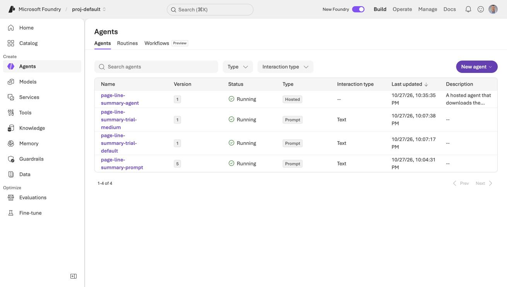
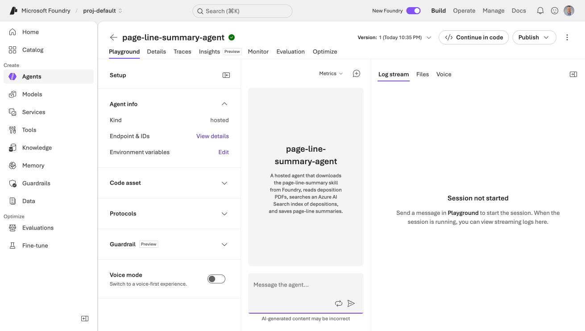
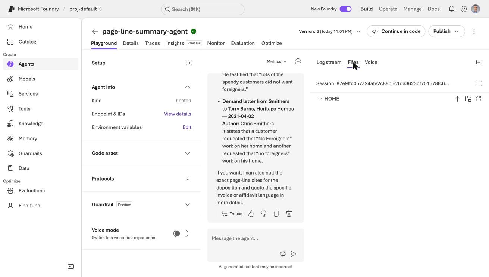
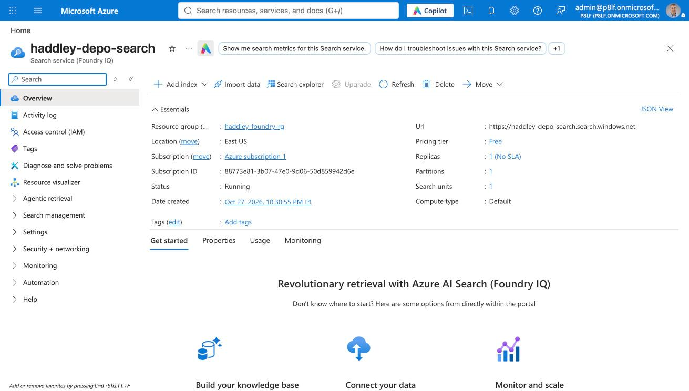
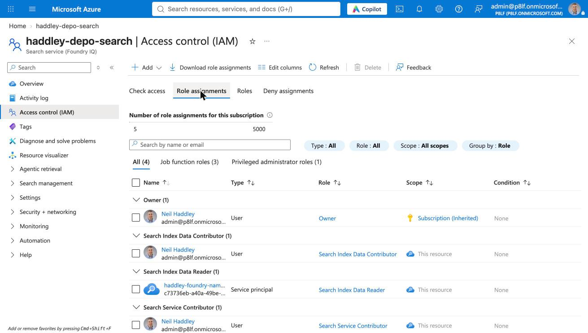
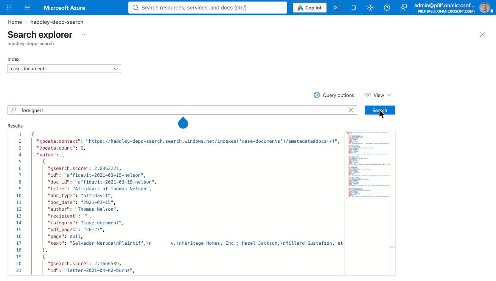
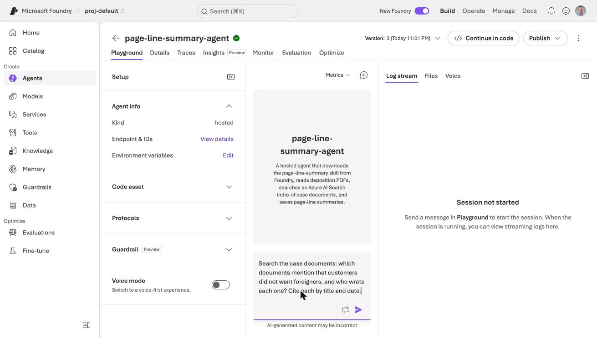
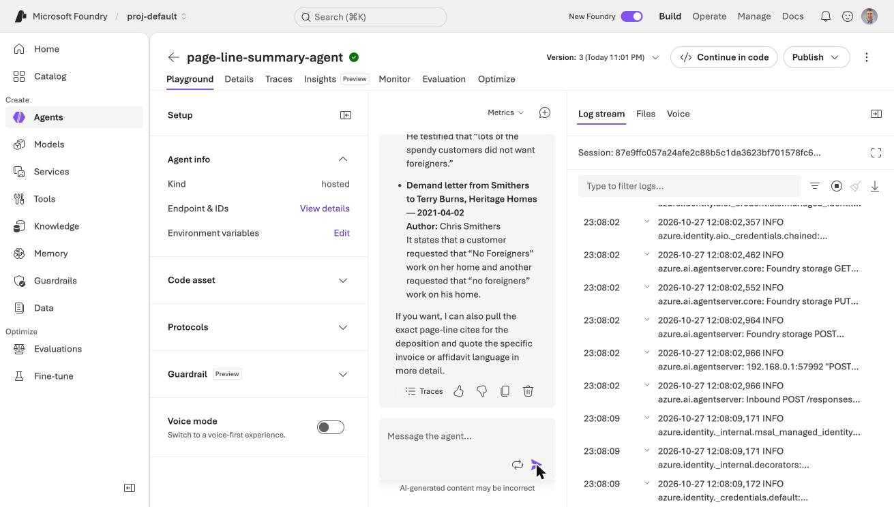

# A skill in Azure: the hosted agent

In [Part 1](/posts/azurefoundryagent2/) I ran my `page-line-summary` skill in a prompt agent. It worked, but the agent could not read a PDF or save a file, so I had to paste the transcript text into the message.

In this post I build a hosted agent, which is my own Python code that Foundry runs. It downloads the skill from Foundry, reads a deposition PDF, saves the summary as a file, and searches an Azure AI Search index of the case documents so that I can ask questions across all of them.

:::brain-power Before you read on
In Part 1 the skill and the agent had a gap between them: the skill said "read the PDF" and the agent had no way to do it. When the agent is my own code, what are the smallest pieces of code that close that gap?
:::

## What a hosted agent is

A hosted agent is a Python (or C#) program that Foundry runs for me. Foundry gives each session its own sandbox with a persistent `$HOME` folder, a dedicated endpoint, and a dedicated Microsoft Entra identity for the agent. The agent calls my model deployment through the project endpoint, and Foundry bills the compute (CPU and memory) while sessions are active, plus the model tokens. The [hosted agents documentation](https://learn.microsoft.com/en-us/azure/foundry/agents/concepts/hosted-agents) points to a pricing page, and I did not find a rate in the pages that I read, so I cannot give you a cost per hour.

## Getting azd

The quickstart uses the Azure Developer CLI (`azd`). Microsoft's DevPack installs it with Homebrew, and on my Mac that failed because my Command Line Tools were too old.

:::watch-it Homebrew could not build azd
The error said "Your Command Line Tools are too outdated." Microsoft publishes a standalone installer script, `https://aka.ms/install-azd.sh`. I downloaded it and read it before I ran it. By default it writes to `/usr/local/bin` and needs `sudo`, so I passed `--install-folder ~/.azd/bin`, created the `azd` link myself, and added the Foundry extension with `azd extension install microsoft.foundry`.
:::

```bash
bash install-azd.sh --install-folder "$HOME/.azd/bin" --no-telemetry
azd version        # azd version 1.37.1
azd extension install microsoft.foundry
azd auth login --use-device-code
```

## Scaffolding the agent

Microsoft's samples repository has a hosted agent that downloads its skills from Foundry at startup, so I started from that one. `azd ai agent init` can run without prompts when I give it my existing project and model deployment.

```bash
azd ai agent init --no-prompt \
  -t "https://github.com/microsoft-foundry/foundry-samples/blob/main/samples/python/hosted-agents/agent-framework/responses/12-foundry-skills/azure.yaml" \
  -p "/subscriptions/<id>/resourceGroups/haddley-foundry-rg/providers/Microsoft.CognitiveServices/accounts/haddley-foundry-name/projects/proj-default" \
  -d gpt-5.4-mini --agent-name page-line-summary-agent \
  --deploy-mode code --runtime python_3_13 --entry-point main.py
```

azd adopted my existing project (`USE_EXISTING_AI_PROJECT="true"`) and bound my existing `gpt-5.4-mini` deployment, so it did not try to deploy a second model.

I then changed the generated `azure.yaml`. I removed the two sample skills, because mine was already in Foundry, and I set the environment variables for my skill and for Azure AI Search.

```yaml
services:
    page-line-summary-agent:
        codeConfiguration:
            dependencyResolution: remote_build
            entryPoint: main.py
            runtime: python_3_13
        container:
            resources:
                cpu: "0.5"
                memory: 1Gi
        env:
            AZURE_AI_MODEL_DEPLOYMENT_NAME: ${AZURE_AI_MODEL_DEPLOYMENT_NAME}
            SKILL_NAMES: ${SKILL_NAMES=page-line-summary}
            AZURE_SEARCH_ENDPOINT: ${AZURE_SEARCH_ENDPOINT}
            AZURE_SEARCH_INDEX_NAME: ${AZURE_SEARCH_INDEX_NAME=case-documents}
        host: azure.ai.agent
        kind: hosted
        protocols:
            - protocol: responses
              version: 2.0.0
```

## The agent code

The agent is about 135 lines in `main.py` plus a `tools.py` module. It does four things.

**1. It downloads the skill at startup.** The code asks the Skills API for each name in `SKILL_NAMES`, unpacks the archive, and gives the folder to a `SkillsProvider`. The provider tells the model the skill's name and description, and the model loads the full `SKILL.md` only when it needs it.

```python
context_providers.append(
    SkillsProvider.from_paths(
        skill_paths=str(DOWNLOADED_SKILLS_DIR),
        disable_load_skill_approval=True,
        disable_read_skill_resource_approval=True,
    )
)
```

:::watch-it Skill tools wait for approval by default
My first run stopped after the model called `load_skill`. The framework turned the call into an approval request, and nobody was there to approve it. My skill is my own, comes from my own project, and has no scripts, so I turned off approval for loading it and for reading its resources. I left approval on for running scripts.
:::

**2. It reads a PDF as tagged lines.** The `extract_transcript` tool is the Part 1 extractor wrapped as a tool. It returns every line as `PAGE:LINE text`, and it handles the quirk that the page label prints after its lines.

**3. It saves the summary.** The `save_summary` tool writes a file into `summaries/` in the session's `$HOME`, which I can download afterwards. Both tools refuse any path outside one folder:

```python
def _inside(path: str) -> Path:
    root = files_dir()
    candidate = (root / path).resolve()
    if candidate != root and root not in candidate.parents:
        raise ValueError(f"{path!r} is outside the allowed folder")
    return candidate
```

**4. It searches the case documents.** I come back to the `search_documents` tool below.

The agent's instructions map the skill's Claude Code tools onto these: `extract_transcript` replaces Read, and `save_summary` replaces Write. They also tell the model that every Page:Line reference must come from a tag in a tool result.

## Running it locally

`azd ai agent run` creates a virtual environment, starts the agent on port 8088, and opens the Agent Inspector. I sent it a request over the Responses protocol.

```bash
curl -s -H "Content-Type: application/json" -X POST http://localhost:8088/responses -d @request.json
```

The agent loaded the skill, read PDF pages 13 to 17, and saved `neruda_arness_summary.md`, in 16.8 seconds.

## Deploying it

```bash
azd deploy
```

The first deploy took 1 minute 35 seconds. azd zips the source, uploads it, and Foundry resolves the dependencies and builds the agent remotely. No container registry was involved, and it needed no role beyond the ones I already had. Later deploys took under 50 seconds.


*The Agents page listed page-line-summary-agent with the type Hosted, next to my prompt agents from Part 1*


*The hosted agent's playground offered a log stream and a Files tab for the session*

### Sessions and files

The agent reads files from its session, so the order of commands matters.

```bash
azd ai agent invoke --new-session "Hello. Which tools do you have?"
azd ai agent files upload ../../data/packet.pdf
azd ai agent invoke "Please summarize the deposition excerpts in packet.pdf ..."
azd ai agent files download -f summaries/neruda_arness_summary.md -t summary.md
```

:::watch-it A new session is an empty folder
I lost the PDF once. After I had uploaded it, I used `--new-session` on the next invoke, and the agent correctly reported "No such file". Each session has its own filesystem (here `/home/session`), so upload the file into the session after it exists, and then keep invoking that same session.
:::

The saved summary scored 3 of 3 on the contradictions I know are in the excerpts (the crew count, the "Brian" mix-up, and the 2011 to 2014 statement), and it labelled Mr. Stritch as defense counsel. That is one run, so it does not prove the agent is reliable.


*The playground's Files tab showed the session's HOME folder, with buttons to upload a file or make a folder*

## Splitting the packet into documents

My Part 1 sample was only two deposition excerpts. The packet they come from holds many other documents, so I split the 40-page packet into 22 separate documents and indexed each one. The split is a short Python script, `split_packet.py`, that writes one PDF and one text file per document, plus a `manifest.json` with each document's title, type, date, author, recipient and PDF pages.

| Type | Documents |
|---|---|
| Letters | 8 |
| Demand letters | 3 |
| Memoranda (one is a voicemail transcript) | 4 |
| Depositions (Arness and Neruda) | 2 |
| Affidavit | 1 |
| Invoices | 2 |
| Sample settlement agreements from other matters | 2 |

I skipped the cover, two blank pages and a divider, and two pages that repeated invoices that I already had.

:::watch-it One page holds two documents, and one extractor breaks words
- **Page 4** holds the end of one memo and the start of a letter, so I split the text inside the page. That page appears in both documents' PDFs.
- **`pypdf` broke words** on the law firm's letterhead pages ("Octo / ber", "Ch / ris"), which would break keyword search. PyMuPDF kept the words whole, so I used it for every page except the transcripts, where `pypdf` worked well.
:::

## Azure AI Search

I created a search service on the Free tier in the same resource group.

```bash
az search service create -g haddley-foundry-rg -n haddley-depo-search --sku free --location eastus
```


*The haddley-depo-search service in East US showed the Free pricing tier*

### The index

The index has one record per document, except for depositions. Those get one record per transcript page, so a hit can be cited to the page and line. The 22 documents became 38 records. The fields are the document title, type, date, author, recipient, a category (case document or sample from another matter), the PDF pages, the transcript page (for depositions), and the text.

```python
SearchableField(name="doc_type", type=S, filterable=True, facetable=True),
SimpleField(name="doc_date", type=S, filterable=True, sortable=True),
SearchableField(name="author", type=S, filterable=True),
SimpleField(name="category", type=S, filterable=True, facetable=True),
SimpleField(name="page", type=SearchFieldDataType.Int32, filterable=True, sortable=True),
SearchableField(name="text", type=S, analyzer_name="en.lucene"),
```

I did not use vector search here. The Part 2 post of my earlier series, [Creating an Agent in Azure AI Foundry](/posts/azurefoundryagent/), used embeddings. For this job the names, dates and quoted phrases matter more than meaning, so plain keyword search with filters was enough, and it needs no embedding model deployment.

### Roles again

The index needs data-plane roles, just as the skills did in Part 1. Three assignments, each scoped to the one search service, cover it:

| Who | Role | Why |
|---|---|---|
| Me | Search Service Contributor | Create the index |
| Me | Search Index Data Contributor | Upload documents |
| The agent's own identity | Search Index Data Reader | Query the index, and nothing else |

I found the agent's identity in `azd ai agent show` under `instance_identity`.


*The Role assignments tab on the search service listed my two roles and the agent's identity with Search Index Data Reader*

The agent never gets a key. It reads the index with its own identity, so there is no secret in an environment variable.

### Testing the index

`build_index.py` uploaded all 38 records. In Search explorer, a query for "foreigners" returned 6 hits, with the affidavit first.


*Search explorer on the case-documents index returned 6 hits for the query foreigners, with the Nelson affidavit scoring highest*

I also checked a few queries from a script. "bad roofer" ranked the defense counsel's letter first, "2011 through 2014" ranked transcript page 68 first, and a filter on `doc_type eq 'deposition'` returned only transcript pages.

## Asking across the documents

The `search_documents` tool takes a query and optional filters for document type and author. Each hit comes back with the title, type, date, author, PDF pages and text, and a deposition hit carries its PAGE:LINE tags. Hits from the sample agreements are labelled as samples from another matter.


*I typed a cross-document question in the hosted agent's playground*


*The agent listed each document that mentions the request, with its author and date, while the log stream ran beside it*

### Question 1: why did Neruda lose work?

I asked: "What reasons do the documents give for why Neruda lost work from Heritage Homes? Cite each source by its title and date, and cite a deposition by PAGE:LINE."

The agent searched twice and returned four groups of reasons with sources. I checked every citation against the transcript pages, and they were right. For example, 71:15–21 holds the "spendy customers did not want foreigners" passage, and 73:7–18 holds Neruda's account of what Nelson said about loyal crews.

One thing was wrong. The agent put "Heritage had too many jobs and was overbooked" under Heritage's side. The overbooking comes from Neruda's own testimony, and Arness is a former employee, so that heading mis-attributed the evidence.

### Questions 2 and 3: do the documents conflict?

These are the questions where the agent matters most, because spotting a conflict is a lawyer's job. I read the packet first and found two places where documents disagree.

| Question | The conflict I found | What the agent said |
|---|---|---|
| Settlement figures | One letter says the proposal was raised from $250,000 "to double that amount", which is $500,000. A later memo says the previous offer was $300,000. | It listed the $300,000 and the $250,000, never mentioned the doubling, and reported a conflict between the $250,000 and $20,000 demands. Those went to different defendants, so that is not a conflict. |
| Start dates | Neruda says he started in February 2017 and met coordinators including Nelson. Nelson's affidavit says he worked at Heritage from January 2018. | It put both dates in its answer and concluded that the documents agree. |

The second one is an inference, not a direct contradiction, because Neruda does not say that Nelson assigned his jobs in 2017. A careful reader would flag it, and the agent did not.

### One generic fix

I added one paragraph to the agent's instructions. It was not tailored to these two questions.

:::pencil What would you add to the instructions?
The agent had all the information in front of it and still compared documents badly. Before you read my fix, write one instruction that would make a model compare two documents more carefully.

:::answer
This is what I added. When comparing documents, list the exact quoted figure, date or name from each, convert relative expressions into absolute values (for example, "double $250,000" is $500,000), compare the values, and note which documents are about different parties. Only then say whether they agree.
:::
:::

I redeployed (47 seconds) and asked both questions again.

| | Before | After |
|---|---|---|
| Settlement figures | False conflict between $250,000 and $20,000. Real conflict missed. | The false conflict was gone, and the agent explained that the $20,000 demands went to different parties. The doubling ($500,000) was still never mentioned, so the real conflict was still missed. |
| Start dates | Concluded the documents agree. | It converted "June of last year" into June 2020, which is correct, and still concluded that the documents agree. |

So the instruction helped a little with a false alarm and did not help with either real miss. This was one run of each question, so I would not draw a firm line between the two answers.

:::bullet-points What this means
- Retrieval and citation worked: the agent found the right documents and the PAGE:LINE references I checked were correct.
- Judging whether documents agree is the weak step. In my runs the model missed both conflicts that I found by reading.
- A summary or answer from this agent is a starting point for a lawyer, who must check every claim against the source.
:::

## Cleaning up

The agent, the search service and the role assignments keep existing until I remove them. I have not removed them yet. When I am done:

```bash
azd ai agent delete page-line-summary-agent
az search service delete -g haddley-foundry-rg -n haddley-depo-search --yes
```

I would also delete the three role assignments that I created and the Part 1 prompt agents.

:::bullet-points Recap
- A hosted agent is my own code. Foundry gives each session a sandbox, a `$HOME` folder, an endpoint and an identity of its own.
- `azd ai agent init --no-prompt` scaffolded the project against my existing Foundry project, and `azd deploy` published it in under two minutes.
- The agent downloads the skill from Foundry at startup, and small function tools replace the Read and Write tools that the skill expects.
- Skill tools need approval by default. I turned approval off for loading my own skill and left it on for scripts.
- I split the 40-page packet into 22 documents and indexed them in a Free Azure AI Search service. The agent queries the index with its own identity and no key.
- The agent cited sources accurately but missed both real conflicts between documents, so every answer needs a lawyer's check.
:::

## References

- [Quickstart: Deploy your first hosted agent](https://learn.microsoft.com/en-us/azure/foundry/agents/quickstarts/quickstart-hosted-agent?pivots=azd)
- [Hosted agents in Foundry Agent Service](https://learn.microsoft.com/en-us/azure/foundry/agents/concepts/hosted-agents)
- [Use skills with Microsoft Foundry agents (preview)](https://learn.microsoft.com/en-us/azure/foundry/agents/how-to/tools/skills)
- [Foundry samples: hosted agents](https://github.com/microsoft-foundry/foundry-samples/tree/main/samples/python/hosted-agents)
- Hilbert, Jim, ["Civil Rights Settlement"](https://open.mitchellhamline.edu/dri_teachingmaterials/3) (2016), *Negotiation Teaching Materials*, Mitchell Hamline School of Law
