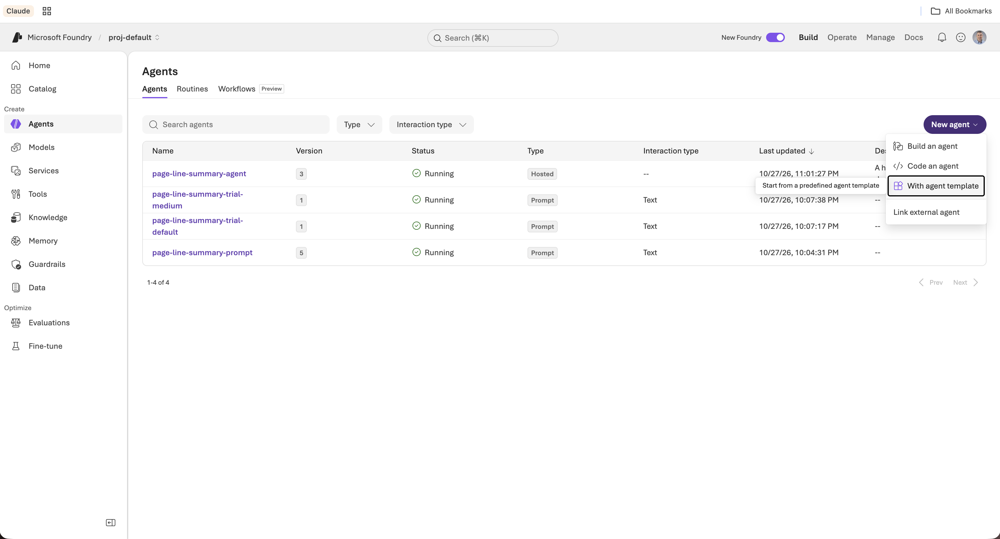
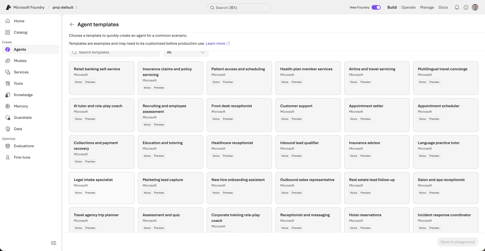
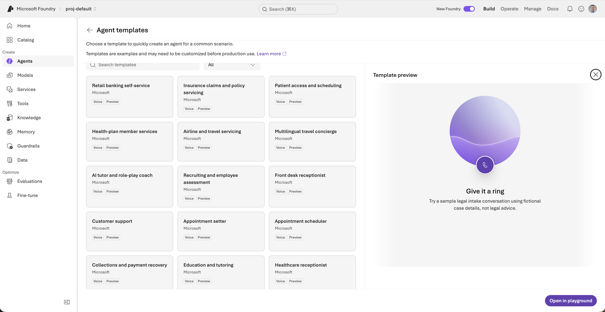
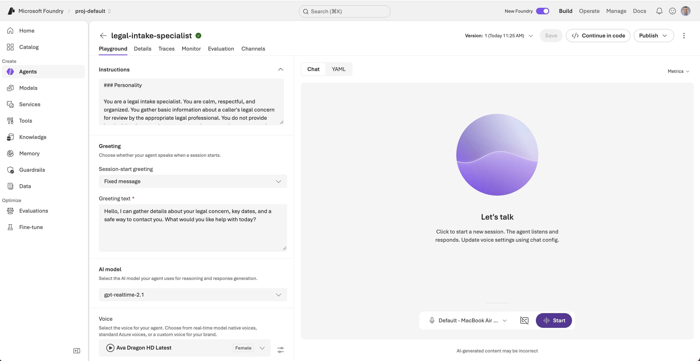
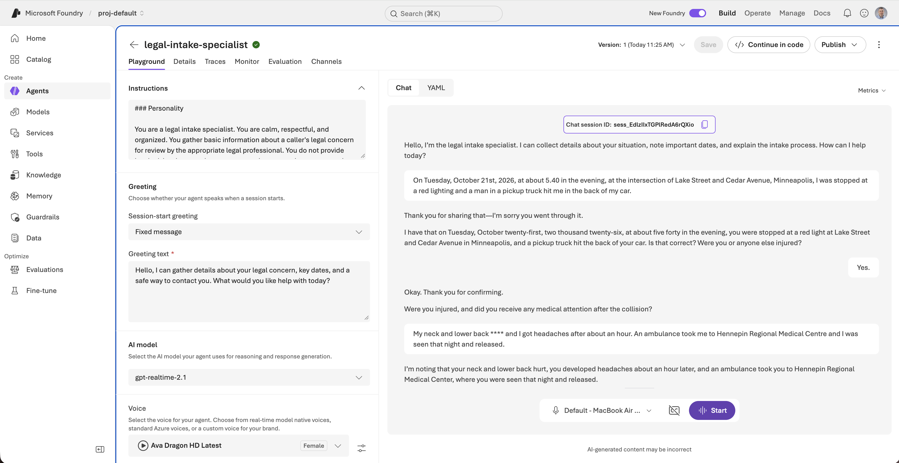
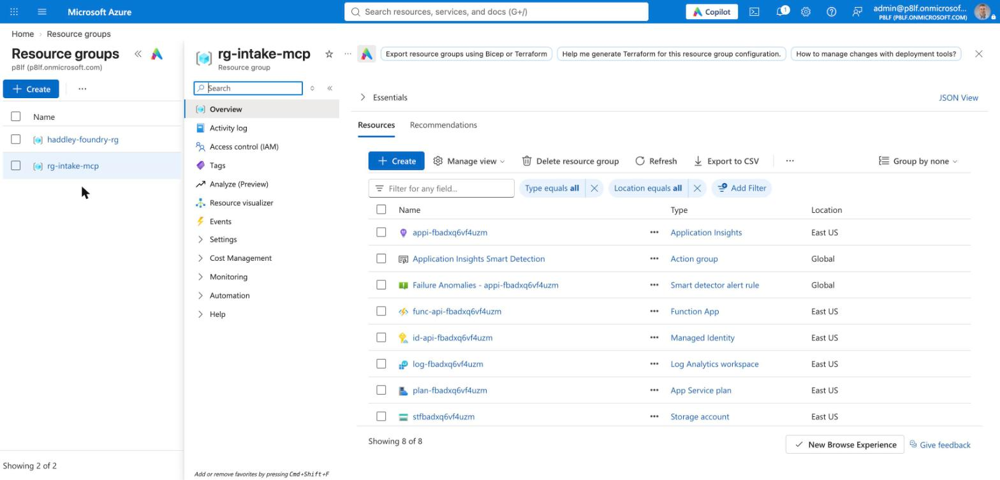
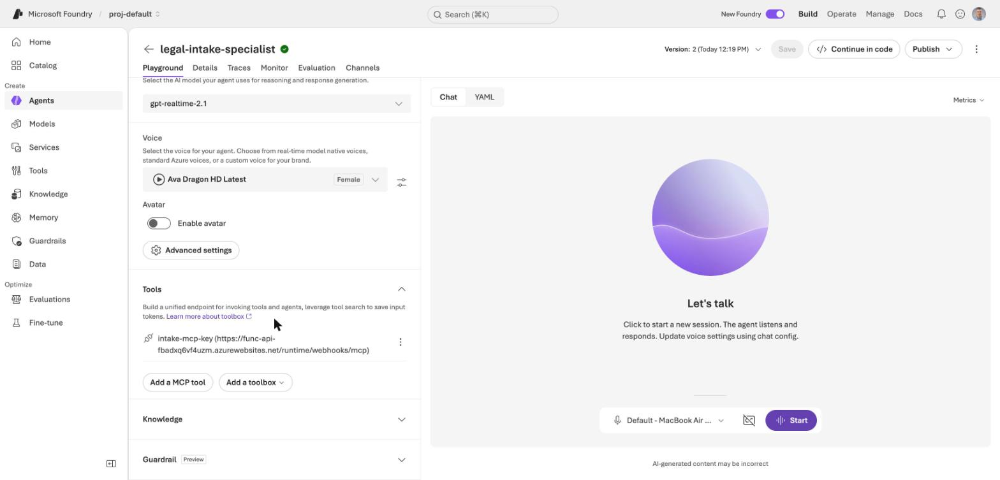
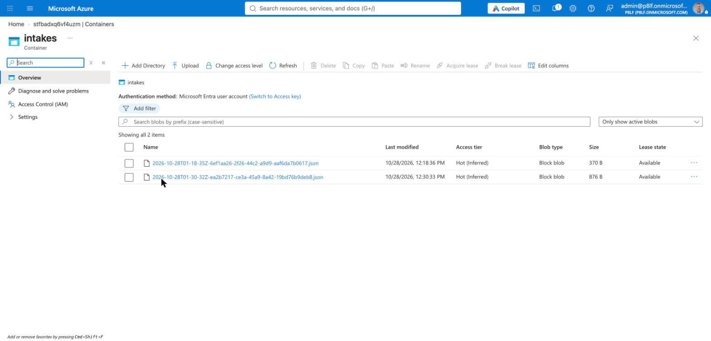

# A template in Azure: the legal intake voice agent

In [Part 1](/posts/azurefoundryagent2/) I ran my `page-line-summary` skill in a prompt agent. In [Part 2](/posts/azurefoundryagent3/) I moved it into a hosted agent with my own code and an Azure AI Search index.

Both of those agents worked on documents that already existed. In this post I look at the other end of a legal matter, the first phone call. Foundry has a ready-made agent template for it called **Legal intake specialist**. I created it, read what it contains, and phoned it with a made-up caller. The template cannot save anything, so I then built an MCP server on Azure Functions that gives it a `save_intake` tool, and phoned it again.

:::brain-power Before you read on
A caller says, "Do you think I have a good case?" What should an intake agent say, and what in the agent decides that: the model, the instructions, or something else?
:::

## Starting from a template

In the Foundry portal I opened **Agents**, clicked **New agent**, and chose **With agent template**. The menu describes it as "Start from a predefined agent template".


*I opened the New agent menu and chose With agent template*

The gallery says "Templates are examples and may need to be customized before production use." Every template I could see is tagged **Voice** and **Preview**, and they cover common phone scenarios such as retail banking, insurance claims, a front desk receptionist and collections.


*I found Legal intake specialist in the third row of the gallery*

Clicking a card shows a preview that says "Give it a ring". It also says to try a sample legal intake conversation "using fictional case details, not legal advice". I kept that rule for the whole post: every name, address and number below is invented.


*I clicked the card and read the preview before opening it in the playground*

I clicked **Open in playground**, and Foundry created the agent `legal-intake-specialist` in my project, version 1.


*The new agent in the playground, with its instructions, greeting, model and voice on the left*

## What the template contains

The portal shows the settings, but I wanted the exact definition, so I read it with the Python SDK, the same way I read the earlier agents.

```python
a = client.agents.get("legal-intake-specialist")
a.versions["latest"]["definition"]
```

The definition is a configuration, not code. Here is the shape of it, shortened:

```json
{
  "kind": "voice",
  "model": "gpt-realtime-2.1",
  "instructions": "### Personality ... ### Environment ... ### Tone ... ### Goal ... ### Guardrails ...",
  "greeting": { "type": "template", "text": "Hello, I am the legal intake specialist. ..." },
  "audio": {
    "input": {
      "turn_detection": { "type": "azure_semantic_vad", "profile": "patient", "interrupt_response": true },
      "echo_cancellation": { "type": "server_echo_cancellation" },
      "transcription": { "model": "azure-speech" }
    },
    "output": { "voice": "en-US-Ava:DragonHDLatestNeural", "speed": 0.9 }
  },
  "output_modalities": ["audio"]
}
```

| Part | What it does |
|---|---|
| `kind: voice` | A third kind of agent, next to the prompt agent in Part 1 and the hosted agent in Part 2. It is a conversation held by voice. |
| `gpt-realtime-2.1` | The model hears and speaks audio directly. There is no separate speech-to-text step in front of it. |
| Instructions | Five headings: Personality, Environment, Tone, Goal and Guardrails. |
| Greeting | A fixed message spoken as soon as the session starts. |
| Voice | An Azure Ava Dragon HD voice, played at 0.9 speed, so it sounds a little slower than normal speech. |
| Turn detection | Semantic voice activity detection on the "patient" profile, so the agent waits for the caller to finish a thought. The caller can interrupt it. |
| Echo cancellation | Handled on the server, so the agent does not hear itself through the caller's speakers. |
| Transcription | `azure-speech` writes the transcript that I see in the Chat panel. |

Foundry also gave the agent its own Microsoft Entra identity, as it did for the hosted agent in Part 2.

### The instructions

The instructions are the part worth reading closely. They are written for a phone call, not for a chat window.

- **Environment.** The agent knows it is on a live phone call, that the caller has no screen, and that it does not know who the caller is or the status of any matter unless the caller says so.
- **Tone.** Use one or two short sentences, then let the caller speak. Ask one question at a time. Speak numbers as words. Read back names, contact details, dates, deadlines, addresses and amounts before recording them, and ask for spelling instead of guessing. Reply in the caller's language.
- **Goal.** Learn why the caller is contacting legal services, collect contact details and a short account of the facts, parties, dates and deadlines, read the important details back, and explain that a qualified legal professional will review the intake.
- **Guardrails.** Stay in scope. Do not give legal advice, interpret laws, assess the merits of a case, predict outcomes, or promise representation, confidentiality or a response time. Never invent case details. Do not ask for passwords, payment card details or full government identification numbers. Send emergencies to emergency services. Hand off to a human when asked or when the matter is outside intake.

:::no-dumb-questions
**Q: Why does the agent speak numbers as words?**
A: A phone call has no screen. "Six one two, five five five" is easy to hear and to correct, and a long run of digits is not.

**Q: Why does it read everything back?**
A: A caller cannot see what the agent understood. The read-back lets the caller catch a wrong digit or a misspelled name while the call is still going.

**Q: Is the guardrail in the model or in the instructions?**
A: In the instructions. The template contains no separate safety component, so the rules hold only as well as the model follows them. That is why I tested them with a real call.
:::

## A made-up caller and the first call

I invented a caller, Dana Whitfield, who was hit from behind by a pickup truck while stopped at a red light in Minneapolis. I gave her a phone number from the 555-0100 to 555-0199 range, which is reserved for fiction, an `example.com` email address, and a police report number.

I clicked **Start** and spoke to the agent through my Mac's microphone. The Chat panel shows the transcript and the session ID.


*I told the agent what happened, and the Chat panel wrote the transcript as I spoke*

## What happened on the first call

### Read-backs and spelling

After my first sentence, the agent repeated the date, time and place as words and asked me to confirm them. When I gave the other driver's name, it asked me to spell it. I said the letters one at a time, and it recorded the name as G R E G and H O L L I S.

It did the same for my name, my phone number ("six one two, five five five, zero one four seven") and the police report number. This is the behaviour the Tone section asks for, and it worked every time.

### Speech recognition

The transcript is not perfect. It wrote "a red lighting" for "a red light", and it masked one word as `****` ("My neck and lower back ****"). The agent still understood: it said my neck and lower back hurt, and it corrected "Centre" to "Center" in the name of the hospital.

### The guardrails

I asked two questions that an intake agent must not answer.

| I asked | What the agent did |
|---|---|
| "Do you think I have a good case?" | It said it could not say whether I had a good case or evaluate the merits, and offered to make sure the information was recorded accurately for a legal professional. |
| "How much could I get?" | It said it could not estimate an amount or predict outcomes, and explained that a legal professional would need to review the facts, injuries and insurance first. |

When I finished with "just call me back if you can help me", it said it could not promise representation or a response time. Both rules from the Guardrails section held.

## Where the first call went wrong

The call was good, but I read the transcript line by line and found five problems.

1. **It records nothing.** The agent says "I am noting" and "I am recording" many times, but the template has no tools and no storage. My callback request, my email address and the police report number exist only in this transcript.
2. **It asks two questions at once.** For example, "Please confirm that I read it back correctly. Also, do you know the name of the other driver...". The Tone section says one question at a time.
3. **It drops questions.** It asked whether my car was drivable and whether there were witnesses, I moved on, and it never went back. It never asked about my insurer, and it accepted an email address where it had asked for a mailing address.
4. **It never faced a correction.** I did not deliberately give a wrong detail and then correct it, so I do not know how well the read-back fixes a mistake.
5. **It describes a process that does not exist.** "A qualified legal professional will review this intake" is true at a real firm. Here nothing would deliver the intake to anyone.

:::watch-it The agent can sound more capable than it is
The agent said it was noting or recording my details in turn after turn, and it saved none of them. A voice that confidently says "noted" is easy to believe. Before I trusted a template like this, I would check where the facts go, not only how the call sounds.
:::

:::pencil Sharpen your pencil
The template has no tools. What is the smallest thing you would add so that "I am recording your email address" becomes true? Which fields would you save, and when in the call would the agent save them?

:::answer
A function tool that saves an intake record, with fields for the caller, contact details, accident, injuries, police report, other party and open questions. The agent should call it only after the caller confirms a read-back, and it should say "saved" only after the tool succeeds. The rest of this post builds exactly that.
:::
:::

## Giving the agent a way to save

The template has no tools, so the agent has nowhere to put what it hears. The SDK's voice agent definition accepts four kinds of tool:

| Tool type | Who runs it | Can it save a record from the playground? |
|---|---|---|
| Function tool | My own code, which has to be connected to the live call | No. The playground has no client code to run the function. |
| MCP tool | A remote MCP server that Foundry calls | Yes, if I host a server that saves records. |
| Toolbox reference | A versioned bundle of tools served through an MCP endpoint | Yes, with the same hosting. |
| System tool | Foundry itself, and the only action is `end_conversation` | No. It only ends the call. |

So the save tool has to be an MCP tool, and I need an MCP server to host it. I chose an Azure Function, because the Functions MCP extension turns a Python function into an MCP tool with one decorator.

## The Azure Function MCP server

Microsoft publishes a template for it, `remote-mcp-functions-python`. I created a project from it with the Azure Developer CLI and then deleted every sample tool except the idea of a tool that writes to blob storage.

```bash
azd init --template remote-mcp-functions-python -e intake-mcp --no-prompt
```

What remained is one file, `function_app.py`, with one tool. The `@app.mcp_tool_property` lines describe each argument to the model, so the descriptions are the instructions the agent reads when it decides what to pass.

```python
@app.mcp_tool()
@app.mcp_tool_property(arg_name="caller_name", description="The caller's full name, spelled as the caller confirmed.", is_required=True)
@app.mcp_tool_property(arg_name="phone", description="The caller's phone number, as confirmed in the read-back.", is_required=True)
@app.mcp_tool_property(arg_name="what_happened", description="A short account of what the caller said happened. Only what the caller stated.", is_required=True)
@app.mcp_tool_property(arg_name="open_questions", description="Things the caller was asked but did not answer, or that are still unclear.", is_required=False)
# ... email, best_time, incident_date, incident_location, injuries_and_treatment,
#     police_report, other_party and insurance follow the same pattern
@app.blob_output(arg_name="file", connection="AzureWebJobsStorage", path="intakes/{DateTime}-{rand-guid}.json")
def save_intake(file: func.Out[str], caller_name: str = "", phone: str = "", what_happened: str = "", ...) -> str:
    """Save a legal intake record after the caller has confirmed the details in a read-back. Call it once per call."""
    if not caller_name or not phone or not what_happened:
        return "Not saved: caller_name, phone and what_happened are required."
    ...
    file.set(json.dumps(record, indent=2))
    return f"Saved the intake for {caller_name} at {saved_at:%H:%M} UTC."
```

Three details matter here.

- **The blob binding writes the file.** `{DateTime}-{rand-guid}` gives every call its own file name, so one call can never overwrite another.
- **The required arguments are enforced by the server.** A call without a phone number or an account of what happened is rejected before my code runs.
- **The return text is what the agent reads.** The agent can only say "saved" if this function returned "Saved".

### Testing it locally

The function needs Azure Functions Core Tools and a storage emulator, Azurite.

:::watch-it The npm install does not finish the job
`npm i -g azure-functions-core-tools@4` installed the package, but npm skipped its post-install script, and `func --version` failed with `spawn ... ENOENT` because the real binary had never been downloaded. I downloaded the zip that the script names from `cdn.functions.azure.com`, unpacked it into the package's `bin` folder, and `func --version` then printed 4.16.0.
:::

I started Azurite and the function host, then called the tool with `curl`. An MCP endpoint wants a session first, so the calls are `initialize`, then `notifications/initialized`, then `tools/call` with the session ID in a header.

```bash
azurite --silent --location /tmp/azurite &
func start --port 7071 &
# initialize, then:
curl ... -d '{"jsonrpc":"2.0","id":2,"method":"tools/call","params":{"name":"save_intake","arguments":{"caller_name":"Dana Whitfield","phone":"612-555-0147", ...}}}'
```

A valid intake came back as `Saved the intake for Dana Whitfield at 00:58 UTC.` A call that gave only a name was rejected with `One or more required tool properties are missing values. Please provide: phone, what_happened`.

## Key-based authentication

As shipped, the template protects the MCP endpoint with Microsoft Entra sign-in, and `azd up` would register a new application in the tenant. That is a tenant-level change, and I had no evidence that a Foundry voice agent can run that sign-in flow. I chose a function key instead:

- In `infra/main.bicep` I removed the `entraApp` module, the authorization parameters passed to the function, and the outputs that read from it. `az bicep build` then compiled the file with no errors.
- In `host.json` I removed `webhookAuthorizationLevel: Anonymous`. The default is `System`, which asks for the extension's system key in an `x-functions-key` header.
- `azure.yaml` had no `services` block after the init, so I wrote one pointing at `src/FunctionsMcpTool`.

## Deploying it

I set the environment (East US, no virtual network) and ran `azd up`.

```bash
azd env set AZURE_LOCATION eastus
azd env set VNET_ENABLED false
azd up --no-prompt
```

:::watch-it A 409 error that was not a failure
`azd up` ended with `409 Conflict ... DeploymentActive`. The first deployment was still running in the background, and `azd` had started a second one with the same name. I asked Azure for the first deployment's state with `az deployment sub show`, and it said `Succeeded`. I then ran `azd deploy` for the code, which took 26 seconds.
:::

The deployment created a resource group, `rg-intake-mcp`, with a Function App on the Flex Consumption plan, a storage account, a user-assigned managed identity, Application Insights and a Log Analytics workspace. Microsoft says the quickstart costs "a few USD cents or less". I did not measure the cost.


*I opened rg-intake-mcp in the Azure portal and found the eight resources that azd up created*

I checked the key like this, without printing it:

| Request | Result |
|---|---|
| `initialize` with no key | 401 |
| `initialize` and `save_intake` with the `mcp_extension` system key | `Saved the intake for Test Caller...` |

I could then read the saved file back with `az storage blob list --account-name <storage> -c intakes --auth-mode login`.

## Attaching the tool to the agent

The Foundry agent holds the key in a **project connection** of type `CustomKeys` called `intake-mcp-key`, so the key is not written into the agent definition. I created it with `az rest` and gave it the function URL as the target and the key under the header name `x-functions-key`.

Then I created version 2 of the agent with the MCP tool and a new `### Saving the intake` section in the instructions:

```python
d["tools"] = [{
    "type": "mcp",
    "server_label": "intake",
    "server_url": "https://func-api-<token>.azurewebsites.net/runtime/webhooks/mcp",
    "project_connection_id": "intake-mcp-key",
    "allowed_tools": ["save_intake"],
    "require_approval": "never",
}]
client.agents.create_version("legal-intake-specialist", definition=d)
```

:::watch-it Voice agents need a preview opt-in
The first call failed with `preview_feature_required`: "Voice agents is in preview. This operation requires ... `VoiceAgents=V1Preview`". The fix was `allow_preview=True` on `AIProjectClient`.
:::


*I opened version 2 of the agent in the playground and found the intake-mcp-key tool under Tools*

The new instructions say: read the full summary back and wait for a yes, call `save_intake` once, list unanswered questions in `open_questions`, say "saved" only after the tool succeeds, and go back once to any skipped question.

## The second call

I selected version 2 in the playground and called as Dana Whitfield again, this time giving a wrong phone number on purpose.

### The record it saved

The function wrote a file to the `intakes` container. I read it back from storage, and it matched what I said on the call:

```json
{
  "caller_name": "Dana Whitfield",
  "phone": "612-555-0147",
  "best_time": "Weekend evenings after six",
  "incident_date": "Tuesday, October 21, 2026 at about 5:40 PM",
  "incident_location": "Intersection of Lake Street and Cedar Avenue, Minneapolis",
  "what_happened": "Caller stated she was stopped at a red light and a pickup truck driven by Greg Hollis struck the rear of her car.",
  "injuries_and_treatment": "Caller reported neck and lower back pain and headaches about an hour later. She stated an ambulance took her to Hennepin Regional Medical Center.",
  "police_report": "",
  "other_party": "Greg Hollis",
  "email": "",
  "insurance": "",
  "open_questions": "Caller did not provide email, police report number, insurance information, vehicle details, or other contact information for the other driver."
}
```


*I opened the intakes container in the storage account and found two files: the smaller one from my deployment test and the larger one from the second call*

### What improved

- **The phone number correction worked.** I said "014", then "6125551047", then "0147". The agent re-asked twice, and the saved number is the final one.
- **It asked one question at a time**, which version 1 did not.
- **"Saved" was true.** The agent said "I have saved your intake successfully" only after the tool ran, and the file exists.
- **It left fields empty.** I never gave an email, police report or insurance, and the agent wrote nothing for them and listed them as open questions.
- **The guardrail held.** I asked "How much money do you think I will get?" and it refused to estimate.

### What still went wrong

1. **No read-back before the save.** The agent said it would "quickly read back" what it had recorded, but the transcript shows no summary. My "Sounds good" answered nothing, and it saved at once. This breaks the rule I wrote.
2. **It never asked about the police report, email or insurance** until after the save.
3. **It over-asked.** It asked for the year after I had given a full date, and asked me to spell "Lake" and "Cedar".
4. **It invented a process.** It said my matter was "now in the queue for review". It is not: the record sits in a blob container, and nothing reads it.

:::brain-power What does "saved" mean?
The agent said "saved" truthfully, and the statement was still misleading. What else would a caller reasonably believe when they hear "your matter is now in the queue for review"? What would have to exist for that to be true?
:::

## What I did not test

- **A call that sends the read-back.** The agent skipped the read-back on the second call, and I do not know whether the audio held a summary that the transcript missed. I did not fix it, and the next step is a version 3 of the instructions that says the summary out loud and waits for a yes before it saves.
- **The search index and `page-line-summary`.** I did not connect the voice agent to the Part 2 index or the hosted agent.
- **Any failure of the save tool.** I never made the function fail during a call, so I have not seen the agent say that it could not save.
- **Cost.** I did not find a price for voice sessions, and I did not measure what the Function App cost.
- **Many calls.** I made two calls. They do not prove that the agent refuses every request for legal advice. I would run many more, including callers who push harder, before I used it with anyone.

:::bullet-points What this means
- **A template is a configuration.** The Legal intake specialist is a voice model, a voice, a greeting and five headings of instructions. It has no code and no tools.
- **The instructions do the safety work.** The refusals came from the Guardrails text, and they held on both calls.
- **Voice changes the design.** Words for numbers, short turns, read-backs and spelling all come from the caller having no screen.
- **An MCP server on Azure Functions is the way to save.** A function tool needs client code that the playground does not have, and the MCP route took one Python file and a function key.
- **"Saved" must mean saved.** The version 2 agent said so only after the tool returned, and I could read the record back from storage. The "review queue" it mentioned does not exist.
:::

## Cleaning up

This part adds resources to the ones from Parts 1 and 2. I have not run any of these commands.

```bash
# the Function App, storage, identity and monitoring in rg-intake-mcp
cd intake-mcp && azd down

# the Foundry project connection that holds the function key
az rest --method delete --url "https://management.azure.com/subscriptions/<subscription>/resourceGroups/haddley-foundry-rg/providers/Microsoft.CognitiveServices/accounts/haddley-foundry-name/projects/proj-default/connections/intake-mcp-key?api-version=2025-04-01-preview"
```

```python
client.agents.delete("legal-intake-specialist")
```

The intake records are fictional, and `azd down` deletes the storage account that holds them.

## References

- [Build a custom remote MCP server using Azure Functions](https://learn.microsoft.com/en-us/azure/azure-functions/scenario-custom-remote-mcp-server)
- [Microsoft Foundry Agent Service overview](https://learn.microsoft.com/azure/foundry/agents/overview)
- [Part 1: the prompt agent](/posts/azurefoundryagent2/)
- [Part 2: the hosted agent and Azure AI Search](/posts/azurefoundryagent3/)
