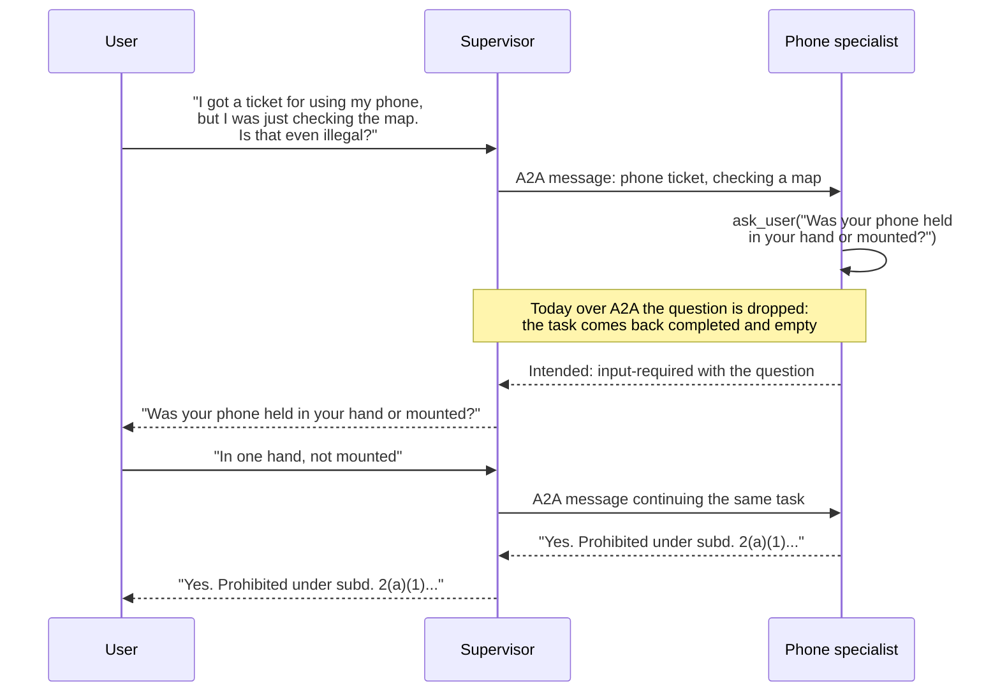

# Subagents in Foundry: specialists that ask for the missing fact

In [orchestration1](/posts/orchestration1/) I compared several ways to build an agent that answers questions about Minnesota traffic and car law from six documents. One of them was **subagents**: a supervisor decides which specialist to ask, and each specialist holds one document. The part I found most interesting was asking. A specialist that holds the document knows which fact decides the answer, so it can pause the conversation, ask the person for that fact, and carry on.

In this post I build the same design in Microsoft Foundry, with a supervisor that calls six specialists over the Agent2Agent protocol, and I test whether the specialists notice a missing fact and ask for it. I use the same eleven conversations as orchestration1. In [Part 3](/posts/azurefoundryagent4/) I built a voice agent from a template. Here every agent is a plain prompt agent, and the new part is how one agent calls another.

## What I found

- **Specialists notice a missing fact, with the right setting.** Each specialist has an `ask_user` tool and a generic rule, with no list of facts to look for. At the default reasoning effort they asked on 1 of the 12 turns that need a question. At high effort they asked on 9 of 12.
- **The questions are targeted.** At high effort every question asked for the fact the document turns on, such as "Did you refuse the chemical test, or did you take it and fail?". By my reading, only about five of LangChain's twelve questions on the same turns did that. Others were offers such as "Do you have any other questions about Minnesota's hands-free law?".
- **One piece is missing: the question does not arrive over A2A.** When a specialist asks through a tool, the A2A reply is an empty completed task. I expect Microsoft to address this, and I show how to check my result, because I may have something wrong.
- **Accuracy and cost, on 62 questions:** the supervisor had the required facts on 50 of 56 in-scope questions against 56 of 56 for one agent holding everything, and used about a quarter of the tokens.

:::brain-power Before you read on
In LangChain a subagent is a tool that the supervisor calls. Foundry has prompt agents but, as I found out, no longer has a tool that wraps one agent inside another. What would you use instead, and what would have to be true for the call to work?
:::

## Where "connected agents" went

Foundry used to have a feature called Connected Agents, in which one agent held others as tools. Microsoft's documentation says it is not available in the new Foundry Agent Service. It gives two replacements:

- **The A2A tool.** An agent calls any endpoint that speaks the [Agent2Agent protocol](https://a2a-protocol.org/latest/), including another Foundry agent with incoming A2A switched on.
- **Workflows.** A declarative flow that runs several agents in sequence, in a group chat, or with a person in the loop.

A supervisor that decides at run time which specialist to call is closest to the A2A tool, so I used that. I did not build a workflow, because the workflow page says Foundry is retiring workflows on 1 December 2026 and tells anyone building new ones to use Microsoft Agent Framework. A fixed-routing design, where code picks the specialist and the model does not decide, would be worth trying there, and I have not.

The mapping from orchestration1 is direct:

| In orchestration1 (LangChain) | In Foundry |
|---|---|
| Supervisor agent | Prompt agent `mn-law-supervisor` |
| One tool per specialist | One A2A tool per specialist |
| Specialist agent holding one document | Prompt agent with the document in its instructions, incoming A2A enabled |
| The tool's description | The specialist's agent card |
| Credentials | A project connection of type `RemoteA2A` |

## The six specialists

Each specialist is a prompt agent whose instructions are a short set of rules followed by one of the six documents. The documents are the ones from orchestration1: speeding, the hands-free phone law, driving while impaired, reckless driving, lemon law and car sales, and car accidents. They run from 2,586 to 5,924 words, and none of them is long enough to need a search index.

```python
RULES = """You are the {title} specialist in a Minnesota traffic and car law service.

Answer only from the document below. Quote the statute or case that supports each point, with its
section number. If the document does not cover the question, say so plainly and do not guess or
fill the gap from memory. If the question depends on a fact you were not given, say which fact it
depends on instead of assuming it. Keep the answer short. This is general information, not legal
advice.

--- DOCUMENT ---
"""

agent = project.agents.create_version(
    agent_name=agent_name(area),
    definition=PromptAgentDefinition(model=model, instructions=RULES.format(title=title) + doc),
)
```

Creating the agent is not enough for another agent to call it. Incoming A2A is off by default, and the portal cannot switch it on yet, so I used the SDK to add an **agent card** and enable the protocol.

```python
project.agents.update_details(
    agent_name=name,
    agent_endpoint=AgentEndpointConfig(
        protocol_configuration=ProtocolConfiguration(
            responses=ResponsesProtocolConfiguration(), a2a=A2AProtocolConfiguration())),
    agent_card=AgentCard(
        version="1.0", description=about,
        skills=[AgentCardSkill(id=area, name=title, description=about)]),
)
```

The agent card is what a calling agent sees about its target, so the `description` is doing the job that a tool description does in LangChain. I wrote one sentence for each area, such as "Questions about using or holding a phone or other device while driving." I fetched the phone specialist's card with a signed-in request to check it. It lists the endpoint three ways, JSON-RPC for A2A 1.0, JSON-RPC for 0.3 and HTTP+JSON for 0.3, and it says text is the only input and output mode and that streaming is off.

I asked the phone specialist a question directly before I connected anything, to check it worked alone.

```PROMPT
Is it illegal to hold my phone at a red light?
```

It answered from its document and quoted § 169.475, subd. 2(a) and the rule that a car stopped at a traffic light is still part of traffic. The call used 3,647 input tokens.


*I opened the Agents list and found the six specialists, the supervisor and the flat agent I used as a baseline*

## Connecting the supervisor to the specialists

Each specialist needs a project connection that stores its A2A address and how to sign in to it. The target is the specialist's A2A base path, `.../agents/<name>/endpoint/protocols/a2a`, and the authentication is the calling agent's own identity, so there is no key to store.

```python
body = {"properties": {"authType": "AgenticIdentityToken", "category": "RemoteA2A",
                       "target": f"{endpoint}/agents/{agent_name(area)}/endpoint/protocols/a2a",
                       "audience": "https://ai.azure.com", "Credentials": {}, "metadata": {}}}
# PUT .../connections/a2a-<area>?api-version=2025-04-01-preview
```

The connections appear in the portal under **Tools**, with the type Agent2Agent (A2A).


*I opened Tools and found the six a2a connections next to the MCP connection from Part 3*

I opened one to see what Foundry stored. The authentication is "Microsoft Entra Agent Identity", and the page gives the connection ID that an agent uses to refer to it.


*I opened a2a-speeding and read its endpoint, its authentication and its connection ID*

## The supervisor

The supervisor holds no law. Its instructions tell it to pick the areas, rewrite the question so that it stands on its own, call the specialists, and build the answer only from what they return. A question outside the six areas goes to a seventh specialist, `mn-law-outside`, whose only job is to say the question is outside the six areas and name them.

```python
INSTRUCTIONS = """You answer questions about Minnesota traffic and car law by asking specialists.
You have seven specialist tools: one for each of six areas of law, and one for anything outside them.
You hold no law yourself.

1. Decide which area or areas the question belongs to. A question can need more than one.
2. Rewrite the question for each specialist so that it stands on its own: put in the facts the user
   gave, leave out the rest. Then call that specialist. Call every specialist the question needs.
3. If the question does not belong to any of the six areas, call the outside specialist.
4. Build the final answer only from what the specialists returned. Keep their section numbers.
   If a specialist says its document does not cover something, say so. Do not fill the gap yourself.
This is general information, not legal advice."""

tools = [A2ATool(a2a_version=A2AProtocolVersion.V1_0, base_url=target, project_connection_id=conn)
         for conn in connections]

agent = project.agents.create_version(
    agent_name="mn-law-supervisor",
    definition=PromptAgentDefinition(model=model, instructions=INSTRUCTIONS, tools=tools,
                                     tool_choice="required"))
```

The line that matters most is `tool_choice="required"`. It makes every response start with a tool call, so the supervisor cannot answer from its own memory or stop at a sentence that announces a call. The seventh specialist exists because of that setting: the six out-of-scope questions must not reach a legal specialist, and with a call required they need somewhere else to go. The supervisor is still all A2A.


*I opened the supervisor in the playground and found the seven-tool instructions and the A2A tools*

## Connection errors

A call from the supervisor to a specialist can fail with three different messages before it works.

| Message | What I saw |
|---|---|
| `does not have a valid target URL specified, and no server URL was provided` | The tool had only the connection's full Azure resource ID. Adding `base_url` to the tool changed this message. |
| `Connection ... not found` | The connection existed, and the portal and the SDK could both read it. It appeared when I called a connection straight after creating it. One connection, `a2a-outside`, kept returning it for more than eight minutes. Two connections that I created and then left alone for four and five minutes worked on their first call. |
| `Failed to fetch agent card: ... 404 ... not accessible to the configured identity` | It appeared for a new agent whose own identity had no role. About three minutes after I assigned the **Foundry Agent Consumer** role to that identity, the same call worked. |

```bash
az role assignment create \
  --assignee-object-id <supervisor instance_identity principal id> \
  --assignee-principal-type ServicePrincipal \
  --role eed3b665-ab3a-47b6-8f48-c9382fb1dad6 \
  --scope <project resource id>
```

Two rules follow from what I saw. Create the connections first and do not call them for about five minutes. And give every agent that holds A2A tools the Foundry Agent Consumer role on the project. Each agent has its own identity, so a second supervisor needs its own assignment. This is what happened to me on three connections and two agents, and it is not documented behaviour.

## What one call looks like

I asked the supervisor the same phone question, and then a speeding question. A response from a Foundry agent is a list of output items, and a call to a specialist appears as two of them: the call and its output.

```json
{ "type": "a2a_preview_call",
  "name": "a2a-speeding",
  "arguments": "{\"message\":{\"parts\":[{\"kind\":\"text\",\"text\":\"In Minnesota, what is the speed limit in an urban district when nothing is posted? Please answer the default speed limit rule ...\"}]}}" }
{ "type": "a2a_preview_call_output",
  "name": "a2a-speeding",
  "output": "In an urban district with no posted limit, the default statutory speed limit is **30 mph**. The document says ..." }
{ "type": "message", "phase": "final_answer", "content": "... the default speed limit in an urban district when nothing is posted is **30 mph** ..." }
```

That is everything I need to check the design. The `name` says which specialist the supervisor chose, `arguments` holds the question as the supervisor rewrote it, and `output` is what the specialist said. In orchestration1 I scored "did it call the right specialists" from the same three pieces of information.


*I asked the supervisor the DWI question in the playground and found the call, the call output and the message in the response*

The portal's trace view lists the same three items. It tells you that the detail comes from the agent's responses and that to see distributed traces you connect Application Insights, which I did not do.


*I opened the trace for that response and found the three items under a single response*

:::no-dumb-questions
**Q: The item type says `preview`, but I asked for A2A version 1.0. Why?**
A: I read the agent back with the SDK. The tool is stored as type `a2a` with `a2a_version` 1.0, which Microsoft lists as the generally available version. So the `preview` is in the name of the output item, not in the tool I created. I cannot see which protocol version Foundry used on the wire, so I do not claim one.

**Q: Does the supervisor's token count include the specialists?**
A: No. The specialist runs inside the A2A call and its tokens are not in the supervisor's usage. I estimate them below from the size of each document.
:::

## Asking for missing information

Some questions cannot be answered until the person supplies a fact. In orchestration1 the specialist noticed this and paused to ask, using an `ask_user` tool, and the supervisor passed the question to the person and the reply back. The same design should work in Foundry, and almost all of it does.

### How it should work

The specialist holds the document, so it knows which fact decides the answer. I give each specialist an `ask_user` function tool and a generic rule. There is no list of facts to look for:

```python
RULES = """You are the {title} specialist in a Minnesota traffic and car law service.

Answer only from the document below. Quote the statute or case that supports each point, with its section number. If the
document does not cover the question, say so plainly. Keep the answer short. This is general information, not legal advice.

Before you answer, decide whether a fact that decides the answer is missing from what the person has told you. If one is,
call the ask_user tool with ONE short question about that fact, and write no text before or after the call. If every fact you
need has been given, answer. Do not ask about anything the person already said.

--- DOCUMENT ---
"""

ask_user = FunctionTool(
    name="ask_user",
    description="Ask the person one short question when the answer depends on a fact they have not given.",
    parameters={"type": "object", "properties": {"question": {"type": "string"}},
                "required": ["question"], "additionalProperties": False},
    strict=True,
)

specialist = project.agents.create_version(
    agent_name=f"mn-law-ask-{area}",
    definition=PromptAgentDefinition(model=model, instructions=RULES.format(title=title) + document,
                                     tools=[ask_user], reasoning=Reasoning(effort="high")),
)
```

The supervisor needs two rules of its own:

```text
If the specialist's reply is a question for the person, not an answer, pass that question on to the user in your own
reply and stop. Do not answer it yourself and do not guess.
When the user answers, send their answer to the same specialist, then build your reply from what it returns.
```

On the wire, the A2A protocol has a task state for this, `input-required`. A specialist that needs a fact moves its task to that state with the question in the status message, and the caller continues the same task with the reply. The pieces on the Microsoft side exist: Agent Framework's `A2AAgent` client records the state and, on the next message, continues the same task by its `task_id`.

### Do the specialists notice a missing fact?

I ran orchestration1's conversations against these specialists. N6 is left out, as it was there, which leaves 11 conversations and 23 turns. Twelve of those turns need a question: the opening turn of each conversation, and the second turn of N7. For each area there is one specialist, called through the Responses API. A simulated user, `gpt-5.4-mini` reading the conversation's fact sheet, answers whatever is asked. I score each turn as orchestration1 did: did the specialist ask exactly when it should, and does the answer contain the required facts. The LangChain figures come from the stored per-turn results for the published subagents row, which I reproduced to the digit: 16 facts, 12 asked correctly, 681,789 prompt tokens.

| | LangChain subagents | Foundry specialists, default effort | Foundry specialists, high effort |
|---|---|---|---|
| Turns that need a question: asked | 12 of 12 | 1 of 12 | 9 of 12 |
| Follow-up turns: asked | 11 of 11 | 0 of 11 | not run |
| Input tokens for the 12 turns that need a question | not comparable | 83,557 | 139,218 |

The reasoning effort is the lever. It is one setting, `reasoning=Reasoning(effort="high")`, and it moved the specialists from asking on one turn to asking on nine, with the same rule. It also cost about two thirds more tokens on those turns, partly from the extra round of asking, and I did not separate the two.

**The quality of the questions differs more than the counts.** LangChain's 12 of 12 counts any call to `ask_user`. Reading every question, I would say about five of its twelve gate questions asked for the decisive fact, two were partly on target, and five were not requests for a missing fact. These are the questions on some matching turns:

| Turn | LangChain subagents asked | Foundry specialist at high effort asked |
|---|---|---|
| DWI stop | "Do you want details on a specific scenario, such as a first-time refusal, a test failure, or a conviction with priors?" | "Did you refuse the chemical test, or did you take it and fail?" |
| Lemon law | "Was the car new or used?" | "Was it a new vehicle or a used vehicle bought from a dealer?" |
| No-fault crash | "Do you have any additional questions about Minnesota accident law?" | "Did your injuries meet Minnesota's tort threshold: more than $4,000 in medical expenses, or permanent injury, disfigurement, death, or 60+ days of disability?" |
| Phone ticket | "Do you have any other questions about Minnesota's hands-free law?" | "Were you holding the phone or typing into the map, or was it mounted/hands-free with no typing?" |
| Van, second turn | "Do you need help determining whether your specific use pattern meets the 40 percent threshold?" | "Is the van used for personal, family, or household purposes at least 40% of the time?" |

The orchestration1 score rewards asking, and not what is asked, so a generic prompt counts the same as the decisive question. The Foundry specialists asked fewer questions, and each one I read was about a fact the document turns on. My classification is a judgement, and the questions are all in the stored results if you want to disagree.

**What I did not measure.** At high effort the specialists missed three turns: the follow-up on street racing, one crash question and one speeding question. After asking, 6 of the 9 answers had the required facts. LangChain's specialists asked on all 11 follow-up turns, which the test did not expect, and by my reading 8 of those 11 were questions about a fact. The Foundry specialists never asked on a follow-up at the default effort. I did not run the follow-ups at high effort, so I cannot say whether high effort makes them over-ask. Each design ran once, the user answers came from different simulators, and the keyword check cannot tell a good answer from a lucky one.

### One conversation: the phone question

[orchestration1](/posts/orchestration1/) has a section called "One conversation, four designs". Its clearest example is the phone question where the document's answer turns on a fact the user never gave, whether the phone was held: "I got a ticket for using my phone, but I was just checking the map. Is that even illegal?", followed by "Does it matter that I was fully stopped and not moving?". In that post every design paused to ask whether the phone was held or mounted, and then gave a definite answer. I ran the same two questions through three Foundry designs.

| Design | Asked a question? | Input tokens, turn 1 / turn 2 |
|---|---|---|
| Supervisor and specialists over A2A, as built in this post | No. "Maybe not — it depends on how you checked the map", with both cases covered | 3,160 / 3,674 at the supervisor, plus about 3,600 for each specialist call (estimated) |
| One agent holding all six documents | No. "Maybe not — it depends on exactly how you were using it" | 35,084 / 35,474 |
| Phone specialist with an `ask_user` tool, called through the Responses API | Yes: "Was your phone held in your hand or mounted?" | 3,719 and 3,772 / 3,886 |

The third row behaves like orchestration1. The specialist asked the same question, and after the scripted reply, "I was holding the phone in one hand, and it was not mounted", it answered that § 169.475, subd. 2(a)(1) prohibits holding the device, and that the navigation exception applies only if the person does not hold it. The follow-up about being stopped was answered in the same conversation for 3,886 tokens, with the quoted rule that a stopped vehicle is still part of traffic unless it is lawfully stopped, off the road and not obstructing traffic.

The first two rows did not ask, because neither has an `ask_user` tool or a rule to ask. Both gave a correct conditional answer that covers held and not held, and both answered the follow-up correctly. The difference is that the question to the user would have made the answer definite.

For comparison, orchestration1 recorded these prompt tokens for the two turns: one agent with everything in its prompt 107,280 and 108,209, skills 14,593 and 4,829, subagents 14,875 and 7,750, and handoffs 14,664 and 4,809. Those runs used different models on my own machine, so only the shape carries over. The flat agent there paid for the whole prompt again at every pause. Here the flat agent did not ask, so it paid about 35,000 tokens a turn, and I did not measure what it would have cost with a question.

Here is the intended flow for the supervisor design, with the one step that does not work today:



### Over A2A, the question does not arrive

**The specialist does its part.** Called through the Responses API, it returned an `ask_user` function call with the right question, "Was the car bought new from a dealer, or used from a dealer/private seller?", two times out of two.

**Over A2A, that question does not arrive.** Called through its A2A endpoint, the same agent returned a completed task with no message and no artifact. I printed the raw JSON-RPC body so that no client library could hide a field, and I repeated the call over A2A 1.0, A2A 0.3, and 1.0 with both extensions that the agent card advertises, `mcp-approval-request` and `citations`.

```json
{"jsonrpc":"2.0","id":"...","result":{"task":{"id":"resp_...","contextId":"ctxt_...",
  "status":{"state":"TASK_STATE_COMPLETED","timestamp":"2026-10-28T04:56:42+00:00"},"artifacts":[]}}}
```

| Reply over A2A when the specialist calls `ask_user` | Result |
|---|---|
| A2A 1.0 | `COMPLETED`, no artifacts |
| A2A 0.3 | `completed`, no artifacts |
| A2A 1.0 with both advertised extensions requested | `COMPLETED`, no artifacts |

**A question written as plain text does arrive.** When a specialist asked in text, the reply was a completed task with the question in its artifact, and the task carried a `contextId`. A supervisor with the two rules above put that question to the user, and then sent the user's answer to the specialist. The specialist asked in one of two runs, and in the other it answered both branches, new and used.

### Why I expect this to be fixed

Everything else in the chain works: the specialist asks, the protocol has a place for the question, and Microsoft's client knows how to continue the task. The missing piece looks small. Microsoft's open-source Agent Framework has an A2A server executor, `A2AExecutor`, and its source skips function-call content. A comment there says that "intermediate function_call / function_result from tool use" is skipped, and the task is then marked complete. It never sets `TASK_STATE_INPUT_REQUIRED`. I have not seen Foundry's own endpoint code, so that Foundry behaves like this executor is an inference. A mapping from a pending `ask_user` call to `input-required` is the natural addition, and I expect Microsoft to make it.

:::watch-it I may have got this wrong
This is one project, one model and one region, and I may be doing something wrong. I found nothing in Microsoft's documentation about function tools over A2A, either as a limit or as a bug, so I cannot say whether the behaviour is intended. I tested a prompt agent, not a hosted agent. To check my result, create a prompt agent with a function tool, enable incoming A2A, and print the raw reply:

```python
async def show(response):                      # print the raw JSON-RPC body
    if response.request.method == "POST":
        await response.aread()
        print(response.status_code, response.text)

async with httpx.AsyncClient(headers={"Authorization": f"Bearer {token}"}, event_hooks={"response": [show]}) as http:
    card = await A2ACardResolver(httpx_client=http, base_url=A2A_BASE, agent_card_path="agentCard/v1.0").get_agent_card()
    client = await create_client(agent=card, client_config=ClientConfig(streaming=False, httpx_client=http))
    message = new_text_message("My car has been in the shop three times. Do I qualify for a refund?", role=Role.ROLE_USER)
    async for _ in client.send_message(SendMessageRequest(message=message)):
        pass
```

If you get an `input-required` task or the question in a message, tell me, because then something in my setup is different from yours.
:::

### What I would tell Microsoft

- A question asked through a function tool on an agent exposed over A2A should surface to the caller. The natural form is the task state `input-required`, with the question in the status message. The official `a2a-sdk` offers `TaskUpdater.requires_input()` for exactly this, and Microsoft's own client already understands the state.
- If that is deliberately unsupported, say so in the incoming A2A page, next to the existing limits on text and streaming.
- Foundry's A2A tool should document what it does when a remote agent returns `input-required`. I could not produce one to test it.

The 62-question results above do not depend on any of this. Their specialists are told to name the fact an answer depends on, and they have no `ask_user` tool.

## The test

I used the 62 single-turn questions from orchestration1. Each one is labelled with the specialists it should reach and the facts the answer must contain. There are 43 single-area questions, 9 that need more than one area, 4 with noisy wording, and 6 outside the six areas, where the right move is to call no specialist.

I scored each answer two ways, the same as the first half of orchestration1. **Facts** means every required fact appears in the answer, which is a keyword check. **Routed** means the set of specialists the supervisor called matches one of the expected sets. I ran every question three times through the supervisor and once through the flat agent, and never ran two designs at the same time. I stopped a second flat run at 33 of 62 questions to save tokens, so the flat agent's score rests on one run.

I also built the baseline from orchestration1: one agent, `mn-law-flat`, with all six documents in its instructions, about 25,900 words in a single prompt.

## How accurate and cheap is it? The 62 questions

| Design | In-scope questions with the facts (56) | Routed (62) | Seconds for 62 questions |
|---|---|---|---|
| Supervisor, run 1 | 50 (89%) | 55 | 434 |
| Supervisor, run 2 | 46 (82%) | 54 | 443 |
| Supervisor, run 3 | 50 (89%) | 55 | 439 |
| One agent holding all six documents | 56 (100%) | not applicable | 668 |

By category in run 1, the supervisor had the required facts on 40 of 43 single-area questions, 6 of 9 multi-area questions and 4 of 4 noisy questions. On 55 of the 56 in-scope questions it made at least one specialist call. Across the three runs, the specialists called were identical on 56 of the 62 questions, and 52 questions had the required facts in all three runs. So the score is fairly steady, but a run can lose a few answers, as run 2 did.

### Checking the answers, not only the keywords

A keyword check is blunt. It cannot fail the six out-of-scope questions, and it fails an answer that writes "10%" where the check wants "ten percent". So I also had a model grade some answers against the source documents. It does not know which design wrote an answer, and it sees only the documents for that question's areas. I picked 19 questions: the 9 where the supervisor missed a keyword or the routing, plus 10 chosen at random. That model is `gpt-5.4-mini`, the same family as every agent in this post, because it was the only model I had quota for. A grader from the same family can be lenient.

| | Passed the judge (19 questions) |
|---|---|
| Supervisor | 14 |
| One agent holding all six documents | 15 |

I read five of the disputed answers myself, and the judge was wrong on three of them.

- **Too strict on the flat agent, twice.** For the stop-sign fine, the flat agent said the documents give no amount and then quoted a petty misdemeanor maximum of $300. That figure is in the speeding document, so the answer is grounded. For the breath-test question it cited two DWI cases, and both are in the DWI document.
- **Too lenient on the supervisor, once.** For "I was texting while doing 105 mph", the supervisor covered only the phone penalty. It never mentioned the speed or the six-month revocation, and the judge passed it.
- **Right on the other two.** The supervisor wrongly said a question about gross negligence was outside its areas, which is a real failure. And its lemon-law deduction answer, "10 cents per mile or 10% of the purchase price", was right, so the keyword check was the one at fault.

With those three corrections, the totals are about 13 for the supervisor and 17 for the flat agent out of 19. I read only five of the 38 answers, so treat those totals as approximate. In the 10 random questions, both designs did well, and the judge failed one flat answer that I judged to be grounded.

### Does the supervisor add knowledge of its own?

The point of specialists is that the answer comes from the document. A supervisor that fills a gap from the model's memory would defeat that. I checked this in two cheap ways, using the final answers of all three supervisor runs and the flat agent, against the six documents.

- **Citations.** I pulled out every statute section an answer cites and looked for it in the documents. The supervisor cited 138 sections across its three runs and the flat agent cited 108, and every one appears in the documents.
- **Figures.** I pulled out every dollar amount, percentage and period, ignored numbers that the user gave, and normalised spelled-out numbers such as "ten cents". After that, each supervisor run had one figure in no document. One was the user's own "210k miles" written differently. The other was "at least 120 days total", a sum of the 30-day base period and the 90 additional days that the document gives. The flat agent had one hypothetical, "a 60 mph zone", in an offer to explain a scenario.

So I found no fact in the supervisor's answers that came from outside the documents. This is a limit more than a proof. It cannot see a claim in prose that has no citation or number, and I tested against the documents and not against what each specialist actually said, because my evaluator did not keep the specialists' replies. It keeps them now. Without a required tool call I saw a supervisor answer a DWI question from its own memory, so the `tool_choice` setting matters here, and the instruction to build the answer only from what the specialists returned is not enough on its own.

### Where the supervisor still goes wrong

- **Multi-area questions.** It made 64 specialist calls for 62 questions, so it almost never asked two specialists. "I was texting while doing 105 mph" went to the phone specialist and not to speeding. A DWI-against-speeding comparison went to the DWI specialist alone.
- **Two out-of-scope questions reached a specialist.** "What is the speed limit in Wisconsin?" and a question about the fine for running a stop sign both went to the speeding specialist. In a separate test of the Wisconsin question the supervisor used the outside specialist, so this varies from run to run.
- **Misroutes.** One question went to the outside specialist that belongs to reckless driving, one went to the reckless specialist that belongs to speeding, and one went to the accident specialist that belongs to DWI.
- **Six answers missed a keyword.** Five were real misses. The sixth, the lemon-law deduction, was right and wrote "10%" where the check wanted "ten percent".

### The cost

The supervisor's own usage was 195,540 input tokens for 62 questions, against 2,174,855 for the flat agent, but that number leaves out the specialists. I estimated them. The phone specialist used 3,647 input tokens for a 2,586-word document, about 1.35 tokens a word, so I applied that rate to the document each call used. The 64 specialist calls come to about 371,000 input tokens, and the whole supervisor design to about 566,000. That is 3.8 times fewer than the flat agent. It is an estimate, because Foundry does not report the specialists' tokens.

It took 434 seconds for the supervisor and 668 for the flat agent, so the supervisor was also faster, even though each question makes two model calls in sequence.

### The same 62 questions in my LangChain project

I ran these 62 questions through a LangChain supervisor and through a flat agent on a local model, `gemma4:12b`, using the same keyword check. Those results are stored with my LangChain project, and orchestration1 does not show them, because that post compares LangChain patterns on conversations.

| | Supervisor with specialists | One agent holding all six documents |
|---|---|---|
| LangChain, `gemma4:12b`, on my Mac | 55 of 56 in-scope facts, 58 of 62 routed, 536,529 prompt tokens, 8,935 seconds | 53 of 56 in-scope facts, 2,294,589 prompt tokens, 2,741 seconds |
| Foundry, `gpt-5.4-mini` | 50 of 56 in-scope facts, 55 of 62 routed, about 566,000 input tokens (estimated), 434 seconds | 56 of 56 in-scope facts, 2,174,855 input tokens, 668 seconds |

In LangChain the specialists were what I hoped for on accuracy and cost: slightly more answers with the facts, and 4.3 times fewer prompt tokens. They were slower, because my Mac processes long prompts slowly. In Foundry the token saving is the same, 3.8 times, and the supervisor is also faster. The accuracy went the other way. Two things changed at once, and I did not separate them. The flat agent did better on `gpt-5.4-mini` than on `gemma4:12b`, 56 against 53, so this model holds a 35,000-token prompt well. The supervisor did worse, 50 against 55. Comparing the two runs question by question shows where the supervisor differs.

| | LangChain supervisor | Foundry supervisor |
|---|---|---|
| Questions that missed a required fact | C10 | C1, C6, F1, L3, M1, M2 |
| Routing misses (of 62) | A6, A7, C1, C10 | C1, C6, C8, M1, M2, O3, O7 |
| Multi-area questions where it asked two or more specialists | 7 of 9 | 2 of 9 (and 1 or 2 of 9 in the other two runs) |
| Specialists called per question, on average | 1.10 | 0.95 |

The two supervisors called the same specialists on 47 of the 62 questions. The biggest difference is on the multi-area questions. For "I was texting while doing 105 mph", LangChain asked the speeding and phone specialists, and Foundry asked only the phone specialist. For the DWI-against-speeding comparison, LangChain asked both, and Foundry asked only DWI. Those two, plus the pedestrian-death question, account for three of the Foundry misses. The Foundry supervisor can ask two specialists, because it did so on the accident-and-DWI question in two of its three runs, so it is a choice the model makes and not a limit of the A2A tool. I have not tried to change that choice.

The flat agents differ in the other direction. On `gemma4:12b` the flat agent missed C2, D5 and F1. On `gpt-5.4-mini` it missed none. Only F1 is missed by both a flat agent and the Foundry supervisor, and that question can draw on several areas of law, such as reckless driving, accidents and phone use.

The other Foundry misses are single-area questions that the supervisor sent to the wrong place. A question about gross negligence went to the "outside" specialist, and one about what a police stop allows went to the reckless-driving specialist. The lemon-law deduction question was a keyword miss on an answer that was right.

## The rate limit, and what it did to the test

The flat agent needs about 35,000 input tokens a question, so running four at a time used up the deployment's tokens-per-minute limit, and a question I typed into the supervisor's playground at the same time failed.


*I typed a question into the supervisor's playground and got a token rate limit error while the flat agent's test was running*

The deployment had 100,000 tokens a minute, and my subscription allows 200,000 for this model, so I raised it to that. After that the flat agent ran all 62 questions with no errors, one question at a time. The limit is per minute and I did not see a weekly one.

## What I conclude, and what I do not

For the 62 single-turn questions, the single agent that held all six documents was more accurate than my supervisor on every check I ran, and it needed no routing. The supervisor used about a quarter of the tokens and was faster. If the documents did not fit in one prompt, or if the cost mattered more than the last six answers, the supervisor would be the answer. The six documents fit in one prompt here, which is why the flat agent works at all.

I did not test any of this:

- **Most answers by anything but keywords.** A model judged 19 of the 62 questions, and I read five answers. The rest are keyword checks only.
- **A flat agent run twice.** Its second run stopped at 33 questions to save tokens.
- **The eight held-out questions and a full conversation.**
- **A fixed-routing design.** I did not build a workflow or an Agent Framework router, so I cannot say whether code that picks the specialist would handle the multi-area questions better.
- **The follow-up turns at high effort.** Whether high effort makes the specialists over-ask is not measured, and the 62-question results are all at the default effort.
- **Higher reasoning effort for the 62 questions.** Every supervisor number here is at the default effort. In a small side test, a higher effort changed whether the supervisor asked a question before calling a specialist, so it may change other behaviour too.
- **Hosted agents over A2A,** and whether Foundry's A2A tool continues an `input-required` task from a server that returns one.
- **Removing the role from an agent that worked.** I tested a new agent without the role and then with it.

:::bullet-points What I know
- **Specialists notice a missing fact when given the effort.** With a generic rule and no checklist, they asked on 9 of 12 needed turns at high reasoning effort and 1 of 12 at the default, with targeted questions.
- **The `ask_user` question has one missing piece over A2A.** The specialist asks correctly, but the A2A reply is an empty completed task. I expect Microsoft to fix that, and I explain how to check my result.
- **Foundry has no Connected Agents any more.** The A2A tool replaces it, and each specialist needs incoming A2A enabled with the SDK, because the portal cannot do it yet.
- **Each call is visible.** The output items name the specialist and show the rewritten question and the answer.
- **A required tool call keeps the supervisor from answering without calling a specialist.** It needs an outside specialist so that out-of-scope questions still have somewhere to go.
- **The supervisor was cheaper and faster, and less accurate.** It had the required facts on 50 of 56 in-scope questions against 56 of 56 for one agent holding everything, and used about a quarter of the tokens. My LangChain run of the same questions had the opposite accuracy result.
- **Every agent with A2A tools needs the Foundry Agent Consumer role,** and a new connection needs about five minutes before its first call.
:::

## Cleaning up

I have not run any of these commands. The agents and connections stay in the project until I do.

```python
for area in AREAS:
    project.agents.delete(agent_name(area))
for name in ("mn-law-supervisor", "mn-law-outside", "mn-law-flat", "mn-law-lemon-ask", "mn-law-ask-supervisor"):
    project.agents.delete(name)
```

Delete the connections from **Tools** in the portal, or with `az rest --method delete` against each one. There are six `a2a-<area>` connections, `a2a-offscope` that the supervisor uses for the outside specialist, `a2a-outside`, which my failed first attempt left behind, and `a2a-lemon-ask` for the clarification test. Remove the role assignments for the two supervisors' identities too. The raised token limit on the deployment stays until I lower it.

## References

- [Connect to an A2A agent endpoint from Foundry Agent Service](https://learn.microsoft.com/en-us/azure/foundry/agents/how-to/tools/agent-to-agent)
- [Enable incoming A2A on a Foundry agent](https://learn.microsoft.com/en-us/azure/foundry/agents/how-to/enable-agent-to-agent-endpoint)
- [Build a workflow in Microsoft Foundry, which says workflows retire on 1 December 2026](https://learn.microsoft.com/en-us/azure/foundry/agents/concepts/workflow)
- [Agent Orchestration, part 1: the same design built with LangChain](/posts/orchestration1/)
- [Part 3: the legal intake voice agent](/posts/azurefoundryagent4/)
