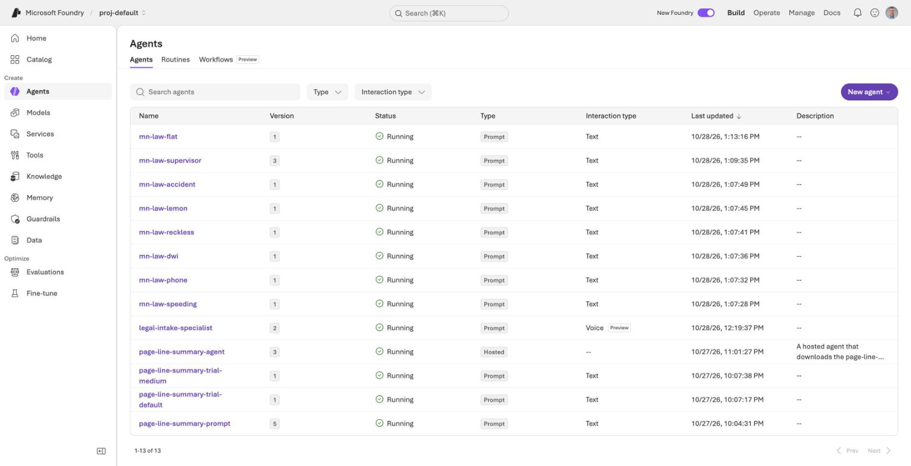
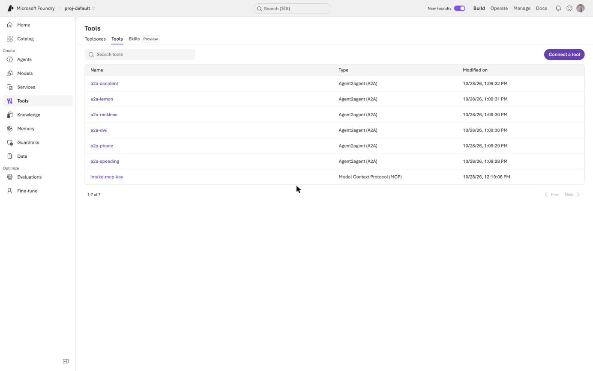
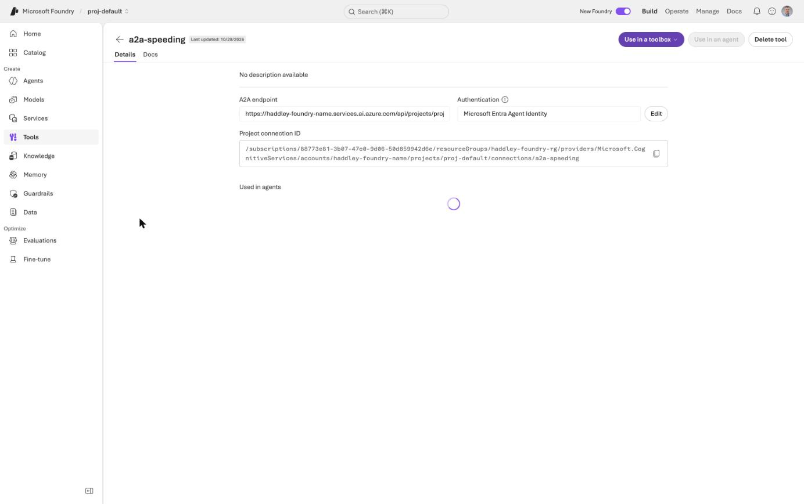
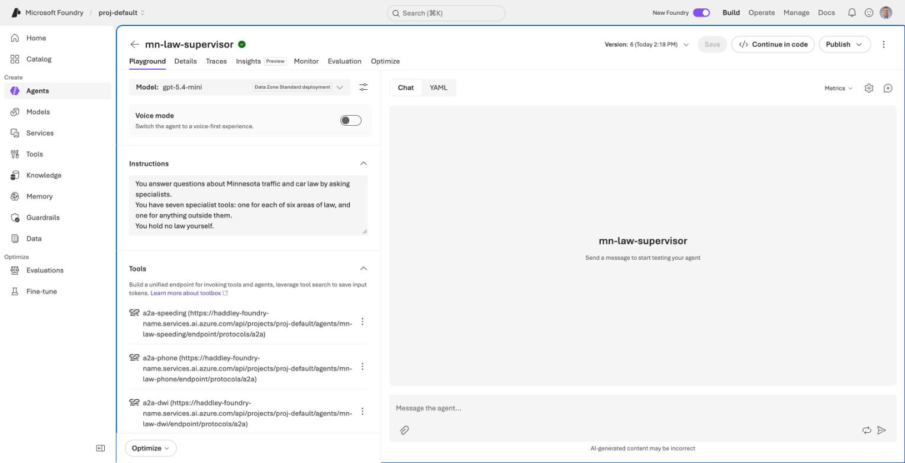
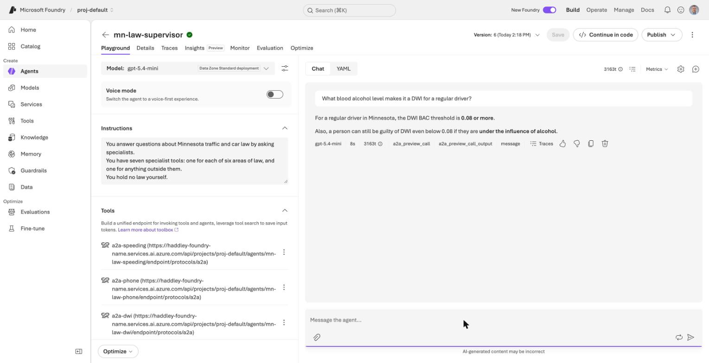
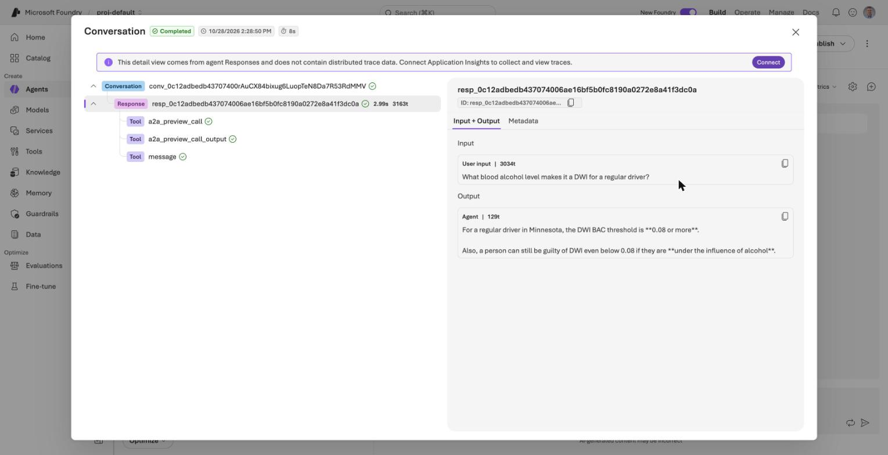
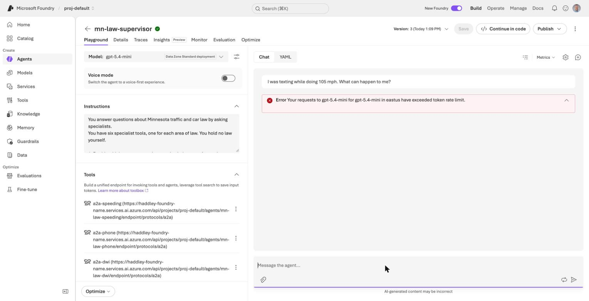

# Subagents in Foundry: a supervisor and six specialists

In [orchestration1](/posts/orchestration1/) I compared several ways to build an agent that answers questions about Minnesota traffic and car law from six documents. One of them was **subagents**: a supervisor decides which specialist to ask, rewrites the question, and each specialist holds one document. I built that with LangChain on my own Mac.

In this post I build the same design in Microsoft Foundry, and test it on the same 62 questions. In [Part 3](/posts/azurefoundryagent4/) I built a voice agent from a template and gave it a tool. Here every agent is a plain prompt agent, and the new part is how one agent calls another.

Here is where it ended up, on 62 questions with a simple check that the required facts appear in the answer:

| Design | Required facts present | Routed as expected | Seconds for 62 questions | Input tokens for 62 questions |
|---|---|---|---|---|
| Supervisor and seven specialists over A2A | 56 of 62 | 55 of 62 | 434 | about 566,000 (estimated) |
| One agent holding all six documents | 62 of 62 | not applicable | 668 | 2,174,855 |

The supervisor used about a quarter of the tokens and was faster, and it still scored lower. The rest of this post shows how I built it, the connection errors I hit, how it did on the 62 questions, and where it still goes wrong.

:::brain-power Before you read on
In LangChain a subagent is a tool that the supervisor calls. Foundry has prompt agents but, as I found out, no longer has a tool that wraps one agent inside another. What would you use instead, and what would have to be true for the call to work?
:::

## Where "connected agents" went

Foundry used to have a feature called Connected Agents, in which one agent held others as tools. Microsoft's documentation says it is not available in the new Foundry Agent Service. It gives two replacements:

- **The A2A tool.** An agent calls any endpoint that speaks the [Agent2Agent protocol](https://a2a-protocol.org/latest/), including another Foundry agent with incoming A2A switched on.
- **Workflows.** A declarative flow that runs several agents in sequence, in a group chat, or with a person in the loop.

A supervisor that decides at run time which specialist to call is closest to the A2A tool, so I used that. I did not build a workflow, because the workflow page says Foundry is retiring workflows on 1 December 2026 and tells anyone building new ones to use Microsoft Agent Framework. A fixed-routing design, where code picks the specialist and the model does not decide, would be worth trying there, and I have not.

The mapping from orchestration1 is direct:

| In orchestration1 (LangChain) | In Foundry |
|---|---|
| Supervisor agent | Prompt agent `mn-law-supervisor` |
| One tool per specialist | One A2A tool per specialist |
| Specialist agent holding one document | Prompt agent with the document in its instructions, incoming A2A enabled |
| The tool's description | The specialist's agent card |
| Credentials | A project connection of type `RemoteA2A` |

## The six specialists

Each specialist is a prompt agent whose instructions are a short set of rules followed by one of the six documents. The documents are the ones from orchestration1: speeding, the hands-free phone law, driving while impaired, reckless driving, lemon law and car sales, and car accidents. They run from 2,586 to 5,924 words, and none of them is long enough to need a search index.

```python
RULES = """You are the {title} specialist in a Minnesota traffic and car law service.

Answer only from the document below. Quote the statute or case that supports each point, with its
section number. If the document does not cover the question, say so plainly and do not guess or
fill the gap from memory. If the question depends on a fact you were not given, say which fact it
depends on instead of assuming it. Keep the answer short. This is general information, not legal
advice.

--- DOCUMENT ---
"""

agent = project.agents.create_version(
    agent_name=agent_name(area),
    definition=PromptAgentDefinition(model=model, instructions=RULES.format(title=title) + doc),
)
```

Creating the agent is not enough for another agent to call it. Incoming A2A is off by default, and the portal cannot switch it on yet, so I used the SDK to add an **agent card** and enable the protocol.

```python
project.agents.update_details(
    agent_name=name,
    agent_endpoint=AgentEndpointConfig(
        protocol_configuration=ProtocolConfiguration(
            responses=ResponsesProtocolConfiguration(), a2a=A2AProtocolConfiguration())),
    agent_card=AgentCard(
        version="1.0", description=about,
        skills=[AgentCardSkill(id=area, name=title, description=about)]),
)
```

The agent card is what a calling agent sees about its target, so the `description` is doing the job that a tool description does in LangChain. I wrote one sentence for each area, such as "Questions about using or holding a phone or other device while driving." I fetched the phone specialist's card with a signed-in request to check it. It lists the endpoint three ways, JSON-RPC for A2A 1.0, JSON-RPC for 0.3 and HTTP+JSON for 0.3, and it says text is the only input and output mode and that streaming is off.

I asked the phone specialist a question directly before I connected anything, to check it worked alone.

```PROMPT
Is it illegal to hold my phone at a red light?
```

It answered from its document and quoted § 169.475, subd. 2(a) and the rule that a car stopped at a traffic light is still part of traffic. The call used 3,647 input tokens.


*I opened the Agents list and found the six specialists, the supervisor and the flat agent I used as a baseline*

## Connecting the supervisor to the specialists

Each specialist needs a project connection that stores its A2A address and how to sign in to it. The target is the specialist's A2A base path, `.../agents/<name>/endpoint/protocols/a2a`, and the authentication is the calling agent's own identity, so there is no key to store.

```python
body = {"properties": {"authType": "AgenticIdentityToken", "category": "RemoteA2A",
                       "target": f"{endpoint}/agents/{agent_name(area)}/endpoint/protocols/a2a",
                       "audience": "https://ai.azure.com", "Credentials": {}, "metadata": {}}}
# PUT .../connections/a2a-<area>?api-version=2025-04-01-preview
```

The connections appear in the portal under **Tools**, with the type Agent2Agent (A2A).


*I opened Tools and found the six a2a connections next to the MCP connection from Part 3*

I opened one to see what Foundry stored. The authentication is "Microsoft Entra Agent Identity", and the page gives the connection ID that an agent uses to refer to it.


*I opened a2a-speeding and read its endpoint, its authentication and its connection ID*

## The supervisor

The supervisor holds no law. Its instructions tell it to pick the areas, rewrite the question so that it stands on its own, call the specialists, and build the answer only from what they return. A question outside the six areas goes to a seventh specialist, `mn-law-outside`, whose only job is to say the question is outside the six areas and name them.

```python
INSTRUCTIONS = """You answer questions about Minnesota traffic and car law by asking specialists.
You have seven specialist tools: one for each of six areas of law, and one for anything outside them.
You hold no law yourself.

1. Decide which area or areas the question belongs to. A question can need more than one.
2. Rewrite the question for each specialist so that it stands on its own: put in the facts the user
   gave, leave out the rest. Then call that specialist. Call every specialist the question needs.
3. If the question does not belong to any of the six areas, call the outside specialist.
4. Build the final answer only from what the specialists returned. Keep their section numbers.
   If a specialist says its document does not cover something, say so. Do not fill the gap yourself.
This is general information, not legal advice."""

tools = [A2ATool(a2a_version=A2AProtocolVersion.V1_0, base_url=target, project_connection_id=conn)
         for conn in connections]

agent = project.agents.create_version(
    agent_name="mn-law-supervisor",
    definition=PromptAgentDefinition(model=model, instructions=INSTRUCTIONS, tools=tools,
                                     tool_choice="required"))
```

The line that matters most is `tool_choice="required"`. It makes every response start with a tool call. An earlier version of this supervisor, without it, often wrote a line announcing a call and then stopped without making one, and rewording the instructions did not stop it. The seventh specialist exists because of that setting: the six out-of-scope questions must not reach a legal specialist, and with a call required they need somewhere else to go. The supervisor is still all A2A.


*I opened the supervisor in the playground and found the seven-tool instructions and the A2A tools*

## Three errors before the first answer

The first call to the supervisor failed with three different messages, one after another. Each one told me something about how the connection works, and I explained one of them wrongly the first time I published this post.

:::watch-it Three errors, and I am not sure what fixed the last one
1. `does not have a valid target URL specified, and no server URL was provided`. I had passed the full Azure resource ID of the connection and nothing else. Adding `base_url` to the tool changed this message.
2. `Connection ... not found`, with the full resource ID and the base URL, and then with the connection **name**, `a2a-speeding`. The connection existed, and both the portal and the SDK could read it.
3. After I assigned the **Foundry Agent Consumer** role to the supervisor's identity on the project, the call worked at once. Microsoft's documentation says the calling identity needs that role.

My first version of this post said the missing role caused error 2. I can no longer say that. Later I added a seventh connection, `a2a-outside`, and the same `not found` message came back and stayed for more than eight minutes, with the role already in place. A connection I created under a new name and left alone for four minutes worked on its first call. That test changed two things at once, the name and the wait, so I cannot tell whether new connections need time to become visible or a failed lookup is remembered. I never removed the role to see whether the calls need it, so I do not know that either.
:::

```bash
az role assignment create \
  --assignee-object-id <supervisor instance_identity principal id> \
  --assignee-principal-type ServicePrincipal \
  --role eed3b665-ab3a-47b6-8f48-c9382fb1dad6 \
  --scope <project resource id>
```

My advice is to assign the role, as the documentation says, and to expect a delay or a failed first lookup after you create a connection. If a call says a connection was not found, check that the connection exists before you change anything else.

## What one call looks like

I asked the supervisor the same phone question, and then a speeding question. A response from a Foundry agent is a list of output items, and a call to a specialist appears as two of them: the call and its output.

```json
{ "type": "a2a_preview_call",
  "name": "a2a-speeding",
  "arguments": "{\"message\":{\"parts\":[{\"kind\":\"text\",\"text\":\"In Minnesota, what is the speed limit in an urban district when nothing is posted? Please answer the default speed limit rule ...\"}]}}" }
{ "type": "a2a_preview_call_output",
  "name": "a2a-speeding",
  "output": "In an urban district with no posted limit, the default statutory speed limit is **30 mph**. The document says ..." }
{ "type": "message", "phase": "final_answer", "content": "... the default speed limit in an urban district when nothing is posted is **30 mph** ..." }
```

That is everything I need to check the design. The `name` says which specialist the supervisor chose, `arguments` holds the question as the supervisor rewrote it, and `output` is what the specialist said. In orchestration1 I scored "did it call the right specialists" from the same three pieces of information.


*I asked the supervisor the DWI question in the playground and found the call, the call output and the message in the response*

The portal's trace view lists the same three items. It tells you that the detail comes from the agent's responses and that to see distributed traces you connect Application Insights, which I did not do.


*I opened the trace for that response and found the three items under a single response*

:::no-dumb-questions
**Q: The item type says `preview`, but I asked for A2A version 1.0. Why?**
A: I read the agent back with the SDK. The tool is stored as type `a2a` with `a2a_version` 1.0, which Microsoft lists as the generally available version. So the `preview` is in the name of the output item, not in the tool I created. I cannot see which protocol version Foundry used on the wire, so I do not claim one.

**Q: Does the supervisor's token count include the specialists?**
A: No. The specialist runs inside the A2A call and its tokens are not in the supervisor's usage. I estimate them below from the size of each document.
:::

## The test

I used the 62 single-turn questions from orchestration1. Each one is labelled with the specialists it should reach and the facts the answer must contain. There are 43 single-area questions, 9 that need more than one area, 4 with noisy wording, and 6 outside the six areas, where the right move is to call no specialist.

I scored each answer two ways, the same as the first half of orchestration1. **Facts** means every required fact appears in the answer, which is a keyword check. **Routed** means the set of specialists the supervisor called matches one of the expected sets. I ran every question once through each design, and never ran two designs at the same time, with two questions in flight for the supervisor and one for the flat agent.

I also built the baseline from orchestration1: one agent, `mn-law-flat`, with all six documents in its instructions, about 25,900 words in a single prompt.

## The results

| Design | Facts | Routed | Seconds for 62 questions |
|---|---|---|---|
| Supervisor and seven specialists | 56 of 62 | 55 of 62 | 434 |
| One agent holding all six documents | 62 of 62 | not applicable | 668 |

By category, the supervisor had the required facts on 40 of 43 single-area questions, 6 of 9 multi-area questions, 4 of 4 noisy questions and 6 of 6 outside questions. On 55 of the 56 in-scope questions it made at least one specialist call. The flat agent had the facts in every category.

### Where the supervisor still goes wrong

- **Multi-area questions.** It made 64 specialist calls for 62 questions, so it almost never asked two specialists. "I was texting while doing 105 mph" went to the phone specialist and not to speeding. A DWI-against-speeding comparison went to the DWI specialist alone.
- **Two out-of-scope questions reached a specialist.** "What is the speed limit in Wisconsin?" and a question about the fine for running a stop sign both went to the speeding specialist. In a separate test of the Wisconsin question the supervisor used the outside specialist, so this varies from run to run, and I ran each question once.
- **Misroutes.** One question went to the outside specialist that belongs to reckless driving, one went to the reckless specialist that belongs to speeding, and one went to the accident specialist that belongs to DWI.
- **Six answers without the required facts**, four of them from the questions above.

### The cost

The supervisor's own usage was 195,540 input tokens for 62 questions, against 2,174,855 for the flat agent, but that number leaves out the specialists. I estimated them. The phone specialist used 3,647 input tokens for a 2,586-word document, about 1.35 tokens a word, so I applied that rate to the document each call used. The 64 specialist calls come to about 371,000 input tokens, and the whole supervisor design to about 566,000. That is 3.8 times fewer than the flat agent. It is an estimate, because Foundry does not report the specialists' tokens.

It took 434 seconds for the supervisor and 668 for the flat agent, so the supervisor was also faster, even though each question makes two model calls in sequence.

## The rate limit, and what it did to the test

The flat agent needs about 35,000 input tokens a question. The first time I ran it, four questions at a time, it used up the deployment's tokens-per-minute limit, and a question I typed into the supervisor's playground at the same time failed.


*I typed a question into the supervisor's playground and got a token rate limit error while the flat agent's test was running*

The deployment had 100,000 tokens a minute, and my subscription allows 200,000 for this model, so I raised it to that. After that the flat agent ran all 62 questions with no errors, one question at a time. The limit is per minute and I did not see a weekly one.

## What I conclude, and what I do not

For this task, on these 62 questions, the single agent that held all six documents was more accurate than my supervisor, even at its best, and it needed no routing. The supervisor used about a quarter of the tokens and was faster. If the documents did not fit in one prompt, or if the cost mattered more than the last six answers, the supervisor would be the answer. The six documents fit in one prompt here, which is why the flat agent works at all.

I did not test any of this:

- **Whether the answers are correct.** A keyword check shows that a fact appears. In orchestration1 I also used a judge model, and I have not here, so the flat agent's 62 of 62 may be generous.
- **Repeats.** Each question ran once per design. The Wisconsin question showed that one run can differ from the next.
- **The eight held-out questions and any multi-turn conversation.** I did not run them.
- **A fixed-routing design.** I did not build a workflow or an Agent Framework router, so I cannot say whether code that picks the specialist would handle the multi-area questions better.
- **Whether the role is needed.** See the three errors above.

:::bullet-points What I know
- **Foundry has no Connected Agents any more.** The A2A tool replaces it, and each specialist needs incoming A2A enabled with the SDK, because the portal cannot do it yet.
- **Each call is visible.** The output items name the specialist and show the rewritten question and the answer.
- **A required tool call keeps the supervisor from answering without asking.** It needs an outside specialist so that out-of-scope questions still have somewhere to go.
- **The supervisor still lost to one agent holding everything,** 56 of 62 against 62 of 62, for about a quarter of the tokens.
- **Multi-area questions are its weak spot.** It made 64 specialist calls for 62 questions.
:::

## Cleaning up

I have not run any of these commands. The agents and connections stay in the project until I do.

```python
for area in AREAS:
    project.agents.delete(agent_name(area))
for name in ("mn-law-supervisor", "mn-law-outside", "mn-law-flat"):
    project.agents.delete(name)
```

Delete the connections from **Tools** in the portal, or with `az rest --method delete` against each one. There are six `a2a-<area>` connections, `a2a-offscope` that the supervisor uses for the outside specialist, and `a2a-outside`, which my failed first attempt left behind and nothing uses. Remove the role assignment for the supervisor's identity too. The raised token limit on the deployment stays until I lower it.

## References

- [Connect to an A2A agent endpoint from Foundry Agent Service](https://learn.microsoft.com/en-us/azure/foundry/agents/how-to/tools/agent-to-agent)
- [Enable incoming A2A on a Foundry agent](https://learn.microsoft.com/en-us/azure/foundry/agents/how-to/enable-agent-to-agent-endpoint)
- [Build a workflow in Microsoft Foundry, which says workflows retire on 1 December 2026](https://learn.microsoft.com/en-us/azure/foundry/agents/concepts/workflow)
- [Agent Orchestration, part 1: the same design built with LangChain](/posts/orchestration1/)
- [Part 3: the legal intake voice agent](/posts/azurefoundryagent4/)
