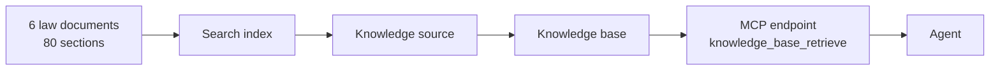
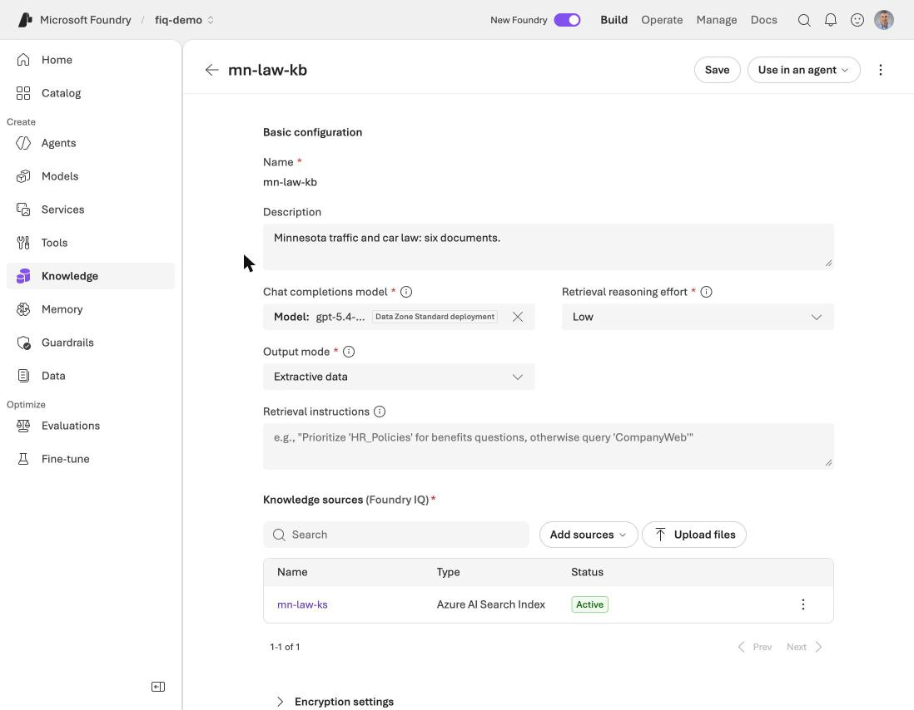
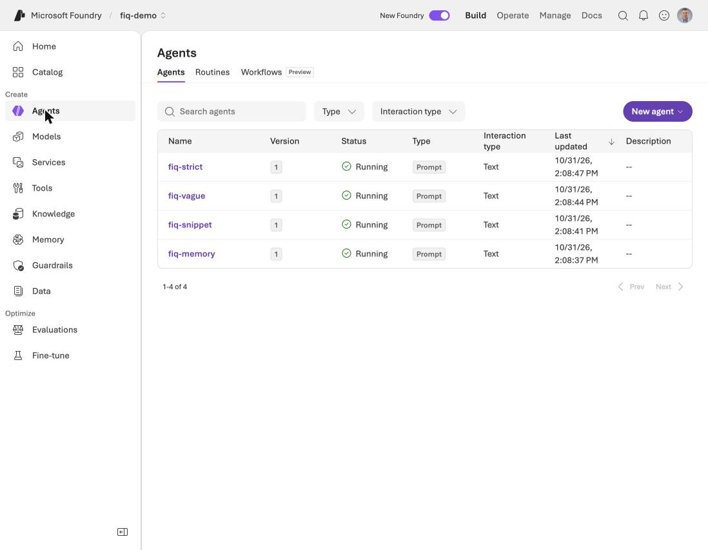
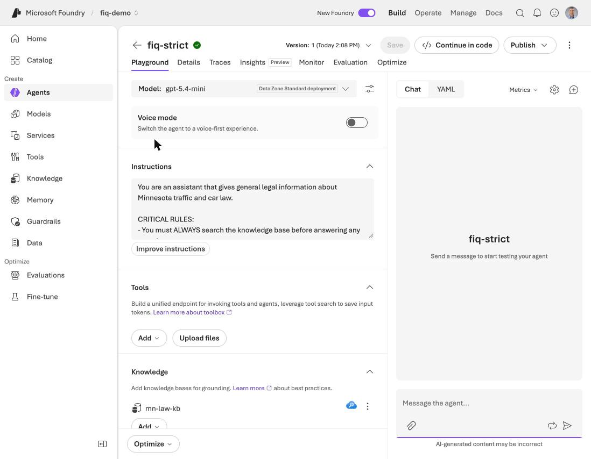
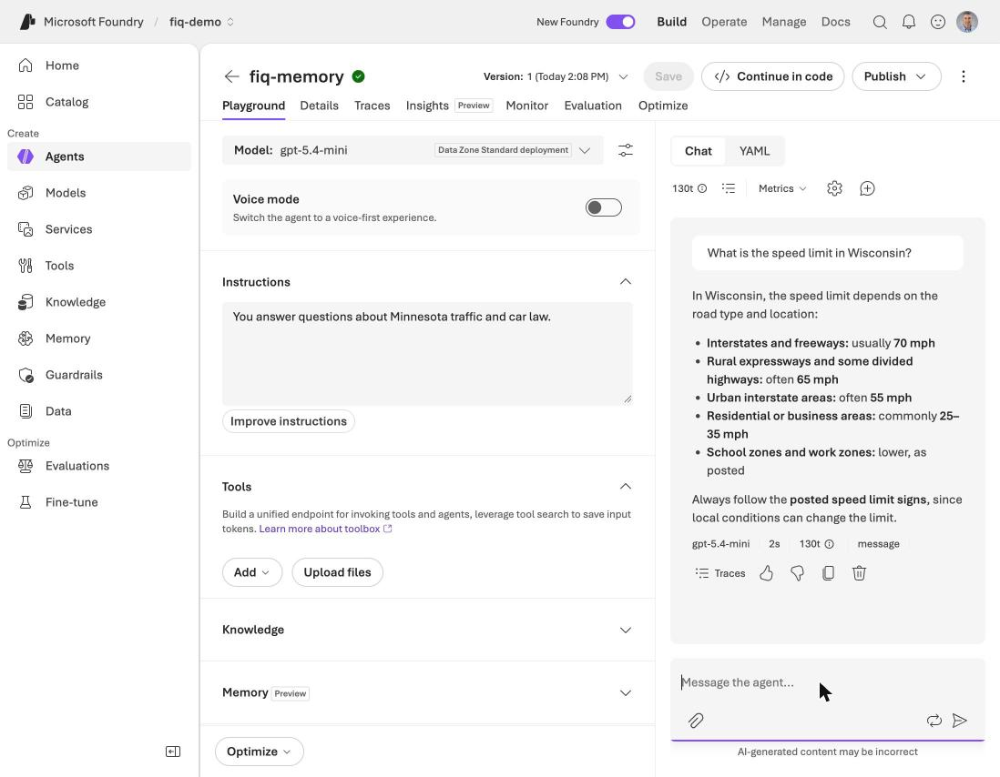
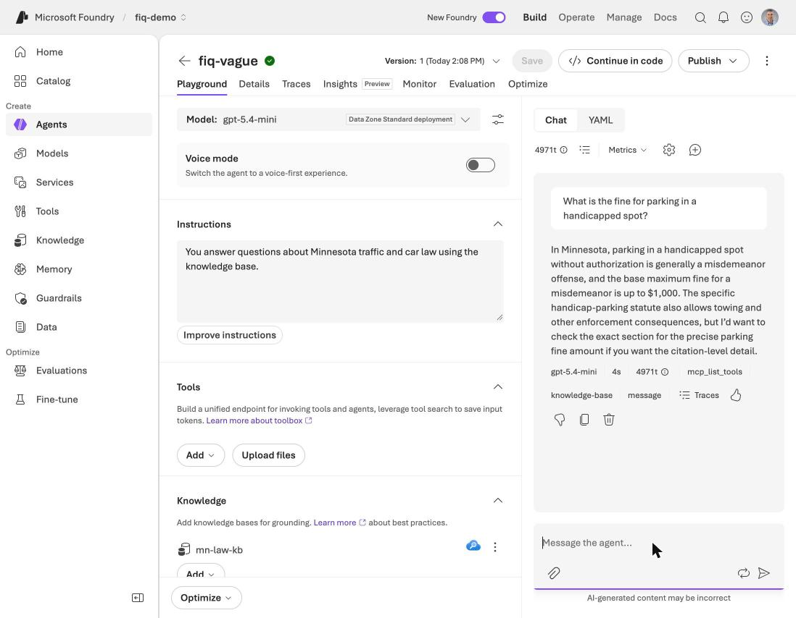
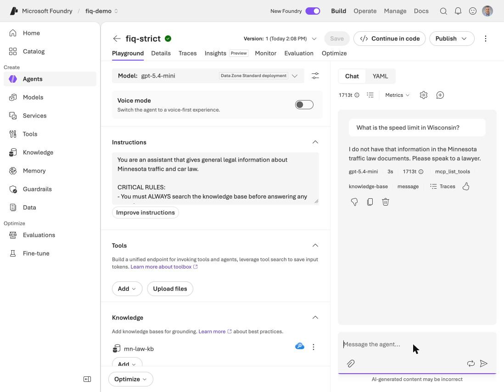
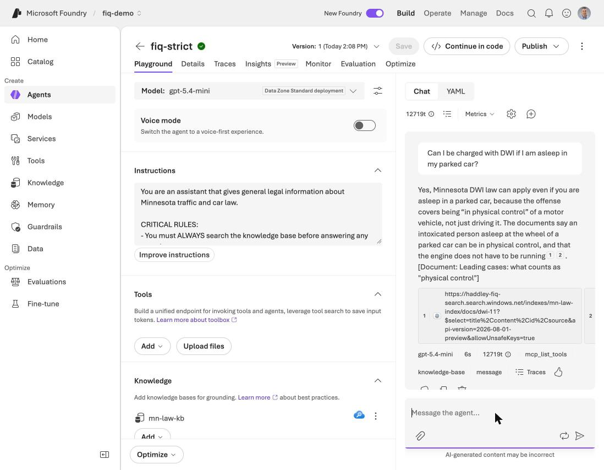

# Foundry IQ: an agent that answers only from the documents

In [Where to start in Microsoft Foundry](/posts/foundry-where-to-start/) I said the Foundry IQ module in Microsoft's learning path was my favourite, because its sample instructions are a good template for any agent that must answer from documents. In this post I test that claim. I follow the module, use the six Minnesota traffic and car law documents from [Part 4](/posts/azurefoundryagent5/), and ask what the module's instructions change.

I have built retrieval-augmented generation (RAG) several ways on this blog already, so I also compare this one with those at the end.

## What I found

:::bullet-points
- Foundry IQ gave me a working knowledge base over my documents in one script. The agent reached it as an MCP tool, and the answers came back with clickable sources.
- The module's own code does not run as written. Its tool snippet fails with a 401 because it leaves out a project connection, and its `agent` call style is already deprecated.
- Vague instructions ("use the knowledge base") still searched and cited. The difference showed up on questions the documents do not cover: the vague agent answered 3 of 6 of them with legal information the documents do not directly cover, and the strict agent answered none of them that way.
- Strict rules have a cost. On one question the documents do answer, the strict agent said it had no information.
- My results come from one run of 17 questions. They might be wrong.
:::

## What Foundry IQ is

Foundry IQ is a managed knowledge layer on top of Azure AI Search. You put your documents in a search index, wrap the index in a **knowledge source**, and group sources into a **knowledge base**. The knowledge base then exposes one Model Context Protocol (MCP) endpoint with a single tool, `knowledge_base_retrieve`. Any agent can call that tool.



The module's point is that retrieval is only half of the job. The agent's instructions decide whether it searches, whether it cites, and what it says when the answer is missing.

## Building it

I created a new Foundry project, a model deployment and a search service, because my earlier Azure resources no longer existed. Everything sat in one resource group, so I could delete it afterwards.

| Piece | What I used |
|---|---|
| Foundry account and project | `haddley-fiq-demo` and `fiq-demo`, in East US 2 |
| Chat model | `gpt-5.4-mini`, capacity 100 |
| Search service | Basic tier, in East US (East US 2 had no capacity for it) |

Permissions took more work than anything else. I ran these role assignments myself, because my own tooling does not make them:

| Who | Role | On |
|---|---|---|
| Me | Search Service Contributor and Search Index Data Contributor | The search service |
| Me | Foundry Project Manager | The Foundry account |
| The search service's identity | Cognitive Services User | The Foundry account, so the knowledge base can call the model |
| The project's identity | Search Index Data Reader | The search service, so the agent can read the knowledge base |

Then one script did the rest. It split each document at its `##` headings, which gave 80 sections, uploaded them as the search index, and created the knowledge source and the knowledge base. The knowledge base returns the matching passages ("extractive data"), uses `gpt-5.4-mini` for query planning, and has the retrieval reasoning effort set to low.


*I opened mn-law-kb in the portal and saw the model, the output mode and the knowledge source mn-law-ks, all Active*

A quick direct test asked "Can I be charged with DWI if I am asleep in my parked car?" and the knowledge base returned the section on what counts as physical control, with the two cases that decide it.

## Where the module's code did not work

:::watch-it The module's snippet fails in two ways
**First, a 401.** The module creates the tool with only a server label and a server address. When I ran an agent built that way, the service replied that authentication to the MCP server failed with a 401. Microsoft's separate how-to article adds the missing piece: a project connection, of category `RemoteTool`, that signs in with the project's managed identity, and the tool then names that connection.

**Second, a deprecated call.** The module calls the agent with `extra_body={"agent": ...}`. The service now rejects that and asks for `agent_reference`.

Neither is a big problem, and both are easy to fix. They show how quickly the preview moves, so check the how-to article beside the module.
:::

## Four agents, one question set

I built four agents on the same model and the same knowledge base, and I changed only the instructions and the connection.


*I saw all four agents Running in the portal: fiq-memory, fiq-snippet, fiq-vague and fiq-strict*

The first has no knowledge base at all:

```text
You answer questions about Minnesota traffic and car law.
```

The second is the module's own snippet, with no connection, so it fails. The third is the vague version:

```text
You answer questions about Minnesota traffic and car law using the knowledge base.
```

The fourth follows the module's pattern: when to search, how to cite, and what to say when the answer is missing.

```text
You are an assistant that gives general legal information about Minnesota traffic and car law.

CRITICAL RULES:
- You must ALWAYS search the knowledge base before answering any question.
- You must NEVER answer from your own knowledge or training data.
- Every answer must name the document section it came from, in this format: [Document: section title].
- If the knowledge base does not contain the answer, respond with exactly: "I do not have that information in the Minnesota traffic law documents. Please speak to a lawyer."
- If the question is outside Minnesota traffic and car law, say that it is outside what you cover. Do not answer it.

Your role is to give accurate, verifiable information from the documents, and nothing else.
```


*I opened fiq-strict in the playground and saw its rules and the mn-law-kb knowledge base attached*

I picked 17 questions from the 62 in Part 4: 11 that the documents cover (single-topic, two-topic and badly worded ones) and 6 that they do not (a Wisconsin speed limit, the weather, a stop sign fine, parking in a handicapped spot and others). Each agent got each question once.

## What happened

| | No knowledge base | Vague | Strict |
|---|---|---|---|
| Searched the knowledge base | 0 of 17 | 15 of 17 | 17 of 17 |
| Gave a citation | 0 of 17 | 14 of 17 | 11 of 17 |
| Required facts present (11 covered questions) | 8 of 11 | 11 of 11 | 9 of 11 |
| Outside questions handled properly (6) | 1 of 6 | 3 of 6 | 6 of 6 |
| Median input tokens, covered question | about 34 | about 12,600 | about 12,700 |
| Median seconds, covered question | 4.0 | 6.4 | 5.2 |

"Handled properly" means the agent declined, or said the documents do not cover it, or answered only what the documents support. I read all 17 answers from each agent, because a keyword check cannot judge that.

### The agent with no knowledge base

It answered 5 of the 6 outside questions confidently from memory, with figures such as a licence renewal fee, Wisconsin speed limits and a stop sign fine. Nothing backs those up, and nothing says they came from Minnesota's documents. It also answered 8 of the 11 covered questions correctly, which tells me the model knows a fair amount of this law already. What it lacks is any way to show where an answer came from.


*I asked the agent with no knowledge base for the Wisconsin speed limit, and it answered with a confident list of limits and no source*

### The vague agent

On the 11 covered questions it did very well: it searched every time, cited every time and had all the facts. The module's worry showed up elsewhere. Asked about a handicapped parking fine, it said the fine is "generally a misdemeanor" in one run, and in another run "a petty misdemeanor, up to $300" with a citation to the speeding document. A citation shows where a passage came from, not that the passage supports the claim, and here it did not. For the stop sign question it applied the general petty misdemeanor rule by analogy.


*I asked the vague agent about parking in a handicapped spot, and it searched the knowledge base and then gave a fine the documents do not state*

### The strict agent

It searched every time, even for the weather question, and it used the exact fallback sentence for four of the outside questions. For the private seller question it gave what the documents say about private sales and then said it does not have the registration steps.


*I asked the strict agent the Wisconsin question, and it searched the knowledge base and then gave the fallback sentence*

On a covered question it did what the module promises: it answered from the documents, and the portal showed the sources.


*I asked about DWI while asleep in a parked car, and the strict agent answered with the section name and two clickable references into the search index*

The cost was one over-refusal. For "I was texting while doing 105 mph," which needs the phone document and the speeding document, the strict agent said it had no information. The vague agent answered it correctly from both. On another question the strict agent gave the penalties but not the word "felony", which my check required.

:::watch-it My first scoring was wrong
My keyword check compared literal text, so "6 months" did not match "six months". It marked three correct answers as misses. I fixed it to compare numbers and words in the same form, and rescored every stored answer. It also changed one repeat run from Part 4 by a single answer, which does not alter anything I wrote there.
:::

## A fireside chat

:::fireside-chat The agent and the knowledge base
**Knowledge base:** I will find the right passages and hand them over. I cannot make anyone use them.

**Agent:** I use you when my instructions tell me to. If they only say "use the knowledge base", I will use you when I feel like it.

**Knowledge base:** And when I find nothing?

**Agent:** Then it depends on my rules. The vague me tries to be helpful and fills the gap. The strict me says I do not have that information.

**Knowledge base:** Which one do your users want?

**Agent:** For a lawyer, the strict one. But strict also turned away a question you could have answered, so I had to be too careful once.

**Knowledge base:** Then we test it, and we keep reading the answers.
:::

## How this compares with my other RAG posts

I have built the same idea several ways. All of them inject retrieved text into the model's prompt instead of relying on its memory, which is the idea in [Context Injection](/posts/contextinjection/).

| Post | How retrieval works | Who builds it | How citations work |
|---|---|---|---|
| [LangChain (RAG)](/posts/langchain/) | A Chroma vector store and OpenAI embeddings, in a small Streamlit app | Me, in a few libraries | Not covered in that post |
| [Azure Search, Part 2](/posts/azuresearchvector/) | Azure AI Search with vector embeddings, built by a portal wizard from Blob Storage | The portal, with me clicking | Not covered in that post |
| [Model Context Protocol, Part 3](/posts/rag1/) | Postgres with pgvector and Ollama embeddings, top 5 by cosine distance, exposed to Claude Code over MCP | Me, in five phases | The raw passages, no model answer |
| [Agentic AI for Professionals, Part 2 and Part 3](/posts/agenticaiforprofessionals2/) | pgvector, chunks of about 800 characters kept within a page, a similarity threshold, and an answer only from numbered context | Me, in code | Read from the database row, so it cannot be invented |
| This post | An Azure AI Search index with a semantic ranker, a model that plans the query, passages returned over MCP | Mostly Foundry, with one script from me | Chosen and worded by the model, with source markers from the search |

**What they share.** Every one splits documents into pieces, finds the pieces closest to the question and puts them in front of a model. Some of them hand the search to an agent or to Claude Code over MCP.

**What differs.**
- **How much I built.** In the pgvector posts I wrote the data model, chunking, retrieval and the prompt. Here one script created the knowledge base, and I wrote the instructions. That is Foundry's offer: less code for me to maintain, and less to see inside.
- **How the match is found.** My index has no embeddings. It uses keyword search with a semantic ranker, and a model rewrites the query. The other posts use vector similarity. So this is not a fair test of vectors against keywords, and I have not tried vectors here.
- **Where citations come from.** In [Part 3 of Agentic AI for Professionals](/posts/agenticaiforprofessionals3/) the citation metadata is read off the database row, so the citation cannot be hallucinated, though the model still decides which excerpt to cite. Here the model writes the section name, and Foundry adds the source markers. My vague agent shows the gap: a real source can sit beside a claim it does not support.
- **How the answer is kept to the documents.** In the pgvector stack the prompt and a similarity threshold do it. Here it is the agent's instructions, and the module's rules are the whole defence.
- **Portability.** The MCP endpoint means my retrieval could serve any MCP client. The pgvector stack I built also exposes a search tool over MCP. Both can feed Claude Code. The Foundry knowledge base and the project connection are Microsoft's.

## Cleaning up

I deleted the resource group that held the Foundry project, the model deployments, the search service and the connection. The Basic search service is the part that costs money while it runs.

## What I would tell a reader

:::bullet-points
- Write the contract in the instructions: when to search, how to cite, and the exact sentence to say when the documents do not cover the question.
- Test the questions the documents do not cover, not only the ones they do. That is where vague and strict differed.
- A citation shows the source of a passage. It does not prove the passage supports the answer.
- Strict rules can over-refuse, so read the refusals too.
- Check Microsoft's how-to article beside the module: the project connection and `agent_reference` are missing from the module's code.
:::

My results come from 17 questions, one run for each agent, and my own reading of the answers. The vague agent gave two different answers to the same question when I asked it again in the playground, so a rerun could change the counts.

## References

- [Introduction to Foundry IQ (Microsoft Learn module)](https://learn.microsoft.com/en-us/training/modules/introduction-foundry-iq/)
- [Connect a Foundry IQ knowledge base to an agent (Microsoft Learn)](https://learn.microsoft.com/en-us/azure/foundry/agents/how-to/foundry-iq-connect)
- [Part 4: the Minnesota law specialists and the 62 questions](/posts/azurefoundryagent5/)
- [Where to start in Microsoft Foundry](/posts/foundry-where-to-start/)
