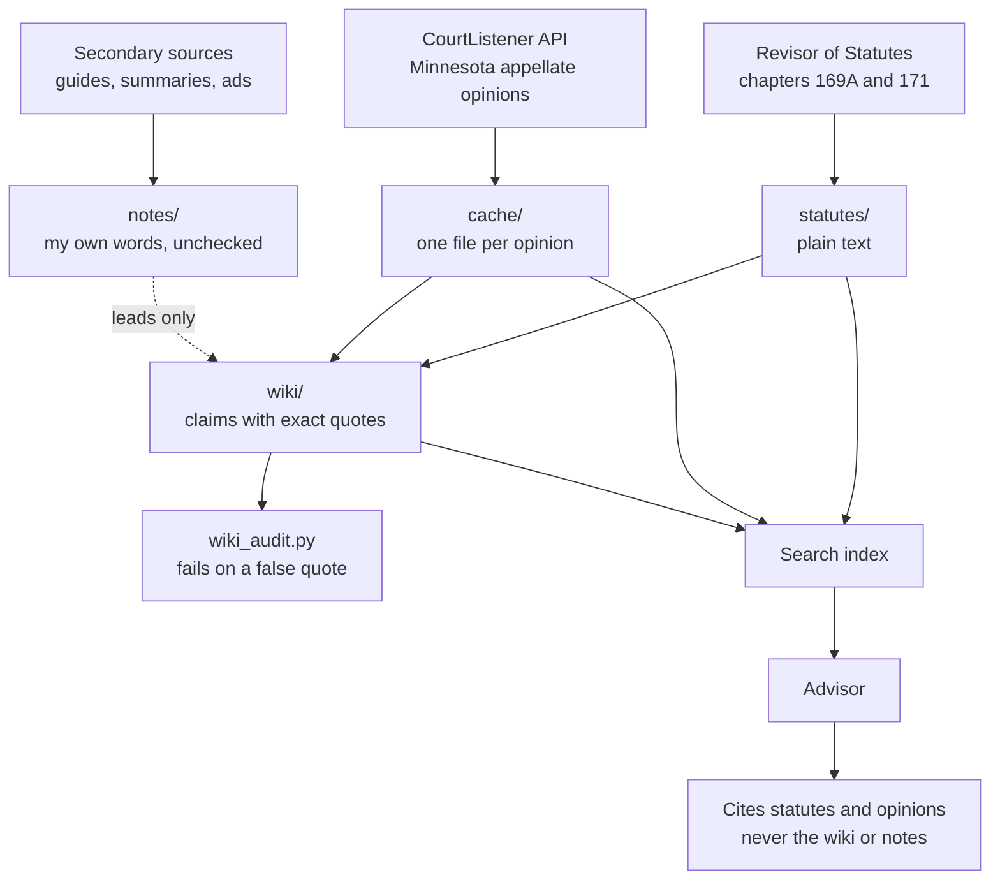
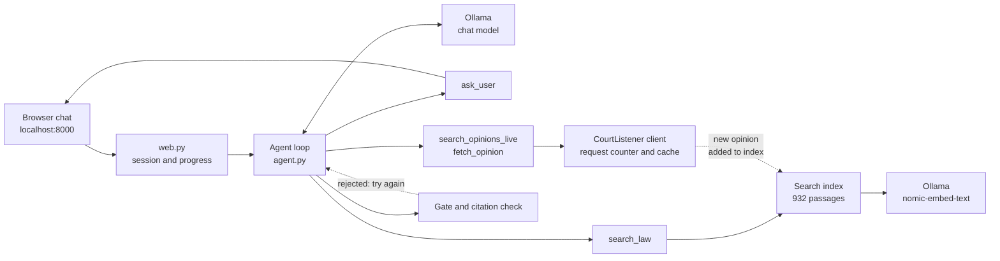
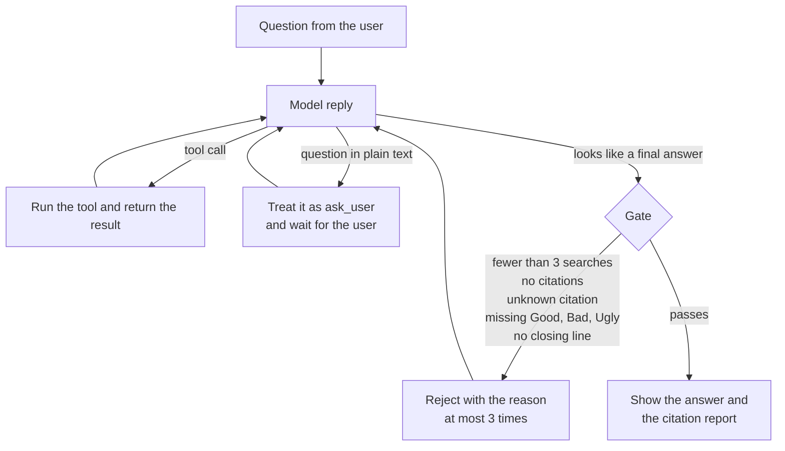
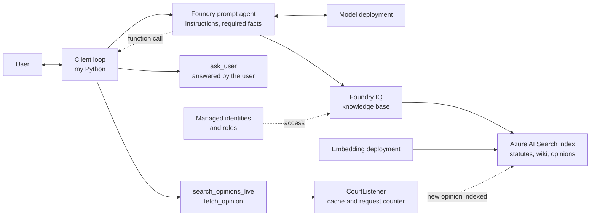

# An advisor that asks before it answers

Someone gave me a design for an agent that "pushes back": it refuses to analyse a Minnesota drunk-driving case until it knows the facts that matter, and then answers from retrieved law. I want to build it in Azure Foundry. This post is the groundwork and a first run on a model that runs on my own Mac. The Azure version is not built yet, and I say so where it matters.

This is an experiment, not a product. Nothing here is legal advice, I have not had it reviewed by a Minnesota lawyer, and a chat with an AI is not privileged.

:::watch-it The risks come first
A wrong answer in this subject costs a licence, money, or liberty. The agent can sound sure and be wrong. A user can say too much to an AI that is not their lawyer. I treat every claim below as unchecked until a statute or a court opinion says so.
:::

## What the agent has to do

1. Ask for the facts that change the outcome: the stage of the case, the date, the test and its result or the refusal, earlier incidents, a child in the car, any crash or injury, age, and a commercial licence.
2. Search the law for what applies.
3. Give each realistic option as Good, Bad and Ugly, with the costs the sources support, what I would do and why, and what the sources could not settle.
4. Cite a statute or a real Minnesota opinion for every legal claim, and never cite from memory.

## Which sources can be trusted

I read a pile of pages that a search for "Minnesota DWI laws" returns. They are not equal, so I sorted them.

| Kind | Example | How I use it |
|---|---|---|
| Statute | Minnesota Statutes, chapters 169A and 171, from the Revisor of Statutes | The authority. The only thing I quote as law. |
| Opinion | Minnesota Supreme Court and Court of Appeals decisions | Authority for how courts read the statutes. |
| Government summary | The [House Research overview](https://www.house.mn.gov/hrd/pubs/dwiover.pdf) (September 2025) | Reference for judging other summaries. Never cited as law. |
| Commentary | A legal publisher's guide | Leads only. |
| Marketing | Law-firm pages and a lead-generation "penalty estimator" | Ideas for what people expect. Never a source of facts. |

Two of the pages refused automated fetching with an HTTP 403, and I did not work around it. For one of them I pasted the text myself, and I wrote notes in my own words without storing the article.

Checking the secondary sources against the statute paid off straight away:

- One guide left out that a refusal alone makes an offence third degree. The statute says so (section 169A.26), and the law-firm pages were right.
- One advertising page said I have 30 days to ask for an administrative hearing. The statute gives no deadline for administrative review during a revocation, and 60 days to petition a court (sections 169A.53 and 171.177). Filing the petition does not stop the revocation.
- Another page still said a temporary licence lasts seven days. The House Research paper says the 2025 law made it 14.
- The licence revocation periods moved in 2025 to section 171.178, so older summaries that cite the old sections are out of date.

:::pencil What would you check first?
A page says "you have 30 days to request a hearing". Where do you go to confirm it, and what do you do with the number if you cannot?

:::answer
I go to the statute, here sections 169A.53 and 171.177, and read the deadline in the text. If I cannot find it, I do not repeat the number. The advisor should say it has no source, not pass on a figure from an advertisement.
:::
:::

## A wiki whose quotes are checked

I wrote the first wiki pages from the statute text only: degrees of the offence, aggravating factors, and how to challenge a revocation. Every claim carries an exact quoted span and the source file. A script, `wiki_audit.py`, checks each quote word for word against the saved statute text.

I tested that the audit can fail by adding a deliberately false quote, which it caught. The wiki now has 16 pages and 125 quoted spans, and all pass.

The wiki is derived and can be regenerated. It helps the agent find which statute to open. The agent cites the statute or the opinion, never a wiki page.

Authority flows from the top-left sources only. The notes feed the wiki as leads, and the audit decides what stays.

## Court opinions, with a budget

I want the agent to find relevant opinions live. CourtListener has a free API for this, and a search can be limited to the Minnesota Supreme Court and the Court of Appeals. My account allows 5 requests a minute, 50 an hour and 125 a day. A live lookup is one search plus one fetch per opinion.

So the client counts every request on disk before it sends one, waits between requests, stops before a limit, and saves each opinion it fetches. A fetched opinion is never downloaded twice. The cache now holds 72 opinions. Not all of them are about drunk driving: several are vehicle-forfeiture cases, and a few are unrelated, so I keep only opinions that mention impaired driving.

:::no-dumb-questions
**Q: Why cache opinions at all if the agent can search live?**
A: Because the budget is small, and because I want to repeat a test and get the same cases. A cache makes the run repeatable, and it lets me check each citation against stored text.
:::

## The local version

The local version uses Ollama, so nothing leaves the machine.

- Statutes, the wiki and the opinions are cut into 932 labelled passages: 142 from statutes, 121 from the wiki and 669 from opinions.
- Each passage is embedded with `nomic-embed-text`, and a search ranks by similarity with a small keyword bonus.
- A chat model (`qwen2.5:14b`) gets four tools: search the law, ask the user, search CourtListener, and fetch an opinion.
- Each passage has a cite label. The model must write citations as the exact label from a search result, and a checker confirms every citation was one the model was shown.
- A second small model plays Sam, a fictional driver, and answers the advisor's questions from fixed facts. Sam took a breath test that read 0.09, has no earlier incidents, had no child in the car, and had no crash.

Everything in the diagram runs on one machine. The only outside call is the optional CourtListener lookup.

## What happened

The first version asked its questions, but then skipped searching and answered from memory, with no citations. The same trap as in [Part 4](/posts/azurefoundryagent5/) showed up in a new form: a model that asks in plain chat text instead of calling the tool ends its turn, so my loop had to treat a question in text as a question.

Instructions were not enough, so I added a gate. An answer is rejected, with the reason, if it searched fewer than three times, has no citations, cites a label that no search returned, or leaves out the required shape. In the next run the model searched five times, but it needed all three rejections. The run took about 12 and a half minutes.

The final answer had 4 citations, all of them matched search results, and it had Good, Bad and Ugly, advice and the closing line. It was still not good:

- It said the revocation is 90 days under section 169A.54. The wiki shows the periods now sit in section 171.178.
- It said a limited licence is available after 30 days. The House Research paper says 15.
- It gave no penalty figures, and its Good, Bad and Ugly lines repeated one another.
- It passed the citation check partly because my checker accepts a section-level label when a longer one was shown. That rule is too lenient.

:::watch-it A matching citation is not a correct claim
The check proves a source with that label was retrieved. It does not prove that the source says what the answer says. Every number needs to be scored against the statute.
:::

:::fireside-chat Sam and the advisor
**Sam:** I was arrested last weekend. What am I facing?

**Advisor:** Before I can say, I need a few facts: the date, the test and its result, and whether you have been in trouble like this before.

**Sam:** Breath test, 0.09. Nothing before. No child, no crash.

**Advisor:** Then I search the law and give you options. Each one gets a Good, a Bad and an Ugly, and each claim gets a citation. If I cannot find a figure, I will tell you rather than guess.

**Sam:** And if you get the number wrong?

**Advisor:** That is why a lawyer needs to read this before you rely on it.
:::

## Azure Foundry or local: benefits and drawbacks

I have now built the first half of this twice over, but only the local half for this part. What follows mixes two kinds of evidence. The local points come from this run. The Azure drawbacks come from what I hit in Parts 2 to 5. The Azure benefits for this particular app are what I expect, and I have not measured them yet.

| | Azure Foundry | Local (Ollama) |
|---|---|---|
| **Model quality and speed** | Larger hosted models, so answers should be faster and better. Expected, not yet measured for this app. | A 14B model took about 12.5 minutes for one answer and needed a gate to search at all. |
| **Retrieval** | Foundry IQ gives the agent a managed search tool over an index, with no retrieval code to write. | I wrote the chunking, embedding, ranking and citation labels myself (about 300 lines). Full control, and full responsibility. |
| **Access and secrets** | Managed identities and roles instead of keys in a script. Setting them up needs role assignments that I could not run for myself. | No keys for the model. The only secret is the CourtListener token in a gitignored file. |
| **Privacy** | An arrest story goes to a cloud service. Data-residency and network controls exist, but I have not tested them. | Nothing leaves the machine. |
| **Cost** | Pay for the model, the search service and the embedding deployment while they exist. I delete the whole environment after a test. | No per-question cost beyond electricity and the machine. |
| **Quota and capacity** | In Part 4 a small tokens-per-minute quota stopped my runs. In Part 5 one region had no search capacity, and the model deployment needed a different type from the one I wanted. | None, but it is limited by the memory and speed of the machine. |
| **Repeatability** | Agents are stored as versions, so I can repeat a test against the same instructions. The service itself can change underneath me. | Pinned model files and a saved index, so a rerun is reproducible apart from the model's own variation. |
| **Rough edges** | Preview APIs and gaps in the learning module, such as a 401 error without a project connection and a deprecated `agent` field. In Part 4, a question asked through an A2A tool was dropped. | Tool calling works, but a small model asks questions in plain text and skips tools unless the loop forces it. |
| **Tooling around the model** | Tracing, evaluation and hosting are part of the platform. | I built the gate, the citation check and the story runner myself. |

The Azure version is planned, not built. This is the shape I intend, using the same tools in the same loop:

The agent lives in Foundry, but the function tools still run in my client loop, because that is the route where `ask_user` worked in Part 4.

### A third option: Foundry Local

Microsoft also ships [Foundry Local](https://learn.microsoft.com/en-us/azure/foundry-local/what-is-foundry-local), which sits between the other two. I have not tried it, so this is what Microsoft's overview says, not something I tested.

- **What it is:** a runtime that an application ships with. It downloads a model on first use, picks the best hardware it finds (GPU, NPU or CPU), and runs inference on the device through ONNX Runtime. There are SDKs for C#, JavaScript, Rust and Python, and an optional local web server.
- **Where it runs:** Windows, macOS on Apple silicon, and Linux. No Azure subscription is needed and prompts are processed on the device. It does use the network to download models and runtime components, and the user can choose to share logs.
- **API:** OpenAI-compatible, including the Responses API format, so code written for the hosted service should need few changes.
- **Models:** a curated catalogue, which the page lists as GPT OSS, Qwen, DeepSeek, Mistral and Phi for chat, plus Whisper for audio. It is not a general model library, so it will not have the exact models I run in Ollama.
- **Built for one user at a time**, not a server. For many users, Microsoft points to server runtimes or to Foundry Local on Azure Local.

What the overview does not say is whether the catalogue models support tool calling or embeddings, and my advisor needs both. I would check that before moving to it. If it works, Foundry Local would keep the privacy of the Ollama version while sharing an API shape with the hosted Foundry agent, which would make the comparison fairer.

:::watch-it Foundry does not make the answers correct
Neither option checks that a statute says what the answer claims. The citation check, the audited wiki and scoring each number against the statute are mine in both cases. A bigger hosted model may make fewer mistakes, but I would still test it the same way.
:::

:::fireside-chat Azure Foundry and the local model
**Azure Foundry:** I bring a bigger model, a search service that is already wired to it, and roles instead of keys. You do not have to write the retrieval.

**Local model:** And I bring a person's arrest story that never leaves the room. Nothing to subscribe to, nothing to delete afterwards.

**Azure Foundry:** You also took twelve minutes to answer one question, and you needed a gate to make you search.

**Local model:** True. But the gate caught me, and it would catch you too. It checks the citations, not who wrote the answer.

**Azure Foundry:** Fair. And you were fine until the numbers came out wrong. Ninety days under a section that no longer holds the periods.

**Local model:** A bigger model might do better on that. I have not seen you do it yet, so I will wait for the test before I concede.

**Azure Foundry:** My quota, region and role assignments have all got in my way before. Setup is part of my cost.

**Local model:** Then let us both answer the same story and let the statute decide.
:::

My current view is that the privacy of an arrest story argues for local, and the quality of the answers argues for the larger hosted model. I will not pick until both have answered the same story and been scored against the statute. A hybrid is possible too: keep the user's story on the machine, and send only the structured facts, with no identifying detail, to a hosted model for the wording.

## Does it need a language model at all?

What the language model contributes is language. It turns a frightened person's story into the handful of facts that matter, it turns those facts into searches, and it writes the options in plain words. It does not supply the law. The statutes and opinions do, and the citation check exists because the model cannot be trusted with that part.

There are ways to avoid a model at run time. A rules engine can map facts to the degree of the offence, the revocation period, the interlock period and the penalty range, with each rule carrying its quote. A guided questionnaire can show pre-written text for each path. Plain search can return passages with no generated answer. The statutes are rule-like enough for a rules engine, and it would give the same answer every time.

Cost per question is not the deciding factor: a question costs cents on Azure and nothing extra locally. The real costs are building and verifying whatever produces the advice, and the cost of a wrong answer. A model is quicker to build and easier to keep current, because updating the law means re-indexing. A rules engine is more correct and easier to defend, but someone has to update the rules when the law changes, as it did in August 2025.

My current view is a mix: rules for anything with a number or a deadline, and the model for intake and wording.

## Still to do

- Run the same story on a larger local model (`gemma4:26b`), on Foundry Local if its models support tool calling and embeddings, and on the Azure Foundry agent, and compare.
- Build the Azure version: an agent with the `ask_user` tool, a knowledge base for the statutes and the cached opinions, and an embedding deployment.
- Score each number in the answers against the statute, with a stricter citation check.
- Try the mix: a rules engine for the numbers, and the model for the wording. That is Part 7: the same advice with and without a language model, scored on correctness.

:::bullet-points
- I sorted the sources by trust: statutes and opinions are authority, and everything else is a lead.
- Checking the summaries against the statute caught real errors, including a deadline and a missing refusal rule.
- A wiki is only useful if its quotes are audited, so I wrote a script that fails on a false quote.
- A court-opinion API with a small budget needs a counter on disk and a cache.
- A local 14B model followed the format but needed a gate to search at all, and its numbers were wrong.
- A citation that matches a retrieved source can still sit under a false claim.
- Foundry brings bigger models, managed search and roles; local brings privacy, no per-question cost and repeatability. Neither makes the answers correct.
:::

## References

- [An Overview of Minnesota's DWI Laws](https://www.house.mn.gov/hrd/pubs/dwiover.pdf), Minnesota House Research Department, September 2025
- [Minnesota Statutes, chapter 169A](https://www.revisor.mn.gov/statutes/cite/169A)
- [CourtListener REST API](https://wiki.free.law/c/courtlistener/help/api/rest/v4/search)
- [Foundry IQ: an agent that answers only from the documents](/posts/azurefoundryagent6/) (Part 5)
- [Azure Foundry Agent, Part 4](/posts/azurefoundryagent5/)
