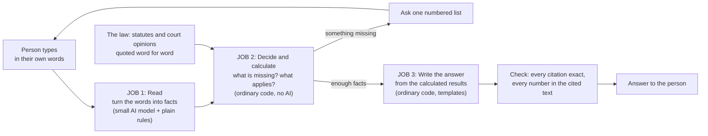
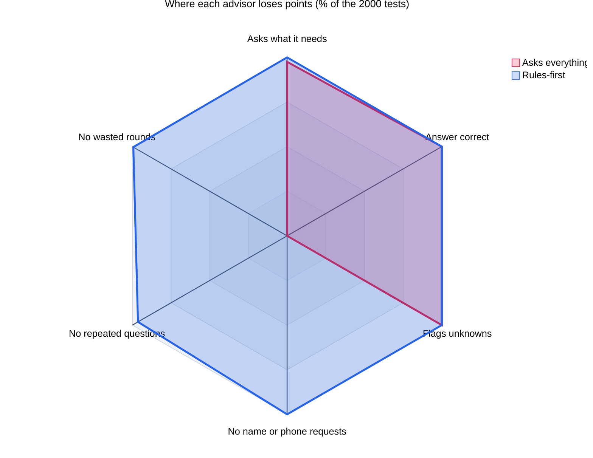
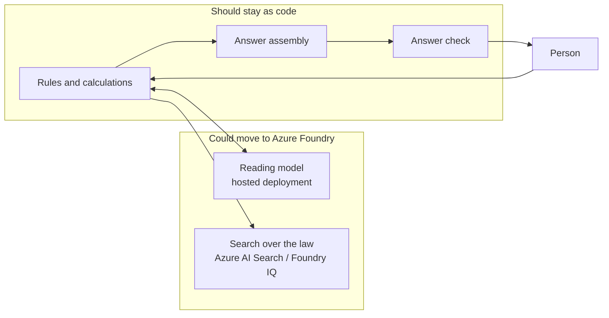

# A DWI advisor that asks before it answers

This is an advisor for someone who has just been arrested for drunk driving in Minnesota. It asks for the facts that matter, works out what applies, and lays out the person's options with a citation on every legal claim. This post covers what it is for, what using it is like, how it works, what the AI model does, the trade-offs, how well it tests, and what Azure Foundry would change. The Azure version is not built.

This is an experiment. It is not legal advice, no Minnesota lawyer has reviewed it, and a chat with an AI is not privileged.

:::watch-it The risks come first
A wrong answer in this subject costs a licence, money, or liberty. An AI can sound sure and be wrong. A person can say too much to something that is not their lawyer. Every claim here is unchecked until a statute or a court opinion says so.
:::

## 1. What is it for?

Someone has just been arrested. They are scared, they do not know the rules, and two things are on a clock: a 60-day deadline to challenge the loss of their licence, and a criminal charge. The advisor does what a careful friend with a law library would do:

1. **Ask the right questions first.** The answer depends on a handful of facts: the test result, earlier incidents, a child in the car, the date on the revocation notice.
2. **Say what the law says**, with the citation, so the person or their lawyer can check.
3. **Lay out the choices** as Good, Bad and Ugly for the licence and for the criminal charge, with the deadline first.
4. **Say what it could not find**, and point to a lawyer.

It is not a lawyer, does not predict whether the person will win, and does not decide for them.

**Who it is for.** The default is the person arrested. A switch on the page ("I am a defendant / prosecutor") changes the view. The prosecutor view uses the same rules and the same answer checks but asks about "the driver" in the third person, skips the licence-need and notice-date questions, and gives a charging summary instead of options: the likely charge, sentencing exposure, licence and vehicle consequences, and points the defence may raise. It gives no advice to the driver. It does not cover the elements and proof, sentencing guidelines or plea practice (each is described under "What the prosecutor view does not cover yet"), it has had one test run, and no prosecutor has reviewed it.

## 2. What is the user experience?

A chat page. The person types what happened in their own words. The advisor asks everything it still needs in one numbered list. The person answers in one message. The advisor replies with a cited answer.

- **It asks once and does not nag.** At most three rounds, nothing asked twice, and never a name, phone number or address.
- **If the person does not know a fact, it says so.** It stops asking, and the answer says "not known" and what that stops it working out. It does not guess.
- **Every legal claim has a citation.** Clicking one shows the passage behind it.

Two real runs, shortened where marked `[...]`. Each took about six seconds on a Mac with `qwen2.5:7b` as the reader.

**A clear story**

> **You:** I was pulled over Saturday night and arrested for a DWI. I'm scared. What happens now? I'm 34.
>
> **Advisor:** I'm sorry you're going through this; there are real steps that can help, so let's take them in order. To give you accurate information I need a few facts. (1) Did you take the breath, blood or urine test, or did you refuse it? (2) What was the test result (the number)? (3) Have you had any earlier alcohol- or drug-related driving incidents, anywhere, and how many years ago was each? (4) Was a child under 16 in the vehicle? (5) What date did you receive the notice of revocation? (6) Do you need your licence for work, school or treatment? (7) Was there any crash or injury? Do you hold a commercial driver's licence? Were any drugs or medication involved? Do you have any DWI conviction outside Minnesota?
>
> **You:** 1. Breath test at the station, it came back .11. 2. I had one DUI back in 2019. 3. No kids, I was alone. 4. They gave me the revocation paper on the 20th of October. 5. Yes, I drive to my warehouse job every day.
>
> **Advisor (extract):** **Deadline first:** You have 60 days from receiving the notice of revocation to petition the court (not 30), and filing does not stop the revocation. [...] You said you received the notice 13 days ago, so about 47 days remain: act now. The last safe day is 2026-12-19; file earlier. [[Minn. Stat. § 169A.53, subd. 2(a)]] [...]
>
> **Facts I am relying on:** Age 34. You took a breath test, result 0.11. Earlier incidents, years ago: 7. No child in the vehicle. Notice of revocation received 2026-10-20. [...]
>
> **Option 1, the licence.** **Good:** You may be able to apply for a limited licence because your work, treatment or schooling depends on driving; it is at the commissioner's discretion, with conditions. [[Minn. Stat. § 171.30, subd. 1(b)(1)]] **Bad:** Your licence revocation for this test failure is until you have completed treatment and an ignition interlock period of at least 2 years. [[Minn. Stat. § 171.178, subd. 4(2)]] [...]
>
> **Option 2, the charge.** **Bad:** On what you describe, the likely charge is third-degree driving while impaired, a gross misdemeanor: 1 aggravating factor (1 qualified prior within ten years). [[Minn. Stat. § 169A.26, subd. 1(a)]] [...] With one prior within ten years, the mandatory minimum is 30 days (at least 48 hours in a local jail, the rest convertible to community work service), unless the court departs for substantial mitigating factors. [[Minn. Stat. § 169A.275, subd. 1(a)(1)]] [...]
>
> **My advice:** File the court petition well before 2026-12-19; do not wait for the last day. [...] A Minnesota DWI lawyer should review it before you rely on it.

Every number, from "13 days" to "2 years" to "30 days", comes from the rules, not the model. The model only reads the reply, including "the 20th of October" and "back in 2019" (seven years ago, from today's date).

**The person does not know**

> **You:** Hi, got arrested for drunk driving last night. I'm 22 and I have never been in trouble before.
>
> **Advisor:** To give you accurate information I need a few facts. (1) Did you take the breath, blood or urine test, or did you refuse it? (2) What was the test result (the number)? (3) Was a child under 16 in the vehicle? (4) What date did you receive the notice of revocation? (5) Do you need your licence for work, school or treatment? (6) Was there any crash or injury? Do you hold a commercial driver's licence? Were any drugs or medication involved? Do you have any DWI conviction outside Minnesota?
>
> **You:** I took the breath test but they never told me the number. No kids in the car. I do not have any paper yet. I work part time at a grocery store and need to drive to it. No crash, no drugs, just beer.
>
> **Advisor:** Thank you. I still need: (1) What was the test result (the number)? (2) What date did you receive the notice of revocation?
>
> **You:** I'm not sure.
>
> **Advisor (extract):** **Deadline first:** You have 60 days from receiving the notice of revocation to petition the court (not 30), and filing does not stop the revocation. Check the date on your own notice; you can ask for administrative review at any time. [[Minn. Stat. § 169A.53, subd. 2(a)]]
>
> **Facts I am relying on:** Age 22. You took a breath test; the result is not known. Earlier incidents: none. No child in the vehicle. Date of the notice: not known. [...]
>
> **What I could not find:** I do not have your test result, so I could not work out the degree of the charge or the length of the revocation. I do not have the date on your notice, so I cannot count your deadline; use the date printed on the notice. [...]

The second round asks only for the two facts still missing. After "I'm not sure" it stops and says what it cannot work out.

## 3. How does it work?

Three jobs, each done by whatever suits it best.

| Job | Done by | Why |
|---|---|---|
| Read the person's message into facts | Plain rules first, then a small AI model for what the rules missed | People write "back in 2019" and "the 20th of October"; a program needs "7 years ago" and a date. |
| Decide what to ask | Code | It must ask the same sensible questions every time and never repeat itself. |
| Work out the degree of the charge, revocation length, jail minimum, fees and deadline | Code, using rules written from the statute, each quoted and checked against the statute text | These are numbers a person might act on. They must be repeatable and checkable. |
| Write the answer | Code, filling in templates | No sentence or number is invented by the model. |
| Check the answer | Code | Every citation must be a real passage, and every number must appear in the passage cited beside it. |

### Where the law comes from

The sources are ranked by trust:

| Kind | Example | How it is used |
|---|---|---|
| Statute | Minnesota Statutes chapters 169A and 171 | The authority. The only thing quoted as law. |
| Court opinion | Minnesota Supreme Court and Court of Appeals decisions | How courts read the statutes. |
| Government summary | The House Research overview (September 2025) | Used to judge other summaries. Never cited as law. |
| Commentary and law-firm pages | Guides, marketing | Leads only, never a source of facts. |

Secondary sources are checked against the statute, and they are wrong often enough to matter: one guide omits that refusing the test alone is third-degree; one page gives 30 days to ask for a hearing where the statute gives 60 days to petition a court; one says a temporary licence lasts seven days where the 2025 law says 14; and the revocation periods now sit in section 171.178, so older summaries cite the wrong sections.

A set of wiki notes records what the statutes say, and each claim carries a word-for-word quote. A script, `wiki_audit.py`, checks every quote against the saved statute text and fails on a false one. It currently checks 125 quotes. The rules are written from that checked wiki, and a court-opinion cache gives the advisor real Minnesota decisions to cite.

## 4. What is the AI model for, and what is it not for?

**For:** reading. It takes a messy message and returns a short list of facts in a fixed format. That is all.

**Not for:** deciding what to ask, working out any number, choosing what applies, or writing the advice.

A check keeps the model's reading honest: a fact it reports is kept only if the person's own words support it. A model asked about something the person never mentioned will invent "no earlier incidents" or "no crash", and this check throws those away.

Because the job is small, the model can be small: `qwen2.5:7b`, running on the same Mac. The person's story never leaves the machine.

## 5. What are the trade-offs?

The alternative design lets the model do everything: choose questions, search, calculate, write. This table compares it with the rules-first design above, with measurements where I have them.

| | Model does everything | Rules first |
|---|---|---|
| **Speed** | About 12 minutes for one answer (14B model) | About 6 seconds |
| **Numbers and deadlines** | Wrong in the run measured: a 90-day revocation and a 30-day limited-licence wait that the current statute does not support, each with a citation attached | Computed by code from the statute; same input, same answer |
| **Can you check it?** | Hard: the reasoning is inside the model | Easy: every figure traces to a rule and a quoted passage |
| **Asking the right questions** | Skips some, repeats others | Asks once, nothing twice, never for personal details |
| **Wording** | Fluent and tailored | Stiff and repetitive, because it is a template |
| **Unusual situations** | Can improvise | Cannot: if the rules do not cover it, it says so |
| **Free-text research of court opinions** | Yes, a search tool | Not in the default app; only the opinions the rules cite |
| **Keeping up with the law** | Re-index the new text | Someone must update the rules when the law changes, as it did in August 2025 |

Rules-first buys speed, repeatability and checkability for the parts a person might act on. It costs flexibility and polish.

A citation that matches a retrieved source can still sit under a false claim. The answer check proves a passage with that label exists and contains the figure. It does not prove the passage says what the sentence claims.

## 6. How well does it work?

**Conversation tests.** 2,000 tests start with a vague opening message, like a frightened person would write, and a simulated driver reveals a fact only when the advisor asks about that topic. They score three things:

1. **Asking:** did it ask for every fact it needs?
2. **Answering:** does the answer contain the right points and avoid the wrong ones, with citations that exist?
3. **Waste:** how many rounds, repeated questions, and requests for personal details?

They come in five groups: facts to gather, partly given, facts the person does not know, distractors that sound relevant but are not, and scope cases the advisor should not try to answer (commercial licences, injuries, drugs, a conviction in another state). Results go into a SQLite database as each test finishes, so they can be read while a run is in progress.

Three scripted advisors check that the scorer can fail something: an ideal one (100%), one that never asks (0%), and one that asks everything repeatedly, asks for a name and phone number every time and repeats questions 37 times a test (0%).

| Advisor | Passed of 2000 | Time per test |
|---|---|---|
| Ideal scripted | 2000 | under 1 s |
| Never asks | 0 | under 1 s |
| Asks everything, repeatedly | 0 | under 1 s |
| Rules-first code with perfect reading | 2000 | under 1 s |
| Rules-first with the real 7B reader | 1997 on the full run; the 3 failures were fixed and re-run singly | about 5 s |

The radar chart compares the rules-first advisor with the one that asks everything. A point at the rim is 100%. Each axis is a share of the 2000 tests, except that "Answer correct" is the share of required points met and "Flags unknowns" covers the 300 tests where the person does not know a fact. The advisor that never asks is left out: it scores 100 on three axes only because it asks nothing to get wrong, and 2.5, 10 and 0 on the other three.

The red shape covers half the hexagon: that advisor gets the facts and the answer but fails the three axes that measure being a nuisance. The blue shape reaches the rim everywhere; its small dents are the 3.6% of tests with a repeated question and the 0.6% with a wasted round.

:::watch-it 100% is not a score for the real world
The 2000 tests are written from the same rules and phrasing the reader is tuned on. A pass rate that high says the plumbing works. It does not say the advisor understands people.
:::

**Free-form messages.** A fairer test of the reading step uses messages written the way people write: "i dont have any priors", "my third, 2009 2013", "wanted my lawyer first". A set of 109 was written by me, and a second set of 137 by a separate agent that had not seen the rules. A message passes only if the facts read equal the expected facts exactly: nothing missed, wrong or invented.

| | Untuned reader | After tuning on those messages |
|---|---|---|
| My 109 messages | 84 right | 109 right |
| Independent 137 messages | 67 right (49%) | 135 right |
| Facts invented that nobody said | 18 | 0 |

The 49% is the figure to rely on. The tuned column is optimistic because the tuning used the same messages. Five labels were revised where the expected answer looked wrong, each with the original recorded: four in the independent set, and one in mine ("I'd rather wait for a lawyer" was labelled a refusal, but the person states neither a refusal nor a test, so the advisor now asks; in Minnesota a request for a lawyer first can be treated as a refusal, which is a legal conclusion the app should not draw for the person). The two independent messages still missed are "I have one from 2014" and "I think its my third, 2009 2013": the reader returns nothing for them and the advisor asks again.

**Existing benchmarks.** I looked for a public benchmark of case facts against best advice for DWI, and for Minnesota, on Hugging Face and the web, and found none. The nearest are general legal benchmarks for spotting missing facts (InsufficiencyBench, whose data is not yet released, and DLawBench), and these are not specific to DWI. A Minnesota DWI benchmark would have to be built, with case facts taken from real opinions and reference advice reviewed by a Minnesota DWI lawyer, because an AI judge cannot check legal accuracy on its own.

## 7. What would change on Azure Foundry?

Azure Foundry is Microsoft's managed platform for hosting AI models, search over documents, and agents. Today everything runs on one Mac. The question is which parts, if any, belong on Foundry.

**Why it might be better there:**

- A larger hosted model might read unusual phrasing more reliably. This is untested; today's reader is a small model on a laptop.
- Foundry provides managed search, hosting, monitoring and role-based access, so there is less plumbing to maintain and a real way to put the app in front of other people.
- No dependence on one Mac's memory and speed.

**Why it might be worse:**

- **Privacy.** The person's story goes to a cloud service. Foundry has data-residency and network controls, which are untested here, and a criminal matter is exactly the story people do not want stored.
- **Cost.** The model and search are paid for as long as they exist. Locally, a question costs nothing extra.
- **Setup friction.** Quota limits, a region without search capacity and role assignments that could not be granted from the account used have all cost time in earlier parts of this series.
- **No gain in correctness.** Foundry does not check that a statute says what an answer claims. The rules, the quote audit and the answer check stay mine, and a hosted model would still be tested the same way.

**Which parts to move:** the code that decides and calculates should stay ordinary code wherever the app runs, because that is where correctness comes from. Only the reading step is a candidate for a hosted model, and only if a larger model reads real messages measurably better. A hybrid could keep the person's story on their own machine or a private service and send nothing identifying to a hosted model. Foundry Local, Microsoft's on-device option, is not viable on this Mac: it offers only CPU variants and runs at about 7 tokens a second.

## What the prosecutor view does not cover yet

The charging summary answers "what does the statute say follows from these facts". A prosecutor also needs three things it does not do. Each is described here with what the statutes in the corpus already say and what is missing.

### Elements and proof

Section 169A.20, subdivision 1, makes it a crime to drive, operate, or be in physical control of a motor vehicle when any one of eight conditions holds. The state has to prove the vehicle condition and one of these, and each is proved differently:

| Condition | What has to be shown |
|---|---|
| Under the influence of alcohol, a controlled substance, an intoxicating substance, cannabis products or a combination (clauses 1 to 4 and 8) | Impairment itself: the officer's observations and any test evidence |
| Alcohol concentration of 0.08 or more (clause 5) | A result "at the time, or as measured within two hours" of driving, operating or physical control, so the time of the test matters |
| Commercial vehicle with 0.04 or more (clause 6) | The same two-hour rule, for a commercial motor vehicle |
| Any amount of a Schedule I or II controlled substance or its metabolite (clause 7) | Presence in the body; using it under a valid prescription is an affirmative defence (§ 169A.46, subd. 2) |

Test refusal is a separate crime (subd. 2), for a refused breath test under §§ 169A.51 and 169A.52, or a refused blood or urine test required by a warrant. The rules compute the degree and the penalties for these, not what has to be proved.

The statutes also set some rules about evidence. Section 169A.45 allows chemical test results into evidence, makes a concentration of 0.04 or more relevant to impairment, makes a refusal admissible, and keeps other competent evidence open. Section 169A.46, subdivision 1, makes it an affirmative defence, to be proved by a preponderance of the evidence, that the person drank enough alcohol after driving and before the test to push the result over the limit. Section 169A.40 allows an arrest on probable cause.

What is missing is the case law on whether the evidence will hold: the lawfulness of the stop and the arrest, the implied-consent advisory (§ 169A.51, subd. 2), warrants for blood and urine, and the federal decisions on breath and blood tests (*Birchfield*, *McNeely*), which bind Minnesota courts but are not in the corpus. The cache holds *Torrez*, *Lueck* and *Knapp*, which the rules already cite, but not a systematic set. A prosecutor edition would need an element-by-element checklist, each element tied to a quoted passage, and the opinions on each way the evidence can fail.

### Sentencing guidelines

The statutes in the corpus set the mandatory minimums by prior history (§§ 169A.275 and 169A.276), when a court may depart (§ 169A.275, subd. 7), stays of execution (§ 169A.283), and consecutive sentences for separate courses of conduct (§ 169A.28). The rules compute those.

Missing:
- The penalty ranges for the lower degrees, which sit in Chapter 609 and are not in the corpus.
- The Minnesota Sentencing Guidelines, published by the Sentencing Guidelines Commission, which are not statute and are not in the corpus. The Commission also publishes felony DWI sentencing data, as reports rather than case-level downloads I could confirm.
- How courts actually sentence in comparable cases.

Without these, the summary can say what the floor is but not where a sentence usually lands.

### Plea practice

The statutes limit what a plea can achieve more than they say how to reach one. A mandatory minimum under § 169A.275 constrains the result unless the court departs; § 169A.43 puts misdemeanor and gross misdemeanor impaired-driving prosecutions with the same attorney. They say nothing on how an office negotiates, and the rest is outside the corpus:

- the court rules on guilty pleas;
- each office's charging and plea policy;
- diversion and treatment-court options, which vary by county.

A tool can lay out what is possible under the statute, with citations: the degree for these facts, the minimum that applies, and the routes around it. Whether to reduce a charge, offer a plea or divert is a prosecutor's judgement, and the tool cannot know a given office's policy. For that reason the view stops at the statute and says so, and does not recommend a plea.

## What is still missing

- Free-text research of court opinions is not in the default app. An older tool-using agent does it and takes minutes per answer; the rules-first advisor carries only the defence prompts its rules derive, plus the opinions those rules cite.
- The reading layer is untested on messages from real people.
- The 2000 conversation tests cover only the defendant view. The prosecutor view has no tests beyond one run.
- The tool-using agent was not compared on the full 2000 tests: at eight minutes or more a test, it cannot be.
- Decisions from other jurisdictions are not used. Minnesota courts may consider other states' decisions when Minnesota has none on point, but they are persuasive only, and which states to include is a question for a Minnesota lawyer.
- No Minnesota lawyer has read the rules. They match the statutes, which can be checked mechanically, but the choice of what to say and what to leave out is a legal judgement.
- The Azure Foundry version is planned, not built.

:::bullet-points
- The app asks a frightened person for the facts that matter, then lays out their options with the deadline first and a citation on every legal claim.
- Code decides what to ask and computes every number; a small local model only reads the person's words.
- That makes it fast (about 6 seconds, against about 12 minutes) and makes every figure checkable.
- Azure Foundry would help the reading step at best, and costs privacy and setup. It would not make the answers correct.
- 99.85% on tests written from the rules is a plumbing check; 49% on independent messages, before tuning, is the closer guide.
:::

## References

- [An Overview of Minnesota's DWI Laws](https://www.house.mn.gov/hrd/pubs/dwiover.pdf), Minnesota House Research Department, September 2025
- [Minnesota Statutes, chapter 169A](https://www.revisor.mn.gov/statutes/cite/169A)
- [Minnesota Statutes, section 171.178](https://www.revisor.mn.gov/statutes/cite/171.178)
- [Foundry IQ: an agent that answers only from the documents](/posts/azurefoundryagent6/) (the previous part)
