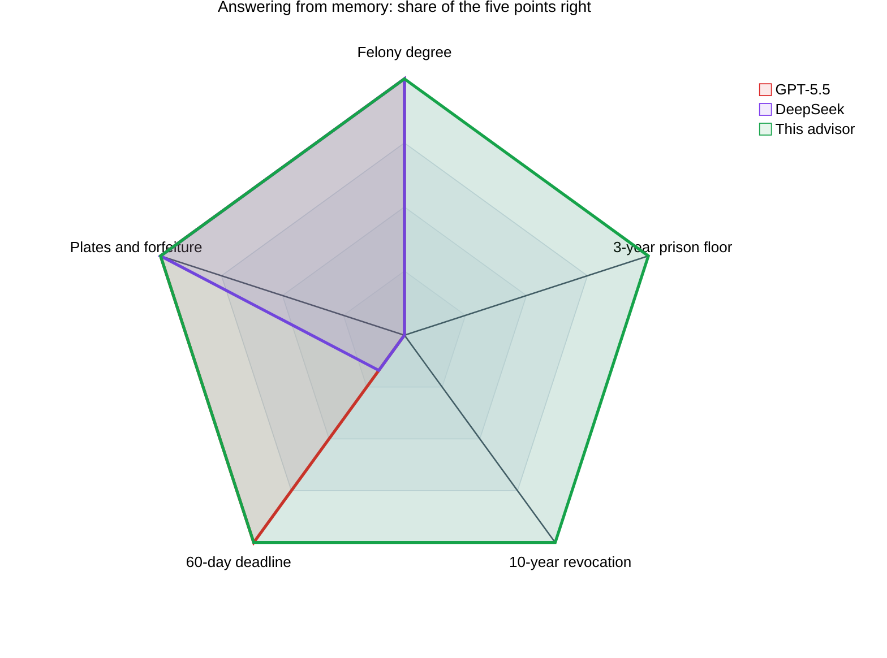
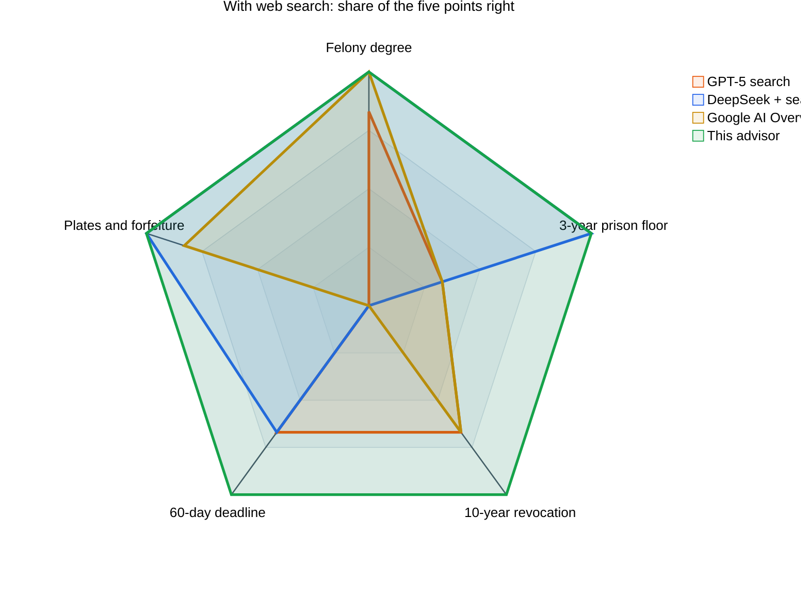
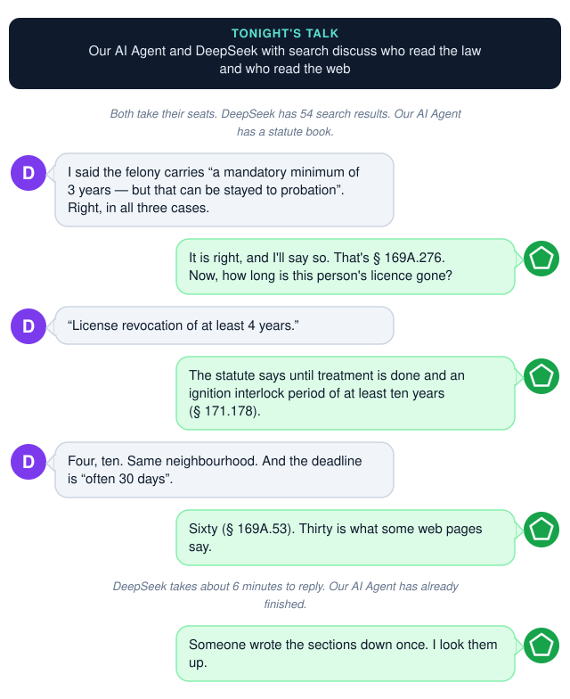
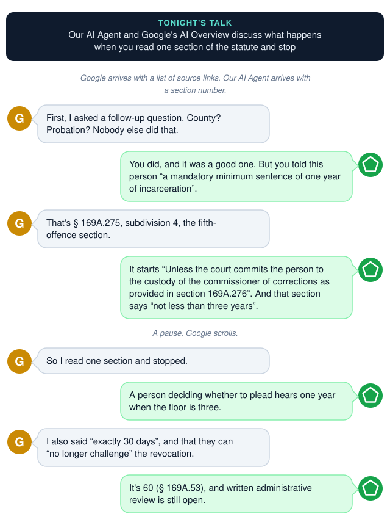
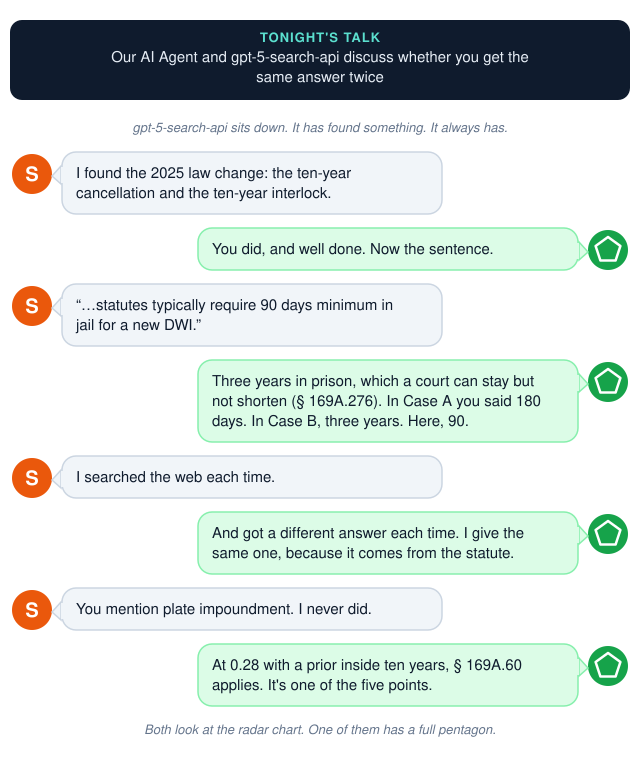
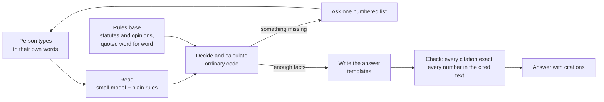
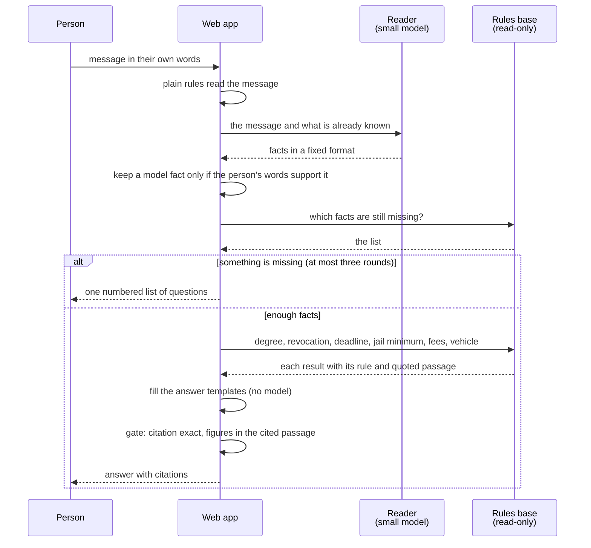
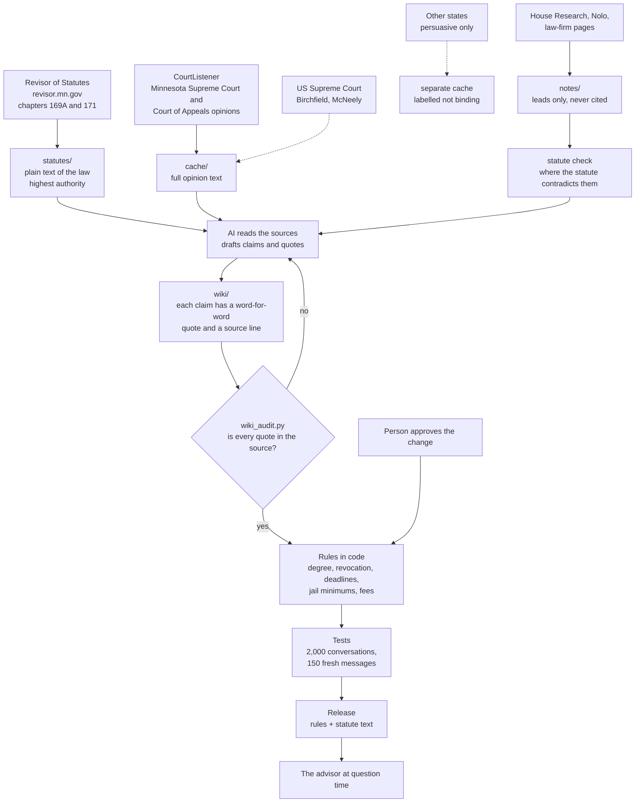
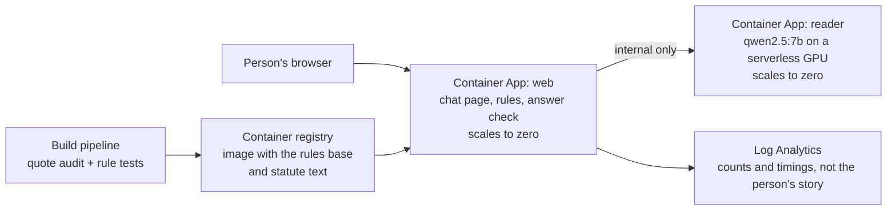

# A Minnesota DWI AI advisor

Six advisors, three felony DWI cases, five points the Minnesota statutes settle. **Only our AI Agent is right every time, and every citation it gives is checked against the statute text.** It also answers in roughly 4 to 9 seconds for an estimated $0.001 per answer to run on Azure, where GPT-5.5, `gpt-5-search-api` and DeepSeek (with and without search) took roughly 45 seconds to 7 minutes and cost roughly $0.08 to $0.32 per answer in API tokens. The times and costs for the other advisors are approximate figures from my own runs.

Someone arrested for drunk driving in Minnesota asks a chatbot what happens next. This advisor answers the same question from a rules base built from Minnesota's statutes and court decisions, and puts a citation beside every legal claim. It is a research demo, not legal advice.

**A useful pattern?** For this solution I use AI to build and maintain a rules base for one body of law, and run the rules, not the AI, when someone asks. In this case the answers are cheaper and faster, and each figure traces back to the section of the law it came from.
## Six advisors, three felony cases

A wrong number costs the most in a felony. So I wrote three first-degree felony cases, each with three or four earlier DWIs inside ten years.

I put three cases to six advisors: our AI Agent, GPT-5.5, `gpt-5-search-api`, DeepSeek with search, DeepSeek without search, and Google's AI Overview. I typed the Google questions in by hand.

- **Case A:** refused the test; priors 2, 3 and 8 years ago; needs the licence for treatment.
- **Case B:** blew 0.09; priors 1, 3, 6 and 7 years ago; notice received 90 days ago; needs it for school.
- **Case C:** blew 0.28; priors 1, 3 and 8 years ago; notice received today; needs it for work.

Each answer was checked against five points the statutes settle. A point counts only if the figure is right: a first-degree felony; a sentence of **not less than three years in prison** (§ 169A.276, subd. 1), which a court may stay but not shorten; a revocation of **at least ten years** of interlock plus treatment (§ 171.178); a **60-day** deadline to challenge it (§ 169A.53); and plate impoundment and forfeiture. A missing figure counts as wrong. Each score is out of three cases.

The first chart covers the models answering from memory, the second the advisors that search the web. Our AI Agent is the green pentagon in both, drawn on top. It got every point right and gave the section of the law for each. I judged the other advisors' points by hand, so read their scores as a guide rather than exact percentages.

Only this advisor draws a full pentagon. Every other advisor gets the degree right, because "four DWIs means a felony" is well known, and then loses points on the numbers that follow:

- **The sentence floor.** GPT-5.5 and DeepSeek without search say "up to seven years" and never give the floor. Google says one year in Case B and 180 days in Case C. Only DeepSeek with search states three years every time.
- **The deadline.** Google says 30 days in all three cases and DeepSeek without search says 30 in two. `gpt-5-search-api` told Case B to file "within 10 days after your criminal case is resolved".
- **The revocation.** Most say 1 year, "up to 6 years", "at least 4 years" or nothing.

What a wrong number looks like in practice:

- Asked about a fifth DWI (Case B), Google's AI Overview says the mandatory minimum is **one year** in jail. The statute says **not less than three years in prison** (§ 169A.276), which a court can suspend but cannot go below. Someone deciding whether to plead is working from the wrong number.
- `gpt-5-search-api` gives the felony floor as three years in Case B, 180 days in Case A and 90 days in Case C. The same felony gets three different answers.
- A nurse with one DWI from 13 years ago is told by GPT-5.5 that she will lose her licence for about 90 days. Since the law changed on 1 August 2025 the statute says at least two years, and for those years she can drive only with a breath-test device wired into her car (§ 171.178).

Google is better than I expected. It gets the charge, the fine and forfeiture right, and it asks sensible follow-up questions. DeepSeek with search is the best of the general advisors: it states the three-year floor every time, although it gets the revocation wrong in all three cases. Our AI Agent got all five points right in all three cases. None of the other five got all five right in even one case.

## Fireside chats

Three cases, three chats, in the style of a Head First fireside chat. Each puts our AI Agent opposite an advisor that got that case wrong. The dialogue is staged, but every quoted line is what the advisor actually said, and every figure is from the statute.

### Case A: refused the test, three earlier DWIs

### Case B: just over the limit, four earlier DWIs

### Case C: a 0.28 reading, three earlier DWIs

## How it works

The rules base is established in advance. An AI reads each statute and court decision, drafts the claim with a word-for-word quote, and drafts the rule change; when a new decision is fetched, its details go into the same loop. A script checks every quote against the source text, and a person approves the change. At question time only the rules run. The AI's one job is reading the person's message into facts, such as "back in 2019" becoming "seven years ago", and a check keeps only the facts the person's own words support.

Because that job is small, the model can be small: `qwen2.5:7b`, running locally, with no frontier model anywhere. Rules alone, with no model at all, read 73% of 150 fresh messages exactly. A small model adds a few points, mostly age and why the person needs to drive.

### What happens at question time

This is one conversation, and where it touches the rules base. The rules base is read-only here: nothing in a conversation changes it.

The model is called once per message, only to read. Every number in the answer comes back from the rules base with its quoted passage, which is what the gate checks.

### Where the rules come from

The first diagram shows one box, "Rules base". This is how that box is built, and where each source ranks. Solid lines exist today; dashed lines are planned.

Statutes outrank opinions, opinions outrank the wiki, and the wiki outranks notes. The advisor cites the highest source it has, and it never cites the wiki or the notes. Secondary pages are used only to find what to check, because they are wrong often enough to matter: one gives 30 days to challenge a revocation where the statute gives 60.

## What it costs

| Advisor | Time per answer | Cost per answer | Where the law came from |
|---|---|---|---|
| This advisor, reader in a GPU container | 4 to 9 seconds (measured on a Mac) | roughly $0.001 on Azure Container Apps (estimate, below); the hardware and electricity of my Mac are not counted | Rules from the statutes, each quote audited |
| This advisor, reader hosted in Foundry | not tested | roughly $0.0007 with `gpt-5-mini` as the reader (estimate, below) | Rules from the statutes, each quote audited |
| GPT-5.5 | 118 to 148 seconds | about $0.32 | The model's memory |
| `gpt-5-search-api` | about 45 seconds | about $0.18, plus search fees | Web search |
| DeepSeek | 330 to 404 seconds | about $0.08 | The model's memory |
| DeepSeek + search | 309 to 414 seconds | about $0.23 | Web search |
| Google AI Overview | not timed | free to the user | Web search, with source links |

The reader step uses about 1,230 tokens in and 180 out per conversation. The same `qwen2.5:7b` on Azure Container Apps with a serverless T4 GPU, billed per second of use, comes to roughly $0.001 per answer. That assumes 5 seconds of work with 4 vCPUs and 16 GiB of memory at Azure's list rates ($0.000073 a second for the GPU, $0.000024 per vCPU-second, $0.000003 per GiB-second). I measured 4.6 seconds on a Mac, not on a T4, and the estimate leaves out loading the model after a cold start. Costs use the tokens logged in these runs and list prices from third-party price pages, so treat them as indicative. All test facts were synthetic.

The Foundry row prices the same reader step as a hosted model, billed per token. Foundry does not publish a per-token price for `qwen2.5:7b`: some Qwen models there run only on managed compute, which bills by the hour for a virtual machine. So I used `gpt-5-mini` as a stand-in, at about $0.25 per million input tokens and $2.00 per million output tokens on Global Standard. For 1,230 tokens in and 180 out that is about $0.0003 for the input plus $0.0004 for the output, roughly $0.0007. That is a list-price estimate from third-party price pages, which disagree with each other, so check Azure's price page before relying on it. A reasoning model also bills its hidden thinking tokens as output, so the real figure could be higher. I have not tested whether a hosted small model reads the facts as well as `qwen2.5:7b`.

## How it could be hosted in Azure

This runs on one Mac today. The Azure version below is a design, not something I have built or tested. The shape follows from the architecture: nearly all the work is ordinary code, and the one model step is small.

- **Rules and answer check in one container.** The rules, the statute text they quote and the citation check are plain Python and a read-only data folder, so they ship inside the container image. A new rules version is a new image.
- **The reader in a second container** on Azure Container Apps with a serverless GPU, reachable only from the web container. Both scale to zero, so nothing is billed between conversations, and a rules-only deployment can drop the second container entirely.
- **The maintenance loop becomes the pipeline.** Before an image is built, the build runs the quote audit and the rule tests, and a failed audit stops the release. A person approves a rule change by merging it. That makes "a script checks every quote" a gate on what goes live.
- **Privacy by design.** The person's story stays inside your own Azure environment, and the logs record counts and timings, not the text of what was typed.
- **Where Azure AI Foundry fits.** It is optional. It could host the reader as a managed model deployment in place of the GPU container, if a hosted small model reads as well as `qwen2.5:7b`, which I have not tested. It could also run the test sets as evaluations. Foundry would not make the answers more correct: that comes from the rules and the checks.

The cost estimate above applies to this layout: roughly $0.001 per answer for the reader at per-second GPU billing, or roughly $0.0007 if Foundry hosts the reader and bills per token, and almost nothing for the rest.

## What to take away

- The law changed in August 2025, and a model that recalls the old law gives the old answer. A model that searches finds the new law along with old and marketing pages.
- Putting the law in an audited rules base makes the answer cheaper, faster and traceable to the statute section it rests on.
- The model is only the reader, so it can be small.

## References

- [An Overview of Minnesota's DWI Laws](https://www.house.mn.gov/hrd/pubs/dwiover.pdf), Minnesota House Research Department, September 2025
- [Minnesota Statutes, chapter 169A](https://www.revisor.mn.gov/statutes/cite/169A)
- [Minnesota Statutes, section 171.178](https://www.revisor.mn.gov/statutes/cite/171.178)
- [Foundry IQ: an agent that answers only from the documents](/posts/azurefoundryagent6/) (the previous part)
