# Business Central Azure Functions

## Azure Functions with Business Central

:::brain-power Before you read on
Business Central cannot draw a QR code by itself. If you wanted it to ask a small web service for one, what would you send to the service, and what would you want back?
:::

## project files

```text
qrcode-generator-function/
├── src/
│   └── app.js
├── host.json
├── package.json
```

## src/app.js

```javascript
const { app } = require('@azure/functions');
const qr = require('qrcode');

app.http('QRCodeGenerator', {
    methods: ['GET'],
    authLevel: 'anonymous',
    handler: async (request, context) => {
        const text = request.query.get('text');

        if (!text) {
            return { 
                status: 400, 
                body: "Please provide text to encode via the 'text' query parameter." 
            };
        }

        try {
            // Generate a QR code as a Data URI (base64 string)
            const qrCodeDataUrl = await qr.toDataURL(text);
            return {
                status: 200,
                body: qrCodeDataUrl,
                headers: {
                    'Content-Type': 'text/plain'
                }
            };
        } catch (error) {
            return {
                status: 500,
                body: `Error generating QR code: ${error.message}`
            };
        }
    }
});
```

## host.json

```json
{
  "version": "2.0",
  "logging": {
    "applicationInsights": {
      "samplingSettings": {
        "isEnabled": true,
        "maxTelemetryItemsPerSecond": 20
      }
    }
  },
  "extensionBundle": {
    "id": "Microsoft.Azure.Functions.ExtensionBundle",
    "version": "[4.*, 5.0.0)"
  }
}
```

## package.json

```json
{
  "name": "qrcode-generator-function",
  "version": "1.0.0",
  "description": "Azure Functions QR Code Generator",
  "main": "src/app.js",
  "scripts": {
    "start": "func start",
    "test": "echo \"Error: no test specified\" && exit 1"
  },
  "dependencies": {
    "@azure/functions": "^4.0.0",
    "qrcode": "^1.5.3"
  },
  "devDependencies": {
    "@types/node": "^20.x"
  },
  "engines": {
    "node": ">=18.0.0"
  }
}
```

## Azure Portal (Visual)
I navigated to portal.azure.com

I clicked + Create a resource

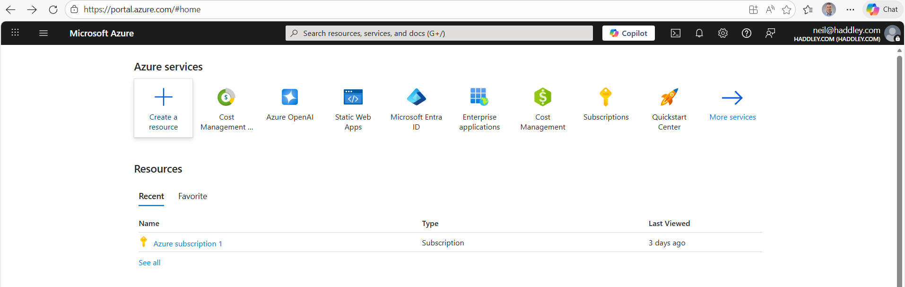
*I clicked + Create a resource*

I clicked Function App|Create

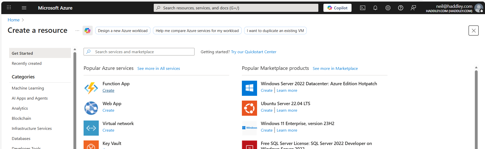
*I clicked "Create"*

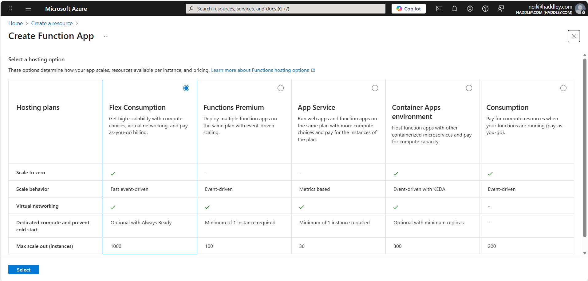
*I selected a hosting option*

I filled in:

Name: qrcode-generator-function

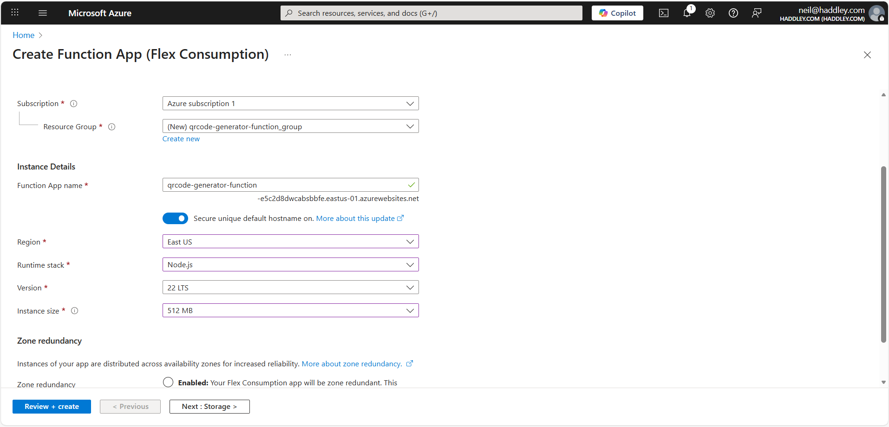
*I provided a Resource Group and Function App name*

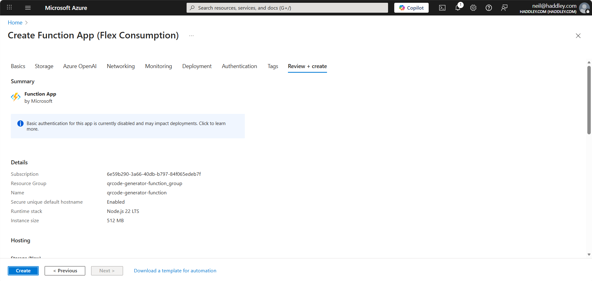
*I clicked Create*

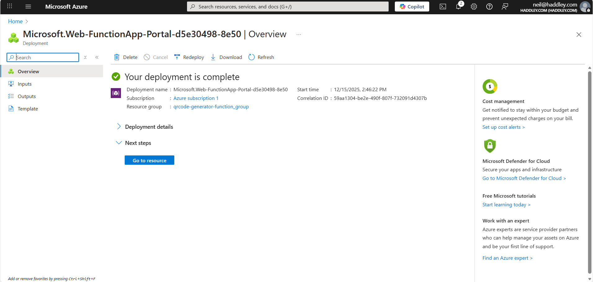
*I clicked Go to resource*

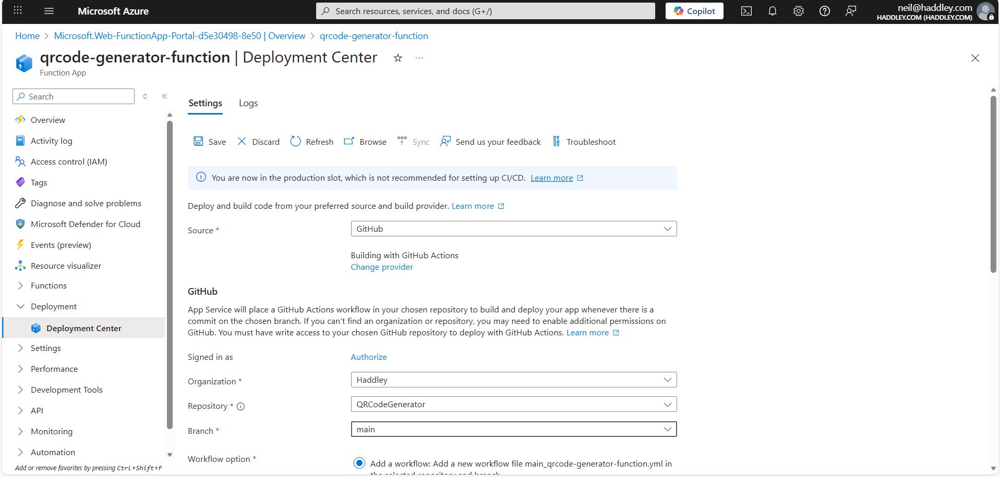
*I clicked Deployment|Deployment Center and entered Github project details*

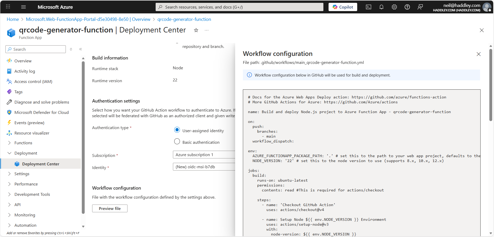
*I previewed the Github action details*

## .github/workflows/main_qrcode-generator-function.yml

```yml
# Docs for the Azure Web Apps Deploy action: https://github.com/azure/functions-action
# More GitHub Actions for Azure: https://github.com/Azure/actions

name: Build and deploy Node.js project to Azure Function App - qrcode-generator-function

on:
  push:
    branches:
      - main
  workflow_dispatch:

env:
  AZURE_FUNCTIONAPP_PACKAGE_PATH: '.' # set this to the path to your web app project, defaults to the repository root
  NODE_VERSION: '22' # set this to the node version to use (supports 8.x, 10.x, 12.x)

jobs:
  build:
    runs-on: ubuntu-latest
    permissions:
      contents: read #This is required for actions/checkout

    steps:
      - name: 'Checkout GitHub Action'
        uses: actions/checkout@v4

      - name: Setup Node ${{ env.NODE_VERSION }} Environment
        uses: actions/setup-node@v3
        with:
          node-version: ${{ env.NODE_VERSION }}

      - name: 'Resolve Project Dependencies Using Npm'
        shell: bash
        run: |
          pushd './${{ env.AZURE_FUNCTIONAPP_PACKAGE_PATH }}'
          npm install
          npm run build --if-present
          popd

      - name: Zip artifact for deployment
        run: zip release.zip ./* -r

      - name: Upload artifact for deployment job
        uses: actions/upload-artifact@v4
        with:
          name: node-app
          path: release.zip

  deploy:
    runs-on: ubuntu-latest
    needs: build
    permissions:
      id-token: write #This is required for requesting the JWT
      contents: read #This is required for actions/checkout

    steps:
      - name: Download artifact from build job
        uses: actions/download-artifact@v4
        with:
          name: node-app

      - name: Unzip artifact for deployment
        run: |
          unzip release.zip
          rm release.zip
      
      - name: Login to Azure
        uses: azure/login@v2
        with:
          client-id: ${{ secrets.AZUREAPPSERVICE_CLIENTID_DC52AD8DA7DF437A982237D80ABB5CC7 }}
          tenant-id: ${{ secrets.AZUREAPPSERVICE_TENANTID_32D143B72F614D7EB5E5481E145E9815 }}
          subscription-id: ${{ secrets.AZUREAPPSERVICE_SUBSCRIPTIONID_7D7131AD943A4E09A8845E8BBEBDD7DA }}

      - name: 'Run Azure Functions Action'
        uses: Azure/functions-action@v1
        id: fa
        with:
          app-name: 'qrcode-generator-function'
          slot-name: 'Production'
          package: ${{ env.AZURE_FUNCTIONAPP_PACKAGE_PATH }}
          
```

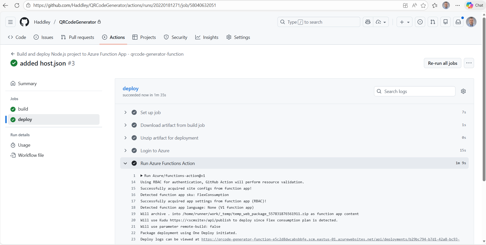
*The Github action built the Function App and deployed to Azure*

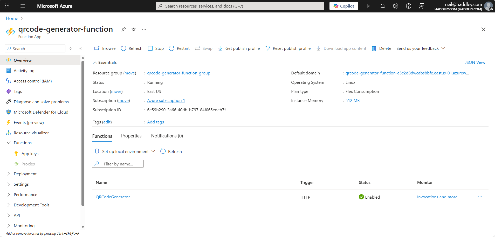
*I reviewed the QRCodeGenerator function details*

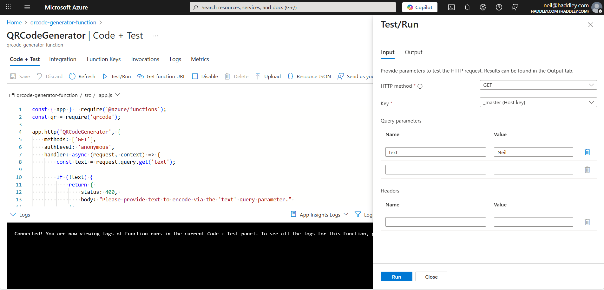
*Testing the QRCodeGenerator function in the Azure portal*

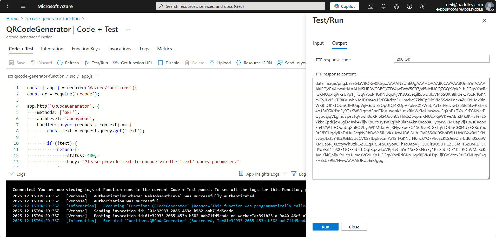
*Test results*

:::no-dumb-questions
**Q: What does this function do?**

A: It is an HTTP function called QRCodeGenerator. It reads the text query parameter, makes a QR code from it, and returns the image as a base64 data URI in plain text.

**Q: What happens if I leave out the text parameter?**

A: The function returns a 400 status and a message that asks for text. If creating the code fails, it returns a 500 status with the error message.
:::

:::watch-it The function is anonymous
The code sets authLevel to anonymous, so anyone who has the address can call it. That is fine for a demonstration that only draws a QR code, but a function that returns private data would need a key or another form of authentication.
:::

:::under-the-hood How the code gets to Azure
In the Deployment Center I entered my GitHub project details, and Azure added a GitHub Actions workflow file to the repository. The workflow built the Function App and deployed it, so a push to the repository updates the function.
:::

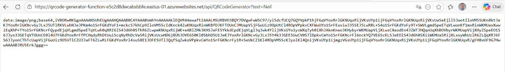

[Test results](https://qrcode-generator-function-e5c2d8dwcabsbbfe.eastus-01.azurewebsites.net/api/QRCodeGenerator?text=Neil)


:::test-drive Try it yourself
1. Open the function's address with ?text=Neil on the end, and look at the answer.
2. Change the text and call it again.
3. Leave the text out and see the 400 message.
:::

:::bullet-points Recap
- An Azure Function can be a small HTTP service that Business Central calls.
- QRCodeGenerator reads a text parameter and returns a QR code as a base64 data URI.
- A missing parameter returns 400, and a failure returns 500.
- GitHub Actions built and deployed the function from my repository.
- Part 2 builds the Business Central extension that calls this function.
:::

## References

- [Quickstart: Create and deploy function code to Azure using Visual Studio Code](https://learn.microsoft.com/en-us/azure/azure-functions/how-to-create-function-vs-code?tabs=go%2Cwindows&pivots=programming-language-javascript)

- [Integrating Business Central with Azure services](https://learn.microsoft.com/en-us/dynamics365/business-central/dev-itpro/developer/integration-azure-overview)