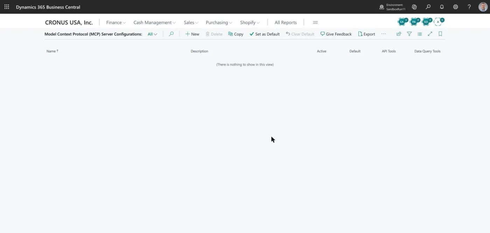
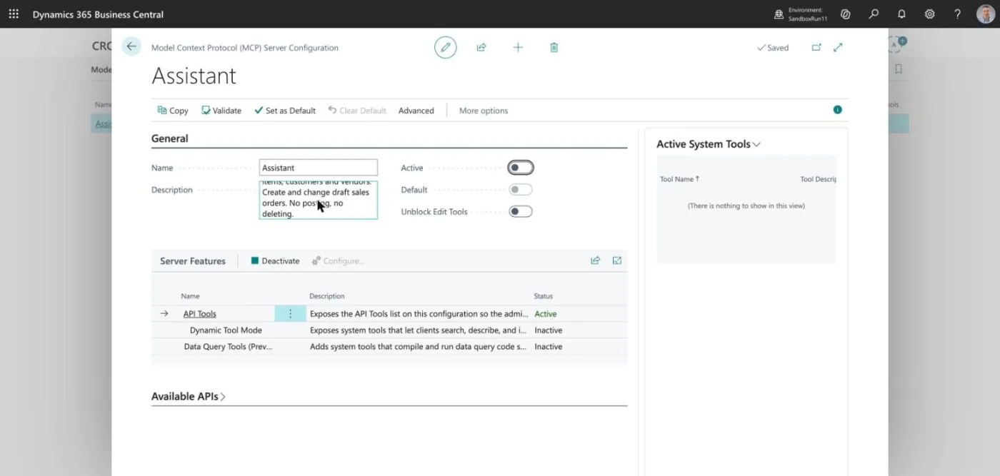
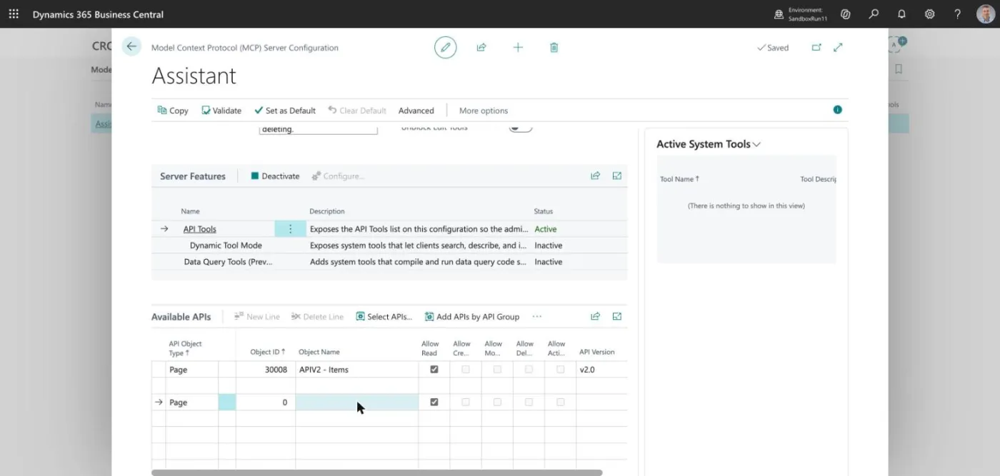
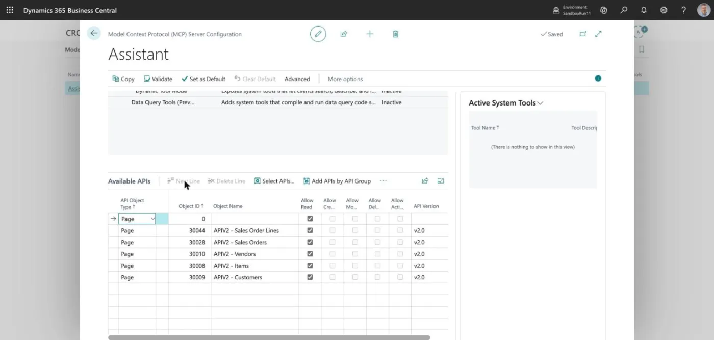
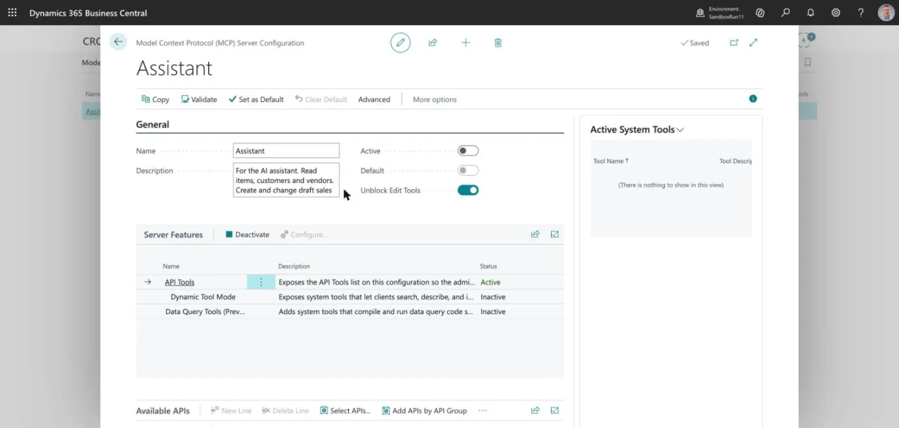
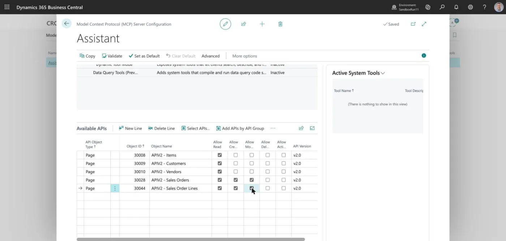
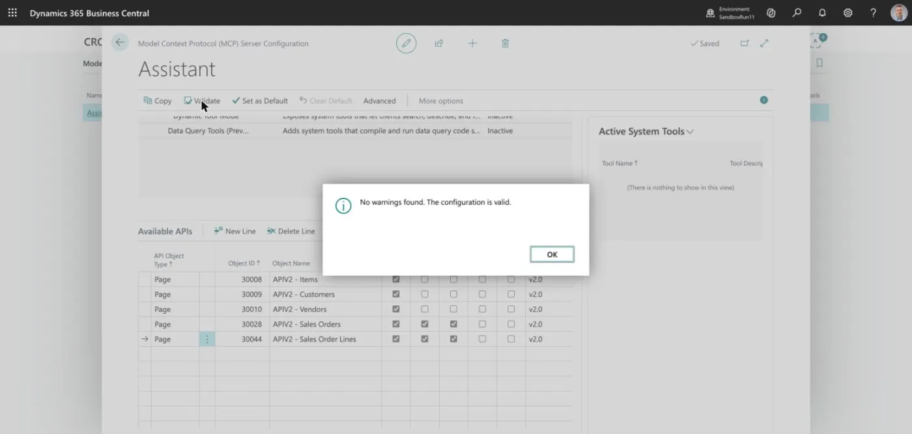
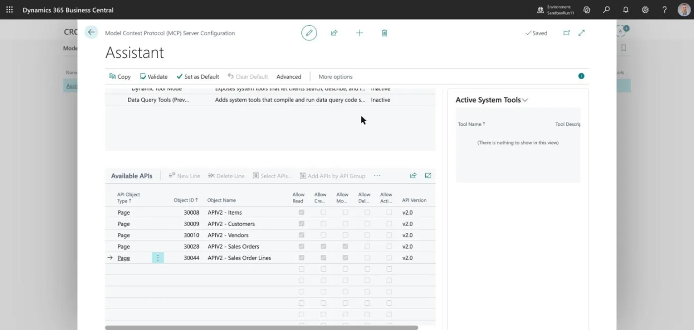

# Turning on Business Central's MCP server

This is the first of seven short posts about letting an AI assistant do small jobs in Business Central. Every screenshot comes from one fresh copy of the practice company that I made for this series (Part 5 shows how).

## Four terms: MCP, server, tool, configuration

:::brain-power
You want an AI assistant to look up a customer. Would you hand it the keys to Business Central, or hand it a short list of things it may do? Why?
:::

- **MCP** (Model Context Protocol) is a standard way for an AI application to ask another program, "what can you do?", and then ask it to do one of those things. I built a small MCP server with one tool in [Model Context Protocol, Part 1](/posts/mcpserver/), and connected Claude Code to Business Central's built-in server in [Part 4](/posts/businesscentralmcpclaudecode/).
- An **MCP server** is the program that answers. Business Central has one, hosted by Microsoft at `mcp.businesscentral.dynamics.com`. It is part of the product.
- A **tool** is one thing the server can do for the AI, such as "list customers" or "create a sales order".
- An **MCP server configuration** is a list, kept inside Business Central, of which tools the server offers. Each tool comes from an **API page** (a Business Central page that is also a web API). For each page you choose what is allowed: read, create, modify, delete, or run an action.

So you do not give an AI "access to Business Central". You decide, page by page and permission by permission, which tools the AI is offered. If a tool is not on the list, the AI is never offered it, so it has nothing to call.

## What we will build

One configuration, called **Assistant**. It is for an AI that does small, low-risk jobs: look things up, and prepare draft sales orders for a person to look at.

| Page | Read | Create and modify |
|---|---|---|
| Items (30008), Customers (30009), Vendors (30010) | yes | no |
| Sales Orders (30028), Sales Order Lines (30044) | yes | yes |

Nothing can be deleted and nothing can be posted. A draft is only a draft until a person acts on it.

## Build it

Search for **Model Context Protocol (MCP) Server Configurations**. The list is empty in the fresh sandbox.

Choose **New**, type the name `Assistant` and a short description.

Now add the pages, one at a time, by typing each API object ID in the **Available APIs** list. The grid re-sorts by object ID after each entry, and the name appears once the row loses focus.

:::watch-it Add one page at a time
If you click away while a line is half made, Business Central can show an error page. Reload and the lines you finished are still there. Click **New Line** to commit a line before typing the next one.

:::

All five pages are in:

Tick **Allow Read** on every row. Tick **Allow Create** and **Allow Modify** only on Sales Orders and Sales Order Lines. The Create and Modify boxes stay greyed out until you switch on **Unblock Edit Tools** on the configuration. That switch is meant for a person to turn on, not the AI.

Choose **Validate**. You want "No warnings found".

Switch **Active** on last. An active configuration is locked: you cannot change its pages or its name until you switch it off again.

:::no-dumb-questions
**Q: Why only five pages?**
A: Every page you add becomes several tools, and the AI has to read a description of each one every time. In an earlier try I added every standard API page: 414 tools. It took 148 seconds just to list them and about 390,000 tokens to describe them. With five pages the list is short and readable.

**Q: Could I just allow everything and trust the AI?**
A: You could, but nothing here asks you to. Each extra tool is one more thing that has to be right. Starting small costs a few minutes and you can add a page later.
:::

## What this does not do

It does not decide who is signed in. The server uses a normal Microsoft sign-in, so the AI works with the permissions of the person who signed in. A configuration limits the tools. It is not a security boundary for that person's own account.

:::fireside-chat The AI and the configuration
*Tonight's talk: one who wants to do everything, and one who keeps a short list.*

**The AI:** I would like to delete a customer.

**The configuration:** There is no tool for that on my list.

**The AI:** Then post this order.

**The configuration:** Not on my list either. I offer five pages: read on all of them, and create and modify on two.

**The AI:** That is not many.

**The configuration:** Ten tools you understand are better than four hundred you do not.
:::

:::bullet-points What to take from this
- An MCP server configuration is a short list of pages and permissions. The tools come from the list.
- Start with read-only, add Create and Modify only where you need them, and switch Active on last.
- Keep the list short. Ten tools you understand are better than four hundred you do not.
:::

Next: [Part 2](/posts/bcmcp2/) connects DeepSeek Harness to this configuration.
