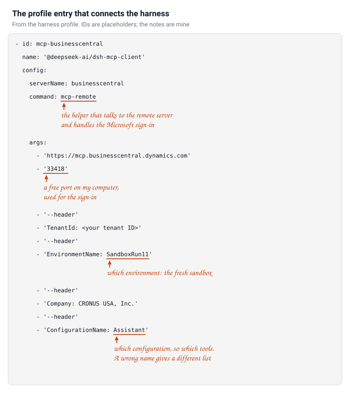
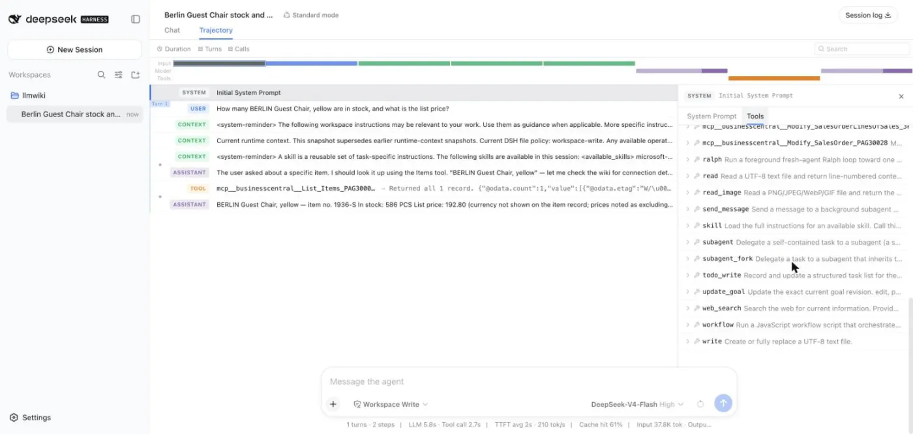
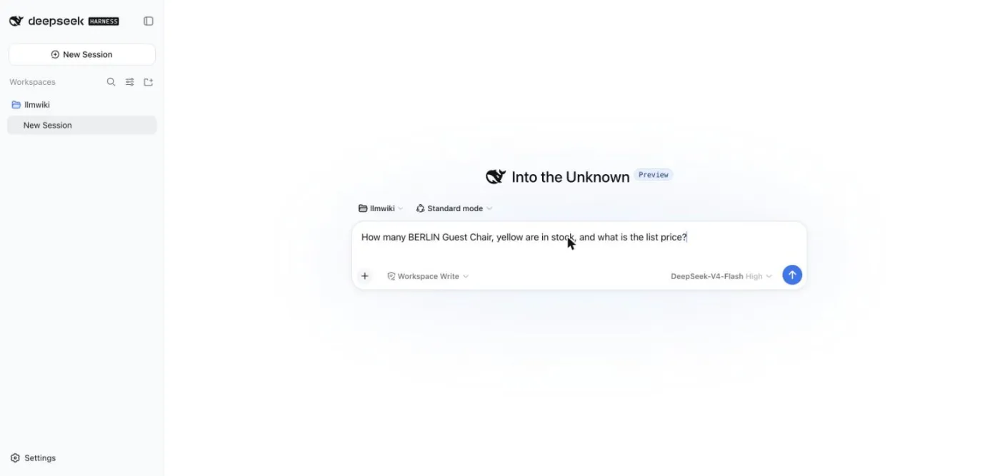
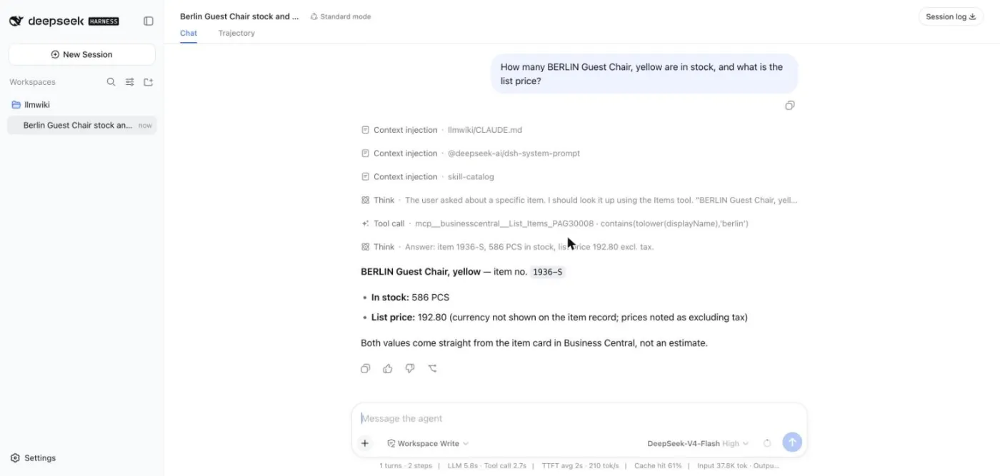
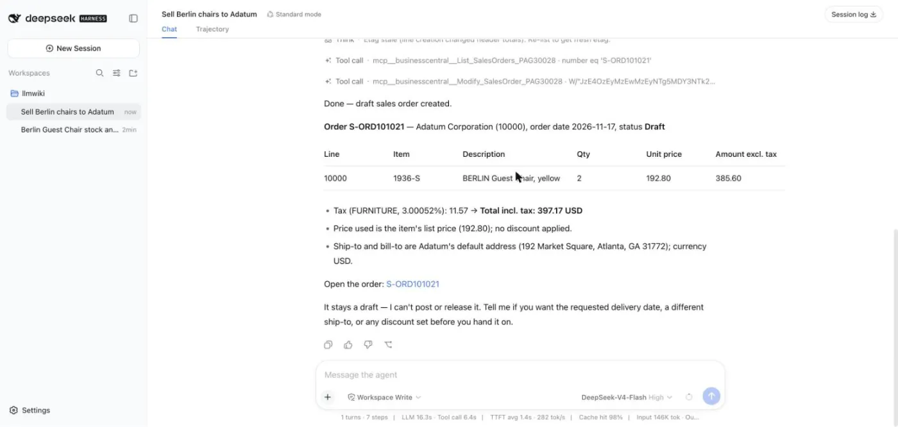
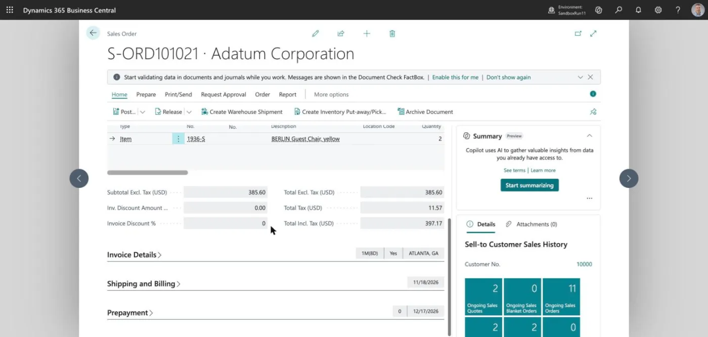

# Connecting DeepSeek Harness to Business Central

[Part 1](/posts/bcmcp1/) made a configuration called **Assistant**: five pages, read everywhere, and create and modify on sales orders only. This post connects an AI application to it and asks two small questions.

## Three pieces

- **DeepSeek Harness** is a program that runs on my computer (`dsh web`, then a page at `127.0.0.1:3080`). It holds the conversation, shows the answers and runs the tools. The model, DeepSeek, does the thinking.
- **`mcp-remote`** is a small helper that lets a program on my computer talk to a remote MCP server and handle the Microsoft sign-in.
- **The Assistant configuration** from Part 1 decides which Business Central tools the AI is offered.

:::brain-power
When the AI asks Business Central to list customers, who is asking? The AI, the harness, or a person? Think about whose name goes on the request.
:::

The AI has no Business Central account of its own. The connection carries the user's Microsoft sign-in, and the server runs every tool as that user. The animation below shows where the sign-in happens. When the harness starts, it also asks the server for its tool list (as in Part 1), so I never type a tool name.



## One entry in the profile

The harness reads a profile file. I added one entry. The words in angle brackets are values you fill in from your own tenant.



And as text you can copy:

```yaml
- insert:
    - id: mcp-businesscentral
      name: '@deepseek-ai/dsh-mcp-client'
      config:
        serverName: businesscentral
        transport: stdio
        command: mcp-remote
        args:
          - 'https://mcp.businesscentral.dynamics.com'
          - '33418'                       # a free port on my computer for the sign-in
          - '--transport'
          - 'http-only'
          - '--header'
          - 'TenantId: <your tenant ID>'
          - '--header'
          - 'EnvironmentName: SandboxRun11'
          - '--header'
          - 'Company: CRONUS USA, Inc.'
          - '--header'
          - 'ConfigurationName: Assistant'
          - '--static-oauth-client-info'
          - '{"client_id": "<your app registration ID>"}'
        toolCallTimeoutMs: 300000
```

Four of those lines say *where* to connect: the tenant, the environment (the sandbox), the company, and the configuration name. If the configuration name is wrong you get a different tool list, or none.

## One sign-in

Business Central's MCP server uses a normal Microsoft sign-in. For that you need an app registration in Microsoft Entra. Mine is a single-tenant public client with the loopback address `http://localhost:33418/oauth/callback` as its redirect, and the Business Central delegated permission `Financials.ReadWrite.All`. I follow Microsoft's own article on the MCP server for the details, and I keep the IDs out of this post.

After a restart, the first connection opens a browser window to sign in. After that the helper remembers the sign-in on my computer.

:::watch-it Tools run as the signed-in user
The harness makes each call with the sign-in of the user who connected. If your user can do something in Business Central, a tool that the configuration allows can do it too. The configuration narrows the tools. It does not narrow you.
:::

## Look at the tool list

Open a session in the harness. Before typing anything, look at the Trajectory tab. It shows the tools the model was given.



You see names such as `List_Items_PAG30008`, `List_Customers_PAG30009`, `Create_SalesOrder_PAG30028` and `Modify_SalesOrder_PAG30028`. The number is the page from Part 1. There is no tool that posts, and none that deletes.

## Prompt A: a question



> How many BERLIN Guest Chair, yellow are in stock, and what is the list price?



It found the item, read the stock (586) and the list price (192.80) and answered. It only used read tools.

## Prompt B: a draft

> Sell 2 BERLIN Guest Chair, yellow to Adatum Corporation at list price.



It looked up the customer and the item, created a sales order with one line (2 × 192.80 = 385.60 before tax), read the order back to check, and told me what it had and had not done. It says plainly that the order stays a draft and that it cannot post it.

Here is the draft in Business Central:



:::no-dumb-questions
**Q: So does the AI call Business Central?**
A: Not directly. The harness gives the model the list of tools and what each one is for. The model suggests a tool call that would be useful: a tool name and its arguments. The harness makes the call to the MCP server, as the signed-in user, and passes the result back to the model. Each tool line you see in the chat is one of those calls.

**Q: What if I ask it to post the order?**
A: It will say it cannot. This configuration has no tool for posting. Parts 6 and 7 add one, on purpose, in a separate and more careful way.
:::

:::fireside-chat mcp-remote and the server
*Tonight's talk: the one who carries the sign-in, and the one who runs the tools.*

**The server:** Who is asking?

**mcp-remote:** I carry a Microsoft sign-in. The name on it is the user's, not the AI's.

**The server:** Then I will run only what that user is allowed to do, and only the tools on my configuration.

**mcp-remote:** Which configuration?

**The server:** The one named in your header. Give me the wrong name and you get the wrong tools.
:::

:::bullet-points What to take from this
- Three pieces: the harness, `mcp-remote`, and the configuration. The configuration decides the tools.
- The profile entry says where to connect and which configuration to use.
- The AI reads the tool list from the server, and works with the permissions of whoever signed in.
:::

Next: [Part 3](/posts/bcmcp3/) adds a second server, so the AI can read Microsoft's documentation.
