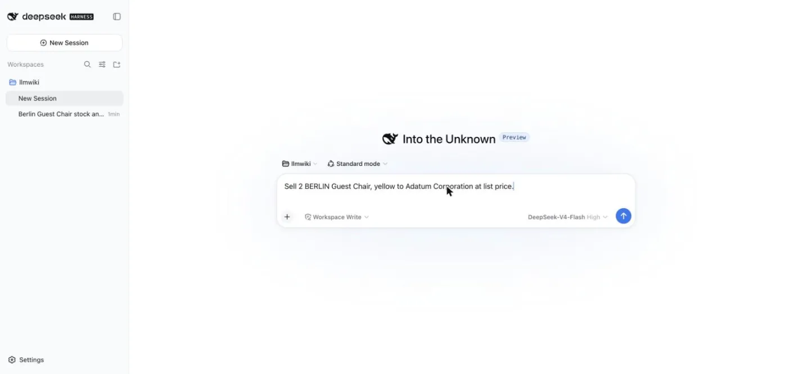
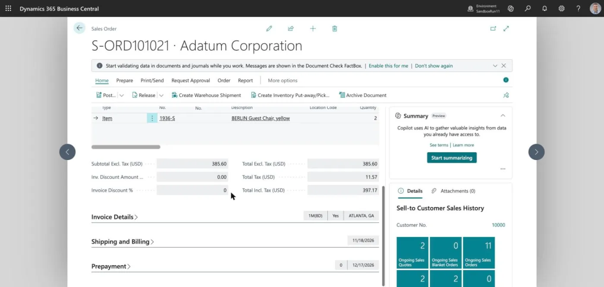
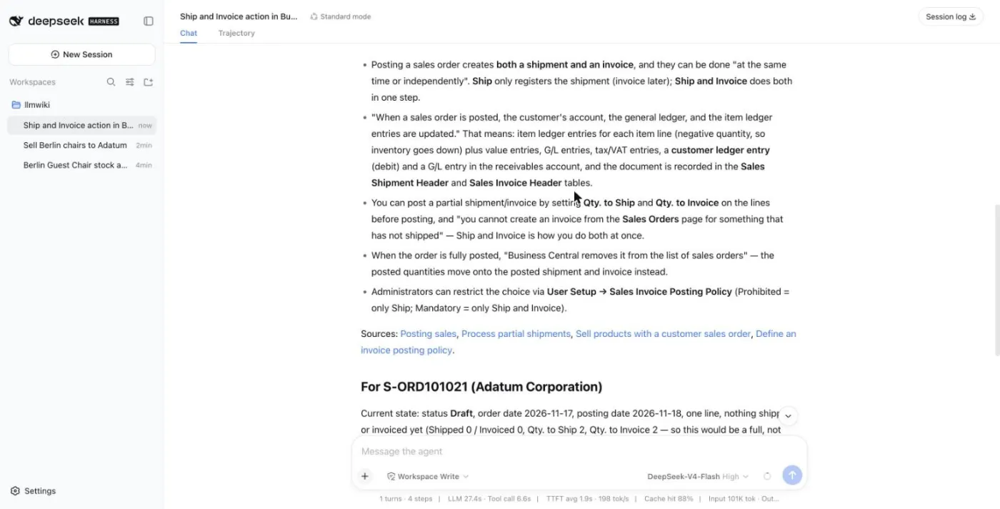
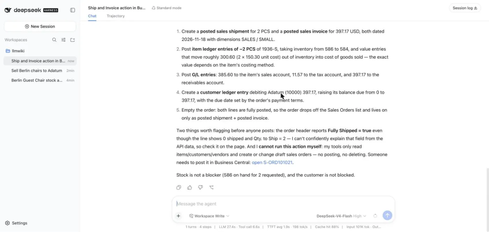

# Letting the AI look things up on Microsoft Learn

[Part 2](/posts/bcmcp2/) connected the harness to Business Central. The AI can now read stock and make drafts, but it only knows what its training and the company's data tell it. If I ask what an action *does*, I would like it to read Microsoft's documentation instead of guessing.

Microsoft runs a second MCP server for exactly this: **Microsoft Learn**. It needs no sign-in.

:::brain-power
Why would you want the AI to read the documentation *before* a person presses a button such as Ship and Invoice, and not after?
:::



## One more entry

Next to the Business Central entry in the profile, I added a second:

```yaml
- insert:
    - id: mcp-mslearn
      name: '@deepseek-ai/dsh-mcp-client'
      config:
        serverName: mslearn
        transport: stdio
        command: mcp-remote
        args:
          - 'https://learn.microsoft.com/api/mcp'
          - '--transport'
          - 'http-only'
        toolCallTimeoutMs: 120000
```

There is no tenant, no company and no configuration, because Learn is public documentation. After a restart, the harness has two servers, and the tool names show which is which: `mcp__businesscentral__…` and `mcp__mslearn__…`.

## Prompt C

This time I ask it to read first and act later. In Part 2 I made a draft order, S-ORD101021, for two chairs.



> Before you do anything, look up on Microsoft Learn what the Ship and Invoice action does on a sales order in Business Central, then tell me what it would change for order S-ORD101021.

The harness shows each step as a line in the chat.



Read the lines from the top:

1. **A Learn search** (`mcp__mslearn__microsoft_docs_search`) for the Ship and Invoice action.
2. **A read of the company's notes** about the Business Central connection (Part 4 says what those notes are).
3. **Business Central lookups**, read only: the order, its lines, the customer and the item.
4. **The answer.**

The first part of the answer is about the action in general, with its sources:



Then it applied that to my order:



For this order, with two chairs at 192.80, it says posting would:

- create a posted shipment and a posted invoice for 397.17;
- post item entries of −2 and take the stock from 586 to 584;
- post the sales, tax and receivables entries (385.60, 11.57 and 397.17);
- create a customer entry for Adatum and raise its balance due from 0 to 397.17;
- take the order off the Sales Orders list.

And it says, in so many words, that it cannot run the action itself: its tools only read and make drafts. A person has to post it in Business Central.

:::watch-it Check the sources
The AI wrote the answer, and it listed the Learn pages it used, so you can open them. Reading its summary is not the same as reading the page. For anything that matters, open the link.
:::

:::no-dumb-questions
**Q: Is this the AI using Microsoft Learn instead of Business Central?**
A: No. It used both, one after the other: Learn for what the action does, Business Central for what is in *this* order.

**Q: Why not paste the documentation into the notes once?**
A: You can, and some things are worth writing down (Part 4). But documentation changes, and the search always reads the current page.
:::

:::fireside-chat Microsoft Learn and Business Central
*Tonight's talk: one who knows the rules for everyone, and one who knows this order.*

**Learn:** I can tell you what Ship and Invoice does for any company.

**Business Central:** I can tell you what it would do to this order.

**Learn:** I cannot see your order.

**Business Central:** And I do not keep the documentation.

**The AI:** Then I will ask you both, and say which answer came from whom.
:::

:::bullet-points What to take from this
- A second MCP server is one more entry in the profile.
- The AI used Learn to explain an action, then Business Central to apply it to a real order, and it stayed within its tools.
- This is look-and-explain only. Nothing was changed in Business Central.
:::

Next: [Part 4](/posts/bcmcp4/) gives the AI the company's own way of working.
