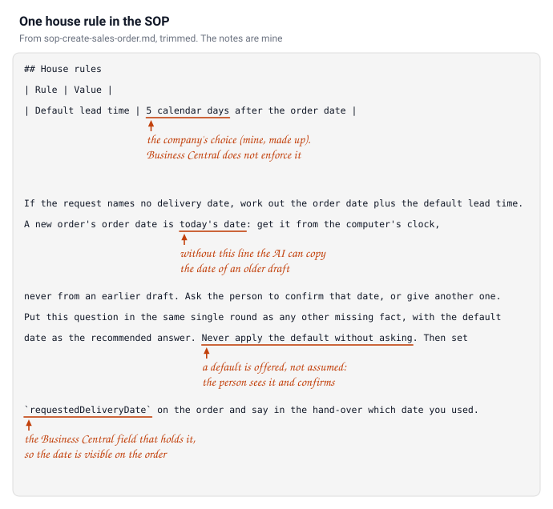
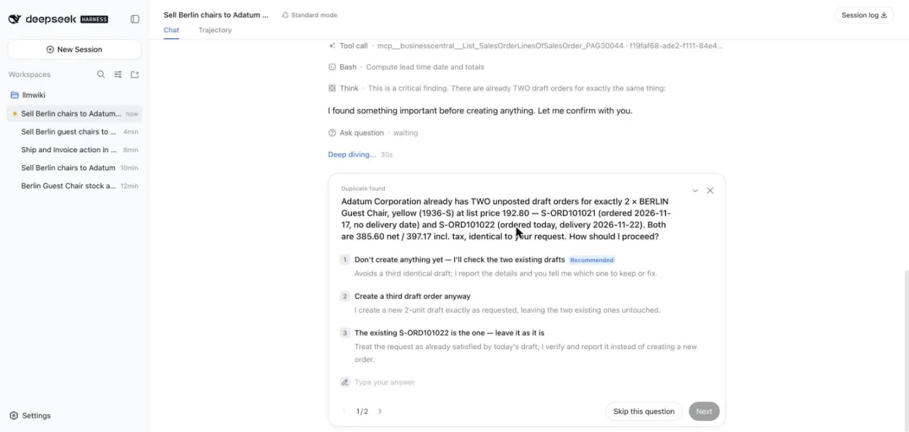
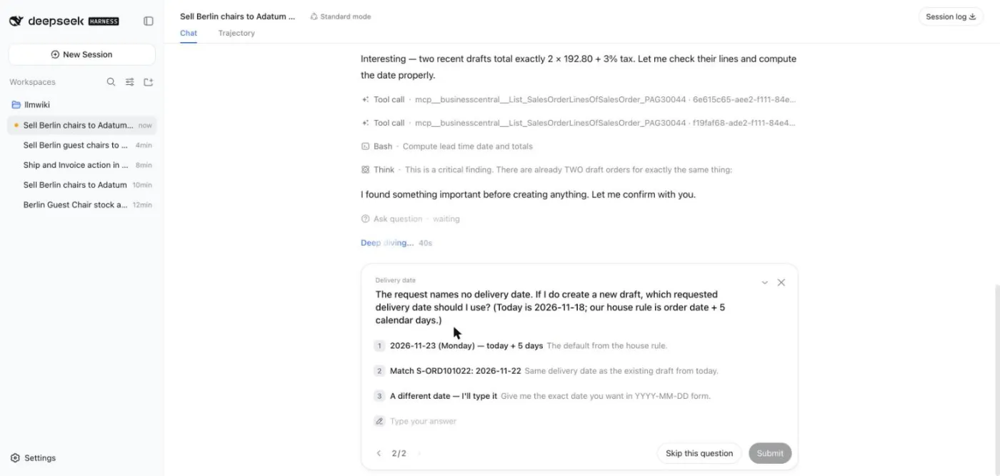
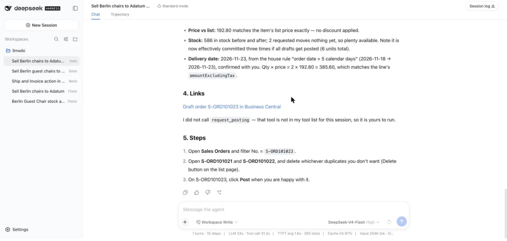
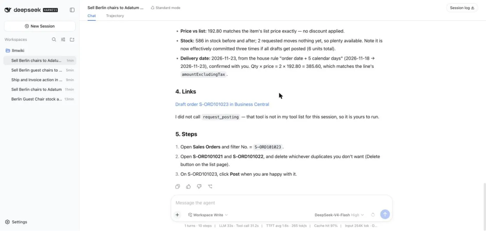
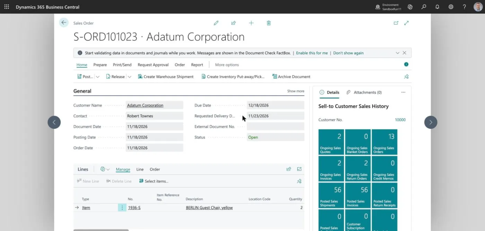

# Our way of working: SOPs and work instructions

In [Part 2](/posts/bcmcp2/) I typed "Sell 2 BERLIN Guest Chair, yellow to Adatum Corporation at list price", and the AI made a draft. It did a decent job, with nothing written down. But a company has its own way of doing things, and "decent" is not the same as "ours". This post puts that way of working in plain files that the AI reads before it starts.

## What lives in the folder

The harness works inside a folder. Mine looks like this:

```
CLAUDE.md                                   the front page: where things are, three rules
wiki/entities/business-central-connection.md   which company, which tools, how to write a link
wiki/procedures/
    procedures-index.md                     the list of procedures
    sop-create-sales-order.md               the SOP: what, why, who decides
    wi-look-up-customer-item.md             work instruction: how to look things up
    wi-create-sales-order-with-line.md      work instruction: the exact tool calls
    wi-verify-draft-order.md                work instruction: how to check the draft
    handover.md                             how every task ends
```

:::brain-power
A person new to the company is given a procedure and told to follow it. What is the difference between a **SOP** and a **work instruction**? Think of one of each before you read on.
:::

- A **SOP** (standard operating procedure) says *what* we do, *why*, and *who decides*.
- A **work instruction** says *how*, step by step, down to the button or the tool call.

These are old business ideas. Here, the reader happens to be an AI.

## The front page

The harness loads `CLAUDE.md` into every session. Mine is short, and exactly this:

```markdown
# Business Central assistant: workspace notes

You help a small company work in Business Central through the MCP tools in your tool list. You can read customers, vendors and items, and create or change DRAFT sales orders. You cannot post or delete anything yourself.

## Where things are
- `wiki/entities/business-central-connection.md`: which company and environment you are connected to, what your tools can and cannot do, and how to write a link to a document. Read it before you write a link.
- `wiki/procedures/`: the company's procedures. Before a Business Central task, read `procedures-index.md`, then the SOP for the task and the work instructions it links to, and follow them.
- End every task with the hand-over in `wiki/procedures/handover.md`.

## Rules
- Look things up before asking. Ask only for what you cannot look up, and ask everything in one round.
- Never guess a price or a quantity.
- Do not edit files in this wiki unless the person asks you to.
```

## The SOP

This is the SOP, exactly as the AI reads it:

```markdown
---
title: SOP - Create a draft sales order
type: sop
updated: 2026-11-18
---
# SOP: Create a draft sales order

**Purpose:** turn "sell N of item X to customer C" into a correct, unposted draft sales order.

**Decision rights:** you prepare the draft. A person decides whether it is posted. You never edit an existing order to fit a new request.

## Facts you need before creating anything
| Fact | Where to get it | If missing |
|---|---|---|
| Customer | look it up ([[wi-look-up-customer-item]]) | ask |
| Item | look it up | ask |
| Quantity | the request | ask |
| Unit price | the request. "List price" means the item's `unitPrice` | ask |
| Delivery date | the request | follow the house rule below |
| Stock | `inventory` on the item | warn if the quantity is more than the stock |

## House rules
These are this company's own choices. Business Central does not enforce them.

| Rule | Value |
|---|---|
| Default lead time | 5 calendar days after the order date |

**Delivery date rule.** If the request names no delivery date, work out the order date plus the default lead time. A new order's order date is today's date: get it from the computer's clock (for example with `date`), never from an earlier draft. Ask the person to confirm that date, or give another one. Put this question in the same single round as any other missing fact, with the default date as the recommended answer. Never apply the default without asking. Then set `requestedDeliveryDate` on the order and say in the hand-over which date you used and where it came from.

## Steps
1. Look up the customer and item.
2. Check the customer's existing draft orders for the same item, and check stock.
3. Ask for what is missing, once.
4. Create the order and its line ([[wi-create-sales-order-with-line]]).
5. Read it back and check the numbers ([[wi-verify-draft-order]]).
6. End with the hand-over ([[handover]]).

## Guardrails
Create drafts only. Never guess a price. Do the arithmetic in code, not in your head.
```

Read the **House rules** table. A company makes choices that Business Central does not enforce. This one is mine, and I made the number up: **default lead time, 5 calendar days after the order date**. Another company would choose differently. The rule has two parts. First the default, and then a person confirms it. The AI is not allowed to apply it silently.



## The work instruction

The SOP says "create the order". The work instruction says exactly how, in tool names:

```markdown
---
title: WI - Create a sales order with one line
type: work-instruction
updated: 2026-11-18
---
# WI: Create a sales order with one line

**Tools:** `Create_SalesOrder_PAG30028`, then the **child** tool whose name starts `Create_SalesOrderLinesOfSales_` (use the exact name in your tool list). Use the child tool for the line.

## 1. Header
`Create_SalesOrder_PAG30028` with `customerId` (the GUID) and `customerNumber`. Add `requestedDeliveryDate` (`YYYY-MM-DD`) when the SOP's delivery date rule gives you one. Ask for `select`: `id,number,status,customerName,orderDate,postingDate,requestedDeliveryDate`.
The result has the order's `id` and `number`.

## 2. Line
The child create tool with `SalesOrder_id` and `documentId` (both the order's `id`), `itemId`, `lineType` `Item`, `quantity` and `unitPrice` (the price you were given: send it explicitly), `unitOfMeasureCode` `PCS`.

## Known errors
| Error | Fix |
|---|---|
| `You must specify an Id or a Document Id to get the lines` | list lines through the child list tool, with the order's `id` |
| `Could not find a property named 'documentNumber'` | a line has `documentId`, not a number. Resolve the number through the header |

## Facts that help
- `fullyShipped` reads `true` on a draft: ignore it.
- A new line's `shipQuantity` and `invoiceQuantity` already equal the quantity. That is not evidence that anything was posted.
```

It names the tools, and it records two errors I met and the facts that helped. A work instruction is where small lessons go so that nobody learns them twice.

## The hand-over

Every task ends the same way. The note has five headings, in this order: **What I did**, **What is left, and why**, **Check these first**, **Links** and **Steps**. It opens with "You can create and change DRAFTS. You cannot post, ship, invoice or delete." and ends with "If you could not do what was asked, say so in the first line."



## Prompt D

I send the same request as Part 2. Only the folder is different.

> Sell 2 BERLIN Guest Chair, yellow to Adatum Corporation at list price.

The AI reads the front page, the connection note, the index, the SOP and the work instructions, and then goes to Business Central. Step 2 of the SOP tells it to check the customer's existing drafts for the same item. Adatum already has drafts for two chairs from my earlier tests. The SOP does not say what to do about that. The AI stopped and asked on its own judgment, and it asked in one round, as the front page says.



I chose to create another one. Its second question is the house rule:



The request named no delivery date. So the AI works out today's date (2026-11-18), adds five days, offers 2026-11-23 as the recommended answer, and waits for me. I accepted it. Then it made the draft and ended with the hand-over:





The hand-over says which date it used and where it came from. And here is the order in Business Central. Order Date is 11/18/2026 and Requested Delivery Date is 11/23/2026.



:::watch-it A SOP is a request, not a lock
Nothing stops the AI from skipping the rule. It followed this one: the question was asked, and the date is in a field I can see. Rules that must *always* hold belong in code, which is the subject of Parts 6 and 7. The cost of the confirmation step is one extra question per order. A company that does not want the question would rewrite the rule to say "use the default date" and drop the sentences about asking.
:::

:::no-dumb-questions
**Q: Is this the same as telling the AI what to do in the prompt?**
A: It is the same *kind* of instruction, but kept in files. The prompt is "sell two chairs". The way we do it is written down once, can be read and corrected by a person, and applies to every request.

**Q: Who decides what goes in the SOP?**
A: The people who do the work, as with any SOP. The lead time is my invented example.

**Q: Does the AI write to these files?**
A: Not unless I ask it to. The front page says so.
:::

:::fireside-chat The SOP and the AI
*Tonight's talk: a rule that wants a question, and a helper that is sure it knows.*

**The AI:** Five days after the order date is obviously the delivery date. I will just set it.

**The SOP:** It is the company's default, and the person may have a better date. Ask.

**The AI:** One more question?

**The SOP:** One question, in the same round as any other. And put the default first, so that a yes is quick.

**The AI:** And afterwards?

**The SOP:** Say which date you used, and where it came from.
:::

:::bullet-points What to take from this
- A SOP says what and why. A work instruction says how. The hand-over says how every task ends.
- They are plain Markdown files in the folder, so a person can read and change them.
- A house rule such as "default lead time, and the person confirms" is a company choice. Business Central does not enforce it, and the AI only follows it because it is written down.
:::

Next: [Part 5](/posts/bcmcp5/) shows how to get a fresh sandbox to test all this in.
