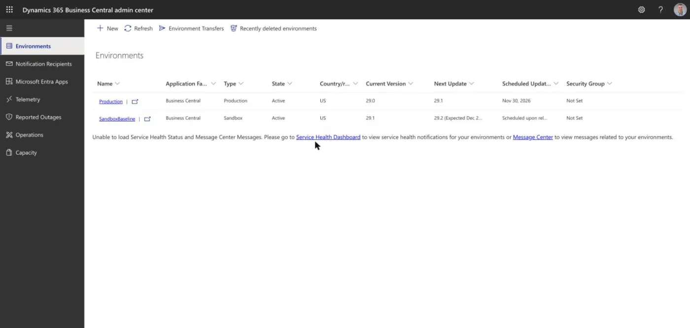
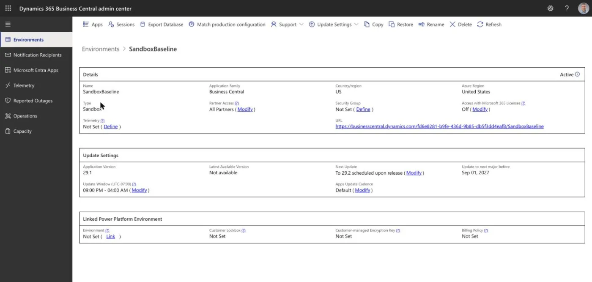
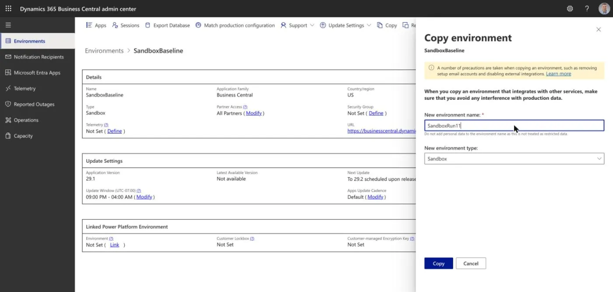
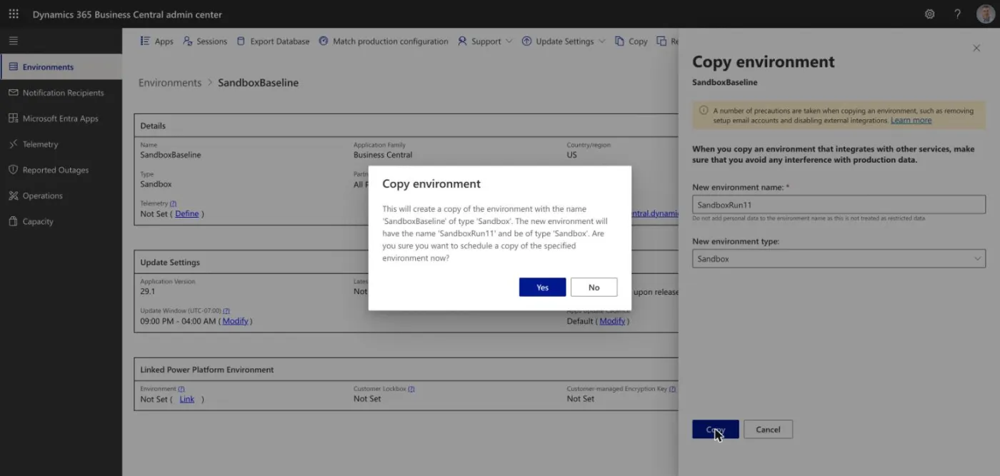
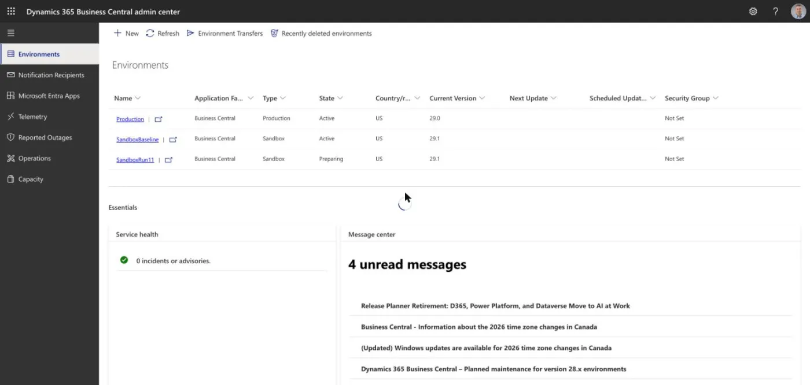
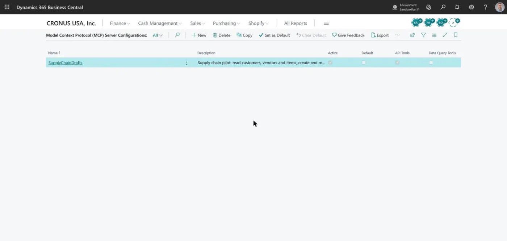

# Testing with a fresh sandbox

Every screenshot in this series comes from one sandbox, **SandboxRun11**. This post shows how I made it, because the AI makes real changes (drafts, and in Parts 6 and 7 a posted invoice). I want to run those tests on a copy that I can throw away.

:::brain-power
You are about to let an AI create and post documents. Which company do you try it in first: the real one, or a copy? And what would make you trust a copy?
:::

## The idea

Keep one sandbox clean, as the starting point. I call mine **SandboxBaseline**. For each test run, copy the baseline to a new sandbox, run the test, and delete the copy afterwards. Every run then starts from the same data.

## Copy it

In the Business Central admin center, open **Environments**. Here is where I started:

Open **SandboxBaseline**:

Choose **Copy**. Type the new name and keep the type as Sandbox:

The admin center asks you to confirm:

The new environment shows **Preparing**, and then **Active** when it is ready.

:::watch-it Three things that tripped me
- **A limit of three sandboxes.** If you are at the limit, delete one before you copy. A deleted environment is kept for a while in the **Deleted environments** list.
- **Names are reserved.** The name of a deleted environment cannot be used again straight away, so choose a new one for each run.
- **A copy brings everything in the baseline,** including any MCP server configurations it held. Open the configuration list in the copy and delete anything you do not want.
:::

## What to do after the copy

1. **Build the configurations** in the new sandbox: **Assistant** (Part 1), and later **Posting** (Part 6).
2. **Point the harness at the new name.** In the profile from Part 2, change `EnvironmentName`.
3. **Point the posting add-on at it too** (Part 6). It refuses to run if its environment does not match the one it is told to expect.
4. **Reset the notes folder** (Part 4) to its starting state, so each run begins with the same files.
5. **Restart the harness,** so that it reads the profile.
6. **Run the prompts.** Then delete the sandbox when you are done with it.

That is the whole of "testing with a fresh sandbox". It is a few minutes of admin, and it means that a surprise during a test cannot touch anything you care about.

:::no-dumb-questions
**Q: Why not test in the real company with a test customer?**
A: Because an AI that is allowed to make drafts can make one against any customer, and you only find out which when it happens. A copy lets you find out for free.

**Q: Does a copy have my real data?**
A: A sandbox copy has the data that the baseline had. Mine is the CRONUS demo company. If you copy from production, you copy real customer data, and you should think about who can sign in to it.
:::

:::fireside-chat The baseline and the copy
*Tonight's talk: the sandbox that stays clean, and the one that gets used.*

**The baseline:** I stay as I am. Nobody tests on me.

**The copy:** I am the one that gets drafts, and a posted invoice, and then gets deleted.

**The baseline:** Does that bother you?

**The copy:** No. It is what I am for. But my name stays reserved for a while after I am gone, so the next copy needs a different one.
:::

:::bullet-points What to take from this
- Keep a clean baseline sandbox, and copy it for each run.
- The copy goes Preparing, then Active. Names and the three-sandbox limit are the traps.
- After the copy, rebuild the configurations, change the environment name in two places, and reset the notes.
:::

Next: [Part 6](/posts/bcmcp6/) is the part I care about most: a way for the AI to ask for a document to be posted, without being able to post it.
