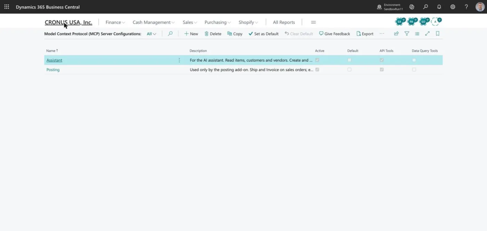
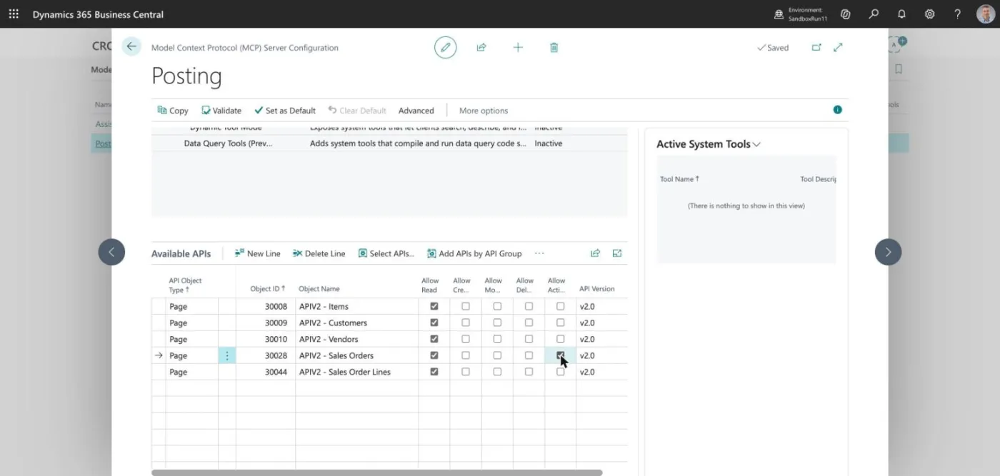
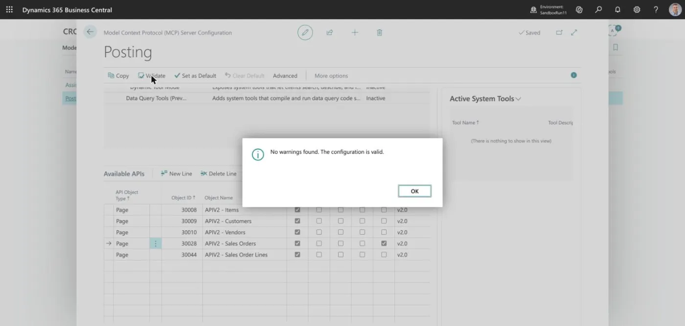
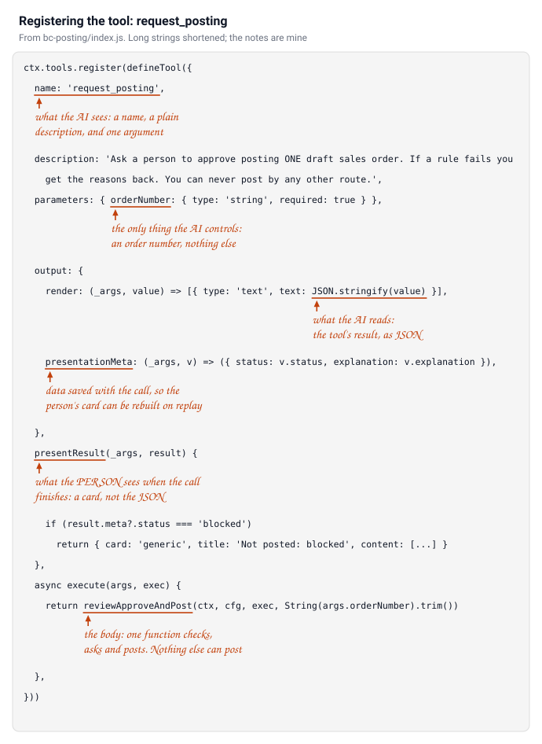
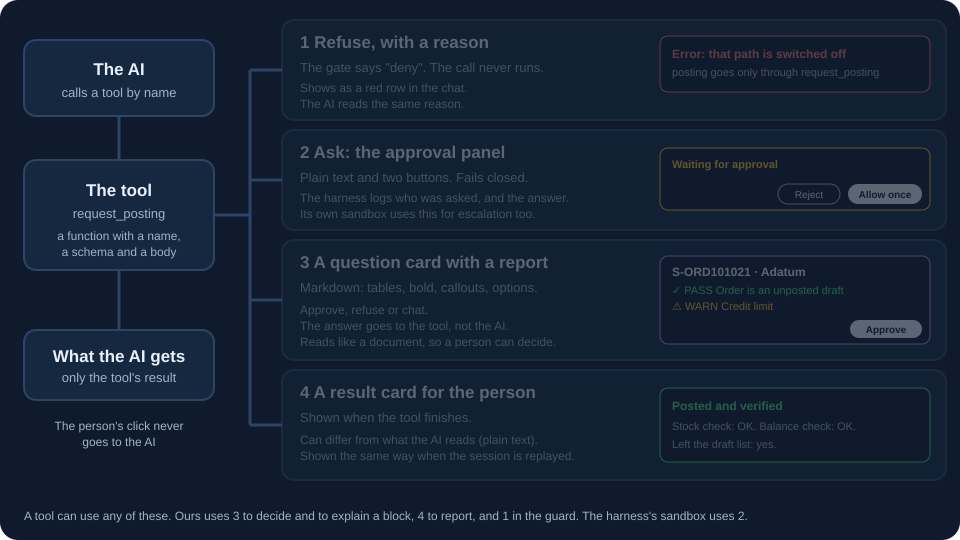
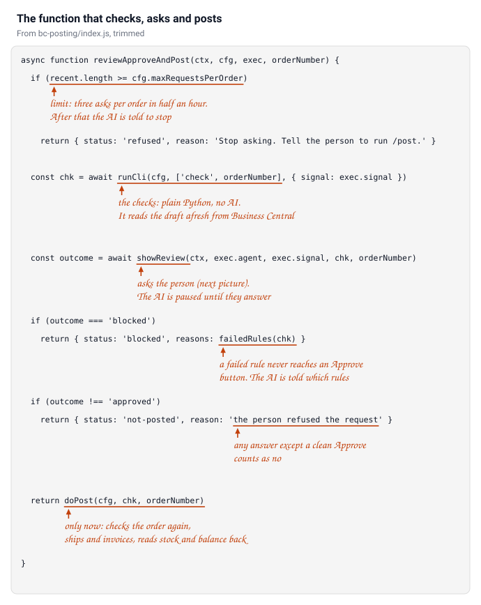
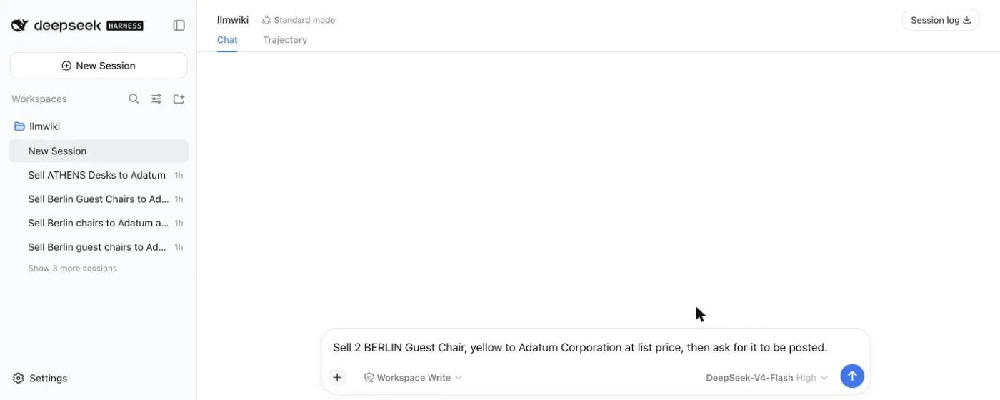
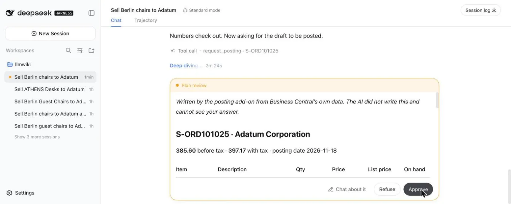

# request_posting: how it is built

So far the AI can read, look things up and make drafts. It cannot post. That is on purpose, but a draft that nobody can post is only half a job. This post and the next add one carefully made way to post: a tool called `request_posting`. This post is about how it is built. [Part 7](/posts/bcmcp7/) is about its rules and what it does not do.

:::brain-power
Business Central already has a tool that posts a sales order (the **Ship and Invoice** action, which you can switch on with **Allow Actions**). Why not simply switch that on in the Assistant configuration and be done?
:::

## Why a tool of my own

Because a posting tool that is simply switched on has nothing in front of it. The AI would call it and the order would be posted. No question to a person, no rules, and no record of why. Posting also cannot be undone from the AI's side.

So I want three things in front of the action: the company's rules checked in plain code, a person who reads the facts and decides, and the AI never holding the means to post. A tool that I write can do all three, and Business Central's own tool cannot.

## The map

## The second configuration

The add-on needs the Ship and Invoice action, and the AI must not have it. So there is a second configuration, **Posting**, which only the add-on connects to. The harness profile from Part 2 names only `Assistant`.

MCP is not the only way to do this. The add-on could have called Business Central's regular web API directly, over plain HTTPS, to ship and invoice the order. It could do that as the current user (a delegated sign-in, so the posting carries that person's name) or as an app with its own registration and credentials (so the posting carries the app's identity). I used MCP because the connection and the idea of a configuration were already in place, so one more configuration was the shortest route. Only the second kind, with credentials that the AI's account cannot read, would separate the add-on from the AI more strongly (see the watch-it box below). I have not built that version.

I built it the same way as Part 1, so here are only the differences:

- **Copy** the Assistant configuration, and give the copy the name `Posting`.
- Leave **Active** off while editing.
- On **Sales Orders (30028)**, untick Create and Modify and tick **Allow Actions**. On every other page, Read only.
- **Validate**, then switch **Active** on.

:::watch-it Two names, one sign-in
Posting is a *different configuration name* on the *same Microsoft sign-in* that the harness uses. That hides the posting tool from the AI's tool list. It does not hide it from my computer, because the sign-in is stored there. A real separation would use a separate Business Central user, with a sign-in the AI's account cannot read. I have not built that, and Part 7 says more.
:::

## A tool is a function with a name

The harness lets a plugin register a tool. A tool has a name, a description the AI reads, the arguments the AI may send, and a body that runs. Here is the registration, shortened. The notes in the picture are mine.

What the model is shown is small: a name (`request_posting`), a sentence about what it is for, and **one argument, an order number**. The model cannot choose the amount, the date or the customer. All it can do is ask.

## Four ways to reach the person

A tool can talk to the person through the harness's own screens. There are four, and a tool can use any of them.

1. **Refuse, with a reason.** The call never runs, and the AI reads the same reason.
2. **Ask with the approval panel.** Plain text and two buttons.
3. **Ask with a question card.** A written report, with Approve, Refuse or "Chat about it". The answer goes to the tool, and not to the AI.
4. **Show a result card** when the tool finishes. It can differ from what the AI reads.

My tool uses the question card to decide and to explain a block, the result card to report, and the first one for a guard (Part 7). The harness's own sandbox uses the approval panel for escalation. For posting I use the review card, because it reads like a document and not a sentence.

## One function: check, ask, post

This is the heart of it. The tool's body is one function that does three things in order, and nothing can skip a step, because there is no other way in.

1. **Check.** It runs a small Python helper that reads the draft *afresh* from Business Central and applies the company's rules. That is plain code, with no AI.
2. **Ask.** It opens the review card and waits. The AI is paused until the person answers.
3. **Post.** Only after a clean Approve, it checks the order again (it may have changed) and posts through the Posting configuration. Then it reads the stock and the customer's balance back to see that they moved by the right amounts.

If a rule fails, there is no card with an Approve button at all. The AI is told which rules failed.

## Prompt E

Now the same request as before, with a second sentence. I ask it to make the order *and* to ask for it to be posted.

> Sell 2 BERLIN Guest Chair, yellow to Adatum Corporation at list price, then ask for it to be posted.

The AI follows the SOP from Part 4. It finds the existing drafts for the same chairs and asks what to do. I chose to use the one with the delivery date (S-ORD101023) and not make a fourth. It then checked the order, said "Requesting posting on S-ORD101023 now", and called the tool:

The card in that screenshot was not written by the AI. It says so at the top: "Written by the posting add-on from Business Central's own data. The AI did not write this and cannot see your answer." [Part 7](/posts/bcmcp7/) goes through that card, one row at a time.

:::no-dumb-questions
**Q: Why does the AI send only an order number?**
A: Because every other detail comes from Business Central. If the AI could send a total, the card might show the AI's numbers instead of the company's.

**Q: Why ask and post in one function?**
A: So that nothing can post without having asked. If asking and posting were two tools, the AI could skip straight to the second.

**Q: Why a plugin, and not a prompt that says "always ask first"?**
A: A prompt is a request. A function that cannot post until a person answers is a mechanism.
:::

:::fireside-chat Ship and Invoice and the add-on
*Tonight's talk: an action that does what it is told, and a tool that decides what it is told.*

**Ship and Invoice:** I post a sales order. I do not ask questions.

**The add-on:** That is why you live in the Posting configuration, and the AI never meets you.

**Ship and Invoice:** I do whatever I am told.

**The add-on:** So someone has to decide what you are told. A person, after the rules have been checked.
:::

:::bullet-points What to take from this
- The Ship and Invoice action goes in a separate configuration (Posting) that only the add-on uses.
- The AI sees one tool with one argument. The body is one function: check, ask, post.
- The person's answer goes to the function, not to the AI.
- Two names on one sign-in is not a security wall. Part 7 is honest about that.
:::

Next: [Part 7](/posts/bcmcp7/) goes through the card, the rules, and what happens when a rule fails.
