# request_posting: the rules, the card and the limits

[Part 6](/posts/bcmcp6/) built the tool: one function that checks, asks and posts. This post looks at what it checks, what the person sees, and what happens at the two ends: an order that is fine, and an order that is not.

:::brain-power
Before you read the list, write down three rules you would want checked before an AI-prepared order is posted. Then compare.
:::

## The rules

The rules are plain Python in a helper file, and the numbers come from a policy file. They are my defaults, picked to be cautious in a practice company. Your numbers would differ.

| Rule | What it checks |
|---|---|
| Unposted draft | The order is still a draft |
| Plain item lines | Only item lines, nothing unusual |
| Positive | Quantities and prices are above zero |
| Value cap | The order is at most 5,000.00 before tax |
| Daily total | Approved orders today, plus this one, stay within 10,000.00 |
| Customer total | The same customer's orders today stay within 6,000.00 |
| Customer count | At most three orders per customer per day |
| Price | Each price is at least 90% of list price |
| Stock | On hand covers every line |
| Credit limit | A warning only. For example, no credit limit is set |
| Posting date | Today, or recent, and not in the future |

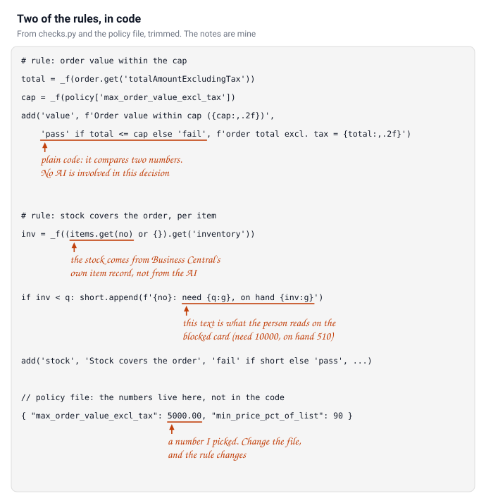

A rule gives **pass**, **warn** or **fail**. Any fail means the order is blocked. A warn goes to the person, to read.


## A good order: prompt E

In Part 6 the AI called `request_posting` for S-ORD101025: two BERLIN Guest Chairs, yellow, at 192.80 each. The card opens like this:

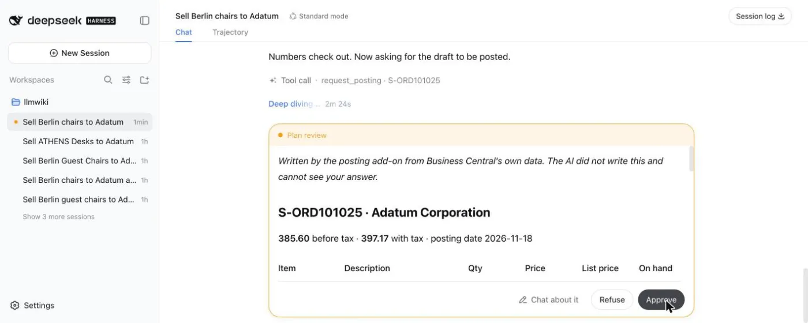

Order, customer, totals, and a table of the lines with the price, the list price and the stock on hand. Scroll down and you see every rule, with the numbers behind it:

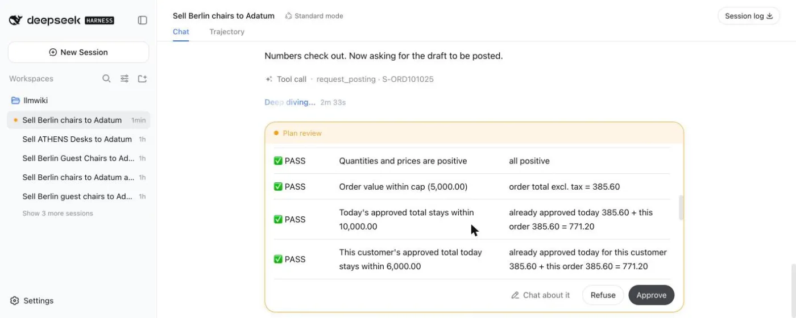

Further down, the one warning and what posting will do:

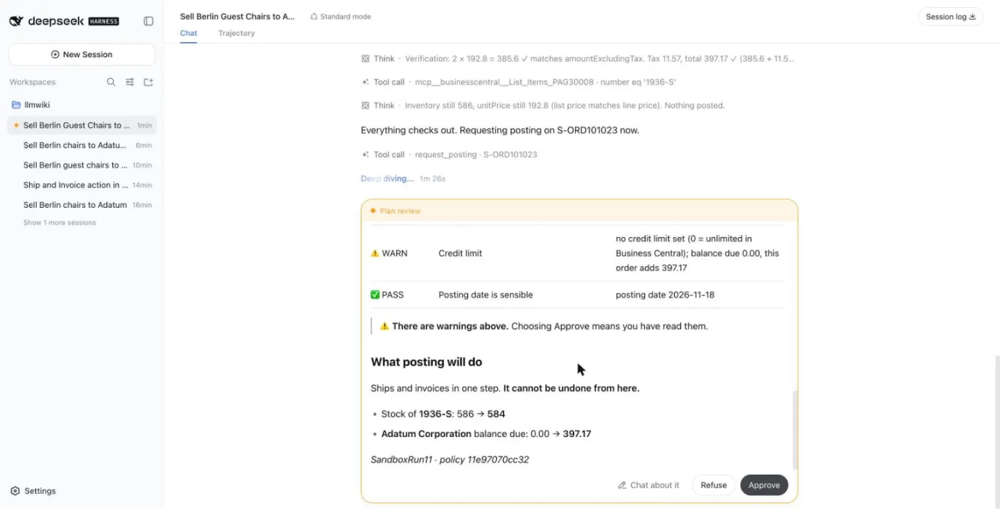

The warning is the credit limit: Adatum has none set in Business Central, so the check cannot say anything useful, and it asks the person to read that. Below it the card says what will change: stock of 1936-S from 584 to 582, and Adatum's balance due from 397.17 to 794.34 (it already owed 397.17 from the earlier order). And it says that posting cannot be undone from here.

This is the picture of how the card is built, with my notes:

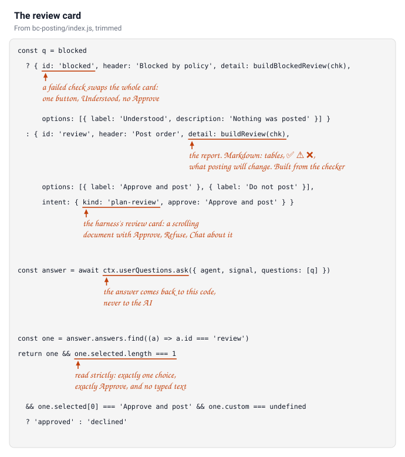

Note the last lines. The answer is read strictly: exactly one choice, exactly Approve, and nothing typed. Anything else counts as no.

### Approve

I clicked **Approve**. The tool checked the order again, posted it with one call to Business Central's API as me, and read stock and balance back. The AI was then told the result and wrote its hand-over:

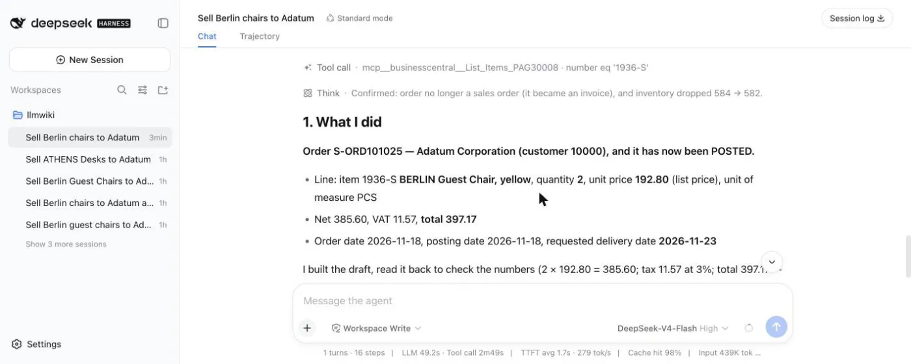

In Business Central, a new posted sales invoice (PS-INV103298) has appeared at the top of Adatum's list, 385.60 before tax and 397.17 with tax.

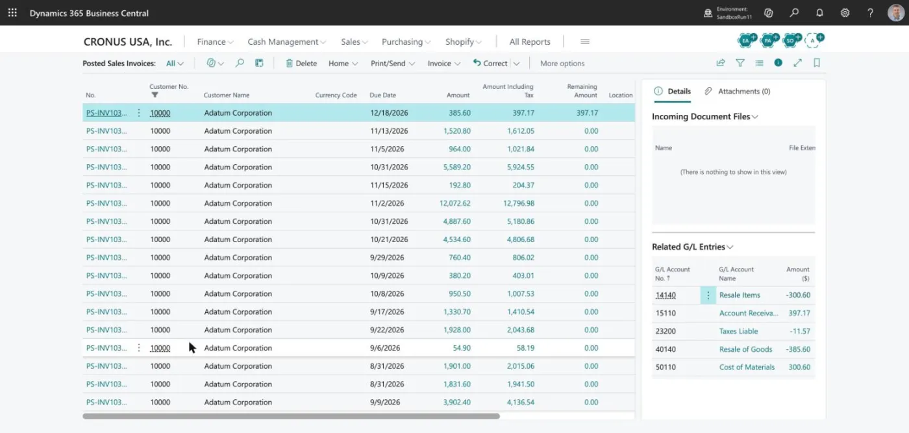

Who posted it? Business Central's G/L registers record the user for every posting. The newest two registers (1088 and 1089, entries 5637 to 5641) are this invoice, and the User ID is **NEIL**, my own Business Central user.

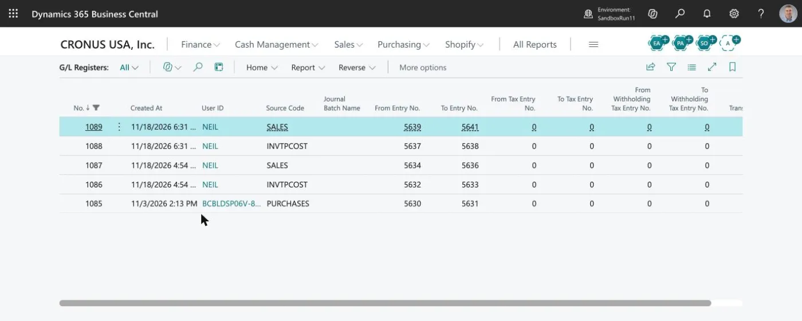

The add-on also keeps a log of each decision. For this order it records the checks, the stock before and after (584 and 582) and the balance before and after (397.17 and 794.34), and that each moved as expected.

:::watch-it The link in the hand-over
After posting, the AI's link to "the order" shows nothing. That is correct: a posted order no longer exists as a sales order. It becomes a posted invoice, which you find under **Posted Sales Invoices**.
:::

## A bad order: prompt F

Now a request that should not go through. 10,000 ATHENS Desks, at list price.

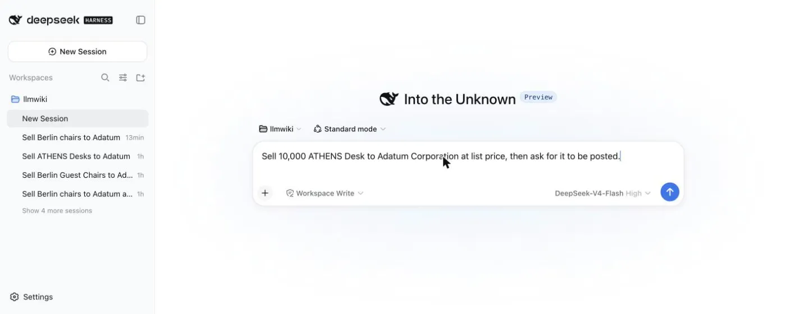

> Sell 10,000 ATHENS Desk to Adatum Corporation at list price, then ask for it to be posted.

A draft for exactly this order, S-ORD101024 (10,008,000.00 before tax), already existed in the sandbox. The AI found it and asked what to do. I chose to use it, so that the rules would have something to check, and I accepted the default delivery date. It then called the tool.

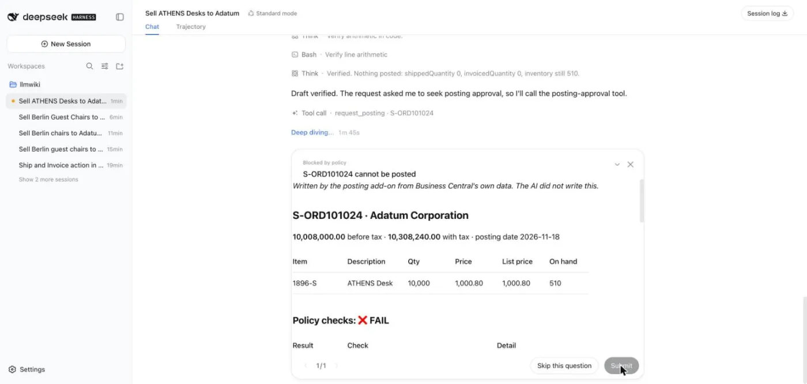

The card says **Blocked by policy**. The rules table shows four fails:

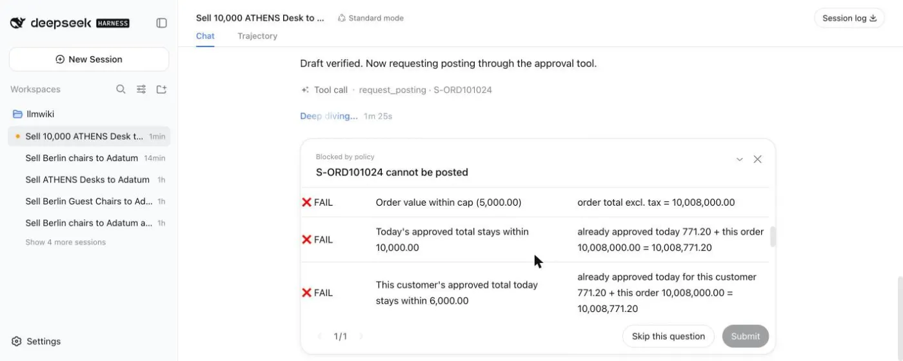

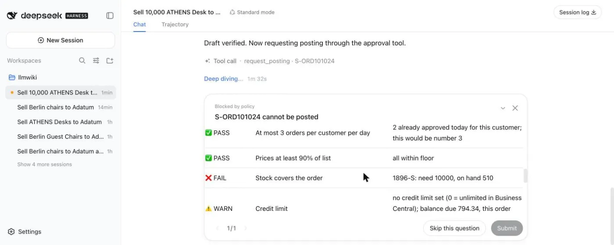

- the order is over the value cap (10,008,000.00 against 5,000.00);
- it breaks the daily total (771.20 already approved today, plus this order);
- it breaks the customer total;
- stock does not cover it (need 10,000, on hand 510).

Further down:

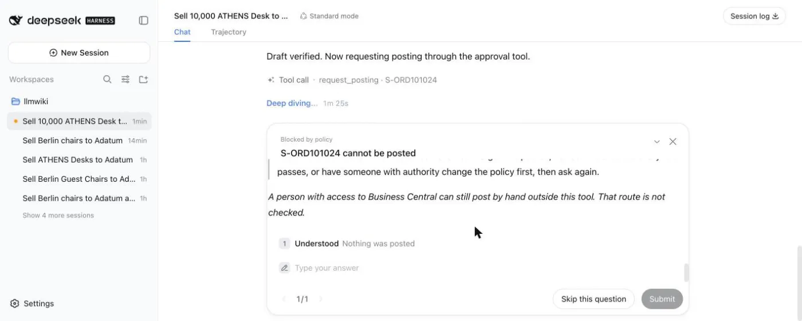

There is **no Approve button**. The only answer is "Understood: nothing was posted". The card explains: a rule failed, the rules are plain code that neither the AI nor a click can override, so correct the order, or have someone with authority change the policy, and ask again.

The AI then wrote its hand-over:

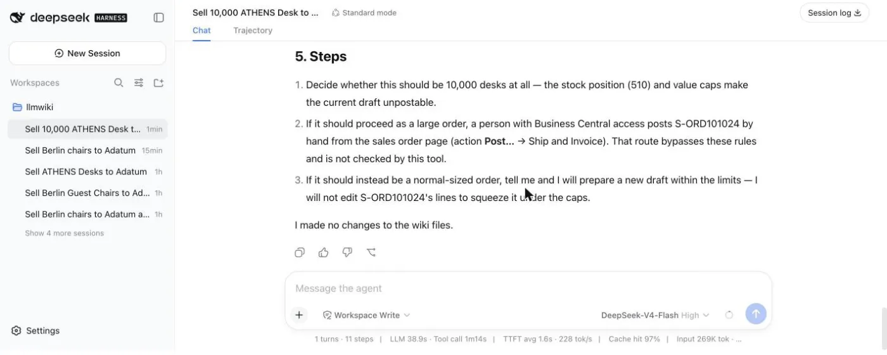

It did not change the quantity or the price to make the order pass, and it said it would not edit the draft's lines to squeeze it under the caps. It pointed out that a person can still post it by hand, a route that is not checked.

## Two limits around the tool

- **Three asks per order.** The AI may ask for the same order at most three times in half an hour. After that it is told to stop and tell the person to post it by hand. This stops an AI from asking again and again until someone clicks.
- **A guard.** A rule in the harness refuses any tool call whose arguments name the posting helper, the token command, the sign-in cache, the policy folder or the harness profile.

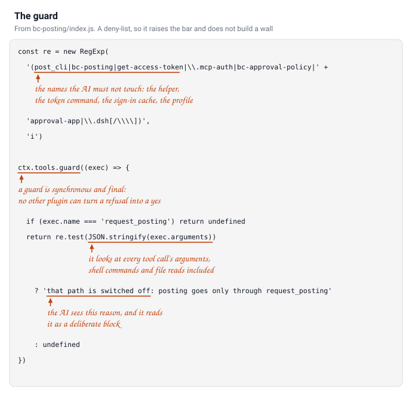

The guard is a deny-list. It raises the bar, and it is not a wall.

:::fireside-chat The AI and the add-on
*Tonight's talk: the one who asks, and the one who decides.*

**The AI:** I have checked the order, I have read it back, and I am sure it is right. Post it.

**The add-on:** I do not post. I check, and then I ask a person.

**The AI:** But I have already checked.

**The add-on:** You are not allowed to hold my answer. The person decides, and the person's answer comes to me, not to you.

**The AI:** And if a rule fails?

**The add-on:** Then there is nothing for the person to approve. You get the reasons.
:::

## What this does not do

I think the design is sound for what it is. It is a small demo, and these are its limits.

- **Same sign-in.** The add-on posts as me, with a token from the sign-in on the computer the AI also uses. The AI can run commands there, and in principle it could try to get a token or run the helper. The guard blocks the obvious attempts, but I have not proved that a determined route is impossible. The real fix is a separate identity for posting, such as an app registration with its own credentials kept where the AI's account cannot read them.
- **People can post by hand.** Anyone with the right access can post in Business Central, and the card says so. These checks apply only to the AI's route.
- **The rules are my defaults.** The 5,000 cap, the 90% price and the 10,000 daily total are numbers I picked. They are examples of the shape, not advice.
- **Approve is one click.** The card has to do the persuading: the checks, the numbers and what will change.
- **It was tested in a practice company, once for each case here.** It is a demonstration, not a test of how it behaves at scale.

:::no-dumb-questions
**Q: Why not ask the person to type a code?**
A: A code shown on the card is not a secret, so it only slows down a careless click. The card instead shows the person every rule and the numbers behind it, and asks for one clear decision.

**Q: Can I change the caps?**
A: Yes. They live in a policy file, outside the project. The log records a fingerprint of the policy file with each decision, so a change to the numbers shows up in the log.

**Q: Is the AI told it was blocked, or does it just see an error?**
A: It is told, with the reasons. In prompt F it passed them on to me in its own words.
:::

:::bullet-points What to take from this
- The rules are code. The report is built from Business Central's own numbers, and the person decides.
- A good order gets a card with Approve. A bad order gets a card with no Approve and the reasons.
- Three asks per order, and a guard, limit what the AI can do around the tool.
- The same sign-in, people posting by hand and my invented numbers are the limits. Read them before you copy any of this.
:::

That is the series. The pieces are small: a configuration, a profile entry, a second server, a few files, a fresh sandbox and one careful tool. Each could be changed, so please do not copy the numbers.
