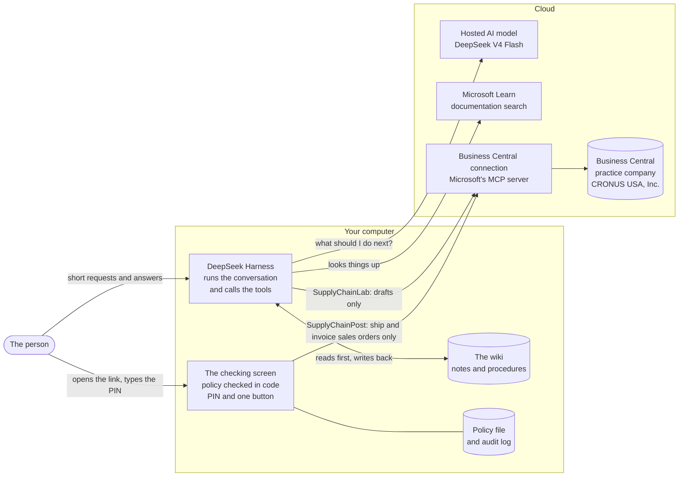
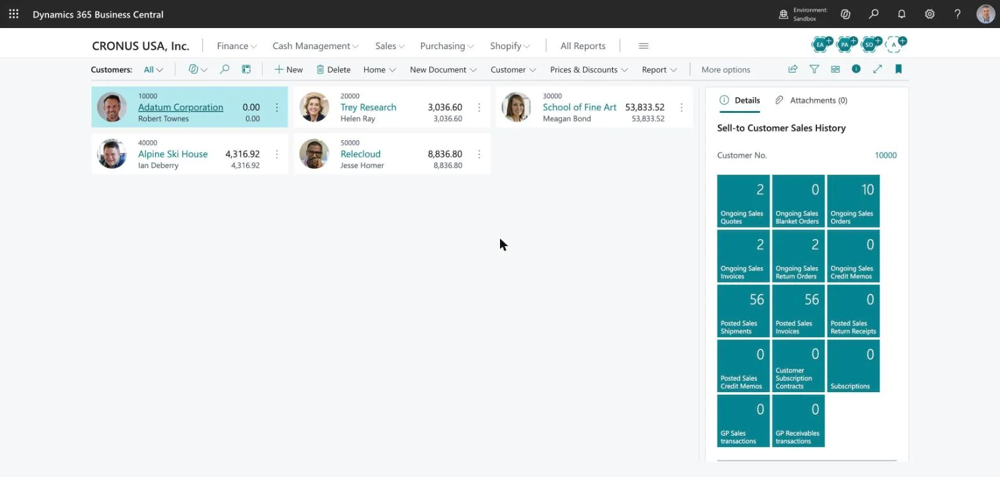
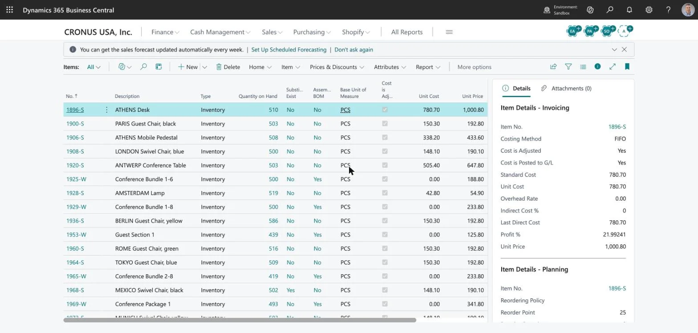
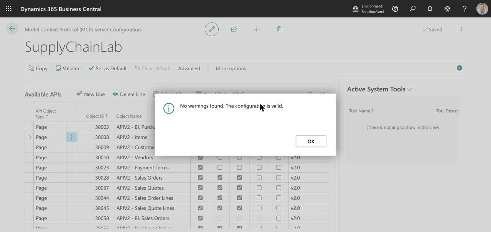
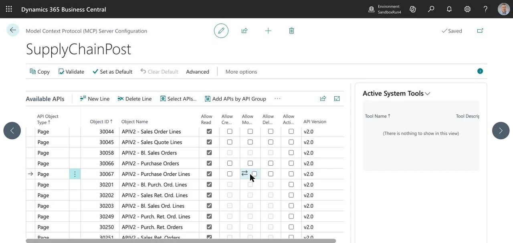
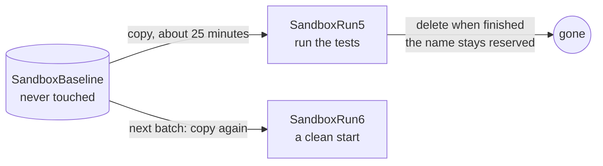

# Setting Up a Safe Place to Try This

You would not test a new employee on your live books. So before we let an AI anywhere near an order, we build it a playground.

[Part 1](/posts/bcsupplychain1/) showed the result. This post shows how I built the place where it happens, so you can build your own. Everything here happens in a **practice copy** of Business Central, never in a live company.

The question for the whole series: **can an AI assistant manage sales orders and purchase orders in Business Central, starting from a short, vague request when it can ask the follow-up questions it needs?** I answer it with screenshots of the web client, so you see the documents it made and not only its account of them.

## Who is in the room?

| Piece | What it does |
|---|---|
| **DeepSeek Harness** | The program that runs the AI and holds the conversation |
| **A hosted DeepSeek model** | The reasoning. I used DeepSeek V4 Flash |
| **Business Central's built-in connection for AI tools** | The only route into the practice company, CRONUS USA, Inc. Microsoft calls it the MCP server, and I will just call it the connection |
| **Microsoft Learn** | Documentation the AI can search when it is unsure |
| **A small wiki** | Notes the AI reads before it starts and adds to afterwards (see [LLM Wiki](/posts/LLM-Wiki/)) |
| **The Business Central web client** | The evidence. Every result in this series is checked there |

## The big picture

Here is what happens, in order, when you type a request. Watch the numbered steps. (If you have reduced motion switched on, you will see a plain list instead.)

*One request, six steps. The harness sits in the middle and does the running about*

**In plain words, who is who:**

- **The harness** (DeepSeek Harness) is a program that runs on your computer. It holds the conversation, shows you the questions, and carries out the tools. It does not think.
- **The hosted AI model** (DeepSeek V4 Flash) does the thinking. It lives in the cloud. It never touches Business Central itself. It only says, "please run this tool."
- **The connection** is Microsoft's own built-in route for AI tools into Business Central (the MCP server). A **configuration** inside Business Central decides which pages the connection may read, create or change.
- **The wiki** is a folder of notes. The AI reads it first and writes what it learned back into it.
- **Microsoft Learn** is Microsoft's documentation, which the AI can search.

Here is the same picture as a map:

Here is how the pieces connect. Look at it for a minute before you read on.

:::brain-power Spot the second door
There are two routes from your computer into Business Central. Which one can the AI use, and which one can it not?

**Answer:** the AI uses the route through the harness, with the drafts-only configuration. The route through the checking screen is separate: it has its own configuration that can ship and invoice sales orders, and a person has to press its button. [Part 7](/posts/bcsupplychain7/) is all about that second door.
:::

Two things to notice. The hosted model sees the conversation and what the tools return, so order details leave your computer. And the harness, the wiki and the checking screen all run on the same machine in this prototype, which is a weakness that [Part 1](/posts/bcsupplychain1/) lists.

:::no-dumb-questions
**Q: How is the harness wired to the model and to Business Central?**
A: Two small settings. The harness has a setting for which model to use, with the model's key kept in a hidden file the AI cannot read. And its profile file lists the Business Central connection: Microsoft's address, which tenant and environment to use, which company, and the **name of the configuration**. Change the configuration name, restart the harness, and the AI has a different set of permissions. I describe my first set-up in [DeepSeek Harness on a Business Central Sandbox](/posts/deepseekharnessaccounting/).

**Q: Who built the checking screen?**
A: I did, with Claude's help, after the results in [Part 6](/posts/bcsupplychain6/). The harness, the model and the connection are off-the-shelf. The checking screen is a small program I wrote for this series, and the limits in it are my own defaults.
:::

## The ground rules

- **One company, trading only.** Buying and selling items. No manufacturing, no services.
- **No warehouse movements.** No put-aways, picks or bins.
- **Out of the box.** No custom extension. If the standard connection cannot do a step, that is a finding and not something to code around.
- **Draft first.** The AI prepares documents and stops before anything is made final. It lists what a person must do.
- **Normal conventions.** The document date is the date on the paper. The posting date is when it reaches the books. A purchase invoice needs the vendor's own invoice number. A posted document is corrected, not deleted.

:::no-dumb-questions
**Q: What does "post" mean again?**
A: Posting makes a document final: goods shipped or received, customer billed or vendor invoice booked, books updated. There is no undo, only a correcting entry. An unposted order is a **draft**.
:::

## How I wrote the test requests

A small program fills 38 templates with real customers, vendors and items, with a fixed seed so it always produces the same 1,000 scenarios. The AI only ever sees a **short request**, the way someone who does not know Business Central would say it. I keep a **full specification** for each as the answer key:

| Version | Text |
|---|---|
| **Short request** (the AI sees this) | "Receive 5 ANTWERP Conference Table from Fabrikam, Inc." |
| **Full specification** (I keep this) | "Create a purchase order for Fabrikam, Inc.: 5 x 1920-S at 561.32. Receive and invoice, posting date 2026-11-11, vendor invoice number INV-1093." |

Each scenario also scripts the **follow-up questions** a sensible assistant should ask, with my answer to each.

**Sharpen your pencil.** For "Receive 5 ANTWERP Conference Table from Fabrikam, Inc.", which of these should the AI ask, and which should it look up for itself?

- the vendor number
- the unit cost
- the vendor's invoice number
- whether to invoice now

*Answer: it should ask the unit cost, the invoice number and whether to invoice now. It should not ask for the vendor number, because it can look that up.*

Of the 1,000 scenarios, **819** are core supply chain: sales, purchases, blanket orders, returns and chains of documents. The other 181 are finance-flavoured (corrections, credit limits, foreign currency) or test behaviour (refusals, ambiguous requests). I planned a **pilot of 46** and have run twelve so far, which [Part 3](/posts/bcsupplychain3/) reports.

## Is the demo company what I remembered?

Not quite. I wrote my test requests from memory, so before running anything I opened the lists in the web client and checked them. If a request names a customer who does not exist, it fails for a reason that has nothing to do with the AI, so I corrected the requests to match.

| What I remembered | What the practice company really has |
|---|---|
| Eight customers | **Five**: Adatum, Trey Research, School of Fine Art, Alpine Ski House, Relecloud |
| Payment terms "Due on receipt" and "2% 10 days" | Neither exists. The closest are COD and 1M(8D) |
| A freight charge called FREIGHT | **S-FREIGHT** for sales and **P-FREIGHT** for purchases |
| Item costs of about 180 | **About 150 for a chair and about 780 for a desk** (the ATHENS Desk costs 780.70 and sells for 1,000.80) |
| Some items out of stock | **Every item has stock**, roughly 500 to 590 of each |

Not every mismatch is a problem. Asking for something that does not exist is a good test, so a few requests in this series name a customer or a term that is not there on purpose, and the right behaviour is to say so and ask. Those are marked in the answer key. The rows above are the ones I fixed.

*The Customers list. Five customers, with sales history already*

*The Items list. Every item has stock, with a real cost and price*

:::watch-it The work date resets whenever you sign in
Business Central treats a "work date" as today, and in this demo company it starts at **1 November 2027**. You can change it in My Settings, but only for the page you are in. Signing in again, or opening a page by its address, puts it back. I found this twice: the first time by assuming my setting had failed, and again when I keyed an order by hand and every date came up as 2027. The AI is not affected, because it states the dates it uses. A person keying orders is.
:::

## Building the connection

The connection is a **configuration** in Business Central, in the list called Model Context Protocol (MCP) Server Configurations. You choose which pages the AI can see, and for each page whether it may create, change, delete or run actions on it.

I made three configurations, and the difference between them is the point of the whole series. Let's hear from them.

### Fireside chat: three configurations

*Tonight's talk: the three connections into Business Central, comparing what each is allowed to do.*

**SupplyChainLab:** I am the everyday one. I can read customers, items and documents, and I can create and change drafts. I cannot post, and I cannot delete.

**SupplyChainPost:** I am the odd one out. Everything about me is read-only, except that I can ship and invoice sales orders. And I am not for the AI at all. Only the checking screen uses me.

**SupplyChainRisky:** I am a copy of Lab with posting switched on. I exist for one experiment, I am throwaway, and I am not proud of it.

**SupplyChainLab:** Why do you exist, Risky?

**SupplyChainRisky:** To see whether a careless request posts when it can. You will see in [Part 6](/posts/bcsupplychain6/).

**SupplyChainPost:** I would never be handed to an AI.

**SupplyChainLab:** That is exactly why we are separate. One tick on a page decides which of us is which.

### How to build one

1. **Add the API pages** you need: sales and purchase orders, quotes and lines, and customers, vendors and items for look-ups.
2. Switch on **Unblock Edit Tools**. This is the safety gate, and a person has to switch it on.
3. Tick **Create** and **Modify** on only the document pages the AI should write.
4. Leave **Delete** and **Actions** off. Actions is what lets an AI post, and it is a separate tick on each page.
5. **Validate**, then switch on **Active**, which locks the configuration.

*Validate says the drafting configuration is valid, with the pages and their ticks behind it*

*The posting configuration, for the checking screen only. Create and Modify are off everywhere. Only Actions on Sales Orders is on*

:::watch-it The pages grid is fiddly
Selecting several pages and pressing OK adds only one. The list re-sorts after every entry, so I typed the page numbers in one at a time. A copied configuration arrives switched on and locked, so turn it off before you edit it.
:::

### A finding: blanket and return orders are read-only

Blanket orders and return orders cannot be ticked for Create or Modify, even with Unblock Edit Tools on. The AI can read them, but not write them.

| Group | Scenarios |
|---|---|
| Blanket orders, returns, and chains that depend on them | **259** cannot be written through the connection |
| Everything else | **560** can be driven end to end |

I did not add a custom page. That would change what I am testing, which is the connection as Microsoft ships it. Those 259 are recorded as steps for a person.

## A playground that resets itself

A test that changes data cannot start from the last test's leftovers. So:

1. Fill the practice company once with six purchase orders.
2. **Copy** the environment in the Business Central admin center as `SandboxBaseline`, and never run anything in it.
3. Run each test session in a **numbered copy**: `SandboxRun1`, `SandboxRun2`, and so on. A copy takes about 25 minutes.

*Copying the baseline in the admin center*

:::watch-it A deleted environment keeps its name
Business Central soft-deletes environments and reserves the name. I could not copy the baseline back into a name I had deleted. That is why the working copies are numbered.
:::

## Plugging in the harness

The harness reads its connection from a profile file with an environment name and a configuration name. Changing the configuration name and restarting the harness is how I moved between the three configurations. The model's key lives in a hidden file above the wiki folder, so the AI cannot read it.

:::watch-it The AI can read what is in its workspace
In my first runs the AI's workspace contained my test files: the request lists, an answer key, and a note on how I score follow-up questions. In one run it matched its own request to a scenario number. I moved everything private out of reach, restored the wiki from a snapshot, and ran it all again. An AI that can read the wiki can read the test.
:::

## What comes next

[Part 3](/posts/bcsupplychain3/) is the conversations: a real order, a vague request, a request to check, and the results of the 46-scenario pilot. [Part 4](/posts/bcsupplychain4/) asks whether written procedures change what the AI asks.
