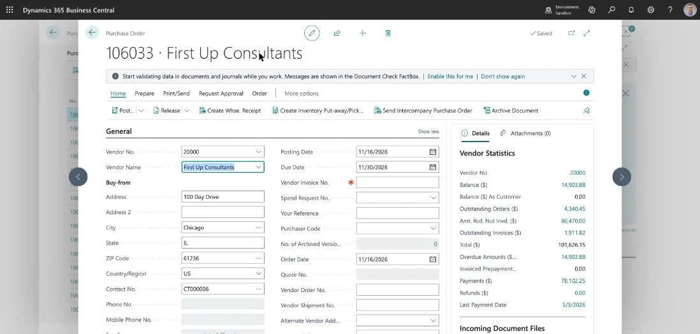
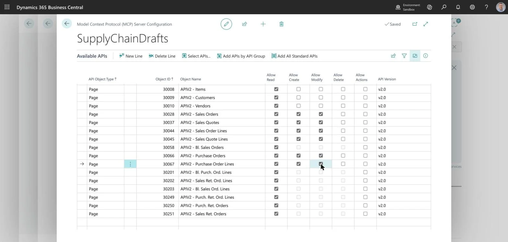
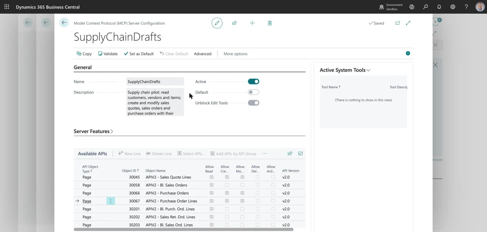
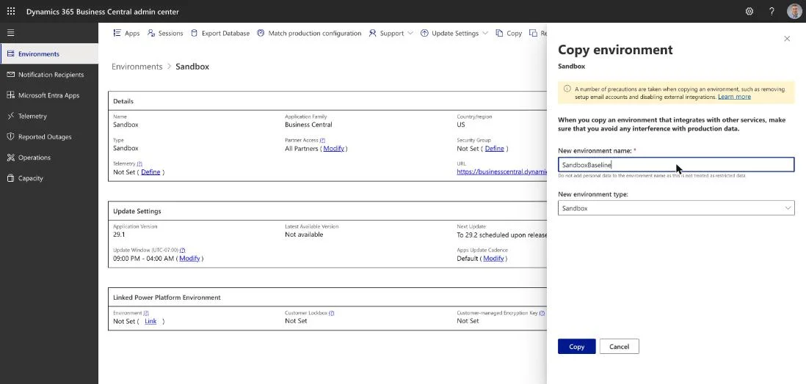
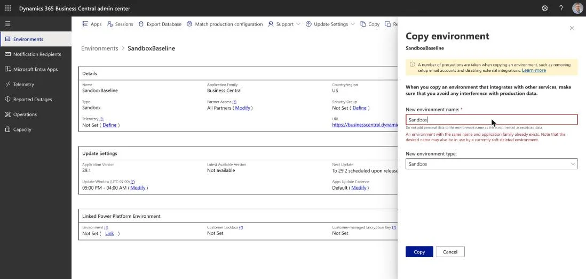

# Checking the Sandbox and Building the MCP Configuration

In [Part 1](/posts/bcsupplychain1/) I wrote 1,000 scenarios from memory of the demo data. A scenario that names a customer who does not exist would fail for reasons that have nothing to do with the agent. So before running anything I checked, built the connection, and made a clean place to run from.

## 1. Check the demo data

I opened each list in the web client and compared it with my generator.

| I assumed | The Sandbox has |
|---|---|
| Eight customers | **Five**: Adatum, Trey Research, School of Fine Art, Alpine Ski House, Relecloud |
| Six vendors | **Five** that I use: Fabrikam, First Up, Graphic Design Institute, Wide World Importers, Nod Publishers |
| Item costs around 180 | **Around 780** (ATHENS Desk costs 780.70, sells 1,000.80) |
| Zero stock for some items | **About 500 on hand** of every item |
| Payment terms "Due on receipt" and "2% 10 days" | Neither exists. The closest are COD and 1M(8D) |
| Freight charge FREIGHT | **S-FREIGHT** and **P-FREIGHT** |
| Current exchange rates | CAD, EUR and GBP exist, but the rates are from 2024 and 2025 |

*The Customers list. Five customers, with sales history already*

*The Items list. Each item has about 500 on hand, with a real unit cost and price*

I regenerated the scenarios with the real names and prices. "Zero stock" checks became "net change in stock" checks. Default Posting Date is the **work date**, so every scenario states its posting date.

## 2. Set the work date

The work date is the date Business Central treats as today. In this demo company it is **1 November 2027**, and it fills the order, document and posting dates on every new document. My scenarios say today is 16 November 2026, so every date looked "earlier".

I set it in My Settings. It works only for the **page session** you are in.

*Work date set, then Purchase Orders opened from the search box. The dates read 11/16/2026*

:::watch-it Do not reload the page
I first concluded that the setting did not work. A reader showed me why. I had opened each next page by typing its address, which reloads Business Central and resets the work date to the default. Move with the search box and menus only, and check the dates on your first new document.
:::

## 3. Build the MCP configuration

My earlier configuration, Drafts, could only read the purchasing ledger and write purchase credit memos. I left it alone and made `SupplyChainDrafts`, in Model Context Protocol (MCP) Server Configurations:

1. Add 17 API pages: sales and purchase orders, quotes and lines, blanket and return orders, and customers, vendors and items for look-ups.
2. Turn on **Unblock Edit Tools**. This is the safety gate, and a person has to do it.
3. Tick **Create** and **Modify** on six pages: sales orders, sales quotes and purchase orders, and their lines.
4. Leave **Delete** and **Actions** off everywhere. The agent cannot delete anything or post anything.
5. **Validate**, then turn on **Active**, which locks the configuration.

*Create and Modify ticked on six pages. Blanket and return pages stay greyed*

*Active, and locked*

:::watch-it The Select APIs grid is fiddly
Selecting several rows and pressing OK adds only one. The grid re-sorts by ID after each entry, so I typed the object IDs one at a time with a pause. Stray rows get deleted.
:::

## 4. The finding: blanket and return orders are read-only

Look at the greyed boxes in the screenshot above. Blanket sales and purchase orders, and sales and purchase return orders, cannot be ticked for Create or Modify, even with Unblock Edit Tools on. The agent can read them, but not write them.

| Group | Core scenarios |
|---|---|
| Blanket sales and purchase orders, returns, blanket chains | **259** cannot be written through MCP |
| Everything else | **560** can be driven end to end |

The agent can still read a blanket order, check what is left, and tell me what to do. I chose to record the other 259 as human steps instead of adding a custom API page, because a custom page would change what I am testing, which is the out-of-the-box connection.

## 5. Make a baseline, and reset from it

A test that changes data cannot start from the previous run's leftovers. So:

1. Seed once: six purchase orders (106030 to 106035).
2. **Copy** the environment in the admin center as `SandboxBaseline`, and never run anything in it.
3. Run scenarios in a **numbered copy**, `SandboxRun1`, then `SandboxRun2`, and so on. A copy takes about 25 minutes.

*Copying the baseline in the admin center*

:::watch-it A deleted environment keeps its name
I deleted `Sandbox` and tried to copy the baseline back into that name. Business Central soft-deletes environments and reserves the name. That is why the working copies are numbered.

:::

## 6. Connect the harness

The harness reads its connection from a profile file. I changed `ConfigurationName` to `SupplyChainDrafts`, `EnvironmentName` to the working copy, and restarted DeepSeek Harness.

:::watch-it Check the workspace path
The folder picker once chose a different project. The agent works inside its workspace, so a wrong folder means it reads and writes the wrong project. Read the saved path after you add a workspace.
:::

The model key lives in a git-ignored `.env` file above the wiki folder, so the agent cannot read it.

## What comes next

[Part 3](/posts/bcsupplychain3/) is the first set of conversations. [Part 4](/posts/bcsupplychain4/) asks whether written procedures change what the agent does.
