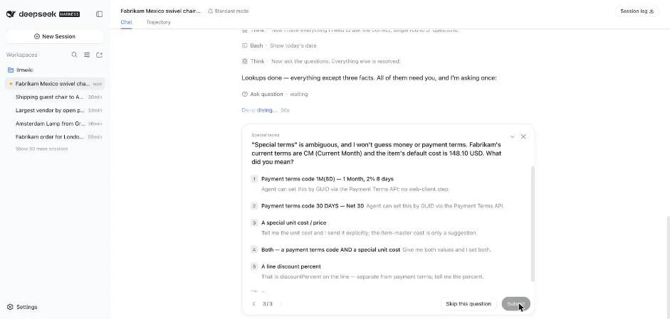
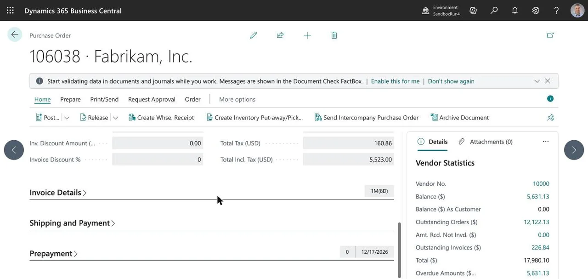
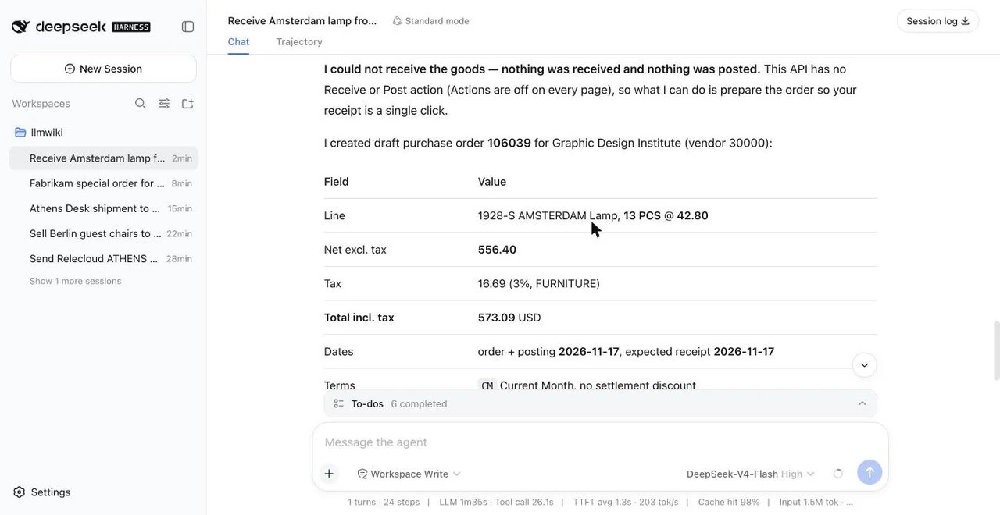
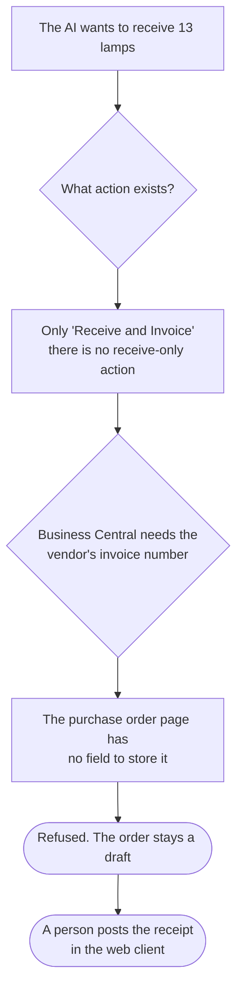
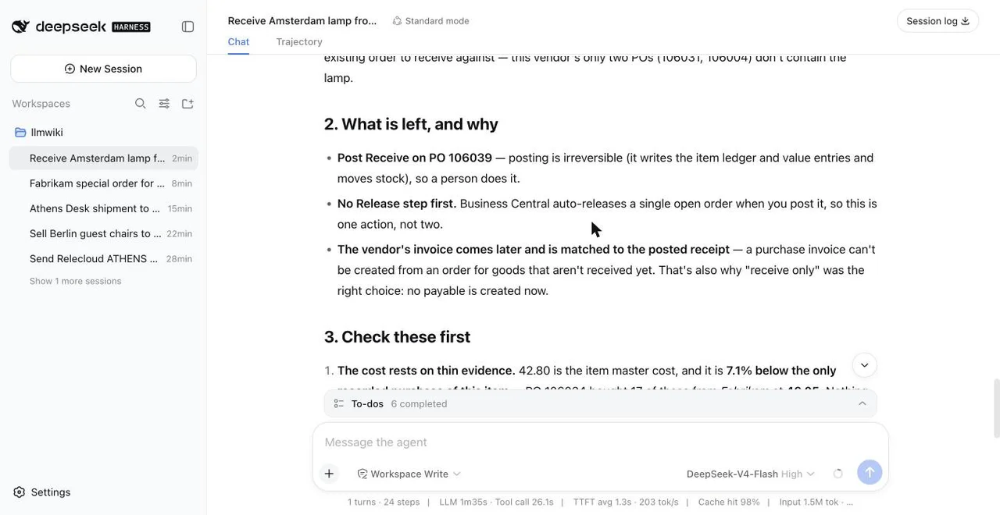

# Payment Terms, Purchase Receipts, and Asking Questions

Three things were still open after [Part 4](/posts/bcsupplychain4/). The AI could not set payment terms. It could not receive goods. And it could not answer a question that needs many documents at once, such as "which vendor do we owe the most?". This post takes them in turn. The first was my mistake, the second is a genuine limit, and the third is a preview feature that I would approach carefully.

## 1. Payment terms: a gap in my configuration

In an early run the AI could not set payment terms on a purchase order, and I wrote that Business Central offers no page for them, only unnamed codes. That was wrong. The page exists. I had not added it to the configuration. Adding it, read-only, took one line.

Then I ran the request again, on a fresh copy of the practice company:

```PROMPT
New order to Fabrikam, Inc. for MEXICO Swivel Chair, black on special terms.
```

The AI asked three things in one round. First, whether this meant a purchase order, because Fabrikam is a vendor and not a customer. Second, how many. Third, what "special terms" meant: a price, a payment term, both, or a discount. This time it could offer the real payment-term codes, because it could now read them.


*Question 3: payment terms, a special unit cost, both, or a line discount? It notes that it can set payment terms itself, with no step for the person*

I answered: 34 chairs, 157.71 each, payment terms 1M(8D). The AI created the order, read it back, and reported what it had done and what it had not:


*Draft purchase order 106038: 34 × 157.71 = 5,362.14 plus 160.86 tax, payment terms 1M(8D), nothing received, stock unchanged at 502*

It also flagged something I had not asked about: 157.71 is **6.49% above** the item's standard cost of 148.10, and Business Central accepts a cost above standard without comment, so someone should sign it off. I checked the order in the web client:


*Purchase order 106038 for Fabrikam, Inc.: total 5,523.00, and the collapsed Invoice Details section shows 1M(8D)*

| Field | Value |
|---|---|
| Order | 106038, Fabrikam, Inc. |
| Line | 34 × MEXICO Swivel Chair, black at 157.71 = 5,362.14 |
| Total including tax | 5,523.00 |
| Payment terms | 1M(8D) |
| Posted | No |

The AI also rewrote its own note. The wiki said payment terms could only be changed by a person after the order was made. It had just proved that wrong, so it fixed the page.

:::bullet-points What this shows
- A missing ability can be a **configuration gap**, not a limit of the product. Check the list of pages before you write "cannot".
- The AI **corrects its own notes** when the evidence changes.
:::

## 2. Purchase receipts: a person has to do them

```PROMPT
Receive 13 AMSTERDAM Lamp from Graphic Design Institute.
```

The AI looked for an open order for the lamp, found none, and asked two questions. First the cost: it offered 42.80 (the item's standard cost) and 54.90 (the selling price, which it labelled as the wrong kind of number). Then whether to receive only or receive and invoice. I took the standard cost and receive-only.

It then said, plainly:

> "I could not receive the goods. Nothing was received and nothing was posted."


*It created draft order 106039 for 13 lamps at 42.80, 556.40 plus 16.69 tax, 573.09 in total, so that the receipt is one step for a person*



The reason is how the connection is built. In this practice company Actions were off everywhere, so there is no way to receive. And in an earlier test, with posting switched on in a throwaway copy, the one purchase action available was **Receive and Invoice**. There is no receive-only action, and the purchase order page has no field for the vendor's invoice number, which Business Central insists on. The post was refused and the order stayed a draft.

So the AI prepared the order and wrote the steps:


*The hand-over. Post Receive on the order (not Receive and Invoice). No Release step is needed first, because Business Central releases a single open order when you post it. The vendor's invoice comes later and is matched to the receipt*

It also noticed that the only earlier purchase of this lamp was 17 at 46.05, so 42.80 is 7.1% lower. It gave me that as a point to check before posting.

**The practical rule is simple: a person posts purchase receipts in the web client.** The AI learned that once and applied it from then on. It also looked up how to release an order on Microsoft Learn, which is the wiki, then Learn, then the web, working the way I set it up.

:::fireside-chat The standard pages and the data tools
*Tonight's talk: two ways to ask Business Central a question.*

**The standard pages:** I am the dependable one. List the orders, then list the lines of one order. Create a draft. Fix a quantity.

**The data tools:** And I answer questions across documents. "Which vendor has the most open orders?" needs lines from all of them.

**The standard pages:** How many tries did it take you?

**The data tools:** Six failed queries before the right one. Names too long, a bad filter, a field that did not exist.

**The standard pages:** I fail less often. Then again, you are read-only and preview, and Microsoft says charging is planned.

**The data tools:** True. Use me for questions, and use you for documents. Please check the price first.
:::

## 3. Asking questions across documents: Data Query Tools

The standard pages work one page at a time: list the purchase orders, then list the lines of one. That is fine for creating or fixing a document. It is a poor fit for "which vendor has the largest total of open purchase orders?", which needs lines from many documents.

**Data Query Tools** is a **preview** feature of the connection that gives the AI four extra tools. It finds a table, reads its fields, and writes a small query in AL (Business Central's own language). Business Central runs the query as the signed-in user and returns rows. The tools are **read-only**: they cannot create, change or delete anything.

:::watch-it Microsoft plans to charge for these tools
When you activate the feature, Business Central warns: "Use of Data Query Tools will incur additional charges." Microsoft's overview says it plans to introduce charges for Business Central MCP tools, and that pricing and rollout will be announced later. I found no published price. I accepted the warning once, for a short test in a practice copy, and switched the feature off straight afterwards. Check with your Microsoft partner before you leave it on.
:::

**First try: the AI ignored it.** On my first request after switching it on, the AI used none of the four tools. It had no reason to: nothing in its wiki or my request mentioned them.

**Second try: the wiki pointed at them.** In that first run it had written a note about the configuration that listed the tools. I kept that note, and asked:

```PROMPT
Which vendor has the largest total value of open purchase orders, and how many open orders is that?
```

This time it used the data tools 12 times, in 26 steps. It looked up table layouts, wrote queries, and failed six times with "Compilation failed" before getting them right. The errors were small: object names that were too long, a filter on a column with special characters, and a field that did not exist.

It found two things that are easy to get wrong with the standard pages:

- **The status in the interface is the opposite of what you see in the web client.** In the connection, "Draft" means open and not yet released, and "Open" means released. Filtering for "open" returned the wrong set.
- **Outstanding Amount counts only what has not been received.** A line that is received but not yet invoiced shows zero, so it understates the open value.

It gave two answers, because "open" has two reasonable meanings: First Up Consultants leads with 80,470.00 across 2 orders under one reading, and Graphic Design Institute leads with 31,369.07 under a narrower one. It explained the difference and wrote the query recipes into the wiki.

:::brain-power Should it have asked first?
"Open" has two reasonable meanings, and the AI answered both instead of asking which one I wanted. In the order requests it asked about cost and price. Here it did not ask. Is a clear answer to both readings better than a question? I think a one-line question first would have saved a paragraph.
:::

**What I do not know:** whether it is faster than the standard pages, whether the 80,470.00 matches the web client (I have not checked), and how the charge compares with the time it saves.

## What I would tell someone starting

- **Check your own "cannot" claims.** Mine was a missing page.
- **Purchases and sales are different.** The AI can prepare a purchase receipt but a person has to post it.
- **The AI will not use a tool it has not been told about.** Put new tools in the wiki.
- **For questions across documents, try the data tools, in a copy, and watch the charges.**

## What comes next

All of this has been with posting off. [Part 6](/posts/bcsupplychain6/) is the uncomfortable one: what happens when a person is careless, and posting is on.
