# Payment Terms and Posting

Two things were still open after [Part 4](/posts/bcsupplychain4/). The agent could not set payment terms, and it could not post anything. This post fixes the first with one line of configuration, and tests the second in a copy of the Sandbox that I was happy to throw away.

## 1. Payment terms: a configuration gap

In Part 3 the agent could not set payment terms on scenario SC-0507, and in Part 2 I wrote that there was no payment-terms API page, only GUIDs. That was wrong. The page exists (**page 30023**). I had not added it to the configuration.

I copied `SupplyChainDrafts` into a new configuration, `SupplyChainLab`, with the **Copy** action, added page 30023 as read-only, and pointed the harness at it. Then I ran the same prompt as before, in a clean copy of the Sandbox:

```PROMPT
New order to Fabrikam, Inc. for MEXICO Swivel Chair, black on special terms.
```

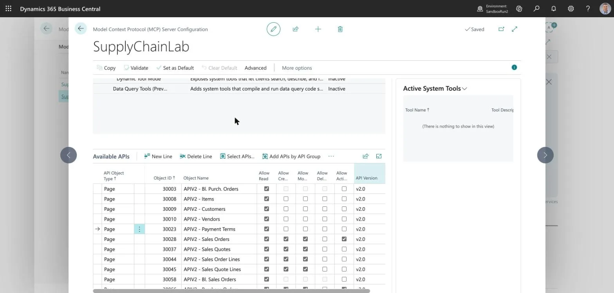
*SupplyChainLab: Payment Terms (30023) is in the list, read-only. Sales Orders (30028) has Allow Actions ticked, which Part 5 comes to below*

The agent asked three questions in one round. First, whether this meant a purchase order, because Fabrikam is a vendor and not a customer:

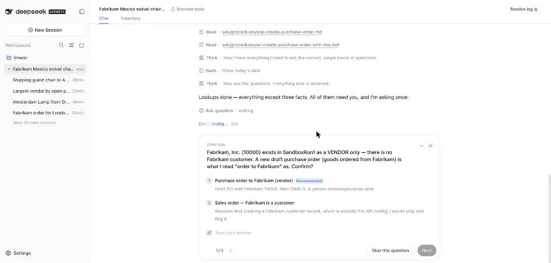
*Question 1: Fabrikam exists as a vendor only, so is this a purchase order?*

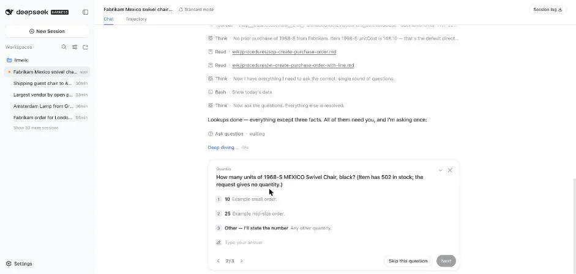
*Question 2: how many? The request gave no quantity, and the item has 502 in stock*

Then the question that had stopped it last time. It refused to guess what "special terms" meant, and this time it could offer the real payment-term codes, because it could now read them:


*Question 3: payment terms, a special unit cost, both, or a line discount? "Agent can set this by GUID via the Payment Terms API: no web-client step"*

I answered "both": 34 chairs, payment terms 1M(8D) and 157.71 each.

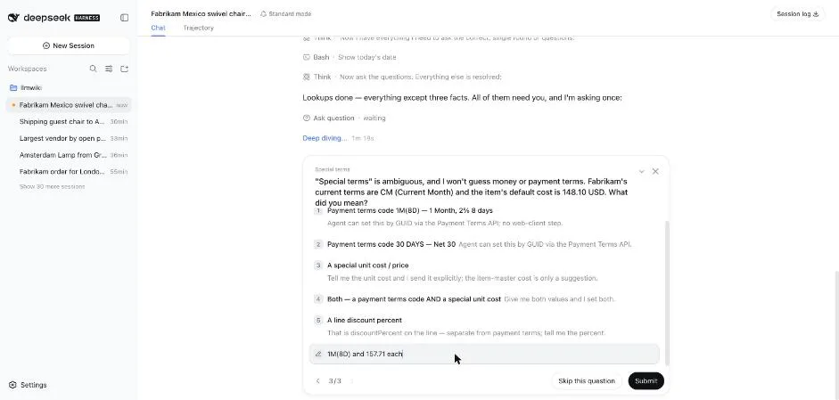
*My answer: both, with the values*

The agent created the order, read it back, and reported what it had done and what it had not:

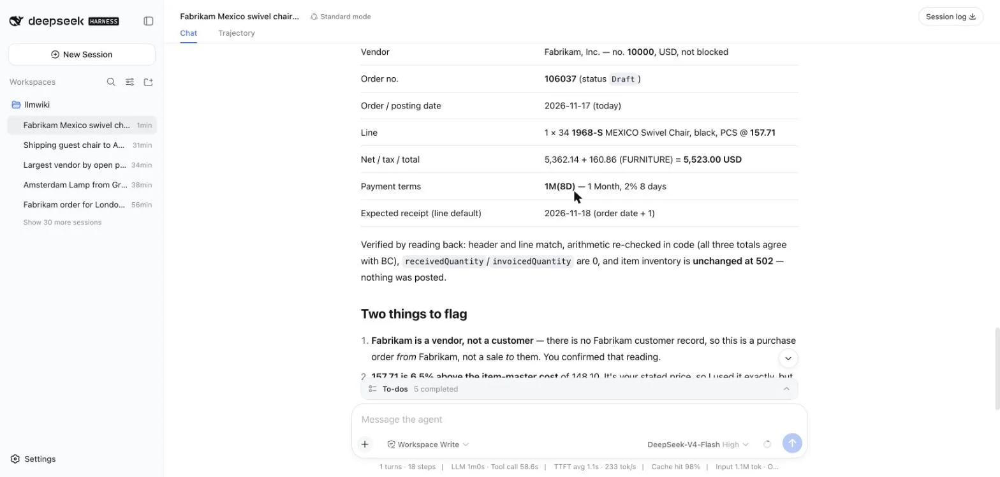
*Draft order 106037: 34 x 157.71 = 5,362.14 plus 160.86 tax, payment terms 1M(8D), nothing posted, stock unchanged at 502*

I checked the order in Business Central:

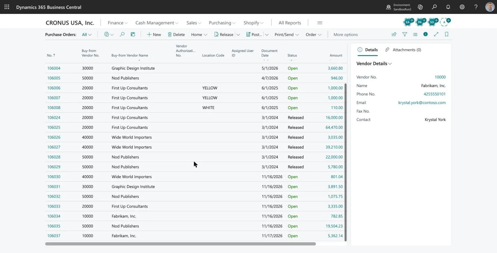
*Purchase Orders: 106037 for Fabrikam, Inc., dated 11/17/2026*

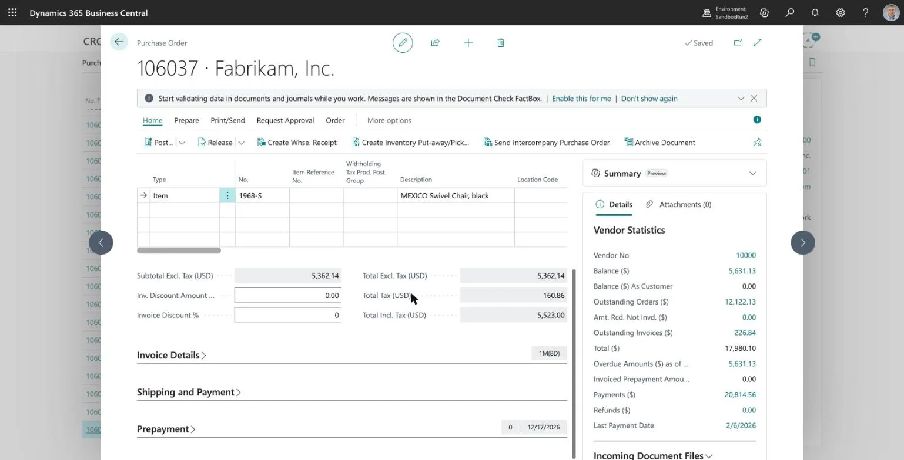
*Order 106037: 34 x MEXICO Swivel Chair, total 5,523.00, and Invoice Details shows 1M(8D)*

| Field | Value |
|---|---|
| Order | 106037, Fabrikam, Inc. |
| Line | 34 x MEXICO Swivel Chair, black at 157.71 = 5,362.14 |
| Total including tax | 5,523.00 |
| Payment terms | 1M(8D) |
| Posted | No |

The totals match the earlier run, where the terms were left as a human step. The difference is that the human step has gone.

The agent also did something I did not ask for. Its own work instruction said payment terms could be set only after the order was made. It had just proved that wrong, so it rewrote the instruction, and it recorded the exact behaviour of the tax and date fields as it went.

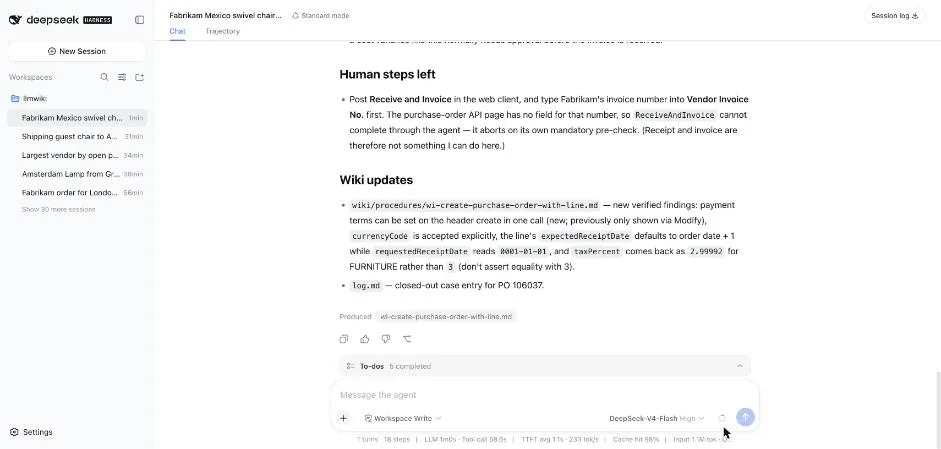
*The human step left: type Fabrikam's invoice number and post. The wiki updates are listed underneath*

:::bullet-points What this shows
- A missing capability can be a **configuration gap**, not a product limit. Check the list of API pages before you write "cannot".
- The agent **corrects its own procedures** when the evidence changes.
:::

## 2. Posting: turn it on in a copy

Posting is controlled by **Allow Actions** on each API page. I ticked it on two pages only, sales orders and purchase orders, in a copy of the Sandbox. Delete stayed off. Only a person can make this change, and I made it deliberately.

### Purchases: a person has to post

The first time I tried this the agent created a draft order, checked it, and then **asked before doing anything irreversible**: leave it as a draft (its recommendation) or post. I told it to post, and Business Central refused:

```
You need to enter the document number of the document from the vendor
in the Vendor Invoice No. field, so that this document stays linked to the original.
```

The order stayed a draft, and stock was unchanged. The reason is in the API. The only purchase action is **Receive and Invoice**, there is no receive-only action, and the purchase order API has no Vendor Invoice No. field to fill in.

The agent wrote that down. When I ran the same prompt again in a clean copy of the Sandbox, it did not even try:

```PROMPT
Receive 13 AMSTERDAM Lamp from Graphic Design Institute.
```

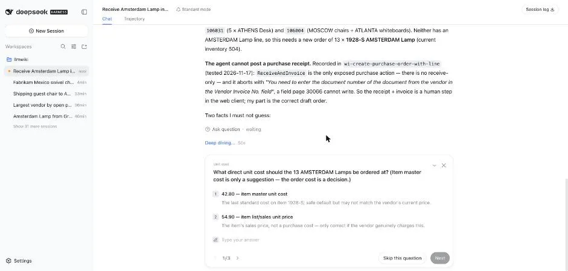
*Before it asked anything, the agent said: "The agent cannot post a purchase receipt." It cited its own wiki note about the refused post*

It asked for the unit cost, whether the person would post receive-only or receive and invoice, and the vendor invoice number if there was one:

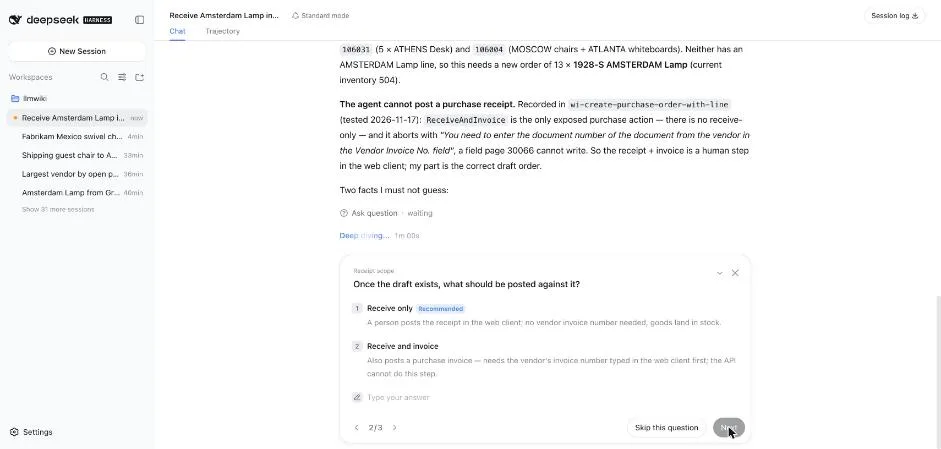
*"Receive only" is recommended: a person posts the receipt in the web client, and no vendor invoice number is needed*

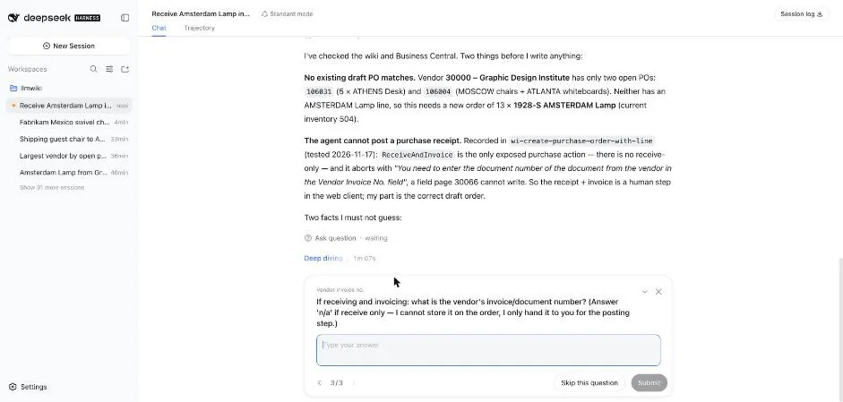
*If receiving and invoicing, the vendor's document number is needed. The agent cannot store it, only hand it over*

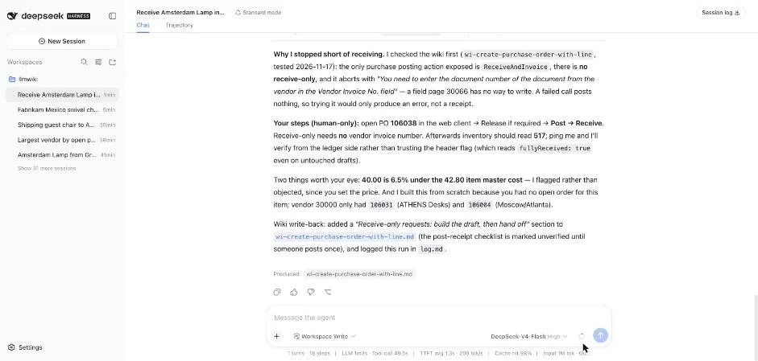
*"Why I stopped short of receiving": the only action aborts without the invoice number, so a failed call "posts nothing, so trying it would only produce an error, not a receipt". It built the draft and listed the human steps*

The practical result is simple: **a person has to post purchase receipts in the web client.** The agent learned that once, and applied it from then on.

### Sales: the post works

```PROMPT
Ship 7 BERLIN Guest Chair, yellow to Adatum Corporation.
```

The agent checked for duplicates and asked about the price. List price was 192.80, and it noticed that Adatum had never bought this item:

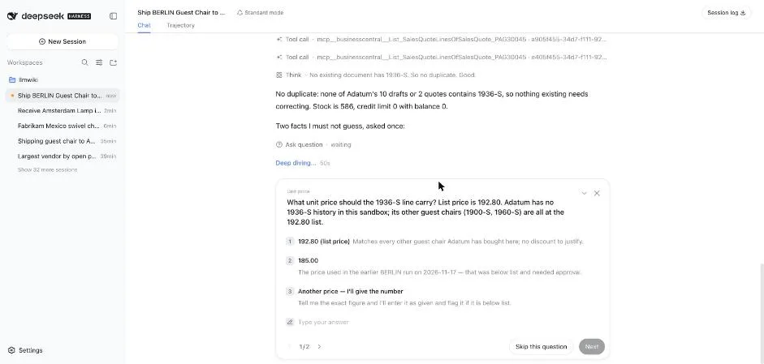
*It offers the list price, the 185.00 used in an earlier run, or another figure. I chose 185.00*

Then it asked the question that matters:

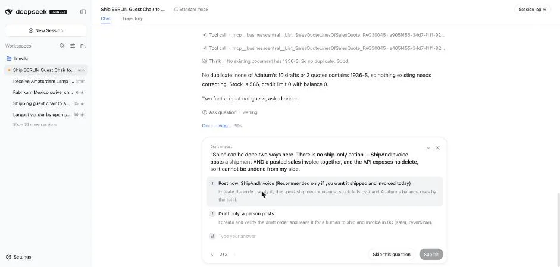
*"There is no ship-only action: ShipAndInvoice posts a shipment AND a posted sales invoice together, and the API exposes no delete, so it cannot be undone from my side." Post now, or draft only so a person posts*

I chose to post, which I would only do in a copy that I can throw away. The agent ran **Ship and Invoice** and then checked its own work against Business Central.

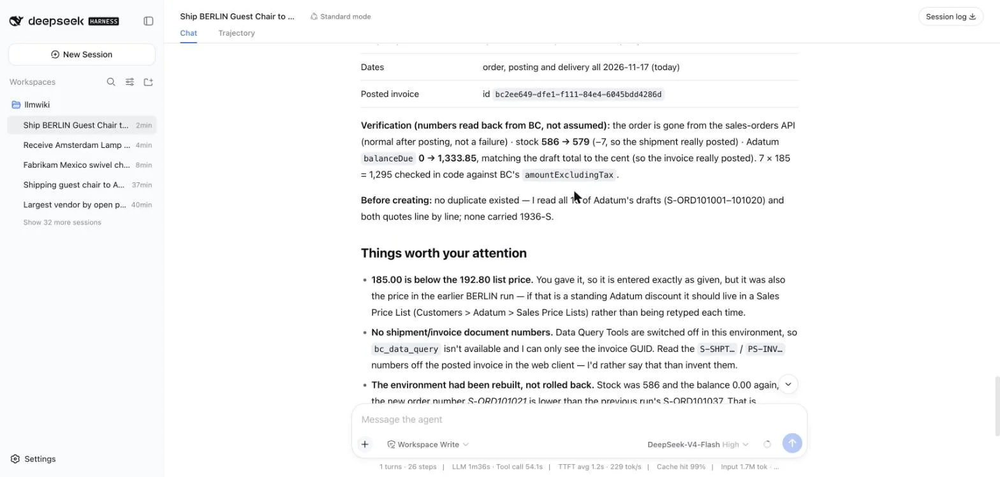
*"Numbers read back from BC, not assumed": stock 586 to 579, Adatum's balance due from 0 to 1,333.85, and 7 x 185 = 1,295 checked in code. It also flagged that 185.00 is below the 192.80 list price*

I checked in the web client:

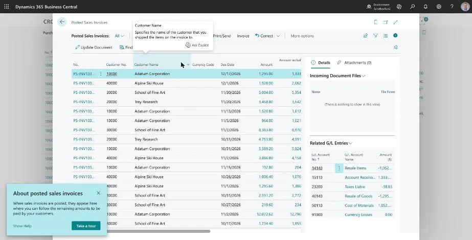
*Posted Sales Invoices: the top row is Adatum Corporation, 1,295.00, due 12/17/2026. The panel on the right shows the general ledger entries*

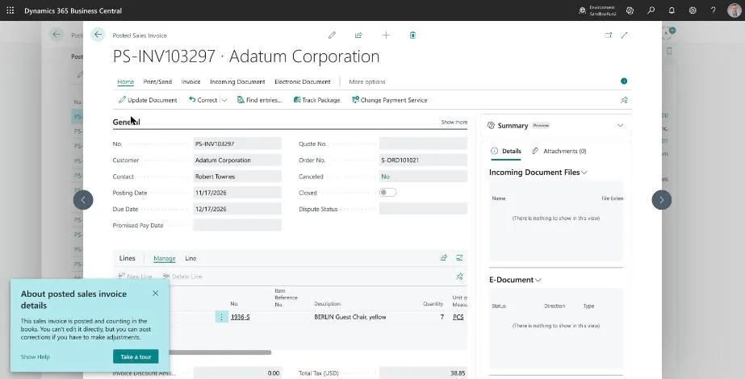
*Posted invoice PS-INV103297: Adatum Corporation, posted 11/17/2026, order S-ORD101021, 7 x BERLIN Guest Chair, yellow*

| Check | Result |
|---|---|
| Posted sales invoice | PS-INV103297, 7 x 185.00 = 1,295.00, due 12/17/2026 |
| Stock | 586 to 579 |
| Customer balance due | 0 to 1,333.85 |

The agent also noticed that the new order number was lower than the one from my first attempt. It read my wiki log, worked out that this was a rebuilt environment and not a lost posting, and wrote that down too.

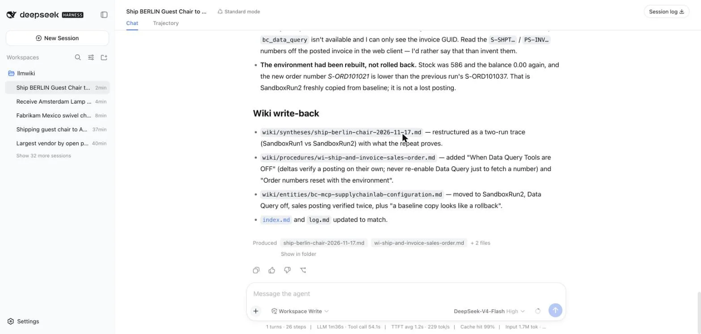
*The wiki write-back: a two-run trace, a note on order numbers resetting with the environment, and the configuration page*

:::watch-it This cannot be undone
A posted invoice stays in the ledger. I only did this in a copy of the Sandbox, and I will delete the copy. If you try the same thing, do it somewhere you can throw away.
:::

## What I would tell someone starting

1. **Posting is a separate decision.** The agent asked both times before posting, and it recommended the safe option both times. A person still has to say yes.
2. **Sales and purchases are different.** Sales can be posted through the API. Purchases cannot, because of the missing invoice number.
3. **Check your own "cannot" claims.** Mine was a missing page.
4. **Use a copy.** A copy of a clean baseline costs about 25 minutes. A posted invoice in the wrong place costs more.

:::no-dumb-questions
**Q: Why not turn posting on for the main Sandbox?**
A: Posted entries are permanent. A test that posts needs an environment that can be thrown away and replaced.

**Q: Could the agent post by itself?**
A: In these runs it asked each time. I have not tested what happens when a prompt says "post it" in the first message, and I would test that next.
:::

## What comes next

[Part 6](/posts/bcsupplychain6/) tries Data Query Tools, a preview feature that lets the agent run queries on Business Central data.
