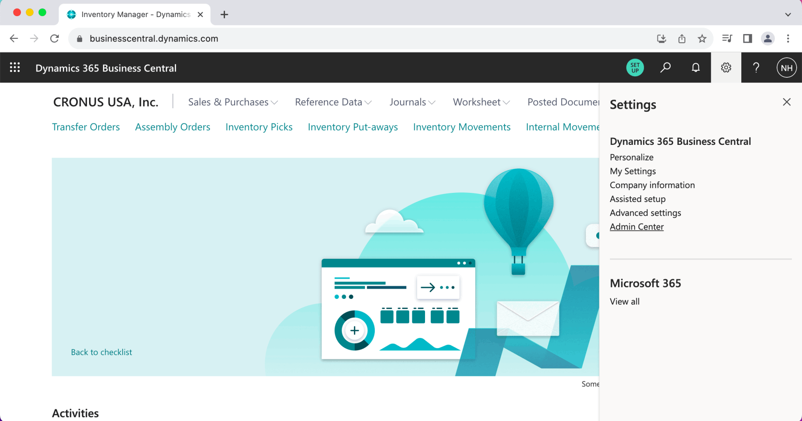
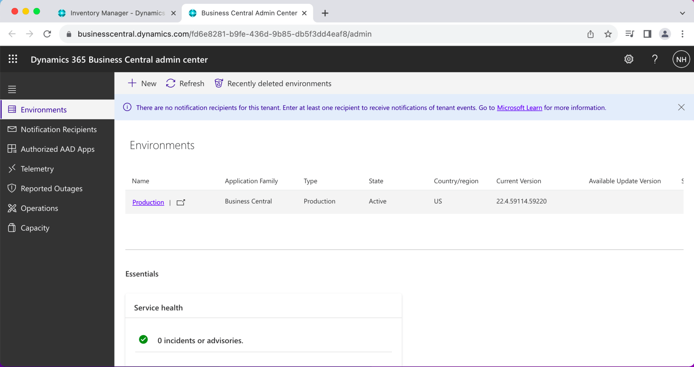
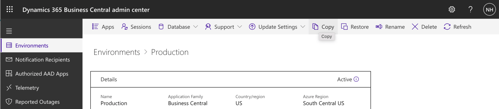
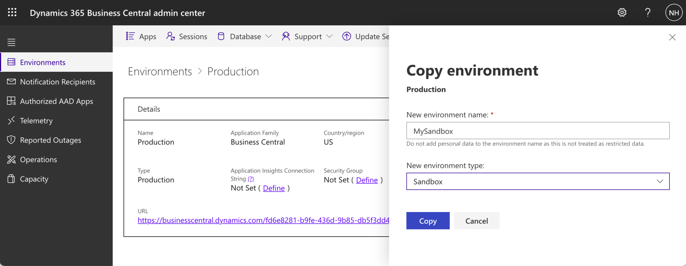
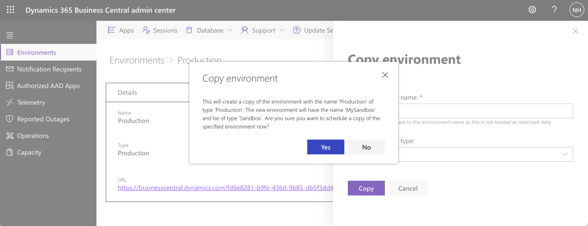
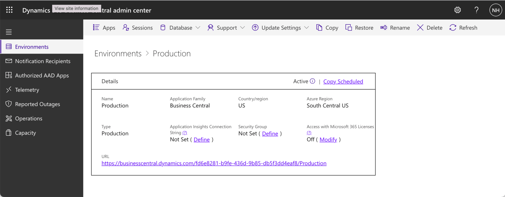
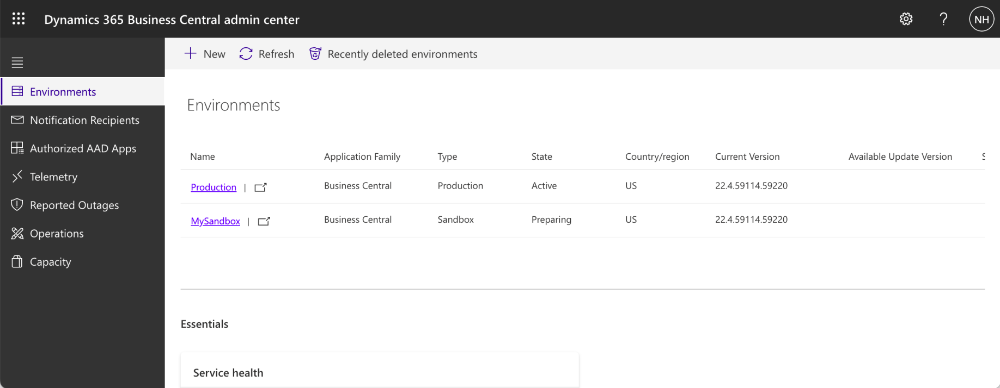
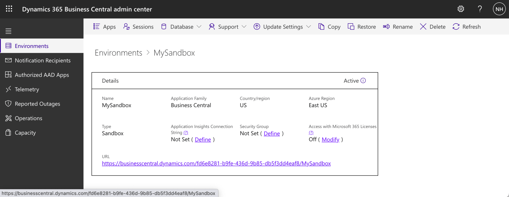
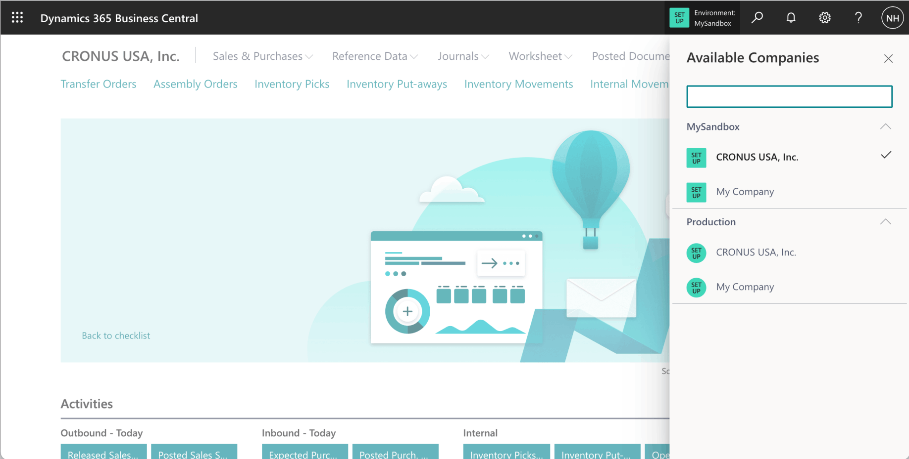

The Business Central Administration Center (Admin Center) provides a portal for tenant administration.

I used the Admin Center to create a development/sandbox environment.

:::brain-power Before you read on
You want to try something risky with your company's real data. How would you do it without putting the real data at risk?
:::

*I used the Settings|Admin Center link to navigate to the Admin Center (portal). Notice that the Safari browser is not supported.*

*I clicked on the "Production" Environment*

*I clicked the Copy link*

:::no-dumb-questions
**Q: What is a sandbox environment?**

A: A copy of the company's Business Central environment that I can use for development and testing. I copied the Production environment into a new Sandbox environment called MySandbox, so I had realistic data to work with.

**Q: Why could I not use Safari?**

A: The first screenshot notes that the Safari browser is not supported by the Admin Center, so I used a different browser for it.
:::

*I selected Sandbox environment type and entered "MySandbox" as the new environment name*

*I clicked the Yes link*

*The copy was scheduled*

*The MySandbox environment was listed in the Environments tab as "Preparing"*

:::watch-it Wait for Active
The copy does not finish at once. The environment is listed as Preparing, and then its state changes to Active. I waited for Active before I opened it.
:::

*The Sandbox state was updated to "Active"*

*I clicked the link*

*I was able to switch between the Production and Sandbox environment*

:::test-drive Try it yourself
1. Open the Admin Center from Settings, and find your Production environment.
2. Copy it to a Sandbox environment with a name of your own.
3. When it is Active, open it and switch between the Sandbox and Production environments.
:::

:::bullet-points Recap
- The Admin Center is the portal for tenant administration.
- I copied Production to a Sandbox environment called MySandbox.
- The copy goes from Preparing to Active, and then I could switch between the two environments.
:::
