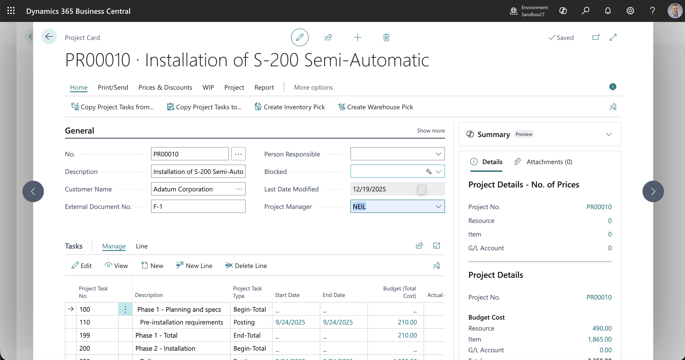
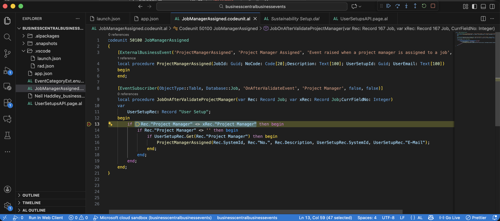
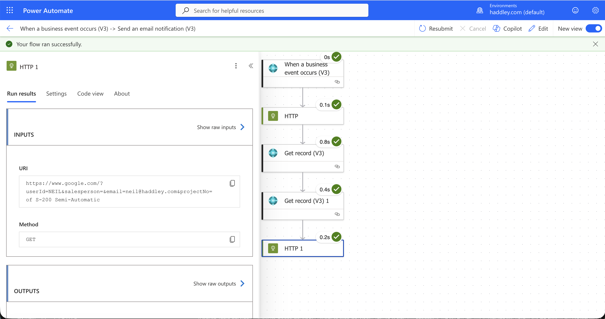

:::brain-power Before you read on
An outside system wants to know the moment a project manager is assigned to a job in Business Central. It could ask every few minutes, or Business Central could tell it. How would you make Business Central do the telling?
:::

## project files

```text
businesscentralbusinessevents/
├── .vscode/
├── .alpackages/
├── .snapshots/
├── app.json
├── EventCategoryExt.enumext.al
├── JobManagerAssigned.codeunit.al
├── UserSetupsAPI.page.al
└── Neil Haddley_businesscentralbusinessevents_1.0.0.0.app
```


## ExternalBusinessEvent Attribute

The `[ExternalBusinessEvent]` decorator attribute in Business Central enables developers to expose custom business events that can be consumed by external systems. This attribute marks a business event as available for external integration through the Business Central API.

### Key Characteristics

- **External Integration**: Events are exposed through the Business Central API and can be subscribed to by external applications
- **Real-time Notifications**: Provides near real-time event notifications to external systems



*I updated the Project Manager*


*External Business Event Code ran*


*Flow ran successfully*

:::no-dumb-questions
**Q: Why is the ProjectManagerAssigned procedure empty?**

A: The [ExternalBusinessEvent] attribute declares the event. Calling the procedure is what raises it, so the body does not need any code.

**Q: What is the User Setups API page for?**

A: An API page publishes a table as a web service that external systems can call. This one publishes User Setup, with the id, user id, email and other fields, so the receiver of the event can look up the user. API pages are served over OData, as I describe in my [OData post](/posts/odata/).

**Q: What does the enum extension do?**

A: It adds a Jobs value to the event categories, so my event can be listed under its own category.
:::

:::pencil When does the event fire?
Read JobOnAfterValidateProjectManager below. A user changes the Project Manager field on a job. Name two conditions that must both be true before ProjectManagerAssigned is raised.

:::answer
The new Project Manager must be different from the old one, and it must not be empty. The code also looks up that project manager in User Setup, and it raises the event only if the lookup finds a record. If any of these fail, nothing is sent.
:::
:::

:::under-the-hood Two small pieces work together
One procedure declares the event, and a second procedure subscribes to the Project Manager field's OnAfterValidate event on the Job table. When the field changes, the subscriber raises the external event with the job's id, number, description, the user's id and the user's email. A flow on the outside then receives it, which is what the last two screenshots show.
:::

## EventCategoryExt.enumext.al

```al
enumextension 50100 EventCategoryExt extends EventCategory
{
    value(50100; Jobs)
    {
        Caption = 'Jobs';
    }
}
```

## JobManagerAssigned.codeunit.al

```al
codeunit 50100 JobManagerAssigned
{
    [ExternalBusinessEvent('ProjectManagerAssigned', 'Project Manager Assigned', 'Event raised when a project manager is assigned to a job', EventCategory::Jobs)]
    local procedure ProjectManagerAssigned(JobId: Guid; NoCode: Code[20];Description: Text[100]; UserSetupId: Guid; UserEmail: Text[100])
    begin
    end;

    [EventSubscriber(ObjectType::Table, Database::Job, 'OnAfterValidateEvent', 'Project Manager', false, false)]
    local procedure JobOnAfterValidateProjectManager(var Rec: Record Job; var xRec: Record Job;CurrFieldNo: Integer)
    var
        UserSetupRec: Record "User Setup";
    begin
        if Rec."Project Manager" <> xRec."Project Manager" then begin
            if Rec."Project Manager" <> '' then begin
                if UserSetupRec.Get(Rec."Project Manager") then begin
                    ProjectManagerAssigned(Rec.SystemId, Rec."No.", Rec.Description, UserSetupRec.SystemId, UserSetupRec."E-Mail");
                end;
            end;
        end;
    end;
}
```

## UserSetupsAPI.page.al

```al
page 50101 "User Setups API"
{
    PageType = API;
    APIPublisher = 'neilhaddley';
    APIGroup = 'admin';
    APIVersion = 'v1.0';
    EntityName = 'userSetup';
    EntitySetName = 'userSetups';
    SourceTable = "User Setup";
    DelayedInsert = true;
    ODataKeyFields = SystemId;

    layout
    {
        area(Content)
        {
            repeater(GroupName)
            {
                field(id; Rec.SystemId)
                {
                    Caption = 'Id';
                    Editable = false;
                }
                field(userId; Rec."User ID")
                {
                    Caption = 'User ID';
                }
                field(salesPersonCode; Rec."Salespers./Purch. Code")
                {
                    Caption = 'Salesperson Code';
                }
                field(allowPostingFrom; Rec."Allow Posting From")
                {
                    Caption = 'Allow Posting From';
                }
                field(allowPostingTo; Rec."Allow Posting To")
                {
                    Caption = 'Allow Posting To';
                }
                field(registerTime; Rec."Register Time")
                {
                    Caption = 'Register Time';
                }
                field(email; Rec."E-Mail")
                {
                    Caption = 'Email';
                }
            }
        }
    }
}
```

:::test-drive Try it yourself
1. Publish the extension, and set up a flow that waits for the business event.
2. Open a job in Business Central and assign a project manager who has a User Setup record.
3. Check that the flow ran, and then clear the field and see that nothing is sent.
:::

:::bullet-points Recap
- The [ExternalBusinessEvent] attribute lets Business Central tell an outside system that something happened.
- Calling the procedure raises the event, and an event subscriber on the Job table calls it.
- An API page lets the receiver look up the user that the event mentions.
- The event fires only when the project manager changes to a non-empty user that exists in User Setup.
:::

## References

- [Business events on Business Central (preview)](https://learn.microsoft.com/en-us/dynamics365/business-central/dev-itpro/developer/business-events-overview)

- [How to create custom “business events” in D365 Business Central to notify & trigger external system](https://www.youtube.com/watch?v=XzYciB_Buio)