[Microsoft Graph](/posts/microsoftgraph/) can be used to develop applications that securely access and integrate with the data stored in Microsoft Dynamics 365 Business Central.

Graph Explorer is a web-based tool provided by Microsoft that allows developers and users to interact with Microsoft Graph APIs (Application Programming Interfaces) without the need for writing code.

:::brain-power Before you read on
Two people open the same item in Business Central, and both change its price. Whoever saves second could overwrite the first change without knowing. How would a web API stop that?
:::

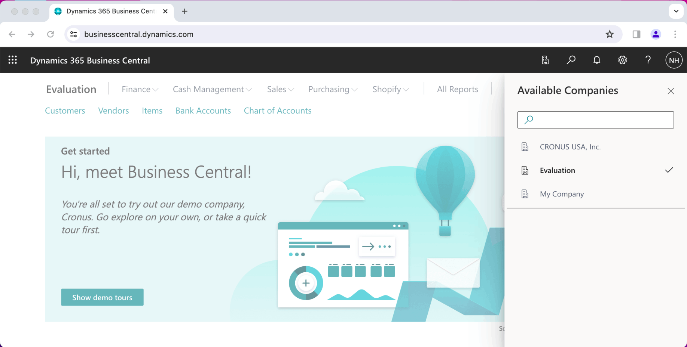
*I navigated to Business Central and reviewed the three companies listed.*

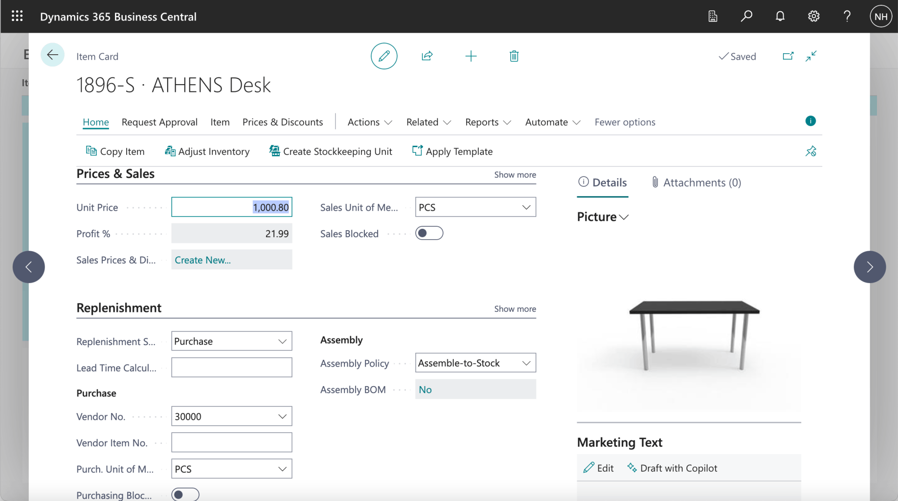
*In the Evaluation company the ATHENS Desk item had a unit price of $1,000.80*

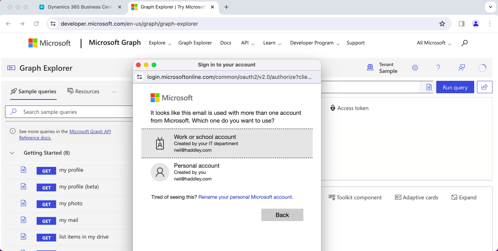
*I navigated to https://developer.microsoft.com/en-us/graph/graph-explorer and clicked the login button*

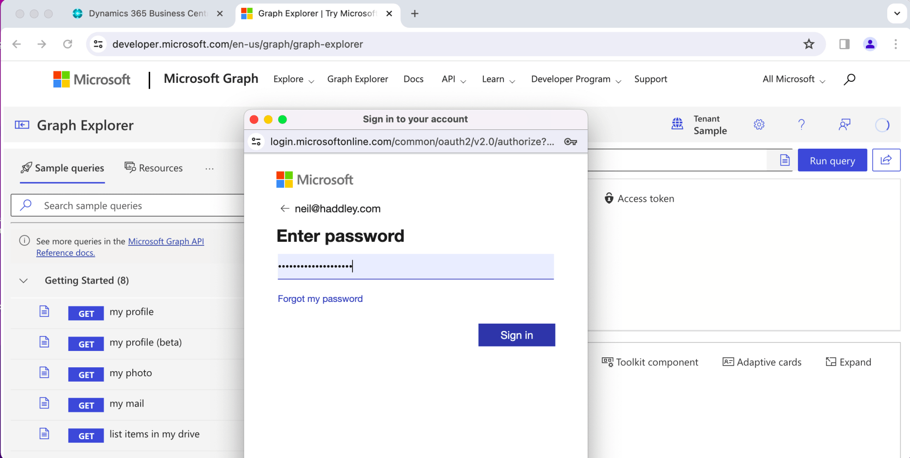
*I logged in using the same credentials*

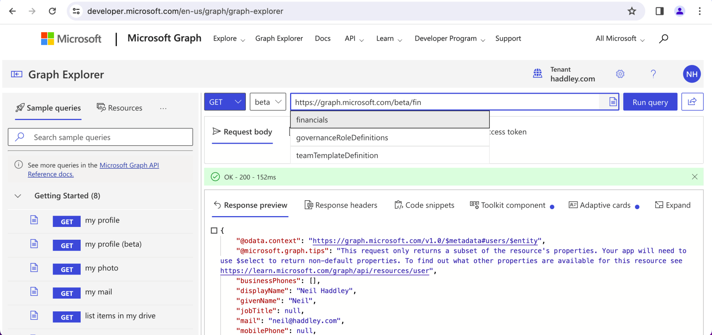
*I switched to the beta endpoint. Typeahead suggested financials*

:::no-dumb-questions
**Q: What is Graph Explorer?**

A: A web tool from Microsoft that lets me send requests to Microsoft Graph and read the answers without writing code. I signed in with the same credentials that I use for Business Central.

**Q: Why did I switch to the beta endpoint?**

A: In my run, the beta endpoint was where the typeahead offered financials, and financials/companies is where I started. I then added the company id, then customers, agedAccountsReceivable and items to the address.
:::

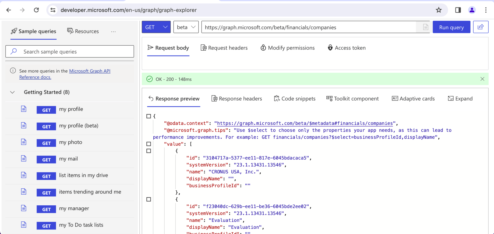
*I added companies and made a GET request to https://graph.microsoft.com/beta/financials/companies.*

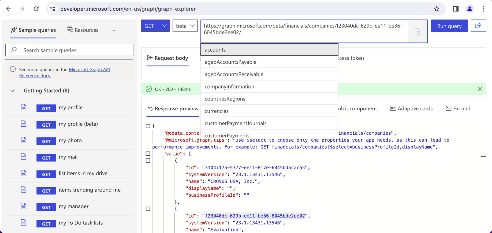
*I added the id of company Evaluation (shown above) to the request url. Typeahead provided a list of options.*

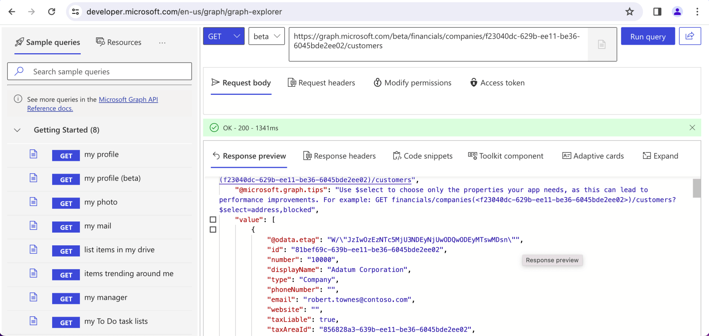
*I selected customers from the typeahead. I made a GET request to https://graph.../customers*

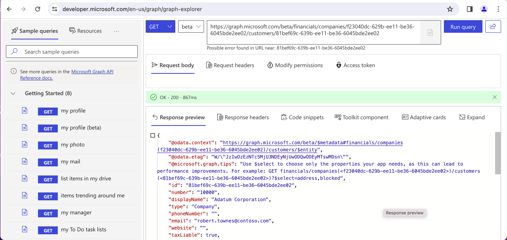
*I added the id of customer Adatum Corporation to the get request URL.*

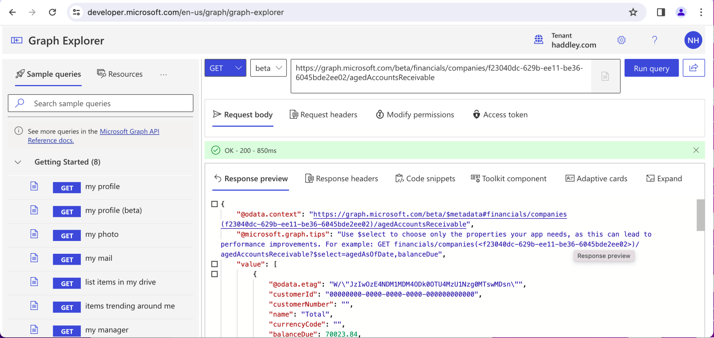
*I updated the request URL to https://graph.../agedAccountsReceivable to return accounts receivable details*

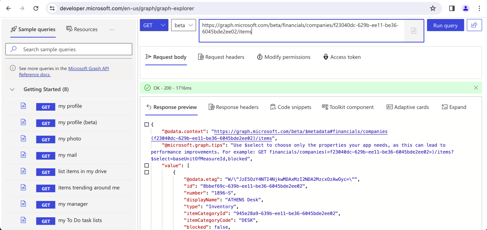
*I updated the request URL to https://graph.../items*

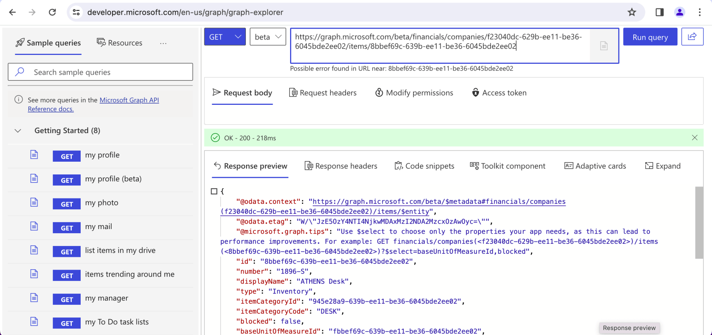
*I added the ATHENS Desk item id to the URL*

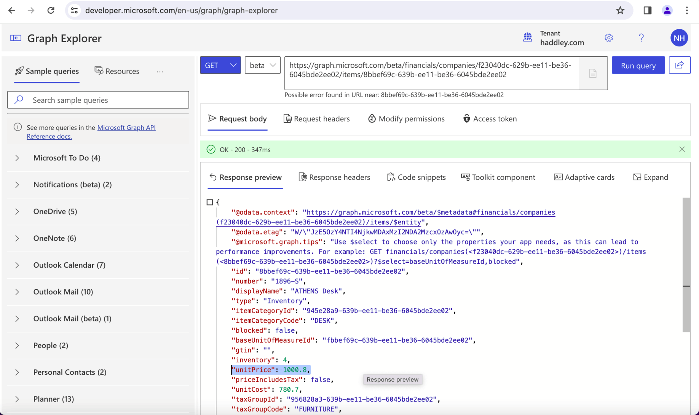
*I noticed that the unit price for an ATHENS Desk was $1,000.80*

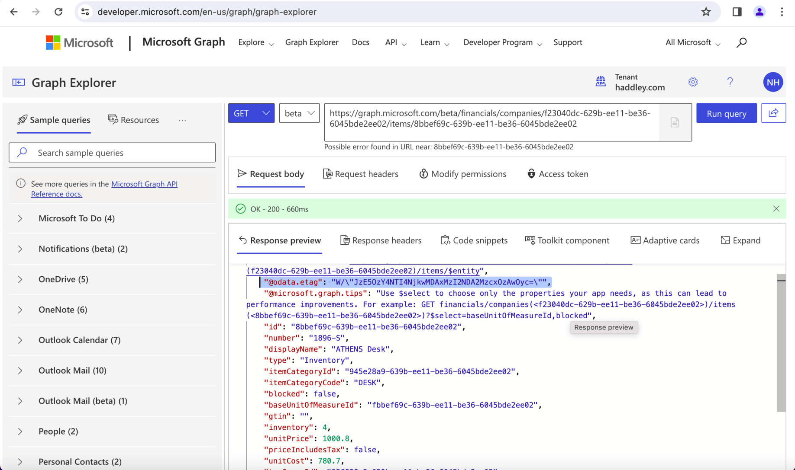
*I noted that the eTag value was ...JzE50zY4N..., a unique identifier associated with a specific version of the resource*

:::under-the-hood What the eTag and If-Match header do
The eTag identifies one version of the record. When I send a PATCH, I put the eTag that I last read into an If-Match header. If it still matches, the update goes through and the record gets a new eTag, as the response showed. If someone else changed the record in the meantime, the tags no longer match and the update is refused.
:::

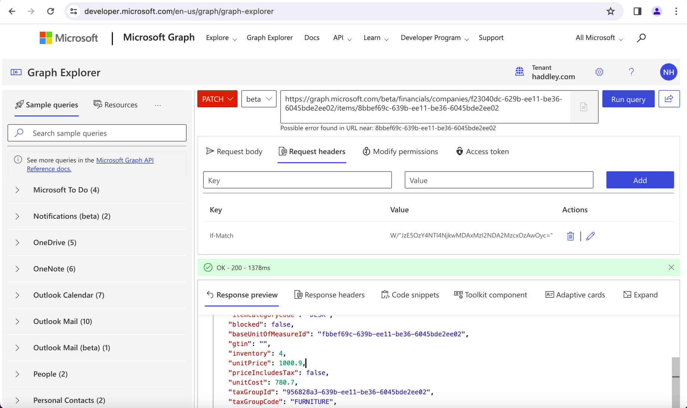
*I created a Request body, updated the http verb to PATCH and added an If-Match header to the Request headers. The If-Match header was used to pass the latest eTag value. Notice that the Response returned confirms that the unit price has been updated to $1,000.90*

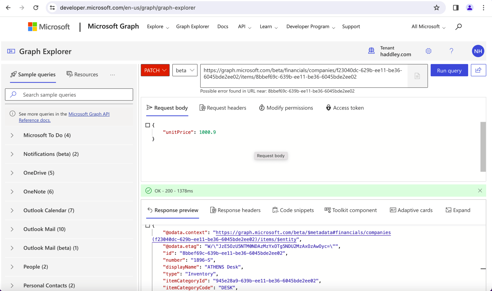
*Notice that the Request body included the new unit price and that the Response eTag value was updated to ...JzE50zU5N..*

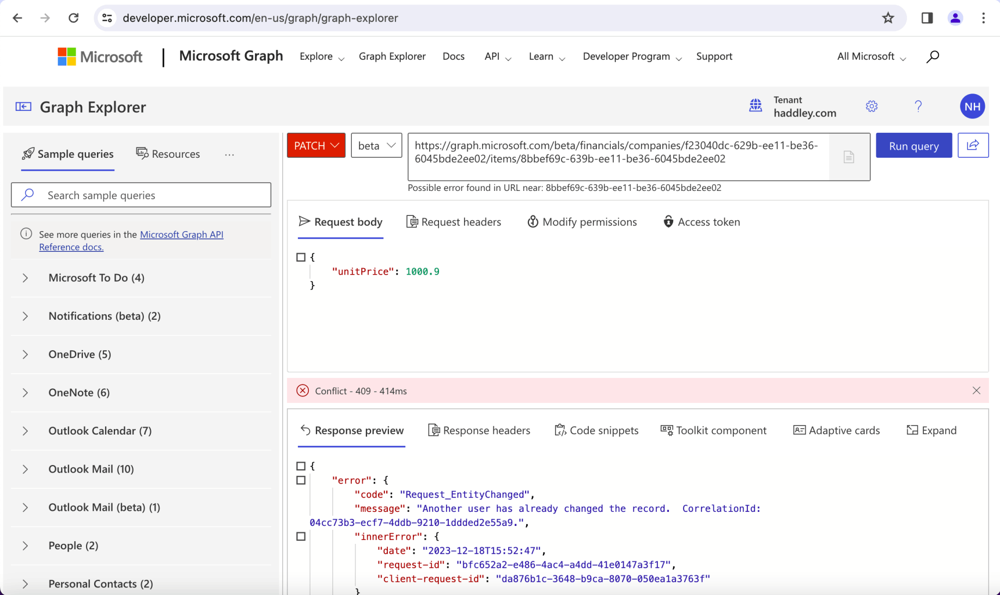
*Executing the same PATCH request with the old eTag value resulted in an error.*

:::pencil Why did the second PATCH fail?
I sent the same PATCH request twice. The first changed the unit price of the ATHENS Desk, and the second failed with an error. What had changed between the two requests, and what does the failure protect against?

:::answer
After the first PATCH, the record had a new eTag. The second request still carried the old eTag in its If-Match header, so it no longer matched. The failure protects against overwriting a newer change with an older view of the record, which is the problem in the question at the top.
:::
:::

:::test-drive Try it yourself
1. In Graph Explorer, make a GET request for an item, and note its eTag.
2. Send a PATCH with a new unit price and the eTag in If-Match.
3. Send the same PATCH again with the old eTag, and read the error.
:::

:::bullet-points Recap
- Graph Explorer lets me call Microsoft Graph without writing code.
- The financials endpoint exposes companies, customers, items and more from Business Central.
- A PATCH changes a record, and the If-Match header carries the eTag that I last read.
- An old eTag makes the update fail, so one user cannot silently overwrite another's change.
:::
