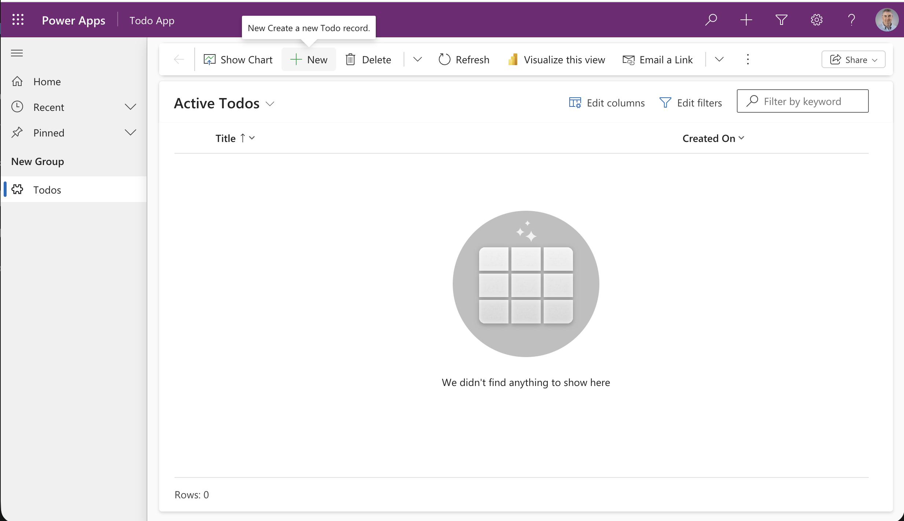
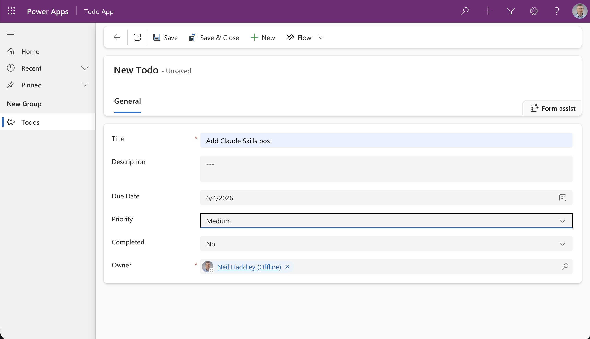
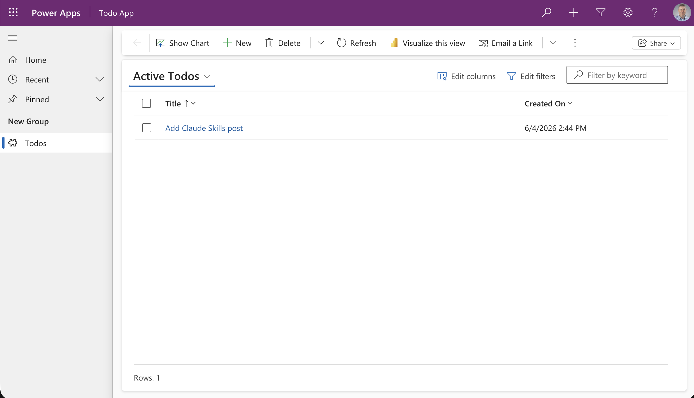

I built a Claude Code skill called `dv-generate` that generates Dataverse solutions for Power Platform. It's published on GitHub. The skill installs with a single curl command.

```bash
curl -fsSL https://raw.githubusercontent.com/Haddley/dv-generate/main/install.sh | bash
```


*I ran `/skills` in Claude Code and saw there were no skills installed yet*


*I ran the install script and watched it clone the dv-generate plugin and register it*


*After restarting Claude Code, `/skills` now showed the `dv-generate` skill listed and active*

With the skill installed, I gave Claude a prompt to generate a Todo model-driven app.

```PROMPT
Create a Dataverse solution for a simple Todo model-driven app with a Todo table. The table should include the following fields:

Title (required text field)
Description (multiline text)
Due Date (date field)
Priority (choice field with options: Low, Medium, High)
Completed (yes/no boolean field)
Generate the solution as a .zip file that I can import directly into my development environment.
```

Claude loads the skill and asks for a publisher prefix before it writes any XML. The prefix goes on every table, column, choice and app name, and it can't be changed once components exist. I answered `neil`.

Claude then writes three files and builds the package:

- `solution.xml`: the solution and publisher details, with my prefix applied throughout.
- `customizations.xml`: the `neil_todo` table with its five columns, an All Todos view, a Quick Find view, a main form, and the model-driven app.
- `pack.sh`: a script that zips the files into `NeilTodoApp.zip`, a few kilobytes and ready to import.

I imported the zip into a development environment with the Power Platform CLI. Importing through make.powerapps.com (Solutions, Import solution) works too.

```bash
pac solution import --path NeilTodoApp.zip
```

The import creates an unmanaged solution, so I can open it in the maker portal and keep editing. The model-driven app was ready to use.


*The Todo App model-driven app opened in Power Apps showing an empty Active Todos view*


*I created a new Todo record with a title, due date, priority, and completed status*


*The record saved and appeared in the Active Todos list — the app worked exactly as designed*

## How the Skill Works

A Claude Code skill is a Markdown file placed in `~/.claude/skills/<skill-name>/`. When the skill is active, its content is injected into Claude's context whenever a matching task is detected — in this case, whenever someone asks Claude to create a Dataverse solution.

The skill is mostly knowledge: templates, rules, and gotchas that Claude needs to generate valid Dataverse XML. (It also ships two small Python scripts, described below, for comparing the XML with what is in your development environment.) The frontmatter `description` field tells Claude when to invoke it; the body tells Claude exactly how to do the work.

The full `SKILL.md` lives in the [dv-generate repository](https://github.com/Haddley/dv-generate/blob/main/skills/dv-generate/SKILL.md). The bulk of it is XML templates and a list of import errors I ran into while building it — things like the correct element order inside `<entity>`, the right casing for option set labels, and why boolean fields render read-only if you omit `disabled="false"` on the form control.

## From first release to production

The skill generates unmanaged solutions only. I tried generating managed ones, and hand-written managed solutions failed when I re-imported them: the staged upgrade (`ImportAsHolding`) tried to delete system columns and left half-installed `_Upgrade` solutions behind. Microsoft also only supports hand-editing the customizations file of an unmanaged export. So the platform writes the managed package, not Claude:

1. Generate the solution (unmanaged).
2. Import it into a development environment (`pac solution import --path MySolution.zip`, or Import solution in make.powerapps.com) and test it.
3. In the development environment, export it as managed (Solutions, Export, Managed, or `pac solution export --managed`).
4. Import that managed zip into your sandbox, then production. Import the same zip each time rather than rebuilding it.

## Changing a solution after the first release

For an unmanaged solution in dev, a change is a regeneration: edit the saved XML in place, raise the `<Version>`, import it over the existing solution (it overwrites), and test. Keep every GUID the same: a changed GUID on re-import creates a duplicate view instead of updating the original. Then export as managed and import into the sandbox as an upgrade (`pac solution import --path X.zip --stage-and-upgrade`).

I ran 16 change scenarios against two development environments, one unmanaged source and one managed target, to find out what regenerating can and can't do.

**It works for:** adding a column, a choice option, a table, an environment variable or a connection reference, and changing a column label or an environment variable default.

**It does not remove things.** Leaving a column, view, form or choice option out of the XML changes nothing: it stays in dev, and so it stays in the managed export. The skill tells you which items to delete in dev before you export:

| You removed | What to do |
|---|---|
| A column, view, form or choice option | Delete it in dev (make.powerapps.com, Tables) before exporting managed. I tested this for a column and a view: after the delete, the upgrade removed both from the target. |
| A table, environment variable, connection reference or app | Delete the unmanaged solution wrapper (`pac solution delete`, never on a managed solution) and re-import, so the solution matches the zip. Delete the table in dev too if it should not survive there. |
| A table while an app stays | The managed upgrade fails ("referenced by 1 other components"). Remove the app in the same release and add it back in the next. |
| A column's type | Dataverse rejects the import. Add a new column, move the data, delete the old one. |

Two warnings. Removing a table in a managed upgrade deletes the table and all of its rows in the target; I confirmed that with three rows in a test table. And a plain update (instead of an upgrade) removes nothing.

### Pull before you regenerate

Someone may have changed things in dev by hand, and regenerating from a stale copy of the XML could overwrite those edits. `pull.py` exports the unmanaged solution from dev and reports what differs from your saved XML:

```bash
python3 ~/.claude/skills/dv-generate/scripts/pull.py --env https://<your-dev-org>.crm.dynamics.com/ --solution MySolution --dir MySolutionDir
```

It compares tables, custom columns, choice options, views, forms, environment variables, connection references and apps, and changes nothing unless you pass `--apply`. `drift.py --manual` lists the manual steps still needed in dev after a regeneration.

### What I haven't tested

Choice-option removal: two of the four imports I tried hung until my 15-minute timeout, and the option stayed in dev anyway. I also haven't confirmed that removing a column deletes its data in the target. The scenarios, fixtures and recorded results are in the repository's `tests/` folder.

## References

- [Dataverse Plugin Is Now on the Claude Marketplace](https://devblogs.microsoft.com/powerplatform/dataverse-plugin-claude-marketplace/)
- [Claude Code (Part 16): Microsoft's official Dataverse plugin](/posts/claudecode16/)
