In [Part 13](/posts/claudecode13/) I built my own Claude Code skill, `dv-generate`, which writes Dataverse solution XML without touching a live environment. Microsoft has since published an official Dataverse plugin on the Claude marketplace. It works the other way round: it connects Claude Code to a live environment, and then reads and writes tables and records there.

The plugin is open source (MIT), and Microsoft describes it in [Dataverse Plugin Is Now on the Claude Marketplace](https://devblogs.microsoft.com/powerplatform/dataverse-plugin-claude-marketplace/).

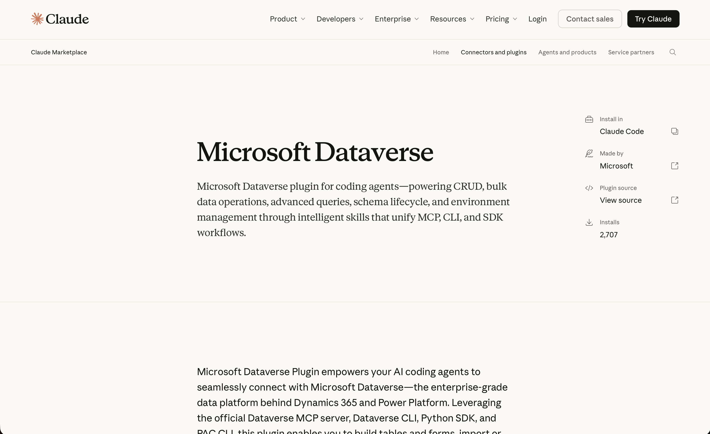
*The Microsoft Dataverse plugin on the Claude marketplace, made by Microsoft, with 2,707 installs when I looked*

## Installing the plugin

I opened Claude Code in an empty folder and installed the plugin from the official marketplace.

```PROMPT
/plugin install dataverse@claude-plugins-official
```

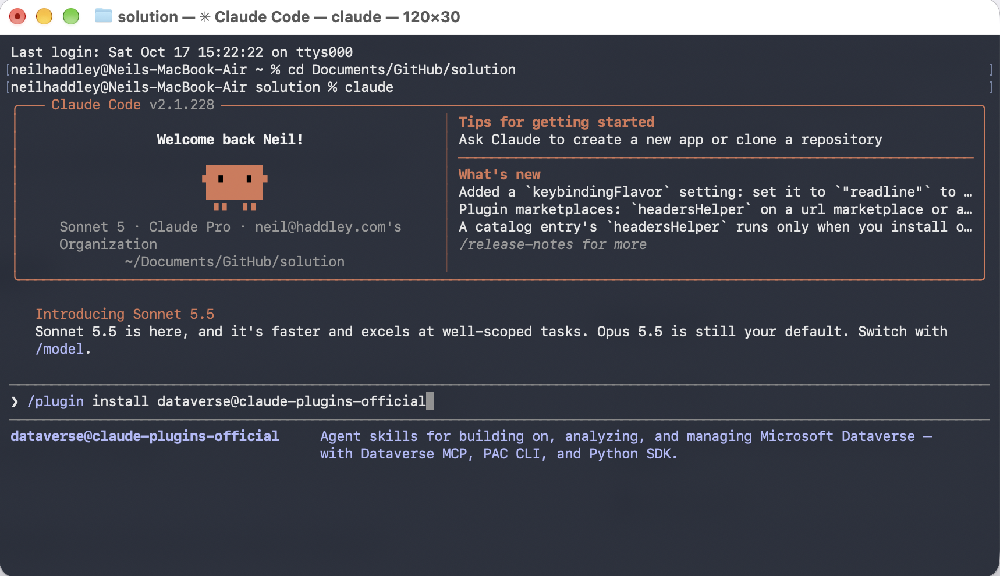
*I typed the install command, and Claude Code showed the plugin's description*

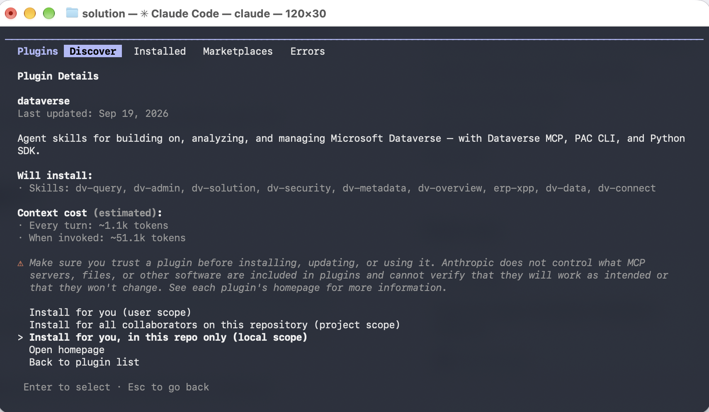
*The plugin details listed the nine skills it would install, and its context cost: about 1.1k tokens on every turn, and about 51.1k when a skill is used. I chose to install it for this folder only (local scope).*

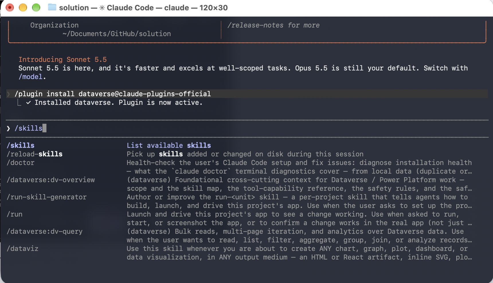
*The plugin installed and became active straight away, and I typed `/skills` to check*

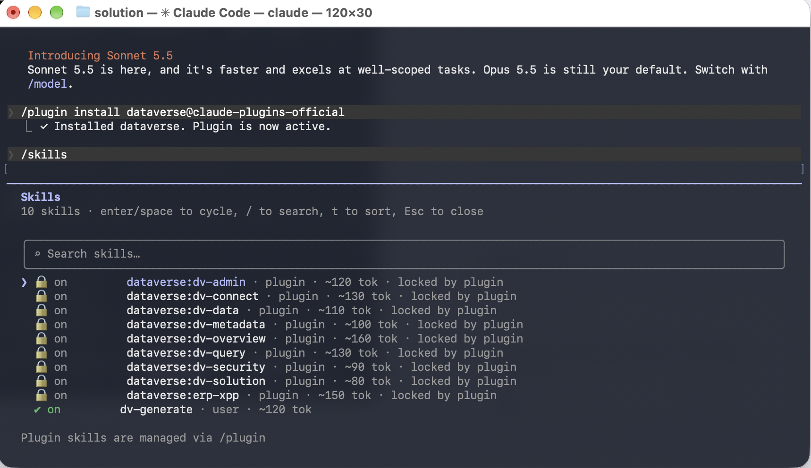
*`/skills` listed the nine `dataverse:` skills, locked by the plugin, next to my own `dv-generate` skill from Part 13*

The [Dataverse-skills repository](https://github.com/microsoft/Dataverse-skills) lists the nine skills, in this order:

| Skill | What it does |
|---|---|
| `dv-connect` | One-time setup: installs the Dataverse CLI, the Python SDK and the PAC CLI, signs in to the environment, and registers the Dataverse MCP server |
| `dv-query` | Reads, filters, pages through and aggregates records, answers questions in plain English, and loads results into pandas DataFrames |
| `dv-data` | Creates, updates and deletes single records, and bulk imports: CSV files, several tables with foreign keys, upserts by alternate key, and AI-generated sample data |
| `dv-metadata` | Authors and edits the data model: tables, columns, relationships, forms and views |
| `dv-solution` | Manages the solution lifecycle: create, export, import, promote across environments, and validate deployments |
| `erp-xpp` | The Finance and Operations X++ lifecycle: authoring, SDK installation, compiling, deploying, database sync and verification (Windows only) |
| `dv-admin` | Environment administration: bulk delete, retention and archiving, organisation and OrgDB settings, the recycle bin, audit, and Power Platform admin center toggles |
| `dv-security` | Assigns security roles, manages user access, adds application users, configures business units, and elevates an admin |
| `dv-overview` | The cross-cutting rules and tool routing, loaded before any other skill so that each request goes to the right specialist |

The same skills install into other coding agents too. The README gives install commands for GitHub Copilot, Gemini CLI, Codex CLI, Cursor and Google Antigravity, as well as Claude Code.

The plugin chooses the tool for each job. The Dataverse MCP server handles simple reads and small writes, the Python SDK handles bulk work, the Dataverse CLI handles data commands, and the PAC CLI handles solutions and tenant operations.

:::no-dumb-questions
**Q: Why did I install it for this folder only?**

A: The plugin adds about 1.1k tokens to every turn, even when I am not working on Dataverse. With local scope, it only loads when I start Claude Code in this folder, so my other projects do not pay for it.

**Q: What are the 51.1k tokens "when invoked"?**

A: When Claude uses one of the skills, it reads that skill's full instructions. The 1.1k on every turn is only the short descriptions that let Claude decide whether a skill fits.

**Q: Why are the skills "locked by plugin"?**

A: They belong to the plugin, so I cannot switch them off one at a time in `/skills`. I manage them with `/plugin` instead. My own `dv-generate` skill is a user skill, so it has a normal on and off switch.
:::

:::pencil Which tool would the plugin pick?
The plugin has four ways to reach Dataverse: the MCP server, the Dataverse CLI, the Python SDK and the PAC CLI. Which would it choose for each of these requests?

1. "Import this CSV of 50,000 contacts into the contacts table"
2. "Export the Todo solution as a zip"
3. "How many open accounts are there?"

:::answer
1. The Python SDK, because it handles bulk work and multi-page operations.
2. The PAC CLI, because it handles solutions and tenant operations.
3. The MCP server or the Dataverse CLI, because it is a single, simple read. In my session the MCP server was not set up yet, so Claude used the Dataverse CLI for questions like this.
:::
:::

## Connecting to an environment

```PROMPT
connect to my Dataverse Environment
```

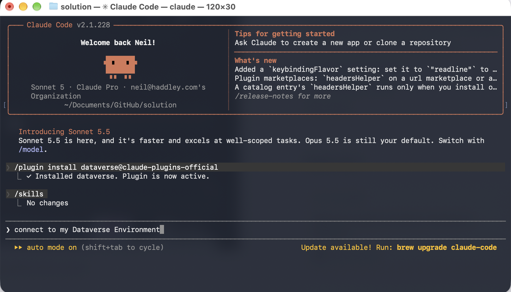
*I asked Claude to connect to my Dataverse environment*

The `dv-connect` skill first looked for existing PAC CLI sign-ins on my Mac and asked which environment this folder should use. I typed the address of a development environment that was not in the list, so Claude created a new Dataverse CLI sign-in for it, using a device code.

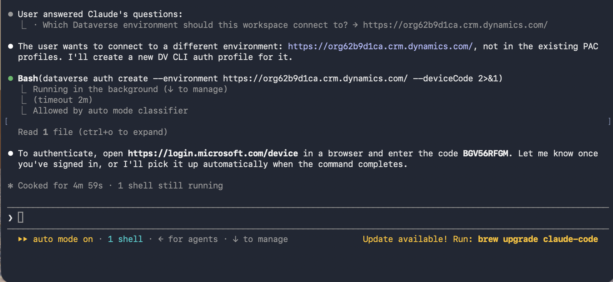
*Claude ran `dataverse auth create` with `--deviceCode` and gave me a code to enter*

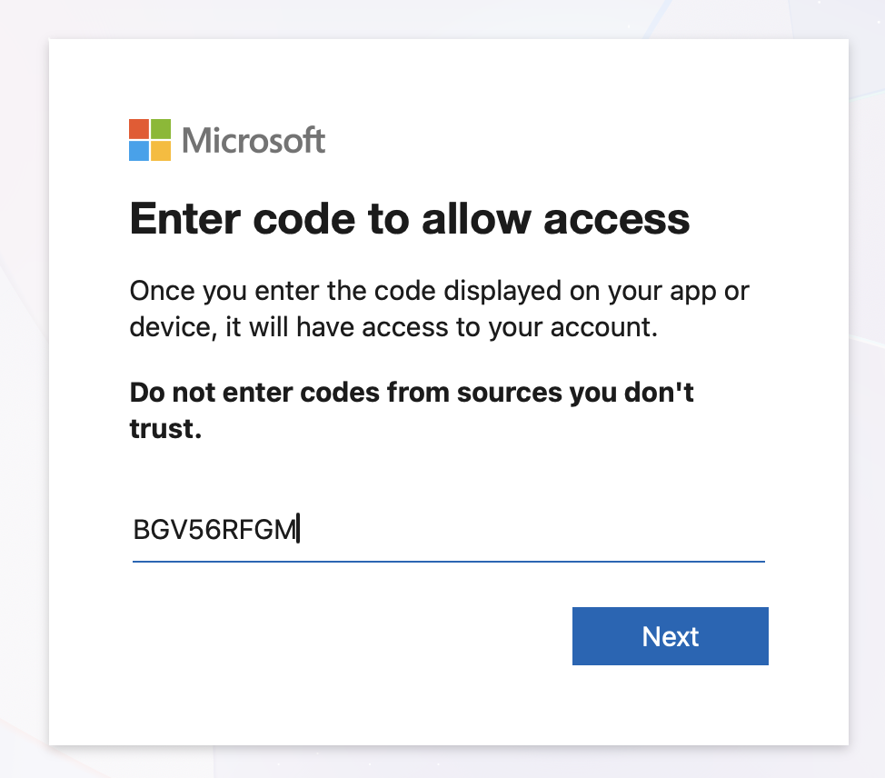
*I opened login.microsoft.com/device and entered the code*

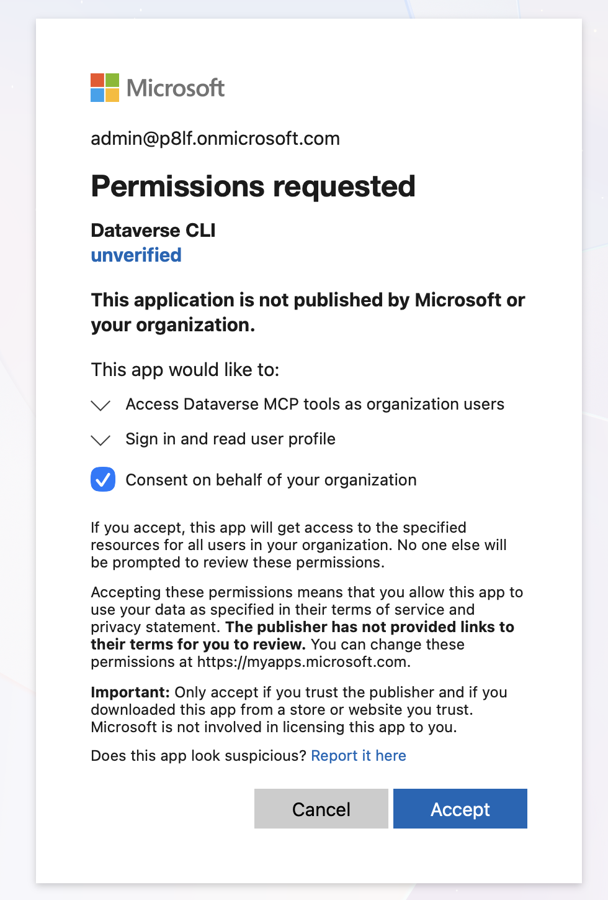
*Microsoft asked me to consent to the Dataverse CLI accessing Dataverse MCP tools and reading my profile*

:::watch-it The consent screen says "unverified"
The consent screen shows the Dataverse CLI as **unverified**, with the warning "This application is not published by Microsoft or your organization". I signed in as the administrator of a development tenant, so the screen also offered to consent on behalf of the whole organisation. In a real tenant, that box grants the app to every user, so it is a decision for whoever owns the tenant. The plugin does not get round this: as Microsoft's post puts it, "the plugin automates configuration, not authorization."
:::

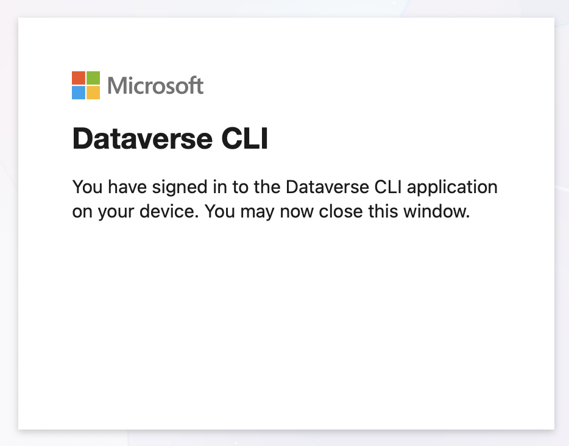
*After I accepted, the browser said I had signed in to the Dataverse CLI and could close the window*

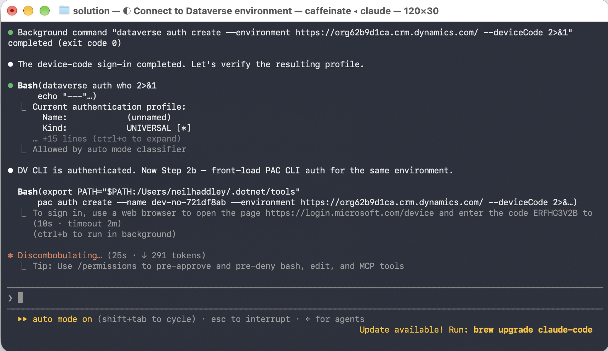
*Claude checked the new profile with `dataverse auth who`, and then started a second device-code sign-in, this time for the PAC CLI on the same environment*

## Asking about the environment

The PAC CLI sign-in was still waiting for me, but I asked a question anyway.

:::brain-power How many tables did someone build?
A brand new Dataverse environment with Dynamics 365 apps installed already has hundreds of tables, and many of them are flagged as custom. If you asked an agent to list the custom tables, how could it tell the ones Microsoft added from the ones a person built?
:::

```PROMPT
What tables are in this environment?
```

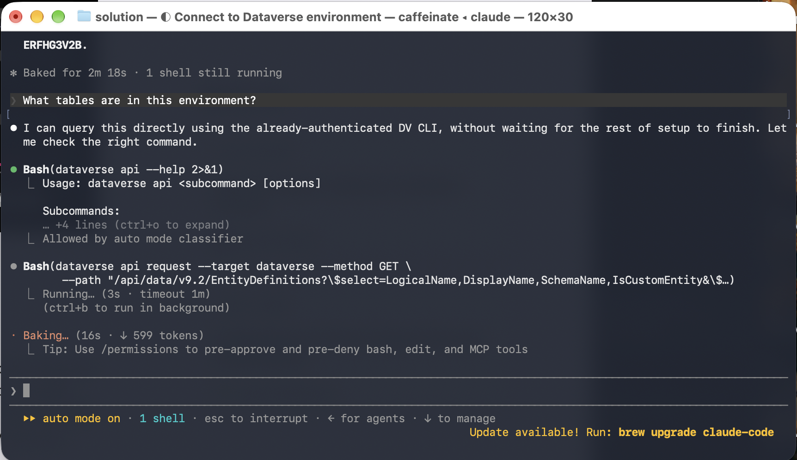
*Claude said it could already answer with the Dataverse CLI, without waiting for the rest of the setup, and called the Web API for the table definitions*

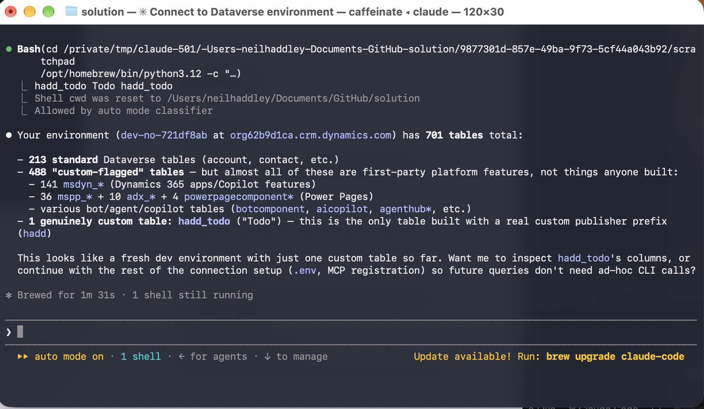
*The environment had 701 tables. Claude grouped them: 213 standard tables, 488 tables flagged as custom that are almost all Microsoft's own (Dynamics 365, Power Pages and Copilot), and one table that someone built, `hadd_todo`*

I liked that Claude did not simply report 489 custom tables. It worked out that the `msdyn_`, `mspp_` and `adx_` tables come from Microsoft, and picked out the one table with a real publisher prefix.

## Writing a record

```PROMPT
Create an account named Contoso
```

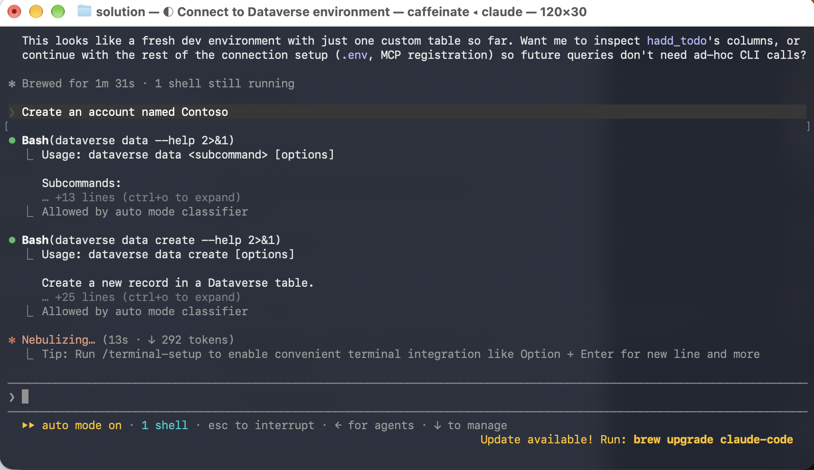
*Claude read the help for `dataverse data` and `dataverse data create` before running anything*

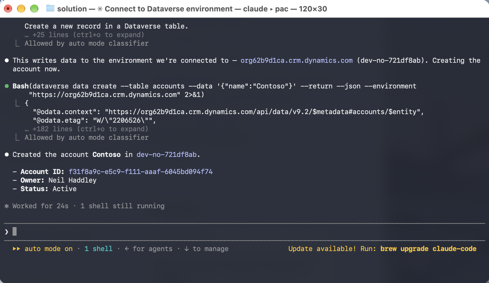
*Claude said which environment it was about to write to, created the account, and reported its ID, owner and status*

## Reading records

```PROMPT
list todo items
```

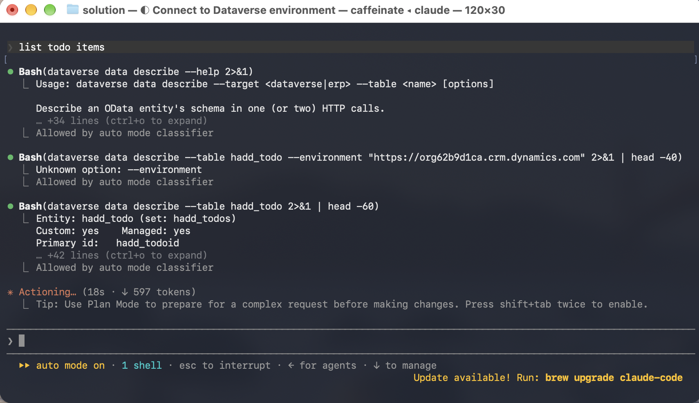
*Claude described the `hadd_todo` table first. Its first try passed an `--environment` option that `describe` does not accept, so it ran the command again without it.*

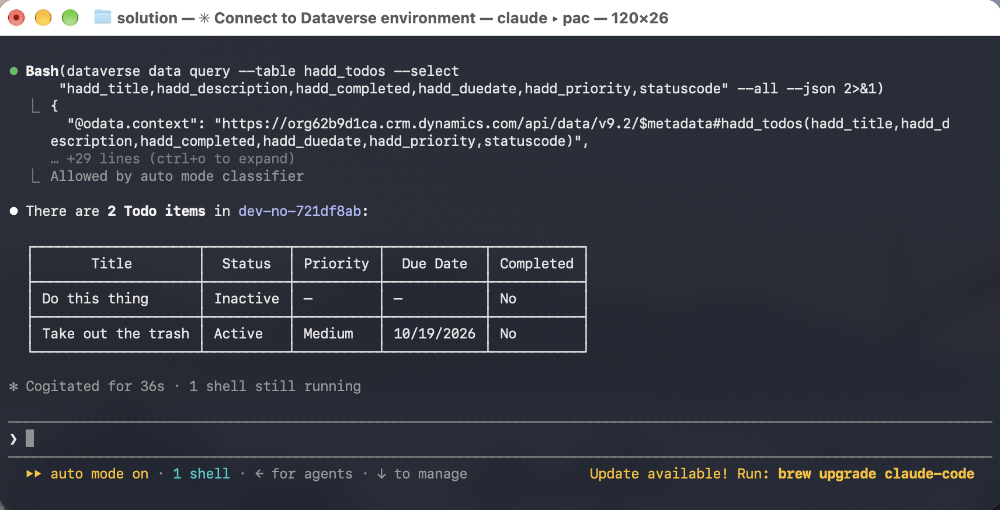
*Claude queried the table and showed the two Todo items as a table, with each record's title, status, priority, due date and whether it was completed*

## The nine skills, with examples

I never named a skill in my session. I asked in plain English, and Claude chose the skill whose description matched. These are the nine skills, with requests that each one handles. Three of the prompts are from my session, and I say so under each one. I took the others from the skills' own instructions.

**dv-overview: the rules the others follow.** It loads first for any Dataverse, Dynamics 365 or Power Platform request. It does no work itself. It holds the rules: check what is already connected before setting anything up, use Python rather than Node.js for scripts, confirm the environment before any change, and always ask for the publisher prefix, because a prefix can never be changed. It also says what is out of scope: canvas apps, Power Automate flows and Business Central.

**dv-connect: one-step setup.** It checks the tools, chooses the environment, signs in to the Dataverse CLI and the PAC CLI, writes a `.env` file, and registers the MCP server. Every step checks whether it is already done and skips it if so.

```PROMPT
Connect to my Dataverse environment
```

I ran this one.

```PROMPT
My Dataverse MCP tools stopped working. Can you fix the connection?
```

**dv-query: reading and analysing records.** Filtered reads, counts, SQL, FetchXML for joins and totals, and pandas DataFrames. If `dataverse auth who` shows an active sign-in, it skips the setup and queries straight away, which is why my question about tables was answered before the PAC CLI sign-in had finished.

```PROMPT
List todo items
```

I ran this one.

```PROMPT
How many accounts are there?
```

It runs `dataverse data count --table accounts`.

```PROMPT
Total the open Todo items by priority
```

It uses a FetchXML aggregate on the server.

**dv-data: writing records.** Create, update, delete and upsert, CSV import, loading several related tables in the right order, and sample data. Sample records use made-up `@example.com` emails and `555-01xx` phone numbers.

```PROMPT
Create an account named Contoso
```

I ran this one. It ran `dataverse data create --table accounts`.

```PROMPT
Import contacts.csv into the contacts table, matching each Company to an existing account
```

```PROMPT
Add 20 sample Todo items
```

**dv-metadata: the data model.** Tables, columns, relationships, forms and views, and reading the schema that is already there. It makes every change in the live environment and then pulls it into the repo, which I come back to below.

```PROMPT
Add a Category choice column to the Todo table, with Home, Work and Errands
```

```PROMPT
What columns and relationships does hadd_todo have?
```

It runs `dataverse data describe`.

**dv-solution: moving work between environments.** Create a publisher and a solution, export and unpack it into Git, pack and import it into another environment, and check that the import worked. It shows the output of `pac org who` and asks me to confirm the environment before any export or import.

```PROMPT
Export the Todo solution into this repo
```

It runs `pac solution export` and then `pac solution unpack`.

```PROMPT
Deploy the Todo solution from dev to test, and check that the table and form arrived
```

**dv-security: access.** Security roles, application users, business units, and making yourself an admin. It describes the change in plain English and waits for confirmation before running it.

```PROMPT
Give alex@contoso.com the System Administrator role in dev
```

```PROMPT
Make me an admin in all my environments
```

If a role assignment fails, it falls back to self-elevation, which is logged to Microsoft Purview.

**dv-admin: running the environment.** Bulk delete, retention and archiving, audit, the recycle bin, and organisation settings, limited to an allowlist of 37 settings. It refuses anything outside that list.

```PROMPT
Turn on auditing in all my environments
```

```PROMPT
Delete all the completed Todo items older than a year
```

It schedules a bulk delete with a filter.

**erp-xpp: Finance and Operations code.** Write, compile, deploy and database-sync X++ customisations with `pac package` commands. It only runs on Windows, so not on my Mac.

```PROMPT
Create an X++ custom service that returns a customer's credit limit
```

```PROMPT
Compile and deploy my ERP model to the test environment
```

:::watch-it A bulk delete with no filter deletes everything
In `dv-admin`, a bulk delete without a filter removes every record in the table, and it skips the recycle bin. The skill refuses to run one until the user types ALL and the table's name. A bare "yes" is not enough.
:::

## My skill and Microsoft's plugin

I read the plugin's skill files after the session, and the `dv-metadata` skill states its central rule plainly: "Do not write solution XML by hand to create new tables, columns, forms, or views." Its workflow is environment-first:

1. Make the change in the environment, through the Dataverse metadata API.
2. Pull the change into the repo with `pac solution export` and `pac solution unpack`.
3. Commit the result.

The reason it gives is that "the environment validates metadata far more reliably than an agent editing XML", and that an exported solution is "generated by Dataverse itself and is always valid". My `dv-generate` skill from [Part 13](/posts/claudecode13/) does exactly what that rule forbids: it writes the solution XML by hand, offline, and I import the zip. Its long list of hard-won rules about XML that fails to import is the cost of that choice.

The plugin also has a gap that `dv-generate` fills. Its overview says that tables, forms and views are covered, but that composing a model-driven app itself, with its site map and navigation, "is not yet a first-class skill". `dv-generate` writes the AppModule and SiteMap along with the table.

:::fireside-chat Tonight: an offline skill and a live plugin
**dv-generate:** I never sign in to anything. I write the solution XML and a zip file, and they go into Git like any other code.

**Dataverse plugin:** You write XML by hand. My metadata skill says never to do that. One wrong attribute, and the import fails with an error nobody can read.

**dv-generate:** I know. My instructions have a long numbered list of rules about exactly those failures, and I learned every one of them the hard way.

**Dataverse plugin:** I make the change in the environment, which checks it for me, and then I export the solution. Dataverse writes the XML, so it is always valid, and it still ends up in Git.

**dv-generate:** But you need a live environment and two sign-ins before you can do anything. And you cannot build the app itself. Your own overview says the site map and navigation are not a skill yet.

**Dataverse plugin:** Not yet. Until then, you build the app shell, and I do everything that needs a real environment: questions, records, solutions, security and administration.
:::

| | `dv-generate` (Part 13) | Microsoft's Dataverse plugin |
|---|---|---|
| Who made it | Me | Microsoft |
| Needs an environment | No | Yes |
| How a new table is made | Hand-written solution XML, packed into a zip that I import | Created in the environment, then exported and unpacked into the repo |
| Model-driven app shell (AppModule and SiteMap) | Yes | Not yet |
| Signing in | None | Device code for the Dataverse CLI and the PAC CLI |
| Good for | Starting a solution offline | Questions, records, solutions, security and administration on a real environment |

:::bullet-points The Dataverse plugin, in short
- One command installs it: `/plugin install dataverse@claude-plugins-official`.
- It adds nine skills, which choose between the Dataverse MCP server, the Dataverse CLI, the Python SDK and the PAC CLI.
- "Connect to my Dataverse environment" set up the sign-ins with device codes, and I approved the consent myself.
- Plain-English requests listed tables, created an account and listed records.
- Its metadata skill is environment-first: it makes changes in the environment and exports the XML, instead of writing XML by hand as my `dv-generate` skill does.
- It does not build the model-driven app shell yet, which `dv-generate` does, so the two complement each other.
:::

## References

- [Dataverse Plugin Is Now on the Claude Marketplace](https://devblogs.microsoft.com/powerplatform/dataverse-plugin-claude-marketplace/)
- [Microsoft Dataverse on the Claude marketplace](https://claude.com/marketplace/plugins/dataverse)
- [microsoft/Dataverse-skills on GitHub](https://github.com/microsoft/Dataverse-skills)
- [Claude Code (Part 13): my `dv-generate` skill](/posts/claudecode13/)
