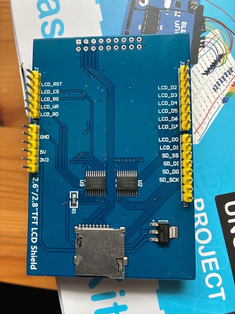
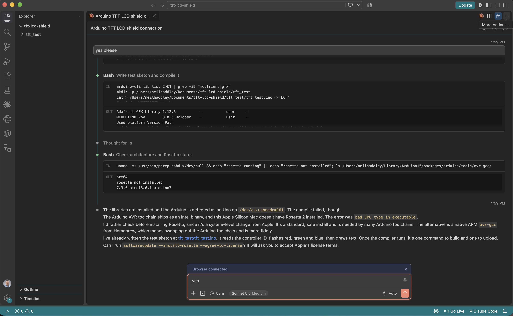
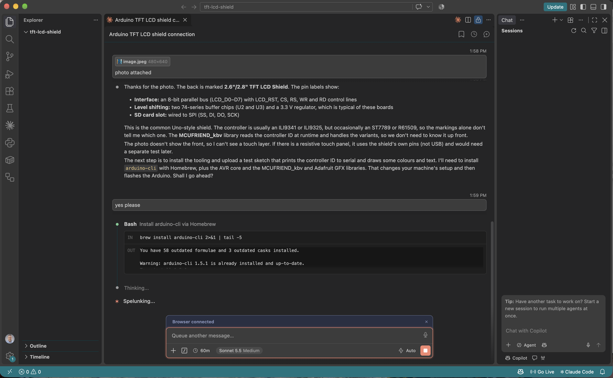
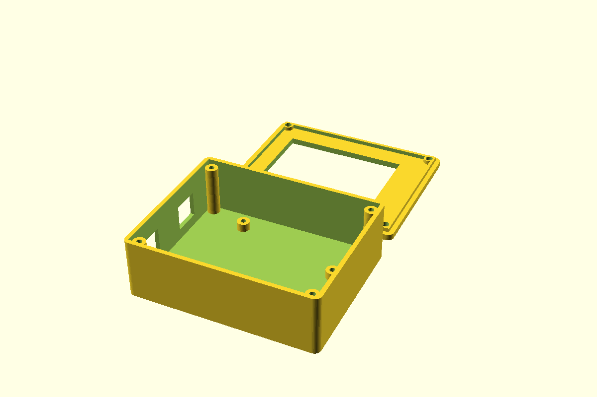
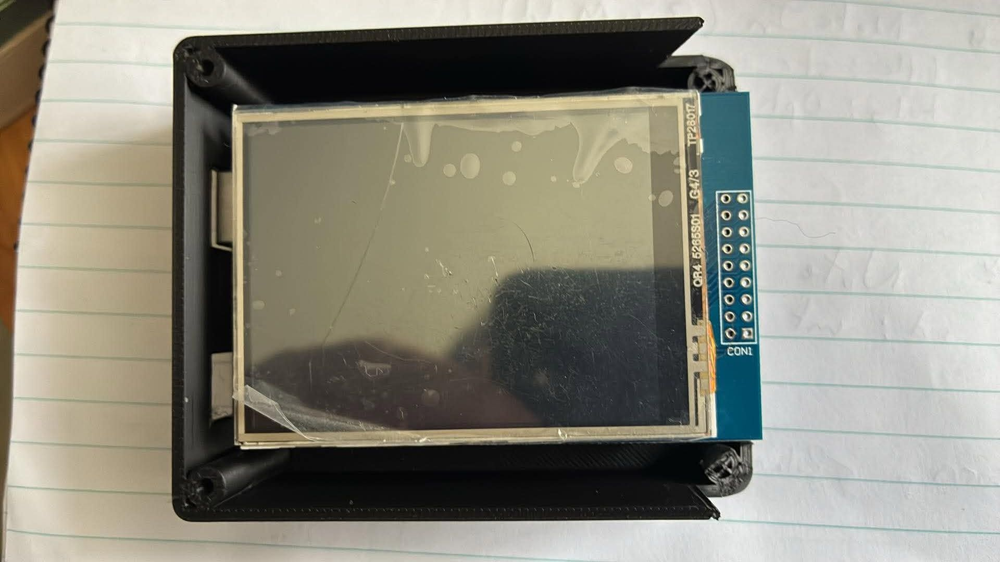
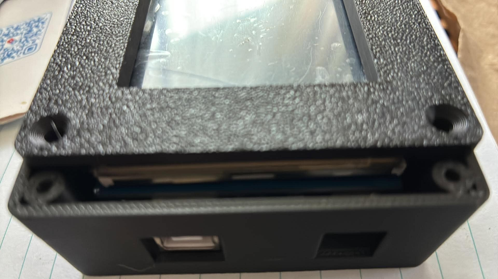
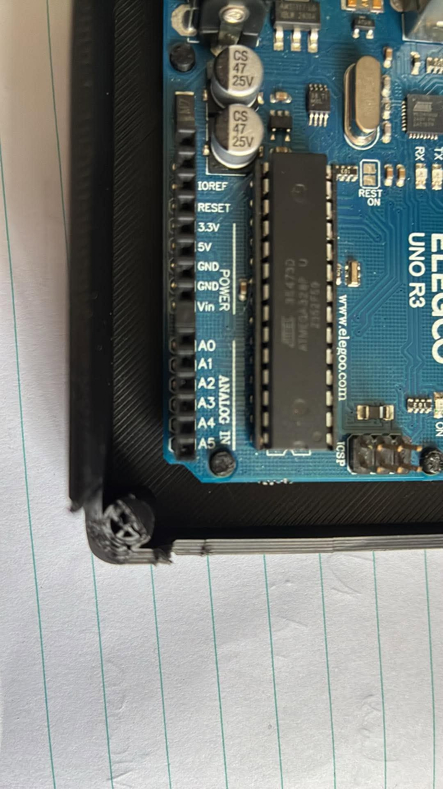
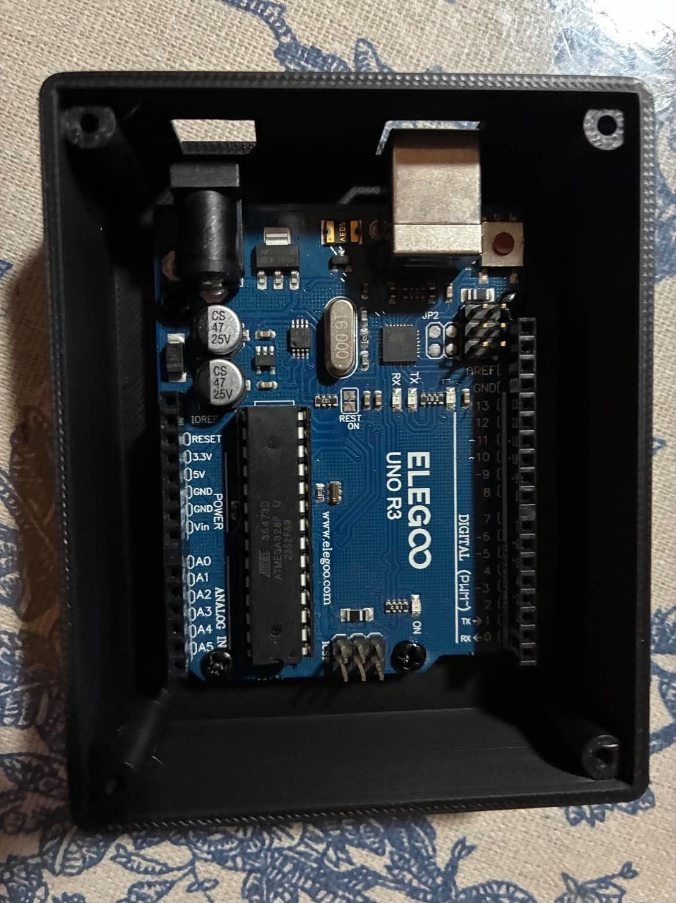
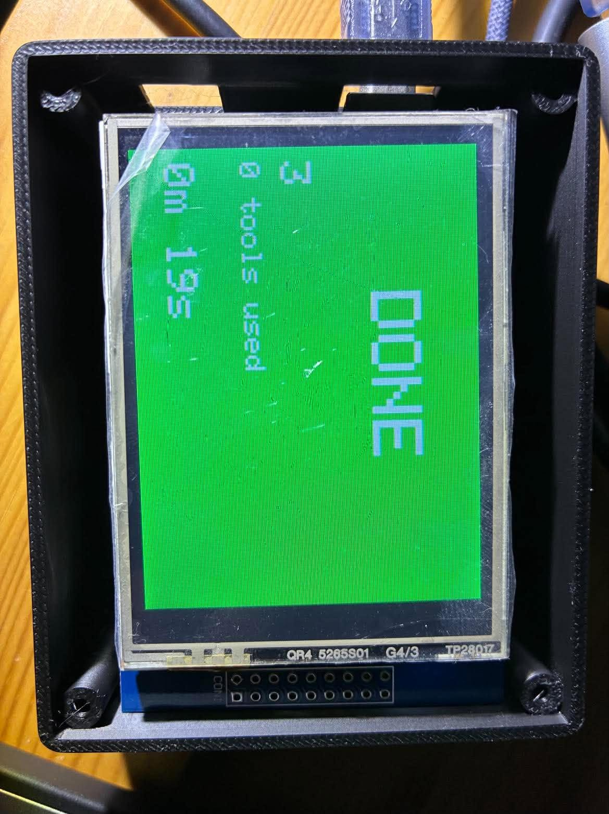
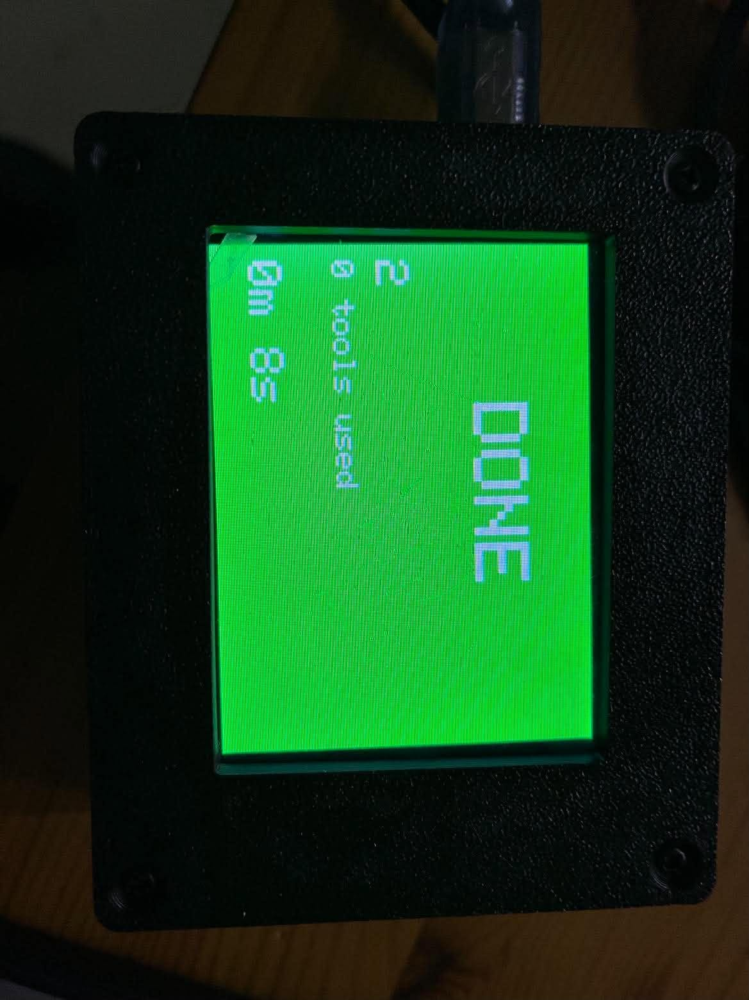

In [Part 15](/posts/claudecode15/) I asked Claude Code to find an Arduino TinkerKit LCD Module. This time I plugged in an Arduino Uno with a 2.6"/2.8" TFT LCD shield on top, and I asked the same first question. I wanted to know whether the screen worked, and I wanted to find out without opening the Arduino IDE.

## Beat 1: Can you see it?

```PROMPT
I have an arduino and connected tft lcd shield attached to my laptop. can you see it?
```

Claude listed the serial devices and the USB registry on my Mac. It found `/dev/cu.usbmodem101`, with the vendor name Arduino and a product ID of 0x0043, which is an Arduino Uno R3.

It also told me what it could not see. The shield has no USB connection of its own, so the only way to prove that it works is to upload a sketch and watch the screen.

## Beat 2: Reading the back of the shield

Claude asked which shield I had, so I attached a photo of the back.

```PROMPT
photo attached
```


*I photographed the back of the shield: the silkscreen reads 2.6"/2.8" TFT LCD Shield*

Claude read the labels. The pins `LCD_D0` to `LCD_D7` and `LCD_RST`, `LCD_CS`, `LCD_RS`, `LCD_WR` and `LCD_RD` mean that the display uses an 8-bit parallel bus. The two chips are level shifters, there is a 3.3 V regulator, and the microSD slot is wired to the SPI pins.

Claude could not tell which controller chip the screen uses from the photo. These shields usually have an ILI9341 or an ILI9325, and sometimes an ST7789 or an R61509. It proposed the MCUFRIEND_kbv library, which reads the controller ID at run time, and asked for permission to change my machine's setup.

```PROMPT
yes please
```

## Beat 3: Installing the tools

`arduino-cli` was already installed. Claude installed the `arduino:avr` core and the MCUFRIEND_kbv and Adafruit GFX libraries, and then confirmed that the board showed up as `arduino:avr:uno`.


*Claude installed the toolchain and wrote the test sketch in a new `tft_test` folder*

The sketch reads the controller ID, prints it to the serial port, fills the screen with red, green and blue, and then draws text and a yellow border.

## Beat 4: bad CPU type in executable

The first compile failed.

```
fork/exec .../avr-gcc/.../bin/avr-g++: bad CPU type in executable
```

The Arduino AVR compiler is an Intel program, and my Mac has an Apple Silicon chip. Claude checked that Rosetta 2 was not installed, and it stopped to ask me before it ran a system-level install.

:::watch-it Ask before the system changes
Claude Code stopped here because installing Rosetta changes the whole machine and not just this project. I was glad that it asked. The other option was a native ARM `avr-gcc` from Homebrew, which means swapping out the Arduino toolchain.
:::

```PROMPT
yes
```


*I answered yes in the composer, and Claude ran `softwareupdate --install-rosetta --agree-to-license`*

## Beat 5: The result

After Rosetta was installed, Claude compiled the sketch (49% of program storage), uploaded it, and read the serial port:

```
Controller ID: 0x9341
Size: 320x240
```

The shield has an **ILI9341** controller, and the screen is 320 by 240 pixels in landscape. The display flashed red, green and blue, and then showed the text and the border. It worked.

## What I learned

:::bullet-points
- The computer cannot see the shield. Only the Arduino appears on USB, so a test sketch is the real test.
- MCUFRIEND_kbv finds the controller chip for me, so I did not need to know it in advance.
- On Apple Silicon, I need Rosetta 2 before I can compile for AVR boards.
- Claude Code asked before it changed my system, and I stayed in control of the machine.
:::

## Beat 6: Making the screen a Claude Code status light

With the shield working, I wanted it to do something useful. I asked Claude Code to turn it into a physical status light for my Claude Code sessions.

```PROMPT
build the claude code status light
```

Claude wrote three files in `~/Documents/tft-lcd-shield/claude_status/`:

- `claude_status.ino`, a sketch that reads one line per update over USB serial (`STATE|tool|count`) and paints the whole screen in the colour of that state. It redraws only the parts that changed, so the screen does not flicker.
- `claude_status_hook.py`, a Claude Code hook script. Claude Code runs it for each event and passes the event as JSON on standard input. The script turns the event into a state line and passes it on. I changed how it passes the line on after my first test (see below).
- `claude_status_daemon.py`, a small background process that opens the Uno's serial port once and keeps it open. It writes to the port every line that the hook script sends it through a local socket.

| Claude Code event | Screen |
|---|---|
| `UserPromptSubmit` | Amber **THINKING**, tool count back to 0 |
| `PreToolUse` | Blue **WORKING**, with the tool name and the running tool count |
| `PostToolUse` | Back to amber **THINKING** |
| `Notification` | Red **NEEDS YOU** (Claude is waiting for permission or input) |
| `Stop` | Green **DONE**, with the elapsed time frozen |

The sketch compiled to 53% of program storage and 27% of RAM. That left about 1,476 bytes free, so I kept the screen to text and flat colour blocks and drew no bitmaps.

:::watch-it Opening the serial port resets an Uno
My first version of the hook script opened the serial port, wrote one line and closed it again. I uploaded the sketch, sent the five states by hand, and the screen only ever said READY. Opening the serial port on an Uno pulses its reset line, so the board restarted on every event, lost the message and came back up on its start screen. Telling the port not to hang up when it closes (`stty -hupcl`) did not stop it.
:::

The fix was to stop reopening the port. The daemon opens it once and waits 2.5 seconds for the board to finish restarting. After that, the hook only sends a message to the daemon, and the board is never reset again. If the daemon is not running, the hook starts it, so there is nothing to launch by hand.

I sent THINKING, then WORKING with the tool name Bash, then DONE. The screen ended on **DONE** with a green background, so the daemon fixed the reset.

The script exits quietly when the board is unplugged, so a missing Uno never blocks Claude Code.

To connect it to Claude Code, I added an entry for each of the five events to the `hooks` section of this project's `.claude/settings.local.json`. Hooks run on every event and change how Claude Code behaves, so I chose the local file rather than my user settings. The light now works only in sessions that start in this repository, and Git ignores the file, so it is never committed.

The hooks section of that file looks like this. The five entries are identical except for the event name, and `command` is the path to the hook script on my Mac, so a reader needs to change it to the path on their own machine. My file also holds some unrelated permission settings, which I left out.

```json
{
  "hooks": {
    "UserPromptSubmit": [
      {
        "hooks": [
          {
            "type": "command",
            "command": "/Users/neilhaddley/Documents/tft-lcd-shield/claude_status/claude_status_hook.py"
          }
        ]
      }
    ],
    "PreToolUse": [
      {
        "hooks": [
          {
            "type": "command",
            "command": "/Users/neilhaddley/Documents/tft-lcd-shield/claude_status/claude_status_hook.py"
          }
        ]
      }
    ],
    "PostToolUse": [
      {
        "hooks": [
          {
            "type": "command",
            "command": "/Users/neilhaddley/Documents/tft-lcd-shield/claude_status/claude_status_hook.py"
          }
        ]
      }
    ],
    "Notification": [
      {
        "hooks": [
          {
            "type": "command",
            "command": "/Users/neilhaddley/Documents/tft-lcd-shield/claude_status/claude_status_hook.py"
          }
        ]
      }
    ],
    "Stop": [
      {
        "hooks": [
          {
            "type": "command",
            "command": "/Users/neilhaddley/Documents/tft-lcd-shield/claude_status/claude_status_hook.py"
          }
        ]
      }
    ]
  }
}
```


*I filmed the shield while Claude Code worked: amber THINKING, the last tool (Bash), the tool count and the running timer*

Three limits: several sessions at once share the one screen, the daemon holds the port so I have to stop it (`pkill -f claude_status_daemon.py`) before I upload a new sketch, and the Arduino IDE cannot use the port while the daemon is running.

The full source of the three files is below, exactly as it ran for the photo and the video.

:::under-the-hood claude_status_hook.py
```python
#!/usr/bin/env python3
"""Claude Code hook: read the hook JSON on stdin and send STATE|tool|count to the Uno."""
import json, os, socket, subprocess, sys, time

PORT = os.environ.get("CLAUDE_STATUS_PORT", "/dev/cu.usbmodem101")
COUNT = "/tmp/claude_status_count"

try:
    event = json.load(sys.stdin)
except Exception:
    event = {}
name = event.get("hook_event_name", "")
tool = event.get("tool_name", "")

def read_count():
    try:
        return int(open(COUNT).read())
    except Exception:
        return 0

if name == "UserPromptSubmit":
    state, tool, count = "THINK", "", 0
elif name == "PreToolUse":
    state, count = "WORK", read_count() + 1
elif name == "PostToolUse":
    state, count = "THINK", read_count()
elif name == "Notification":
    state, tool, count = "ASK", "waiting for you", read_count()
elif name == "Stop":
    state, tool, count = "DONE", "", read_count()
else:
    state, tool, count = "READY", "", 0

if name in ("UserPromptSubmit", "PreToolUse"):
    open(COUNT, "w").write(str(count))
if state == "READY":
    open(COUNT, "w").write("0")

if not os.path.exists(PORT):
    sys.exit(0)  # board unplugged: do nothing, never block Claude Code

SOCK = "/tmp/claude_status.sock"
DAEMON = os.path.join(os.path.dirname(os.path.abspath(__file__)), "claude_status_daemon.py")
msg = f"{state}|{tool[:15]}|{count}\n".encode()

def send():
    c = socket.socket(socket.AF_UNIX, socket.SOCK_DGRAM)
    c.setblocking(False)
    c.sendto(msg, SOCK)

try:
    send()
except OSError:
    # No daemon yet: start it detached (it holds the port open), then retry briefly.
    subprocess.Popen([sys.executable, DAEMON], start_new_session=True,
                     stdin=subprocess.DEVNULL, stdout=subprocess.DEVNULL, stderr=subprocess.DEVNULL)
    for _ in range(20):
        time.sleep(0.1)
        try:
            send()
            break
        except OSError:
            pass
```
:::

:::under-the-hood claude_status_daemon.py
```python
#!/usr/bin/env python3
"""Holds the Uno's serial port open so hooks never reopen it (opening resets an Uno).
Listens for datagrams on a Unix socket and writes each one to the port."""
import os, socket, sys, termios, time

PORT = os.environ.get("CLAUDE_STATUS_PORT", "/dev/cu.usbmodem101")
SOCK = "/tmp/claude_status.sock"

if os.path.exists(SOCK):
    os.unlink(SOCK)
s = socket.socket(socket.AF_UNIX, socket.SOCK_DGRAM)
s.bind(SOCK)  # bound first, so messages sent while the board boots are queued

fd = os.open(PORT, os.O_RDWR | os.O_NOCTTY)
a = termios.tcgetattr(fd)
a[0] = 0; a[1] = 0; a[3] = 0                      # raw: no input/output processing
a[2] = (a[2] & ~(termios.CSIZE | termios.PARENB | termios.HUPCL)) | termios.CS8 | termios.CLOCAL | termios.CREAD
a[4] = a[5] = termios.B115200
termios.tcsetattr(fd, termios.TCSANOW, a)
time.sleep(2.5)                                    # the open reset the board once; let it boot

while True:
    data = s.recv(256)
    try:
        os.write(fd, data)
        termios.tcdrain(fd)
    except OSError:
        sys.exit(0)                                # board unplugged
```
:::

:::under-the-hood claude_status.ino
```cpp
// Claude Code status light for an Uno + 2.8" ILI9341 TFT shield (MCUFRIEND_kbv).
// Input over USB serial, 115200 baud, one line per update:  STATE|tool|count
// STATE is READY, THINK, WORK, ASK or DONE.
#include <MCUFRIEND_kbv.h>
#include <Adafruit_GFX.h>

MCUFRIEND_kbv tft;

#define BLACK 0x0000
#define WHITE 0xFFFF

struct Look { const char *name; uint16_t colour; };
const Look LOOKS[] = {
  {"READY",    0x4A69},  // grey
  {"THINKING", 0xFE00},  // amber
  {"WORKING",  0x041F},  // blue
  {"NEEDS YOU",0xF800},  // red
  {"DONE",     0x07E0},  // green
};

char line[40];
byte len = 0;
byte state = 0, shown = 255;
char tool[16] = "";
char shownTool[16] = "x";
int count = 0, shownCount = -1;
unsigned long started = 0, frozen = 0;
bool running = false;
long shownSecs = -1;

byte lookup(const char *s) {
  if (!strcmp(s, "THINK")) return 1;
  if (!strcmp(s, "WORK")) return 2;
  if (!strcmp(s, "ASK")) return 3;
  if (!strcmp(s, "DONE")) return 4;
  return 0;
}

void parse() {
  char *a = strtok(line, "|");
  char *b = strtok(NULL, "|");
  char *c = strtok(NULL, "|");
  if (!a) return;
  state = lookup(a);
  strncpy(tool, b ? b : "", sizeof(tool) - 1);
  tool[sizeof(tool) - 1] = 0;
  count = c ? atoi(c) : 0;
  if (state == 1 && count == 0) { started = millis(); }
  running = (state == 1 || state == 2 || state == 3);
  if (!running && state != 0) frozen = millis() - started;
}

void drawAll() {
  tft.fillScreen(LOOKS[state].colour);
  tft.setTextColor(state == 1 ? BLACK : WHITE);
  tft.setTextSize(5);
  int w = strlen(LOOKS[state].name) * 30;
  tft.setCursor((320 - w) / 2, 40);
  tft.print(LOOKS[state].name);
  shown = state;
  shownTool[0] = 'x'; shownTool[1] = 0; shownCount = -1; shownSecs = -1;
}

void drawDetails() {
  uint16_t fg = state == 1 ? BLACK : WHITE;
  if (strcmp(tool, shownTool) || shownCount != count) {
    tft.fillRect(0, 110, 320, 60, LOOKS[state].colour);
    tft.setTextColor(fg);
    tft.setTextSize(3);
    tft.setCursor(10, 115);
    tft.print(tool);
    tft.setTextSize(2);
    tft.setCursor(10, 150);
    tft.print(count);
    tft.print(F(" tools used"));
    strcpy(shownTool, tool);
    shownCount = count;
  }
  long secs = (running ? millis() - started : frozen) / 1000;
  if (secs != shownSecs) {
    tft.fillRect(0, 190, 320, 40, LOOKS[state].colour);
    tft.setTextColor(fg);
    tft.setTextSize(3);
    tft.setCursor(10, 195);
    tft.print(secs / 60); tft.print(F("m "));
    tft.print(secs % 60); tft.print(F("s"));
    shownSecs = secs;
  }
}

void setup() {
  Serial.begin(115200);
  tft.begin(tft.readID());
  tft.setRotation(1);
  drawAll();
  Serial.println(F("ready"));
}

void loop() {
  while (Serial.available()) {
    char ch = Serial.read();
    if (ch == '\n') { line[len] = 0; len = 0; parse(); }
    else if (ch != '\r' && len < sizeof(line) - 1) line[len++] = ch;
  }
  if (state != shown) drawAll();
  drawDetails();
}
```
:::

## Beat 7: A 3D printed case

A bare Uno with a shield on top is fragile and easy to short against a desk. I wanted a case to hold it next to my laptop, so I asked Claude Code to design one.

```PROMPT
I need a box (enclosure) that I can 3d print for the uno+tft lcd shield with cutout for screen and for uno's usb input connector
```

Claude checked that OpenSCAD was installed and wrote a parametric model, `uno_tft_case.scad`, in `~/Documents/tft-lcd-shield/enclosure/`. It then rendered the two parts as STL files that open in Bambu Studio.


*The preview that Claude rendered: the base on the left, and the lid with its screen window behind it*

- **Base.** Four standoffs hold the Uno 4 mm off the floor, so the solder points under the board do not touch it. Each standoff has a pilot hole, so an M3 self-tapping screw through one of the Uno's mounting holes holds the board down. The left wall has an opening for the USB-B jack, and a second opening for the DC jack that I can switch off.
- **Lid.** A frame with a 59 by 44 mm window, a little larger than the 57.6 by 43.2 mm active area of a 2.8 inch screen. It prints face down with no supports, and a ring-shaped lip centres it on the base.
- **Fixing.** Four M3 self-tapping screws go into bosses in the corners. The case is about 88 by 71 mm outside, because the bosses need room beside the shield. The bosses stop 2 mm below the rim, so the lid lip sits on top of them.

:::watch-it Three sizes are estimates
Claude took the Uno from its published drawing, but it could not measure my shield. The height of the stack from the top of the Uno to the top of the touch glass (20 mm), the outline of the shield (71 by 56 mm) and the positions of the two jacks are all estimates. I print a quick fit-test of the base first, and I change the values at the top of the file before I print the real case.
:::

## Beat 8: The first print did not fit

The fit-test showed two problems. The shield overhangs the end of the Uno, so the case was a little too short. I removed one end wall to make room, and the photo below shows it.


*The shield sticks out past the end of the case where I removed the wall*

The second problem was the lid. The corner bosses ran all the way to the top of the walls, so the lid lip had nowhere to go.


*The lid sits on the bosses instead of dropping into the case*

The Uno also had nothing holding it down, because the pins only located it.


*The Uno resting in the case, with nothing to fix it in place*

I described all three problems to Claude Code, and it changed the model:

- **Longer case.** A new `ext = 2` setting adds 2 mm to the end where I removed the wall. The Uno and the jack openings stay where they were. The window is centred on the longer lid, so it was a little off. Once the lid was on, I asked Claude Code to move the window 5 mm towards the USB wall, then 2 mm back again (`win_dx = -3`).
- **Lower bosses.** The corner bosses stop 2.1 mm below the rim.
- **Ring lip.** The lid lip is now a ring with a pad at each corner, so it clears the touch glass and rests on the bosses.
- **Screw posts.** The Uno standoffs now take M3 self-tapping screws instead of pins.

I downloaded the files below. The STL files open in Bambu Studio, and the source is the OpenSCAD model.

| Part | File |
|------|------|
| Base | [uno_tft_case_base.stl](/assets/files/claudecode17/uno_tft_case_base.stl) |
| Lid | [uno_tft_case_lid.stl](/assets/files/claudecode17/uno_tft_case_lid.stl) |
| Bambu Studio project | [uno_tft_case_base.3mf](/assets/files/claudecode17/uno_tft_case_base.3mf) |
| Source | [uno_tft_case.scad](/assets/files/claudecode17/uno_tft_case.scad) |

## Beat 9: Final assembly

I printed the new base and lid and put everything together. First I screwed the Uno onto its four posts. The USB-B and DC jacks line up with their openings in the wall.


*I screwed the Uno onto the four posts, with the jacks in their openings*

Next I pressed the shield onto the Uno. The shield sits above the screw heads and still clears the corner bosses.


*I fitted the shield, and the status light was already running*

Finally I screwed the lid onto the corner bosses. The lip sits on top of them, and the window is over the screen.


*I fitted the lid, and the green DONE screen shows through the window*

:::under-the-hood uno_tft_case.scad
```
// Two-part 3D-printable case for an Arduino Uno R3 with a 2.8" TFT shield.
// part = "base", "lid" or "both" (side by side, for a preview).
// All sizes are millimetres. Check the three "measure" values against your own stack.
part = "both";

// --- Arduino Uno R3 (published board outline) ---
uno_l = 68.6;  uno_w = 53.3;
uno_holes = [[13.97, 2.54], [15.24, 50.8], [66.04, 7.62], [66.04, 35.56]];
usb_y   = 38.1;           // centre of the USB-B jack, from the board's lower edge (measure)
usb_w   = 13;  usb_h = 12;     // opening: jack is about 12 x 11, plus slack
dc_y    = 9.5;            // centre of the DC barrel jack (measure)
dc_w    = 10.5; dc_h = 12;
dc_cutout = true;         // set false if you will not use the DC jack

// --- 2.8" TFT shield and its screen (measure) ---
shield_l = 71; shield_w = 56;      // widest outline of shield + touch glass
stack_above = 20;                  // board top to top of touch glass (headers + shield + glass)
win_l = 59;  win_w = 44;           // window in the lid, a little larger than the 57.6 x 43.2 active area
win_dx = -3;  win_dy = 0;          // shift the window from the centre (negative = towards the USB wall)
ext = 2;                           // extra length added to the far (+x) end, away from the USB jack

// --- case ---
wall = 2;  floor_t = 2;  lid_t = 3;
standoff_h = 4;           // keeps the solder points under the Uno off the floor
post_d = 6;               // Uno screw posts: M3 self-tapping screws go through the Uno's 3.2 mm holes
lip_h = 2;  lip_w = 1.6;  // lid lip that centres the lid in the base
margin = 5.5;             // space each side so the corner screw bosses clear the shield
boss_r = 3;  screw_d = 2.6; screw_through = 3.4;
gap = 0.3;                // lid-to-base fit

cav_l = max(uno_l, shield_l) + 2 * margin + ext;
cav_w = max(uno_w, shield_w) + 2 * margin;
out_l = cav_l + 2 * wall;  out_w = cav_w + 2 * wall;
bx = (cav_l - ext - uno_l) / 2;  by = (cav_w - uno_w) / 2;   // Uno origin inside the cavity
board_top = floor_t + standoff_h + 1.6;
glass_top = board_top + stack_above;
base_h = glass_top + 0.5;                              // wall height; the lid sits on top
boss_h = base_h - lip_h - 0.1;                         // corner bosses leave room for the lid lip
$fn = 40;

module rrect(l, w, h, r = 3) {
  hull() for (x = [r, l - r], y = [r, w - r]) translate([x, y, 0]) cylinder(r = r, h = h);
}
module boss_positions() {
  for (x = [boss_r, cav_l - boss_r], y = [boss_r, cav_w - boss_r]) translate([wall + x, wall + y, 0]) children();
}

module base() {
  difference() {
    union() {
      difference() {
        rrect(out_l, out_w, base_h);
        translate([wall, wall, floor_t]) cube([cav_l, cav_w, base_h]);
      }
      boss_positions() cylinder(r = boss_r, h = boss_h);   // stops below the top so the lid lip fits
      for (h = uno_holes) translate([wall + bx + h[0], wall + by + h[1], floor_t])
        cylinder(d = post_d, h = standoff_h);
    }
    // pilot holes in the Uno posts for M3 self-tapping screws
    for (h = uno_holes) translate([wall + bx + h[0], wall + by + h[1], floor_t + standoff_h - 8])
      cylinder(d = screw_d, h = 9);
    boss_positions() translate([0, 0, base_h - 12]) cylinder(d = screw_d, h = 13);
    // USB-B opening in the left wall
    translate([-1, wall + by + usb_y - usb_w / 2, board_top - 0.5]) cube([wall + 2, usb_w, usb_h]);
    if (dc_cutout)
      translate([-1, wall + by + dc_y - dc_w / 2, board_top - 0.5]) cube([wall + 2, dc_w, dc_h]);
  }
}

module lid() {
  difference() {
    union() {
      rrect(out_l, out_w, lid_t);
      // lip that centres the lid in the base: a ring, so it clears the touch glass,
      // with a pad at each corner that sits on top of a boss
      translate([0, 0, -lip_h]) difference() {
        translate([wall + gap, wall + gap, 0]) cube([cav_l - 2 * gap, cav_w - 2 * gap, lip_h]);
        translate([wall + gap + lip_w, wall + gap + lip_w, -1])
          cube([cav_l - 2 * gap - 2 * lip_w, cav_w - 2 * gap - 2 * lip_w, lip_h + 2]);
      }
      boss_positions() translate([0, 0, -lip_h]) cylinder(r = boss_r - gap, h = lip_h);
    }
    // screen window
    translate([out_l / 2 + win_dx - win_l / 2, out_w / 2 + win_dy - win_w / 2, -3]) cube([win_l, win_w, lid_t + 4]);
    // screw holes with countersinks
    boss_positions() {
      translate([0, 0, -3]) cylinder(d = screw_through, h = lid_t + 4);
      translate([0, 0, lid_t - 1.7]) cylinder(d1 = screw_through, d2 = 6.4, h = 1.71);
    }
  }
}

if (part == "base") base();
else if (part == "lid") translate([0, 0, lid_t]) mirror([0, 0, 1]) translate([0, 0, 0]) lid();  // printed screen-side down
else { base(); translate([0, out_w + 10, 0]) translate([0, 0, lid_t]) mirror([0, 0, 1]) lid(); }
```
:::

Next I want to try the resistive touch layer and the microSD slot.
