# Copilot Agents: Impressive in the Demo, Disappointing on Monday?

A demo is a controlled room. The agent gets one tidy document, one clear question and a technical pre-sales professional who knows which questions work. On Monday morning the same agent meets three versions of a policy, a folder it may not be allowed to read, and a user who asks something nobody rehearsed.

*On Monday morning, a line in the system prompt fixes none of these*

Is it true that Microsoft Copilot agents look good in demos and disappoint in real work? Do companies fail to invest enough in the knowledge sources and tools the agent depends on? Is the Microsoft Copilot harness any better than something you do not need to pay for? And one question for anyone who builds these for clients: what happens to the delivery consultant if the Monday result disappoints?

## What the evidence does support

**Agents are unreliable on realistic office work, in general.** [TheAgentCompany](https://arxiv.org/abs/2412.14161) simulates a small software company, and the best agent in the latest version finished 30.3% of its 175 tasks without help. That says something about language-model agents as a group. It says nothing about any particular Copilot configuration.

**Many agent projects will not survive.** Gartner forecast in June 2025 that over 40% of agentic AI projects would be cancelled by the end of 2027. It gave three causes: rising costs, unclear business value and inadequate risk controls. It also warned about "agent washing", where vendors rebrand existing assistants, robotic process automation and chatbots as agents, and it estimated that only about 130 of the thousands of agentic AI vendors are real. In February 2025 Gartner predicted that through 2026, organisations will abandon 60% of AI projects unsupported by AI-ready data.

## Why the demo works

A demo hides the work that sits behind the agent. Microsoft's own documentation is frank about that work, in its [best practices for building declarative agents](https://learn.microsoft.com/en-us/microsoft-365/copilot/extensibility/declarative-agent-best-practices) and its [known issues](https://learn.microsoft.com/en-us/microsoft-365-copilot/extensibility/known-issues).

- An agent grounded on SharePoint or OneDrive needs a Copilot licence, and the signed-in user needs at least read access. When any of these is missing, grounding can fail without any visible error ([known issues](https://learn.microsoft.com/en-us/microsoft-365-copilot/extensibility/known-issues)).
- More knowledge sources are not automatically better. Microsoft advises relevance over quantity ([best practices](https://learn.microsoft.com/en-us/microsoft-365/copilot/extensibility/declarative-agent-best-practices)), and says an agent with many sources can respond slowly ([known issues](https://learn.microsoft.com/en-us/microsoft-365-copilot/extensibility/known-issues)).
- Instructions should name which source or tool applies to each task. They should also tell the agent to ask for missing information instead of guessing ([best practices](https://learn.microsoft.com/en-us/microsoft-365/copilot/extensibility/declarative-agent-best-practices)).
- Microsoft says to evaluate grounding, not only how fluent the answers sound ([best practices](https://learn.microsoft.com/en-us/microsoft-365/copilot/extensibility/declarative-agent-best-practices)).
- Access rules belong in the service the agent calls. Instructions and confirmation prompts do not replace them ([best practices](https://learn.microsoft.com/en-us/microsoft-365/copilot/extensibility/declarative-agent-best-practices)).

[A consulting firm's article on Copilot Studio](https://www.withum.com/resources/getting-the-best-out-of-your-microsoft-copilot-studio-agents-setting-the-right-expectations-for-real-impact/) by Withum, published in February 2026, makes the same point from the builder's side. It says that an agent cannot follow instructions that depend on tools, data or knowledge it has not been given, and that clear instructions only work when paired with the right configuration. The article offers no survey data or failure rates. It is the opinion of a consulting firm that also promotes an Agent in a Day workshop at the end of the article, not evidence, but it matches Microsoft's guidance.

:::brain-power Before you read on
An agent answers perfectly in a demo from one clean benefits document. Now it sits on a SharePoint site with 40,000 files, three versions of every policy, and permissions that differ for every person who asks. Name two things that could go wrong that the demo could never show.
:::

## Is it all too little investment in knowledge and tools?

Partly. It helps to separate two kinds of failure.

**Failures that investment can fix.** The knowledge was never connected, or the agent could not read it. The instructions assumed a tool that did not exist. Nobody tested what happens when information is missing:

- The Copilot built into a model-driven app answered only from the Contacts data in that app. It could not create a record, and it would not answer a general question until I added a custom topic in Copilot Studio ([the post](/posts/powerapps9/)).
- In my Business Central series, the DeepSeek Harness agent could only do what its configuration allowed, and that configuration was drafts only ([Part 1](/posts/bcmcp1/)). That was by design. In the first instance I only wanted to give the agent tools to read accounting information, not to make updates.

**Failures that investment will not fully fix.** The benchmark agents in [TheAgentCompany](https://arxiv.org/abs/2412.14161) had the tools and the environment, and most tasks still failed. Microsoft says its setting to keep an agent to its configured sources is not a guarantee ([best practices](https://learn.microsoft.com/en-us/microsoft-365/copilot/extensibility/declarative-agent-best-practices)). Gartner lists cost, unclear value and weak risk controls ([June 2025](https://www.gartner.com/en/newsroom/press-releases/2025-06-25-gartner-predicts-over-40-percent-of-agentic-ai-projects-will-be-canceled-by-end-of-2027)) beside data ([February 2025](https://www.gartner.com/en/newsroom/press-releases/2025-02-26-lack-of-ai-ready-data-puts-ai-projects-at-risk)), so even a well-fed agent can fail a business case.

So the honest answer is: investment in knowledge and tools is necessary, and it is not sufficient. Someone still has to check the output.

:::fireside-chat The demo and Monday argue about who is to blame
**The demo:** I was perfect. Every question got a clear answer.

**Monday:** You wrote the questions.

**The demo:** The agent was not the problem. It just needed good documents.

**Monday:** Which nobody cleaned, and half of which it may not read.

**The demo:** Then the real work is the documents and the tools, not the agent.

**Monday:** Mostly. And even then, somebody has to read what it says before the client does.
:::

## Is the Microsoft Copilot harness better than something I do not need to pay for?

I can answer this for one task at least. In [a separate post](/posts/copilotstudiostl/), I asked a Microsoft Copilot harness agent that I created in Copilot Studio to turn two photos of a gingerbread man into an STL file. The agent produced two files, and I sliced one and sent it to my printer. Before that, I had given the same photos to Claude Code and to DeepSeek Harness. Both converted them to an STL file. It was easy, and certainly no harder than the Copilot Studio agent.

- **DeepSeek Harness** is open and plugin-based. In [an earlier post](/posts/deepseekharnessollama/), I pointed it at a model running on my own Mac through Ollama, with no API key. That costs me no usage fees, although I own the hardware.
- **Claude Code** is a harness that is not tied to Anthropic's own models. With Anthropic's models it needs a paid plan or API credits, but in [Claude Code, Part 11](/posts/claudecode11/) I ran it against a local Ollama model, qwen3-coder:30b, with no API costs and no data leaving my machine. Ollama also documents the setup ([Ollama](https://docs.ollama.com/integrations/claude-code)).
- **The Microsoft Copilot harness in Copilot Studio** needed a pay-as-you-go billing plan charged to an Azure subscription before the agent would answer. Is that cost more than the cost of the hosted LLM?
- **A custom agent with no off-the-shelf harness.** In [Blog AI Assistant, Part 2](/posts/localagent2/), I wrote the agent loop myself. It runs in the browser, calls tools and stops when the model gives a plain-text reply, on top of a checked wiki of my posts and a hosted Qwen3.5 9B large language model. In [Azure Foundry Agent, Part 7](/posts/azurefoundryagent8/), a rules base built from the statutes avoided traps that GPT with search, GPT-5.5 and DeepSeek fell into.

The Microsoft Copilot harness was not easier for this STL file generation task. My answer is no. I found no reason to believe that the Microsoft Copilot harness is any better than one that I do not need to pay for.

**Does Microsoft's licensing change that answer?** A harness outside Microsoft can read your mail as you, through Microsoft Graph delegated permissions. The app acts as the signed-in user and cannot reach anything that the user could not already reach ([Microsoft Graph mail API overview](https://learn.microsoft.com/graph/api/resources/mail-api-overview)). The user needs a mailbox, which normally comes with an Exchange Online licence, and the user or an administrator has to consent to the permissions. I found no Copilot licence requirement for that route. Licensing does appear in two other places. Microsoft's Copilot Studio documentation for the Work IQ MCP servers says that a Microsoft 365 Copilot licence is required ([Work IQ MCP overview](https://learn.microsoft.com/en-us/microsoft-copilot-studio/use-work-iq)), while its Work IQ API documentation says that access is independent of Copilot licensing and billed by usage, and I could not reconcile the two. Agent 365, which governs agent identities including agents from other vendors, is reportedly licensed per user ([Superpower Daily](https://superpowerdaily.com/posts/microsoft-adds-controls-for-third-party-and-local-ai-agents-in-agent-365)). I found nothing that says Claude Code or DeepSeek Harness need a Microsoft licence to read a customer's own data. If Microsoft tied that access to a licence, the answer above could change.

So what is unique about the Microsoft Copilot harness? Not the loop. Planning, a sandbox, skills, memory and tool calls are things that Claude Code and DeepSeek Harness also do.

If the hard part is the tools and the knowledge sources, is the choice of harness a distraction?

## Where Copilot Cowork and Claude Cowork fit

Two newer products have similar names and different designs. Claude Cowork is a desktop agent from Anthropic. It works on your own machine, inside the folders you give it. Copilot Cowork, launched by Microsoft in March 2026, is not a renamed copy of it. Microsoft says it worked closely with Anthropic to bring the technology that powers Claude Cowork into Microsoft 365 Copilot, and Copilot Cowork runs in the cloud inside your Microsoft 365 tenant. It draws on your email, meetings, chats and files, makes a plan, and works in the background while you review, pause or approve.

## The danger for delivery consultants

A client judges the agent on Monday, and three roles stand behind that moment:

- **The salesperson.** A professional services salesperson opens the conversation or, for an internal team, an enterprise architect or another IT department resource.
- **The technical pre-sales professional.** This person sets the expectation, with a demo and a statement of work, whether the client is external or an internal business unit.
- **The delivery consultant.** This person is responsible for building the agent and getting it into production, inherits that expectation and is judged against it.

The reputation of the internal team or professional services firm rests on the technical pre-sales professional's skill at setting expectations and drafting a detailed statement of work.

**A disclaimer is not a deliverable.** A delivery team cannot develop an AI for a paying customer, add a line saying that generative AI results may be wrong, and walk away calling it good. The Copilot Studio Preview chat shows "AI-generated content may be incorrect" under its message box. That line protects the product. It does not protect the delivery consultant who configured the agent, because the client paid for answers that hold up on their own documents. Public cases show who answers when AI-assisted work disappoints. Deloitte Australia delivered a report to a government department under a contract of about A$440,000. A researcher found fabricated references, and Deloitte issued a corrected version that disclosed the use of Azure OpenAI. It refunded part of the fee, reported as more than A$97,000. In Canada, a Deloitte report on health staffing for Newfoundland and Labrador, priced at about $1.6 million, was found to contain at least four citations that do not appear to exist. The province changed how it awards contracts.

I found no report that names a Copilot agent in either case. Deloitte Australia disclosed Azure OpenAI, which is a hosted model, but did not say what application or harness was used, and for the Canadian report I found no named tool. They show who answers for disappointing AI-assisted work: the firm that signed its name to the result.

Courts have seen the same failure. In *Mata v. Avianca* in 2023, lawyers filed a brief that cited cases which ChatGPT had invented. Judge Castel imposed a $5,000 penalty on the lawyers and their firm, and found that they had defended the citations after the court questioned them ([ABA Journal](https://abajournal.com/web/article/lawyers-who-doubled-down-and-defended-chatgpts-fake-cases-must-pay-5k-judge-says)). Damien Charlotin keeps a public [database of court decisions](https://www.damiencharlotin.com/hallucinations/) in which a court found or implied that a filing relied on hallucinated material. A secondary summary counted 2,305 decisions worldwide by 16 November 2026, with self-represented litigants behind about 57 to 60 percent of them and lawyers about 39 to 40 percent in the first three quarters of 2026 ([law-tech.ai](https://law-tech.ai/knowledge/ai-hallucination-cases-court-2026-data/)). In *Mata*, the tool was ChatGPT, not a Copilot agent. The lawyer who signs the filing answers for it, whichever tool wrote the draft.

These are the protections an experienced consultant would write into the statement of work. For a very small engagement, an experienced consultant would normally create the statement of work and then deliver against it. Otherwise they would work with the account manager or enterprise architect to develop the statement of work and then support the delivery team through the delivery phase.

1. **Write down what the agent knows.** List the knowledge sources and who owns them. Say plainly that the agent cannot answer outside them.
2. **Test on the client's own documents before the build.** Agree 20 real questions and what a good answer looks like. A demo score is not a deployment score.
3. **Charge for the preparation, not only the agent.** Cleaning documents, fixing permissions and writing instructions that name the tools are most of the work.
4. **Put verification in the process.** Say in the contract that a person checks the output before it leaves the building. Microsoft's own advice is to test missing information, permissions and failed actions.
5. **Disclose the use of AI, and check every citation.** Deloitte's cost was not only the refund. It was the headline.
6. **Do not hide behind a disclaimer.** "Generative AI results may be wrong" is a warning to the reader. It is not a measure of quality, and it does not replace the test questions, the named sources or the person who checks.

:::pencil Write the first three lines of the statement of work
Imagine a client asks for a Copilot agent that answers HR questions from a SharePoint site. As the technical pre-sales professional, write the three sentences you would put in the statement of work to stop Monday from being a surprise.

:::answer
One example: "The agent answers only from the documents in the agreed HR folder, which the client owns and keeps current." "Success is 18 correct answers out of 20 agreed test questions, marked by the client's HR team before launch." "Every answer that reaches an employee is marked as AI-generated, and HR reviews a sample each month." Yours may differ, but each line should name a source, a measure or a checker.
:::
:::

:::no-dumb-questions
**Q: So are Copilot agents useless?**
A: No. Microsoft's guidance and the evidence both point to narrow agents that are grounded on a known source, have a clear purpose and whose work a person checks. A first draft or a second pair of eyes tolerates an occasional mistake.
:::

:::bullet-points The short version
- The demo-to-reality gap is real.
- Verified: the CMU benchmark figures, Gartner's two forecasts and the two Deloitte cases.
- Under-investment in knowledge sources and tools explains a lot, and Microsoft's own guidance says so. It does not explain everything, so a person still has to check the output.
- The technical pre-sales professional sets the expectation and drafts the statement of work, and the delivery consultant inherits both and owns the Monday result. Write down the sources, test on real documents and keep verification in the process.
:::

## References

- [Microsoft touts M365 Copilot momentum, claims 15M paid users](https://www.computerworld.com/article/4124591/microsoft-touts-m365-copilot-momentum-claims-15m-paid-users.html) (Computerworld)
- [Microsoft claims 15 million paid M365 Copilot seats](https://www.directionsonmicrosoft.com/blog/microsoft-claims-15-million-paid-m365-copilot-seats) (Directions on Microsoft)
- [Microsoft fiscal year 2026 third quarter earnings call](https://www.microsoft.com/en-us/investor/events/fy-2026/earnings-fy-2026-q3), [fourth quarter](https://www.microsoft.com/en-us/investor/events/fy-2026/earnings-fy-2026-q4) and [fiscal 2027 first quarter](https://www.microsoft.com/en-us/investor/events/fy-2027/earnings-fy-2027-q1) (Microsoft Investor Relations)
- [Microsoft Copilot Cowork explained: how it differs from Anthropic's Claude Cowork](https://www.businesstoday.in/technology/news/story/microsoft-copilot-cowork-explained-how-it-differs-from-anthropics-claude-cowork-519930-2026-03-10) (Business Today)
- [Copilot Cowork: a new way of getting work done](https://www.microsoft.com/en-us/copilot/blog/2026/03/09/copilot-cowork-a-new-way-of-getting-work-done/) (Microsoft Copilot Blog)
- [Pay-as-you-go meters](https://learn.microsoft.com/power-platform/admin/pay-as-you-go-meters) (Microsoft Learn)
- [FAQ for agents powered by the Microsoft Copilot harness](https://learn.microsoft.com/microsoft-copilot-studio/agents-experience/faqs-copilot-harness) (Microsoft Learn)
- [Mail API overview](https://learn.microsoft.com/graph/api/resources/mail-api-overview) (Microsoft Graph, Microsoft Learn)
- [Work IQ MCP overview](https://learn.microsoft.com/en-us/microsoft-copilot-studio/use-work-iq) (Microsoft Learn)
- [Microsoft adds controls for third-party and local AI agents in Agent 365](https://superpowerdaily.com/posts/microsoft-adds-controls-for-third-party-and-local-ai-agents-in-agent-365) (Superpower Daily)
- [Microsoft announces Copilot Cowork with help from Anthropic](https://venturebeat.com/orchestration/microsoft-announces-copilot-cowork-with-help-from-anthropic-a-cloud-powered) (VentureBeat)
- [TheAgentCompany: Benchmarking LLM Agents on Consequential Real World Tasks](https://arxiv.org/abs/2412.14161) (arXiv, Carnegie Mellon University)
- [Carnegie Mellon news: TheAgentCompany](https://www.cs.cmu.edu/news/2025/agent-company)
- [AI agents fail a lot](https://www.theregister.com/2025/06/29/ai_agents_fail_a_lot/) (The Register)
- [Microsoft 365 Copilot extensibility: known issues](https://learn.microsoft.com/en-us/microsoft-365-copilot/extensibility/known-issues) (Microsoft Learn)
- [Declarative agent best practices](https://learn.microsoft.com/en-us/microsoft-365/copilot/extensibility/declarative-agent-best-practices) (Microsoft Learn)
- [Getting the best out of your Microsoft Copilot Studio agents](https://www.withum.com/resources/getting-the-best-out-of-your-microsoft-copilot-studio-agents-setting-the-right-expectations-for-real-impact/) (Withum, a consulting firm)
- [Gartner predicts over 40% of agentic AI projects will be canceled by end of 2027](https://www.gartner.com/en/newsroom/press-releases/2025-06-25-gartner-predicts-over-40-percent-of-agentic-ai-projects-will-be-canceled-by-end-of-2027) (Gartner)
- [Lack of AI-ready data puts AI projects at risk](https://www.gartner.com/en/newsroom/press-releases/2025-02-26-lack-of-ai-ready-data-puts-ai-projects-at-risk) (Gartner)
- [Lawyers who 'doubled down' and defended ChatGPT's fake cases must pay $5K, judge says](https://abajournal.com/web/article/lawyers-who-doubled-down-and-defended-chatgpts-fake-cases-must-pay-5k-judge-says) (ABA Journal)
- [AI Hallucination Cases Database](https://www.damiencharlotin.com/hallucinations/) (Damien Charlotin)
- [AI Hallucination Cases in Court: What the 2026 Data Shows](https://law-tech.ai/knowledge/ai-hallucination-cases-court-2026-data/) (law-tech.ai)
- [Deloitte refunds Aussie gov after AI fabrications slip into $440K welfare report](https://www.theregister.com/2025/10/06/deloitte_ai_report_australia/) (The Register)
- [Deloitte refunds $60K on report with AI errors](https://www.cfodive.com/news/deloitte-refunds-60k-report-ai-errors-australian-government-accounting/) (CFO Dive)
- [Deloitte report for Newfoundland government found to have apparently false citations](https://www.ctvnews.ca/canada/newfoundland-and-labrador/article/deloitte-report-for-newfoundland-government-found-to-have-apparently-false-citations/) (CTV News)
- [Newfoundland and Labrador overhauls procurement after report errors thought to be AI](https://www.ctvnews.ca/atlantic/article/newfoundland-and-labrador-overhauls-procurement-after-report-errors-thought-to-be-ai/) (CTV News)
- [Microsoft denies reports of lower AI sales targets](https://www.techradar.com/pro/microsoft-denies-reports-of-lower-ai-sales-targets-as-customers-resist-new-tools) (TechRadar)
- [Adding a Custom Topic in Copilot Studio to the Copilot in a Model-Driven App](/posts/powerapps9/)
- [Business Central and DeepSeek Harness, Part 1](/posts/bcmcp1/)
- [Business Central and DeepSeek Harness, Part 4](/posts/bcmcp4/)
