# I Asked a Microsoft Copilot Harness Agent to Turn a Gingerbread Man into an STL File

I had two photos of a gingerbread man lying on lined paper next to a ruler. I wanted a file my 3D printer could read. So I asked an agent that I created in Copilot Studio, powered by the Microsoft Copilot harness, to make one.

This post follows the whole trip: sign-up, one line of instructions, a message about credits, a pay-as-you-go billing plan that I set up, two STL files, a slicer and a print job.
## Signing up for Copilot Studio

I went to the Copilot Studio sign-up page. It recognised my account and asked me to select Continue.

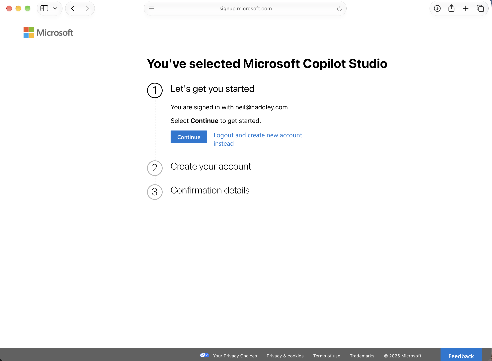
*I selected Continue*

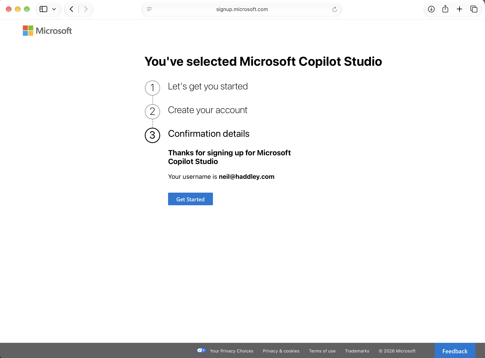
*Microsoft thanked me for signing up for Copilot Studio*

The home page greeted me with three cards: Agent, Workflow and App (preview). A small badge said **Uses Copilot Credits**.
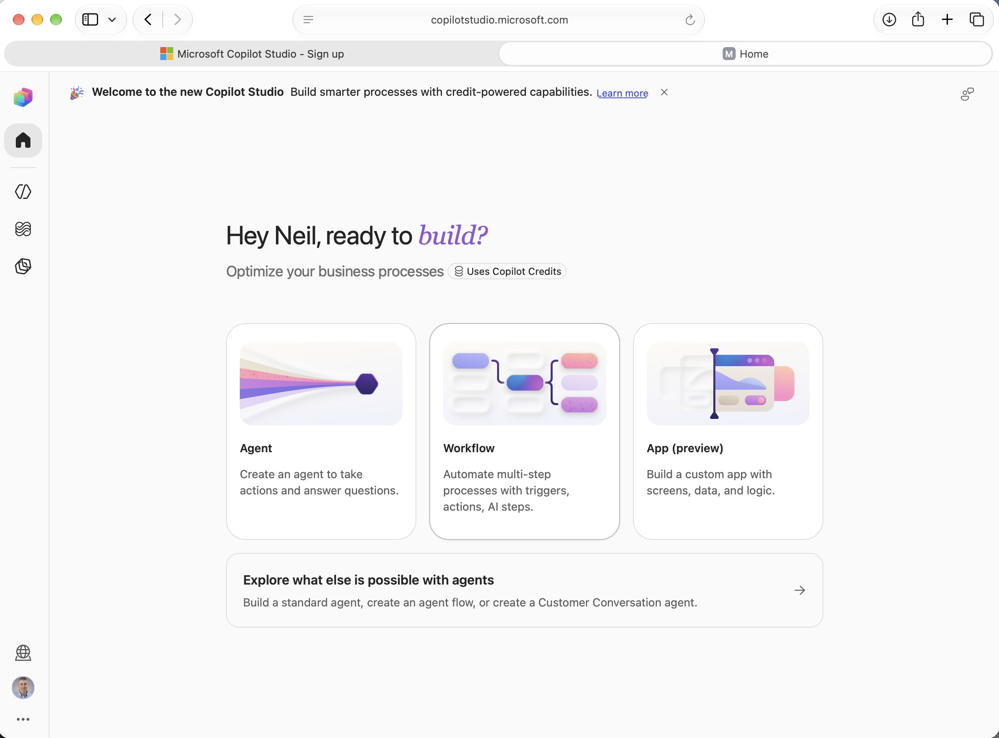
*The home page offered Agent, Workflow and App (preview)*

## One line of instructions

The new agent opened as "Untitled Agent". The right-hand panel already had a model set to Auto, a tool called Work IQ and a knowledge source called Search all websites. The instructions box held a template asking for five things: what the agent should accomplish, what is in and out of scope, how it should communicate, when it should use knowledge or take action, and when it should act alone, ask for input or stop.

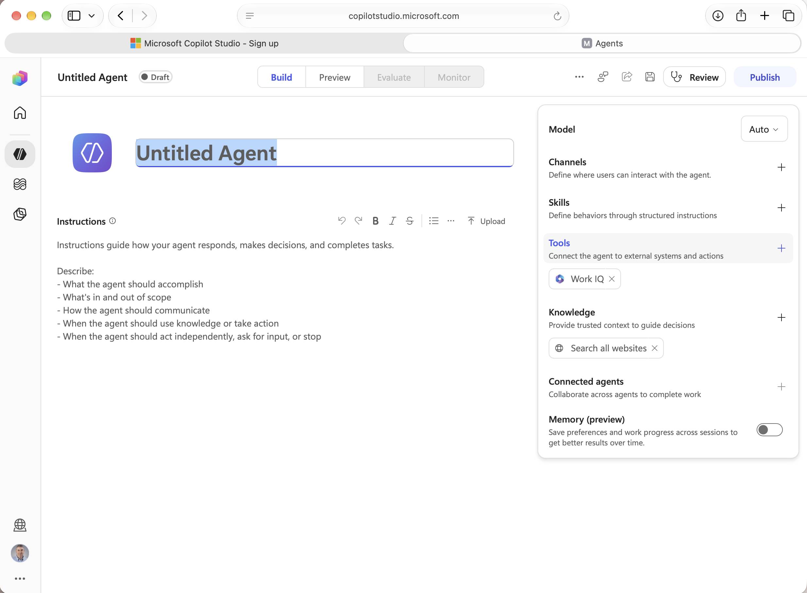
*The template asked for five things*

I wrote one sentence and named the agent **STL file generator**.

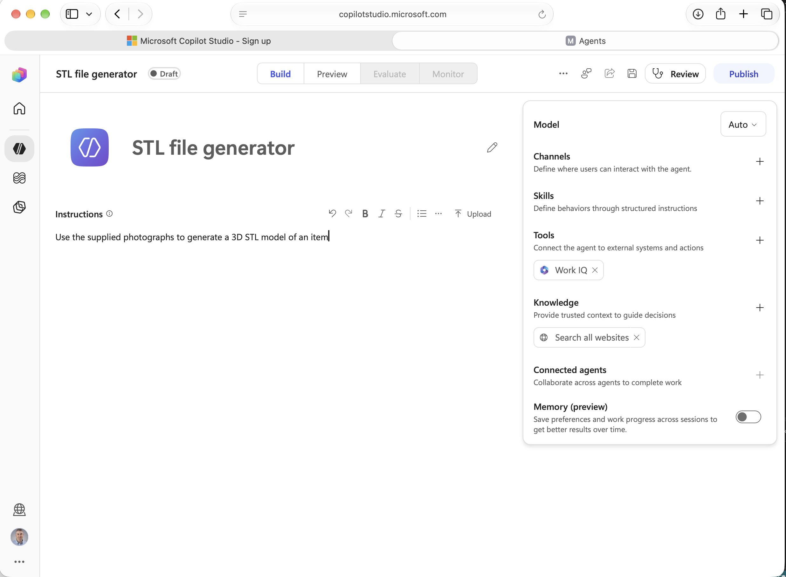
*I wrote one line of instructions*

```PROMPT
Use the supplied photographs to generate a 3D STL model of an item
```

:::brain-power Before you read on
My instructions say nothing about scale, thickness, file format details or what to do when a photo does not show the whole object. Which of those will matter when I try to print the result?
:::

## The first attempt

In the Preview tab I attached two photos and typed a request.
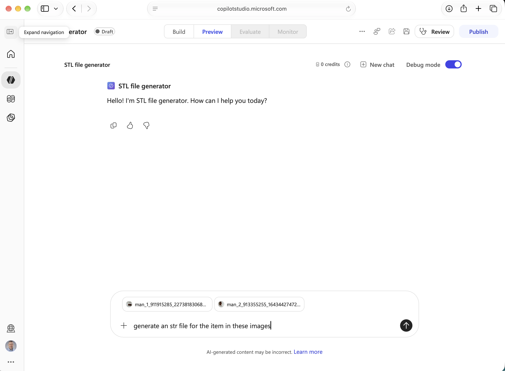
*I attached two photos and asked for a file*

The agent stopped with an error message.

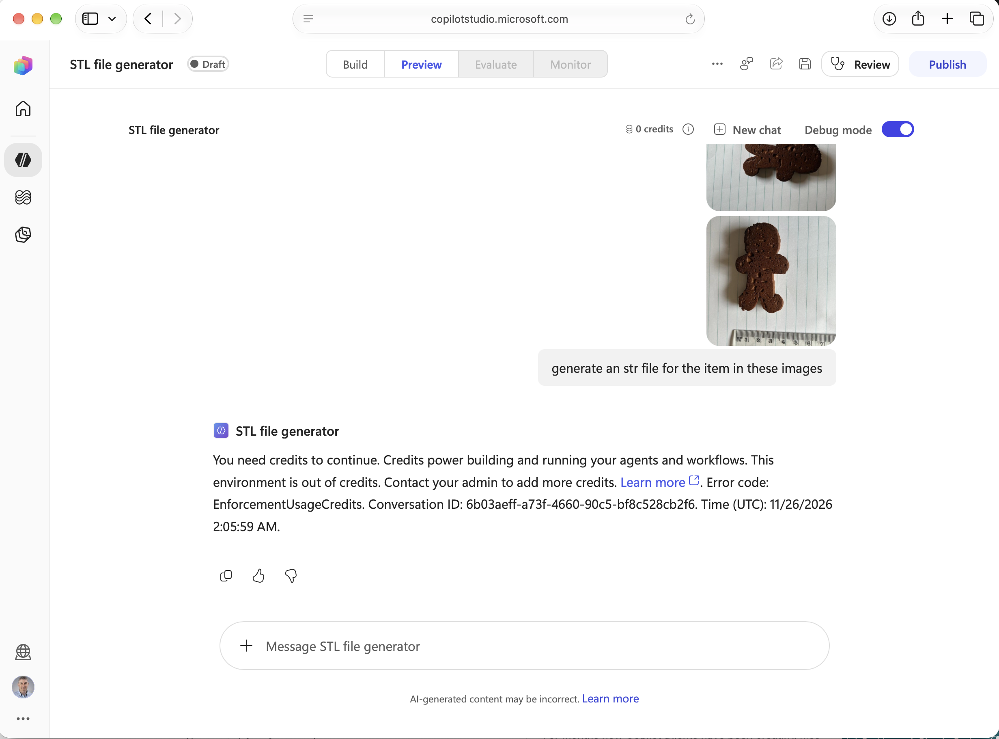
*The agent said the environment was out of credits*

The message said that the environment was out of credits, and gave the error code `EnforcementUsageCredits`. I had not set up any billing, so the environment had no credits to spend. The fix was mine to make: I had to set up pay-as-you-go billing.

## Which kind of agent is this?

Copilot Studio runs every agent on a harness, which is the runtime between the model and the agent you design. Microsoft describes three: the standard harness, the Microsoft Copilot harness and the Customer Conversation harness ([Harnesses in Copilot Studio](https://learn.microsoft.com/microsoft-copilot-studio/harnesses-overview)).

My agent runs on the **Microsoft Copilot harness**. This is how I created it:

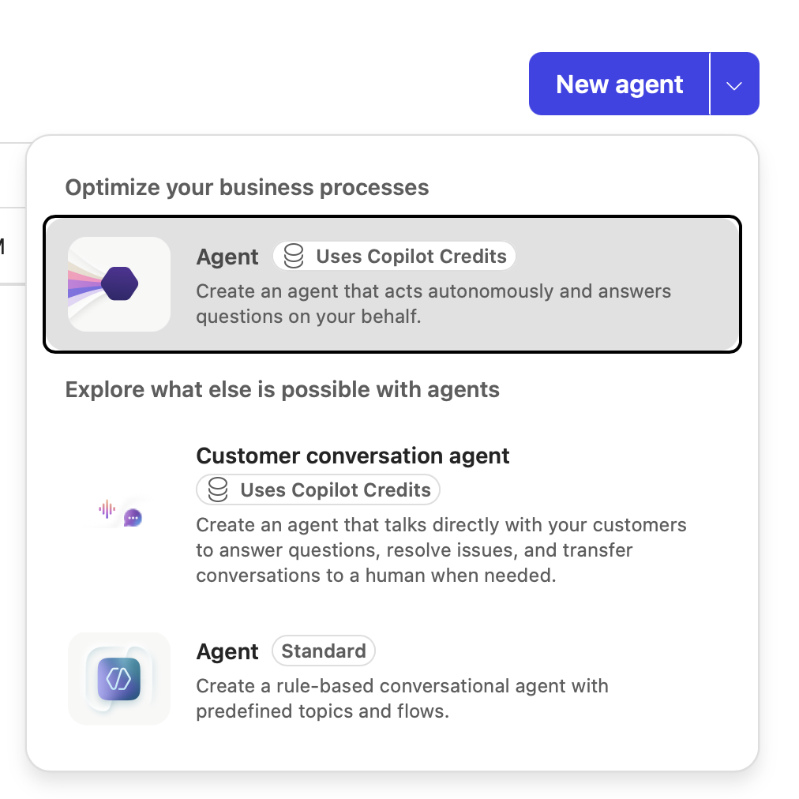
*The New agent menu offered Agent, Customer conversation agent and Agent (Standard)*

Here is what points to that harness:

- I created it from the New agent menu by choosing the first option, Agent, which carries the **Uses Copilot Credits** badge and is described as an agent that acts autonomously and answers questions on my behalf. The menu also offers a Customer conversation agent and an Agent labelled **Standard**, described as a rule-based conversational agent with predefined topics and flows. I chose neither of those.
- The agent has four tabs, Build, Preview, Evaluate and Monitor, with Skills, Memory (preview) and Connected agents on the Build tab, and no Topics page. Microsoft's documentation describes the Build tab as the single place where this harness is configured.
- The agent created files and said that they were in `/app/created`. Microsoft says this harness works with files in a secure sandbox.
- It uses Copilot Credits, which is how Microsoft bills this harness.

You may also see this harness called the **GitHub Copilot harness**. Earlier Microsoft blog posts used that name, and Microsoft's current documentation uses Microsoft Copilot harness.

The two main harnesses differ like this:

| | Standard harness | Microsoft Copilot harness |
|---|---|---|
| How it works | Follows the topics and rules that I define | Takes a goal, plans the steps and adapts |
| Best for | Short, bounded, rule-based tasks | Long, multi-step processes |
| Building | Topics, triggers, variables, prompts | Instructions, skills, tools, workflows, memory |
| Files | Not a focus | Creates and edits files in a sandbox |
| Predictability | Tighter control | Less predictable, because the agent chooses the next step |
| Billing | Existing Copilot Studio licensing | Usage-based Copilot Credits |

Microsoft says that the Copilot harness can overwork a simple problem and spend credits without a better result ([Compare Copilot Studio agent harnesses](https://learn.microsoft.com/microsoft-copilot-studio/guidance/choose-harness)).

:::no-dumb-questions
**Q: Could I have added Topics?**
A: Not as topics, as far as I can tell. Microsoft says that this harness does not carry topics over. Skills, workflows and hooks cover similar ground. A skill is a reusable behaviour written in Markdown that the agent runs when a request matches it, and a hook runs a workflow at set points, such as the start of a session.
:::

## Setting up pay-as-you-go billing

The fix took me out of Copilot Studio and into two other Microsoft portals.

First, in the Azure portal, I created a resource group named CopilotStudioResourceGroup in East US, under my Azure subscription.

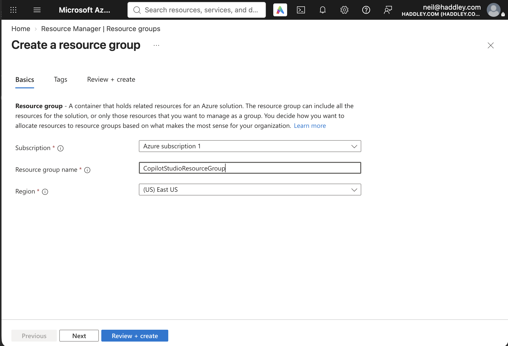
*I created a resource group in Azure*

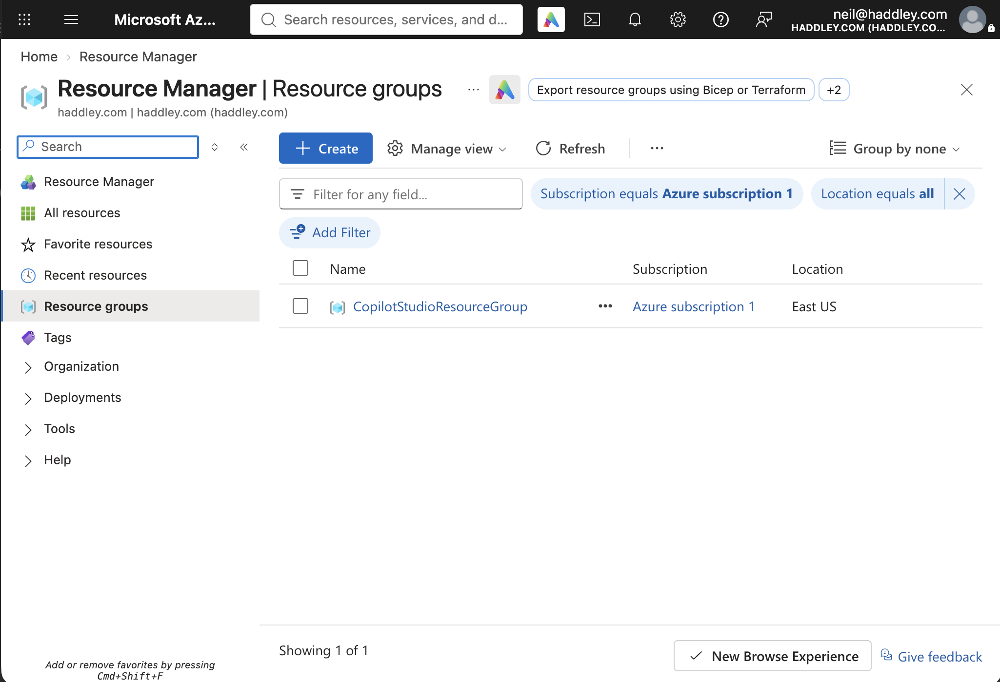
*The new resource group appeared in the list*

Then, in the Power Platform admin center, I opened Licensing and Billing plans. The list said "No data to display".

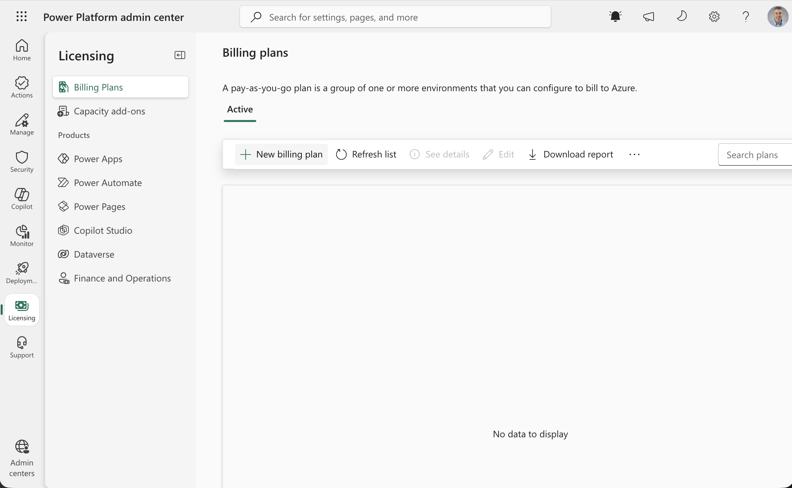
*I had no billing plans*

I selected New billing plan. The dialog warned me that creating the plan turns on pay-as-you-go billing for every resource in the environments I select, charged to an Azure subscription. I named the plan CopilotStudioBillingPlan and ticked two meters: Copilot Studio and Windows 365 for Agents.

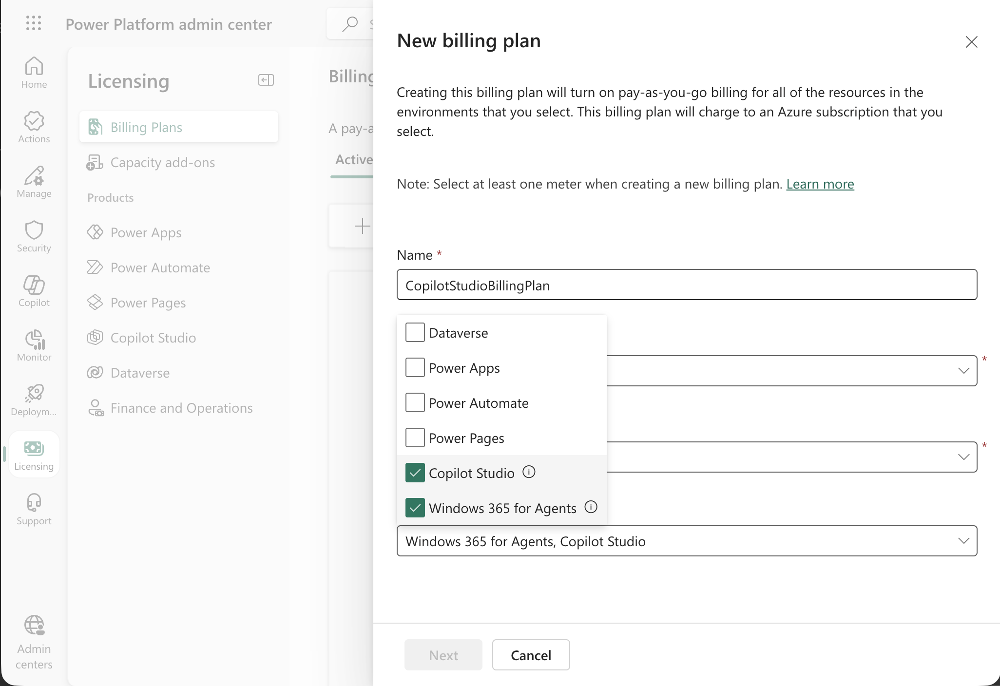
*I ticked the Copilot Studio and Windows 365 for Agents meters*

Next I chose the United States region and the one environment I had, haddley.com (default).

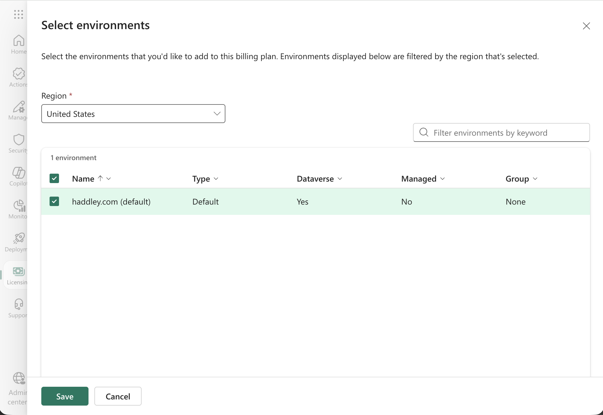
*I selected my default environment*

The plan appeared with the status Enabled.

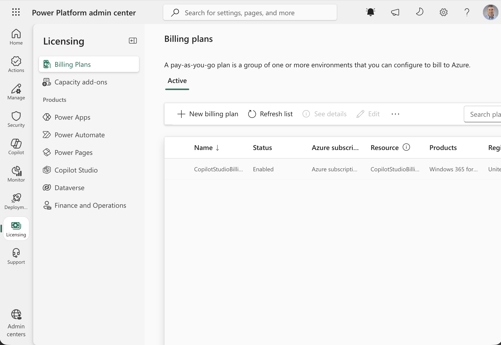
*The billing plan was enabled*

:::no-dumb-questions
**Q: Why does an agent builder need an Azure subscription?**
A: Because a pay-as-you-go plan bills to Azure. The credits came from a meter that I had to switch on myself. I would want a client's finance team to know that before the first invoice, not after.

**Q: Did I know what the Windows 365 for Agents meter does?**
A: Nope.
:::

## The second attempt

I went back to the preview chat, attached the same two photos and typed the request again.

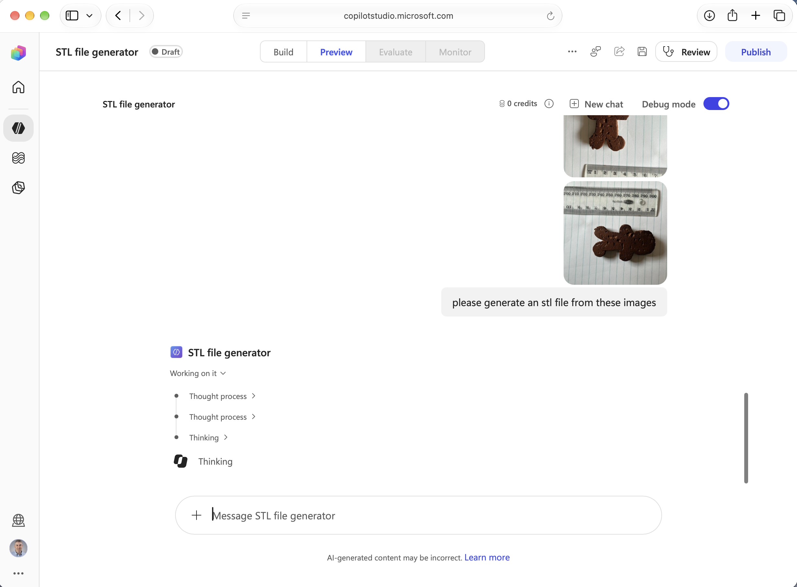
*The agent showed Working on it, with two Thought process steps and a Thinking step*

This time the agent worked. After a pause it replied with a long message. I have summarised what it said, because the details are the interesting part.

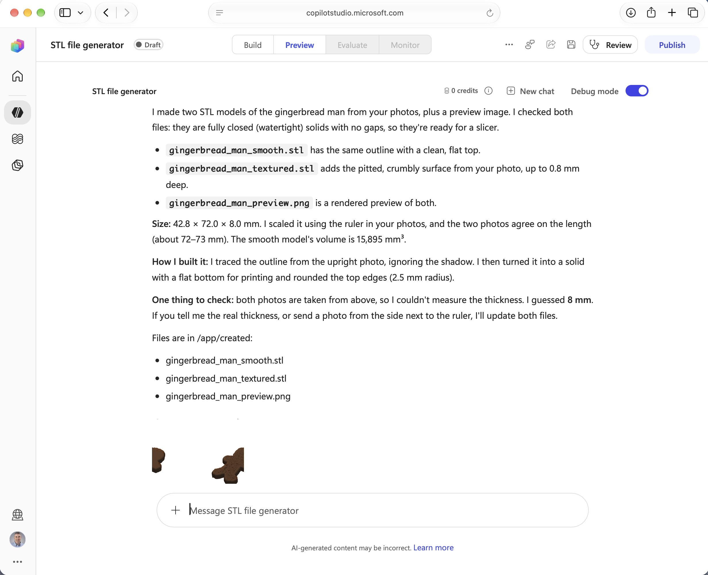
*The agent reported two STL files and a preview image*

- It made **two** STL models and a preview image. One file was smooth, with a clean flat top. The other, the textured one, added the pitted, crumbly surface from my photo, up to 0.8 mm deep.
- It said that it checked both files and that they are fully closed solids with no gaps, so they are ready for a slicer.
- It gave a size of 42.8 × 72.0 × 8.0 mm. It said that it scaled the model using the ruler in my photos, and that both photos agreed on the length at about 72 to 73 mm.
- It described its method. It traced the outline from the upright photo and ignored the shadow, turned the outline into a solid with a flat bottom, and rounded the top edges with a 2.5 mm radius.
- It admitted a weakness. Both photos were taken from above, so it could not measure the thickness. It guessed **8 mm**, and it offered to update both files if I told it the real thickness or sent a photo from the side.

:::pencil Measured or guessed?
Read the list above. Which of the three dimensions did the agent measure from my photos, and which did it guess?

:::answer
It measured the length and width from the ruler in the photos. It guessed the thickness at 8 mm, because neither photo showed the cookie from the side.
:::
:::

I liked that answer. The agent did not hide the guess. It put the guess under the heading "One thing to check".

## What did the agent actually do?

It is easy to think that the agent built a 3D model of a cookie from two photos. From its own summary, it did something simpler:

- It traced the outline of the cookie from the upright photo and ignored the shadow.
- It scaled the outline using the ruler.
- It pushed the outline up into a solid with a flat bottom and rounded top edges, and for the textured file it added a pitted surface up to 0.8 mm deep.
- It guessed the thickness, because neither photo showed the cookie from the side.

That is a flat silhouette extruded to a chosen height, and it is the easy case. I did not see the code that the agent ran, so this comes from its own description. A cookie is a good subject for it. I would expect a mug with a handle to be much harder.

Three parts did the work:

- **The LLM** read the photos, spotted the ruler and the shadow, chose the method, wrote the code and said which number it had guessed. For this job, I think most of the skill is in the LLM.
- **The code** did the outline tracing, the scaling and the writing of the STL file.
- **The Microsoft Copilot harness** gave the model a sandbox to run that code in, kept the loop going and handed back the files. Microsoft says that this harness runs each task in a secure sandbox ([Harnesses in Copilot Studio](https://learn.microsoft.com/microsoft-copilot-studio/harnesses-overview)).

## Looking at the file

I downloaded the textured STL and opened it in a file viewer. I saw a flat gingerbread man with a pitted top and a steep edge with fine vertical streaks.

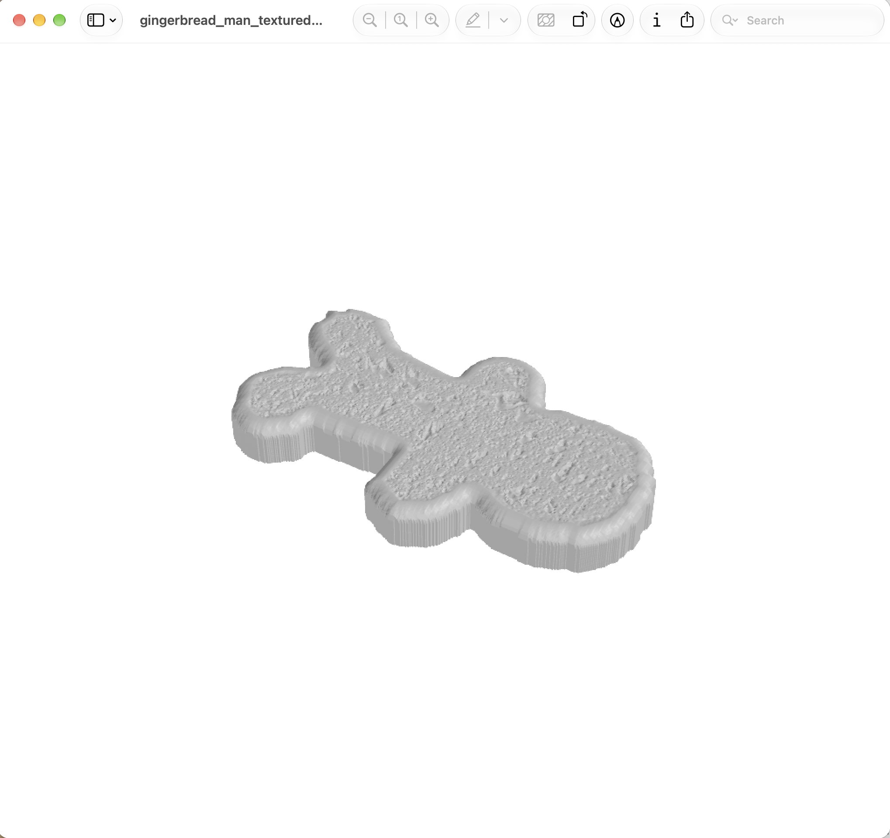
*The textured STL looked like a thick, crumbly slab in the shape of my cookie*

## From STL to print job

I opened only the textured file in Bambu Studio. I did not slice or print the smooth one. I used my Bambu Lab P1S with a 0.4 mm nozzle, PLA Basic filament and the 0.20 mm Standard process.

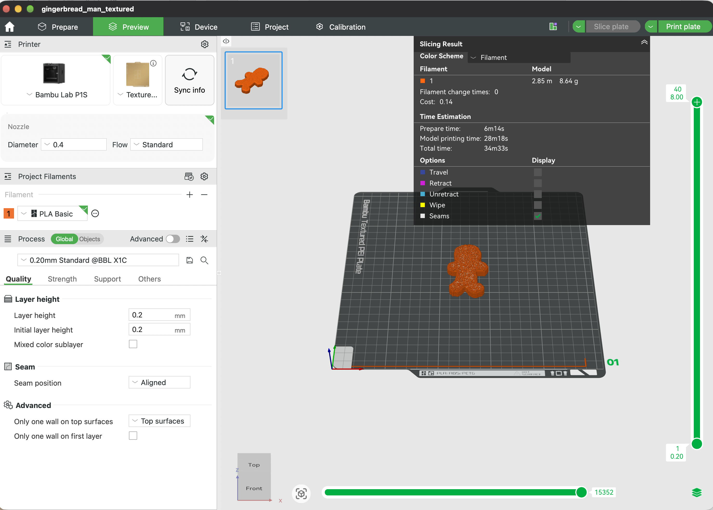
*Bambu Studio sliced the model without complaint*

The slicer reported 2.85 m of filament, 8.64 g and a total time of 34 minutes and 33 seconds, for a cost of 0.14. I sent that one job to the printer.

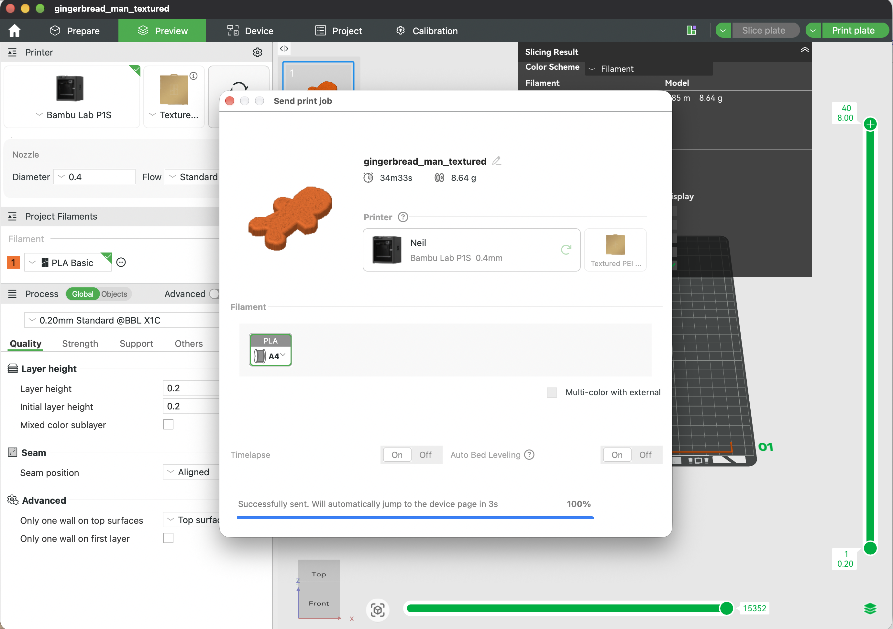
*The slicer reported that it successfully sent the job*

A file that a slicer accepts without repair is a good sign. It is not the same as a part that fits.

:::fireside-chat The photos and the agent argue about thickness
**The photos:** I was taken from above. Every picture of me is flat.

**The agent:** I measured your length and width with the ruler. For your thickness, I had to guess.

**The photos:** You guessed 8 mm. How do you know that is right?

**The agent:** I do not. That is why I told the user to check it.

**The photos:** A side view would have settled it.

**The agent:** Yes, and nothing in my one line of instructions told me to ask for one before I started.
:::

## Publishing the agent

I wanted to share the agent. I selected Publish. The dialog told me to add a channel so people can start conversations, and that without a channel, triggers run the agent automatically.

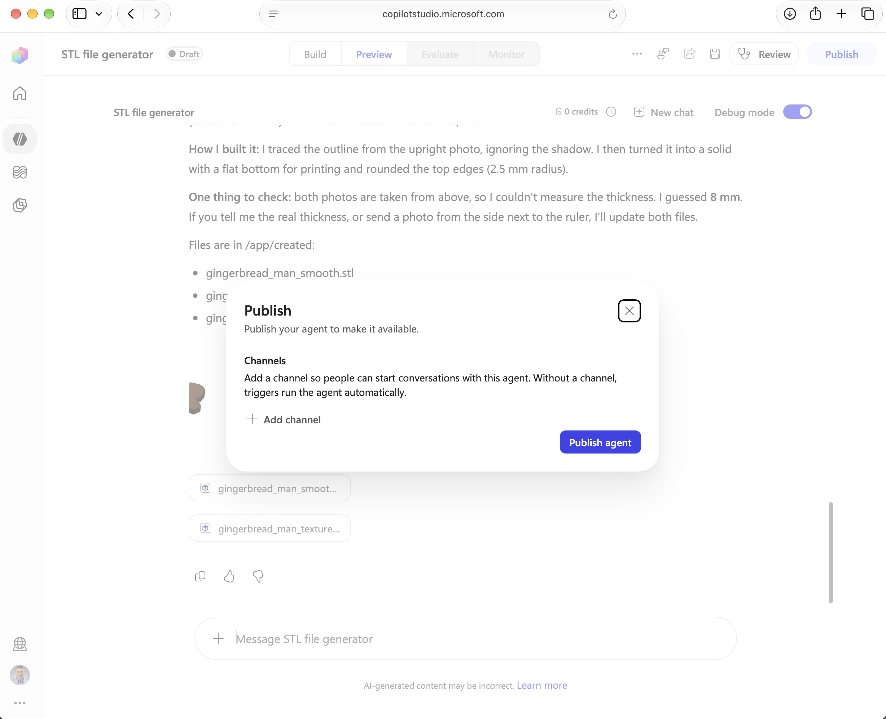
*Publish asked me to add a channel*

I published without a channel first. Copilot Studio said the agent was published but not on any channel yet, so nobody could reach it.

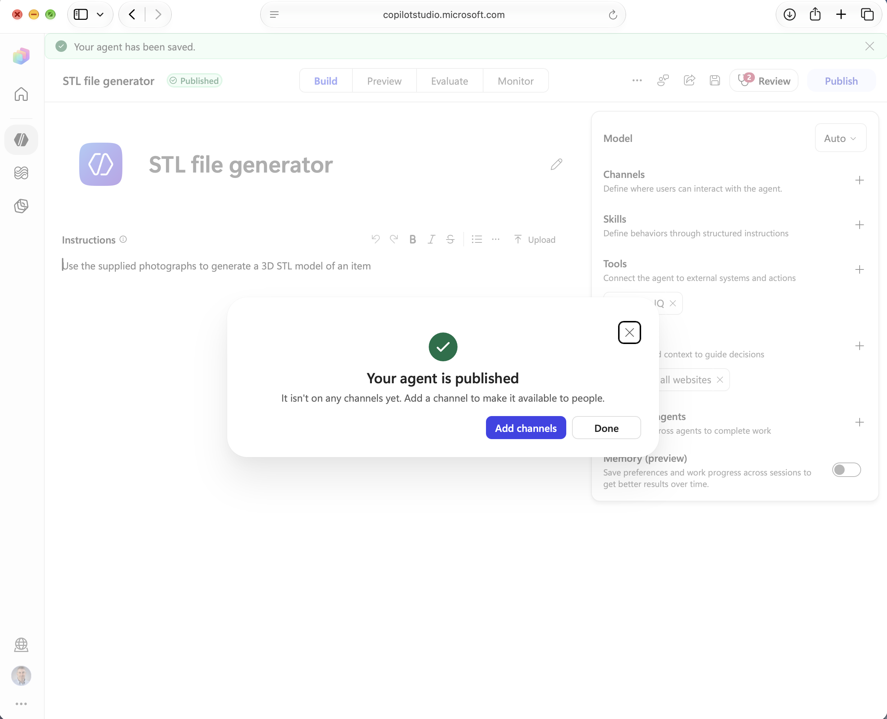
*Published, but available to nobody*

A red badge appeared on the Review button. I also noticed that the Work IQ tool, which reads Microsoft 365 data, was still attached to a program that only needs photographs. I selected its X, and Copilot Studio asked me to confirm the removal.

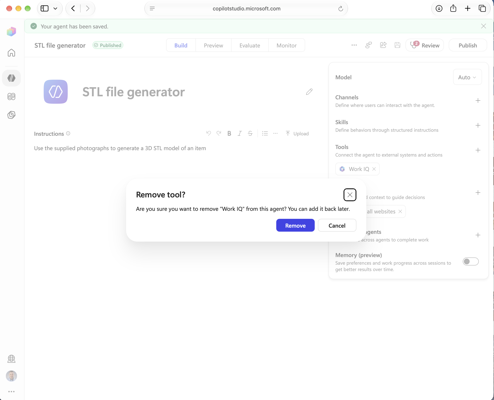
*Copilot Studio asked whether I wanted to remove Work IQ*

I opened the settings. Under Safety and access, the Authentication setting offered two choices: **No authentication** and **Authenticate with Microsoft**. A note on top said that changes take effect after I save and publish.

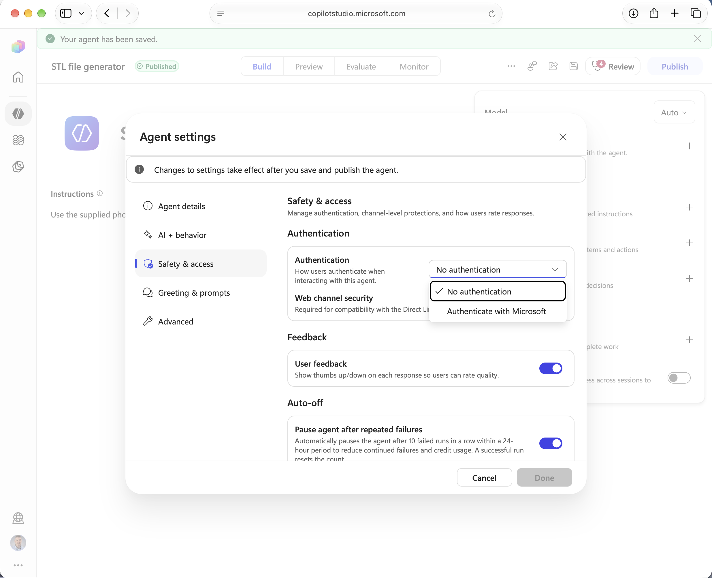
*The Authentication list offered No authentication or Authenticate with Microsoft*

Further down the same page, a setting called Pause agent after repeated failures was switched on. It pauses the agent after ten failed runs in a row within 24 hours, to reduce failures and credit use.

:::watch-it An agent that spends money for anyone who finds it
My agent runs on a pay-as-you-go plan. Its authentication setting offered No authentication as one of two options. Before I give the link to anybody, I need to decide who may use it, and I should pick the authentication on purpose. I did not test what an anonymous visitor could do, so I make no claim about it here.
:::

## Sharing the demo website

I added the Demo website channel, and Copilot Studio told me that my agent published successfully.

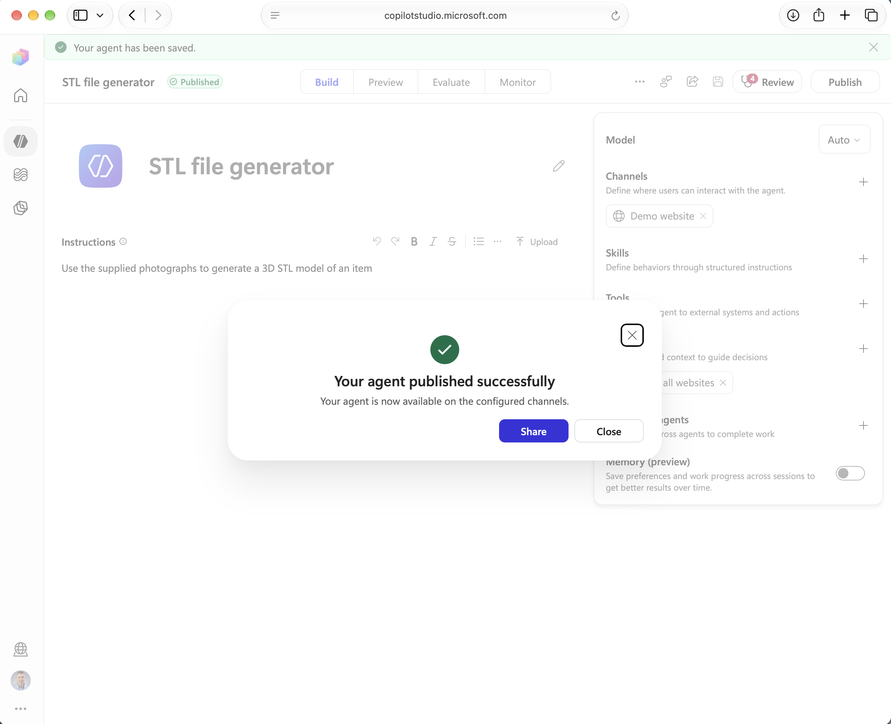
*The agent published to the configured channel*

The Share dialog gave me a link for team members to try the agent, an Open demo website button and an Embed tab.

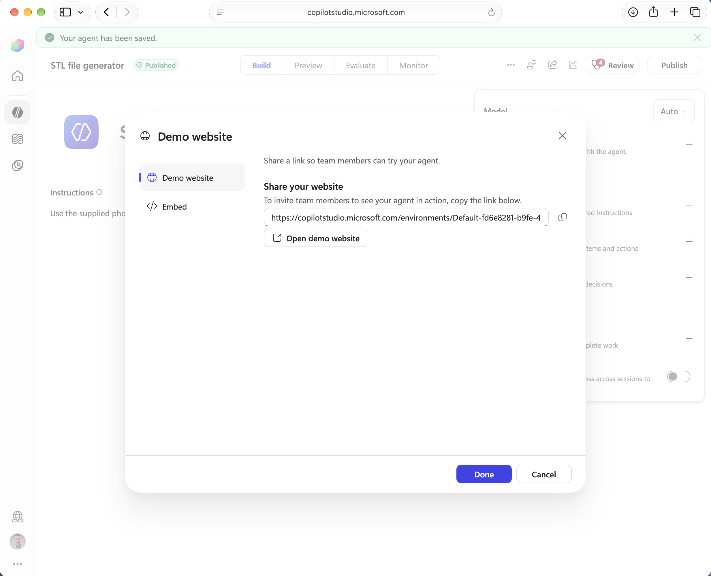
*I could copy a link to the demo website*

The demo website opened with a big headline announcing my new agent and the chat on the right. The page described itself as a testing space before you roll the agent out to a broader audience.

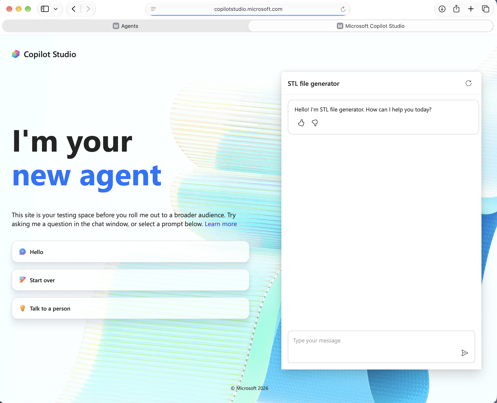
*The demo website greeted me as STL file generator*

Microsoft calls it a demo website, and the page says so.

:::watch-it The demo website could not take my photos
The chat on the demo website had a text box and a send button, but no way to upload a file. I could not attach my photos, so I could not use the published agent there to generate an STL file. The only place where I could attach photos and get the files was the Preview chat inside Copilot Studio.
:::

## Other ways I could have done this

Copilot Studio was not the only route. I tried the other harnesses, but not Agent Builder, so I make no claim about how well that would work:

- **Agent Builder in Microsoft 365 Copilot.** Microsoft says its code interpreter is always on, runs Python in a sandbox and can produce downloadable files ([code interpreter](https://learn.microsoft.com/plugins/code-interpreter)). It is available to users with a Microsoft 365 Copilot licence, so it might have avoided the pay-as-you-go plan.
- **Other harnesses.** I used both [Claude Code](/posts/claudecode17/) and [DeepSeek Harness](/posts/deepseekharness/) to convert the same photos to an STL file. It was easy, and certainly no harder than using the Microsoft Copilot harness agent.

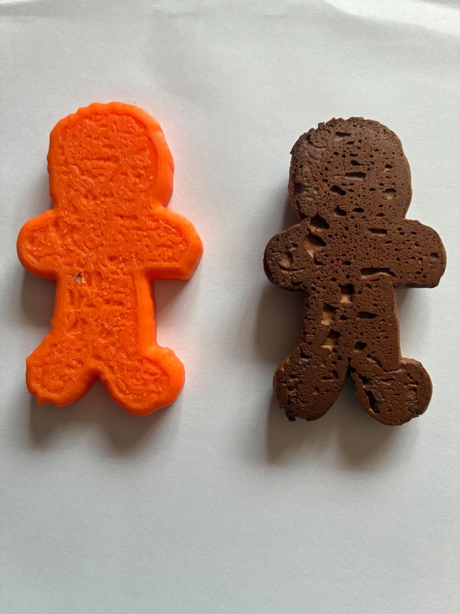
*My 3D printed gingerbread man on the left, next to the original on the right*

:::bullet-points The short version
- I created the agent with one line of instructions, and the first test stopped because I had not set up billing.
- A pay-as-you-go billing plan, charged to an Azure subscription, fixed it.
- The agent returned two STL files, a preview image and a clear note that it had guessed the thickness at 8 mm.
- Bambu Studio sliced the textured file without repair: 8.64 g and about 35 minutes.
- Before sharing the agent, I need to choose its authentication and understand its meters.
:::

For a similar job done with Claude Code, see [3D Printing](/posts/3dprinting3/), where I designed two versions of the back half of a rear light and measured it from a photo.
