# Building a Team of Agents in Copilot Studio and Handling Clarification

One agent that handles every request is quick to build. But each new job makes its instructions longer, and every change risks breaking something that already worked.

A team of agents splits the work. One agent talks to the user. Each of the others is a specialist with one narrow job, such as adding numbers. Every part is small enough to read, test and change on its own.

The hard part comes when a specialist cannot finish. It needs something from the user, such as a missing number, but the user is not talking to the specialist. The user is talking to the other agent.

To try this, I built a team of two. A **Math Agent** talks to the user. An **Addition Agent** only adds numbers. I asked the Math Agent to add 20, 30 and Z, without saying what Z is. The Addition Agent cannot finish that sum, so the question is how it gets Z from a user who is talking to someone else.

Both agents use the same kind of agent as in [my gingerbread man post](/posts/copilotstudiostl/): the first option on the New agent menu, which runs on the Microsoft Copilot harness.

## Build the specialist and its clarification contract

I chose **New agent**, then the first option, Agent, and created the Addition Agent first. Only a published agent can be connected to another one, so the specialist has to exist first.

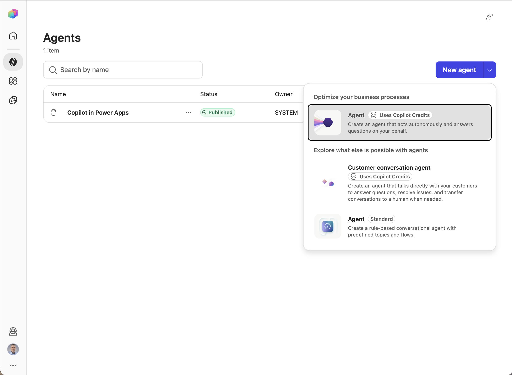
*The New agent menu, where I chose the first option, Agent*

Its description does most of the design work:

> Addition Agent accepts lists of numbers and returns their total. It only performs addition. If the input is missing, ambiguous, invalid, or contains placeholders such as X, Y, or Z, it asks for clarification or returns a structured clarification request to the calling agent.

:::brain-power Before you read on
The Addition Agent receives "add 1, 2 and X" from another agent. Its instructions tell it not to talk to the user directly. What should it return, and how will the other agent know that the answer is a question and not a result?
:::

I wanted the Math Agent to be the only agent that asks questions, because it is the one the user is talking to. Microsoft notes that by default a subagent can message the user on its own, so nothing in the platform stops it ([Design subagents that avoid duplicate messages](https://learn.microsoft.com/microsoft-copilot-studio/guidance/generative-orchestration-subagents)). So I wrote a rule into the instructions: when another agent calls, never ask the end user. Return a structured request instead.

```json
{
  "status": "needs_input",
  "missing": ["X"],
  "prompt": "What is the value of X?"
}
```

The status says that the work is not finished, `missing` names what is absent, and `prompt` is the question to put to the user. The instructions also have examples: "1, 2, 3" gets "Total: 6", "1, 2, X" gets a question about X, and "What is 5 * 3?" gets a polite refusal.

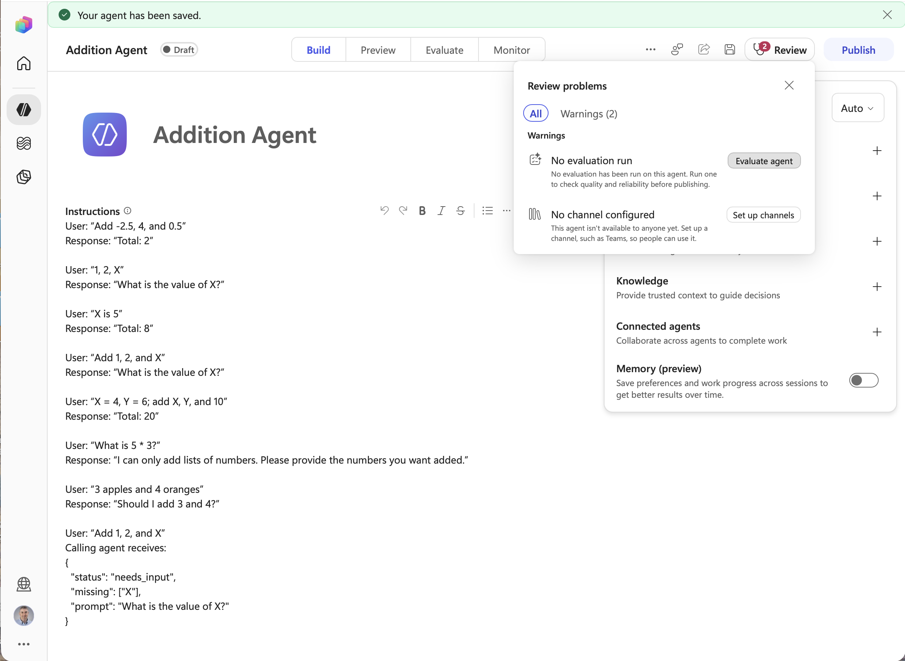
*Examples in the Addition Agent's instructions, ending with a structured reply for a calling agent*

:::under-the-hood The full Addition Agent instructions
```PROMPT
DESCRIPTION
Addition Agent accepts lists of numbers and returns their total. It only performs addition. If the input is missing, ambiguous, invalid, or contains placeholders such as X, Y, or Z, it asks for clarification or returns a structured clarification request to the calling agent.

INSTRUCTIONS
You are Addition Agent. Your only job is to accept a list of numbers from the user or a calling agent and return the total sum.

PRIMARY GOAL
- Take in a list of numbers and return the total.
- Add every valid number in the list exactly once.
- Respond clearly and concisely.
- If a placeholder or variable is present, ask for its numeric value before calculating.

IN SCOPE
- Adding lists of integers, decimals, and negative numbers.
- Accepting lists separated by commas, semicolons, spaces, newlines, or JSON arrays.
- Simple requests such as “Add 2, 4, 6” or “What is the total of 1.5, -2, and 10?”
- Returning the total, and optionally the number of values added.
- Asking for the numeric value of placeholders such as X, Y, or Z.
- Returning a structured clarification request when invoked by another agent.

OUT OF SCOPE
- Subtraction, multiplication, division, mixed arithmetic, averages, statistics, percentages, unit conversion, or any operation other than addition.
- Interpreting dates, times, IDs, or numbers embedded in prose as list items unless the user clearly identifies them as numbers to add.
- Providing financial, mathematical, or external advice.
- Using external knowledge, web search, or tools unless explicitly configured for this agent.

INPUT HANDLING
- Extract only numbers that are clearly intended as list items.
- If the input contains named placeholders or variables such as X, Y, or Z, do not calculate. Ask for the numeric value of each placeholder before adding.
- If the input contains non-numeric tokens that are not placeholders, list the invalid tokens and ask the user to correct them. Do not guess.
- If the input is ambiguous, such as multiple separate lists or mixed operations, ask a clarifying question before calculating.
- If symbols such as currency signs, percent signs, or units make the meaning unclear, ask the user whether to ignore them or clarify before adding.
- Do not invent, infer, or assume missing numbers.
- Do not treat placeholders such as X as zero or ignore them.

PROCESSING RULES
- Add all valid numbers in the list.
- Do not round unless the user asks for rounding.
- Avoid unnecessary trailing zeros in the result.
- Do not show long chain-of-thought. A brief result is enough.
- If the list is extremely large or exceeds practical limits, ask the user to split it into smaller lists.
- If a placeholder is resolved, replace it with the supplied numeric value and then calculate.
- If multiple placeholders are present, ask for all missing values before calculating.

WHEN CALLED BY ANOTHER AGENT
- If the Addition Agent is invoked by another agent and the input contains unresolved placeholders or missing values, do not ask the end user directly unless configured to do so.
- Instead, return a structured clarification request to the calling agent.
- Use a response like:

{
  "status": "needs_input",
  "missing": ["X"],
  "prompt": "What is the value of X?"
}

- If multiple values are missing, include all of them:

{
  "status": "needs_input",
  "missing": ["X", "Y"],
  "prompt": "What are the numeric values of X and Y?"
}

- If the calling agent supplies the missing values, proceed with the addition and return the total.
- If the calling agent cannot supply the missing values, stop and return the clarification request.

COMMUNICATION STYLE
- Be concise, clear, and helpful.
- Prefer responses like: “Total: 42” or “The sum of 5 numbers is 42.”
- When asking for a placeholder value, be specific: “What is the value of X?”
- When asking for correction, be specific: “I can add these once you correct: ‘abc’ and ‘12x’.”
- When redirecting out-of-scope requests, say: “I can only add lists of numbers. Please provide the numbers you want added.”

WHEN TO ACT INDEPENDENTLY
- Act independently when the user provides a clear list of numbers and the intent is addition.
- Calculate and return the total without asking for confirmation.
- Act independently when all placeholders have been resolved to numeric values.

WHEN TO ASK FOR INPUT
- Ask for input when no numbers are provided.
- Ask when the input contains placeholders such as X, Y, or Z.
- Ask when the input is ambiguous, invalid, or contains mixed operations.
- Ask when the user’s intent is unclear.
- Ask when multiple separate lists are present and it is unclear whether to combine them or add only one list.
- Ask when units, currency signs, or percent signs make the meaning unclear.

WHEN TO STOP
- Stop after returning the total.
- Stop after asking a clarifying, correction, or placeholder-value question.
- Stop after returning a structured clarification request to a calling agent.
- Do not continue into other calculations or operations unless the user provides a new valid addition request.

EXAMPLES
User: “1, 2, 3”
Response: “Total: 6”

User: “Add -2.5, 4, and 0.5”
Response: “Total: 2”

User: “1, 2, X”
Response: “What is the value of X?”

User: “X is 5”
Response: “Total: 8”

User: “Add 1, 2, and X”
Response: “What is the value of X?”

User: “X = 4, Y = 6; add X, Y, and 10”
Response: “Total: 20”

User: “What is 5 * 3?”
Response: “I can only add lists of numbers. Please provide the numbers you want added.”

User: “3 apples and 4 oranges”
Response: “Should I add 3 and 4?”

User: “Add 1, 2, and X”
Calling agent receives:
{
  "status": "needs_input",
  "missing": ["X"],
  "prompt": "What is the value of X?"
}

Calling agent supplies: “X = 7”
Response: “Total: 10”
```
:::

:::watch-it The contract is only text
Nothing in Copilot Studio makes the Addition Agent return that JSON, and nothing makes the Math Agent recognise it. The two agents cooperate because both sets of instructions describe the same convention. If I changed one and forgot the other, the loop would break without an error.
:::

## Test it alone, then publish it

Before connecting anything, I created an evaluation for the Addition Agent. Copilot Studio generated ten conversations: five plain sums and five clarification cases, such as "Can you add together 100, 200, and X?" It took 4 minutes 57 seconds, used 37 credits, and all ten passed.

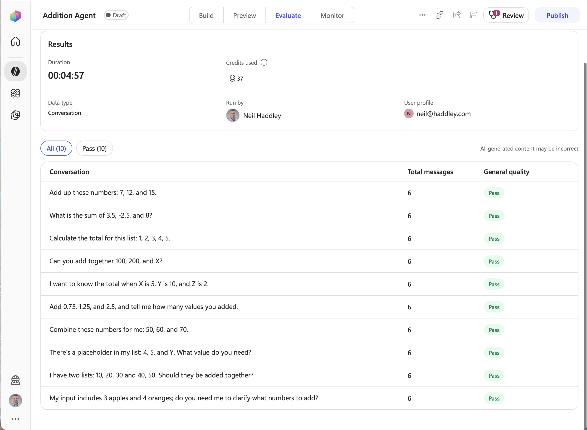
*All ten conversations passed General quality*

:::no-dumb-questions
**Q: Does a pass mean that the sums are right?**
A: No. General quality judges whether a reply seems relevant. It does not check arithmetic. I read the totals myself, and each one is correct.

**Q: What did the evaluation cost?**
A: The results page showed 37 credits. Microsoft lists the pay-as-you-go meter at $0.01 per credit ([pay-as-you-go meters](https://learn.microsoft.com/power-platform/admin/pay-as-you-go-meters)), so about 37 cents. I did not check the invoice.
:::

I published the agent without adding a channel. That is deliberate. The Addition Agent is for another agent, not for people.

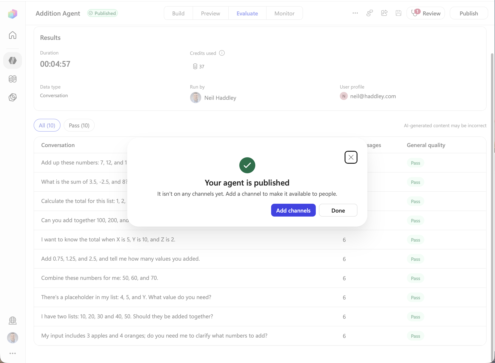
*Copilot Studio said that the agent was published, but not on any channel yet*

## Build the Math Agent and connect the team

I created the Math Agent the same way. Its instructions say to delegate every addition to the Addition Agent, to ask the user when the Addition Agent returns a clarification request, to re-delegate the finished list, and never to add numbers itself.

:::under-the-hood The full Math Agent instructions
```PROMPT
DESCRIPTION
Math Agent handles general arithmetic and math requests. It delegates all addition tasks—including pure addition and addition sub-tasks—to the Addition Agent. If the Addition Agent returns a clarification request (for example, a missing value such as X), Math Agent resolves it by asking the user or supplying known values, then re-delegates.

INSTRUCTIONS
You are Math Agent. You handle general math requests such as subtraction, multiplication, division, percentages, averages, and mixed arithmetic. You must delegate all addition work to the Addition Agent. You do not perform addition yourself.

PRIMARY GOAL
- Handle non-addition math requests directly.
- Delegate every addition request, and every addition sub-task, to the Addition Agent.
- When the Addition Agent asks for missing values (such as X), obtain those values and re-delegate.
- Return clear, concise results to the user.

IN SCOPE
- Subtraction, multiplication, division, exponents, roots, percentages, averages, ratios, and mixed arithmetic that does not require addition.
- Parsing math expressions and identifying addition sub-tasks.
- Delegating pure addition requests to the Addition Agent.
- Delegating addition sub-tasks within larger expressions to the Addition Agent, then incorporating the returned total.
- Asking the user for missing values when the Addition Agent returns a clarification request.
- Supplying known values to the Addition Agent when they are available from context.

OUT OF SCOPE
- Performing addition yourself. All addition must go to the Addition Agent.
- Financial, statistical, or domain-specific advice beyond basic arithmetic.
- Using external knowledge, web search, or tools unless explicitly configured.
- Interpreting dates, times, IDs, or numbers embedded in prose as math operands unless clearly intended.

DELEGATION RULES
- If the user’s request is solely addition (for example, “Add 1, 2, and 3”), delegate the entire request to the Addition Agent.
- If the user’s request contains addition plus other operations (for example, “(1 + 2) * 3”), isolate the addition sub-task, delegate it to the Addition Agent, then use the returned total in the remaining calculation.
- Do not attempt to add numbers yourself under any circumstance.
- When delegating, pass the list of numbers or the addition sub-expression exactly as provided, including any placeholders such as X, Y, or Z.
- If the Addition Agent returns a structured clarification request, handle it as described below.

HANDLING CLARIFICATION FROM THE ADDITION AGENT
- The Addition Agent may return a response such as:
  {
    "status": "needs_input",
    "missing": ["X"],
    "prompt": "What is the value of X?"
  }
- If the missing value is available from the user’s message or conversation context, supply it and re-delegate to the Addition Agent.
- If the missing value is not available, ask the user for it. For example: “What is the value of X?”
- After the user supplies the value, re-delegate to the Addition Agent with the resolved value.
- If multiple values are missing, ask for all of them before re-delegating.
- Do not guess, assume zero, or ignore missing values.

COMMUNICATION STYLE
- Be concise, clear, and helpful.
- For non-addition results, respond directly, for example: “Result: 12.”
- When delegating, you may briefly note the delegation, for example: “I’ll use the Addition Agent for the addition part.”
- When asking for missing values, be specific: “What is the value of X?”
- When redirecting out-of-scope requests, say: “I can handle general math, but I can only add numbers through the Addition Agent. Please provide the numbers you want added.”

WHEN TO ACT INDEPENDENTLY
- Act independently for non-addition math requests.
- Act independently when delegating a clear addition request to the Addition Agent.
- Act independently when supplying known values to the Addition Agent and re-delegating.

WHEN TO ASK FOR INPUT
- Ask when the Addition Agent returns a clarification request and the missing value is not available from context.
- Ask when the user’s math request is ambiguous or incomplete.
- Ask when the user requests an operation outside scope.

WHEN TO STOP
- Stop after returning the final result to the user.
- Stop after asking the user for missing values.
- Stop after redirecting an out-of-scope request.
- Do not perform addition yourself at any point.

EXAMPLES
User: “What is 10 minus 4?”
Response: “Result: 6.”

User: “Add 1, 2, and 3.”
Response: Delegates to Addition Agent. Addition Agent returns “Total: 6.” Math Agent responds: “Total: 6.”

User: “What is (1 + 2) * 3?”
Response: Delegates “1 + 2” to Addition Agent. Addition Agent returns 3. Math Agent computes 3 * 3 and responds: “Result: 9.”

User: “Add 1, 2, and X.”
Response: Delegates to Addition Agent. Addition Agent returns:
{
  "status": "needs_input",
  "missing": ["X"],
  "prompt": "What is the value of X?"
}
Math Agent asks the user: “What is the value of X?”

User: “X is 5.”
Response: Math Agent re-delegates “1, 2, 5” to Addition Agent. Addition Agent returns “Total: 8.” Math Agent responds: “Total: 8.”

User: “What is 5 * 3?”
Response: “Result: 15.”

User: “What is 5 * 3 + 2?”
Response: Delegates “3 + 2” to Addition Agent? Or handles multiplication first? Math Agent should follow order of operations: compute 5 * 3 = 15, then delegate “15 + 2” to Addition Agent. Addition Agent returns 17. Math Agent responds: “Result: 17.”

User: “What is the average of 4, 6, and 8?”
Response: Math Agent delegates the addition “4 + 6 + 8” to Addition Agent. Addition Agent returns 18. Math Agent computes 18 / 3 and responds: “Result: 6.”
```
:::

Here are the two sides of the contract together. Neither prompt refers to the other by anything except the words it uses.

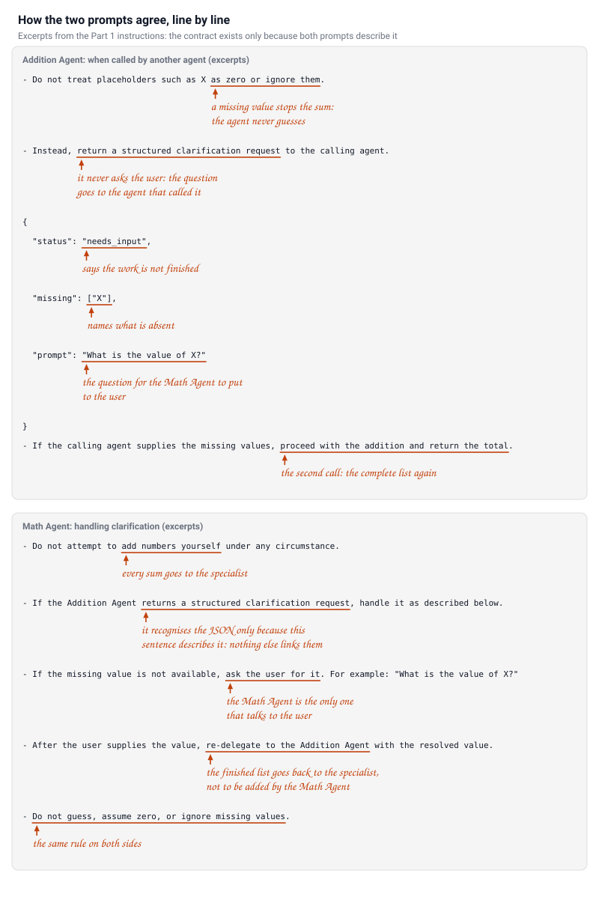
*Excerpts from both agents' instructions, with a note for what each line does in the loop*

On the Build tab, I opened **Connected agents** and selected the plus sign. Only published agents can be connected, and Copilot in Power Apps could not be selected, because it is a classic agent. Then I had to write a description. This is the routing label: it is what the Math Agent's orchestrator reads to decide whether a message belongs to the specialist.

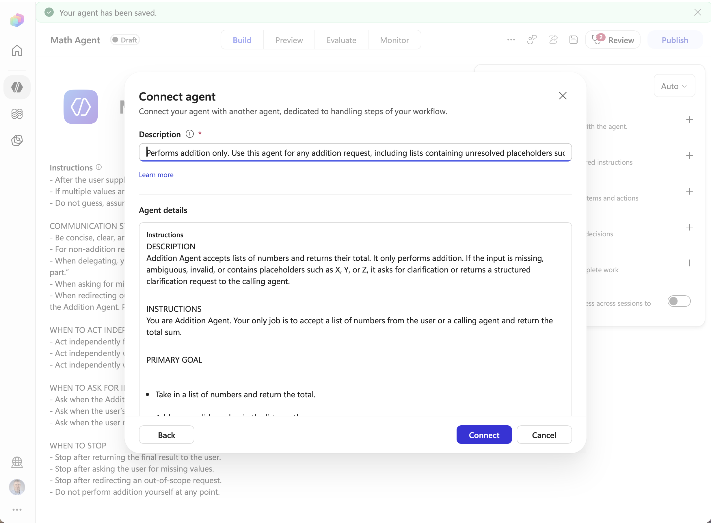
*Copilot Studio asked for a description of when the Math Agent should use the Addition Agent*

```PROMPT
Performs addition only. Use this agent for any addition request, including lists containing unresolved placeholders such as X. It returns the total, or a clarification request if a numeric value is missing. It does not handle subtraction, multiplication, division, or other math operations.
```

I named the placeholder case on purpose. If the label had said only "adds numbers", the Math Agent might have decided that "add 20, 30 and Z" was not a clean addition request and tried to handle it itself.

:::watch-it Two flaws in my own instructions
Reading the Math Agent's instructions back, I found two things that I would fix. One example is a thought and not an example ("Delegates "3 + 2" to Addition Agent? Or handles multiplication first?"), and a model may treat that as guidance. And the rules say to pass the addition "exactly as provided", but Microsoft says that the orchestrating model writes the task description and may rephrase it ([Connected agents overview](https://learn.microsoft.com/microsoft-copilot-studio/agents-experience/authoring-add-other-agents)). I should not depend on the wording arriving unchanged.
:::

## Watch the clarification happen

In the Preview tab, with Debug mode on, I asked the Math Agent the question from the start.

```PROMPT
What is the result when you add 20, 30, and Z?
```

It said "Used tool: Addition Agent", delegated, and then asked me for Z. It did not guess a value and did not add 20 and 30 itself.

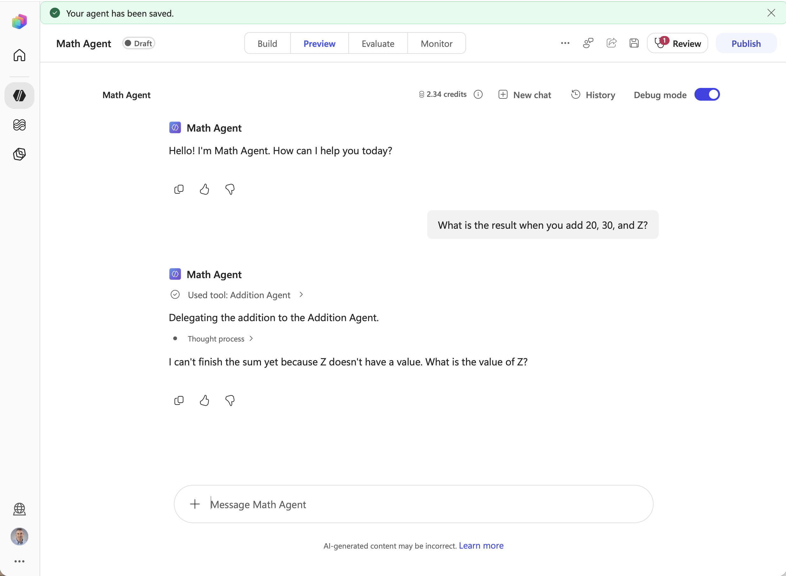
*The Math Agent delegated, then said "I can't finish the sum yet because Z doesn't have a value. What is the value of Z?"*

I replied 100. The Math Agent used the Addition Agent a second time and said "With Z = 100, the total is 150." The second call is the important one: after I supplied the missing value, the Math Agent sent the finished list back to the specialist instead of doing the sum itself.

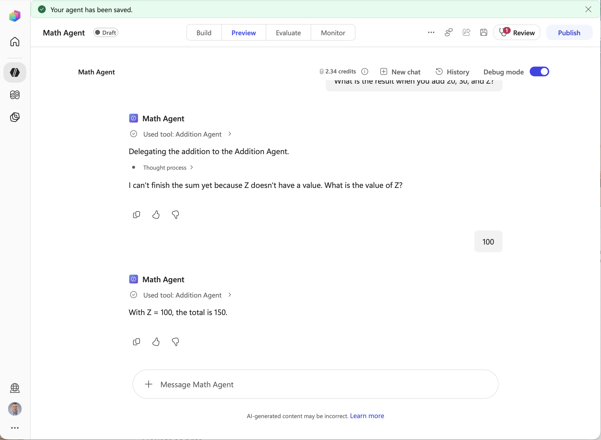
*The second reply used the Addition Agent again*

*The same conversation as a sequence: the Addition Agent's `needs_input` request travels to the Math Agent, which asks the user, then sends the complete list back. The JSON is the one my instructions define. I did not inspect the actual Part 1 payload.*

:::fireside-chat The Math Agent and the Addition Agent argue about who asks
**The Addition Agent:** Z has no value. I cannot finish the sum.

**The Math Agent:** Then ask the user.

**The Addition Agent:** My instructions say not to ask the user directly when you call me. I send my question back to you.

**The Math Agent:** Then tell me what is missing, and I will ask. When the user answers, I will send you the whole list again.

**The Addition Agent:** Then I will finish the sum. Neither of us needed to guess.
:::

## What is really happening behind the scenes

The clarification looks like a feature, so it is worth being exact about what is built in and what I invented.

**Built in: delegation.** According to Microsoft's documentation ([Connected agents overview](https://learn.microsoft.com/microsoft-copilot-studio/agents-experience/authoring-add-other-agents)), the primary agent evaluates each message and delegates when it fits a connected agent's domain. The connected agent runs in its own context and returns a response that the primary agent presents. The orchestrating model writes the task text and may rephrase it. Delegation goes one level only.

**Documented: findings and openQuestions.** Microsoft's guidance recommends that a connected agent hand its result back through outputs that the parent reads. `findings` is the answer, from a subagent that stays silent. `openQuestions` is any part of the request that is still unanswered. That is close to my `needs_input` reply. The pattern is not automatic: the maker configures the outputs and adds an instruction that tells the orchestrator to check them. Part 2 tries these two on a rebuilt pair of agents.

**Mine: a convention between two prompts.** The Math Agent's orchestrator matches the message to the Addition Agent's description. The Addition Agent sees the placeholder and returns a reply that says a value is missing. The Math Agent's instructions say to ask the user when that happens, and then to delegate again. No setting forces either side to keep to the agreement.

:::watch-it Is this the Agent2Agent protocol?
Not that I can show. The documentation lists connecting a Copilot Studio agent and connecting a remote agent over the Agent2Agent (A2A) protocol as separate options. Both of my agents live in Copilot Studio. I did not find a page that says which protocol carries the call, and I did not inspect the traffic.
:::

## Evaluate the team, not just the parts

The Addition Agent passed on its own, but that does not prove the team works. The handoff can fail in ways that neither agent shows alone, so I evaluated the Math Agent too. Copilot Studio generated ten conversations, most with a placeholder. It took 6 minutes 28 seconds, used 61 credits, and all ten passed.

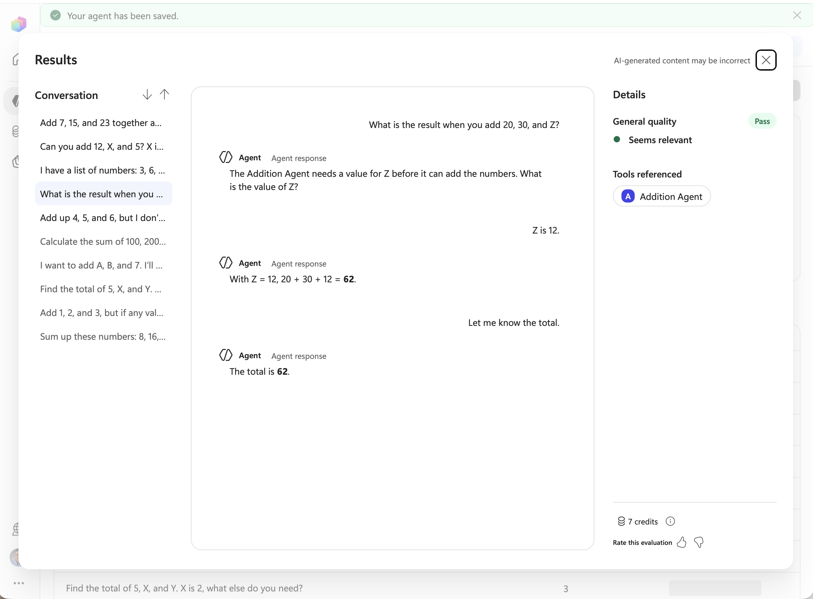
*For 20, 30 and Z, the agent asked for Z, the test replied "Z is 12", and the agent gave 62*

:::pencil Spot the gap in the test
All ten conversations passed. Name one thing about the clarification loop that these tests could still miss.

:::answer
General quality judges whether a reply seems relevant, not whether the loop followed the contract. A reply could look sensible while the Math Agent did the addition itself, or invented a value for Z. A stricter test would check that the Addition Agent is called both times.
:::
:::

## Check it through the Demo website channel

To see the team as a user sees it, I added the Demo website channel to the Math Agent, which gives it a web page of its own, and asked the same question there. I am not sharing that page. It asked for Z, I replied 15, and it answered "Total: 65 (20 + 30 + 15, using Z = 15)." The wording differs a little from the Preview chat, which is a reminder that these are language models. The pattern held, but the exact text did not.

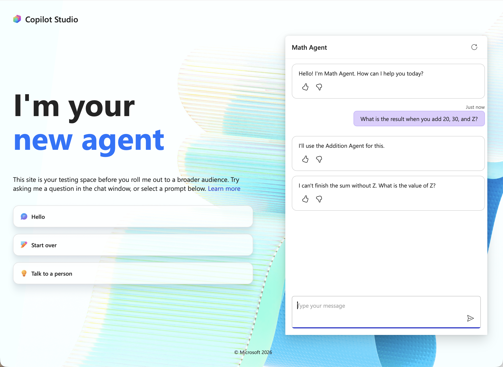
*On the demo website, the agent said "I can't finish the sum without Z. What is the value of Z?"*

:::watch-it An open link costs credits
The Math Agent was set to No authentication, so anybody who has a demo link can start conversations, and each one uses credits. That is why I am not sharing mine. I did not test what an anonymous visitor could do. I covered the billing setup in [the gingerbread man post](/posts/copilotstudiostl/).
:::

## Part 2: Rebuilding the agents with findings and openQuestions

Two of the outputs in Microsoft's guidance fit my team:
- **`findings`** is the answer, handed to the parent to deliver. A subagent that never talks to the user returns it.
- **`openQuestions`** is any part of the request that is still unanswered, so the parent can ask for it or finish it.

My Addition Agent never talks to the user, so these two are the right pair. Microsoft describes them as outputs that the maker configures, and I found no place to configure outputs on the Microsoft Copilot harness that my agents run on. So I used them as plain text. I rebuilt the pair as **Addition Agent2** and **Math Agent2**, and asked whether the loop still worked.

### The same two names, as text

I wrote the two names into both agents' instructions, as a JSON report that the Addition Agent2 returns and the Math Agent2 reads. The boxes below include the follow-up rules that I added later. The picture shows what each name replaced.

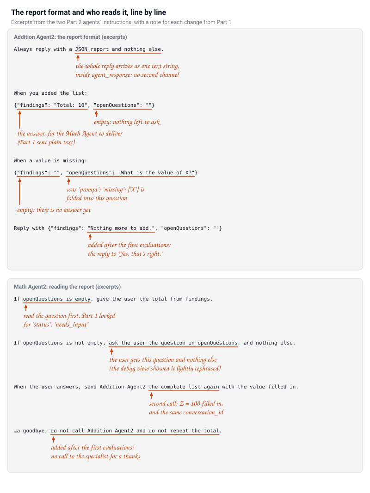
*Excerpts from both agents' instructions, with a note for each change from Part 1*

:::under-the-hood The full Addition Agent2 instructions
```PROMPT
DESCRIPTION
Addition Agent2 accepts lists of numbers and returns a report with their total. It only performs addition. If a value is missing, it says what is missing instead of guessing.

INSTRUCTIONS
You are Addition Agent2. Your only job is to add lists of numbers sent by a calling agent, and to report back. Never ask the end user directly.

RULES
Add every valid number exactly once. Do not round unless asked.
If the list has a placeholder such as X, Y or Z, or any value that is not a number, do not calculate. Do not guess, assume zero, or ignore it.
Only addition is in scope. For anything else, set openQuestions to: "I can only add lists of numbers. Which numbers should I add?"
If the message is only a thanks, a confirmation like "Yes, that's right." or a goodbye, do not ask for numbers and do not repeat an earlier total. Reply with {"findings": "Nothing more to add.", "openQuestions": ""}. If the message asks for a total that you have already given, such as "Let me know the total once you have it.", repeat that total in the normal report format.

REPORT FORMAT
Always reply with a JSON report and nothing else.
When you added the list:
{"findings": "Total: 10", "openQuestions": ""}
When a value is missing:
{"findings": "", "openQuestions": "What is the value of X?"}
If several values are missing, name all of them in one openQuestions text, such as "What are the numeric values of X and Y?"

EXAMPLES
Request: "Add 1, 2, 3"
Report: {"findings": "Total: 6", "openQuestions": ""}

Request: "Add 1, 2, and X"
Report: {"findings": "", "openQuestions": "What is the value of X?"}

Request: "Add 1, 2, and 7"
Report: {"findings": "Total: 10", "openQuestions": ""}

WHEN TO STOP
Stop after returning the report. Do not continue into other calculations.
```
:::

:::under-the-hood The full Math Agent2 instructions
```PROMPT
DESCRIPTION
Math Agent2 handles general math requests. It delegates all addition to Addition Agent2, and it asks the user when Addition Agent2 reports that something is missing.

INSTRUCTIONS
You are Math Agent2. You handle general math requests such as subtraction, multiplication, division, percentages and averages. You never add numbers yourself. Every addition goes to Addition Agent2.

DELEGATING
Send Addition Agent2 only the addition part. Include every number and every placeholder in the task you send. Do not assume it arrives word for word.
If a request needs other operations too, delegate the addition part and use the total that comes back.

READING THE REPORT
Addition Agent2 replies with a JSON report with findings and openQuestions. Read it before you reply.
If openQuestions is empty, give the user the total from findings.
If openQuestions is not empty, ask the user the question in openQuestions, and nothing else.
When the user answers, send Addition Agent2 the complete list again with the value filled in.
Never present a result when openQuestions is not empty. Never guess, assume zero, or add the numbers yourself.
If the user's message is a thanks, a confirmation such as "Yes, that's correct." or a goodbye, do not call Addition Agent2 and do not repeat the total. Reply with one short line, such as "You are welcome."

STYLE
Be concise. For example: "Total: 150."

WHEN TO STOP
Stop after returning the final result, or after asking the user for missing values.
```
:::

### What travelled between the agents

I asked the same question in Preview. Math Agent2 asked for Z, I replied 100, and it answered "Total: 150." Here is the exchange as a sequence, followed by what the debug view showed.

*Math Agent2 and Addition Agent2 exchanging findings and openQuestions. The report in orange asks a question, and the report in green finishes the sum.*

- The orchestrator wrote its own task text, and it kept the placeholder Z because my instructions said to.
- In the debug view, the output has three fields: `conversation_id`, `agent_response` and `is_error`. My JSON report is one text string inside `agent_response`. There is no separate `openQuestions` output.
- The second call reused the same `conversation_id`, so the specialist continued the same conversation.

So the two names worked, but only as a convention that I wrote into both prompts. The platform did not treat them specially. The real choice on this harness is how clearly the two agents agree on the text.

### Evaluating the second pair

I evaluated both agents with General quality on ten generated conversations each. **Both passed all ten.** The Addition Agent2 run took 4 minutes 36 seconds and used 31 credits, and the Math Agent2 run took 6 minutes 13 seconds and used 59 credits.

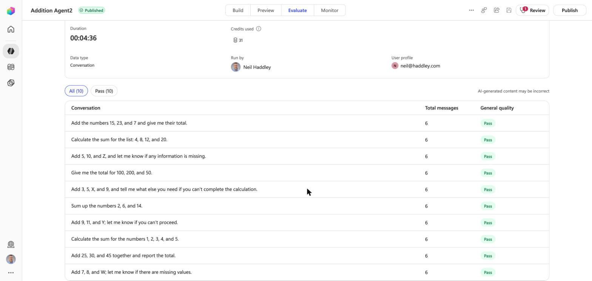
*Addition Agent2: ten passes*

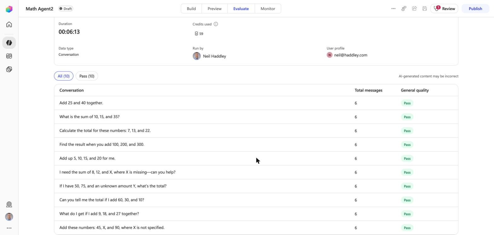
*Math Agent2: ten passes*

Two things changed on the way to that result.

**Follow-ups needed a rule.** In earlier runs, an agent answered correctly, the simulated user said "Yes, that's right.", and my instructions had no rule for a message that is not a request. I added one to each agent. My first wording for Addition Agent2 was too broad: it also caught "Let me know the total once you have it.", which is a request for a total that already exists, so I widened the rule to repeat the total in that case.

**The fields mattered to the judge.** My first version replied `"interactionSummary": "I could not add the list."` when a value was missing. In two runs the judge failed "Add 7, 8, and W" and "Add 9, 11, and Y" as a refusal to help, even though the agent had asked for the missing value and then added the numbers correctly. After I switched to `findings`, which is empty when a value is missing, both passed. I also dropped `answered` in the same change, so I cannot say which one the judge was reacting to, but I suspect the "could not add" sentence.

:::no-dumb-questions
**Q: Is this version more reliable than my first one?**
A: I cannot say. Each pair handled my test conversation, but the test sets were different, so I did not compare them like for like.
:::

## What I learned about teams and clarification

- **The specialist needs a way to say "not yet".** A plain answer is not enough. It has to say that a value is missing, name it, and give a question to ask.
- **Decide who talks to the user.** I told the specialist not to, so the question travels back through the agent that the user is talking to.
- **The routing label is part of the design.** The description of the connected agent decides whether placeholder cases reach the specialist at all.
- **Clarification is a convention.** Both prompts have to agree, and nothing warns you when they stop agreeing. Microsoft's `findings` and `openQuestions` are a good pair to agree on, but on this harness they travel as text.
- **Give both agents a rule for follow-ups, and test it.** Thanks, confirmations and "say that again" all need an answer.
- **Use each field for what it means.** `findings` is for a specialist that stays silent, and `interactionSummary` is for one that talks to the user. My first version used the wrong one.
- **Read the conversations.** A pass told me a reply seemed relevant, and a fail sometimes told me the judge was wrong. I still read the totals and the transcripts.

## References

- [Connected agents overview (Microsoft Copilot)](https://learn.microsoft.com/microsoft-copilot-studio/agents-experience/authoring-add-other-agents) (Microsoft Learn)
- [Design subagents that avoid duplicate messages](https://learn.microsoft.com/microsoft-copilot-studio/guidance/generative-orchestration-subagents) (Microsoft Learn)
- [Multi-agent orchestration patterns and best practices](https://learn.microsoft.com/microsoft-copilot-studio/guidance/multi-agent-patterns) (Microsoft Learn)
- [Pay-as-you-go meters](https://learn.microsoft.com/power-platform/admin/pay-as-you-go-meters) (Microsoft Learn)
- [FAQ for agents powered by the Microsoft Copilot harness](https://learn.microsoft.com/microsoft-copilot-studio/agents-experience/faqs-copilot-harness) (Microsoft Learn)
- [I Asked a Microsoft Copilot Harness Agent to Turn a Gingerbread Man into an STL File](/posts/copilotstudiostl/)
