A Customer Posting Group is used to define which accounts receivable general ledger account to use when selling goods to a Customer.

Customer Posting Groups are maintained using the Customer Posting Groups page.

:::brain-power Before you read on
When a company sells to a customer, the amount owed has to land in a particular account in the books. Who or what should decide which account, and where would you want that choice stored?
:::

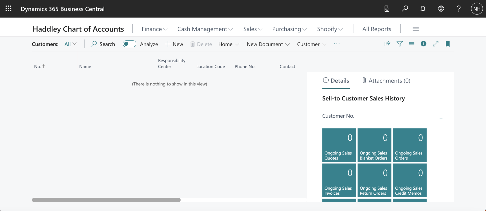
*I used search to navigate to the Customer page. I used + New to create a new Customer*

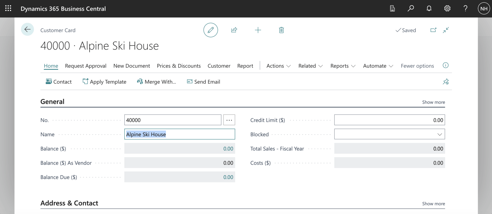
*I entered Customer details*

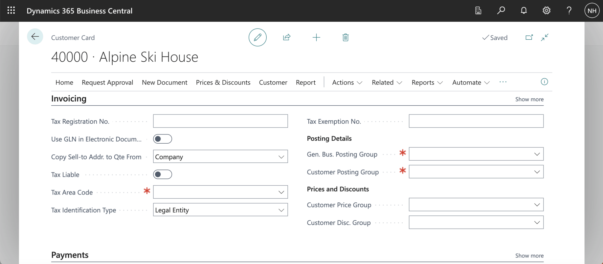
*I reviewed the Invoicing tab for the new Customer*

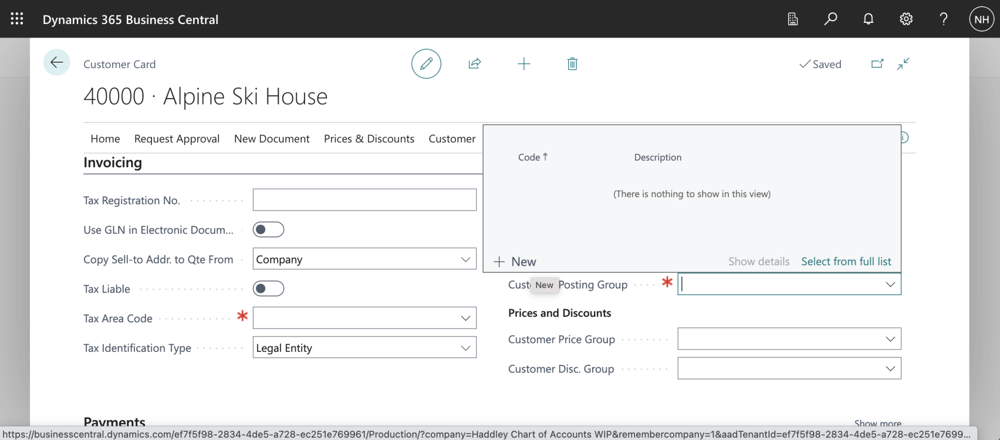
*I clicked the + New link*

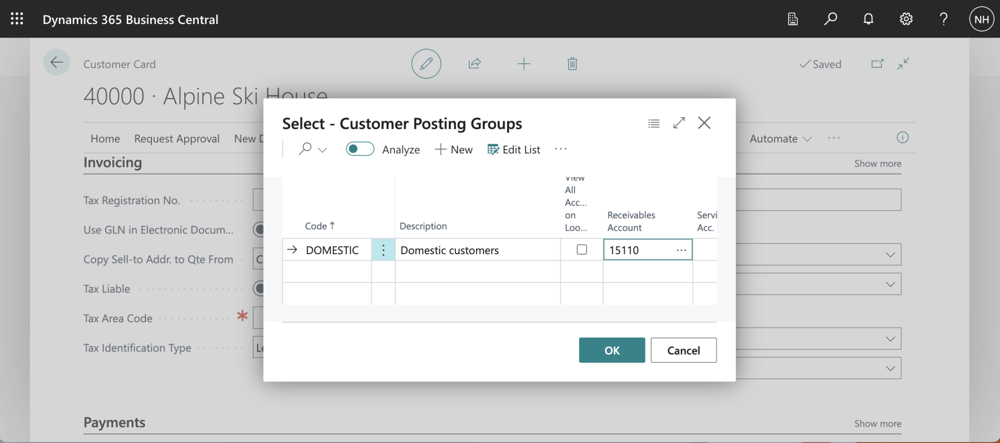
*I added code DOMESTIC and set Receivables Account to 15110 (Account Receivable, Domestic)*

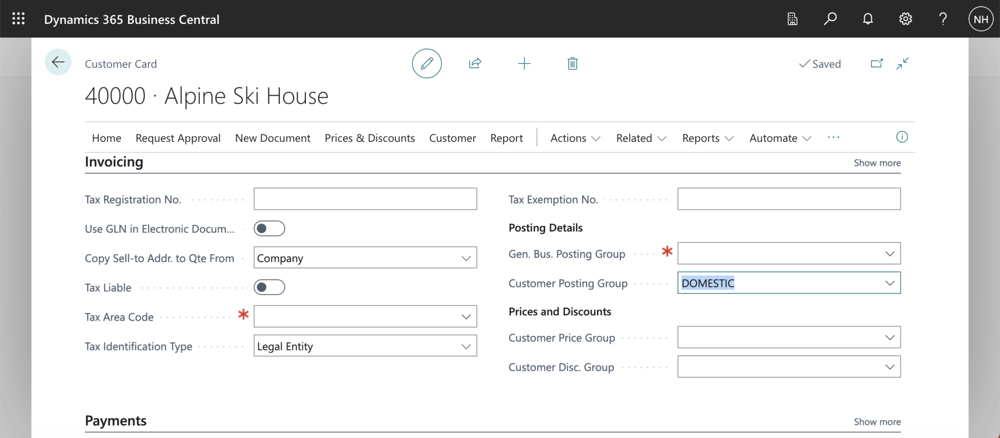
*I set the Customer Posting Group to DOMESTIC*

:::no-dumb-questions
**Q: What is a Customer Posting Group?**

A: A setting that says which accounts receivable general ledger account to use when I sell to a customer. I created one called DOMESTIC, with 15110 (Account Receivable, Domestic) as its Receivables Account, and assigned it to the new customer.

**Q: Why use Preview Posting?**

A: It shows what a posting would create without actually posting it. I could check the entries first, and I did not leave extra entries in the books.
:::

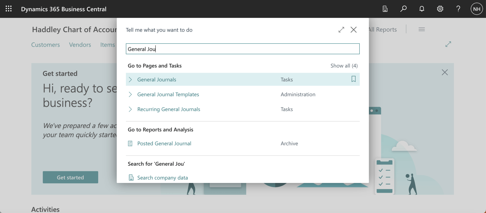
*I used search to navigate to the General Journal page*

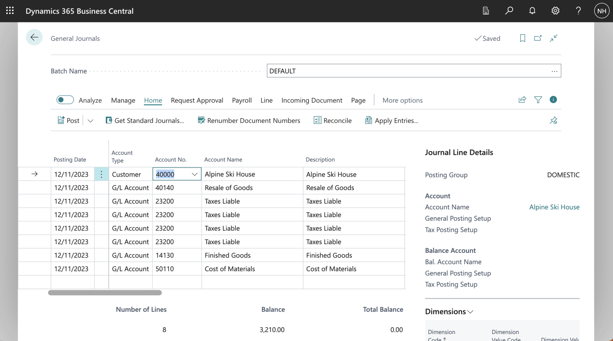
*I selected Customer Alpine Ski House*

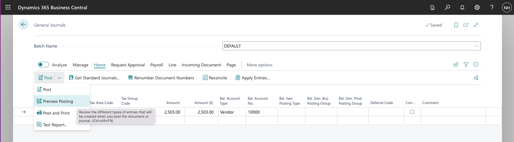
*I clicked the Preview Posting button*

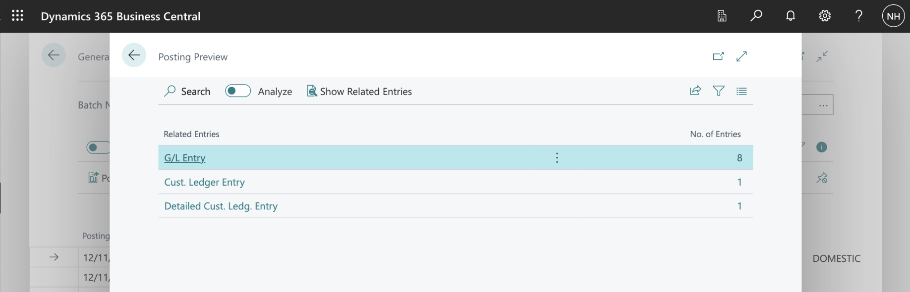
*The preview showed 8 General Ledger entries, 1 Customer Ledger entry and 1 Detailed Customer Ledger entry*

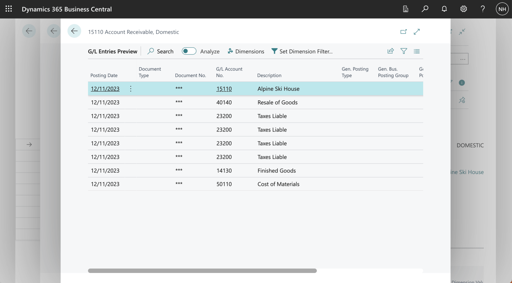
*The first general ledger entry relates to General Ledger account 15110 Accounts Receivable, Domestic (per the DOMESTIC Customer Posting Group).*

:::pencil Which account is debited?
The customer has the DOMESTIC Customer Posting Group, and its Receivables Account is 15110. Before you look at the preview again, which general ledger account would you expect the receivable entry to use?

:::answer
Account 15110, Accounts Receivable, Domestic. The preview showed 8 general ledger entries, 1 customer ledger entry and 1 detailed customer ledger entry, and the first general ledger entry was on 15110, because the customer's posting group says so.
:::
:::

:::test-drive Try it yourself
1. Create a Customer Posting Group with a receivables account of your own.
2. Assign it to a new customer.
3. Open the General Journal, choose the customer, and use Preview Posting.
4. Check that the receivable entry uses your account.
:::

:::bullet-points Recap
- A Customer Posting Group decides which accounts receivable account a customer's sales use.
- I created DOMESTIC with account 15110 and assigned it to a new customer.
- Preview Posting showed the ledger entries without posting them.
:::
