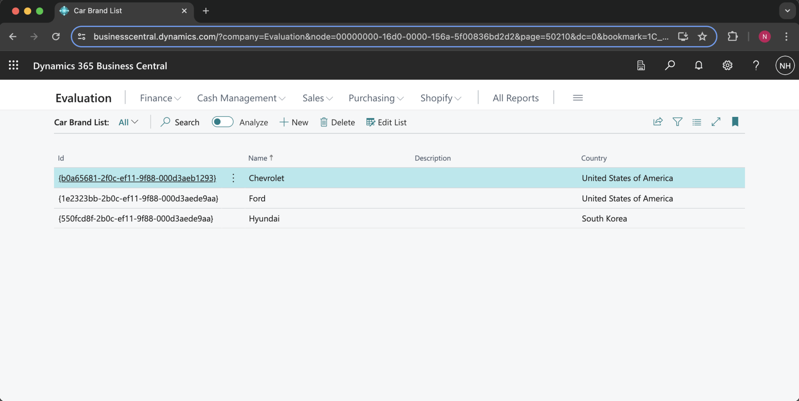
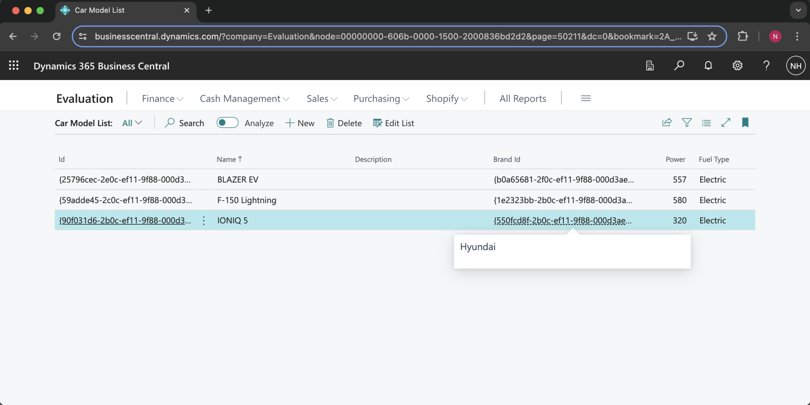
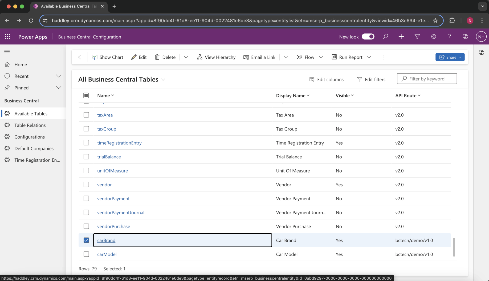
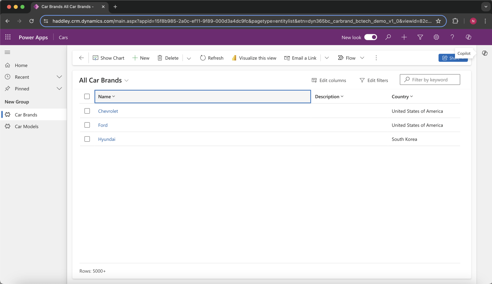
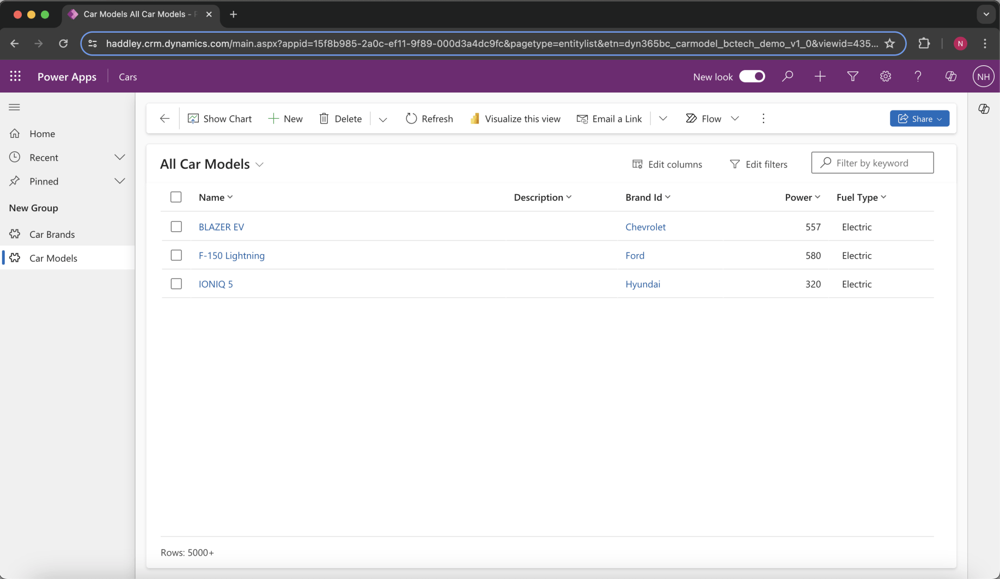
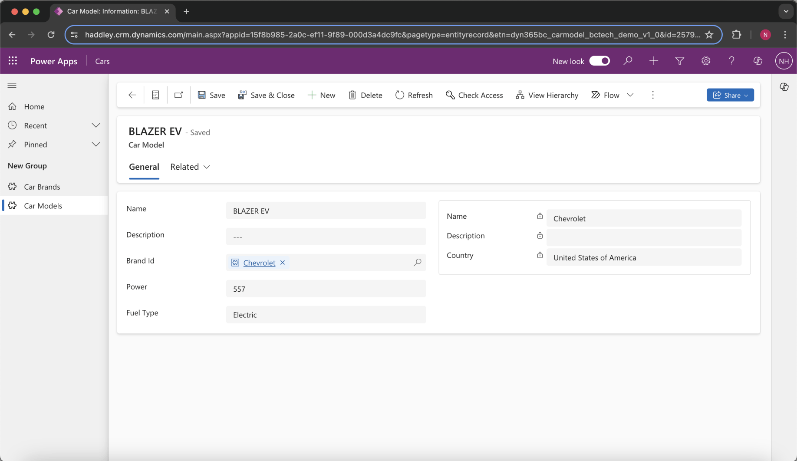

I created two related Business Central tables and connected to them as Power Platform Dataverse Virtual Tables.

:::brain-power Before you read on
You build your own tables in Business Central, such as car brands and car models. How could a Power Apps app work with them without anyone copying the data into Dataverse?
:::


*I edited the Car Brand table using the Car Brand List page*


*I edited the Car Model table using the Car Model List page*


*I reviewed the Car Brand and Car Model tables in the Available Tables list*

:::no-dumb-questions
**Q: Why did I create list pages for the tables?**

A: The Car Brand List and Car Model List pages gave me a way to type in the data in Business Central. The tables then appeared in the Available Tables list of the Business Central Configuration app.

**Q: How are the two tables related?**

A: A Car Model has a Brand Id, which is the SystemId of a Car Brand. The code sets ValidateTableRelation to false, and notes a blog post that explains why.
:::


*I viewed the contents of the Car Brands table using a Model Driven App View*


*I viewed the contents of the Car Models table using a Model Driven App View*


*I updated a Car Model record using a Model Driven App Form*

:::under-the-hood What the AL code defines
Car.al declares two tables, Car Brand and Car Model, and an enum called Fuel Type. A Car Model holds a name, a description, the Brand Id, the power in cc and the fuel type. Both tables use the CustomerContent data classification. Once the tables exist, the same virtual table steps as in my other post expose them in Dataverse.
:::

:::test-drive Try it yourself
1. Create two related tables in AL, with list pages, and publish the extension.
2. Make them visible in the Business Central Configuration app.
3. View them in a model-driven app, and edit a record in a form.
4. Check the change in Business Central.
:::

:::bullet-points Recap
- Custom Business Central tables can be exposed to Dataverse as virtual tables.
- I created Car Brand and Car Model, with list pages to enter data.
- A model-driven app showed both tables and let me update a Car Model.
:::


## Car.al

```al
table 50200 "Car Brand"
{
    DataClassification = CustomerContent;
    Caption = 'Car Brand';

    fields
    {
        field(1; Name; Text[100])
        {
            Caption = 'Name';
        }
        field(2; Description; Text[100])
        {
            Caption = 'Description';
        }
        field(3; "Country"; Text[100])
        {
            Caption = 'Country';
        }
    }

    keys
    {
        key(PK; Name)
        {
            Clustered = true;
        }
    }
}
table 50201 "Car Model"
{
    DataClassification = CustomerContent;
    Caption = 'Car Model';

    fields
    {
        field(1; Name; Text[100])
        {
            Caption = 'Name';
        }
        field(2; Description; Text[100])
        {
            Caption = 'Description';
        }
        field(3; "Brand Id"; Guid)
        {
            TableRelation = "Car Brand".SystemId;
            // https://yzhums.com/22220/
            ValidateTableRelation = false;
            Caption = 'Brand Id';
        }
        field(4; Power; Integer)
        {
            Caption = 'Power (cc)';
        }
        field(5; "Fuel Type"; Enum "Fuel Type")
        {
            Caption = 'Fuel Type';
        }
    }

    keys
    {
        key(PK; Name, "Brand Id")
        {
            Clustered = true;
        }
    }
}
enum 50200 "Fuel Type"
{
    Extensible = true;
    value(0; Petrol)
    {
        Caption = 'Petrol';
    }
    value(1; Diesel)
    {
        Caption = 'Diesel';
    }
    value(2; Electric)
    {
        Caption = 'Electric';
    }
}
page 50200 "API Car Brand"
{
    PageType = API;

    APIVersion = 'v1.0';
    APIPublisher = 'bctech';
    APIGroup = 'demo';

    EntityCaption = 'Car Brand';
    EntitySetCaption = 'Car Brands';
    EntityName = 'carBrand';
    EntitySetName = 'carBrands';

    ODataKeyFields = SystemId;
    SourceTable = "Car Brand";

    Extensible = false;
    DelayedInsert = true;

    layout
    {
        area(content)
        {
            repeater(Group)
            {
                field(id; Rec.SystemId)
                {
                    Caption = 'Id';
                    Editable = false;
                }

                field(name; Rec.Name)
                {
                    Caption = 'Name';
                }
                field(description; Rec.Description)
                {
                    Caption = 'Description';
                }
                field(country; Rec.Country)
                {
                    Caption = 'Country';
                }
            }

            part(carModels; "API Car Model")
            {
                Caption = 'Car Models';
                Multiplicity = ZeroOrOne;
                EntityName = 'carModel';
                EntitySetName = 'carModels';
                SubPageLink = "Brand Id" = Field(SystemId);
            }
        }
    }
}
page 50201 "API Car Model"
{
    PageType = API;

    APIVersion = 'v1.0';
    APIPublisher = 'bctech';
    APIGroup = 'demo';

    EntityCaption = 'Car Model';
    EntitySetCaption = 'Car Models';
    EntityName = 'carModel';
    EntitySetName = 'carModels';

    ODataKeyFields = SystemId;
    SourceTable = "Car Model";

    Extensible = false;
    DelayedInsert = true;

    layout
    {
        area(content)
        {
            repeater(Group)
            {
                field(id; Rec.SystemId)
                {
                    Caption = 'Id';
                    Editable = false;
                }
                field(name; Rec.Name)
                {
                    Caption = 'Name';
                }
                field(description; Rec.Description)
                {
                    Caption = 'Description';
                }
                field(brandId; Rec."Brand Id")
                {
                    Caption = 'Brand Id';
                }
                field(power; Rec.Power)
                {
                    Caption = 'Power';
                }
                field(fuelType; Rec."Fuel Type")
                {
                    Caption = 'Fuel Type';
                }
            }
        }
    }
}
permissionset 50200 "Car Brand"
{
    permissions =
        tabledata "Car Brand" = RIMD,
        page "API Car Brand" = X;

}
permissionset 50201 "Car Model"
{
    permissions =
        tabledata "Car Model" = RIMD,
        page "API Car Model" = X;

}


page 50210 "Car Brand List"
{
    PageType = List;
    SourceTable = "Car Brand";
    ApplicationArea = All;
    UsageCategory = Lists;

    layout
    {
        area(content)
        {
            repeater(Group)
            {
                field(id; Rec.SystemId)
                {
                    Caption = 'Id';
                    Editable = false;
                }

                field(name; Rec.Name)
                {
                    Caption = 'Name';
                }
                field(description; Rec.Description)
                {
                    Caption = 'Description';
                }
                field(country; Rec.Country)
                {
                    Caption = 'Country';
                }
            }


        }
    }
}
page 50211 "Car Model List"
{
    PageType = List;
    SourceTable = "Car Model";
    ApplicationArea = All;
    UsageCategory = Lists;

    layout
    {
        area(content)
        {
            repeater(Group)
            {
                field(id; Rec.SystemId)
                {
                    Caption = 'Id';
                    Editable = false;
                }
                field(name; Rec.Name)
                {
                    Caption = 'Name';
                }
                field(description; Rec.Description)
                {
                    Caption = 'Description';
                }
                field(brandId; Rec."Brand Id")
                {
                    Caption = 'Brand Id';
                }
                field(power; Rec.Power)
                {
                    Caption = 'Power';
                }
                field(fuelType; Rec."Fuel Type")
                {
                    Caption = 'Fuel Type';
                }
            }
        }
    }
}
```
