# DeepSeek Harness and a Vendor Dispute in Business Central

## What this post tells you, and why

In [LLM Benchmarking](/posts/llmbenchmark/) I measured six models on accountancy questions and ended on this point: a real answer needs more than a good model. It needs a **harness**. This post shows what that means on one small accounting case, from the first message to a result that a person can act on. I ran it once, in the harness's web UI, on a brand new Business Central Sandbox, and I took a screenshot at each step. Here is what I tell you, in order:

1. **What a harness is,** in one picture and one paragraph.
2. **The scenario:** a vendor delivers six broken lamps and agrees to take them back.
3. **The setup:** a fresh Sandbox, a configuration that can only read and draft, and one seeded order.
4. **The run:** what the harness read, looked up, asked me and created, with the screenshots.
5. **A check against Business Central:** what it got right, and the two things it got wrong.
6. **What a person does next,** and what I will change in the second run.

**Why:** accounting work has rules that live outside the product, and consequences that cannot be undone. A harness that reads the ledger, shows its sources, asks the right questions and stops before posting is useful. The honest test is to check its work against the system, so I did, and one of its conclusions was wrong.

:::watch-it It also works in Claude Code
I have run this kind of case in Claude Code with the same two connections, and it reached the same kind of plan. Everything in this post is about DeepSeek Harness, because one clear run is easier to follow than two. A harness is not tied to one product.
:::

## A harness, in one picture

You give the harness the scenario. The harness sends the scenario, with a list of the tools it has (or knows about), to the model. The model replies with an answer, or with a request: call this tool with these arguments. The tool might search the internet, look something up in Business Central or Microsoft Learn, or ask you a question. The harness makes the call, adds the result to the conversation (it may summarise an old conversation to keep it short), and sends it all back to the model. That loop repeats until the model gives an answer and asks for no more tools.


*The loop. The model decides what to ask for, and the harness makes the calls*

So a harness is powered by a model, and it is not the model. The model does the reasoning and chooses the next request. The harness does everything else: it holds the conversation, runs the tools, and decides which of the model's requests are allowed to run, with approvals that can stop a risky one.

The word "agent" is used loosely, so here is how I use the two words here. The harness is the software apart from the model. An agent is a model and a harness working on a task together. That fits Simon Willison's definition of 18 September 2025: "An LLM agent runs tools in a loop to achieve a goal." A test that works for me: if I swap the model, what stays the same? What stays the same is the harness.

## The scenario

Graphic Design Institute delivered purchase order 106030: 15 AMSTERDAM Lamps (item 1928-S) at $42.80. Six of the 15 arrived broken. The vendor has agreed to take the six back and credit them at the price we paid. The company uses Business Central, the invoice is already posted, and nobody in the warehouse has the receipt number or the invoice number. They have the vendor's delivery note, and it quotes our purchase order number.

That detail is the point. Think about who holds which number when the goods arrive.

| Who | What they have in front of them | When |
|---|---|---|
| **Goods-in clerk** | The delivery note and our purchase order number. Posting the receipt creates the receipt number. | The day the goods arrive |
| **Buyer** | The purchase order number and the negotiation. | Throughout |
| **Accounts payable** | The vendor's invoice number, then our posted invoice number and the vendor's credit note. | Days or weeks later |

The one number every role shares is the **purchase order number**. So the harness has to start from that, and trace the receipt and the invoice from it.

:::brain-power Before you read on
Business Central deletes a purchase order once it is fully received and fully invoiced. If the harness looks for order 106030 in the list of purchase orders, what will it find, and what should it do next?
:::

## The setup

I wanted a clean start, so I created a new Business Central **Sandbox** environment and made everything in it on purpose. The full setup, with the Microsoft Entra app and the connection, is in [Connecting DeepSeek Harness to Business Central](/posts/deepseekharnessbusinesscentral/). Here are the three steps that matter for this run.

**The environment.** The admin center shows the Production environment and the new Sandbox, which is Active and on version 29.1:

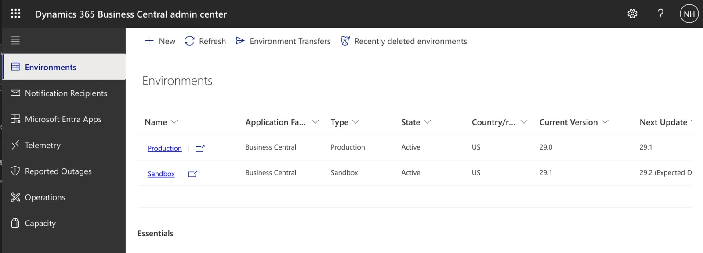
*The Business Central admin center: Production, and the new Sandbox once it was Active*

**A configuration that can only read and draft.** Business Central's MCP server exposes whatever a *configuration* allows. I made one called **Drafts**. It has 16 API pages. All 16 are read-only, except Purchase Credit Memos and their lines, where I also allowed Create and Modify. Delete and bound actions (the ones that post) stay off. Create and Modify only become available after someone switches on **Unblock Edit Tools**, and that switch is a person's decision, so I switched it on myself. Then I switched **Active** on last, because an active configuration is locked.

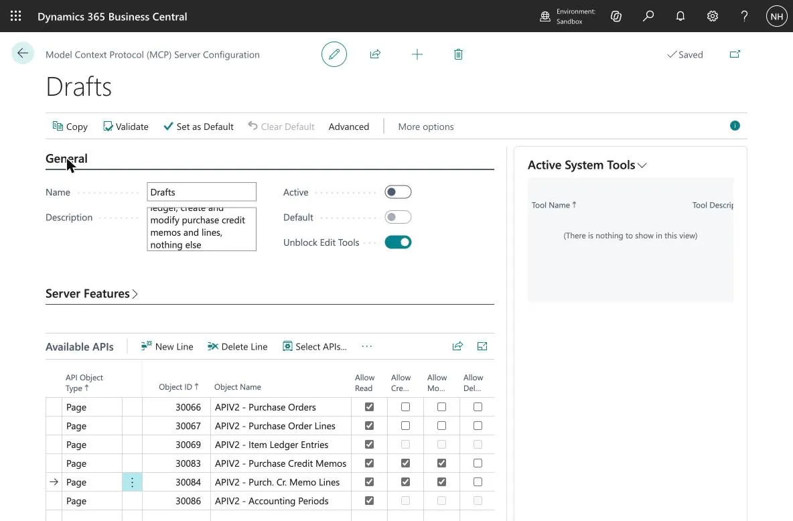
*The Drafts configuration with Unblock Edit Tools on, and Create and Modify ticked on the two credit memo pages*

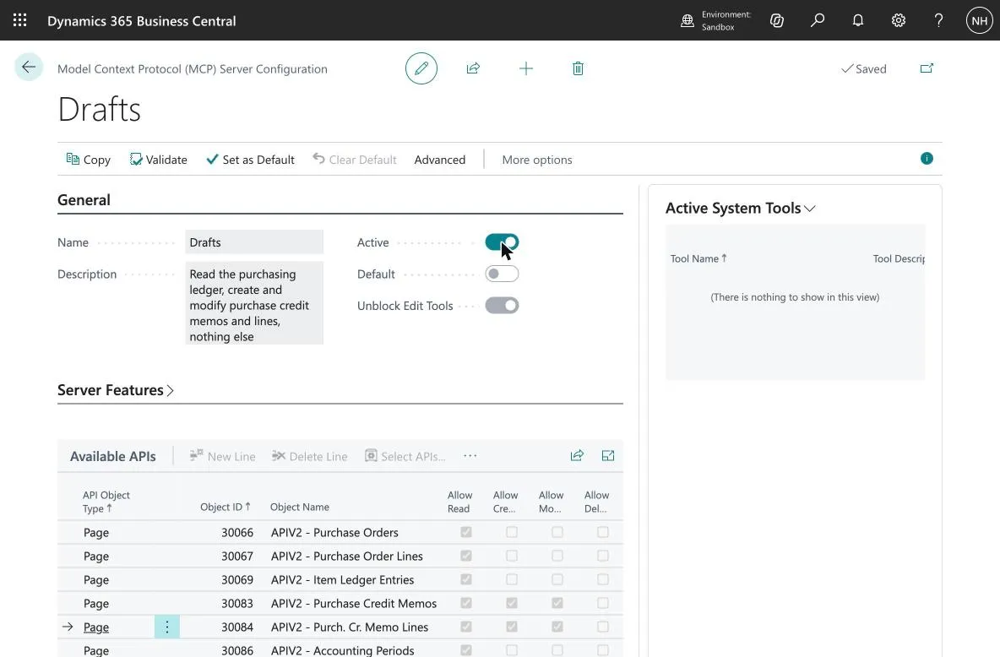
*Drafts is Active, so it is locked. Everything else on the grid is read-only*

Asking the server for its tools from outside returned 26: list tools, plus create and modify for credit memos and their lines, and nothing else.

**One seeded order.** I created purchase order 106030 for the vendor, with 15 lamps, a placeholder vendor invoice number (`TEST-INV-9001`, so nobody mistakes it for a real vendor document), and the dates set to today, 13 November 2026. The Sandbox work date is 1 November 2027, so Business Central warned that the order date is earlier than the work date, which I expected.


*The order header: vendor 30000, vendor invoice number TEST-INV-9001, posting, due and order dates set to November 2026. I did not touch the document date, which matters later*

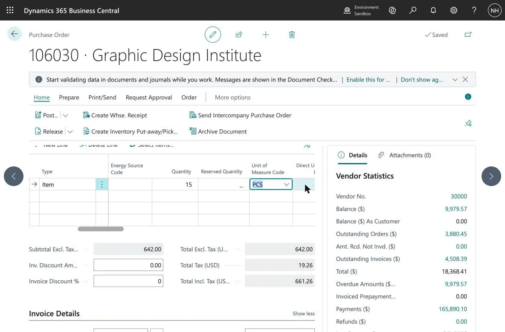
*Purchase order 106030: 15 lamps, $642.00, tax $19.26, total $661.26. The 3% tax comes from the order's tax area*

Then I posted it with **Receive and Invoice**. That is what a goods-in clerk and an AP clerk would end up doing between them, just compressed into one action. Business Central posted it as invoice **108234**, and the receipt is **107240**.

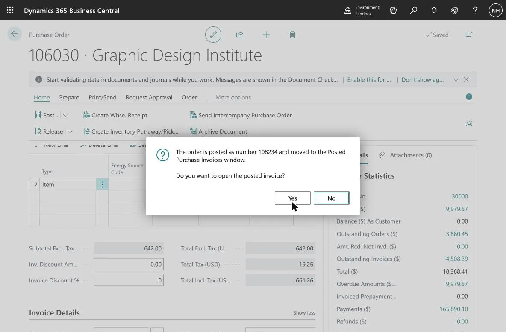
*"The order is posted as number 108234 and moved to the Posted Purchase Invoices window"*

The harness's working folder held the scenario, a skill that sets out the method (start from the purchase order number, search Microsoft Learn, read the ledger, cite a source for every step, do arithmetic with code), and two short company rules: put every disputed posted invoice on hold, and any credit over $500 needs the controller's approval.

## The run

I started DeepSeek Harness in its web UI, with the DeepSeek V4 Flash model, and added the working folder as a workspace. Then I typed this prompt:

```PROMPT
Read scenario.md and use the vendor-dispute skill. Method: (1) start from the purchase order number (106030) and read the ledger with the Business Central tools; (2) look up how Business Central handles returns and credit memos with the Microsoft Learn tools, and follow the documented steps; (3) name the jurisdiction from the documents in the ledger and look up the sales and use tax rule for the credit (search the internet, then read the official tax authority page) and the US GAAP treatment (cite what you can read; the FASB Codification is paywalled, so flag that for a qualified accountant); (4) write the plan with a source for each step. Then create a draft credit memo in Business Central with the create tools, only if the ledger shows that one is needed, with each line's description naming the purchase order and the receipt. It must stay an unposted draft. Never post anything. Say what a person must do that the tools cannot, and ask me whatever you need to know before you finish, and report the document number.
```

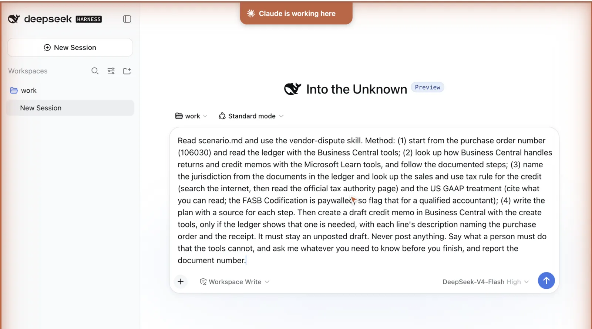
*The prompt in the web UI, sent to the "work" workspace in Standard mode*

### It read the skill and the company's rules first

The first steps are reads of local files: the skill, the scenario, then the company's rules, in the order of an index. It read the approvals rule and the hold policy before it touched Business Central.

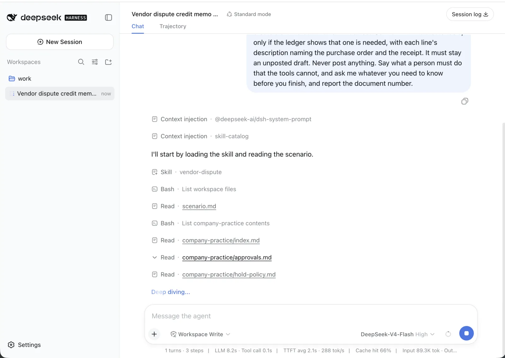
*The first steps: the skill, scenario.md, then company-practice/index.md, approvals.md and hold-policy.md*

### It started from the purchase order number, and did not stop when the order was missing

Its first filter on the order number returned nothing. It listed all the purchase orders without a filter, and noted that 106030 is not among the 14 records. Then it said "Let me trace it through receipts and invoices."

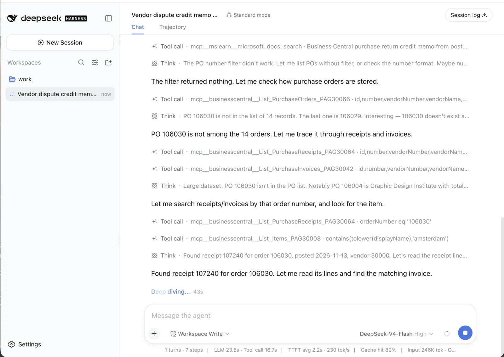
*"PO 106030 is not among the 14 orders. Let me trace it through receipts and invoices."*

That is the harness doing the right thing, and the cause is something I did in the seeding. I posted 106030 as Receive and Invoice, so it was fully received and fully invoiced. Business Central deletes a purchase order once it is completely invoiced, and moves the details onto the posted receipt (107240) and the posted invoice (108234), which both keep the order number. So the open purchase orders table no longer holds 106030, and the first filter returned nothing for the same reason. The harness then filtered receipts by `orderNumber eq '106030'`, found receipt 107240, read its lines, and found the matching invoice. A person holding only a delivery note might look in the order list, find nothing, and think the order does not exist. The harness did not.

### It read the rest of the ledger and the documentation

Next it read the receipt lines, the invoice lines, the vendor, the item ledger entries, the existing credit memos and the tax groups, and fetched Microsoft Learn pages, including [Handle vendor payment disputes](https://learn.microsoft.com/en-us/dynamics365/business-central/payables-how-handling-payment-disputes) and [Process returns or cancellations](https://learn.microsoft.com/en-us/dynamics365/business-central/purchasing-how-process-purchase-returns-cancellations).

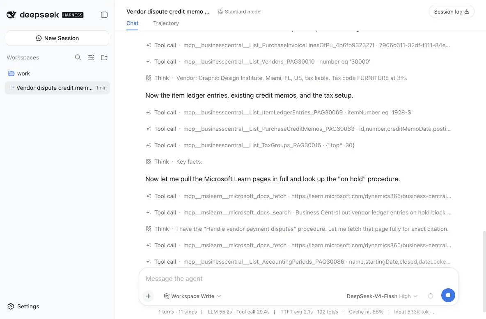
*Ledger reads (receipt lines, invoice lines, vendor, item ledger entries) alternate with Learn searches and fetches*

The Learn page matters because it says the **Correct** and **Cancel** actions on a posted invoice work only for unpaid invoices and do not support partial returns. That rules them out for six lamps out of 15, and points to a credit memo made from the invoice, which the page says you can edit to return only part of the quantity.

### It chose the wrong jurisdiction

The prompt asked it to name the jurisdiction from the documents in the ledger. This is where it went wrong. The vendor is in Miami, Florida, and the ship-to address is in Atlanta with the state field empty, so the harness chose Florida. It fetched the Florida surtax rate form DR-15DSS and extracted the Miami-Dade rate, and it searched for the GAAP treatment. The FASB Codification is paywalled, so it tried other sources. A download of a PwC inventory guide redirected to a login page, so it read an AccountingTools article instead.

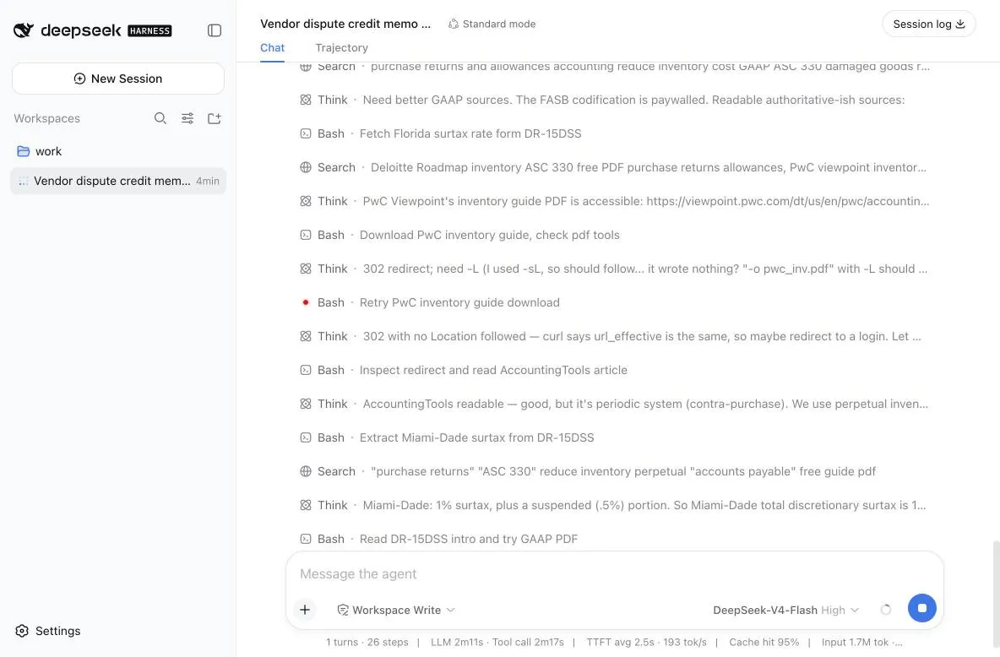
*Florida's surtax form, and the search for a readable GAAP source after the Codification and a PwC guide were out of reach*

The order's own tax area is **ATLANTA, GA**, as the checks below show. The standard Business Central API does not return the tax area, so the harness could not see the field that settles the question. It had only the vendor's state.

### It created the draft before it asked

It read the G/L entries for invoice 108234 (the description is "Order 106030"), copied the conventions of an existing credit memo, read the tax areas, and then created draft credit memo **1011** and its line.

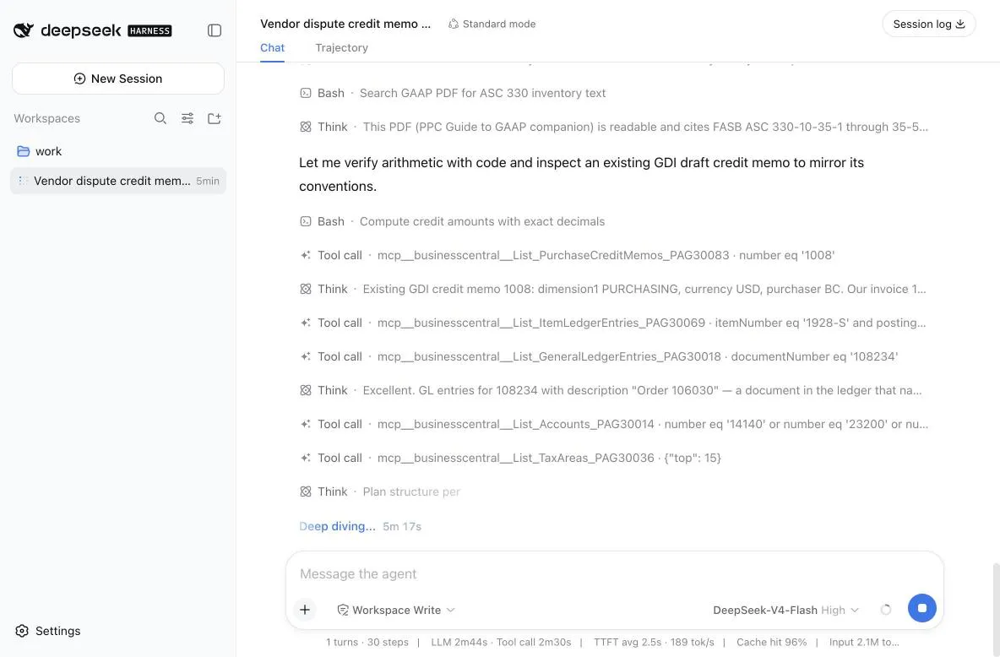
*G/L entries, accounts and tax areas, and then "Plan structure per…"*

One step failed, and the harness recovered in the next. Verifying the line, it called the general lines tool with a parent id, and the tool answered "Unknown property PurchaseCreditMemo_id for operation List_PurchaseCreditMemoLines_PAG30084".

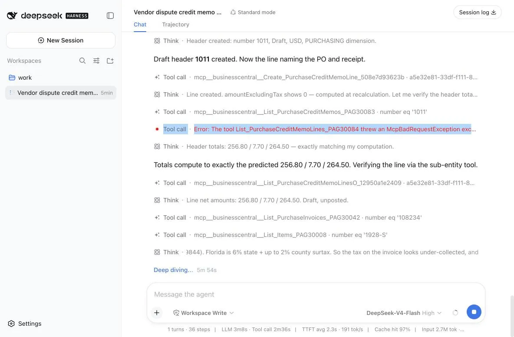
*Draft 1011 created. The red line is the tool error, and the next line is the harness's recovery*

The cause is that Business Central exposes two list tools for credit memo lines. One lists all lines and has no parent id. The other, named `…OfPurchaseCreditMemo`, takes the parent document's id. The harness said "Verifying the line via the sub-entity tool", called the second one, and read the line back: net 256.80, tax 7.70, total 264.50. That matches its own arithmetic, and the figures came from Business Central, not from the harness's own sums.

### It asked four questions

Then it wrote its plan to a file, `PLAN.md`, and asked me four questions in the web UI, one at a time, with numbered options and a box to type in.

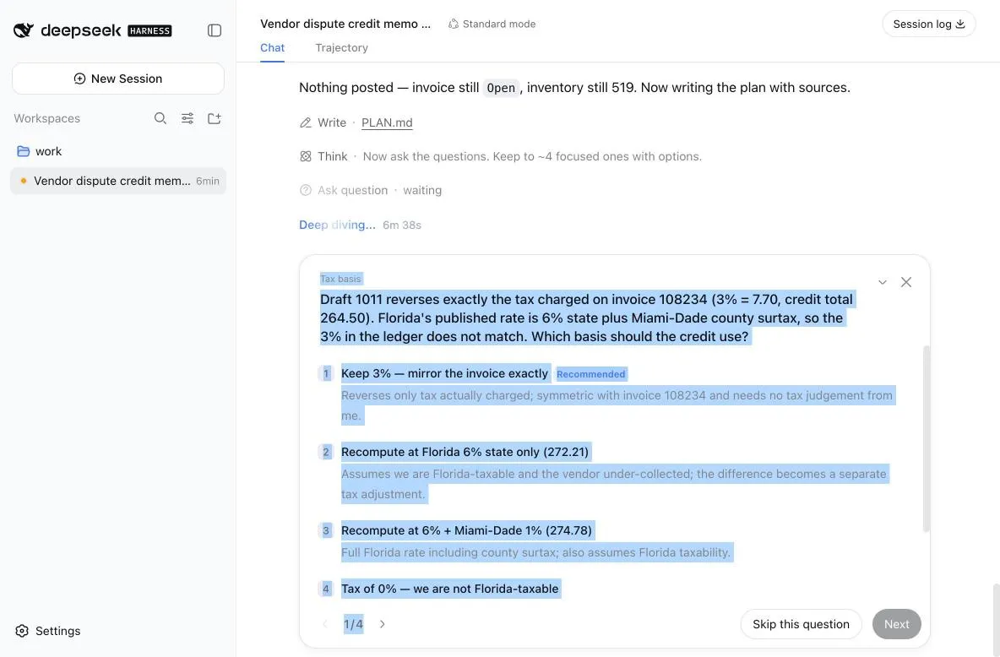
*Question 1 of 4: which tax basis should the credit use?*

| # | The harness asked | I chose |
|---|---|---|
| 1 | The draft reverses exactly the tax charged on the invoice (3%, $7.70). Florida's published rate is higher, so the 3% does not match. Which basis? | Keep 3%, mirror the invoice |
| 2 | The hold policy needs the buyer's initials. What are they? The invoice carries the purchaser code BC. | NH, mine. BC is a demo-data code, not the buyer |
| 3 | Do you have the vendor's credit note number? | No, leave it blank |
| 4 | What happens to the six lamps? This decides whether a return shipment is also needed, and "I want to avoid inventory being reduced twice." | Collected by the vendor |

Question 4 was the best of them. If the credit memo reduces inventory and somebody also posts a return shipment, the six lamps leave stock twice. Nothing in the prompt asked for that warning.

### Its final report

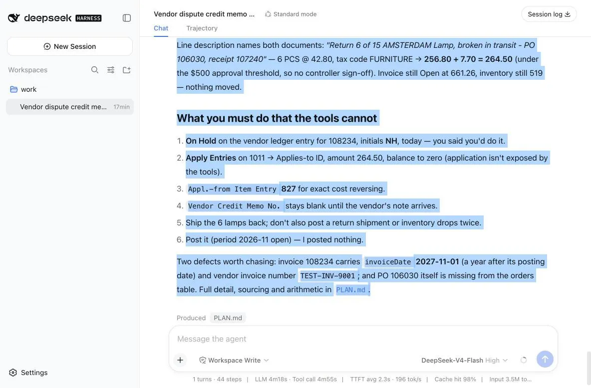
*The end of the report: six things a person must do, and two defects worth chasing*

The run took 44 steps. The model and tool time added up to about nine minutes, and the rest of the 17 minutes was the harness waiting for my answers. Its report gives document number 1011, status Draft, unposted. The credit is 6 × $42.80 = $256.80 plus $7.70 tax, $264.50, under the $500 approval limit. Invoice 108234 is still open at $661.26. It lists six things for a person:

1. Put invoice 108234 On Hold with initials NH, today, because the tools cannot reach the vendor ledger entry.
2. Apply entries on credit memo 1011 to the invoice, which is not exposed by the tools.
3. Set the original item entry for exact cost reversing, which is not a field on the API line.
4. Leave the vendor credit memo number blank until the vendor's note arrives.
5. Ship the six lamps back, and do not also post a return shipment.
6. Post, in an open period. The harness posted nothing.

It also flagged two defects: PO 106030 is missing from the orders table, and invoice 108234 carries an invoice date of **2027-11-01**, a year after its posting date.

## Checking it against Business Central

I opened Business Central and checked each claim.

**The amounts are right.** Draft credit memo 1011 is Open, not posted. Its subtotal is 256.80, the tax is 7.70 and the total is 264.50. The line is "Return 6 of 15 AMSTERDAM Lamp…" and names the purchase order and the receipt. The Vendor Cr. Memo No. is empty, and Business Central marks that field as required, so the draft cannot be posted by accident.

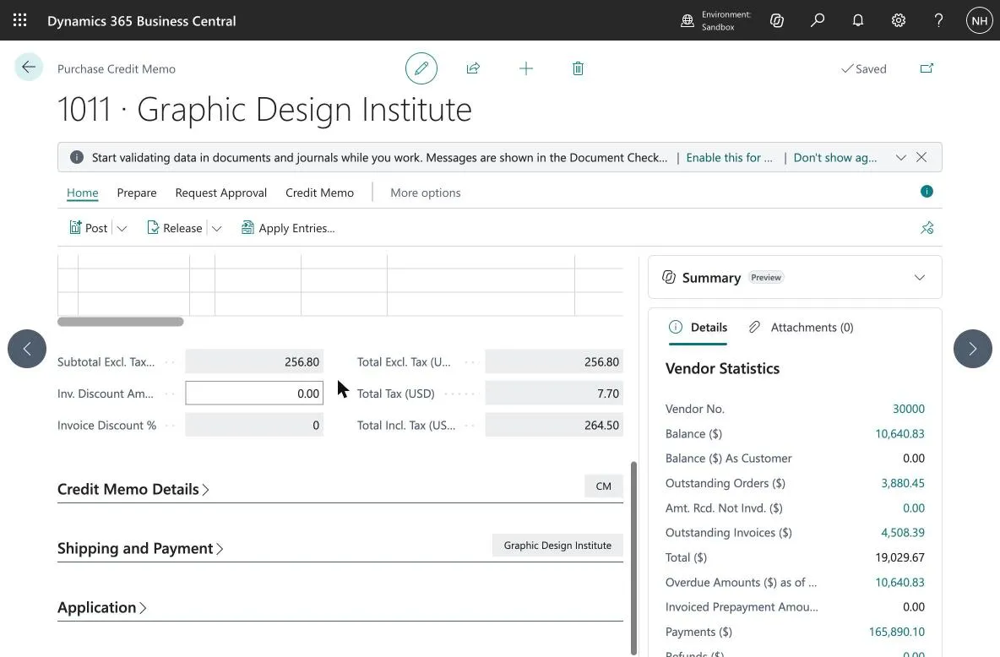
*Draft 1011: subtotal 256.80, tax 7.70, total 264.50*

**The jurisdiction is wrong.** The report says the jurisdiction is Florida and that "the tax area is MIAMI, FL". Posted invoice 108234 has Tax Area Code **ATLANTA, GA**, and so does the draft the harness created.

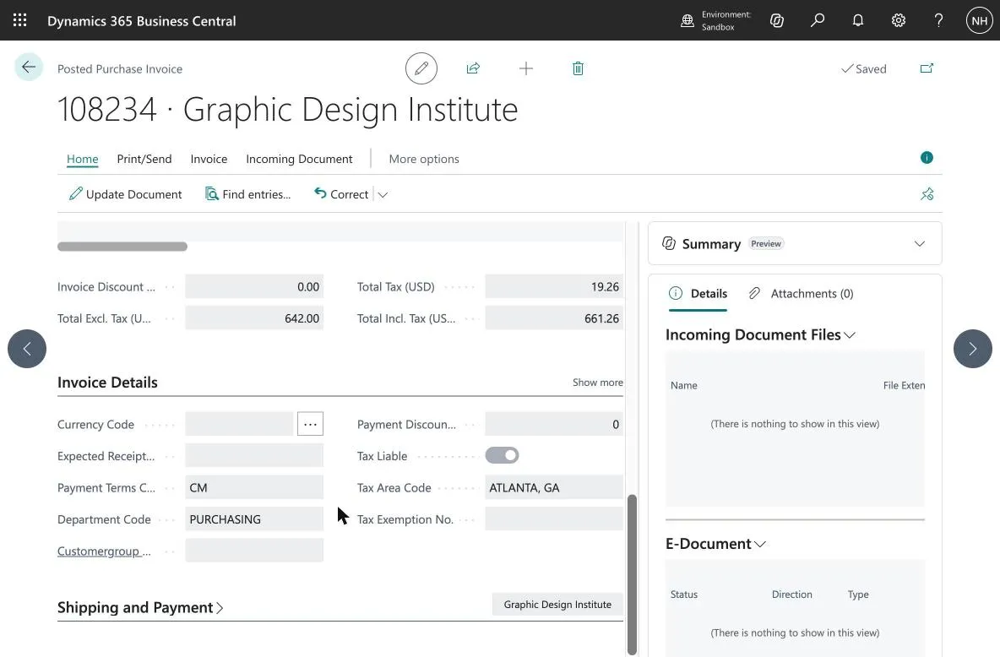
*Posted invoice 108234: Tax Liable is on and the Tax Area Code is ATLANTA, GA*

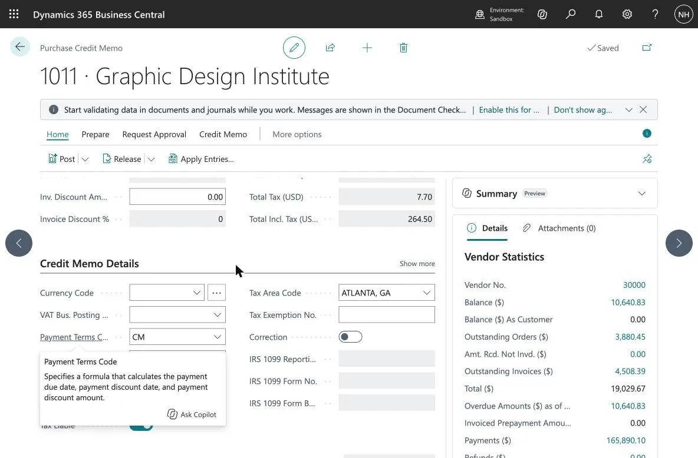
*Draft 1011 carries the same tax area, ATLANTA, GA*

The credit itself is still correct, because it mirrors the invoice and reverses the tax that was charged. But the Florida statute, the Miami-Dade surtax and the "under-collected" remark in the report all rest on the vendor's address, and that was not the right fact. Whether the tax on a returned purchase is credited is a question about the buyer's jurisdiction, which here is Georgia.

**The 2027 invoice date is a real defect, and it is mine.** Invoice 108234 has a posting date of 13 November 2026 and an invoice date of 1 November 2027. When I seeded the order I changed the posting, order and due dates, but not the document date, which took the Sandbox work date. The harness found it from the data, and it was right. I will not hide this, because it shows the harness checking something I did not ask it to check.

## What a person does next

The harness never posts. Its output is a plan with sources and one unposted draft. I have not posted anything, and I have not put the invoice on hold, because the next step is not mine to take today: the vendor has not issued a credit note. A person would, in order:

1. Wait for the vendor's credit note, then enter its number on draft 1011.
2. Put invoice 108234 On Hold with the buyer's initials, so that a payment run does not pay the disputed amount.
3. Apply the credit to the invoice, so that the open balance falls from $661.26 to $396.76.
4. Post, with the real date, after the lamps have left and the vendor's figures agree with the draft.

:::no-dumb-questions
**Q: Why did it say Florida?**

A: Because it had no better fact. The vendor card says Miami, FL and the ship-to state is empty. The field that settles it, the order's tax area, is on the order card but not in the API. A harness can only reason from what its tools show it. It was right to ask, and it did ask. I chose the option that kept the credit equal to the invoice, which was the right amount, and the report still named Florida.

**Q: Is it a problem that it created the draft before asking?**

A: Not here, because a draft can be deleted and nothing posts. If the configuration allowed posting it would be a serious problem. That is why I kept bound actions off.

**Q: Where did the draft's tax area come from?**

A: I do not know. The harness did not report setting it, and the draft shows ATLANTA, GA, the same as the invoice. The error was in the harness's reasoning about which jurisdiction applies, not in the document.
:::

## What this post told you

:::bullet-points What to remember
- A harness is the software around a model: it holds the conversation, runs the tools and decides which requests run. The same model in a plain chat cannot read your ledger.
- Start from the one number every role shares. The harness traced purchase order 106030 to receipt 107240 and invoice 108234, even though the order was no longer in the order list.
- A configuration limits what the harness can touch. Mine allowed reading and drafting credit memos, and nothing else. It created one unposted draft, and that is where it stopped.
- Check its work against the system. The amounts, the draft and a data defect were right. The jurisdiction was wrong, because the field that settles it is not in the API.
- Its questions are part of the result. It asked about the tax basis, the hold, the vendor's credit note and the lamps, and one of them protected the inventory from a double reduction.
- A person still owns the vendor's credit note, the hold, the application of the credit, and the posting.
:::

## What comes next

I will run this again, and I will change three things. I will set the document date when I seed the order, so the invoice date is not a year ahead. I will state in the scenario that the order's tax area is ATLANTA, GA, because a person would know it, and because the API cannot show it, and I will see whether the harness then uses Georgia. And I will keep the run clean from the start, with a screenshot at every step, including the three questions that I did not capture this time.

## References

- [LLM Benchmarking](/posts/llmbenchmark/): the benchmark, and why the harness matters
- [Connecting DeepSeek Harness to Business Central](/posts/deepseekharnessbusinesscentral/): the setup behind this run
- [Blog AI Assistant](/posts/localagent2/): a harness written as custom code
- [I think “agent” may finally have a widely enough agreed upon definition to be useful jargon now](https://simonwillison.net/2025/Sep/18/agents/): Simon Willison, 18 September 2025
- [DeepSeek Harness](/posts/deepseekharness/) (part 1), [with Ollama](/posts/deepseekharnessollama/) (part 2) and [with local subagents](/posts/deepseekharnesshybrid/) (part 3)
- [Handle vendor payment disputes](https://learn.microsoft.com/en-us/dynamics365/business-central/payables-how-handling-payment-disputes) and [Process returns or cancellations](https://learn.microsoft.com/en-us/dynamics365/business-central/purchasing-how-process-purchase-returns-cancellations): Microsoft Learn
