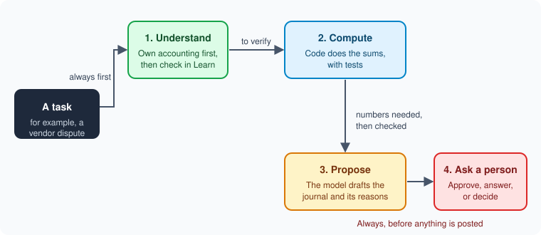
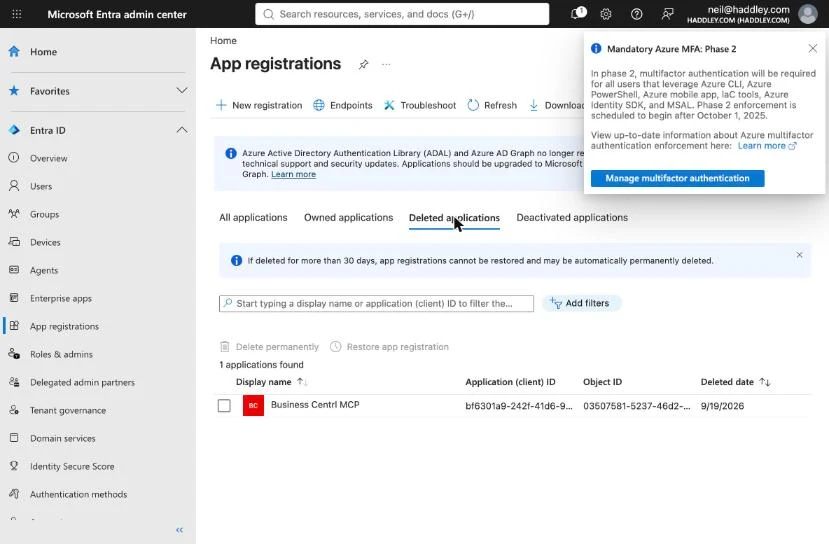
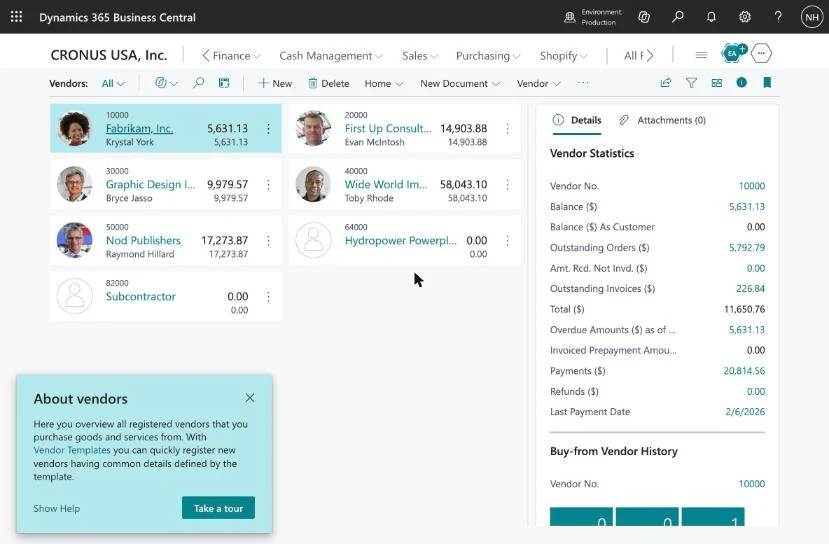
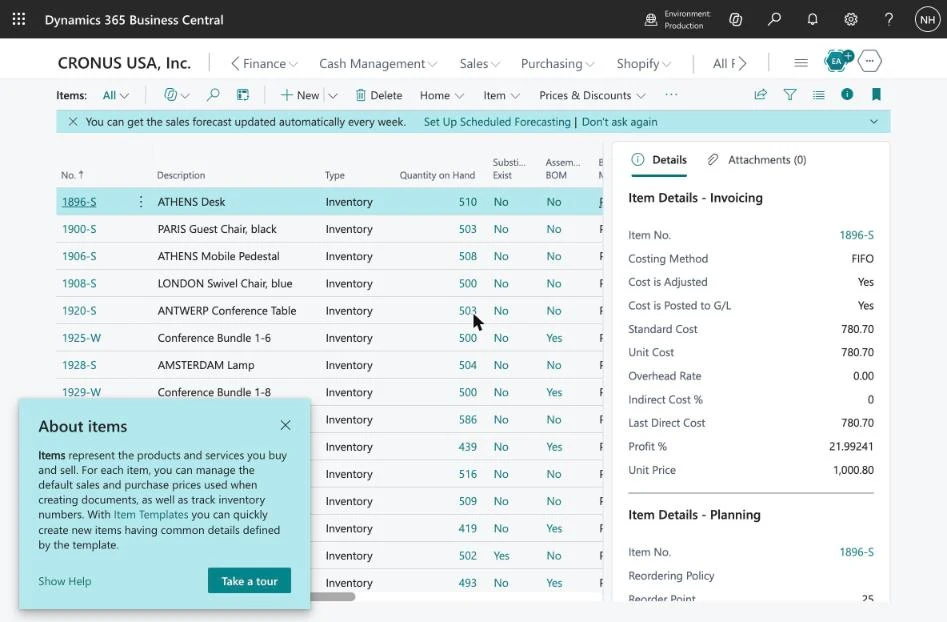
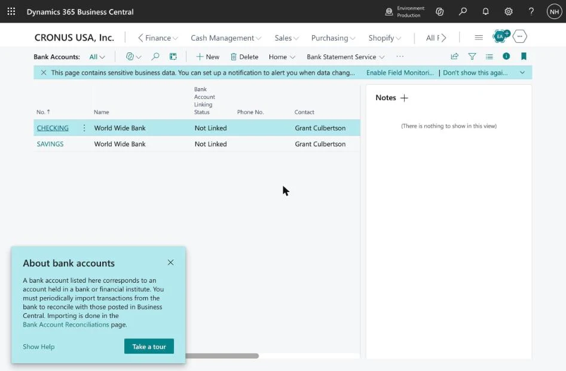

# DeepSeek Harness and a Vendor Dispute in Business Central

In [LLM Benchmarking](/posts/llmbenchmark/) I measured six models on accountancy questions, and then said that a good model is only half of a useful system. The other half is the **harness**: what the model is asked, what it can look up, which tools it can call to get the work done (a search, a calculator, a connection to the ledger), and who is asked when it is unsure.

This post tests that idea on one realistic accounting challenge. My starting point has two parts. The plan should begin with what the model already understands about accounting, which is the thing my benchmark measured. Then, before the agent answers, it should check everything that depends on Business Central against Microsoft Learn, the way an accountant less familiar with Business Central might review the product documentation for best practices before posting anything unusual.

:::watch-it What I tested, and what I did not
I ran the scenario through DeepSeek Harness itself, four times with four different setups, and I report the runs below. Each setup ran **once**, so treat the differences as hints, not measurements. I connected Business Central's MCP server and read real data from the Cronus demo company, and I connected the harness to it, which failed at first and then worked with a smaller configuration, as the section on the ledger describes. The four runs below were made earlier, with plain files that stand in for what the connection returns. The harness also had no screen on which a person could answer its questions, so the ask-a-person features are described from the documentation and were not exercised. Everything I say about Business Central comes from Microsoft Learn pages that I read for this post, and I name the page each time.
:::

## The scenario

A vendor delivers an order. Some of the items are **broken**, and some of the items are the **wrong ones**. The company uses Business Central, and the invoice may already be posted. The company wants a creative settlement: keep the wrong items at a lower price, and get credit for the broken ones.

This is a good test because there is no single answer. The right documents depend on three facts:

1. Has the original purchase invoice been **posted**?
2. What happens to the **wrong** items: keep them free, keep them at a discount, or send them back?
3. What happens to the **broken** items: scrap them here, send them back, or wait for replacements?

I put the question to an AI assistant in a chat, and I will call its reply "the assistant's answer". I do not know which model wrote it. Its first reply was not an answer at all: it asked those same three questions. Then I told it the invoice was posted, that I would keep the wrong items at a discount, and that I would scrap the broken ones locally, and it wrote a four-step procedure.

:::brain-power Before you read on
The assistant stopped to ask three questions instead of guessing. Which of the three would change the Business Central documents the most?
:::

## Even an answer that mentions Microsoft Learn needs checking

The assistant's answer named Microsoft Learn in places, but it gave no links, so I could not tell which claim came from which page. A fluent procedure is not a correct one. I took each claim and looked for it on Microsoft's own pages: [Handle vendor payment disputes](https://learn.microsoft.com/en-us/dynamics365/business-central/payables-how-handling-payment-disputes), [Process returns or cancellations](https://learn.microsoft.com/en-us/dynamics365/business-central/purchasing-how-process-purchase-returns-cancellations) and [Use item charges to account for extra trade costs](https://learn.microsoft.com/en-us/dynamics365/business-central/payables-how-assign-item-charges).

| The assistant said | What Microsoft Learn says | Verdict |
|---|---|---|
| Put the posted invoice **On Hold** in Vendor Ledger Entries, with your initials, so it is not paid | On the Vendor ledger entries page, choose **Edit List** and type up to three characters in the **On Hold** field. The **Suggest Vendor Payments** batch job excludes entries that are on hold. | Confirmed |
| For the wrong items you keep at a discount, post a **Purchase Credit Memo** with a line of type **Charge (Item)**, quantity 1, and the discount as the unit cost | The same steps appear under "Create a purchase allowance". The page says they apply to a credit memo or a return order. | Confirmed |
| Link the charge to the posted receipt with **Item Charge Assignment**, then **Get Receipt Lines** and **Suggest Item Charge Assignment** | These are the documented actions for assigning a charge to a posted purchase receipt. | Confirmed |
| Apply the credit memo to the original invoice with **Apply Entries** and **Applies-to ID**, then check the remaining amount | The credit memo steps use **Apply Entries**, **Applies-to ID** and **Amount to Apply**, and they say the **Balance** is zero when everything is reversed. | Confirmed |
| Use **Get Posted Document Lines to Reverse** on the **Purchase Credit Memo** | Learn lists this action on the **Purchase Return Order** page. For a credit memo it describes **Create Corrective Credit Memo** and **Copy from Document**. | Not on the credit memo, as far as these pages say |
| Posting the credit memo creates a negative item ledger entry that removes the broken units from stock | The pages I read do not say this. | Not confirmed |
| Use a **Return Reason Code** with **Inventory Value Zero** for items scrapped locally | The three pages do not mention it. In a short Business Central video I watched, it is used for sending items to a vendor for repair. | Not confirmed for this use |
| The charge "lowers your inventory unit cost" | For items on **Standard** costing, the charge does not change the unit cost. It is posted as a purchase variance. | Wrong for some items |
| *(nothing)* | If the items were already sold, the cost of goods sold does not update until you run **Adjust Cost - Item Entries**. | **Missing** |

So the assistant's answer was mostly right, and the two serious problems are the ones you cannot see by reading it. It left out a step that would have left the cost of goods sold wrong, and it described one effect that is wrong for any item on standard costing. A reader who trusts fluent text would never notice either.

:::watch-it The error is in what the answer leaves out
It is easy to check a claim that is on the page. It is hard to notice a step that is not. A harness that begins with the model's own understanding of the case, then finds the documented procedure and makes every step of the plan point at it, finds missing steps. Reading an answer more carefully does not.
:::

## Two more sources, and what they add

The Dynamics community blog post I read, written for the older NAV, argues for the same paper trail that Microsoft documents. Its advice is to receive a delivery in full into a quality-control location, move the good items to the main location with an item reclass journal, and use a **purchase return order** for the broken ones. It rejects the shortcut of undoing the receipt, because the shortcut fails once any of the quantity has been sold and leaves no record of the return. That blog was written for NAV, so I treat it as the reason behind the process, and Microsoft Learn as the current steps.

Learn also has a warning that matters here: the **Correct** and **Cancel** actions on a posted invoice work only for **unpaid** invoices and do not support partial returns. A dispute over some of the items on a paid invoice cannot use them.

## Which documents for which outcome

Here is the map from the outcomes to the documents, using only what the three Learn pages say:

| Outcome | Business Central document | Source |
|---|---|---|
| Hold the payment while you negotiate | **On Hold** on the vendor ledger entry | Dispute page |
| Keep items at a lower price | Credit memo with a **Charge (Item)** line, assigned to the receipt | Returns page, "Create a purchase allowance" |
| Send items back | **Purchase Return Order**, with **Get Posted Document Lines to Reverse** | Returns page |
| Vendor sends replacements | A negative line on the return order, then **Move Negative Lines**, which creates a new purchase order | Returns page |
| Close the dispute | **Apply Entries** and **Applies-to ID**, then release the hold | Returns and dispute pages |
| Costs change after a sale | **Adjust Cost - Item Entries** | Item charges page |

## What the harness adds


*Every task goes down the same four stages. The agent starts from its own general knowledge of accounting and checks the product-specific parts in Learn. If nothing documents a step, it skips to asking a person.*

DeepSeek Harness is a coding agent, and I used it to build a game in parts 1 to 3. Its documentation describes several features that matter for this job. I list only the ones I read about:

| Harness feature | What the documentation says | What it does in this scenario |
|---|---|---|
| **User questions** | The agent can ask a person a question with a list of options, and the person can also type an answer. If nobody answers, the result is `pending`, which the documentation says is not an answer, a refusal or a permission. | The three intake questions. |
| **Plan mode** | The agent presents a plan with `exit_plan_mode`, and the person approves it, asks for changes or dismisses it. | The settlement plan, approved before any document is drafted. |
| **Approvals** | A tool can ask before a risky call. The only grant is `allowed-once`, and anything else, including no answer, is a refusal. Each request is logged. | Any tool that writes to Business Central. |
| **Skills** | Instruction files that the agent loads by name, kept in `.dsh/skills` in the project. | The company's own dispute procedure. |
| **Web access** | Two tools, `web_search` and `web_fetch`. The documentation says they are offered to the model only when the chosen provider can authenticate. | The first step of the plan: find and read the Learn pages. |
| **Subagents** | A lead agent starts child agents on models of my choice. A child cannot ask a person. | Local workers for reading and drafting. |

Two details shaped the design. A subagent cannot ask a person, so the lead agent must do all the asking. And `web_fetch` has no per-call confirmation in the standard presets, and the documentation says a model can send data to any URL it can reach, so I would let it fetch public Learn pages only, and never put a vendor's figures in a request.

## The plan starts with understanding, then a lookup

This is the part I care about most, and I changed my mind about it while writing. My first version said the first step should be a search. That is the wrong order. A model that has learned accounting can already see what kind of problem this is: a vendor allowance on goods that are partly sold, and a credit for goods that are scrapped. It can see that a $450 credit on $500 of lamps is a $50 loss, not a $450 gain. No Business Central page says that. What the model cannot know from its weights is how **this product** behaves, and that is what the search is for:

1. **Understand.** Before it searches, the agent writes a short analysis from its own knowledge of accounting: what kind of problem this is, what is debited and credited, what the real gain or loss is, which facts in the case change the treatment, and a draft plan. Every statement that depends on how Business Central behaves is marked "to verify".
2. **Search.** The agent calls `web_search` with the Business Central terms from the case, such as "purchase allowance credit memo".
3. **Fetch and verify.** It reads the pages that the search returns, and for each "to verify" statement it says whether Learn confirms it, changes it, or does not cover it, with the page address and the sentence it relied on.
4. **Compare.** It lists the steps of each documented procedure and checks that its plan has every one.
5. **Ask.** Only then does it ask the person the questions that neither its own understanding nor the documents can answer.

The understanding comes first for three reasons. It gives the search better terms. It lets the agent notice when a page contradicts good accounting sense. And it shows which parts of the plan **no page covers**, so those go to a person instead of being filled in quietly. The risk is that the model anchors on its first draft, so Learn wins whenever the two disagree about how the product behaves.

:::watch-it Search first for product details, and do not guess addresses
While I was writing this post, two Learn addresses that I guessed returned 404 errors. A search then found the right pages straight away. An agent that builds the address from memory will fail the same way, or worse, will fetch an old page that still exists. So the plan must search, then fetch what the search returns.
:::

Three more rules keep the lookup honest, and the first one repeats the lookup:

- **Look again before every follow-up question.** The agent searches Learn before it asks a person anything, and again whenever an answer changes the plan. Many questions turn out to be documented, and documented practice changes over time: Microsoft updates these pages, and the ones I fetched each carry a last-updated date. A question that Learn can answer should never reach a person.
- **Prefer the current page, and note its date.** The pages I fetched carry a last-updated date. When two sources disagree, such as the NAV-era blog and a current Learn page, the agent prefers the current page and tells the person that the other exists.
- **Send the terms, never the figures.** A search for "purchase allowance credit memo" is harmless. A search that contains a vendor's name and an invoice total is not.
- **No source means ask.** If nothing documents a step, the agent says so and asks a person. The assistant's "Inventory Value Zero" step is an example: none of the three pages mentions it.

## The agent asks the three questions

The assistant asked its three questions in free text. A harness can ask them as a form, so the answers come back as exact choices that the rest of the process can use. This is how I would write the first one, based on the shape the documentation describes:

```
Header:    Invoice status
Question:  Has the original purchase invoice been posted?
Options:   Posted, and not yet paid
           Posted, and already paid
           Received only, with no invoice posted
           Not received at all
```

Each answer changes the plan. An unpaid, posted invoice can be held and credited. A paid one also needs a refund from the vendor, and Learn says the **Correct** and **Cancel** shortcuts cannot help. A receipt with no invoice posted is simpler. If the person does not answer, the agent does nothing except carry on with work that does not depend on the answer.

## The agent does the sums with code

The assistant said, quite rightly, to enter the negotiated allowance and use **Suggest Item Charge Assignment** to share it across the receipt lines. That function has a choice of **Equally**, **By Amount**, **By Weight** and **By Volume**. Before I post anything, I want to know what the answer should be, so I check it with code instead of by eye. Here is the **By Amount** share, in whole cents, with the last line taking the remainder so that the shares always add up to the allowance:

```python
from decimal import Decimal, ROUND_HALF_UP

def spread_by_amount(allowance, line_amounts):
    allowance = Decimal(str(allowance))
    amounts = [Decimal(str(a)) for a in line_amounts]
    total = sum(amounts)
    shares = [(allowance * a / total).quantize(Decimal("0.01"), rounding=ROUND_HALF_UP) for a in amounts[:-1]]
    shares.append(allowance - sum(shares))
    return [float(s) for s in shares]

assert spread_by_amount(200, [500, 300, 200]) == [100.0, 60.0, 40.0]
assert spread_by_amount(100, [1, 1, 1]) == [33.33, 33.33, 33.34]
```

I ran both checks and they pass. The agent would run the same function, compare its result with the **Qty. to Assign** column that Business Central proposes, and ask a person if the two disagree. I have not checked how Business Central itself rounds the last cent, so the first thing the comparison would teach me is whether my rule matches theirs.

## "How we do things around here"

Microsoft Learn says what Business Central does. It cannot say what **this company** does. Do we hold every disputed invoice, or only those over a certain amount? Which item charge number is the purchase allowance? Do we scrap broken items here, or always send them back? Today those answers live in people's heads and in old emails, and that is why an agent that knows only the documentation has to ask so many questions.

A company wiki of practice fixes this. It is a set of short pages, one rule each, kept as files in the project, in the same spirit as my [LLM Wiki](/posts/LLM-Wiki/) post. A page holds:

- **The rule:** "Scrap broken items here when they cost under $50 a unit."
- **The reason:** "The freight back costs more than the credit."
- **Who said it, and when:** the controller, on a date.
- **An example case,** with the vendor and the figures taken out.
- **A review date,** after which the agent treats the rule as stale and asks again.
- **The Learn page it relied on, and that page's last-updated date.** If the page has changed since, the rule is flagged for review, because the documented practice may have moved on.

:::brain-power Which of the three questions could a wiki answer?
Look back at the three intake questions: has the invoice been posted, what happens to the wrong items, what happens to the broken items. One of them is a fact about this case, and no wiki can answer it. The other two are partly policy. Which is which?
:::

### How the agent uses it

The agent now has two kinds of source, and it cites both:

| Question | Source | Example |
|---|---|---|
| **How does Business Central work?** | Microsoft Learn | An allowance is a credit memo with a **Charge (Item)** line. |
| **What do we do here?** | The company wiki | Allowances use our own item charge number, and a second person approves any over $500. |

The wiki goes in the plan as a skill. The harness documentation says a skill is an instruction file that the agent loads by name, and that the agent first sees only each skill's name and description. A skill called `company-practice`, whose description says "how we handle vendor disputes, returns and allowances", would send the agent to the wiki index. I have not tested this, and I have not read about any long-term memory feature in the harness, so plain files and a skill are all that I am relying on.

With the wiki in place, the agent first searches Learn, then reads the wiki, and skips the questions that either one answers. It asks the person only to **confirm**: "The wiki says we scrap broken items under $50 a unit. These cost $12. I will plan it that way. Correct?" That is one short question instead of three open ones.

### The questions never drop to zero

The wiki should make the agent more useful every month, so the questions should fall over time. But I would keep a floor, because some questions are worth asking even when the wiki has an answer:

| The agent still asks when | Why |
|---|---|
| The facts of this case are not in the wiki | No page can say whether this invoice is posted. |
| The amount is near a limit in a rule | A rule that says "over $500" is easy to get wrong at $499. |
| The rule is stale, or the Learn page behind it has changed | The practice may have moved on. |
| It is a vendor or a type of dispute the wiki has not seen | The rules may not apply. |
| A rule has been applied many times without a person looking | An occasional confirmation catches a rule that has drifted. I would start with one case in ten and adjust. |
| Anything is about to be posted | Always. |

Each confirmation also keeps the person in the loop. A person who is asked a few good questions stays familiar with the case, and one who is never asked will stop noticing when the agent is wrong.

### How it learns

After each case the agent proposes changes to the wiki, using what the person said. It might propose a new page, a change to an old page, or a note that two pages disagree. The person reads the change, edits it and approves it. The agent never saves a rule on its own.

:::watch-it Do not let one busy afternoon become policy
If the agent saved every answer it was given, a hasty "just scrap them" on a Friday would become a rule, and every later case would follow it. A rule needs a person's approval, a reason and a review date. A rule that came from one case is marked as such.
:::

:::no-dumb-questions
**Q: What if the wiki disagrees with Microsoft Learn?**

A: The agent says so and does not follow either blindly. A wiki rule can change **what the company chooses**, such as the approval limit. It cannot change **how the system behaves**. If a page said "we never run Adjust Cost - Item Entries", the agent would flag it, because Learn explains that skipping it leaves the cost of goods sold wrong.

**Q: What if two pages disagree with each other?**

A: The agent asks a person and shows both pages. It does not pick the newer one, because newer is not the same as right.

**Q: Can a model write the wiki pages?**

A: It can draft them. On this blog, a model writes the first draft of each wiki page and an audit checks that every quote appears word for word in the post. The audit does not check whether a summary is true. I found a generated summary that said the opposite of its post, and only a person reading it caught that. A company wiki needs the same human review, with higher stakes.
:::

### How I would know it works

The test is simple and it can fail. Take twenty past disputes with known outcomes. Run them with an empty wiki and count the questions the agent asks and the plans a person has to correct. Add the wiki, rebuilt only from the answers to the first ten, and run the other ten. If the questions do not fall, the wiki is not helping. If the corrections rise, the wiki is teaching the agent bad habits.

## Local accounting standards and tax rules

Microsoft Learn says how Business Central works, and the company wiki says what the company does. Neither says what the **law and the standards require**, and for an accountant that is a third source that matters just as much. The answer to "does the agent also need to review the local accounting rules and the local tax rules?" is yes.

In this scenario, three questions belong to that third source:

- **The allowance.** Does a vendor allowance on goods you keep reduce the cost of the inventory, or is it income? Under IFRS, paragraph 11 of IAS 2 deducts trade discounts and rebates in working out the cost of purchase, according to a secondary summary, because I could not reach the standard's own text without a subscription. US GAAP and other local standards have their own wording, so the agent has to look up the one that applies.
- **The scrap.** When broken goods are scrapped, the loss is recognised under the same standards, and the timing and the account follow the company's policy.
- **The tax.** Whether the tax on the original invoice must be adjusted when a credit is agreed, when, and what the vendor must issue (a credit note, for example) are set by the local tax authority, not by Business Central. Business Central has tax groups and posting setups that carry out the rules, but it does not decide them.

The harness handles this source in four ways:

1. **Know the jurisdiction first.** The company's country and tax setup decide which rules apply. The agent reads them from the company's data, as the next section describes, and asks only if they are missing.
2. **Go to the primary source, and label it when it cannot.** The agent searches for the standard-setter's own text or the tax authority's own guidance, fetches it, and cites the page and the date, in the same way as for Learn. Rules change by date and by year, so the date matters. Tax authority pages are usually public. Accounting standards often are not: when I tried to fetch IAS 2 myself, the IFRS Foundation page gave only a summary, and the full text sits behind a subscription. In that case the agent can reach only secondary summaries, and it must say so in its output, mark the point as "not checked against the standard", and pass it to a person whose firm has the subscription. It must not quote a summary as if it were the standard.
3. **Say how sure it is.** Standards and tax law need interpretation. The agent states what the source says, what it assumes, and what it could not find.
4. **Hand it to a qualified person.** A draft that touches tax goes to a tax professional or the controller. The agent informs the decision and does not make it.

Here is what my four runs did with this. **None of them looked at local accounting or tax rules.** Only Run A asked whether the agreed amounts include tax, as one of its 17 questions, and Runs B, C and D did not mention tax at all. They were not asked to, and my skills did not tell them to, so this is a gap in my design and not a failing of the model. The fix is a rule in the skill: "Name the jurisdiction. Look up the accounting standard and the tax rule for each step that has a tax or reporting effect, cite them, and flag them for a qualified person."

## The agent reads the ledger through Business Central's MCP server

Run A asked 17 questions, and about ten of them asked for facts that sit in the company's own data: the costing method of item A, whether the lamps are still in stock, whether certain setup switches are on, whether the invoice lines match the receipt, the currency, and whether the posting period is open. A person should never be asked those. Business Central can answer them itself, because it now ships its own Model Context Protocol (MCP) server, which I connected to Claude Code in [Model Context Protocol](/posts/businesscentralmcpclaudecode/).

That post gives the details that matter here:

- **A static list of objects.** I created a configuration in static tool mode, so only the objects I added are exposed. Adding all the standard APIv2 pages gave 414 tools.
- **Read-only by default.** Each object has separate switches for Allow Read, Create, Modify, Delete and Bound Actions, and I had only Allow Read ticked. The agent can look at the ledger and cannot change it.
- **A real sign-in.** The server uses OAuth through an Entra app, and I granted it with delegated permissions, so the agent acts as a signed-in person. That post also warns that read-only tools still return live company data.

The harness already has the other half. Its README describes an MCP client plugin, `@deepseek-ai/dsh-mcp-client`, which I found installed on this machine. Each plugin instance connects to one MCP server, over a local command or over HTTP, and registers that server's tools so the model sees them as `mcp__<server>__<tool>`. Here is how I would set it up, using the same bridge as my earlier post. The angle brackets stand for values from that post, which I have left out:

```yaml
- id: mcp-businesscentral
  name: '@deepseek-ai/dsh-mcp-client'
  config:
    serverName: businesscentral
    transport: stdio
    command: npx
    args: ['-y', 'mcp-remote', 'https://mcp.businesscentral.dynamics.com', '<port>',
           '--transport', 'http-only',
           '--header', 'TenantId: <tenant>', '--header', 'EnvironmentName: <environment>',
           '--header', 'Company: <company>', '--header', 'ConfigurationName: <read-only configuration>']
```

I tried exactly this, and it did not work as I hoped. The next two sections say what I found. I connected the server from my own machine first, and then I tried the harness.

### What happened when I connected it

I expected a few minutes of work, because my earlier post had it working. It took most of an afternoon, and each problem is worth knowing about before you try:

- **The app registration had been deleted.** The sign-in failed with Microsoft's error AADSTS700016, which says the application was not found in the directory. The Entra app from my earlier post was in the **Deleted applications** list, deleted on 19 September. Microsoft will not restore an app registration more than 30 days after deletion, and it said so when I tried: "Restore not allowed 30 days after soft deletion." I had to create a new one. This is the lesson I most want you to take away. A connection that worked once depends on an identity that someone, perhaps you, can delete.
- **The new registration needs very little.** Single tenant, a public client, the loopback redirect address `http://localhost:33418/oauth/callback`, and the Business Central delegated permission `Financials.ReadWrite.All`. It does not need admin consent. I kept the new client ID out of this post. It is not a secret, but nothing here needs it.
- **The Business Central configuration does not mention the app at all.** The "Blog Post" configuration only decides which objects the agent can see and what it can do with them. The app registration is just the identity that signs you in, so I did not need to change anything inside Business Central when I replaced the app.
- **The wrong tenant looks like a license problem.** Opening the bare Business Central address sent me to a tenant with no license, with the message "You don't have access to Business Central". The fix is to put the tenant in the address, so it always lands in the right place.
- **The tool list takes 148 seconds.** With every standard API exposed, the server returns 414 tools in a response of about 1.5 MB. Claude Code allows far less time than that, so the connection showed as "Connected" with the message "tools fetch failed". I measured the time by asking the server directly, and then raised the timeout in the project's settings.
- **The sign-in is a human step.** The first sign-in needs a browser and a password, and the agent cannot and should not type your password. After that the token is cached and the agent reconnects without you.

Here are the screens that went with it. The first is the deleted app, and the second is Microsoft refusing to bring it back:


*The Entra app from my earlier post, in the Deleted applications list, deleted on 19 September*


*I clicked Restore, and the notification says: "Restore not allowed 30 days after soft deletion"*

The replacement app, with the one permission it needs, and the wrong-tenant error that I hit on the way:


*The new app registration, with the Dynamics 365 Business Central delegated permission Financials.ReadWrite.All. The "Admin consent required" column says No*


*The bare Business Central address opened a tenant with no license, and showed this message*

With that done, eight read-only calls to the "Blog Post" configuration all returned data from the Cronus demo company: 7 vendors, 72 inventory items, 2 bank accounts, 161 currencies with 168 exchange rate rows, 239 posted purchase receipts, 236 posted purchase invoices and 14 purchase orders. A call took one to seven seconds once the connection was open. One gap matters for this scenario: the API's item fields do not include the **costing method**, which decided the Standard cost trap in my case. That fact is on the item card in the web client, not in the API, so the agent would need a second route to it.

Here is the same data in the Business Central web client, which is what the agent's calls returned:


*The seven vendors in CRONUS USA, Inc. Every one is in US dollars, so the foreign currency case in my tests uses a fictional euro vendor*


*The item list. The details pane shows the costing method for the selected item, FIFO for 1896-S ATHENS Desk, which the API does not return*


*The two bank accounts, CHECKING and SAVINGS at World Wide Bank, which the bank reconciliation case uses*

What it changes is the question list. With the ledger readable, the agent's questions shrink to the ones that no data can answer: what the company intends, and what a person must approve.

### When I connected the harness itself

I added that configuration to the harness's headless profile, as a row in its patch file, and asked the agent to list the company's vendors with the new tools. Two things happened.

**The tools never loaded.** The harness started the bridge, and the bridge connected, and the harness asked for the tool list. That list takes 148 seconds to come back, and the harness gave up on the request, cancelled it and reconnected, again and again. The 414 tools were never registered. Raising the timeout for tool calls did not help, because that setting covers calling a tool and not asking for the list.

**The agent went round the problem.** With no Business Central tools, the agent wrote two small scripts in its workspace, read the cached sign-in token from the token folder in my home directory, and called the Business Central server directly with that token. The script was named "readonly-vendor-probe", and I did not see its result, because I stopped the run. I had not told the agent about the token, and nothing stopped it from reading it.

:::watch-it An agent that cannot use a tool looks for another way
File permissions on a token stop other users, and they do not stop an agent that runs as you. If you want an agent to read a company's data, make the proper route work, and keep credentials where the agent cannot read them: a sandbox that denies the token folder, or a token that belongs to a separate account. The approval and sandbox features in the harness are the controls. A line in a skill saying "do not do this" is a request.
:::

I stopped the run and took the row out of the profile. The fix was not in the harness. A longer timeout was not available, because the plugin's own documentation says it does not expose a discovery timeout, and the 414 tool definitions come to roughly 390,000 tokens, far more than a model can hold. The fix was a smaller Business Central configuration.

### The fix: a smaller configuration

I created a second MCP configuration in Business Central, called "Close", with only ten objects, each with **Allow Read** and nothing else: items, vendors, currencies, purchase invoices, bank accounts, purchase receipts, purchase orders, item ledger entries, purchase credit memos and currency exchange rates.


*The "Close" configuration, active, with its objects in Available APIs. Only Allow Read is ticked*

:::watch-it The order matters, and the picker has a trap
You cannot switch a configuration to Active until after you have chosen its tools, and once it is active the tool list is locked. My first attempt switched Active on first, and then half-made a line that broke the card, so I had to delete the configuration and start again. The picker also **replaces** the single line when you choose one API at a time. The way that works is to filter the picker on the ID column with a list such as `30010|30008|30051`, tick all the rows with the header checkbox, and press OK. Then switch Active on last.
:::

Here is what the smaller configuration changed, measured against the same server:

| | "Blog Post" (every standard API) | "Close" (ten objects) |
|---|---|---|
| Tools | 414 | 10 |
| Time to list the tools | 148 seconds | 3.0 seconds |
| Size of the list | 1.56 MB, about 390,000 tokens | 33 KB, about 8,300 tokens |

With the row pointed at "Close", I asked the agent the same question again: list the vendors, read-only, and say which tool you used. It called `List_Vendors_PAG30010` through the MCP connection and returned all seven vendors with their balances, the same as in the web client, in 24 seconds. It wrote no scripts of its own this time, and it did not go looking for a token.

:::no-dumb-questions
**Q: The agent does need to create the accounting transactions in the end, does it not?**

A: Yes. A plan on its own is not the work. The agent should create the transactions as **drafts**, such as a purchase credit memo with its lines, or journal lines for an accrual, and a person reviews and posts them. That needs a second configuration, "drafts only", with **Create** and **Modify** ticked for those specific objects and **Bound Actions** left off, because posting is a bound action in Business Central, which I would confirm in the documentation before relying on it. Business Central's own user permissions and approval workflow, and the harness's one-time approval, sit on top of that. I have not built the drafts-only configuration yet, and it is the first thing Part 5 needs.
:::

:::watch-it Reading is not the same as writing
Give the agent a read-only configuration for planning. If it ever needs to write, make that a separate configuration, with only the Create switch on for one kind of draft document, and with Bound Actions off. As I understand the setup page, posting is a bound action, but I would confirm that in the documentation before I relied on it. The agent drafts, and a person posts.
:::

## The agent never posts

The agent's output is a draft: the plan, the list of documents, the amounts, the sources and any open questions. Putting the invoice **On Hold** is the one action I would let it prepare, because it is reversible and the dispute page explains it fully. Everything else, including each credit memo, return order and application, is posted by a person after reading the draft. It reads the company's own ledger through the read-only MCP connection in the previous section, and it never writes to it.

:::no-dumb-questions
**Q: Is this more work than asking the chat assistant?**

A: Yes, and the checking is the point. The assistant's answer was fast and mostly right. Checking it against the documentation found a missing step and a wrong effect, and that took a few minutes. A harness makes that check part of the process instead of something a careful person does when they have time.

**Q: Which model would do the reading?**

A: I do not know yet. In my benchmark Gemma 4 26B got 29 of 30 and Qwen3.5 9B got 27, but those were arithmetic questions with one right number. This scenario is prose, and I am running my 285 prose questions through a judge to find out whether the same models are best at reading as well.

**Q: Why not let the agent post the credit memo, once I have approved the plan?**

A: Approving a plan is not approving a posting. A posting needs the real amounts, the real receipt lines and the real vendor, and any of them can differ from the plan. The documentation says an approval is granted once, for one action, and I would keep to that.
:::

:::pencil Find the missing step
A vendor credits you $120 for damaged items that you keep. You already sold half of them last week. You post the credit memo with a **Charge (Item)** line assigned to the receipt. Your inventory value is now correct. What is still wrong, and what do you do about it?

:::answer
The cost of goods sold for the items that you already sold has not changed, so your profit for last week is understated. Run the **Adjust Cost - Item Entries** batch job, which forwards the extra cost, here a reduction, to the sale entries. The item charges page explains this, and it is exactly the kind of step that a procedure written from memory leaves out.
:::
:::

## What happened when I ran it

I made a synthetic case with a fictional vendor, Contoso Furniture Supply, and gave it to DeepSeek Harness in its headless mode, using the DeepSeek V4 Flash model with high reasoning. The case matches the scenario above, with two traps built in: the wrong items are on Standard costing, and 8 of the 20 are already sold. The receipt has three lines, $500 for the lamps, $300 for the chairs and $200 for a third item. The invoice is posted and unpaid. The vendor agreed a $450 credit for the 10 broken lamps and a $200 allowance for the 20 chairs we keep.

| Run | Setup | Questions listed | Time |
|---|---|---|---|
| A | The case and one sentence, with no instructions | 17 | 3 min 19 s |
| B | A skill: search Learn first, quote a page and a sentence for each step, check the steps of each procedure | 8 | 3 min 47 s |
| C | The skill from B, plus the company wiki (four short rules) | 6 | 4 min 33 s |
| D | A skill that says: write your own accounting analysis first, then verify it in Learn | 5 | 4 min 58 s |

The agent has no screen in this mode, so each run ended with a list of questions and stopped. Nobody answered them.

**What all four got right.** Every run chose two credit memos and not Correct or Cancel, because the dispute is partial. Every run assigned the chairs allowance as a **Charge (Item)** line, and every run saw that item B is on Standard costing, so the $200 is a purchase variance that does not touch the 12 chairs in stock or the 8 already sold. Runs A, B and D worked out the $50 loss on the lamps, and Run C raised it as a question. I checked four of Run B's quotations against the Learn pages, and all four matched. I did not check the rest.

**Run A already searched.** I gave it no instruction to look anything up, and it said it had verified the product behaviour against Microsoft's documentation. A capable model does this unprompted. What the skills added was discipline: a page and a sentence for each step, a table that checks each documented procedure step by step, and fewer, sharper questions.

**Only Run C put the invoice on hold.** The company wiki said to hold every disputed invoice on the day the dispute starts. Runs A, B and D never mentioned it, even though Learn has a page about it. That is tacit knowledge doing its job: the case never said "dispute hold", and nothing in the documentation tells a company to do it.

**The wiki made the questions sharper, not only fewer.** Run C noticed that the lamps cost exactly $50 a unit, which is not "under $50", so the scrap rule says to send them back, and that contradicts the case. It also noticed that the two credits are $450 and $200, each under the $500 approval limit, but $650 together. It did not choose. It asked a person, and those are the right questions for a person.

**Run D's analysis showed what Learn does not cover.** Its accounting-first table also said that had item B used FIFO, the $200 would have split $80 to cost of goods sold and $120 to stock. Its verification table then marked two points as "not covered" by Learn: which account takes the $50 loss, and how the sold chairs are treated under Standard costing. That is the benefit of the order I now recommend: the agent knows what to look up, and knows what it could not find.

**Where the agents went wrong.**
- Run C declared a conflict **within** Learn, between the item charges page and the Standard costing pages. The item charges page has its own section on Standard cost items that resolves it, so there was no real conflict.
- Run C's plan has no cost adjustment step, while the other three have one. The run with the most context and the fewest questions dropped a step.
- Run D reported that the `web_fetch` tool was not available in this headless session, and fetched the pages another way. I did not find out why.
- **None of the four looked at local accounting or tax rules,** as the earlier section says.
- Run D's tidy plan was written to a file. It was only a plan file, but it is a reminder that a skill saying "do not post" is a request, not a control. The harness's approvals are the control.

## What comes next

This post is Part 4. It has one scenario, four runs of it, and a design for the parts I could not yet test. Part 5 will do the comparison properly:

- **Two agents, two setups.** Claude Code with Sonnet 5.5 and DeepSeek Harness, each plain and each customised with the skill, the company wiki, the company data and a read-only Business Central connection.
- **Four cases, built from the real Cronus company:** the vendor dispute, a bank reconciliation with planted faults, a goods-received-not-invoiced accrual, and a foreign currency vendor credit.
- **A drafts-only Business Central configuration,** so that the agent can create the transactions and a person posts them. The read-only one works.
- **Repeats,** so that I know how much of a difference is luck.

Four tests from this post still wait for that setup: a person answering the agent's questions, so that silence stays pending and nothing is posted; the local-rules lookup, to see that the agent cites a standard and flags it for a qualified person; a saved wiki rule that points at an older Learn page, which the agent should flag instead of following; and twenty disputes run with an empty wiki and then with a wiki built from ten of them, counting the questions and the corrections.

I ran a quick pilot on made-up data while building this, and I am not reporting it, because my scoring of it was too crude to trust.

:::bullet-points What to remember
- A complex question has branches, and the first job is to find out which branch you are on. Ask, do not guess.
- Start the plan with the model's own general knowledge of accounting, mark what depends on the product, then verify it in the documentation. Search before fetching, and tie every step to a page and a sentence.
- Check for the steps that are missing as well as the steps that are wrong.
- There are three kinds of rules: how the product works (Learn), what the company does (the wiki), and what the law and standards require (local GAAP and tax rules, for a qualified person to sign off).
- Let the agent read the ledger through a read-only connection, so it never asks a person for a fact that the data holds.
- Let code do the sums, and compare its answer with the system's.
- A question with no answer is a pending question, not permission.
- Learn says how the system works, and a company wiki says how we do things around here. The agent searches Learn again before every follow-up question, because documented practice changes, and a person approves every new rule.
- The wiki makes the questions fewer, never none: the agent keeps asking when the case is new, the amount is near a limit, the rule is stale, or something is about to be posted.
- An agent that cannot use a tool looks for another route, even a credential file. Make the proper route work, and keep credentials out of its reach.
- The agent drafts, and a person posts.
:::

## References

- [LLM Benchmarking](/posts/llmbenchmark/): the benchmark, and why the harness matters
- [LLM Wiki](/posts/LLM-Wiki/): the idea of a knowledge base that a model drafts and a person reviews
- [Model Context Protocol](/posts/businesscentralmcpclaudecode/): connecting Claude Code to Business Central's built-in MCP server
- [IAS 2 Inventories](https://www.ifrs.org/issued-standards/list-of-standards/ias-2-inventories/): the IFRS Foundation page, a summary only, with the full text behind a subscription
- [Cost of Inventories (IAS 2)](https://ifrscommunity.com/knowledge-base/cost-of-inventories/): a secondary summary that describes paragraph 11 on trade discounts and rebates. This is where I found that paragraph, and I could not check it against the standard itself.
- [DeepSeek Harness](/posts/deepseekharness/) (part 1), [with Ollama](/posts/deepseekharnessollama/) (part 2) and [with local subagents](/posts/deepseekharnesshybrid/) (part 3)
- [Handle vendor payment disputes](https://learn.microsoft.com/en-us/dynamics365/business-central/payables-how-handling-payment-disputes), [Process returns or cancellations](https://learn.microsoft.com/en-us/dynamics365/business-central/purchasing-how-process-purchase-returns-cancellations) and [Use item charges to account for extra trade costs](https://learn.microsoft.com/en-us/dynamics365/business-central/payables-how-assign-item-charges): Microsoft Learn
- [Dynamics NAV: receiving defective inventory](https://community.dynamics.com/blogs/post/?postid=a15ca48b-e08e-4e67-834a-ff7dce93fa22): the Dynamics community blog post
- DeepSeek Harness documentation: [user questions](https://deepseek-harness.github.io/deepseek-harness/en/reference/subsystems/user-questions), [approvals](https://deepseek-harness.github.io/deepseek-harness/en/reference/subsystems/approval), [plan mode](https://deepseek-harness.github.io/deepseek-harness/en/reference/subsystems/plan), [skills](https://deepseek-harness.github.io/deepseek-harness/en/reference/subsystems/skills), [web access](https://deepseek-harness.github.io/deepseek-harness/en/reference/subsystems/web) and [subagents](https://deepseek-harness.github.io/deepseek-harness/en/reference/subsystems/subagent)
