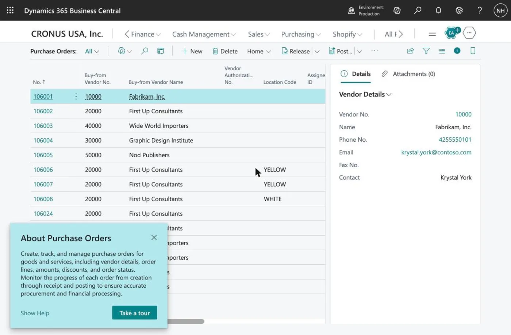
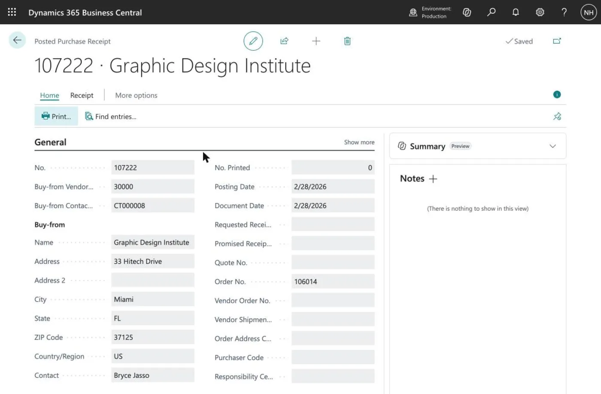
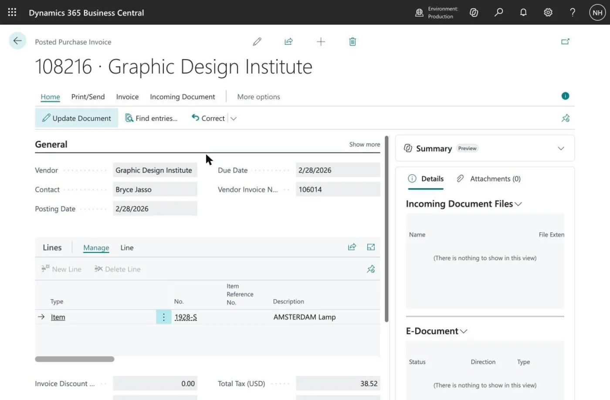
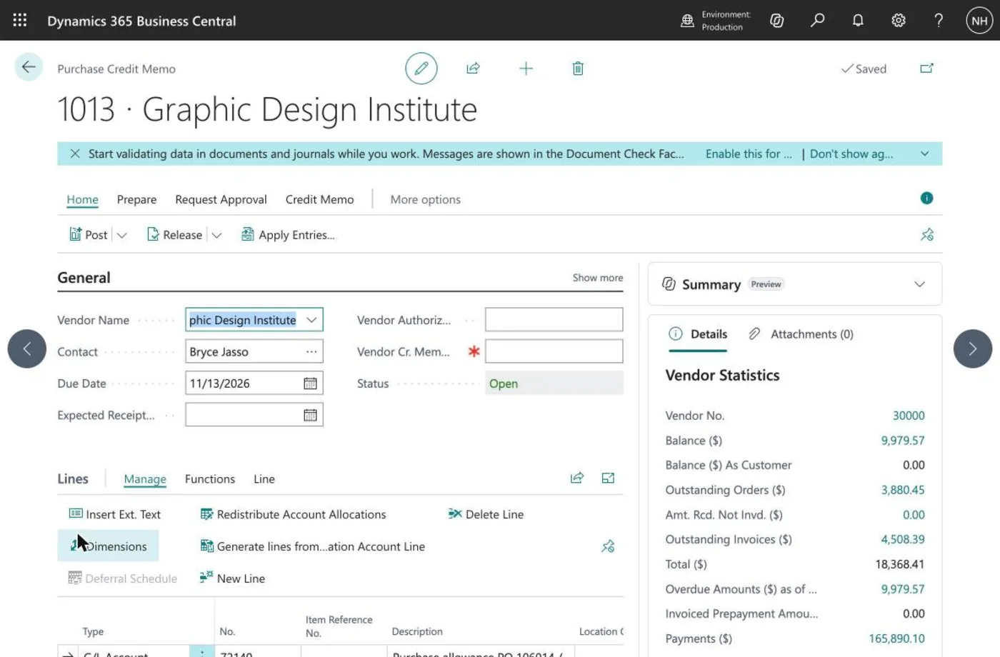
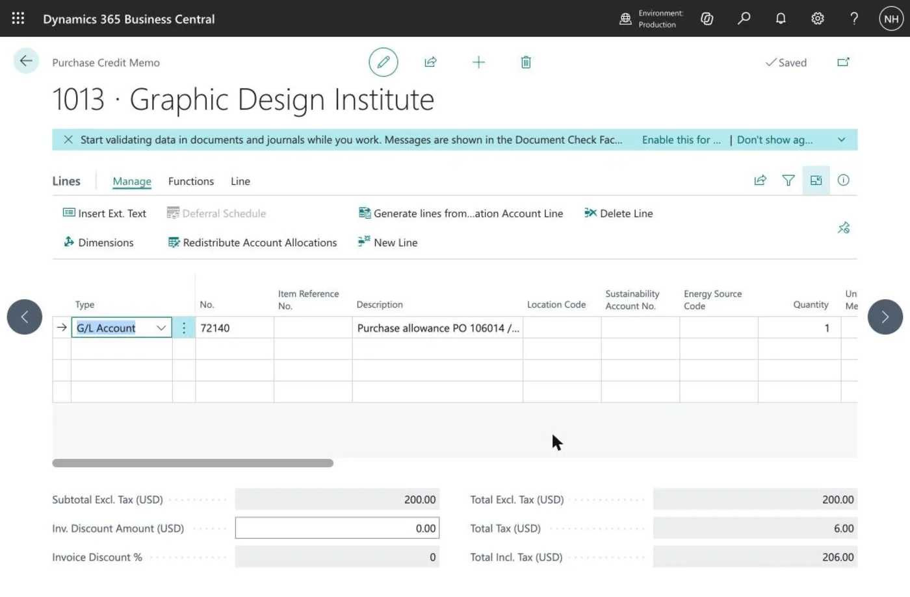
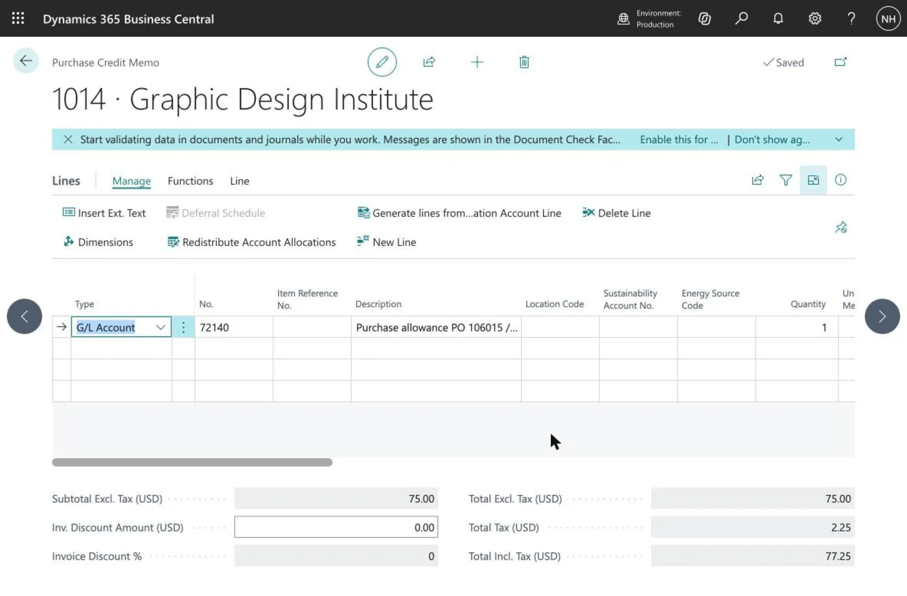
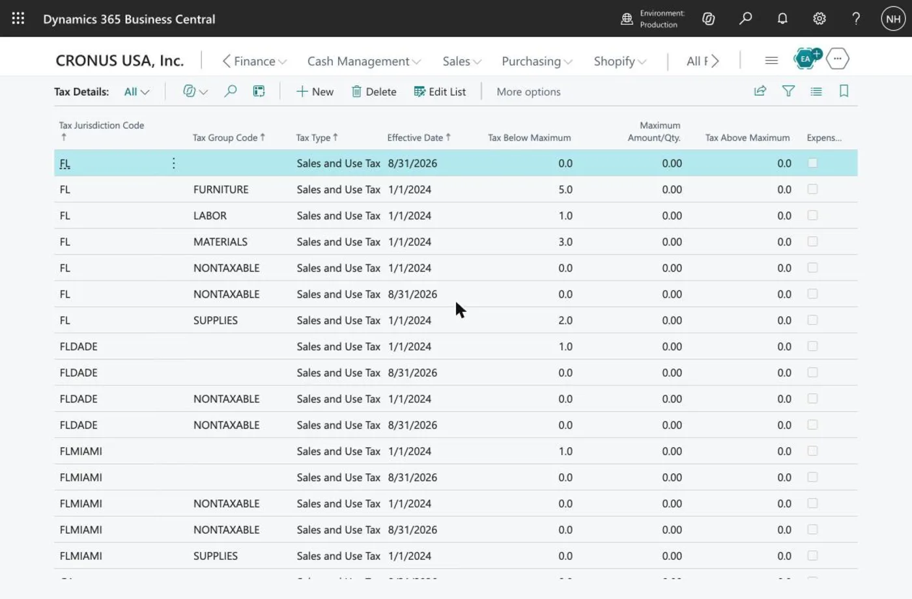
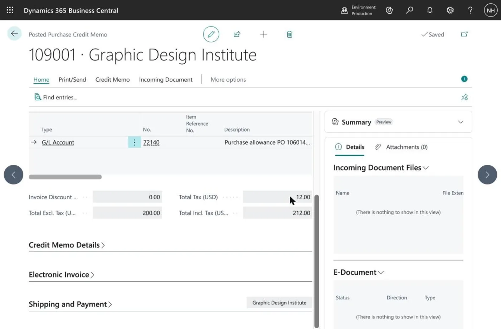
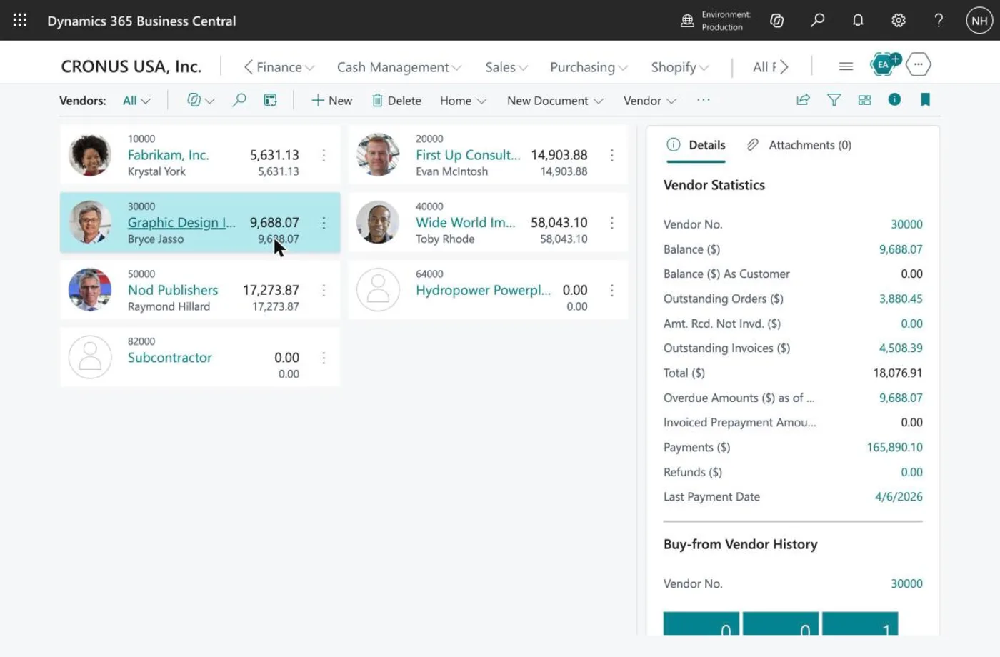

# DeepSeek Harness and a Vendor Dispute in Business Central

## What this post tells you, and why

In [LLM Benchmarking](/posts/llmbenchmark/) I measured six models on accountancy questions and ended on this point: a real answer needs more than a good model. It needs a **harness**. This post shows what that means on one realistic accounting scenario, from the first message to a result that a person can act on. Here is what I tell you, in order:

1. **What a harness is,** in one picture and one paragraph.
2. **The scenario:** a vendor delivers broken items and the wrong items, and the company wants a settlement.
3. **What a chat answer gets right and wrong,** checked against Microsoft Learn.
4. **How the harness approaches the case:** understand first, then look up, then ask, and do the sums with code.
5. **What it needs besides the documentation:** the company's habits, the law, the vendor, and the records an auditor will want.
6. **One run, start to finish,** on the real Cronus demo company, from two purchase order numbers to two draft credit memos, with screenshots.
7. **What a person does next:** check the tax, add the missing paper, approve and post, with the vendor balance before and after.

**Why:** accounting work has branches, rules that live outside the product, and consequences that cannot be undone. A harness that looks things up, reads the ledger, shows its sources and stops at the right place is useful. A model that answers fluently is not enough, and the difference is easiest to see on a worked example.

:::watch-it It also works in Claude Code
I ran the same case through Claude Code with the same two connections, and it reached the same kind of plan, faster. Everything in this post is about DeepSeek Harness, because one clear run is easier to follow than two. A harness is not tied to one product.
:::

## A harness, in one picture

You give the harness the scenario. The harness sends the scenario, with a list of the tools it has (or knows about), to the model. The model replies with an answer, or with a request: call this tool with these arguments. The tool might search the internet, look something up in Business Central or Microsoft Learn, or ask you a question. The harness makes the call, adds the result to the conversation (it may summarise an old conversation to keep it short), and sends it all back to the model. That loop repeats until the model gives an answer and asks for no more tools.

*The loop. The model decides what to ask for, and the harness makes the calls*

So a harness is powered by a model, and it is not the model. The model does the reasoning and chooses the next request. The harness does everything else: it holds the conversation, runs the tools, and decides which of the model's requests are allowed to run, with approvals that can stop a risky one.

The word "agent" is used loosely, so here is how I use the two words here. The harness is the software apart from the model. An agent is a model and a harness working on a task together. The harness can be a general-purpose program such as Claude Code or DeepSeek Harness, or custom code, such as the code behind the [Blog AI Assistant](/posts/localagent2/). That fits Simon Willison's definition of 18 September 2025: "An LLM agent runs tools in a loop to achieve a goal." Anthropic's essay [Building effective agents](https://www.anthropic.com/engineering/building-effective-agents) (19 December 2024) draws a related line between a workflow, where code fixes the steps in advance, and an agent, where the model directs its own steps and its own use of tools. A test that works for me: if I swap the model, what stays the same? What stays the same is the harness. Product names do not follow this, so I keep each product's own name and say "harness" when I compare them.

## The scenario

A vendor delivers an order. Some of the items are **broken**, and some of the items are the **wrong ones**. The company uses Business Central, and the invoice may already be posted. The company wants a creative settlement: keep the wrong items at a lower price, and get credit for the broken ones.

This is a good test because there is no single answer. The right documents depend on three facts:

1. Has the original purchase invoice been **posted**?
2. What happens to the **wrong** items: keep them free, keep them at a discount, or send them back?
3. What happens to the **broken** items: scrap them here, send them back, or wait for replacements?

For the run I used real data from Business Central's Cronus demo company, and I started the scenario from **purchase order numbers**, because that is what the people who found the problem actually have. The vendor is Graphic Design Institute. Purchase order 106014 was 15 lamps, and 6 of the 15 arrived broken. The vendor agreed to credit $200.00 for them, and we will scrap them here. Purchase order 106015 was 5 yellow guest chairs that arrived with the wrong finish. We will keep them for a $75.00 allowance. Both orders were received and invoiced in February, and the invoices are posted.

### In practice: who holds which number

Think about who is in front of which document when the goods arrive.

| Who | What they have in front of them | When |
|---|---|---|
| **Goods-in clerk** | The vendor's delivery note, our purchase order number, and the order's lines. Posting the receipt creates the receipt number. | The day the goods arrive |
| **Buyer** | The purchase order number, the vendor's order confirmation and the negotiation. | Throughout |
| **Accounts payable** | The vendor's invoice number, then our posted invoice number, the payment status and the vendor's credit note. | Days or weeks later |
| **Controller** | The approval limits, and the finished file for the auditors. | At approval and at audit |

The one number that every role shares is the **purchase order number**. The receipt number and the invoice number are created later, by different people, and the people who open the boxes rarely have them. That is why the harness should start from the purchase order number, and why I wrote the scenario that way.

There are two moments when a problem is found. **At goods-in**, nothing is invoiced yet, and the fix is cheap: receive only what is good, or receive everything into a quality-control location, note the shortfall on the receipt, tell the buyer, and let the invoice be matched to what was really accepted. No credit memo is needed. **Later**, after the invoice is posted and paid, the fix is a credit memo and a claim. This post is about the second, harder case, which is also the one where the paperwork has to be traced back from the order.

Here is what Business Central holds for these orders. The Purchase Orders list does not show 106014 or 106015 at all, because an order that is fully received and invoiced is deleted when the last invoice posts. The order number survives on the posted receipt and the posted invoice, which is how the harness finds them.

*The open Purchase Orders list. The numbers jump from 106008 to 106024, because the fully invoiced orders 106014 and 106015 are no longer there*

*Posted purchase receipt 107222. Order No. is 106014, and Vendor Shipment No., where the delivery note number belongs, is empty*

:::brain-power Before you read on
Which of the three questions above would change the Business Central documents the most? Keep your answer in mind. The harness has to find the answers in the ledger, and some of them it cannot find at all.
:::

## Step 1: A chat answer, checked

I put the scenario to Claude Sonnet 5.5 in a plain chat, with no tools, no files and no instructions, and I call its reply "the assistant's answer". It wrote a sensible three-part procedure: a purchase return order for the broken items, a credit memo with an item charge for the wrong ones, then apply the credits and adjust the cost.

It gave no links. I asked, in a third message, for the exact Microsoft Learn page and sentence behind each step. It declined: it had consulted no Learn pages, the answer came from its general knowledge, and any URL or quotation it produced now would be reconstructed from memory. It then split its answer into standard features it trusted but had not verified, and its own reasoning, "not documented statements". That is the honest answer, and it is also the limit of a plain chat: with no tools, it cannot cite a source it has not read. So I looked each claim up on Microsoft's own pages.

| The assistant said | What Microsoft Learn says | Verdict |
|---|---|---|
| Use **Get Posted Document Lines to Reverse** and the cost reverses correctly | The action "always exactly reverses the costs from the posted document line". | Confirmed |
| For the wrong items you keep, post a credit memo with a **Charge (Item)** line, quantity 1, assigned to the receipt | The same steps appear under "Create a purchase allowance". | Confirmed |
| Run **Adjust Cost - Item Entries** so the lower cost reaches the cost of goods sold | After an item charge on items already sold, the batch job forwards the cost to the sale entries. | Confirmed |
| Scrapping needs no separate posting, and a negative adjustment would remove the stock twice | The pages say nothing about scrapping. | Not confirmed |
| The credit "lowers the inventory cost of the kept items" | For items on **Standard** costing, the charge does not change the unit cost. It is posted as a purchase variance. | Wrong for some items |
| Do not use **Create Corrective Credit Memo**, because it reverses the whole invoice | The action copies the invoice into a credit memo that you can edit. | Overstated |
| *(nothing)* | A disputed posted invoice can be put **On Hold** so that payment runs skip it. | **Missing** |
| *(nothing)* | The Learn training module starts by registering the **compensation agreement** with the vendor, before anything is shipped, credited or scrapped. | **Missing**: nothing should be scrapped or posted until the vendor has agreed |

So the assistant's answer was mostly right, and the problems are the ones you cannot see by reading it: it left out the hold, it never said that the vendor must agree first, and it described one effect that is wrong for items on standard costing.

:::watch-it The error is in what the answer leaves out
It is easy to check a claim that is on the page. It is hard to notice a step that is not. A harness that begins with the model's own understanding of the case, then finds the documented procedure and makes every step of the plan point at it, finds missing steps. Reading an answer more carefully does not.
:::

Microsoft Learn also has a training module for this kind of situation, [Manage returns to vendors in Dynamics 365 Business Central](https://learn.microsoft.com/en-us/training/modules/manage-vendor-returns-dynamics-365-business-central/). It treats the dispute as a **compensation agreement** registered on a purchase return order. For goods that stay with you, it says to add a **Charge (Item)** line with the allowance in **Direct Unit Cost** and assign it to the posted receipt, which "keeps the inventory valuation accurate". Learn also warns that **Correct** and **Cancel** on a posted invoice work only for **unpaid** invoices, so a dispute over a paid invoice cannot use them.

## Step 2: How the harness approaches the case

The order matters: understand first, then search. A model that has learned accounting can already see what kind of problem this is: a vendor allowance on goods that are partly sold, and a credit for goods that are scrapped. It can see that a $385 credit on $428 of lamps is a $43 loss, not a gain. No Business Central page says that. What the model cannot know from its weights is how **this product** behaves, and that is what the lookup is for:

1. **Anchor.** Start from the purchase order number. If the case has none, ask for it first. Follow the order number to the receipts and invoices in the ledger.
2. **Understand.** Before it searches, the harness writes a short analysis from the model's own knowledge of accounting, and marks every statement that depends on how Business Central behaves as "to verify".
3. **Search.** It calls Microsoft Learn's MCP tool `microsoft_docs_search` with Business Central terms from the case, never figures or names.
4. **Fetch and verify.** It reads the pages with `microsoft_docs_fetch`, and for each "to verify" statement says whether Learn confirms it, changes it, or does not cover it, with the page and the sentence.
5. **Read the rest of the ledger.** It reads the other facts of the case from Business Central itself, so it never asks a person for something the data holds.
6. **Ask.** Only then does it ask the person the questions that neither the model, the documents nor the ledger can answer.

If nothing documents a step, the harness says so and asks a person. It also does the arithmetic with code and not in its head, for example the share of an allowance across receipt lines.

:::watch-it Search first, and do not guess addresses
While I was writing, two Learn addresses that I guessed returned 404 errors. A search then found the right pages straight away. A harness that builds an address from memory will fail the same way, or worse, will fetch an old page that still exists.
:::

## Step 3: What it needs besides the documentation

Microsoft Learn says how Business Central works. A real settlement also depends on four other things.

**The company's habits.** Do we hold every disputed invoice? Which item charge is the purchase allowance? Do we scrap broken items here? Those answers live in people's heads. A company wiki of short rules, each with a reason, an owner and a review date, kept as files and loaded by the harness as a skill, answers them. In my run the wiki said: put every disputed posted invoice on hold; scrap broken items that cost under $50 a unit; approvals above $500 need a second person; allowances use the item charge `PURCH-ALLOW`. A rule can change what the company chooses. It cannot change how the product behaves, so if the two disagree the harness says so and does not follow either blindly.

**The law and the standards.** Whether the tax on the original invoice must be adjusted, and how a vendor allowance is accounted for (under US GAAP, ASC 705-20 treats vendor consideration as a reduction of the purchase price), are set by the tax authority and the standard-setter, not by Business Central. The harness should look them up, cite them, say when it cannot reach the primary text (the FASB Codification is paywalled), and flag the point for a qualified accountant.

**The vendor.** The settlement is a negotiation unless the terms were agreed in advance. A harness can price each offer, flag the approval limits, check what the ledger says (both invoices paid, so a credit becomes a refund claim), and draft the message. Could it conduct the negotiation itself? Technically, yes. Whether it should is a question of authority and risk, not a limit of the technology: a message to a vendor cannot be recalled, the company decides who may commit it, and the auditors will ask who agreed what. So I would grow its role in steps: it informs, then it drafts and a person sends, then it negotiates within a **mandate** that a person writes down, the way a company gives a junior buyer a limit. Until the vendor agrees, nothing is scrapped or posted, because scrapping first can leave a company with no goods, no evidence and no credit.

**The records.** A settlement that the books show and the files do not support is a problem at audit time. I found no standard that lists the records for a vendor dispute, so this is practitioner guidance, built from [PCAOB AS 1105](https://pcaobus.org/oversight/standards/auditing-standards/details/AS1105) on audit evidence: the order, receipt and invoice; evidence of the defect (photographs, a note); the vendor's agreement in writing, and later the vendor's own credit note; an internal approval dated before the disposal; evidence of the disposal; the posting trail; the reconciliation of the agreed credit to the received credit; and the payment hold. The harness can keep the checklist and say which items exist and which are missing. It must never create evidence: it does not write the approval or invent a vendor email.

Things also go wrong: a vendor that has stopped trading, a vendor blocked in Business Central, goods already sold or used, an invoice already paid. Most of these are reads of the ledger, so the harness should check them before it plans anything.

## Step 4: One run, start to finish

For the run I used DeepSeek Harness in its headless mode with the DeepSeek V4 Flash model. It had two connections: the Microsoft Learn MCP server, and the Business Central MCP server with a configuration that could read the ledger and create and modify purchase credit memos and their lines, and nothing else. (The setup, and what went wrong on the way, is in [Connecting DeepSeek Harness to Business Central](/posts/deepseekharnessbusinesscentral/).) The harness also had the company wiki and a skill that set out the method, starting with "start from the purchase order number". I gave it the scenario above and asked for four things: read the ledger from the purchase orders, look up the product behaviour, name the jurisdiction and look up the tax rule and the GAAP treatment, and write a plan with a source for each step. Then I asked it to create the two draft credit memos and never post. Here is the run, as a conversation. Every quoted line is a real query or a real reply from the logs, and long replies are cut.

*DeepSeek Harness starts from two purchase order numbers and ends with two draft credit memos*

### What it read

The harness looked for orders 106014 and 106015 first and found nothing, and then listed all 14 open orders to be sure. Then it did what the numbers allow: it searched the posted receipts and invoices for those order numbers. Order 106014 led to receipt **107222** (15 lamps at $42.80, a cost of $642.00) and invoice **108216**. Order 106015 led to receipt **107223** (5 chairs at $150.30, a cost of $751.50) and invoice **108217**. Both invoices are paid, and both were posted on 28 February 2026, so the credits cannot reduce an unpaid balance. They become a refund to claim, or a balance to offset. Here is invoice 108216 in the web client. In this demo data the Vendor Invoice No. field repeats the purchase order number, which is a second way to reach the invoice from the order:

*Posted purchase invoice 108216 for the lamps. Its Vendor Invoice No. is 106014, the purchase order number*

### What it concluded

For the tax it chose **Florida**, because the vendor is in Miami and the invoices are taxed at exactly 6%, citing Fla. Stat. § 212.17 (the credit must carry the tax). It also said what it could not settle: the ship-to on both invoices is Atlanta, so Florida tax on a Georgia delivery may be the wrong situs, and it asked a person to confirm. That question was the right one. The harness could not see the field that settles it, because the API does not return a tax area. In the web client the posted invoices carry **Tax Area Code ATLANTA, GA**, so its Florida conclusion was wrong, and I come back to this below. For the accounting it cited ASC 705-20-25-1, read in KPMG's public inventory handbook because the FASB Codification is paywalled, and flagged both credits for a qualified accountant. It also asked how to spread the $200.00: across all 15 lamps, which takes the unit cost from $42.80 to $29.47, or only over the 6 broken ones, which is $33.33 a lamp.

Not all of its lookups were useful. The internet search returned an unrelated tax-credit form among the Florida statutes, and one Learn search returned a page about Canadian sales tax. The harness read past them, which is what a harness should do and what a person would have to do too.

### What it created

Then it created the drafts. These are the two credit memos in Business Central, listed beside the existing ones. Memos 1013 and 1014 have no vendor credit memo number, because the vendor has not issued one. (1011 and 1012 are earlier test drafts from my first run, and the harness noticed them and flagged them.)

*The Purchase Credit Memos list. 1013 and 1014 are the harness's drafts. The Vendor Cr. Memo No. column is empty because the vendor has not issued a credit note*

*Draft credit memo 1013 for Graphic Design Institute. Its status is Open, so it is not posted. The Post button is there for a person to use*

*Draft 1013 for the lamps: one line, subtotal $200.00, tax $6.00, total $206.00*

*Draft 1014 for the chairs: subtotal $75.00, tax $2.25, total $77.25*

Each draft has one line of type **G/L Account**, number 72140, with a description that names both the purchase order and the receipt, for example "Purchase allowance PO 106014 / posted receipt 107222 - 6 of 15 AMSTERDAM Lamps 1928-S arrived broken". The run also shows the small frictions of working through an API. The harness created memo 1013 with a posting date from the end of the demo data and then corrected it, and its first description for 1014 was 105 characters when the field holds 100, so Business Central rejected it and it shortened the text.

### What it could not do

The harness first tried the documented line: type **Charge (Item)**, using the wiki's `PURCH-ALLOW` item charge. Business Central answered "The Item Charge does not exist", and no tool can create item charges, so it fell back to a G/L account line. It said plainly what that costs: **a G/L line does not revalue inventory**, which is the whole point of the allowance procedure, and it noted that this contradicts the wiki rather than following the wiki silently. It listed the rest of what it could not do:

- It could not assign the allowance to the receipts, because the assignment is a screen action. It could not apply the credits to the paid invoices, scrap the lamps, run **Adjust Cost - Item Entries** or put the invoices on hold, as the wiki's hold rule asks, which was moot anyway because both invoices are paid.
- The tax on the drafts came out at 3%, not 6% ($6.00 and $2.25 instead of $12.00 and $4.50). The harness said the API cannot set the tax area on the header. As the next section shows, that was not the cause.
- It reported that the header totals read 0.00 through the API. In the Business Central web client they are correct, as the screenshots show.

It stopped with four questions for a person: who sets the tax area before posting, and whether 6% Florida tax is what the vendor will actually credit given the Atlanta delivery; whether to create `PURCH-ALLOW` and redo the drafts on it; how to spread the $200.00 over the lamps; and who confirms ASC 705-20 against the Codification before anyone posts.

The run took 6 minutes 17 seconds. Nothing was posted, because the harness had no tool that posts.

## Step 5: What a person does next, and then did

The harness never posts. Its output is a plan with sources and two unposted drafts, and a person has more to do before posting. I played that person, with the same Business Central tools open in the web client, and I recorded each step.

**Before.** Vendor 30000 had a balance of $9,979.57:

*Graphic Design Institute before posting: balance $9,979.57*

**Check the tax, and find that the harness was wrong.** Both drafts already had Tax Area Code ATLANTA, GA and the line tax group FURNITURE, the same as the posted invoices, so the harness's explanation (the API cannot set the area) was not the cause. The cause is in the Tax Details: the rates have effective dates, and a new set takes effect on 31 August 2026. A credit memo dated 13 November 2026 picks up the new, lower rate, 3%, while the invoices from February used the old one, 6%. The harness could not see this. Nothing in the API shows tax rates by date, and it is the kind of thing that a person with the right page open finds in a minute.

*Tax Details: each jurisdiction has rates with effective dates of 1 January 2024 and 31 August 2026. A document dated after 31 August takes the newer rate*

To reverse the tax at the rate the vendor originally charged, I dated both credits 30 August 2026, the last day of the old rates. The tax then came out at 6% ($12.00 and $4.50). That is a workaround for this demo data. In a real company the accountant decides which rate applies to a credit for an invoice from an earlier period, and the harness's job is to raise the question, which it did.

**Get the paper.** Business Central will not post a credit memo without a Vendor Cr. Memo No. The vendor has not issued a credit note, so I entered the obviously fake references TEST-1013 and TEST-1014. In real life this is the vendor's own document, and a harness must never invent it.

**Approve and post.** I released each memo and posted it. Business Central posted 1013 as **109001** and 1014 as **109002**:

*Posted purchase credit memo 109001: G/L account 72140, subtotal $200.00, tax $12.00, total $212.00*

**After.** The vendor's balance fell by the two credits, $212.00 and $79.50:

*Graphic Design Institute after posting: balance $9,688.07, which is $9,979.57 less $291.50*

Two things are still not right. The lines are G/L account lines, so inventory is **not** revalued and the lower cost does not reach the cost of goods sold. The documented route is a Charge (Item) line assigned to the receipt, followed by **Adjust Cost - Item Entries**. And the credits are not applied to the paid invoices, so the balance reflects a vendor refund still to be claimed. Both are for a person with the item charge set up.

:::no-dumb-questions
**Q: Is this more work than asking the chat assistant?**

A: Yes, and the checking is the point. The chat answer was fast and mostly right. Checking it against the documentation found missing steps, a wrong effect and several unconfirmed steps, and that took a few minutes. A harness makes that check part of the process instead of something a careful person does when they have time.

**Q: Why not let the harness post the credit memo, once I have approved the plan?**

A: Approving a plan is not approving a posting. A posting needs the real amounts, the real receipt lines and the real vendor, and any of them can differ from the plan, as the item charge and the tax did here. Posting is also a bound action in Business Central, and the configuration leaves bound actions off, so the harness could not post even if it tried.

**Q: Why can the harness create documents but not post them?**

A: Creating a draft is reversible: a person can delete it. A posted document is part of the books. The configuration allows Create and Modify on two kinds of document and nothing else, and a person decided to switch writing on.
:::

:::pencil Find the missing step
A vendor credits you $120 for damaged items that you keep. You already sold half of them last week. You post the credit memo with a **Charge (Item)** line assigned to the receipt. Your inventory value is now correct. What is still wrong, and what do you do about it?

:::answer
The cost of goods sold for the items that you already sold has not changed, so your profit for last week is understated. Run the **Adjust Cost - Item Entries** batch job, which forwards the extra cost, here a reduction, to the sale entries. The item charges page explains this, and it is exactly the kind of step that a procedure written from memory leaves out.
:::
:::

## What this post told you

:::bullet-points What to remember
- A real answer needs more than a good model. It needs a harness: the software that holds the conversation, runs the tools the model asks for, and decides which requests run.
- A chat answer can be fluent and incomplete. The errors that matter are the steps it leaves out, and a harness with documentation tools finds them.
- Start the plan from what the model knows about accounting, mark what depends on the product, then verify it against the documentation and the ledger. Search before fetching, and tie every step to a source.
- Four sources besides the documentation matter: the company's habits, the law and the standards, the vendor, and the audit records. The settlement is a negotiation unless the terms were agreed in advance, and the harness informs it, drafts for it, and could negotiate within a written mandate once a person trusts it to.
- Start from the purchase order number: it is the one number every role shares. In the run, the harness followed the order numbers to the receipts and invoices, found both invoices paid, cited Florida tax law and ASC 705-20 and said where it could not read the primary text, and created two unposted draft credit memos. A person then found the tax-rate effective date that the harness could not see, dated the credits to reverse the tax at the original rate, and posted them, and the vendor's balance fell from $9,979.57 to $9,688.07.
- It also said what it could not do: the documented item charge did not exist, the tax came out wrong, and the questions that only a person can answer stayed open.
- The harness drafts, and a person posts.
- It also works in Claude Code.
:::

## What comes next

The next steps are a bank reconciliation, a goods-received-not-invoiced accrual and a foreign currency vendor credit on the same real company, and a test that puts a person in front of the harness's questions, so that silence stays pending and nothing is posted. A harness that creates the item charge itself, with a person's approval, would close the gap that this run found.

## References

- [LLM Benchmarking](/posts/llmbenchmark/): the benchmark, and why the harness matters
- [Connecting DeepSeek Harness to Business Central](/posts/deepseekharnessbusinesscentral/): the setup behind this run
- [LLM Wiki](/posts/LLM-Wiki/): the idea of a knowledge base that a model drafts and a person reviews
- [Model Context Protocol](/posts/businesscentralmcpclaudecode/): connecting Claude Code to Business Central's built-in MCP server
- [Blog AI Assistant](/posts/localagent2/): a harness written as custom code
- [I think “agent” may finally have a widely enough agreed upon definition to be useful jargon now](https://simonwillison.net/2025/Sep/18/agents/): Simon Willison, 18 September 2025
- [Building effective agents](https://www.anthropic.com/engineering/building-effective-agents): Anthropic, 19 December 2024
- [DeepSeek Harness](/posts/deepseekharness/) (part 1), [with Ollama](/posts/deepseekharnessollama/) (part 2) and [with local subagents](/posts/deepseekharnesshybrid/) (part 3)
- [Handle vendor payment disputes](https://learn.microsoft.com/en-us/dynamics365/business-central/payables-how-handling-payment-disputes), [Process returns or cancellations](https://learn.microsoft.com/en-us/dynamics365/business-central/purchasing-how-process-purchase-returns-cancellations) and [Use item charges to account for extra trade costs](https://learn.microsoft.com/en-us/dynamics365/business-central/payables-how-assign-item-charges): Microsoft Learn
- [Manage returns to vendors in Dynamics 365 Business Central](https://learn.microsoft.com/en-us/training/modules/manage-vendor-returns-dynamics-365-business-central/): the Microsoft Learn training module on compensation agreements and exact cost reversing
- [PCAOB AS 1105: Audit Evidence](https://pcaobus.org/oversight/standards/auditing-standards/details/AS1105)
- DeepSeek Harness documentation: [user questions](https://deepseek-harness.github.io/deepseek-harness/en/reference/subsystems/user-questions), [approvals](https://deepseek-harness.github.io/deepseek-harness/en/reference/subsystems/approval), [skills](https://deepseek-harness.github.io/deepseek-harness/en/reference/subsystems/skills) and [web access](https://deepseek-harness.github.io/deepseek-harness/en/reference/subsystems/web)
