# DeepSeek Harness and a Vendor Dispute in Business Central

## What this post tells you, and why

In [LLM Benchmarking](/posts/llmbenchmark/) I measured six models on accountancy questions and ended on this point: a real answer needs more than a good model. It needs a **harness**. This post shows what that means on one small accounting case, from the first message to a result that a person can act on. I ran the case in the harness's web UI, on a brand new Business Central Sandbox, and I took a screenshot at each step. Here is what I tell you, in order:

1. **What a harness is,** in one picture and one paragraph.
2. **The scenario:** a vendor delivers six broken lamps and agrees to take them back.
3. **The setup:** a fresh Sandbox, a configuration that can only read and draft, and one seeded order.
4. **The run:** what the harness read, asked me and created.
5. **Where it looked for help:** the Microsoft Learn searches and pages, and the sentences it relied on.
6. **A check against Business Central:** the amounts, the jurisdiction and the dates.
7. **What a person does next.**

**Why:** accounting work has rules that live outside the product, and consequences that cannot be undone. A harness is useful when it reads the ledger, shows its sources, asks the right questions, and stops before it posts anything to the ledger. The honest test is to check its work against the system, so I did.

:::watch-it It also works in Claude Code
I have run this kind of case in Claude Code with the same two connections, and it reached the same kind of plan. Everything in this post is about DeepSeek Harness, because one clear story is easier to follow than two. A harness is not tied to one product.
:::

## A harness, in one picture

You give the harness the scenario. The harness sends the scenario, with a list of the tools it has (or knows about), to the model. The model replies with an answer, or with a request: call this tool with these arguments. The tool might search the internet, look something up in Business Central or Microsoft Learn, or ask you a question. The harness makes the call, adds the result to the conversation (it may summarise an old conversation to keep it short), and sends it all back to the model. That loop repeats until the model gives an answer and asks for no more tools.

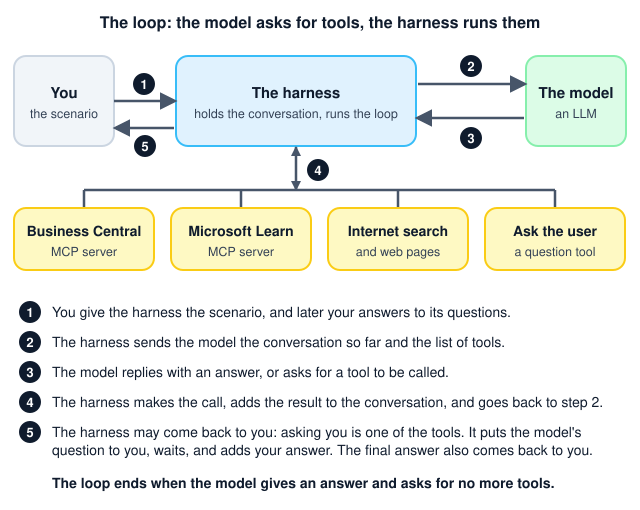
*The loop. The model decides what to ask for, and the harness makes the calls*

So a harness is powered by a model, and it is not the model. The model does the reasoning and chooses the next request. The harness does everything else: it holds the conversation, runs the tools, and decides which of the model's requests are allowed to run, with approvals that can stop a risky one.

The word "agent" is used loosely, so here is how I use the two words here. The harness is the software apart from the model. An agent is a model and a harness working on a task together. That fits Simon Willison's definition of 18 September 2025: "An LLM agent runs tools in a loop to achieve a goal." A test that works for me: if I swap the model, what stays the same? What stays the same is the harness.

## The scenario

Graphic Design Institute delivered purchase order 106030: 15 AMSTERDAM Lamps (item 1928-S) at $42.80. Six of the 15 arrived broken. The vendor has agreed to take the six back and credit them at the price we paid. The company uses Business Central, the invoice is already posted, and nobody in the warehouse has the receipt number or the invoice number. They have the vendor's delivery note (TEST-DN-4472), and it quotes our purchase order number.

That detail is the point. Think about who holds which number when the goods arrive.

| Who | What they have in front of them | When |
|---|---|---|
| **Goods-in clerk** | The delivery note and our purchase order number. Posting the receipt creates the receipt number. | The day the goods arrive |
| **Buyer** | The purchase order number and the negotiation. | Throughout |
| **Accounts payable** | The vendor's invoice number, then our posted invoice number and the vendor's credit note. | Days or weeks later |

The one number every role shares is the **purchase order number**. So the harness has to start from that, and trace the receipt and the invoice from it.

The scenario includes one fact that a person would know and the API cannot show: the order's tax area is ATLANTA, GA, and the goods were delivered to the Atlanta address. I explain why below.

:::brain-power Before you read on
Business Central deletes a purchase order once it is fully received and fully invoiced. If the harness looks for order 106030 in the list of purchase orders, what will it find, and what should it do next?
:::

## The setup

I wanted a clean start, so I created a new Business Central **Sandbox** environment and made everything in it on purpose. The full setup, with the Microsoft Entra app and the connection, is in [Connecting DeepSeek Harness to Business Central](/posts/deepseekharnessbusinesscentral/). Here are the three steps that matter.

**The environment.** The admin center shows the new Sandbox, first Preparing and then Active:

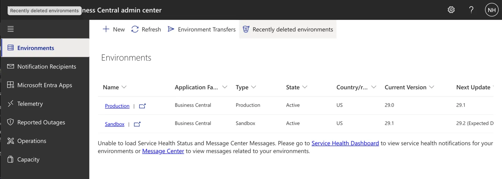
*The Business Central admin center: the recreated Sandbox once it was Active*

**A configuration that can only read and draft.** Business Central's MCP server exposes whatever a *configuration* allows. I made one called **Drafts**. It has 16 API pages. All 16 are read-only, except Purchase Credit Memos and their lines, where I also allowed Create and Modify. Delete and bound actions (the ones that post) stay off. Create and Modify only become available after someone switches on **Unblock Edit Tools**, and that switch is a person's decision, so I switched it on myself. Then I switched **Active** on last, because an active configuration is locked.

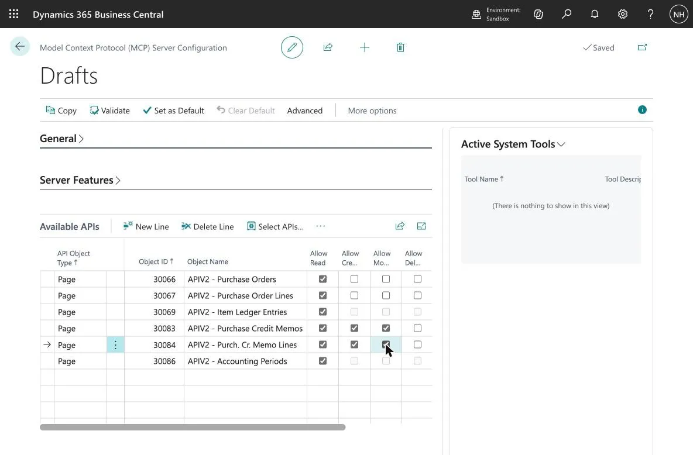
*The Drafts configuration with Unblock Edit Tools on, and Create and Modify ticked on the two credit memo pages*

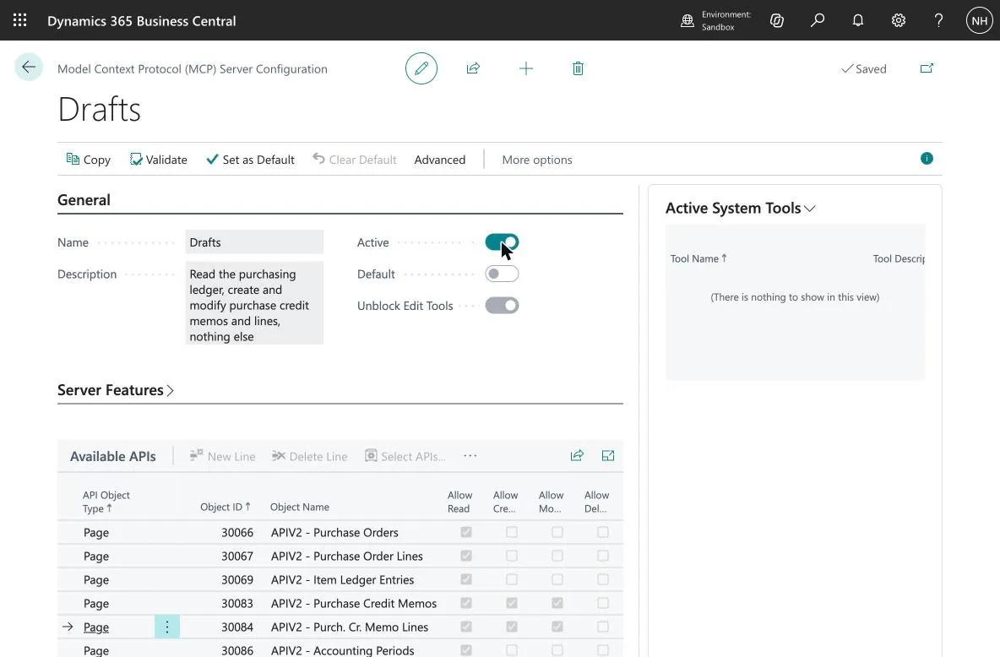
*Drafts is Active, so it is locked. Everything else on the grid is read-only*

**One seeded order.** I created purchase order 106030 for the vendor, with 15 lamps, a placeholder vendor invoice number (`TEST-INV-9001`, so nobody mistakes it for a real vendor document), and every date set to 13 November 2026. I set the **document date** as well, and I entered the delivery note number as the vendor shipment number.

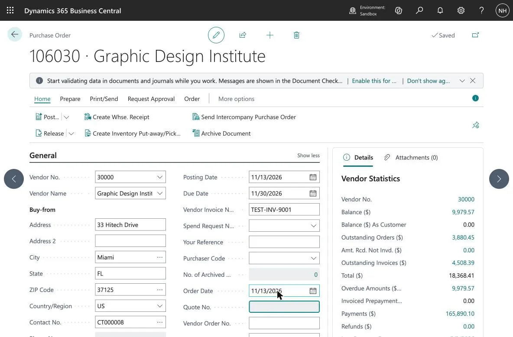
*The order header with the posting, order and due dates set to November 2026*

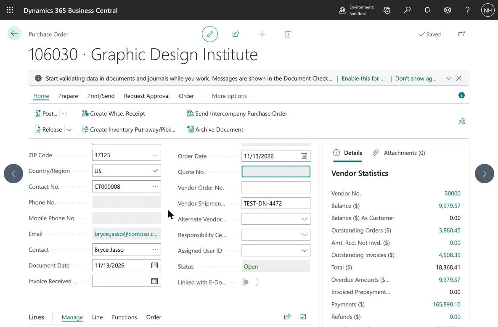
*The document date and the vendor shipment number TEST-DN-4472*

The Sandbox work date is 1 November 2027, so Business Central warned that the order date is earlier than the work date, which I expected.

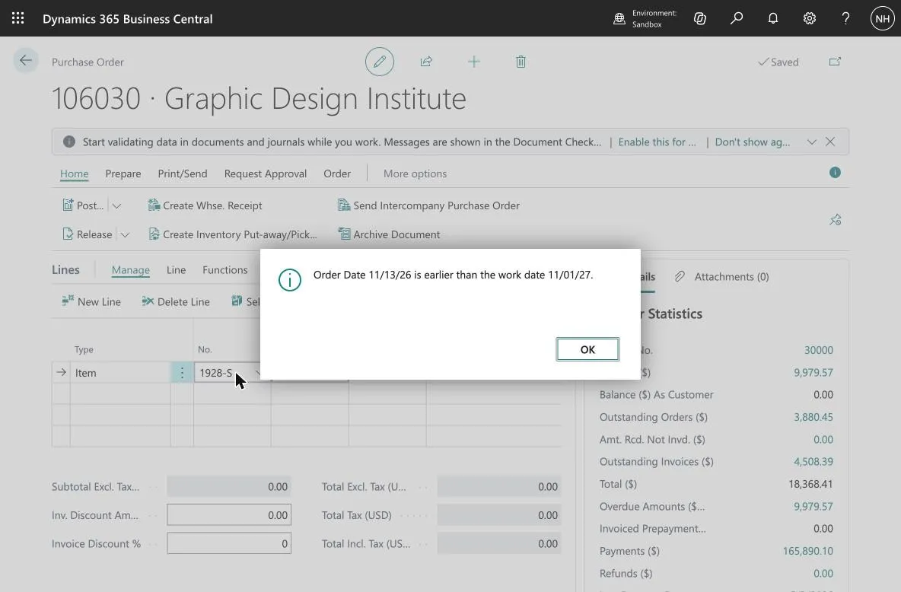
*"Order Date earlier than work date", the expected notice*

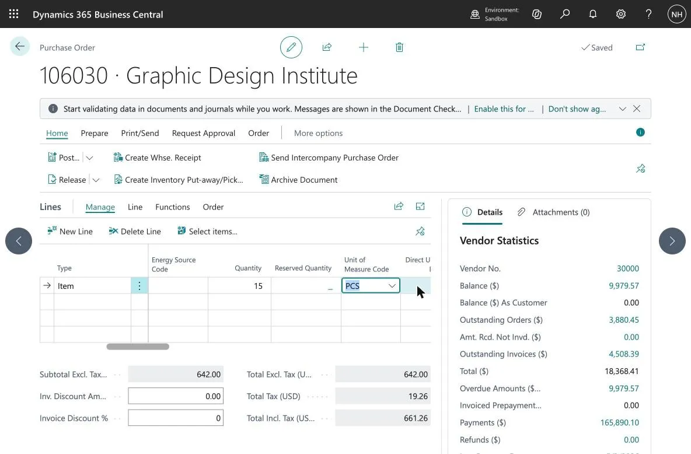
*Purchase order 106030: 15 lamps at $42.80*

Then I posted it with **Receive and Invoice**. That is what a goods-in clerk and an AP clerk would end up doing between them, compressed into one action. Business Central posted it as invoice **108234**, and the receipt is **107240**.

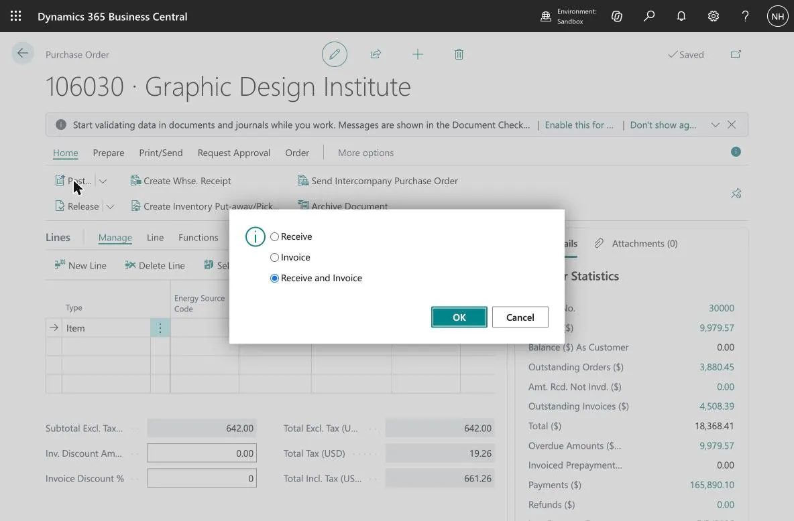
*The post dialog: Receive and Invoice*

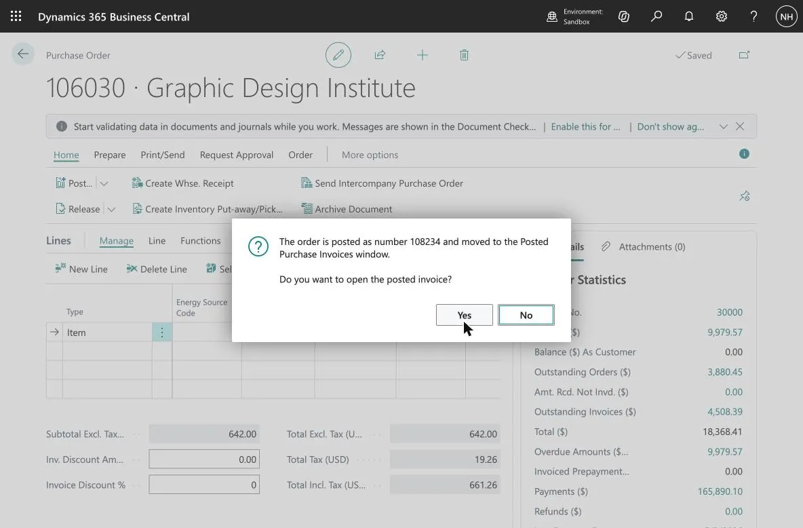
*"The order is posted as number 108234"*

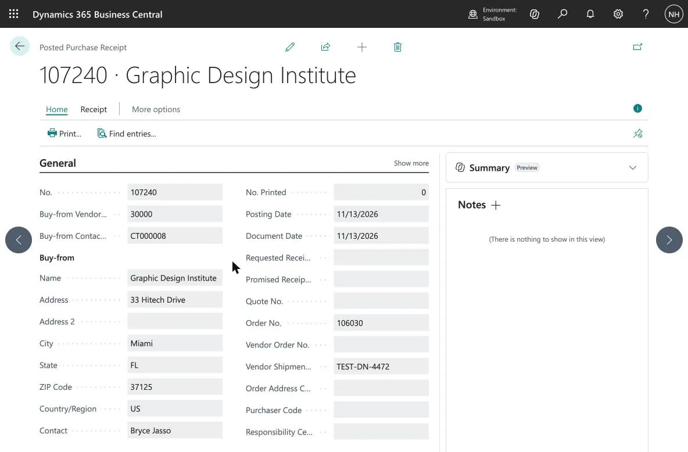
*Posted receipt 107240. It keeps the order number 106030, and the order itself has gone*

The harness's working folder held `scenario.md`, a skill and two short company rules. The skill is called **vendor-dispute**. A skill is a short instruction file (here `SKILL.md`) that the harness reads when the prompt names it. I wrote this one, and it tells the harness to follow six steps in order: search Microsoft Learn first, before it answers from memory; search again before it asks me anything; read the company's own rules and say so if they disagree with Learn; write a plan with the page address and the sentence relied on for every step; do arithmetic with code; and never post, stopping with a plan, sources and questions. The two company rules are: put every disputed posted invoice on hold, using the buyer's initials, and any credit over $500 needs the controller's approval.

## The run

I started DeepSeek Harness in its web UI, with the DeepSeek V4 Flash model, and added the working folder as a workspace.

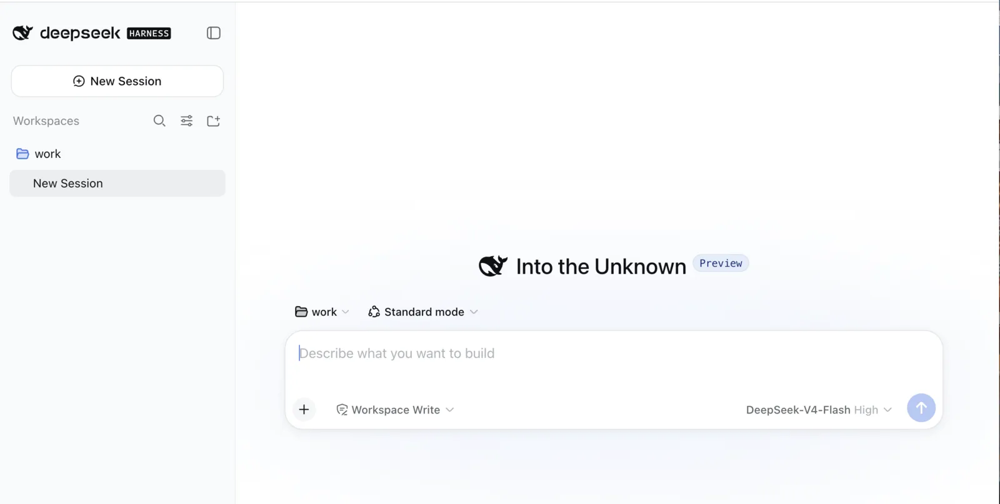
*The "work" workspace added to the harness*

Then I typed this prompt:

```PROMPT
Read scenario.md and use the vendor-dispute skill. Method: (1) start from the purchase order number (106030) and read the ledger with the Business Central tools; (2) look up how Business Central handles returns and credit memos with the Microsoft Learn tools, and follow the documented steps; (3) name the jurisdiction from the documents in the ledger and look up the sales and use tax rule for the credit (search the internet, then read the official tax authority page) and the US GAAP treatment (cite what you can read; the FASB Codification is paywalled, so flag that for a qualified accountant); (4) write the plan with a source for each step. Then create a draft credit memo in Business Central with the create tools, only if the ledger shows that one is needed, with each line's description naming the purchase order and the receipt. It must stay an unposted draft. Never post anything. Say what a person must do that the tools cannot, and ask me whatever you need to know before you finish, and report the document number.
```

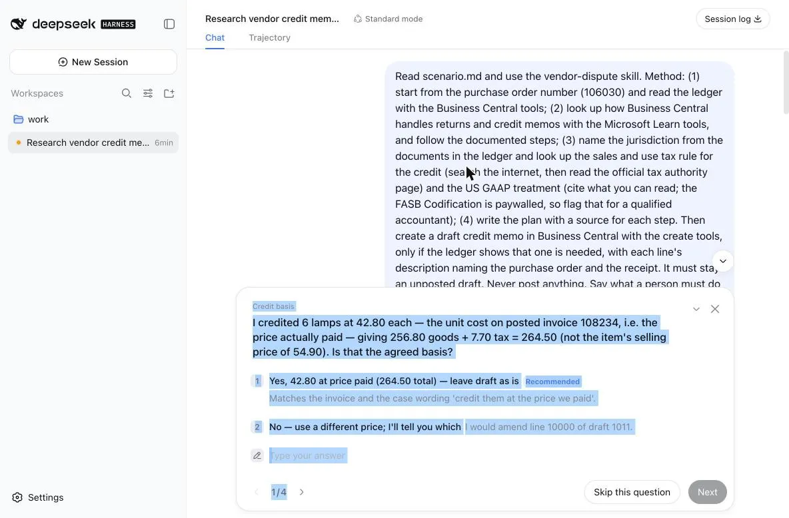
*The prompt sent to the "work" workspace in Standard mode*

### It read the skill, the scenario and the company's rules first

The first steps are reads of local files: the skill, the scenario, then the company's rules, in the order of an index. It read the approvals rule and the hold policy before it touched Business Central, and it made itself a nine-item to-do list.

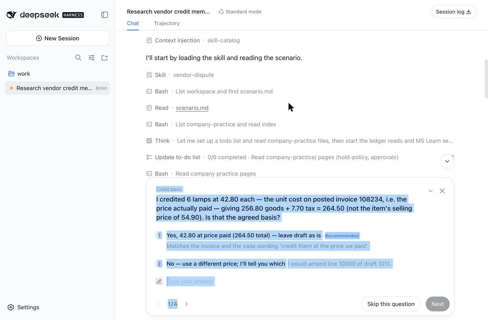
*The skill, scenario.md and the two company rules, read before any Business Central call*

### It started from the purchase order number, and did not stop when the order was missing

Its first filter on the order number returned nothing. It listed all the purchase orders, and noted that 106030 is not among the 14: the highest is 106029. Then it did what the skill says, and followed the order number to the posted receipts.

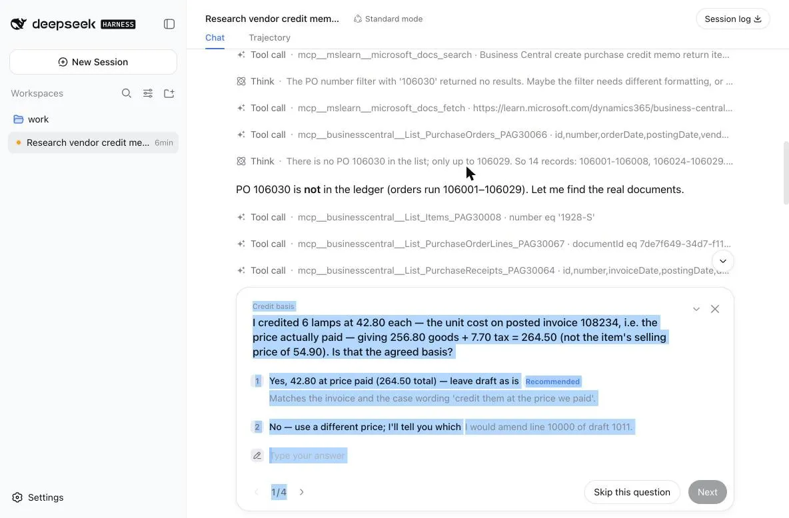
*The Microsoft Learn search and fetch alongside the first filter on the order number, which found nothing*

The cause is something I did in the seeding. I posted 106030 as Receive and Invoice, so it was fully received and fully invoiced. Business Central deletes a purchase order once it is completely invoiced, and the number lives on in the posted receipt and the posted invoice. The harness filtered receipts by `orderNumber eq '106030'` and found receipt 107240. It had considered receipt 107222, which also holds 15 of the same lamps from the same vendor, but that receipt belongs to order 106014, so it picked the right one by **order number** and not by quantity. A person holding only a delivery note might look in the order list, find nothing, and think the order does not exist. The harness did not.

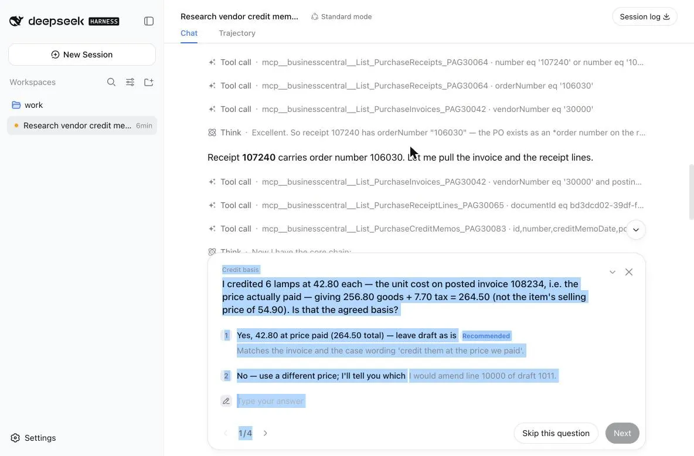
*Receipt 107240 found through its order number, then the invoice that carries the same order number*

It then proved the invoice belongs to that receipt, in code: 15 × 42.80 = 642.00 exactly, and the tax of 19.26 is exactly 3.0000 per cent of 642.00. Invoice 108234 is open and unpaid, and no credit memo exists for it, so one is needed.

### It named the right jurisdiction

The prompt asked it to name the jurisdiction from the documents in the ledger. The scenario said the order's tax area is ATLANTA, GA, and the receipt ships to an Atlanta address, and the harness reasoned about **Georgia, City of Atlanta, Fulton County**. It said so in terms: the vendor's Miami address is not the jurisdiction.

### It created the draft, and verified it

It computed the credit in code and then created draft credit memo **1011**. One call failed with an unknown-property error, because Business Central exposes two tools for credit memo lines and the first takes no parent id. It tried the second tool, created the line, and read it back: net 256.80, tax 7.70, total 264.50. It also checked that nothing posted: item 1928-S still had its one November ledger entry, and no general ledger entry carried document 1011.

### It asked four questions

Then it wrote `plan.md` and asked me four questions in the web UI, one at a time. I took a screenshot of each question before I answered it.

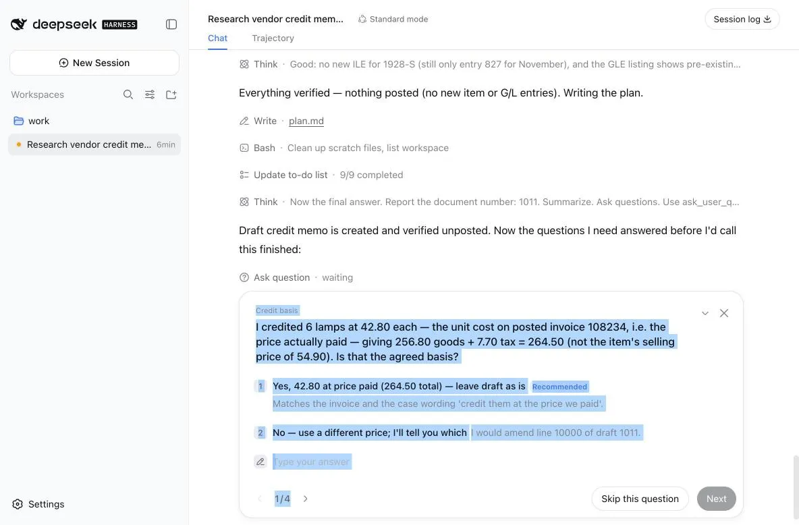
*Question 1 of 4: is 42.80 per lamp the agreed credit basis?*

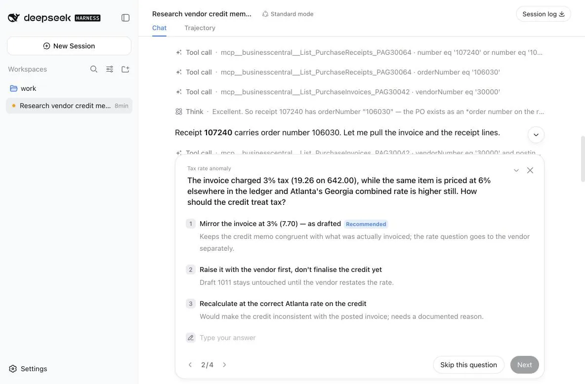
*Question 2: the invoice charged 3 per cent tax. How should the credit treat tax?*

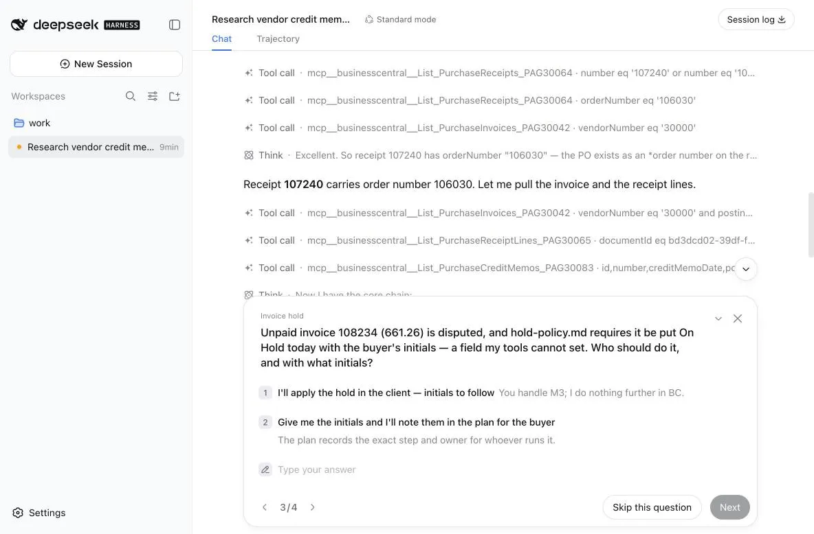
*Question 3: the hold policy needs the buyer's initials, which its tools cannot set*

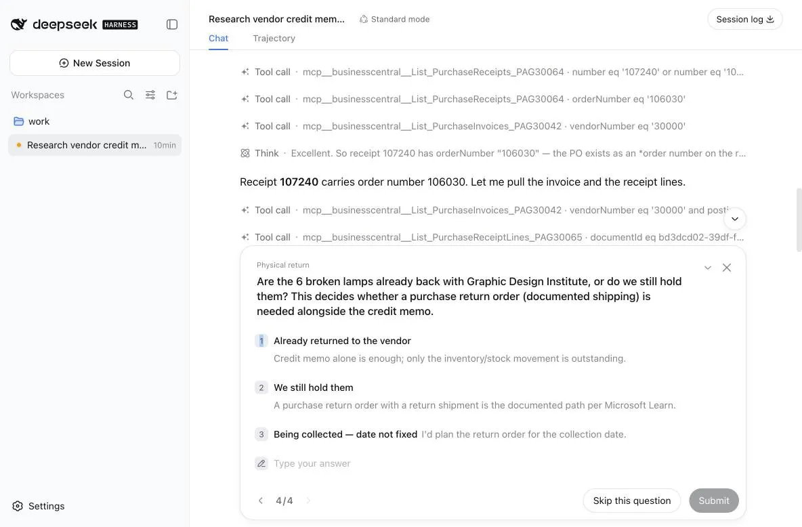
*Question 4: are the six lamps already back with the vendor?*

| # | The harness asked | I chose |
|---|---|---|
| 1 | The credit uses 42.80 per lamp, the price paid on the invoice, and not the selling price of 54.90. Is that the basis? | Yes, leave the draft as it is |
| 2 | The invoice charged 3 per cent tax. Mirror it, raise it with the vendor first, or recalculate? | Mirror the invoice, as drafted |
| 3 | The hold must be applied with the buyer's initials, and the tools cannot set it. Who does it? | Give the initials, and the harness notes them in the plan |
| 4 | Are the six lamps already back, still held, or being collected? | Being collected, date not fixed |

The harness recorded everything in `plan.md`: the two answers it needed to confirm, one answer still open (the initials), and the point that the credit memo alone does not move any stock. The trap is that a return shipment and a credit memo would each reduce inventory, so the plan lists the physical return as work for a person once the lamps leave.

## Where it looked for help: Microsoft Learn

The skill tells the harness to search Microsoft Learn first, and to follow the documented steps. These are the lookups, taken from the session log.

| Tool | What it asked for |
|---|---|
| Search | "Business Central create purchase credit memo return items to vendor from posted purchase invoice" |
| Fetch | [Process purchase returns or cancellations](https://learn.microsoft.com/dynamics365/business-central/purchasing-how-process-purchase-returns-cancellations) |
| Fetch | [Correct or cancel unpaid purchase invoices](https://learn.microsoft.com/dynamics365/business-central/purchasing-how-correct-cancel-unpaid-purchase-invoices) |

It did not guess a page address. It searched with Business Central terms and no figures or names, and then fetched the pages that the search returned. The plan then gives, for each step, the page and the sentence it relied on. These are the ones that decided the plan:

1. **Correct and Cancel are out.** "If a posted purchase invoice isn't paid, you can use the Correct or Cancel actions on the posted purchase invoice to automatically reverse the transactions. These actions only work for unpaid invoices, and they don't support partial returns or cancellations." Six lamps out of 15 is partial, so the harness used a credit memo.
2. **Use a credit memo, and edit it to the agreement.** "If you want to return items to your vendor or cancel services you purchased, you can create and post a purchase credit memo that specifies the requested change to the original purchase invoice." Then step 3: "Edit information on the lines according to the agreement, such as the number of items returned or the amount to be reimbursement."
3. **Cost.** "To keep inventory valuation correct, you typically want to pick return items from inventory at the unit cost that they were purchased at, not at their current unit cost. This process is referred to as exact cost reversing." Setting this link needs the **Appl.-from Item Entry** field, which the API does not expose, so a person does it.
4. **Apply the credit.** On the Apply Vendor Entries page, "select the line with the posted purchase document that you want to apply the purchase credit memo to, and then choose the Applies-to ID action." The harness cannot do this either.
5. **Posting is the last step**, and the harness did not take it.

### What the main page is, and did it help?

"Process purchase returns or cancellations" is the Business Central documentation page for sending goods back to a vendor. It is a how-to page for a person using the web client, not a description of the API. It has four parts: a note on when **Correct** and **Cancel** can be used, a procedure for a credit memo made from a posted invoice, a procedure for a purchase return order, and a section on inventory costing.

**Yes, it helped, in three specific ways:**

- **It decided the route.** The note about Correct and Cancel is what rules out the quick option for a partial return. Without it, the harness would have been guessing which of three documents (a credit memo, a return order, or Correct) fits six lamps out of 15.
- **It supplied the checklist.** The eight steps of the credit memo procedure gave the harness a list to compare its own plan against. That is how it knew which steps it could do (create the draft, edit the line to six) and which it could not (apply entries, post).
- **It explained why cost matters.** The costing section is the reason the plan tells a person to set the original item entry. A model answering from memory might get the amounts right and miss that.

**It also had limits, and I want to be fair about them:**

- The page is written for a person using the Business Central web client, with its pages and buttons, and not for the MCP server. So the harness could read a step that it could not perform. The MCP tools expose the API pages, and those have no apply action and no field for the original item entry. The page told the harness what a person does in the web client, and the MCP tools decided what the harness could do. My configuration limited that further, to reading and drafting credit memos.
- It says nothing about the buyer's initials or an On Hold step. That came from the company's own rule, and the skill told the harness to compare the two. Learn says how Business Central works, and the company's rules say what the company does.
- It has a typo in the purchase allowance section ("items that what you want"), and the harness had to read around it. It decided correctly that an allowance is for damaged goods you keep, and that six lamps going back is a return.
- It did not change the amounts. The 256.80, the 7.70 and the 264.50 came from the ledger and from code. Learn changed the route and the list of things for a person to do.

So I would not say the page made the harness cleverer. I would say it made the plan **checkable**: every step has a page and a sentence, so a person can open the page and see whether the harness read it correctly. That is the value I was hoping for, and I did not measure it against a run without Learn. Doing that comparison is worth a later post.

The harness also followed the page's own checklist. After the plan, the skill says to list the steps of the documented procedure that it used, and to confirm that the plan has all of them. The plan has that table, and it marks which steps a tool did and which a person must do.

Outside Microsoft Learn, it ran seven web searches. It could not read the Georgia rules through a plain page fetch, because the Secretary of State site needs JavaScript and the legal-text sites block automated clients. It went through a text-extraction service, and read the official pages of the Georgia Department of Revenue and the Secretary of State. Those gave it:

- **O.C.G.A. § 48-8-58:** no credit to the dealer "unless the taxes collected have been returned by the dealer to the purchaser". That is why the 7.70 of tax is in the credit.
- **Ga. Comp. R. & Regs. 560-12-1-.25:** a return within 90 days is a deduction on the dealer's Schedule of Exempt Sales, and the dealer keeps records for three years.
- **The Department of Revenue's return tips:** the code for the Atlanta part of Fulton County is 060A.
- **US GAAP:** ASC 330-10-35-1B and 35-2, as amended by ASU 2015-11, read from a public reprint. It flagged that the FASB Codification itself is paywalled, and that a qualified accountant must confirm recognition and presentation.

:::under-the-hood How it read pages it could not fetch
The harness has no browser, only a text fetch. When the Georgia rules page returned an empty shell, it tried the mirror sites, found them blocked, and then used a reader service that renders the page first. It then said, in its plan, which texts it had read from official pages and which from a mirror. That is the behaviour I want: it did not quote a statute it had not read.
:::

## Checking it against Business Central

I opened Business Central and checked draft 1011.

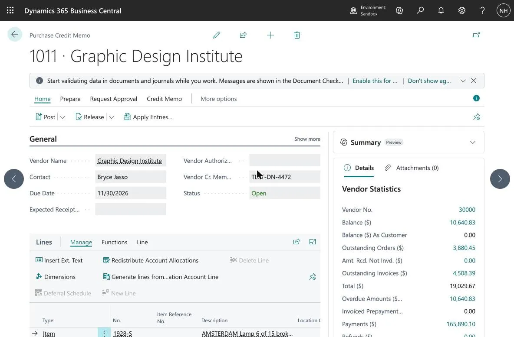
*Draft 1011: vendor Graphic Design Institute, Vendor Cr. Memo No. TEST-DN-4472, the Post action available but not used*

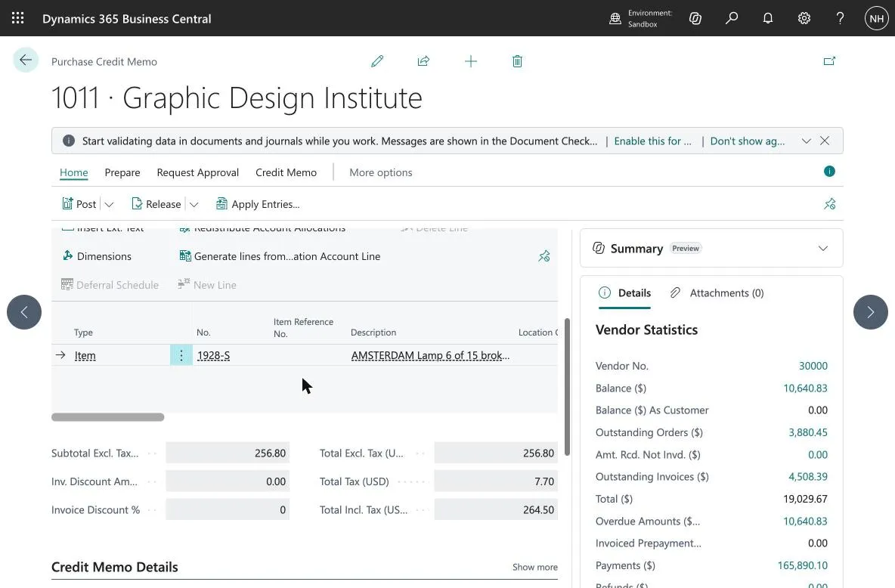
*The line for item 1928-S, with the subtotal 256.80, tax 7.70 and total 264.50*

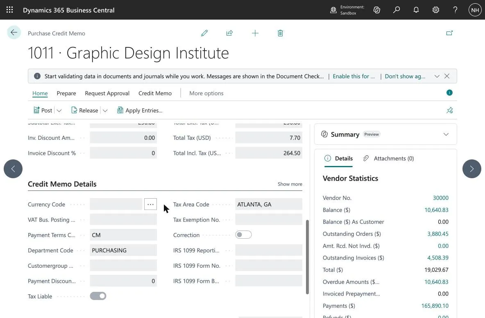
*Tax Area Code ATLANTA, GA, the same as the posted invoice*

**The amounts are right.** The credit is 6 × 42.80 = 256.80, plus tax 7.70, total 264.50, under the $500 limit, so the controller's approval is not triggered. The line description names the purchase order, the receipt and the delivery note. The header says Open in the web client and Draft through the API, and either way it is unposted.

**The jurisdiction is right.** The tax area is ATLANTA, GA on the draft and on the posted invoice.

**The "tax anomaly" has an explanation that the harness could not see.** The harness noticed that the invoice charged 3 per cent although the same item is priced at 6 per cent on the 2025 and May 2026 lines, and Atlanta's combined rate is higher. It asked me, and it was right to ask. When I looked at the tax details in the Sandbox, I found a second set of rates effective from 3 November 2026, and a document dated after that date takes 3 per cent. 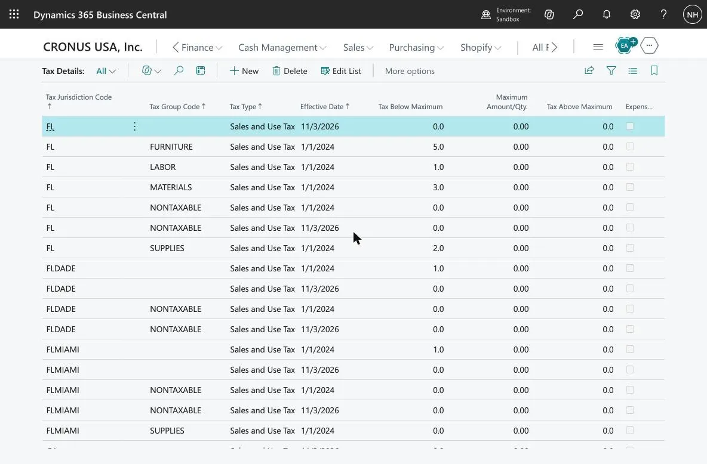
*The Sandbox's tax details, with the second set of rates*

So the Sandbox is behaving as it was set up, and the question a real company would put to the vendor is whether their tax set-up is right. The harness did the useful thing: it reported the inconsistency, made the credit mirror the invoice, and did not decide.

**The invoice date is right.** I set the document date when I seeded the order, so the harness had nothing to complain about.

## What a person does next

The harness never posts. Its output is a plan with sources and one unposted draft. I have not posted anything. A person would, in order:

1. Put invoice 108234 On Hold with the buyer's initials, today, so that a payment run does not pay the disputed amount. The tools cannot set that field.
2. Wait for the vendor's credit note, then replace the delivery note placeholder in Vendor Cr. Memo No.
3. Open the credit memo, apply it to invoice 108234 for 264.50, so the open balance falls from 661.26 to 396.76, and set the original item entry for exact cost reversing.
4. Record the physical return when the vendor collects the lamps, without also posting a credit memo that reduces the stock a second time.
5. Raise the 3 per cent rate with the vendor.
6. Post, with the real date, after the controller and the vendor's figures agree with the draft.

:::no-dumb-questions
**Q: Why did the harness reason about Georgia and not Florida?**

A: Because the scenario told it the order's tax area. The standard Business Central API does not return the tax area, and a harness can only reason from what its tools show it. The vendor card says Miami, Florida and the ship-to state is empty. A person would know the order's tax area and put it in the case. So would a company that wrote its own tool.

**Q: Is it a problem that it created the draft before it asked?**

A: Not here, because a draft can be deleted and nothing posts. If the configuration allowed posting, it would be a serious problem. That is why I kept bound actions off.
:::

## What this post told you

:::bullet-points What to remember
- A harness is the software around a model: it holds the conversation, runs the tools and decides which requests run. The same model in a plain chat cannot read your ledger.
- Start from the one number every role shares. The harness traced purchase order 106030 to receipt 107240 and invoice 108234, even though the order was no longer in the order list.
- Microsoft Learn is part of the method. The harness searched with Business Central terms, fetched the pages, and gave the sentence it relied on for each step.
- A configuration limits what the harness can touch. Mine allowed reading and drafting credit memos, and nothing else. It created one unposted draft, and that is where it stopped.
- Check its work against the system. The amounts, the draft and the jurisdiction were right. The jurisdiction was right because the scenario gave the harness one fact that a person would know: the order's tax area.
- Its questions are part of the result. It asked about the credit basis, the tax rate, the hold and the lamps, and each one is a decision that belongs to a person.
- A person still owns the vendor's credit note, the hold, the application of the credit, and the posting.
:::

## References

- [LLM Benchmarking](/posts/llmbenchmark/): the benchmark, and why the harness matters
- [Connecting DeepSeek Harness to Business Central](/posts/deepseekharnessbusinesscentral/): the setup behind these runs
- [Blog AI Assistant](/posts/localagent2/): a harness written as custom code
- [I think “agent” may finally have a widely enough agreed upon definition to be useful jargon now](https://simonwillison.net/2025/Sep/18/agents/): Simon Willison, 18 September 2025
- [DeepSeek Harness](/posts/deepseekharness/) (part 1), [with Ollama](/posts/deepseekharnessollama/) (part 2) and [with local subagents](/posts/deepseekharnesshybrid/) (part 3)
- [Process purchase returns or cancellations](https://learn.microsoft.com/dynamics365/business-central/purchasing-how-process-purchase-returns-cancellations) and [Correct or cancel unpaid purchase invoices](https://learn.microsoft.com/dynamics365/business-central/purchasing-how-correct-cancel-unpaid-purchase-invoices): Microsoft Learn
- [O.C.G.A. § 48-8-58](https://codes.findlaw.com/ga/title-48-revenue-and-taxation/ga-code-sect-48-8-58/), [Ga. Comp. R. & Regs. 560-12-1-.25](https://rules.sos.ga.gov/gac/560-12-1-.25) and the [Georgia Department of Revenue ST-3 tips](https://dor.georgia.gov/tips-completing-sales-and-use-tax-return)
- [ASU 2015-11, Inventory (Topic 330)](https://viewpoint.pwc.com/dt/us/en/fasb_financial_accou/asus_fulltext/2015/asu_201511inventory_/asu_201511inventory__US/asu_201511inventory__US.html): the public reprint of the amended paragraphs
