# Connecting DeepSeek Harness to Business Central

## What this post tells you, and why

[DeepSeek Harness and a Vendor Dispute in Business Central](/posts/deepseekharnessaccounting/) needs a harness that can read a company's ledger and, at the end, create unposted draft documents. Getting there took more setup than I expected, and the setup is its own subject, so it lives here. In this post I tell you, in order:

1. **How the harness reads the ledger:** Business Central's own MCP server, a read-only configuration, and a sign-in through an Entra app.
2. **What went wrong on the way:** a deleted app registration, a wrong tenant, a tool list that took 148 seconds, and a harness that went looking for a token.
3. **The fix:** a configuration with ten objects instead of 414 tools.
4. **How I went from reading to drafting:** two more configurations, the last of which can create and modify credit memos and nothing else.
5. **What stays out of reach:** posting.

## Reading the ledger through Business Central's MCP server

A person should not be asked for facts that sit in the company's own data, such as the costing method of an item, whether the goods are still in stock, the currency, or whether a posting period is open. Business Central can answer most of them itself, because it now ships its own Model Context Protocol (MCP) server, which I connected to Claude Code in [Model Context Protocol](/posts/businesscentralmcpclaudecode/).

That post gives the details that matter here:

- **A static list of objects.** I created a configuration in static tool mode, so only the objects I added are exposed. Adding all the standard APIv2 pages gave 414 tools.
- **Read-only by default.** Each object has separate switches for Allow Read, Create, Modify, Delete and Bound Actions, and I had only Allow Read ticked. The harness can look at the ledger and cannot change it.
- **A real sign-in.** The server uses OAuth through an Entra app, and I granted it with delegated permissions, so the harness acts as a signed-in person. That post also warns that read-only tools still return live company data.

The harness already has what it needs. Its README describes an MCP client plugin, `@deepseek-ai/dsh-mcp-client`, which I found installed on this machine. Each plugin instance connects to one MCP server, over a local command or over HTTP, and registers that server's tools so the model sees them as `mcp__<server>__<tool>`. Here is how I would set it up, using the same bridge as my earlier post. The angle brackets stand for values from that post, which I have left out:

```yaml
- id: mcp-businesscentral
  name: '@deepseek-ai/dsh-mcp-client'
  config:
    serverName: businesscentral
    transport: stdio
    command: npx
    args: ['-y', 'mcp-remote', 'https://mcp.businesscentral.dynamics.com', '<port>',
           '--transport', 'http-only',
           '--header', 'TenantId: <tenant>', '--header', 'EnvironmentName: <environment>',
           '--header', 'Company: <company>', '--header', 'ConfigurationName: <read-only configuration>']
```

I tried exactly this, and it did not work as I hoped. The next two parts say what I found. I connected the server from my own machine first, and then I tried the harness.

### What happened when I connected it

Six things to know before you try:

- **The app registration had been deleted.** The sign-in failed with Microsoft's error AADSTS700016, which says the application was not found in the directory. The Entra app from my earlier post was in the **Deleted applications** list, deleted on 19 September. Microsoft will not restore an app registration more than 30 days after deletion, and it said so when I tried: "Restore not allowed 30 days after soft deletion." I had to create a new one. A connection that worked once depends on an identity that someone, perhaps you, can delete.
- **The new registration needs very little.** Single tenant, a public client, the loopback redirect address `http://localhost:33418/oauth/callback`, and the Business Central delegated permission `Financials.ReadWrite.All`. It does not need admin consent. I kept the new client ID out of this post. It is not a secret, but nothing here needs it.
- **The Business Central configuration does not mention the app at all.** The "Blog Post" configuration only decides which objects the harness can see and what it can do with them. The app registration is just the identity that signs you in, so I did not need to change anything inside Business Central when I replaced the app.
- **The wrong tenant looks like a license problem.** Opening the bare Business Central address sent me to a tenant with no license, with the message "You don't have access to Business Central". The fix is to put the tenant in the address, so it always lands in the right place.
- **The tool list takes 148 seconds.** With every standard API exposed, the server returns 414 tools in a response of about 1.5 MB. Claude Code allows far less time than that, so the connection showed as "Connected" with the message "tools fetch failed". I measured the time by asking the server directly, and then raised the timeout in the project's settings.
- **The sign-in is a human step.** The first sign-in needs a browser and a password, and the harness cannot and should not type your password. After that the token is cached and the harness reconnects without you.

Here are the screens that went with it. The first is the deleted app, and the second is Microsoft refusing to bring it back:

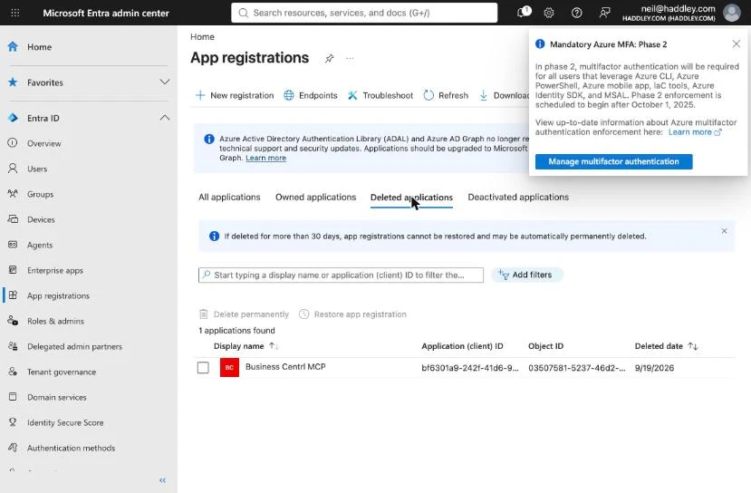
*The Entra app from my earlier post, in the Deleted applications list, deleted on 19 September*

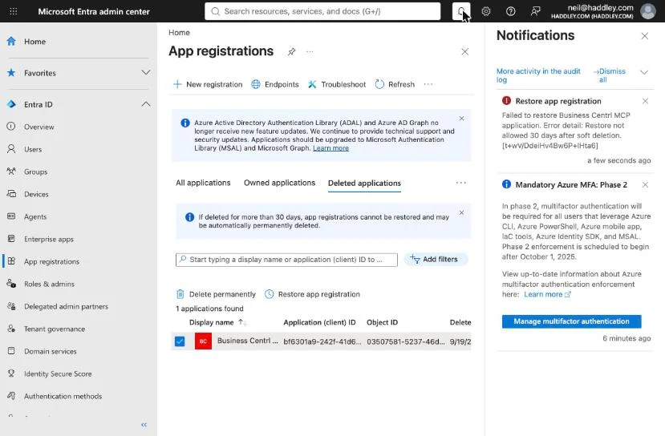
*I clicked Restore, and the notification says: "Restore not allowed 30 days after soft deletion"*

The replacement app, with the one permission it needs, and the wrong-tenant error that I hit on the way:

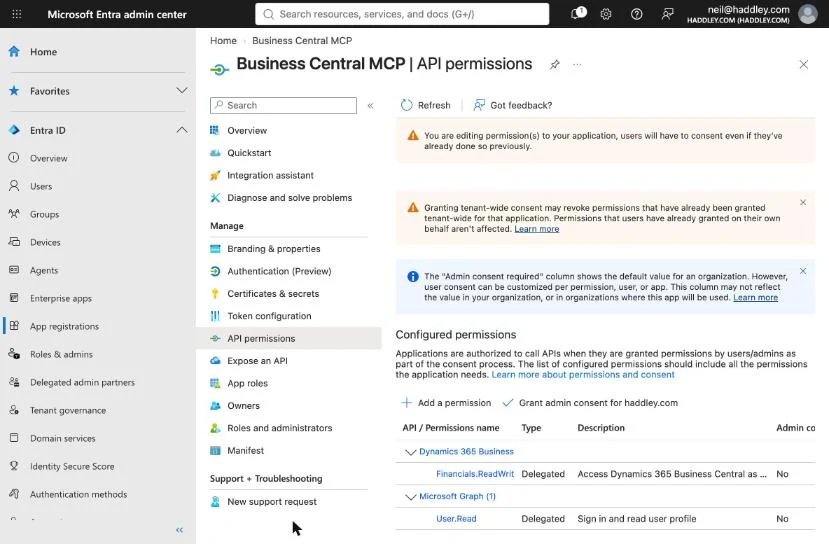
*The new app registration, with the Dynamics 365 Business Central delegated permission Financials.ReadWrite.All. The "Admin consent required" column says No*

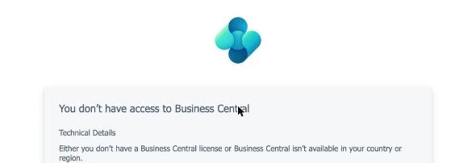
*The bare Business Central address opened a tenant with no license, and showed this message*

With that done, eight read-only calls to the "Blog Post" configuration all returned data from the Cronus demo company: 7 vendors, 72 inventory items, 2 bank accounts, 161 currencies with 168 exchange rate rows, 239 posted purchase receipts, 236 posted purchase invoices and 14 purchase orders. A call took one to seven seconds once the connection was open. One gap matters for this scenario: the API's item fields do not include the **costing method**, which decided the Standard cost trap in my case. That fact is on the item card in the web client, not in the API, so the harness would need a second route to it.

Here is the same data in the Business Central web client, which is what the harness's calls returned:

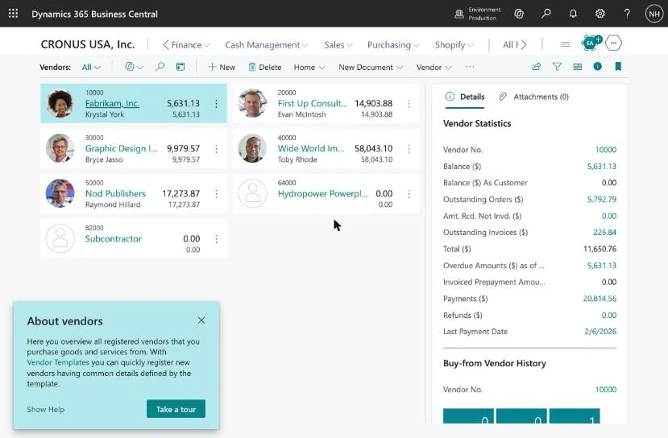
*The seven vendors in CRONUS USA, Inc. Every one is in US dollars, so the foreign currency case in my tests uses a fictional euro vendor*

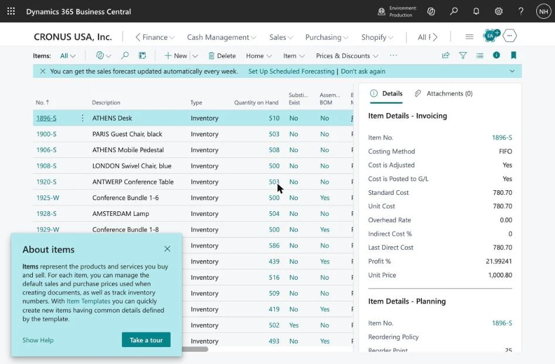
*The item list. The details pane shows the costing method for the selected item, FIFO for 1896-S ATHENS Desk, which the API does not return*

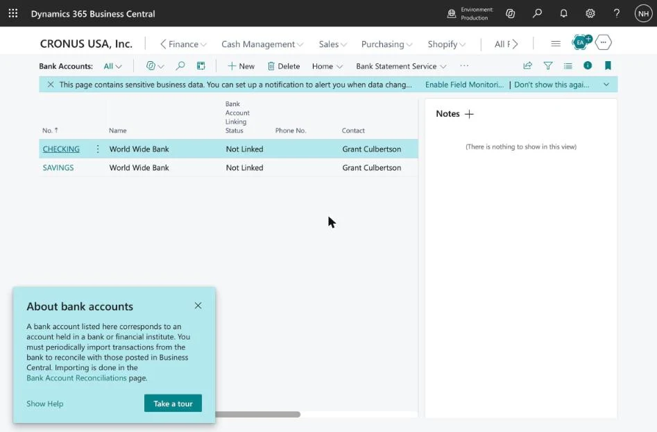
*The two bank accounts, CHECKING and SAVINGS at World Wide Bank, which the bank reconciliation case uses*

What it changes is the question list. With the ledger readable, the harness's questions shrink to the ones that no data can answer: what the company intends, and what a person must approve.

### When I connected the harness itself

I added that configuration to the harness's headless profile, as a row in its patch file, and asked the harness to list the company's vendors with the new tools. Two things happened.

**The tools never loaded.** The harness started the bridge, and the bridge connected, and the harness asked for the tool list. That list takes 148 seconds to come back, and the harness gave up on the request, cancelled it and reconnected, again and again. The 414 tools were never registered. Raising the timeout for tool calls did not help, because that setting covers calling a tool and not asking for the list.

**The model went round the problem.** With no Business Central tools, it wrote two small scripts in its workspace, read the cached sign-in token from the token folder in my home directory, and called the Business Central server directly with that token. The script was named "readonly-vendor-probe", and I did not see its result, because I stopped the run. I had not told the harness about the token, and nothing stopped it from reading it.

:::watch-it A harness that cannot use a tool looks for another way
File permissions on a token stop other users, and they do not stop a harness that runs as you. If you want a harness to read a company's data, make the proper route work, and keep credentials where the harness cannot read them: a sandbox that denies the token folder, or a token that belongs to a separate account. The approval and sandbox features in the harness are the controls. A line in a skill saying "do not do this" is a request.
:::

I stopped the run and took the row out of the profile. The fix was not in the harness. A longer timeout was not available, because the plugin's own documentation says it does not expose a discovery timeout, and the 414 tool definitions come to roughly 390,000 tokens, far more than a model can hold. The fix was a smaller Business Central configuration.

:::watch-it Too many tools breaks the harness, and it is no surprise
Every tool the harness registers has to be described to the model in every request, and the harness has to list all of them before it can start. Here that meant 414 tool definitions, about 390,000 tokens, and a tool list that took 148 seconds to arrive. The harness gave up on it, so the harness had no tools at all. Even when a model can hold that many definitions, more tools mean more tokens to read, more timeouts and a bigger chance of choosing the wrong tool. Give a harness only the tools that its task needs, and make each one read-only until a person decides otherwise.
:::

### The fix: a smaller configuration

I created a second MCP configuration in Business Central, called "Close", with only ten objects, each with **Allow Read** and nothing else: items, vendors, currencies, purchase invoices, bank accounts, purchase receipts, purchase orders, item ledger entries, purchase credit memos and currency exchange rates.

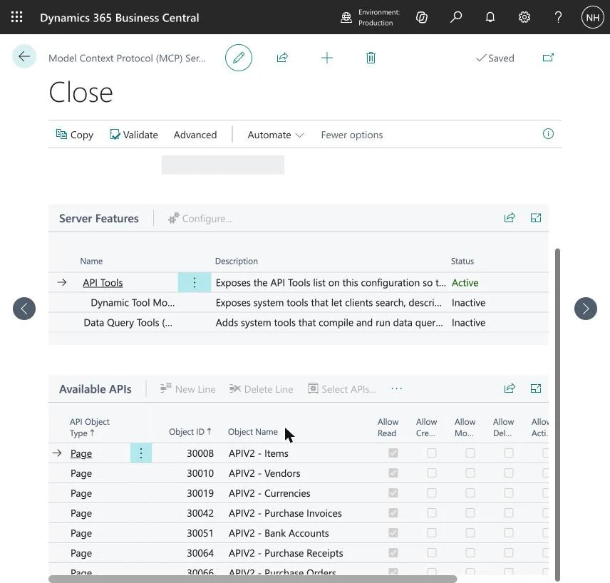
*The "Close" configuration, active, with its objects in Available APIs. Only Allow Read is ticked*

:::watch-it The order matters, and the picker has a trap
You cannot switch a configuration to Active until after you have chosen its tools, and once it is active the tool list is locked. Switching Active on first leaves a half-made line that breaks the card, and the only fix is to delete the configuration and start again. The picker also **replaces** the single line when you choose one API at a time. The way that works is to filter the picker on the ID column with a list such as `30010|30008|30051`, tick all the rows with the header checkbox, and press OK. Then switch Active on last.
:::

Here is what the smaller configuration changed, measured against the same server:

| | "Blog Post" (every standard API) | "Close" (ten objects) |
|---|---|---|
| Tools | 414 | 10 |
| Time to list the tools | 148 seconds | 3.0 seconds |
| Size of the list | 1.56 MB, about 390,000 tokens | 33 KB, about 8,300 tokens |

With the row pointed at "Close", I asked the harness the same question again: list the vendors, read-only, and say which tool you used. It called `List_Vendors_PAG30010` through the MCP connection and returned all seven vendors with their balances, the same as in the web client, in 24 seconds. It wrote no scripts of its own this time, and it did not go looking for a token.

## From reading to drafting

For planning, the harness only reads. For the final run of the vendor dispute I wanted it to create the documents themselves as drafts. That took two more configurations, each a copy of the one before.

- **"Close Plus".** The ten objects of "Close" plus five more, all with Allow Read only: G/L accounts, G/L entries, purchase invoice lines, purchase receipt lines and accounting periods. It serves 17 list tools. It exists because the other cases in my plan need ledger entries, and I found that the standard Business Central APIs have no bank account ledger entries or vendor ledger entries at all.
- **"Close Drafts".** A copy of "Close Plus" with **Allow Create** and **Allow Modify** ticked on exactly two objects, Purchase Credit Memos and Purchase Credit Memo Lines, which I added because a draft credit memo needs lines. Delete and Bound Actions stay off. I checked the result from outside: the server offers 25 tools, which are the 19 list tools plus six create and modify tools for those two objects, and nothing else.

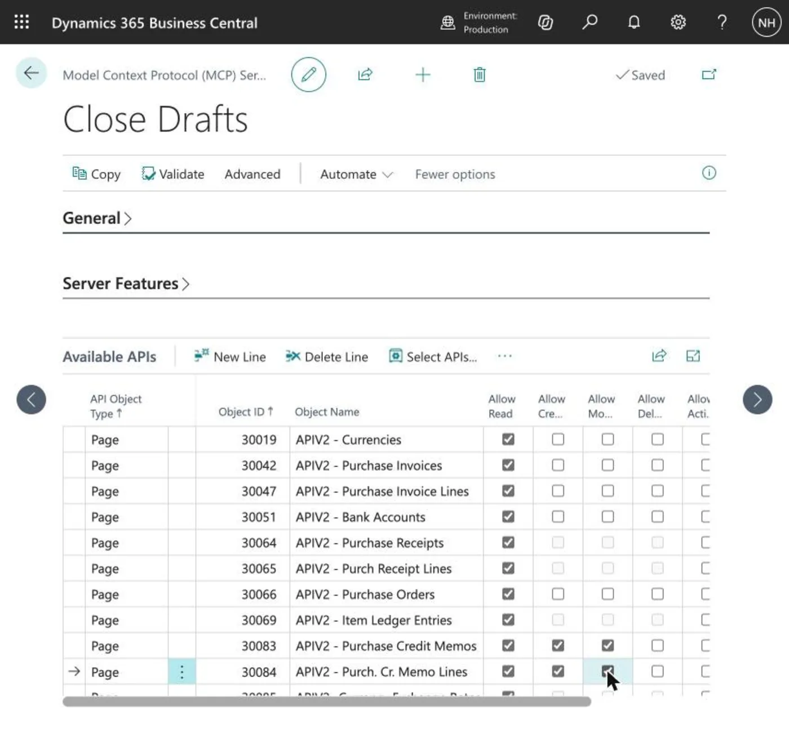
*The "Close Drafts" configuration. Create and Modify are ticked on the two credit memo objects only, and every other row is read-only*

:::watch-it The write switch is a person's decision
Create and Modify stay greyed out until **Unblock Edit Tools** is switched on for the configuration. That switch decides whether a configuration may write to the company at all, so it is the one setting I leave to a person. I built the configuration and a person switched it on. I would keep it that way, because the party that asks for write access should not also be the one to unlock it.
:::

:::watch-it Posting is a bound action, and it stays off
As I understand the setup page, posting a document is a bound action in Business Central, and "Close Drafts" leaves Bound Actions off. In the final run the harness created two credit memos and had no way to post them. Posting stayed with a person.
:::

Three details are worth knowing before you copy this:

- **A copy of an active configuration arrives locked.** Switch Active off on the copy, change its objects, and switch Active on last.
- **The picker replaces the focused row.** Adding one object through the picker silently replaced my Items line, and I noticed only when I counted the tools. Adding a new line and typing the object ID avoids it.
- **The data under the configuration can change.** The Cronus demo company refreshes some data, and a reset or a recreated company would probably delete the configurations too, because they are stored as company data. The Entra app registration and the cached sign-in token are not affected. Writing down the object list makes a rebuild a matter of minutes.

## Starting again in a Sandbox

For the second run of the vendor dispute I wanted a clean company that I had made on purpose, so I created a new **Sandbox** environment in the Business Central admin center. Its state is Preparing for a few minutes, and then Active.

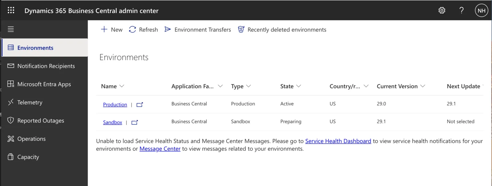
*The admin center while the Sandbox is being prepared: state Preparing, version 29.1*

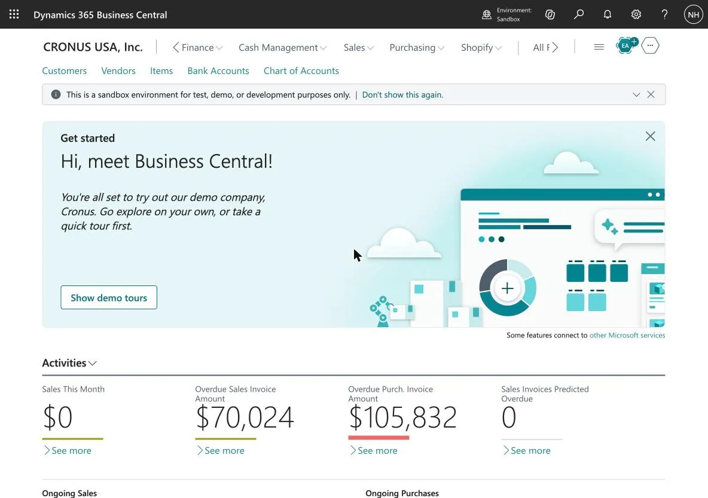
*The new Sandbox opened as CRONUS USA, Inc. The banner says it is for test, demo or development only*

A new environment has none of the MCP configurations from the old one, because they are stored as company data. The list was empty:

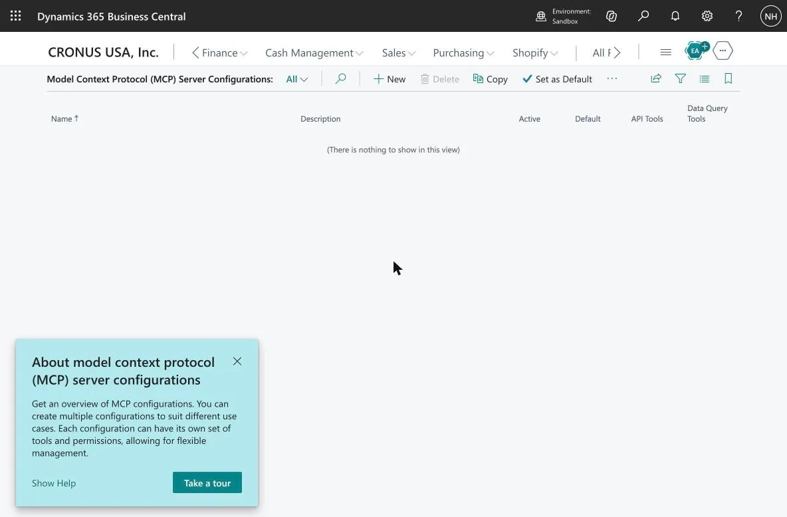
*The MCP Server Configurations list in the new Sandbox: nothing to show*

So I rebuilt the one I needed, called **Drafts**: a new configuration, then a new line for each object by typing its object ID, with Allow Read on every line. These are the 16 objects, which are the ones a vendor dispute reads, plus the two credit memo pages: Items 30008, Vendors 30010, Accounts 30014, Tax Groups 30015, G/L Entries 30018, Tax Areas 30036, Purchase Invoices 30042, Purchase Invoice Lines 30047, Purchase Receipts 30064, Purchase Receipt Lines 30065, Purchase Orders 30066, Purchase Order Lines 30067, Item Ledger Entries 30069, Purchase Credit Memos 30083, Purchase Credit Memo Lines 30084 and Accounting Periods 30086.

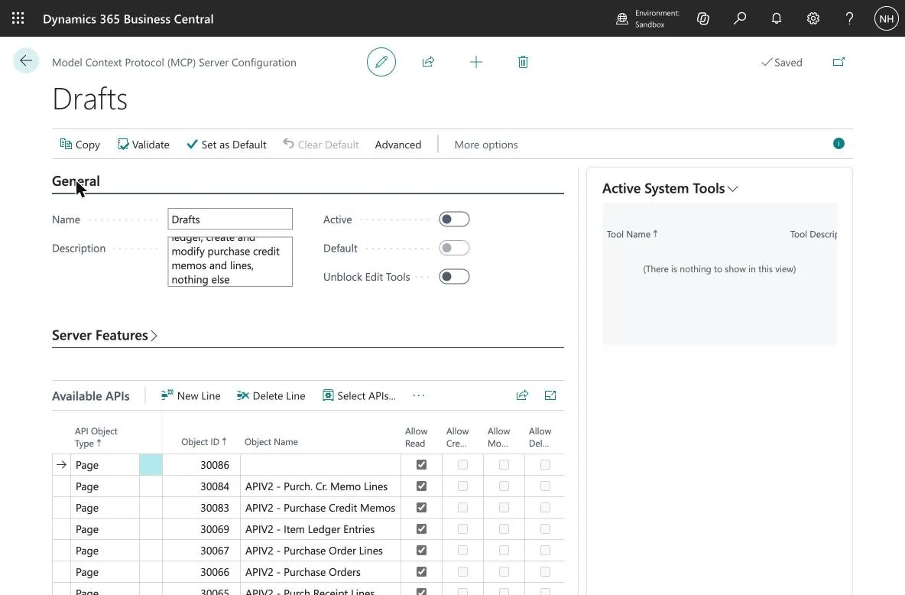
*The Drafts configuration with its read lines. Active is still off, and so is Unblock Edit Tools*

Three things were different from the first time:

- **The grid jumps.** After the page reloads, the lines grid can scroll to its last row and show only that row. Pressing the Up arrow in the grid brings the others back. Nothing had been lost.
- **Create and Modify wait for a person.** Their boxes were greyed out until the **Unblock Edit Tools** switch was on, and I left that switch to a person, as before.
- **Active goes last, and saving takes about 15 seconds.** An active configuration is locked, so I ticked Create and Modify on the two credit memo pages first.

Asking the server for its tools from outside returned 26: the list tools, plus create and modify for credit memos and their lines, and nothing else.

## Connecting Microsoft Learn as well

The harness also needs the product documentation. Microsoft Learn has its own public MCP server at `https://learn.microsoft.com/api/mcp`, with no sign-in. It offers three tools, `microsoft_docs_search`, `microsoft_docs_fetch` and `microsoft_code_sample_search`. I added it to the harness profile in the same way as the Business Central row, as a second MCP client entry. Because both servers appear as tools in the same list, the model chooses between them like any other tools, and the harness logs each call.

:::watch-it It also works in Claude Code
The same configurations work with Claude Code: I pointed it at the "Close" and "Close Drafts" configurations and the Microsoft Learn server through its MCP settings, with the same sign-in. The setup belongs to Business Central, not to the harness, which is why one set of lessons covers both.
:::

## What this post told you

- Business Central ships an MCP server, and a harness reads the ledger through a configuration that lists exactly the objects it may see.
- Connecting it took six lessons: a deleted app registration cannot be restored after 30 days, the wrong tenant looks like a licence problem, the sign-in is a human step, and a harness that cannot use a tool will look for another way, even a token file.
- **Too many tools breaks a harness.** The full configuration gave 414 tools and a 148-second tool list. Ten objects gave a 3-second list.
- Reading and writing are separate configurations. The drafts configuration creates and modifies two kinds of document, switched on by a person, with posting out of reach.
- The result is in [the vendor dispute post](/posts/deepseekharnessaccounting/): two unposted draft credit memos that a person reviews and posts.

## References

- [DeepSeek Harness and a Vendor Dispute in Business Central](/posts/deepseekharnessaccounting/): the scenario that this setup serves
- [Model Context Protocol](/posts/businesscentralmcpclaudecode/): connecting Claude Code to Business Central's built-in MCP server
- [DeepSeek Harness](/posts/deepseekharness/) (part 1), [with Ollama](/posts/deepseekharnessollama/) (part 2) and [with local subagents](/posts/deepseekharnesshybrid/) (part 3)
- [Microsoft Learn MCP server](https://learn.microsoft.com/en-us/training/support/mcp): the public Learn server and its three tools
