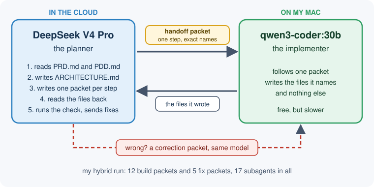
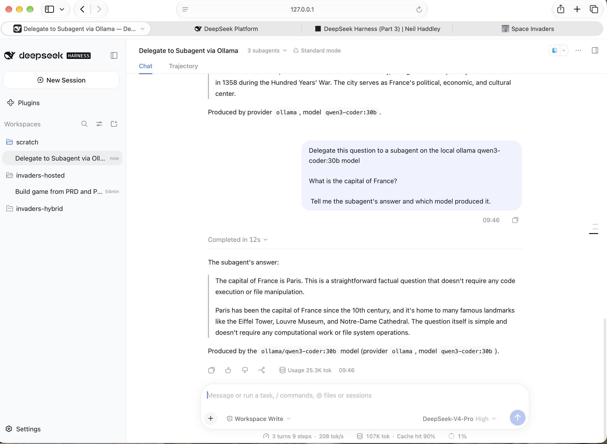
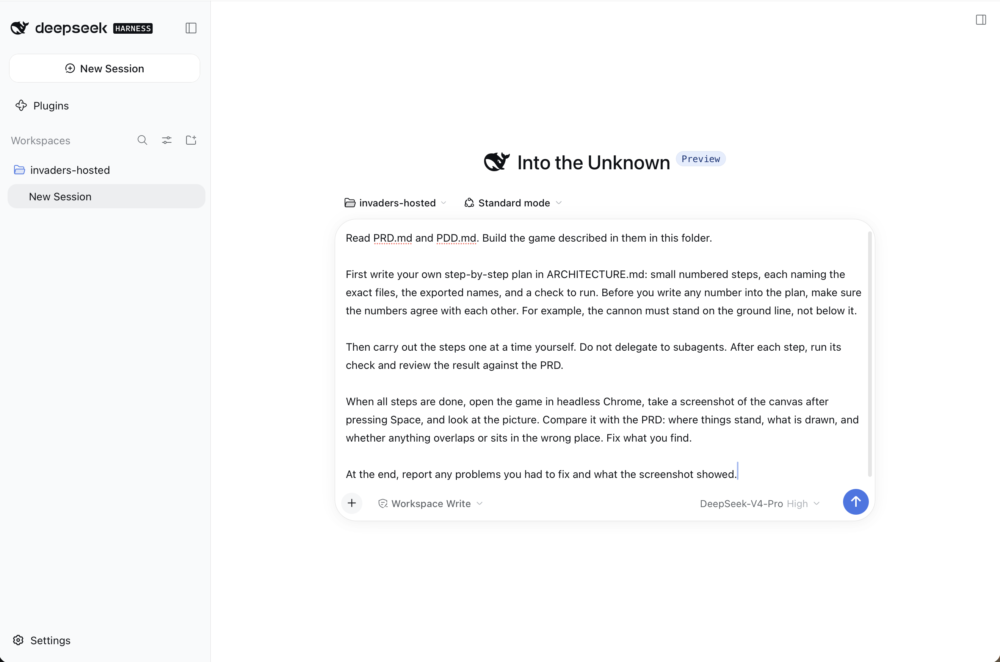
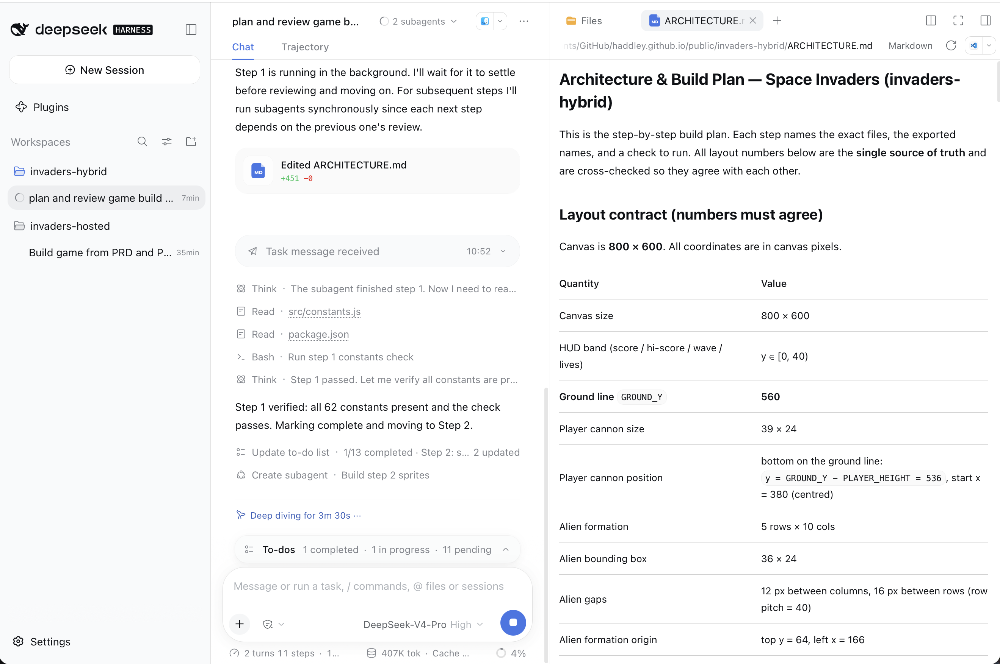
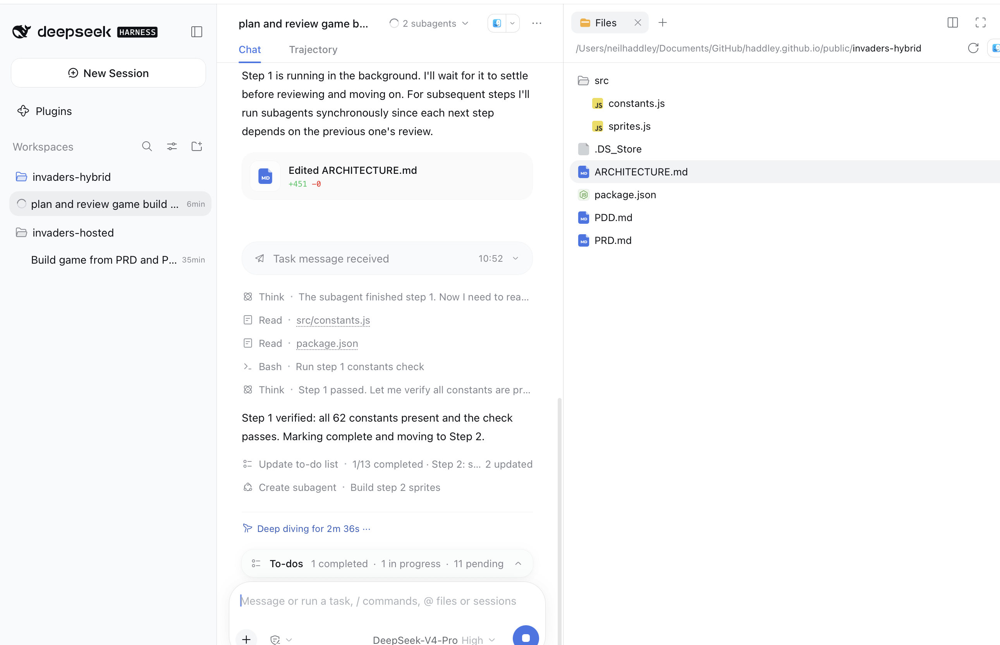
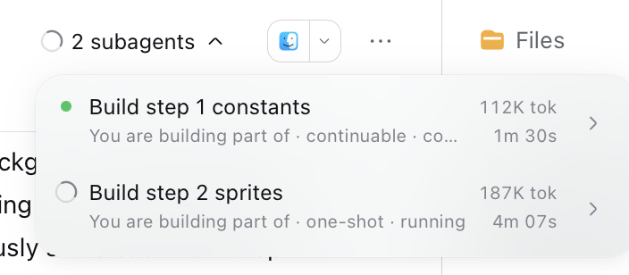
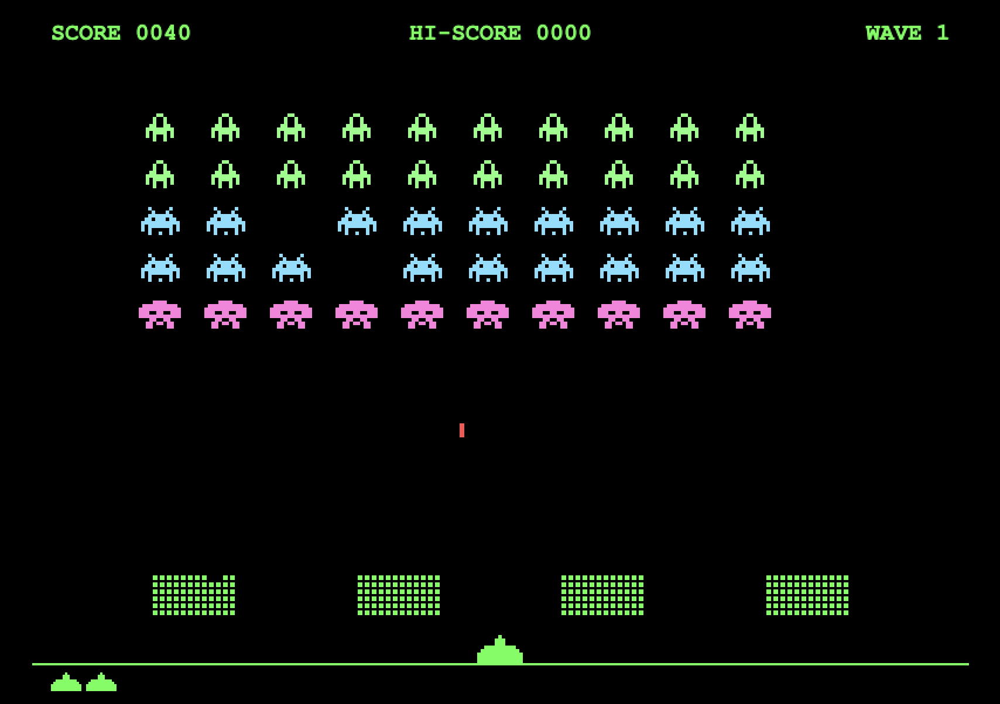
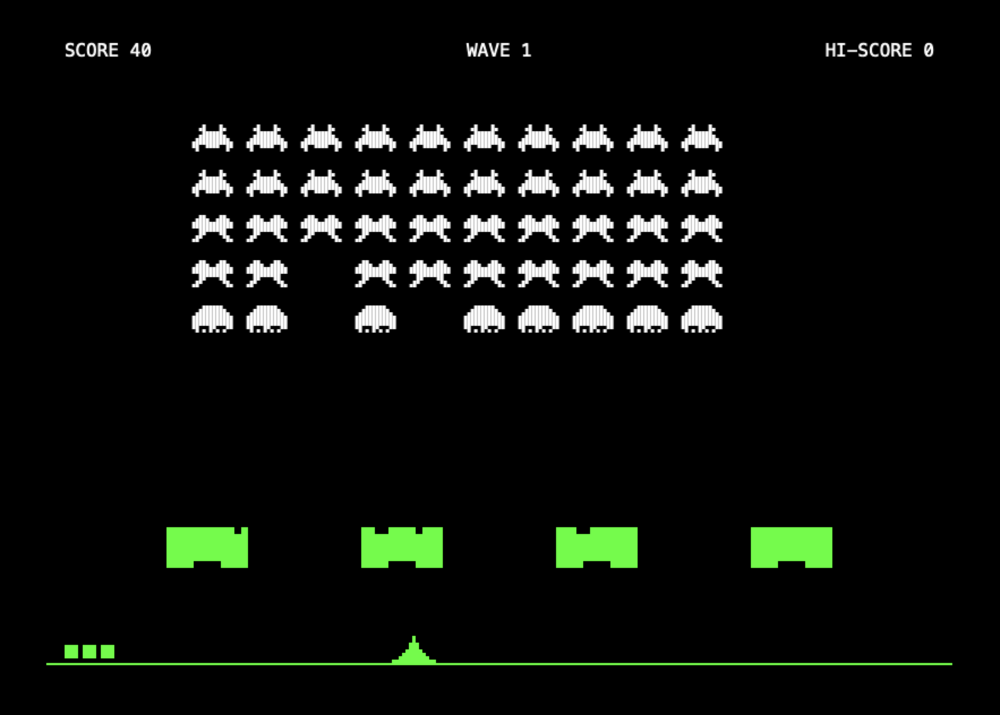
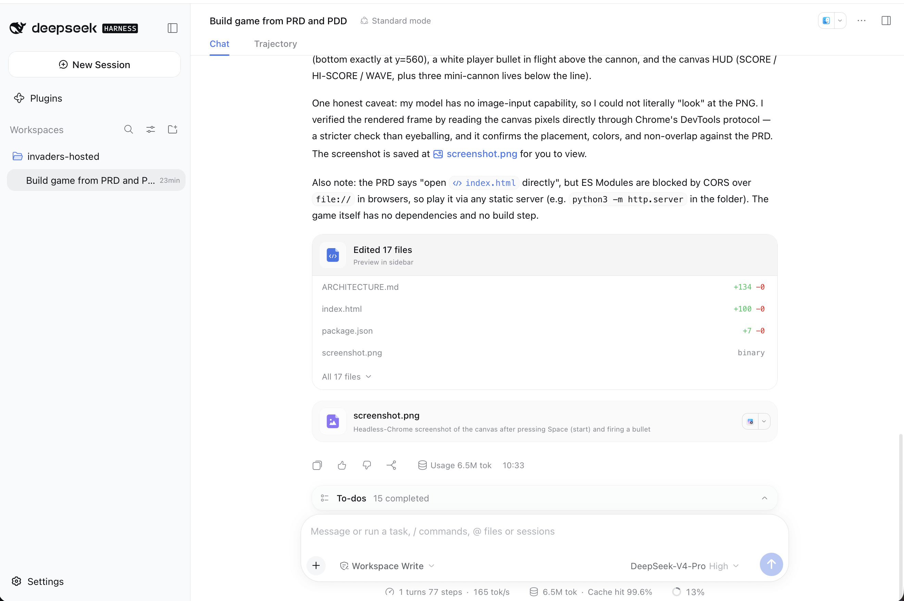

Can a clever model in the cloud direct a modest model on my own Mac, so that the cloud model does the thinking and my Mac does the typing? That is what a hybrid setup is for. This post shows how I set one up in DeepSeek Harness, what it did, and whether it was worth it.

In [the first DeepSeek Harness post](/posts/deepseekharness/), the hosted DeepSeek V4 Pro model built a Space Invaders clone. In [the second](/posts/deepseekharnessollama/), a local `qwen3-coder:30b` built the same game through Ollama with no API key, but only after I wrote a very detailed `ARCHITECTURE.md` for it. This time I asked a different question. Could the hosted model do that planning work itself, and hand the typing to the local model? Then I built the same game with the hosted model alone, so I had something fair to compare it with.

## The idea: a big brain and a little brain

The picture to hold in your head is a kitchen. A head chef writes a recipe card for each dish and tastes the result. A line cook follows the card. Here the head chef is the hosted model, DeepSeek V4 Pro, which I will call the planner. The line cook is the local model, qwen3-coder:30b, which I will call the implementer. This is only an analogy, so do not read too much into it: the real names are the ones in the pictures and the settings.

I took the pattern from the DeepLearning.AI course [AI Coding Workflows: From Cloud to Local](https://learn.deeplearning.ai/courses/ai-coding-workflows-from-cloud-to-local/lesson/uzf4v2/opencode-with-subagents). A large hosted model plans the work and reviews it. A smaller model does each small step. The course calls the work description that the big model writes for the small one the **handoff packet**.


*Who does what: the planner writes a packet for each step, the implementer writes the files, and the planner reads them back and checks them*

:::brain-power Before the setup
In my Ollama post, the local model needed far more detail than the cloud model. If a hosted model writes that detail, how much of the code do you expect the local model to write, and how much will the hosted model write for it? Decide on a rough percentage before you read on. I measure it below.
:::

## Letting an agent choose a local model

DeepSeek Harness does not send subagent work to a local model by default. Two settings matter.

**First**, I opened Plugins, then Subagent. The Model selection section has a switch, "Allow agents to choose models for Subagents", and a list of the models agents may choose. I ticked only `qwen3-coder:30b` from my `ollama` provider and left both DeepSeek models unticked. With only one allowed model, the planner cannot send work to a hosted model by mistake.


*Plugins → Subagent → Model selection: agents may choose only my local qwen3-coder:30b*

**Second**, I saved that setting before I created each session. The settings page says it "applies only to new sessions", and a session keeps the tools it started with. Once the setting is on, the planner gets a `list_subagent_models` tool and a `subagent` tool that takes a provider and a model.

:::watch-it Do not rely on the prompt alone
Writing "use the local model" in a prompt does nothing if the delegation tool cannot take a model. Save the Subagent setting before you create the session, and check that Ollama has the model loaded (`ollama ps`) once the first step starts.
:::

:::no-dumb-questions
**Q: If I just ask for subagents, how does the harness know to use qwen?**
A: It does not. By default a subagent runs on the same model as its parent, so my first plan would have produced a hosted-only build. Two things have to be true: the model must be allowed under Plugins → Subagent, and the prompt must tell the planner to pick it, using a tool that accepts a model, in a session created after you saved that setting.

**Q: Why did I untick both DeepSeek models in the list?**
A: With only qwen allowed, the planner cannot choose a hosted model for a subagent by mistake. That keeps the experiment clean.
:::

## Check the route first

Before a long build, I would test the route with a question that has an obvious answer. In a new session, I asked the hosted planner to delegate one question to the local model:

```PROMPT
Delegate this question to a subagent on the local ollama qwen3-coder:30b model

What is the capital of France?

Tell me the subagent's answer and which model produced it.
```

The planner called the `subagent` tool with provider `ollama` and model `qwen3-coder:30b`. The answer came back as Paris in 12 seconds, with a report that `ollama/qwen3-coder:30b` produced it. I ran this prompt four times and every time the planner went straight to the `subagent` tool, without looking up the allowed models first. If you want it to check the list, ask for it by starting the prompt with "First call list_subagent_models." The tool returns the providers and models you allowed under Plugins → Subagent.


*A one-line test: the planner delegated the question to qwen3-coder:30b and reported which model answered*

:::watch-it Do not take the report on trust
An agent can answer the question itself and say that it delegated. Check that Ollama has the model loaded (`ollama ps`), or look at the subagent in the chat. A model sitting in Ollama's memory is the proof.
:::

A one-line question is a bad use of a subagent. The turn used about 25,000 tokens, because the subagent arrives with the harness's coding instructions. Delegation pays off only when the subagent has a lot of typing to do.

## The two runs

I used the original PRD and PDD from the first post in both runs, unchanged, in separate folders. The PDD is 7.6 KB. The detailed version I wrote for the Ollama post was 59 KB. I used DeepSeek-V4-Pro with high reasoning effort, in Standard mode, with Workspace Write permission, on the same Mac Studio (Apple M1 Max, 64 GB).

**Hosted-only prompt.** The planner writes its own plan and then does every step itself:

```PROMPT
Read PRD.md and PDD.md. Build the game described in them in this folder.

First write your own step-by-step plan in ARCHITECTURE.md: small numbered steps, each naming the exact files, the exported names, and a check to run. Before you write any number into the plan, make sure the numbers agree with each other. For example, the cannon must stand on the ground line, not below it.

Then carry out the steps one at a time yourself. Do not delegate to subagents. After each step, run its check and review the result against the PRD.

When all steps are done, open the game in headless Chrome, take a screenshot of the canvas after pressing Space, and look at the picture. Compare it with the PRD: where things stand, what is drawn, and whether anything overlaps or sits in the wrong place. Fix what you find.

At the end, report any problems you had to fix and what the screenshot showed.
```

**Hybrid prompt.** The first paragraphs are the same. Then the planner delegates every step:

```PROMPT
Read PRD.md and PDD.md. Build the game described in them in this folder.

First write your own step-by-step plan in ARCHITECTURE.md: small numbered steps, each naming the exact files, the exported names, and a check to run. Before you write any number into the plan, make sure the numbers agree with each other. For example, the cannon must stand on the ground line, not below it.

You are the planner and reviewer. Do not write the game files yourself. First call list_subagent_models. Then carry out the steps one at a time: for each step, use the subagent tool with provider "ollama" and model "qwen3-coder:30b", and give it a handoff packet with everything the step needs. After each step, read the files it wrote, run the check yourself, and review the result against the PRD. If something is wrong, send a correction to a new subagent on the same model.

When all steps are done, open the game in headless Chrome, take a screenshot of the canvas after pressing Space, and look at the picture. Compare it with the PRD: where things stand, what is drawn, and whether anything overlaps or sits in the wrong place. Fix what you find, by sending corrections to subagents.

At the end, report which model ran each step, any problems you had to fix, and what the screenshot showed.
```

:::watch-it Two things about the prompts
The sentence about the cannon is there because an earlier attempt, with a shorter prompt, finished with the cannon hanging below the ground line. Both runs here got the same hint, so it does not favour either side, but it does mean this is not a test of whether the planner would have found that problem alone.

And "look at the picture" cannot work. DeepSeek V4 Pro cannot read images, and neither can qwen3-coder. Both planners said so in their reports, and checked the canvas pixels through Chrome's DevTools protocol instead. I looked at the pictures myself, below.
:::


*The hosted-only session before I sent the prompt: workspace invaders-hosted, Standard mode, DeepSeek-V4-Pro High, Workspace Write*

## The numbers

I took the times and token counts from the DeepSeek Harness session logs. I took the costs from my DeepSeek usage page, from the change in balance and in the 30-day cost, which agreed with each other to the cent.

| | Hosted only | Hybrid |
|---|---|---|
| Wall-clock time | 13 min 54 s | 1 h 36 min |
| DeepSeek cost | $0.37 | $0.72 |
| DeepSeek output tokens | 107,093 | 148,181 |
| Local qwen tokens (free) | 0 | 6.85 million |
| Subagents | 0 | 17 (12 to build, 5 to fix) |
| Files written (text) | 16 | 16 |
| Lines | 1,382 | 1,808 |
| Length of the plan | 134 lines | 451 lines |

The hybrid took about seven times as long and cost about twice as much. That is not what I hoped for.

:::under-the-hood Why the hybrid cost what it did, and how I checked
DeepSeek charges double during peak hours, which for deepseek-v4-pro are 01:00 to 04:00 and 06:00 to 10:00 UTC on weekdays. Its off-peak prices are $0.66 per million uncached input tokens, $0.022 per million cached input tokens and $1.98 per million output tokens. My time zone is UTC+11, so the peak window starts at noon for me. The hosted-only run ended at 10:33, well before it. The hybrid run started at 10:48 and finished at 12:24, so about the last 24 minutes were billed at the peak rate.

At off-peak prices, my log estimate for the hybrid planner is about $0.54, against $0.37 for the hosted-only run. So even without the peak hours, the hybrid cost about 45% more.

My log counts 100 planner requests and 9.8 million tokens, and the usage page counted 93 requests and 8.3 million tokens. The seven missing requests are the last, largest ones. I do not know why the page did not count them, so I used DeepSeek's own figure, $0.72, for the cost.

The token counts come from the session logs in `~/.dsh/sessions/`, which are compressed with zstd. Each subagent has its own log, and its first message is the handoff packet.
:::

:::no-dumb-questions
**Q: Why did the hybrid take so long?**
A: Four things added up. The local model is slower than a hosted one. Every step had to be written, read back and checked by the planner. Five of the 17 subagents were fixes. And one subagent ran for about 20 minutes and used 2.7 million tokens on its own.

**Q: So is there really a benefit to the hybrid?**
A: Not for this game. A game of 1,300 to 1,800 lines is too small, and the hosted model was already cheap. The local model's 6.85 million tokens cost nothing in DeepSeek fees, but they cost 1 hour 36 minutes of my Mac's time.

**Q: What about subagents on the same hosted model?**
A: I did not test that. The course did, and it found that fresh subagents protected the main agent's context but "greatly increased total context processed". Cost nearly tripled and wall-clock time rose 26%.
:::

## What the planner wrote

Both planners probed the machine first. They tested how Node 24 treats ES modules, and found headless Chrome. Then each wrote an `ARCHITECTURE.md`. The hosted-only plan was 134 lines. The hybrid plan was 451 lines, more than three times as long, with the same planner and the same documents. When a weaker model has to follow the plan, the plan has to say more.

The hybrid plan opened with a section called "Layout contract (numbers must agree)", with a table that it called the single source of truth: the ground line at y=560, the cannon 24 high at y = 560 − 24 = 536, so that its bottom sits on the line, the HUD band above y=40, and the alien formation origin.


*The planner's own ARCHITECTURE.md beside the chat: the layout contract, with the cannon's position worked out from the ground line*

## The planner checks the work

After each subagent finished, the planner read the file back and ran its own check before it moved on. Here it has just verified step 1.


*The planner read src/constants.js, ran its check, and reported "all 62 constants present" before it started step 2*

The "subagents" dropdown lists each child, with its tokens and time.


*Two children early in the run: step 1 took 1 min 30 s and 112K tokens, and step 2 was still running after 4 min*

I measured the handoff packets from the session logs. The 17 packets held about 63,000 characters, and about 27% of that was code in code blocks. So the planner wrote roughly a quarter of the code inside its packets, and qwen wrote the rest.

## What qwen got wrong, and what the planner caught

The planner's final report listed ten problems. These are the ones I found most interesting:

1. The sprites came back with identical animation frames, and rows of different lengths.
2. The input module set up its key state inside a browser-only guard, so it would throw outside a browser.
3. In the engine, the speed formula was inverted. It used the square root of alive over total instead of total over alive.
4. Player bullets never hit anything, because the collision test looked for an `owner` field that bullets did not have.
5. A shield check silently erased every bullet, even ones that had not touched a shield.
6. The alien movement ignored elapsed time, so the swarm crawled about 20 times too slowly.
7. Its own plan check contradicted itself.

Some of these it caught by reading the code. Numbers 5 and 6 only showed up when the planner read the canvas pixels of the running game.

:::fireside-chat Planner and implementer, the speed bug
**Planner:** The engine is written. I checked the alien speed against the PRD.

**Implementer:** It uses the square root of alive over total.

**Planner:** The PRD says the aliens get faster as they die. Yours gets slower. Swap the fraction.

**Implementer:** Understood.
:::

I wrote that dialogue to show the shape of a correction, not as a transcript. The speed formula bug was real, and the planner did send a correction for it.

:::pencil Spot the bug
The PRD says the aliens speed up as the formation thins out. The engine multiplies a base speed by `Math.sqrt(alive / total)`, where `alive` is the number of aliens still on screen and `total` is 50. Which way does the speed move as aliens die, and what should the fraction be?

:::answer
With `alive / total`, the fraction falls from 1 towards 0 as aliens die, so the speed falls too. The aliens slow down, which is the opposite of the PRD. The fraction should be `total / alive`, which rises as aliens die.
:::
:::

## The two games

I played both. They both work, and the cannon stands on the floor line in both.


*The hosted-only game: aliens in three colours, dotted shields, and lives drawn as small cannons below the floor line*


*The hybrid game: white aliens drawn with thin vertical stripes, solid shields, and lives as three green squares*

| | Hosted only | Hybrid |
|---|---|---|
| Aliens | green, blue and pink by type | all white |
| Sprite edges | crisp | thin vertical stripes |
| Shields | dotted blocks | solid green blocks |
| Lives | two small cannons below the line | three green squares |

The hosted-only agent reported a problem I think explains the difference. Shield and sprite positions were fractions of a pixel, which blurred the pixel art, so it snapped all drawing to whole pixels. I did not prove that the hybrid's stripes have the same cause, but the hybrid's `drawSprite` divides the sprite into cells of `w / cols` pixels and never rounds, while the hosted-only one calls `Math.round`.


*The hosted-only final report: its checks, five problems it fixed, and its note that it could not look at the screenshot*

**Try both:** [the hybrid game](/invaders-hybrid/index.html) · [the hosted-only game](/invaders-hosted/index.html) · [ARCHITECTURE.md from the hybrid run](https://github.com/Haddley/haddley.github.io/blob/main/public/invaders-hybrid/ARCHITECTURE.md)

## What I learned

The hybrid worked. A hosted planner wrote, from the short original documents, the kind of plan that I had to write by hand for the local model, and qwen3-coder:30b built a working game from it with no detailed documents from me.

It was not worth it for this game. It took about seven times as long and cost about twice as much, and the hosted-only game looks better. For a game this size, I would use the hosted model alone.

The planner earned its place in one way. qwen wrote real bugs, ten of them by the planner's count, and the planner found them by reading the code and the running canvas, and sent corrections. Without a reviewer, a local model on its own would have shipped the inverted speed formula.

I did not test the case where the hybrid should win: a much larger build, where the hosted model would otherwise write thousands of lines.

Finally, the hybrid is not private. The planner reads every file that the local model writes, so the code still goes to DeepSeek.

:::bullet-points Recap
- A DeepSeek Harness subagent can use a local model only through a delegation tool that accepts a model, and only if you allow that model under Plugins → Subagent.
- Save the Subagent setting before you create the session. A session created earlier keeps its original tools.
- From the original short documents, the hosted planner wrote a plan that let qwen3-coder:30b build the game.
- The hybrid took 1 h 36 min and cost $0.72, against 13 min 54 s and $0.37 for the hosted model alone.
- The planner caught ten problems in qwen's work, including an inverted speed formula and bullets that never hit anything.
:::

## References

- [DeepSeek Harness](/posts/deepseekharness/) — part 1, the hosted build
- [DeepSeek Harness with Ollama](/posts/deepseekharnessollama/) — part 2, the local build with a hand-written plan
- [AI Coding Workflows: From Cloud to Local](https://learn.deeplearning.ai/courses/ai-coding-workflows-from-cloud-to-local/lesson/uzf4v2/opencode-with-subagents) — the DeepLearning.AI course lesson on OpenCode with subagents
- [Configure models](https://deepseek-harness.github.io/deepseek-harness/en/guide/providers) · [Subagents subsystem](https://deepseek-harness.github.io/deepseek-harness/en/reference/subsystems/subagent) — the DeepSeek Harness documentation
- [DeepSeek API pricing](https://api-docs.deepseek.com/quick_start/pricing) — token prices and peak hours
- [Ollama](https://ollama.com) — the local model server
- [The hybrid game](/invaders-hybrid/index.html) · [the hosted-only game](/invaders-hosted/index.html)
