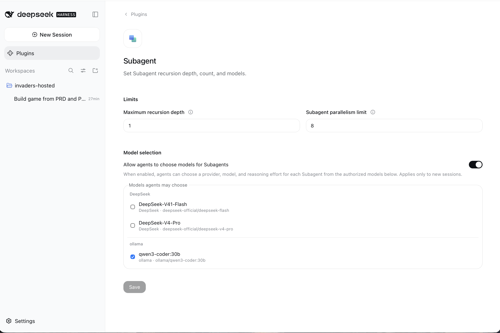
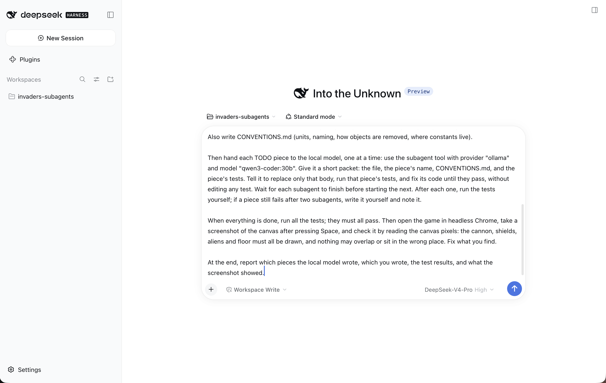
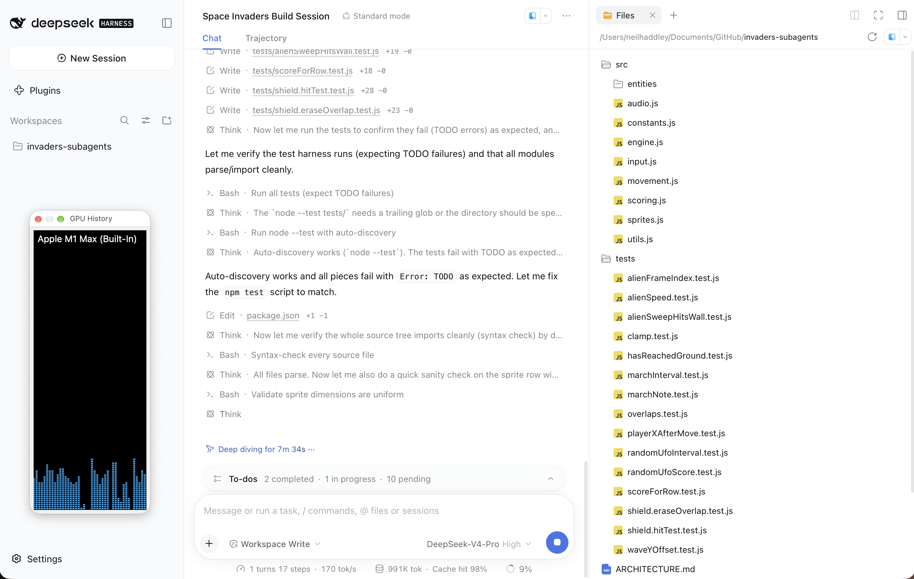
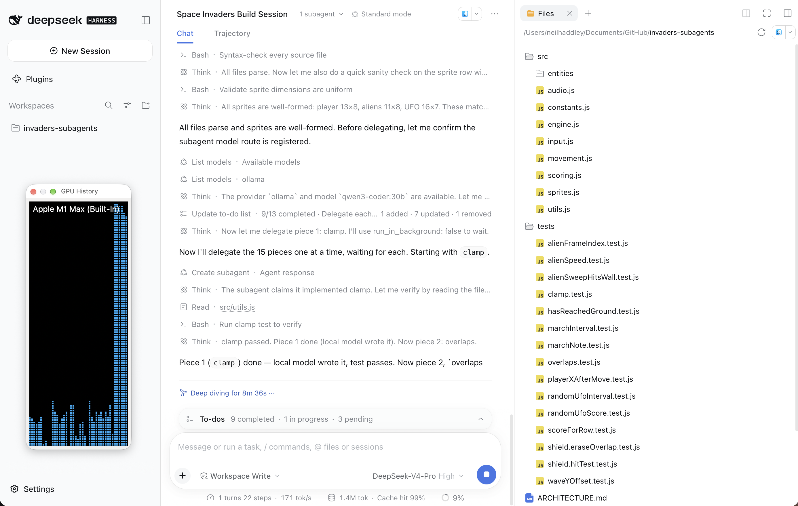
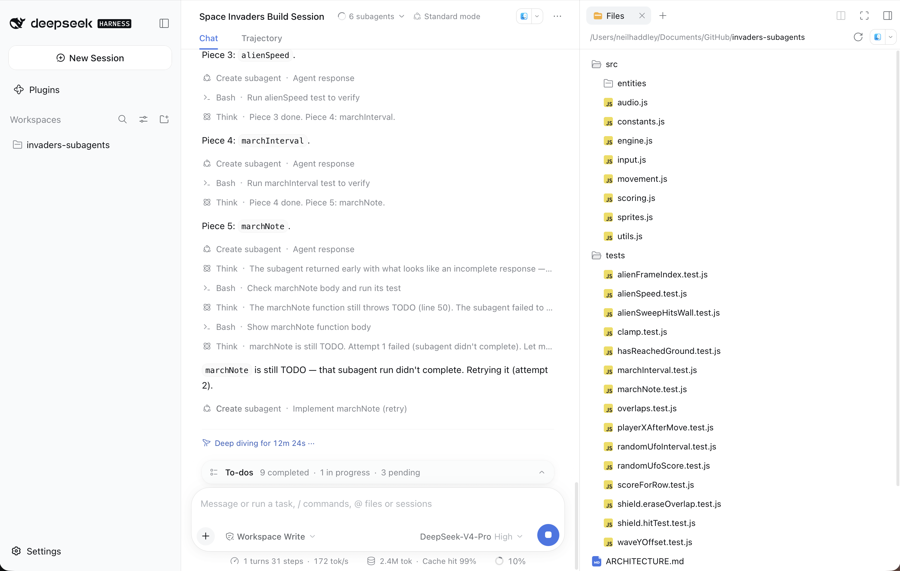
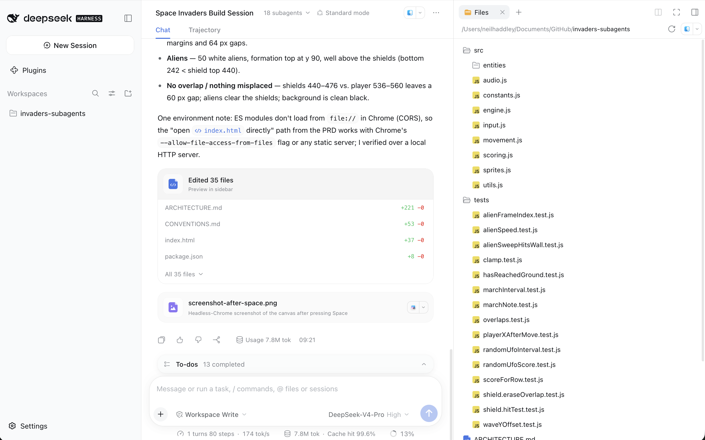
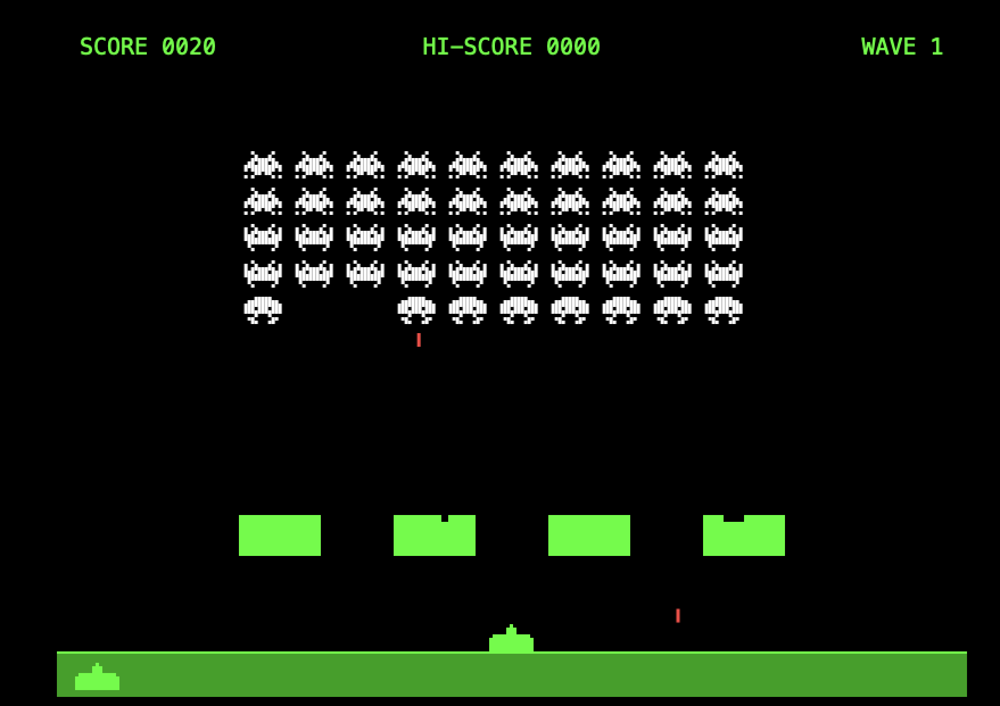
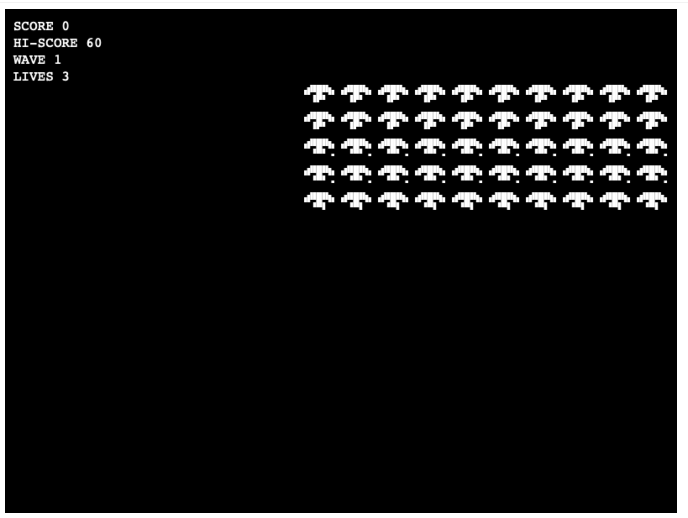

Can a model running free on my own Mac do some of the work, while a hosted model does the thinking? The DeepLearning.AI course [AI Coding Workflows: From Cloud to Local](https://learn.deeplearning.ai/courses/ai-coding-workflows-from-cloud-to-local/lesson/uzf4v2/opencode-with-subagents) shows how: a large model plans the work and hands pieces of it to subagents running a smaller model. In this post I tried that pattern in DeepSeek Harness, building the same Space Invaders game as in [part 1](/posts/deepseekharness/) and [part 2](/posts/deepseekharnessollama/).

The short answer: it works, provided the pieces are small and written down exactly.

## The idea

The hosted model, DeepSeek V4 Pro, builds the game. For each small function whose behaviour it can pin down completely, it writes only three things:

- the signature, with a comment that states exactly what the function does, including the formula and the units;
- a body that throws `TODO`;
- tests for it.

Then it hands each `TODO` to a subagent running qwen3-coder:30b on my Mac through Ollama. The subagent fills in the body and runs the tests until they pass. The hosted model checks the result itself before it moves on.

:::brain-power Before you read on
The local model is free. How much do you think handing it the small functions will save on the hosted model's bill?
:::

## Setting it up

In DeepSeek Harness I opened Plugins, then Subagent, switched on "Allow agents to choose models for Subagents", and ticked only `qwen3-coder:30b`. With only the local model allowed, the planner cannot send a piece to a hosted model by mistake.


*Plugins → Subagent: agents may choose only my local qwen3-coder:30b*

:::watch-it Save the setting first
The setting applies only to sessions created after you save it. Save it, then create the session.
:::

I gave DeepSeek V4 Pro the same short PRD and PDD as in part 1, and this prompt:

```PROMPT
Read PRD.md and PDD.md. Build the game described in them in this folder.

First write your own step-by-step plan in ARCHITECTURE.md. Before you write any number into the plan, make sure the numbers agree with each other. For example, the cannon must stand on the ground line, not below it.

Build the game yourself, with one exception: small, fully specified pieces of logic go to a local model. For each pure function or short class method (under about 25 lines) whose behaviour you can pin down completely, and that does not call any other such piece, write only:
- its signature, with a doc comment that states exactly what it does, including any formula, units and edge cases;
- the body: throw new Error('TODO');
- tests for it in tests/*.test.js, using node:test with top-level test(...) calls.
Aim for 10 to 20 such pieces. Write everything else yourself, including everything the player sees on screen. Also write CONVENTIONS.md (units, naming, how objects are removed, where constants live).

Then hand each TODO piece to the local model, one at a time: use the subagent tool with provider "ollama" and model "qwen3-coder:30b". Give it a short packet: the file, the piece's name, CONVENTIONS.md, and the piece's tests. Tell it to replace only that body, run that piece's tests, and fix its code until they pass, without editing any test. Wait for each subagent to finish before starting the next. After each one, run the tests yourself; if a piece still fails after two subagents, write it yourself and note it.

When everything is done, run all the tests; they must all pass. Then open the game in headless Chrome, take a screenshot of the canvas after pressing Space, and check it by reading the canvas pixels: the cannon, shields, aliens and floor must all be drawn, and nothing may overlap or sit in the wrong place. Fix what you find.

At the end, report which pieces the local model wrote, which you wrote, the test results, and what the screenshot showed.
```


*The session before I sent the prompt: DeepSeek-V4-Pro High, Standard mode, Workspace Write*

## What a piece looks like

The planner picked 15 pieces, wrote a test file for each, and checked that every test failed with `TODO` before it handed anything over.


*Fifteen test files, one per piece, all failing with TODO before any delegation*

Here is one piece. The planner wrote the comment and the tests; qwen wrote the single line in the body:

```js
/**
 * Horizontal speed of the alien swarm in px/s.
 * Formula: min(ALIEN_SPEED_X_MAX, ALIEN_SPEED_X_BASE * sqrt(totalCount / aliveCount)).
 * Both counts must be >= 1 (the engine never calls this with no aliens).
 */
export function alienSpeed(aliveCount, totalCount) {
  return Math.min(ALIEN_SPEED_X_MAX, ALIEN_SPEED_X_BASE * Math.sqrt(totalCount / aliveCount));
}
```

```js
test('full grid speed is the base 60 px/s', () => {
  strictEqual(alienSpeed(50, 50), 60);
});

test('a single alien caps at the max 300 px/s', () => {
  strictEqual(alienSpeed(1, 50), 300);
});
```


*The first piece: the subagent wrote clamp, then the planner read the file and ran the test itself before moving on*

## The result

All 15 pieces were written by qwen on my Mac. Each subagent read the file, edited the body and ran its test, usually in 25 to 70 seconds.

Three times, a subagent finished in two seconds having done nothing: qwen wrote its request to read a file as plain text instead of as a real tool call, and the harness took that text as its final answer. Each time, the planner ran the test, saw the `TODO` still there, and started the piece again. The retry worked every time.


*marchNote: the first subagent returned without doing anything; the planner's test caught it and a retry fixed it*

:::watch-it Check the work, not the report
A subagent can report that it has finished when it has not. The planner caught all three empty runs because it ran the tests itself after every piece.
:::


*The planner's final report: all tests pass, and the screenshot check is clean*

| | |
|---|---|
| Time | 25 minutes |
| DeepSeek cost | $0.40 |
| Pieces written by qwen | 15 of 15 (18 subagents, 3 of them retries) |
| Tests | 48, all passing |

And the game plays: the aliens march, both sides shoot, the shields chip, and the cannon respawns when it is hit.


*The finished game, with the cannon standing on the floor and bullets in flight*

**[▶ Play it](/invaders-subagents/index.html)**: Enter to start, the arrow keys or A and D to move, Space to fire.

## Did the local model save money?

No. The hosted model alone built the same game in 14 minutes for $0.37, so the bill came out about the same.

The reason is simple. To hand over a small function, the hosted model still has to describe it exactly and write its tests, and for a small function that takes about as many words as writing the code. The local model saves money only when the code it writes is much longer than its description.

:::no-dumb-questions
**Q: Why not give the local model bigger pieces, then?**
A: I tried. When I handed whole parts of this game to subagents, I got a game that passed 91 tests but never drew the cannon. The local model is reliable when a job is small and has one thing to get right.


*An earlier attempt with bigger pieces: 91 passing tests, and no cannon on screen*

**Q: Could an AI check how the game looks?**
A: Not reliably. I showed four local vision models and DeepSeek Flash a screenshot with the aliens squashed together into strips, and a correct one. None of them spotted the squashed aliens, and all of them invented problems in the correct game. They are good at exact rules, such as "the cannon's bottom row touches the floor", which can be written as tests. For "does it look right", I looked at it myself.

**Q: Do I need subagents at all?**
A: No. A short script that calls Ollama directly and runs the tests did the same job in 15 minutes for $0. Subagents are closer to the course and check their own work, which is why I used them here.
:::

## What I learned

The course's pattern works with a local model, as long as each piece is small and the hosted model writes down exactly what it must do. Write the formula in the comment, write the tests first, and have the planner check every piece itself.

Expect a local model to write small, exactly described pieces correctly, as long as the hosted model writes each piece's comment and tests first and checks every result. On this project, it did not make the build any cheaper.

:::bullet-points Recap
- DeepSeek V4 Pro planned and built the game; qwen3-coder:30b subagents on my Mac wrote all 15 small functions.
- Each piece had an exact comment and its own tests, written before the code.
- The planner ran the tests after every piece and caught three subagents that had done nothing.
- 25 minutes, $0.40, 48 passing tests: the same cost as the hosted model alone.
- Bigger pieces failed, and no AI could judge how the game looked.
:::

## References

- [AI Coding Workflows: From Cloud to Local](https://learn.deeplearning.ai/courses/ai-coding-workflows-from-cloud-to-local/lesson/uzf4v2/opencode-with-subagents): the DeepLearning.AI lesson on subagents
- [DeepSeek Harness](/posts/deepseekharness/) (part 1) and [DeepSeek Harness with Ollama](/posts/deepseekharnessollama/) (part 2)
- [Subagents subsystem](https://deepseek-harness.github.io/deepseek-harness/en/reference/subsystems/subagent): the DeepSeek Harness documentation
- [DeepSeek API pricing](https://api-docs.deepseek.com/quick_start/pricing)
- [Ollama](https://ollama.com)
- [Play the game](/invaders-subagents/index.html)
