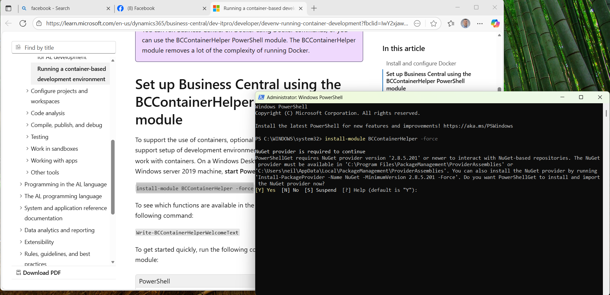
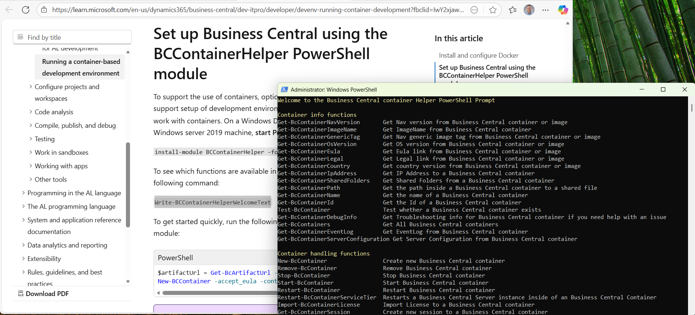
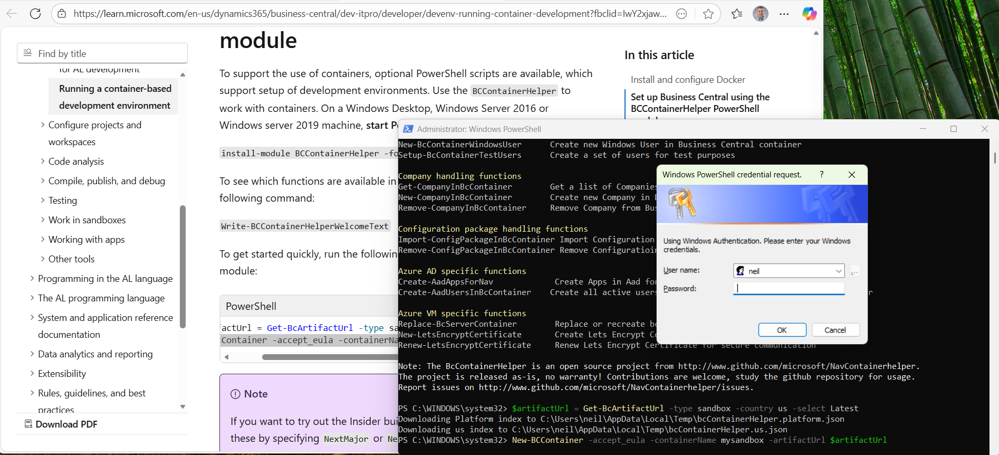
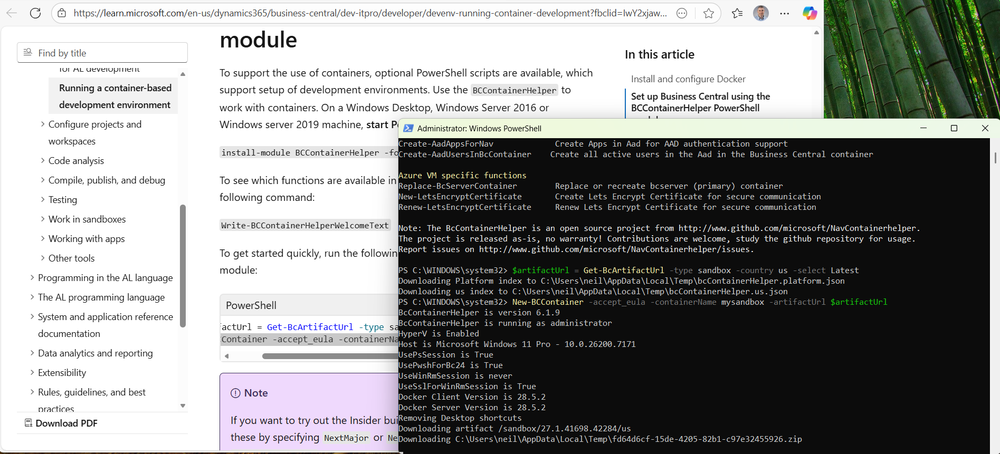
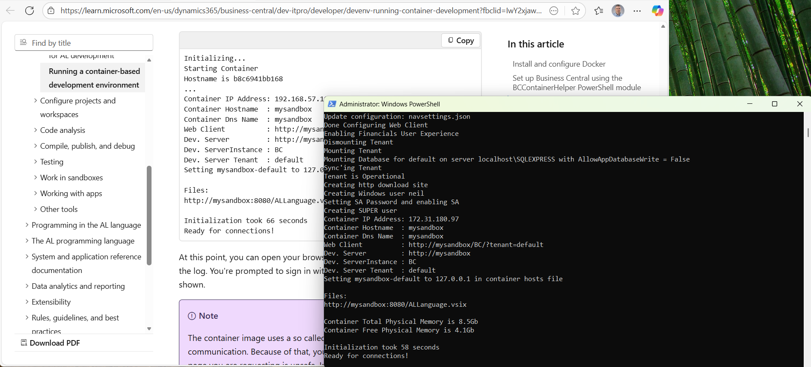
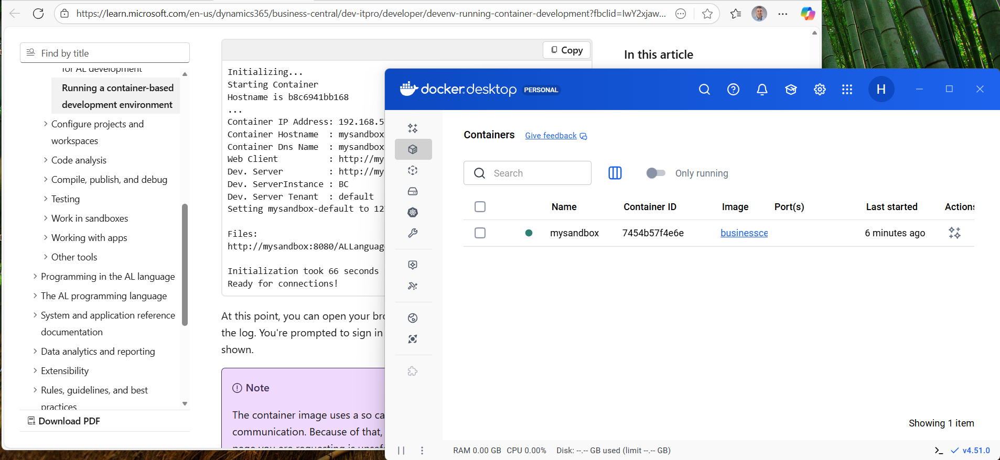
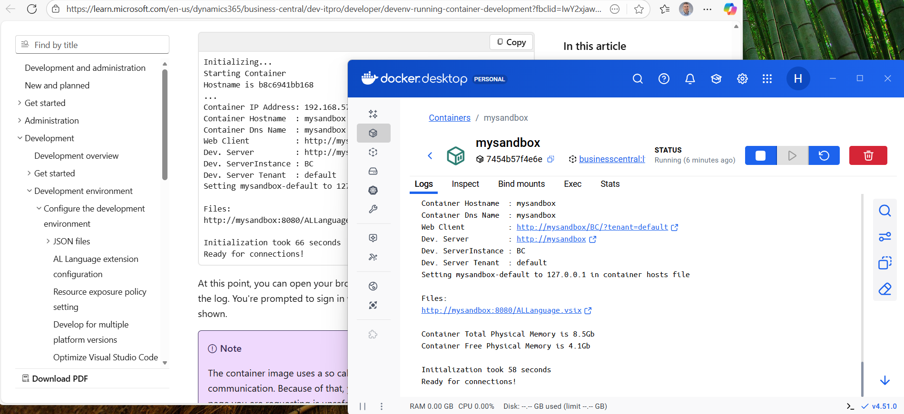
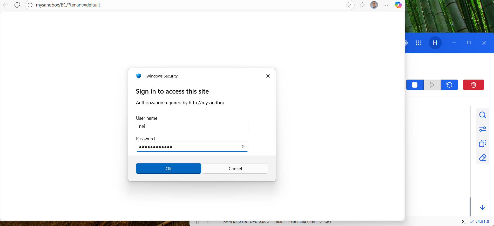
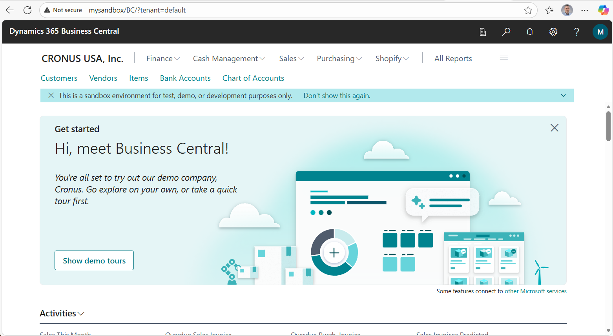
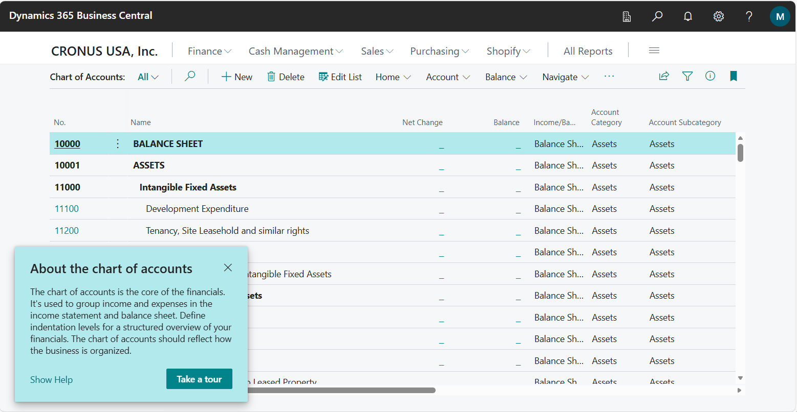

I ran a container-based development environment for Dynamics 365 Business Central using Docker on Windows.

:::brain-power Before you read on
You need your own copy of Business Central for development, one that you can create and throw away. What would you want it to contain, and how fast would you want to get it?
:::

```powershell
Set-ExecutionPolicy -ExecutionPolicy RemoteSigned -Scope CurrentUser
install-module BCContainerHelper -force
Write-BCContainerHelperWelcomeText
$artifactUrl = Get-BcArtifactUrl -type sandbox -country us -select Latest
New-BCContainer -accept_eula -containerName mysandbox -artifactUrl $artifactUrl
```


*I ran install-module BCContainerHelper -force*


*I ran Write-BCContainerHelperWelcomeText*


*I ran $artifactUrl = Get-BcArtifactUrl -type sandbox -country us -select Latest*


*I ran New-BCContainer -accept_eula -containerName mysandbox -artifactUrl $artifactUrl*

:::no-dumb-questions
**Q: What is BCContainerHelper?**

A: A PowerShell module that makes it simple to create and manage Business Central containers. I installed it with install-module, and then ran Write-BCContainerHelperWelcomeText to check it.

**Q: What does the artifact URL select?**

A: Get-BcArtifactUrl chooses which Business Central build to use. With -type sandbox -country us -select Latest, I asked for the latest sandbox build for the United States.

**Q: Why does the address end with a container name?**

A: The container is called mysandbox, so I opened it at http://mysandbox/BC/?tenant=default. The name that I gave New-BCContainer became the host name.
:::

:::watch-it The command accepts the licence agreement for you
The -accept_eula option on New-BCContainer agrees to the end-user licence agreement on your behalf. Read the agreement before you add the option to your own scripts.
:::


*The container was ready for connections*


*I reviewed Docker Desktop*


*I reviewed the logs*


*I navigated to http://mysandbox/BC/?tenant=default*


*I reviewed the CRONUS USA, Inc. company*


*I reviewed the Chart of Accounts*

:::test-drive Try it yourself
1. Install BCContainerHelper, and look up the latest sandbox artifact URL.
2. Create a container with New-BCContainer, and wait until it is ready for connections.
3. Open it in a browser, and look at the CRONUS USA, Inc. company and its Chart of Accounts.
:::

:::bullet-points Recap
- BCContainerHelper creates Business Central containers with a few PowerShell commands.
- Get-BcArtifactUrl chooses the build, and New-BCContainer creates the container.
- The container's name became the address that I opened in the browser.
- The container held the CRONUS USA, Inc. demonstration company.
:::

## References

- [Running a container-based development environment](https://learn.microsoft.com/en-us/dynamics365/business-central/dev-itpro/developer/devenv-running-container-development)
