# My First Lakehouse in Microsoft Fabric: Load a CSV, Query It with SQL, Chart It in a Notebook

In this post I follow one file through Microsoft Fabric. I put it in a Lakehouse, turned it into a table, and queried that same table two ways: with SQL and with Python.

I used a small file of 200 sales orders from January to June 2026. I generated it myself, and you can [download sales.csv](/assets/images/fabriclakehouse/sales.csv) to follow along.

## Start a workspace on a Fabric trial

I opened the Fabric home page and signed in.

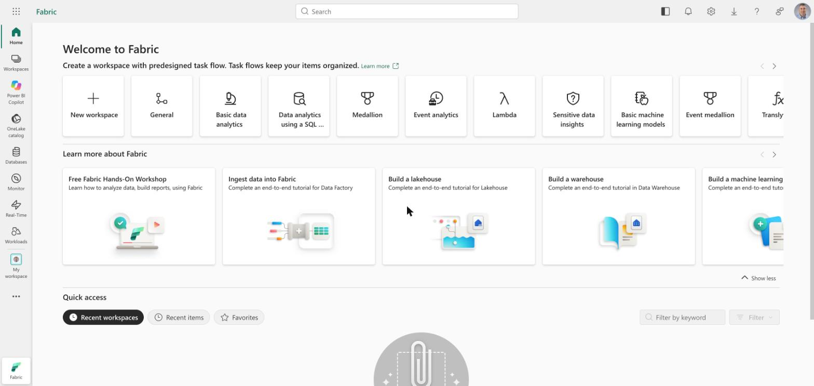
*The Fabric home page*

My tenant had no Fabric capacity at first, so the **Fabric** workspace type was greyed out when I tried to create a workspace. I started the 60-day Fabric trial from my profile menu. After that, the header read "Trial activated: 66 days left", and a new workspace type called **Fabric Trial** appeared.

I clicked **New workspace** and named it `Sales Lakehouse Tutorial`.

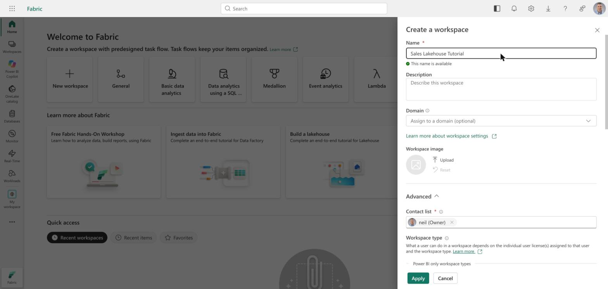
*I named the workspace*

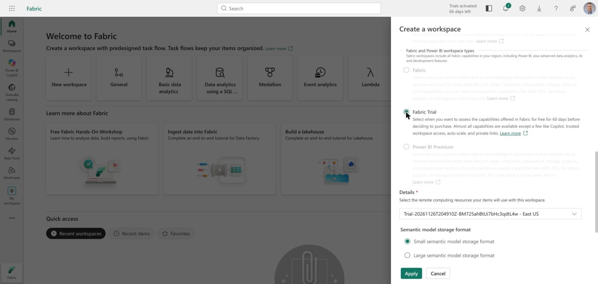
*I chose Fabric Trial as the workspace type*

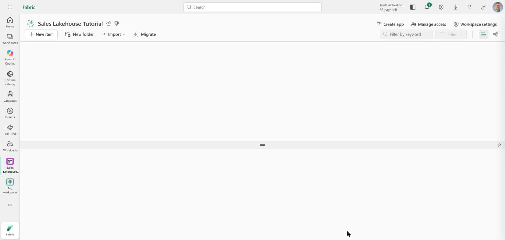
*The new workspace was empty*

## Create the Lakehouse

In the workspace I clicked **New item**, typed `Lakehouse` into the filter box, and chose **Lakehouse**.

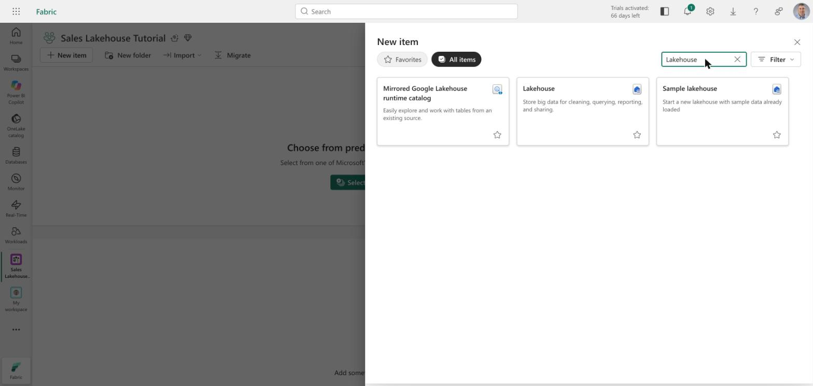
*I filtered the item list for Lakehouse*

I named it `SalesLakehouse` and left **Lakehouse schemas** ticked, so my tables would go into a `dbo` schema.

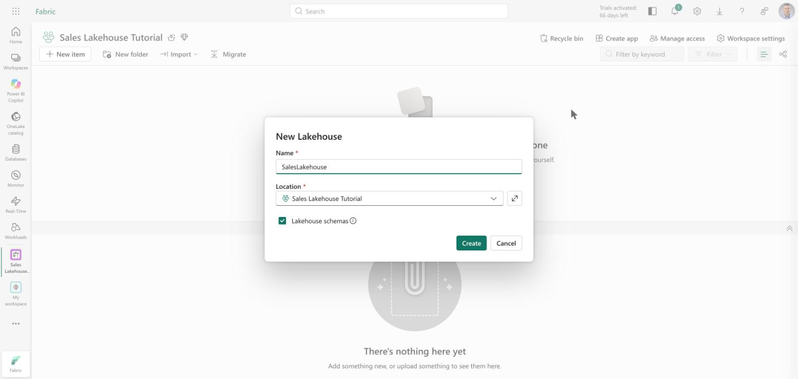
*I named the Lakehouse*

Fabric created the Lakehouse and, at the same time, a SQL analytics endpoint for it. The Explorer shows two areas: **Tables** for Delta tables and **Files** for anything else.

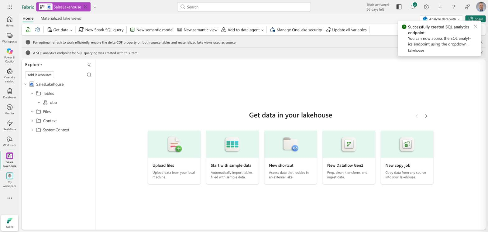
*The empty Lakehouse, with Tables and Files*

## Upload the CSV

I clicked **Upload files**, chose `sales.csv`, and clicked **Upload**. The file landed in **Files**, because a CSV is a file, not a table yet.

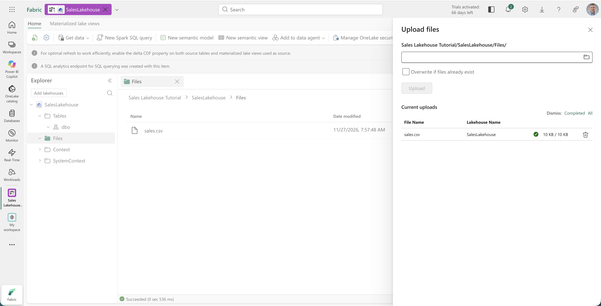
*The upload finished: sales.csv, 10 KB*

## Turn the file into a Delta table

I right-clicked `sales.csv`, chose **Load to Tables**, and then **New table**.

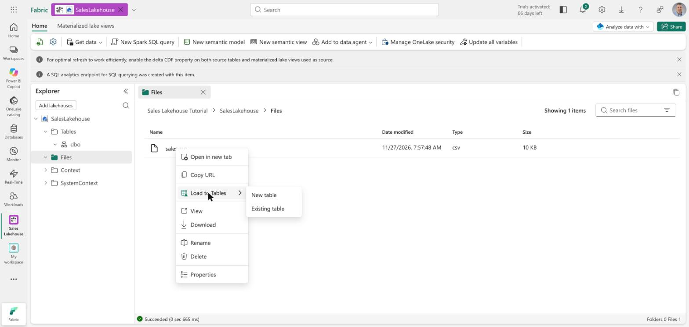
*I chose Load to Tables, then New table*

The defaults were what I wanted: schema `dbo`, table name `sales`, and the first row used as column names. I clicked **Load**.

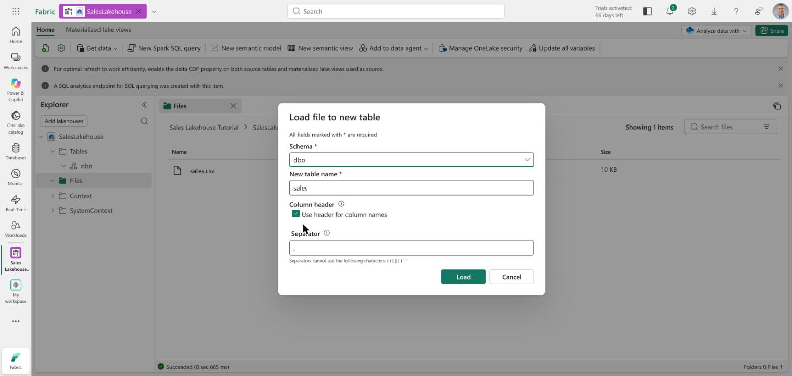
*The Load file to new table dialog*

A few moments later the `sales` table appeared under `dbo`. The data preview showed all 200 rows and 8 columns, and Fabric had worked out the types: `OrderDate` is a date, and the quantities and prices are numbers.

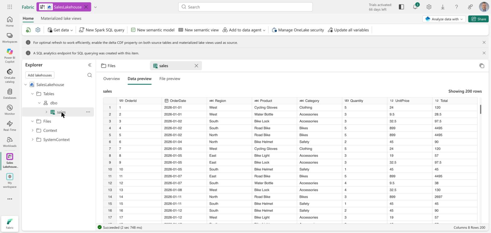
*The sales table: 200 rows, 8 columns*

:::no-dumb-questions What is a Delta table?
**Q: What did Load to Tables create?**
A: A Delta table. It is a folder in OneLake that holds the data as Parquet files, plus a transaction log that records every change made to the table. Together they behave like a database table, but they are ordinary files in an open format. Delta is Parquet plus that log, so a folder of Parquet files on its own is not a Delta table.

**Q: Why Parquet?**
A: Parquet stores each column together, not each row. That lets the data compress well, and it lets an engine read only the columns a query needs, so a query for revenue by category does not read the order dates. Each file also carries its own column names and types, with the smallest and largest value in each block, so an engine can skip blocks that cannot match the query. The trade-off is that a Parquet file is not edited in place. An update writes new files, and the transaction log records which files make up the current table.

**Q: Is Parquet a Databricks thing?**
A: No. Parquet is an open-source Apache project. Delta Lake, which adds the transaction log, began at Databricks and is also open source. Fabric uses both as open formats.

**Q: Why does that matter?**
A: The log lets a table be updated and deleted reliably, keeps a history of its versions, and rejects rows that do not fit its columns. Because the format is open, every Fabric engine reads the same table: the SQL analytics endpoint, a Spark notebook and Power BI. I loaded the data once and use it in both ways below.

**Q: What is different about the CSV in Files?**
A: It is only a file. Nothing records its column types or its history, so each tool has to guess. That is why I loaded it into a table first.
:::

## Query it with SQL

From **Analyze data with**, I chose **SQL analytics endpoint**.

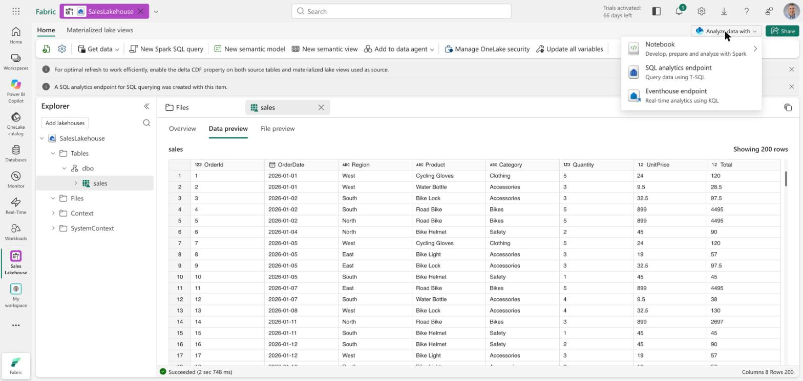
*The Analyze data with menu*

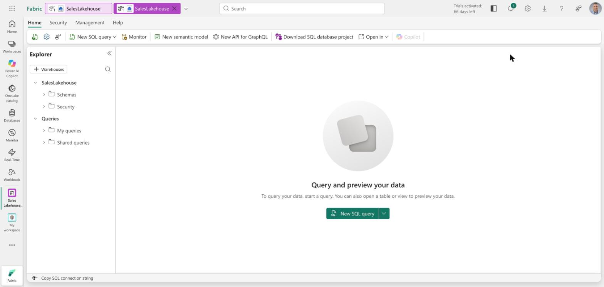
*The SQL analytics endpoint, ready for a query*

I clicked **New SQL query** and ran this:

```sql
SELECT Category, COUNT(*) AS Orders, SUM(Total) AS Revenue
FROM dbo.sales
GROUP BY Category
ORDER BY Revenue DESC;
```

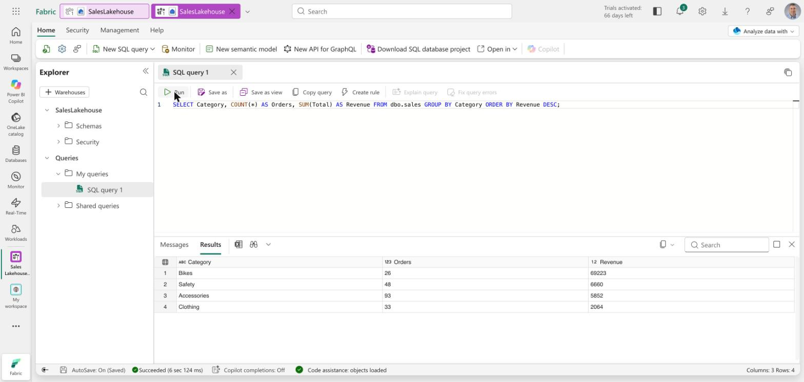
*Bikes brought in far more revenue than the other three categories*

| Category | Orders | Revenue |
|---|---|---|
| Bikes | 26 | 69,223 |
| Safety | 48 | 6,660 |
| Accessories | 93 | 5,852 |
| Clothing | 33 | 2,064 |

I checked these figures against the CSV with a short Python script on my Mac, and they matched exactly.

## Chart it in a notebook

I went back to the Lakehouse and chose **Analyze data with**, then **Notebook**, then **New notebook**. The notebook opened with `SalesLakehouse` already attached.

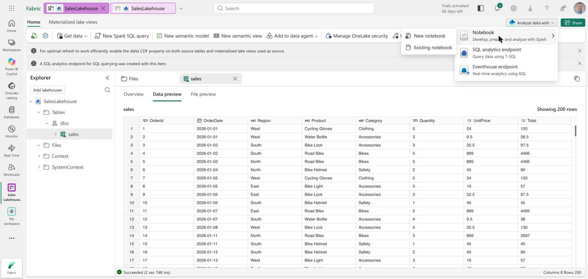
*I created a new notebook from the Lakehouse*

I replaced the placeholder comments with this PySpark code, which reads the same `dbo.sales` table, adds a month column, and draws stacked bars:

```python
import matplotlib.pyplot as plt
from pyspark.sql import functions as F
df = spark.read.table("dbo.sales").withColumn("Month", F.date_format("OrderDate", "yyyy-MM"))
pdf = df.groupBy("Month", "Category").agg(F.sum("Total").alias("Revenue")).toPandas()
pivot = pdf.pivot(index="Month", columns="Category", values="Revenue").fillna(0).sort_index()
pivot.plot(kind="bar", stacked=True, figsize=(9, 5), title="Monthly revenue by category")
plt.ylabel("Revenue")
plt.tight_layout()
plt.show()
```

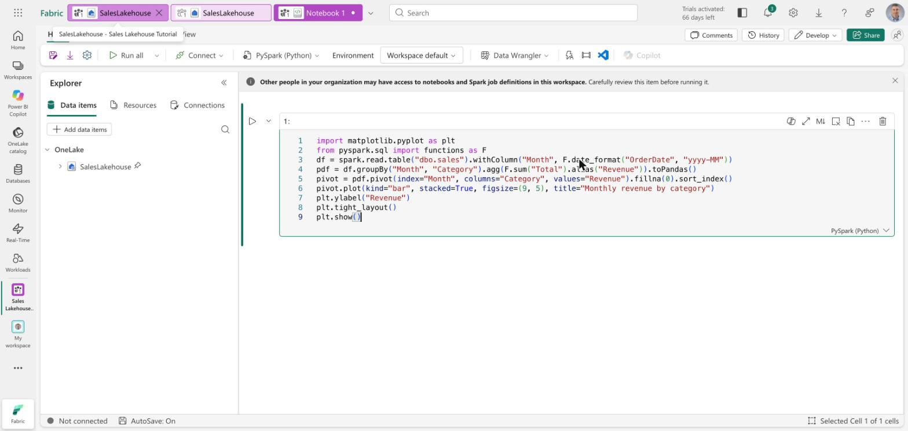
*The code in the first cell*

:::watch-it The first run failed
I clicked **Run cell** and got this error instead of a chart:

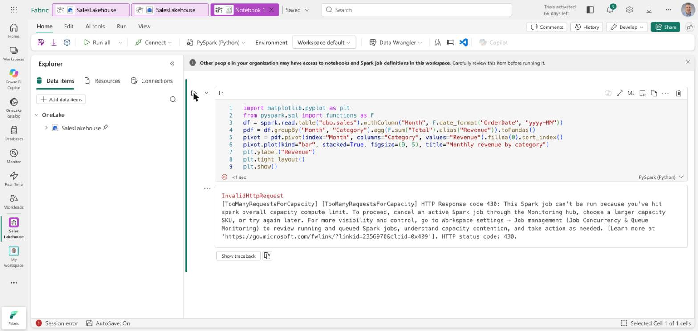
*TooManyRequestsForCapacity: the Spark job could not start*

I tried again after about a minute and got the same error. The message suggested looking at the Monitoring hub, so I opened **Monitor**. One activity was still **In progress**: the Lakehouse operation from my Load to Tables step. The table had loaded, but that Spark session had not ended.

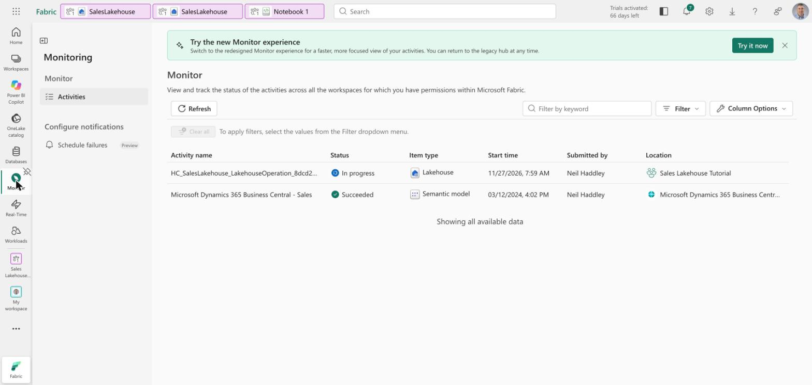
*The Load to Tables job was still in progress*

I stopped that session with the cancel icon and confirmed. I then ran the cell again, and the Spark session started in 6 seconds. I did not prove that the leftover session was the cause, but stopping it was the only thing I changed.
:::

The chart appeared under the cell. Bikes dominate every month, and the revenue falls from January to April, rises in May, and falls again in June.

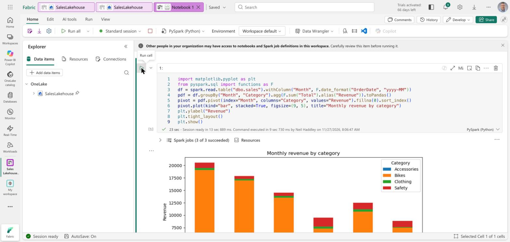
*Monthly revenue by category, drawn from the same table that the SQL query used*

## Where the old SQL Server tools went

I came to Fabric knowing SSAS, SSIS and SSRS, so I looked up where each one lives now. I read the Microsoft Learn pages for this. I did not try any of the three below.

:::no-dumb-questions Where is SSAS, SSIS, SSRS and Power BI in all this?
**Q: Where is SSAS?**
A: It is the semantic model. The Analysis Services engine (VertiPaq and DAX) runs inside Power BI and Fabric, so a Fabric semantic model is SSAS Tabular in the cloud. Azure Analysis Services was the standalone cloud version, and Microsoft publishes a guide for moving from it to Power BI. Multidimensional models (cubes and MDX) are not supported there. A semantic model can also use Direct Lake mode, which reads the Delta files in OneLake without importing them first. SSAS never did that. In this post I queried the table directly, so I skipped the semantic model. It is where a measure such as revenue would be defined once for every report.

**Q: Where is SSIS?**
A: In Data Factory in Fabric (pipelines) and in Spark notebooks. The Load to Tables step I used is the smallest example of it. For existing packages, Fabric has an Invoke SSIS Package activity that runs `.dtsx` files stored in OneLake. It is in preview.

**Q: Where is SSRS, and where is Power BI?**
A: Both are in Power BI. Power BI reports are the interactive ones. Paginated reports are the SSRS `.rdl` format, built for printing and PDF. Microsoft provides a tool that publishes `.rdl` reports from SSRS 2012 to 2022 into a Power BI workspace, with some features unsupported, such as custom code DLLs. I built no reports in this post.

**Q: So is Fabric one platform that replaces SQL Server?**
A: No. Fabric puts several analytics engines on one shared storage format with one bill. It reduces the plumbing between those engines. It does not reduce the number of systems you run. SQL Server and Dataverse still hold the data that applications write, and Fabric holds a copy of it. Part 2 measures that copy.
:::

:::no-dumb-questions What has Fabric to do with AI?
**Q: Is Fabric an AI product?**
A: Mostly it is where the data sits. The AI link comes in three ways, and I used only the first.
- **Same table, more tools.** A notebook reads the same Delta table as the SQL query, so Python machine-learning code can read it too. I used PySpark for a chart, not for a model.
- **Assistants on top.** Copilot and the Data Agent let people ask questions of the data in plain language. Copilot was not available on my trial, and I did not try a data agent.
- **Fabric IQ (preview).** It stores business definitions, such as what a Customer is and how it relates to an Order, mapped onto the tables, so that an agent reads definitions and not only column names.

**Q: What does Fabric not do?**
A: It does not make the data right. In Part 2 a form insert saved with blank product names, and deleted rows stayed in the lake as blank marker rows. An AI that asks questions of that table would count them.

**Q: Why are people excited about it?**
A: The pitch is that AI agents need governed, current data in one place. How current depends on the copies. In Part 2 a change took from a few seconds to 18 minutes to arrive.
:::

:::bullet-points What I learned
- A Lakehouse keeps **Files** and **Tables** apart. Loading a CSV to a table turns it into a Delta table.
- The SQL analytics endpoint and the notebook read the same table. I loaded the data once and used it two ways.
- The trial capacity is limited. If a notebook cannot start a Spark session, check the **Monitor** hub for sessions that are still running.
:::

## References

- [Microsoft Fabric](https://app.fabric.microsoft.com/home?experience=fabric-developer)
- [Lakehouse overview in Microsoft Fabric (Microsoft Learn)](https://learn.microsoft.com/en-us/fabric/data-engineering/lakehouse-overview)
- [Delta Lake tables in Microsoft Fabric (Microsoft Learn)](https://learn.microsoft.com/fabric/fundamentals/delta-lake-overview)
